# 🐍 Polars与Python数据分析：第20课：Python列表

在本节课中，我们将要学习 Python 中的列表对象。列表是后面处理数据、保存多个值、维护顺序时非常基础的一种容器。我们会从列表的定义讲起，理解什么是可变、什么是有序集合、什么是元素，然后动手创建空列表和各种列表，接着学习 `len`、`type`、`append`、`pop` 以及 `in` 和 `not in` 的用法。上一课我们接触了字符串，本节中我们来看看列表与字符串在可变性上的区别，并一步步建立对列表的直观认识。列表看起来简单，但它是理解后续索引位置、数据集合和数据分析操作的重要起点。

## 📦 Polars与Python数据分析：第20课：列表的定义与可变性

上一节我们介绍了字符串等单个值对象，本节中我们来看看列表的基本定义。接下来要介绍的 Python 对象是列表。从技术上说，列表可以定义为一个可变数据结构，用来保存有序的值集合。这个定义里有几个关键词需要逐一理解，否则后面写代码时容易混淆。我们先把定义写成代码形式，方便直观看到列表长什么样。

```python
列表 = [元素1, 元素2, ..., 元素n]
```

先看“可变”这个词。列表是可变的，这一点与上一课看到的字符串不同。每次对字符串调用方法时，我们并没有修改已有的字符串值，而是让方法在程序里返回一个新的字符串。相比之下，对列表调用方法时，这些方法会修改、改变或调整已有的列表对象，而不是创建一个全新的列表对象。也就是说，字符串方法通常给你一个新结果，列表方法通常直接在原列表上动手。可以用下面的代码对比这种差异。

```python
# 字符串方法通常返回新字符串
new_text = text.upper()

# 列表方法通常修改原列表
items.append("新元素")
```

接下来看“有序的值集合”这个说法。我们可以把列表看成一个容器，它允许我们保存多个值，而且不只是保存多个值，还要按顺序保存多个值。此前接触过的数据类型，例如字符串、数字、布尔值，都表示单个值。整数表示一个数字，字符串表示一段文本。列表是我们第一次接触到的、可以在自身内部保存多个值的对象。现实中有很多想法需要用 Python 建模，而这些想法需要“多个值”或“多个有序值”的概念。例如，如果要表示或建模超市里排队的人群，就需要某种容器来表示多个条目、多个排队的人；再比如要建模咖啡店里所有可选的菜单项，这些也是值的集合，不只是一个条目。集合可能只有一个条目，也可能有五个或一百个条目，因此需要某种数据结构或对象来保存它们，并且可能按指定顺序保存。这个更大的列表中的一个条目、一项或一个值，技术术语叫作“元素”。

## 🧱 Polars与Python数据分析：第20课：创建列表与空列表

上一节我们理解了列表是可变的、有序的多值容器，本节中我们来看看怎样在 Python 里创建一个列表。创建列表对象需要一对开方括号和闭方括号，也就是键盘上字母 P 右边的两个符号。下面这个写法就是一个 Python 列表，而且它是一个有效列表。

```python
[]
```

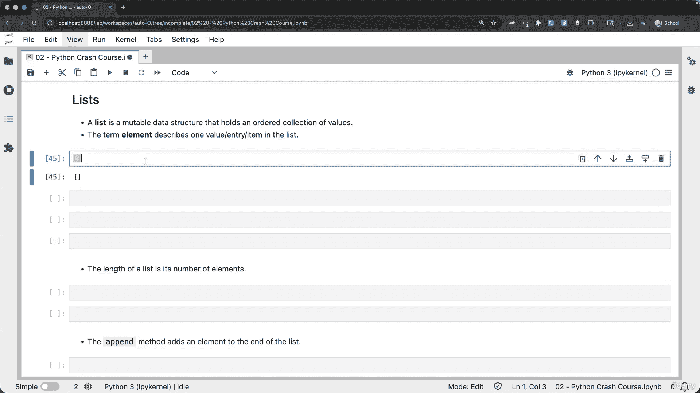

请记住，列表是用于按顺序保存值的容器，但它并不强制要求真的保存任何值。就像字符串可以是空字符串一样，空字符串仍然是一段文本，只是保存了零个字符。从技术上说，也可以有一个不包含任何元素或条目的列表。仅仅写出开方括号和闭方括号，就已经创建了一个列表。下面我们看看怎样往列表里填充元素：把元素写出来，并且每两个元素之间用逗号和空格分隔。逗号是技术上的要求，空格只是为了可读性。例如，下面可以提供一个值 `4`。

```python
[4]
```

这样我们就有了一个保存一个元素的列表，这个元素是 `4`。可以把列表看成一个容器或盒子，它按顺序保存着值 `4`。如果想再往列表里加一个元素，仍然提供逗号和空格，然后写下一位元素。假设下一个要保存的数字是 `8`，写法如下。

```python
[4, 8]
```

继续这个例子，再给列表增加几个条目。每增加一个新数字，都加一个逗号和空格，然后加入 `15`、`16`、`23` 和 `42`。执行后可以看到，我们得到了一个包含六个数字的列表。

```python
[4, 8, 15, 16, 23, 42]
```

这里要再次强调，这个列表不仅是六个数字的容器，而且这六个数字是按顺序保存的。最先声明的数字，就是 Python 认为排在第一位的数字。`4` 在 `8` 前面，`8` 在 `15` 前面，依此类推。这个例子是整数列表，但列表其实可以在自身内部保存其他有效的 Python 对象。下面我们来看几个不同元素类型的列表例子，先看布尔值列表。

```python
[True, False, True, True, False]
```

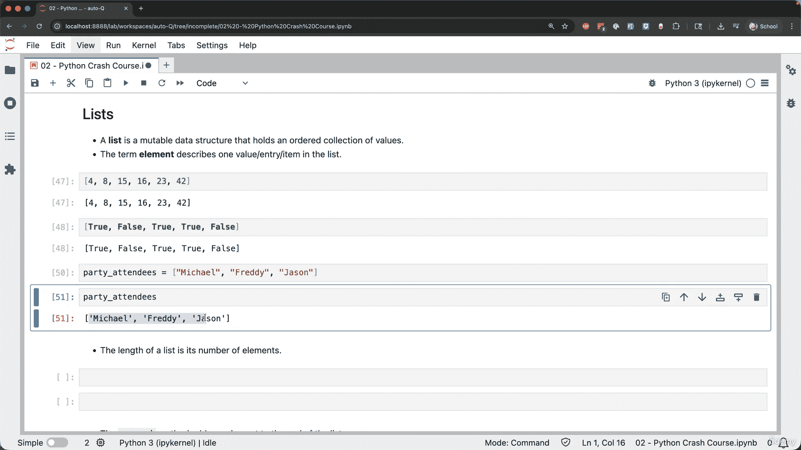

这个布尔值列表同样使用一对开方括号和闭方括号，里面依次写入了 `True`、`False`、`True`、`True` 和 `False`。现在我们就有了一个包含五个元素的列表，也就是五个按顺序保存的布尔值。接着看一个字符串列表的例子：声明另一个列表，使用一对开方括号，然后放入字符串 `"Michael"`、`"Freddie"` 和 `"Jason"`。

```python
["Michael", "Freddie", "Jason"]
```

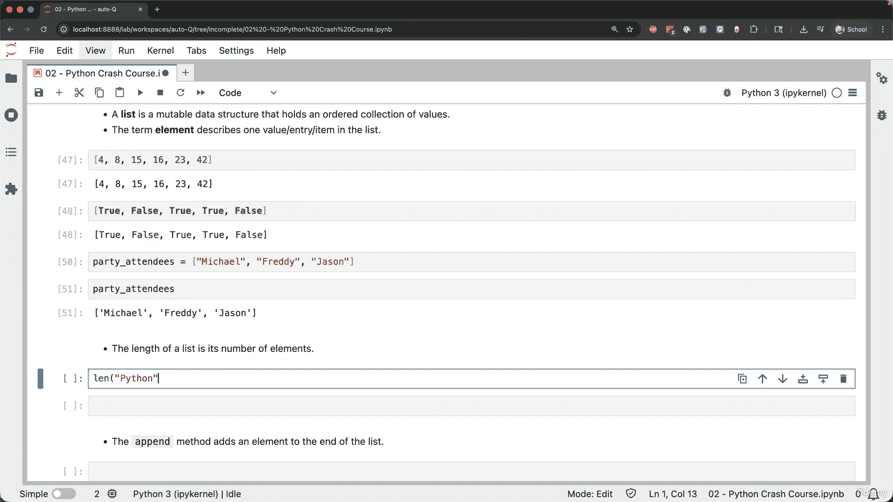

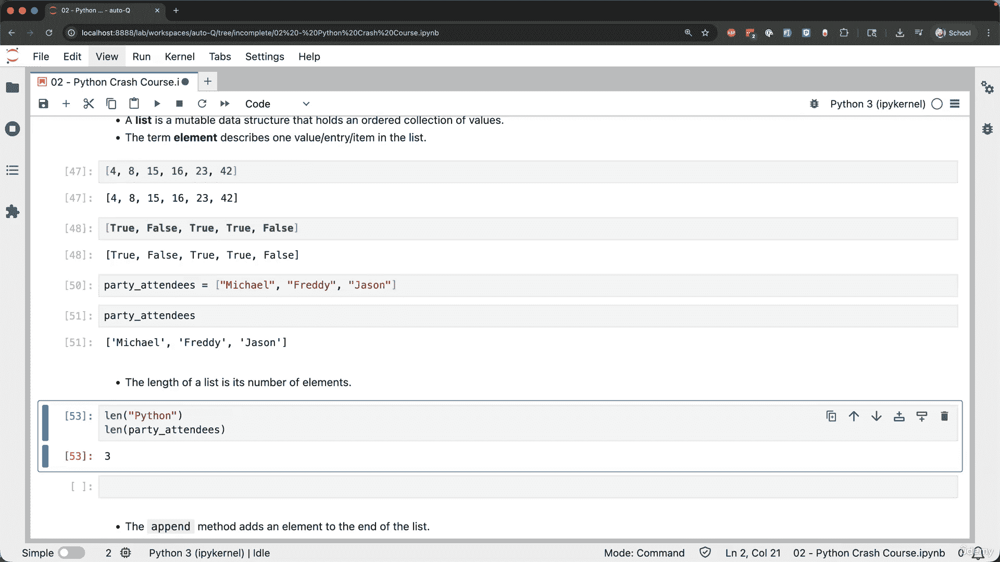

这是一个包含三个字符串的列表，这些字符串也是按顺序保存的。Michael 在 Freddie 前面，Freddie 在 Jason 前面。和其他 Python 对象一样，可以把整个列表、整个集合赋值给一个变量。例如，可以把上面这个列表赋值给变量 `party_attendees`。

```python
party_attendees = ["Michael", "Freddie", "Jason"]
```

执行单元格后，可以打印 `party_attendees`。这个变量仍然是一个替身，但它现在代表的是一个列表，而列表是一种集合类型。这个结构、这个对象是一个容器，它在自身内部保存多个字符串。通过变量名来引用列表，是后面操作列表时最常用的方式。

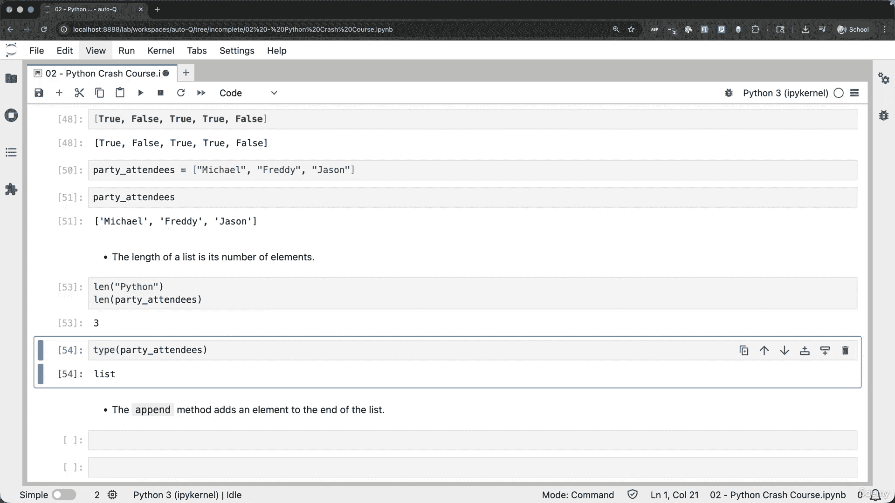

## 🔢 Polars与Python数据分析：第20课：len函数与type函数

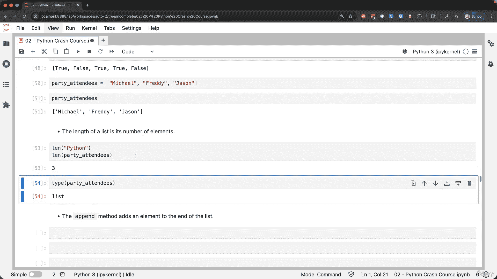

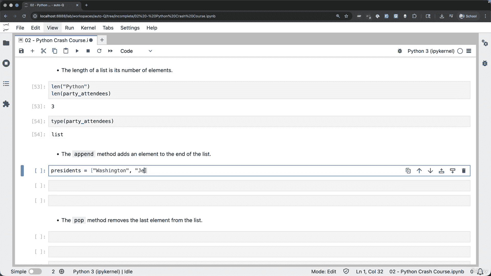

上一节我们创建了整数、布尔值和字符串列表，本节中我们来看看怎样获取列表的长度和类型。前面已经介绍过 `len` 函数，并且练习过传入字符串 `"Python"`，它返回字符串按字符计算的长度。事实证明，`len` 函数非常灵活，它也可以接受列表作为参数。例如，可以把 `party_attendees` 列表传给 `len`，它会告诉我们列表中条目总数，等价地说，就是列表中元素总数。`party_attendees` 里一共有三个字符串，所以长度是 `3`。长度关系可以用下面的代码表示。

```python
len(party_attendees)  # 3
```

同样，前面也介绍过 `type` 函数，它接受任何有效的 Python 对象，并告诉你这个对象是什么种类。更技术地说，它会告诉你对象由哪个类创建，关于类后面会讨论。这里先展示例子：把 `party_attendees` 传给 `type`，它会告诉我们这是一个 Python 列表。列表是一个独立的、与字符串或数字不同的对象。类型检查可以写成下面这样。

```python
type(party_attendees)  # <class 'list'>
```

## ✏️ Polars与Python数据分析：第20课：append方法与同质列表

上一节我们确认了列表可以通过 `len` 和 `type` 来观察，本节中我们来看看怎样修改列表。前面谈过可变性这个概念：每当对列表调用方法时，方法实际上会改变底层列表，而不是创建一个新列表。下面演示这个例子。先创建一个新列表，把它赋值给 `presidents` 变量。这个列表按顺序保存两个字符串：`"Washington"` 和 `"Jefferson"`。

```python
presidents = ["Washington", "Jefferson"]
```

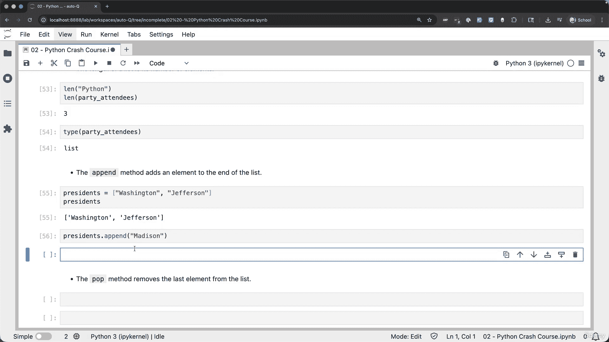

然后在单元格下方输出 `presidents` 列表。接着对列表调用一个方法，语法与对其他对象调用方法完全一样。和往常一样，先写出变量，然后写一个点，再写方法名。如果按下 Tab 键，会看到列表上可用的许多方法。这个方法和字符串上的方法完全不同，因为它们是不同的值，是不同类型的对象，通过方法支持不同类型的操作和功能。列表上的一个典型方法是 `append`，它把元素加到列表末尾。下面把两元素列表修改为在末尾添加第三个元素，相当于把新元素加到队伍末尾。这个方法的参数就是想要添加的内容，这里传入另一个字符串 `"Madison"`。

```python
presidents.append("Madison")
```

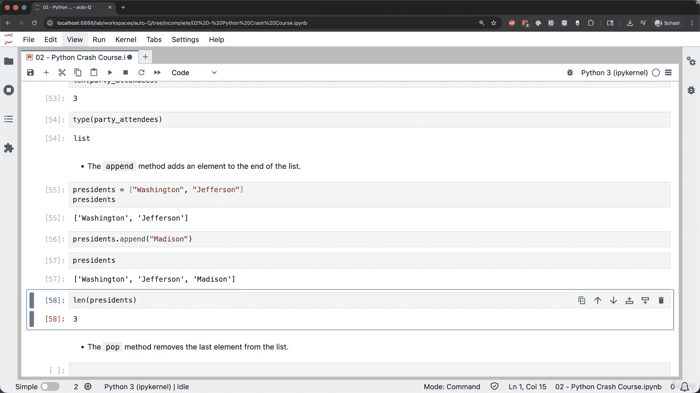

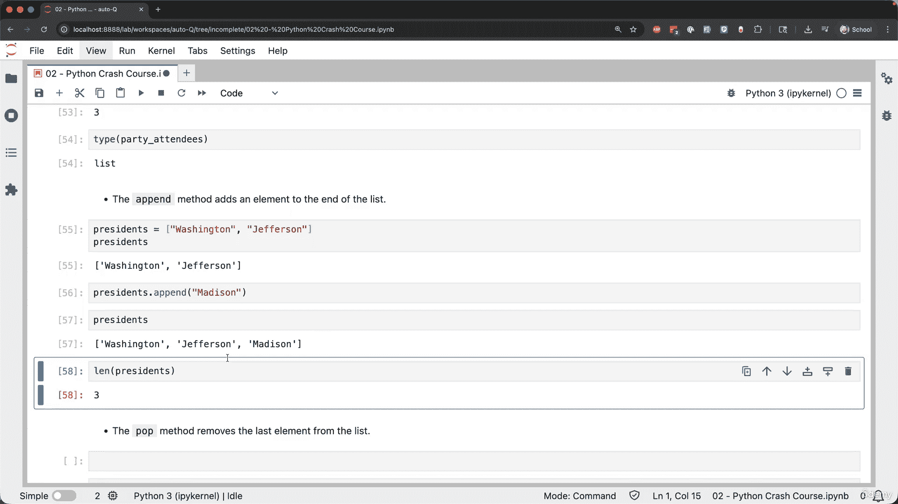

这里需要指出，列表中的元素从技术上说不必是同一类型，但在现实世界里，它们通常是同一类型，因为列表通常用来建模某种一致想法或一致值的有序容器。这个例子里，我们是在按顺序建模总统列表，所以里面放布尔值或数字并不合理。技术上确实可以在列表里混放类型，偶尔也会见到，但通常列表是同质的。同质的意思是，列表保存的是相同且一致数据类型的元素。现在调用 `append` 方法，表面上没有发生什么，因为 `append` 方法从技术上说没有返回值，但这个方法已经突变或改变了底层列表。如果之后输出 `presidents`，会看到字符串 `"Madison"` 被添加或追加到了列表末尾。列表现在的长度是 `3`。例如，可以把 `presidents` 传给 `len` 函数，可以看到长度从 `2` 变成了 `3`。这个过程可以用下面的代码概括。

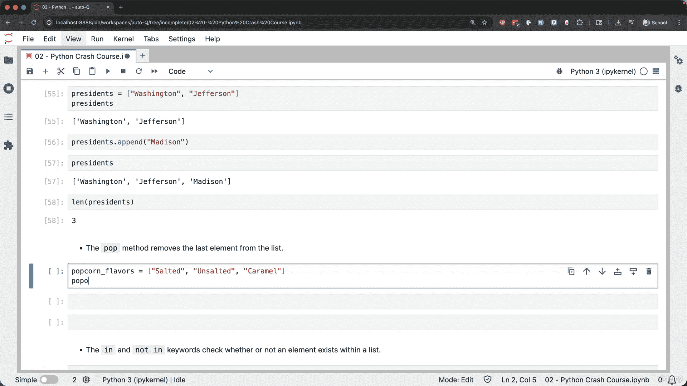

```python
presidents = ["Washington", "Jefferson"]
presidents.append("Madison")
len(presidents)  # 3
```

## 🗑️ Polars与Python数据分析：第20课：pop方法删除末尾元素

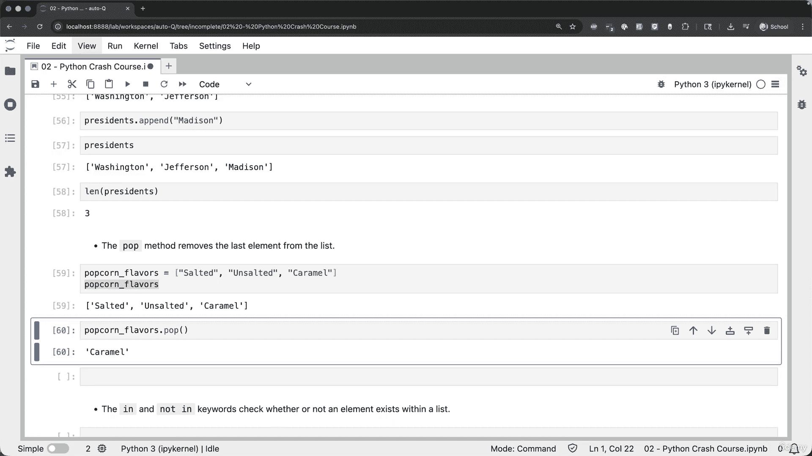

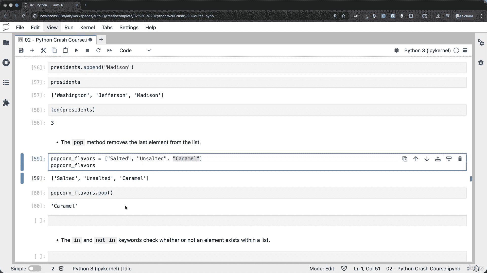

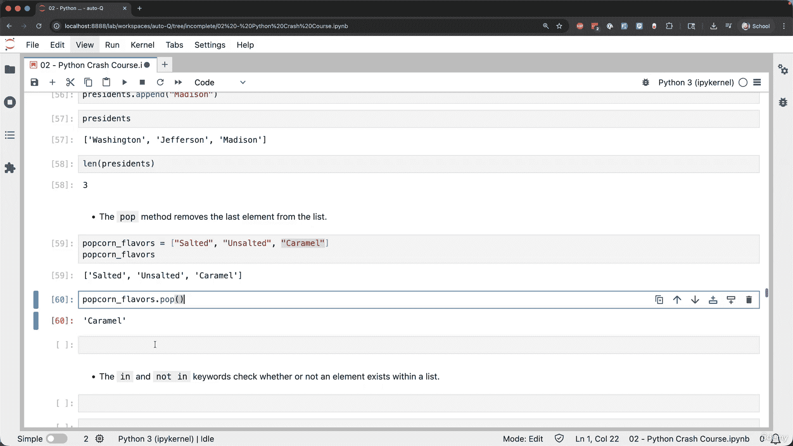

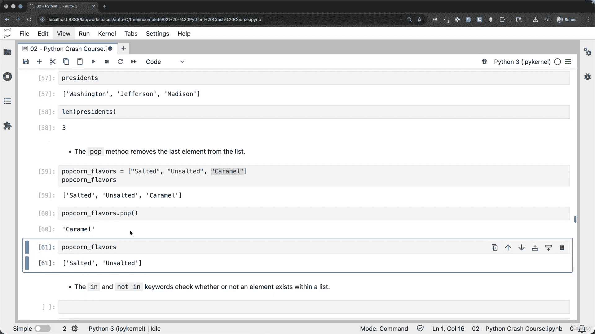

上一节我们使用 `append` 在列表末尾添加元素，本节中我们来看看与之互补的方法：从列表删除最后一个元素。这个方法叫 `pop`。下面声明一个新列表，把它叫作 `popcorn_flavors`。给这个列表提供三个字符串：`"salted"`、`"unsalted"` 和 `"caramel"`，分别表示咸味、无盐和焦糖。然后在单元格下方预览 `popcorn_flavors` 的样子。

```python
popcorn_flavors = ["salted", "unsalted", "caramel"]
```

原理相同：访问引用列表的变量名，放一个点，然后写方法名，这里的方法名是 `pop`。`pop` 会实际返回被移除的值，但它也是突变方法的一个例子，因为它会从列表中删除最后一个元素。如果希望保留被删除的值，可以把返回值保存到一个变量里。同时也要注意，`popcorn_flavors` 列表已经被突变，现在只剩两个元素，因为 `pop` 方法删除了第三个元素。可以用下面的代码观察 `pop` 的返回值和列表变化。

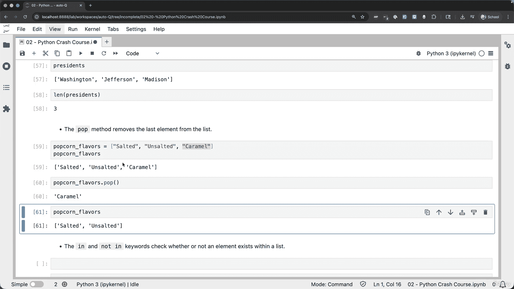

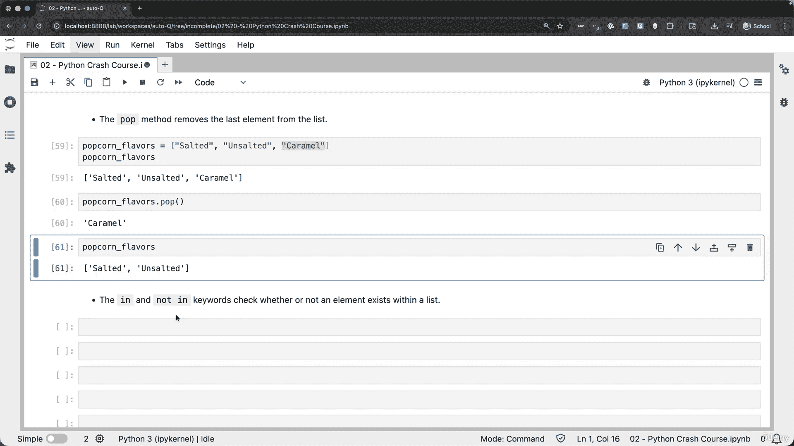

```python
removed_flavor = popcorn_flavors.pop()
print(removed_flavor)       # caramel
print(popcorn_flavors)      # ['salted', 'unsalted']
```

## 🔎 Polars与Python数据分析：第20课：in与not in关键字

上一节我们学习了 `append` 和 `pop` 这两个会修改列表的方法，本节中我们来看看怎样检查一个值是否在列表里。最后要展示的是 `in` 和 `not in` 关键字的使用，前面在搜索较大字符串中是否包含子字符串时已经见过它们。Python 语言的一个优点是比较一致，因此可以在不同数据类型上使用完全相同的关键字。例如，再声明一个列表，做一个行星列表。这里声明 `planets` 变量，列表照例用一对开方括号，元素按顺序放在里面，用逗号和空格分隔，依次放入 `"Mercury"`、`"Venus"`、`"Earth"` 和 `"Mars"`。然后在下方输出 `planets` 变量的值。

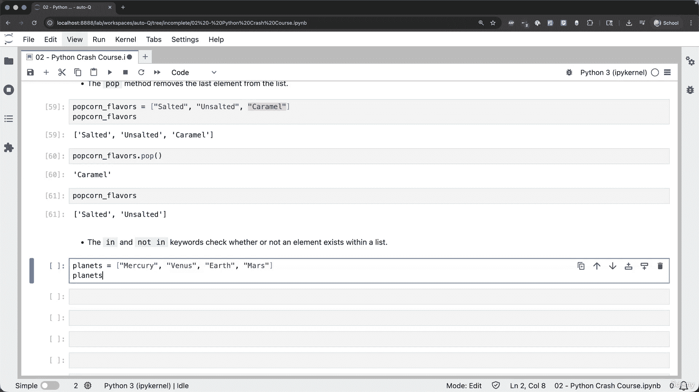

```python
planets = ["Mercury", "Venus", "Earth", "Mars"]
```

这是一个长度为 `4` 的列表，包含四个字符串。`in` 和 `not in` 关键字会按预期工作：把要搜索的内容放在 `in` 关键字左边，把要搜索的那个值所在的容器放在关键字右边。当我们想检查列表包含或不包含某个给定元素时，这很有帮助。例如，可以检查字符串 `"Earth"` 是否出现在 `planets` 列表中的任何位置。这里是搜索内容，这里是 `in` 关键字，右边提供的不再是字符串，而是一个列表。结果会如预期一样返回 `True`，因为这个字符串确实包含在右边这四个字符串组成的序列或集合中。检查方式如下。

```python
"Earth" in planets    # True
```

如果搜索不同的内容，例如 `"Jupiter" in planets`，这个字符串完全不在列表里，所以会得到 `False`。和往常一样，必须小心大小写，因为 Python 确实关心大小写。例如，小写字母 `e` 开头的字符串 `"earth"` 不在 `planets` 中的任何位置，因此 `in` 关键字会返回 `False`。

```python
"Jupiter" in planets  # False
"earth" in planets    # False
```

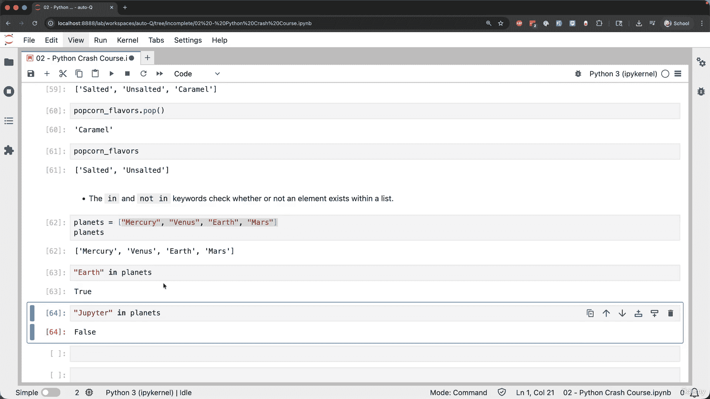

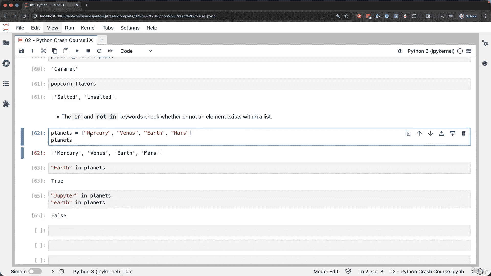

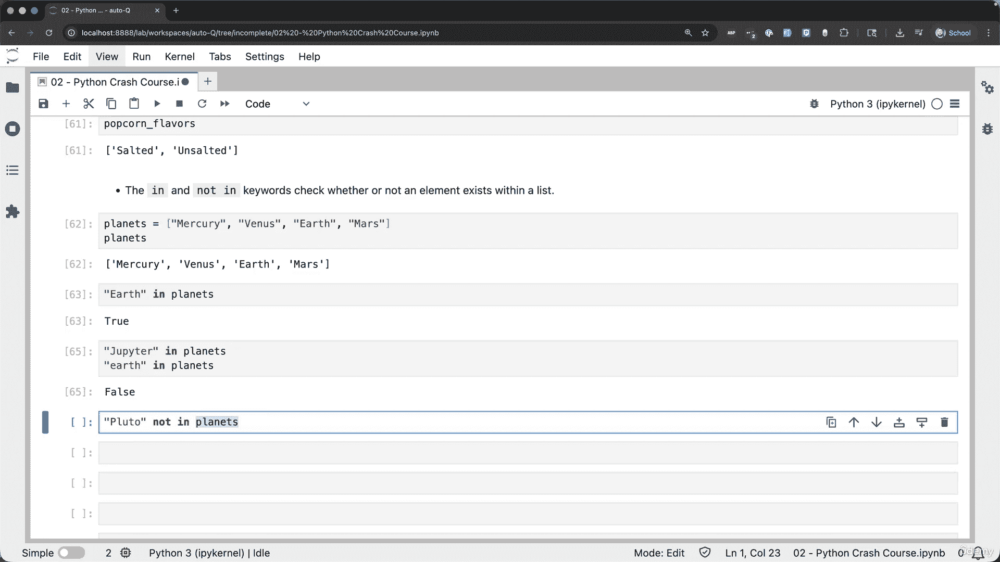

互补的 `not in` 关键字用于检查一个值是否不在列表中，如果不在，就返回 `True`。例如，可以检查字符串 `"Pluto"` 是否不在 `planets` 列表包含的元素中。这里仍然是在搜索内容，但验证的是它不在右边的容器里，`planets` 是一个列表。`"Pluto"` 确实不在 `planets` 中，所以结果是 `True`。再展示相反情况：如果检查 `"Mars"` 是否不在 `planets` 中，因为 `"Mars"` 在 `planets` 里，而且是这里的第四个元素，所以会返回 `False`。`not in` 的用法可以概括如下。

```python
"Pluto" not in planets  # True
"Mars" not in planets   # False
```

## 🧭 Polars与Python数据分析：第20课：本节总结与下一课索引位置

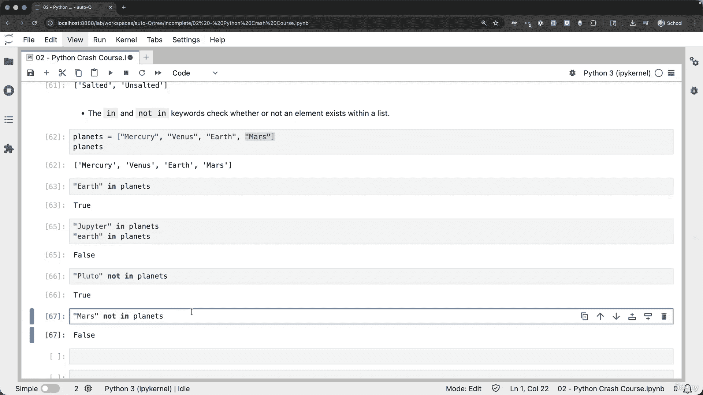

上一节我们通过 `in` 和 `not in` 完成了列表元素检查，本节中我们对整节课做一个收束。以上就是对 Python 列表的介绍。和字符串非常相似，这里重要的不是死记所有方法，因为随时可以查阅 Python 文档来复习这些方法，而且随着练习增多，通常会自然记住它们。更重要的是理解列表的基本价值和用途。现实世界中有一些想法必须建模为有序的值集合，某个东西按顺序保存，一个条目或多个条目按序列保存，而列表就是 Python 中的容器，是让我们在代码中支持这类现实想法的对象。在本节课中我们一起学习了列表的定义、可变性、有序集合、元素、创建空列表和多种列表、赋值给变量、`len` 与 `type`、`append`、`pop` 以及 `in` 和 `not in` 关键字。在下一课中，我们将看看索引位置，它会与列表如何维护元素顺序这件事紧密联系起来。

