# 🐍 Polars与Python数据分析：21：索引位置与切片

在本节课中我们将要学习索引位置和切片这两个非常基础的概念，并看看它们在字符串和列表这两种数据类型中是如何使用的。学完这些内容以后，我们还会把它们和后面要用的Polars联系起来，因为访问表格数据时也会用到类似的思路。索引位置看起来只是一个数字计数，切片看起来只是用冒号取一段内容，但它们其实是后面所有“按位置取值”操作的地基，所以值得慢慢理解。

## 🧭 Polars与Python数据分析：21.1：索引位置的基本概念

上一节我们介绍了字符串和列表这两种数据类型，本节中我们来看看它们共同拥有的一个重要特性：索引位置。如果把这两种对象放在一起比较，会发现它们有很多共同点。列表按顺序存储元素，而字符串也可以看成是按顺序排列的字符序列。Python 用来记录这种顺序的工具，就是索引位置。

索引位置本质上就是一个从前往后递增的数字计数。你可以把它想成现实生活中数汽车：一辆、两辆、三辆、四辆，每个数都比前一个数大 1。Python 里的索引位置也是同样的道理，每个位置对应的数字都比前一个位置大 1。这里有一个非常重要的注意点：Python 从 0 开始计数。也就是说，列表中的第一个元素或者字符串中的第一个字符，索引位置是 0；第二个元素或第二个字符，索引位置是 1；第三个就是 2，后面依次类推。

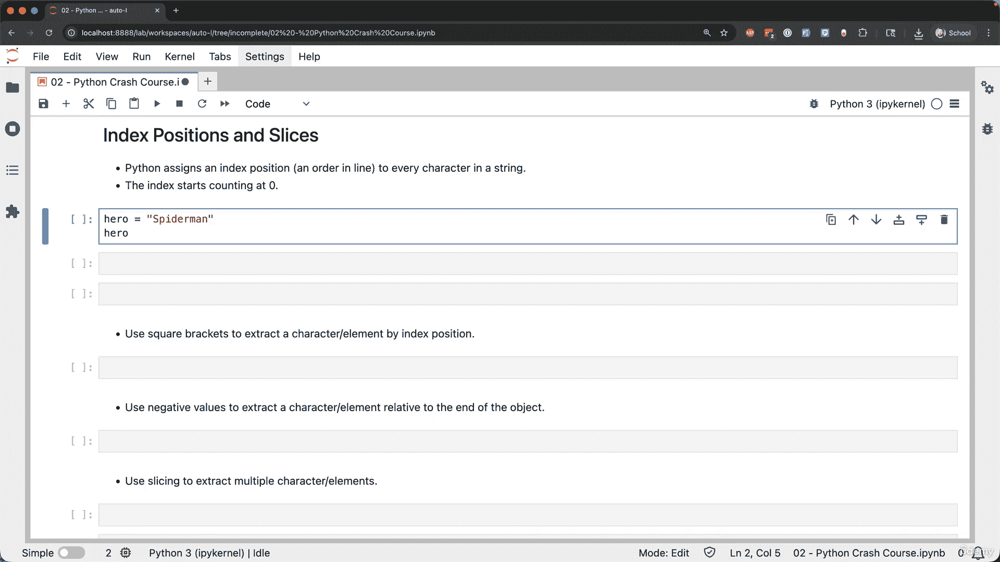

索引位置之所以重要，是因为我们要用它来访问单个字符或单个列表元素。可以把索引位置理解成每个元素在集合中的“门牌号”，而这个门牌号是从 0 开始发放的。下面这个公式可以帮助记忆最后一个索引位置和长度之间的关系：

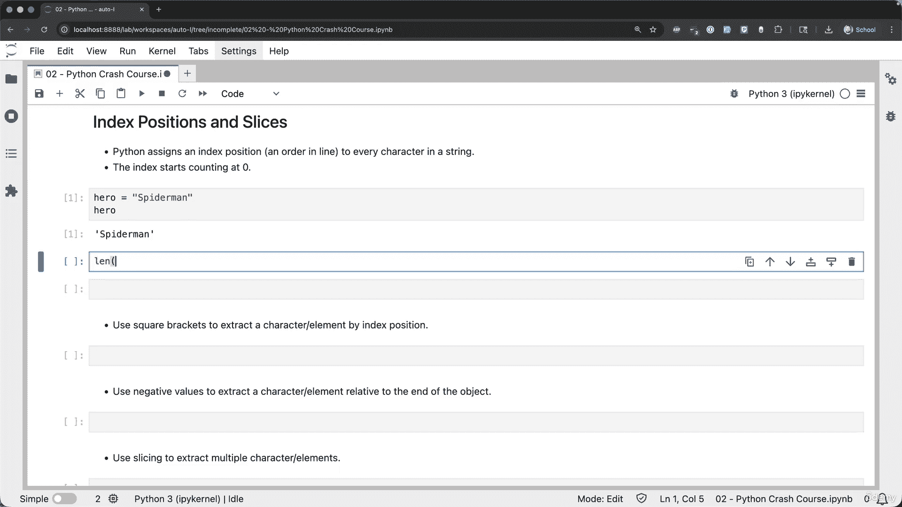

$$
最后一个索引 = len(对象) - 1
$$

## 🔤 Polars与Python数据分析：21.2：字符串中的索引访问

在理解了索引位置从 0 开始以后，本节中我们来看看如何用索引位置访问字符串中的字符。先看一个具体例子：定义一个变量 `hero`，给它赋值为字符串 `"Spiderman"`，然后在下面输出这个变量。

```python
hero = "Spiderman"
hero
```

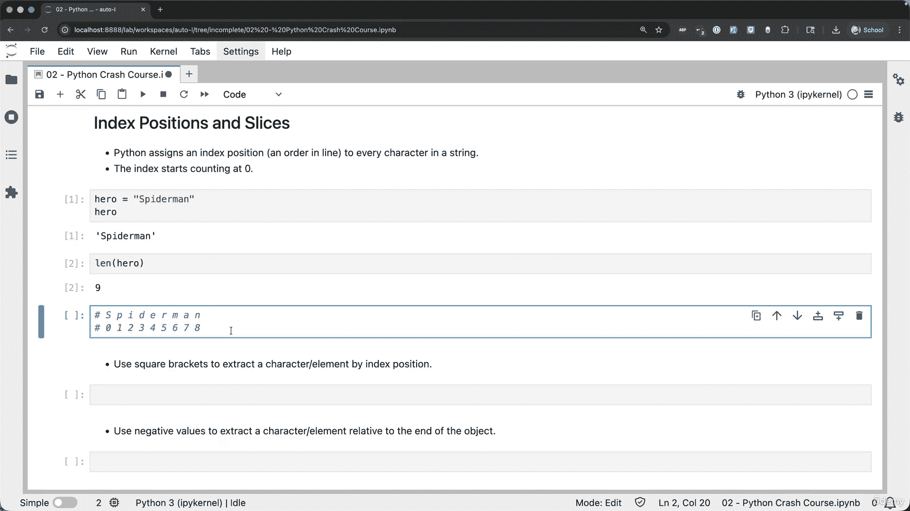

`"Spiderman"` 一共有 9 个字符。如果把 `hero` 传给 Python 的 `len` 函数，会得到返回值 9。下面可以把每个字符用空格分开写出来，再在下面写出它们对应的索引位置。前面已经说过，索引从 0 开始计数，所以大写字母 `S` 的索引位置是 0；接下来 `p` 的索引是 1，`i` 的索引是 2，依次类推，得到 0、1、2、3、4、5、6、7、8。最后一个索引位置是 8。

这里会看到一个固定规律：最后一个索引位置总是比长度小 1。原因是长度从 1 开始数字符个数，而索引从 0 开始数位置，所以最后一个字符的索引总是 `长度 - 1`。长度为 9 时，最后一个索引就是 8。这个规律对所有字符串都成立。

接下来要访问字符串中的字符，需要使用索引位置，并把索引位置写在一对方括号里。下面是几个访问示例：

```python
hero[0]   # 返回 'S'
hero[1]   # 返回 'p'
hero[8]   # 返回 'n'
```

- `hero[0]` 表示取索引位置 0 的字符，也就是大写字母 `S`。
- `hero[1]` 表示取索引位置 1 的字符，也就是第二个字符 `p`，这里容易混淆，因为索引 1 不是第一个字符，而是第二个字符。
- `hero[8]` 表示取最后一个索引位置 8 的字符，也就是 `"Spiderman"` 末尾的 `n`。

方括号这种写法和声明列表时使用的方括号语法看起来一样，但在这里只是恰好相同，它的作用是：在一个变量名或已有数据类型后面，从该对象内部访问某个内容。方括号里写数字索引位置，就表示要取那个位置上的字符。

如果提供一个超出字符串边界的无效索引位置，比如 `hero[100]`，Python 就会触发错误或异常。下面这个无效访问示例需要注释掉：

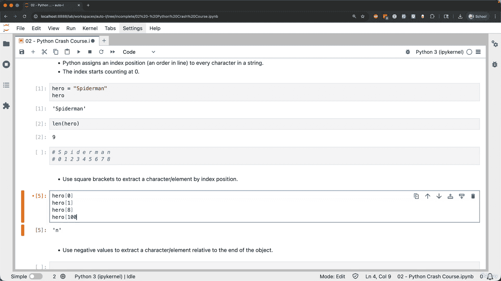

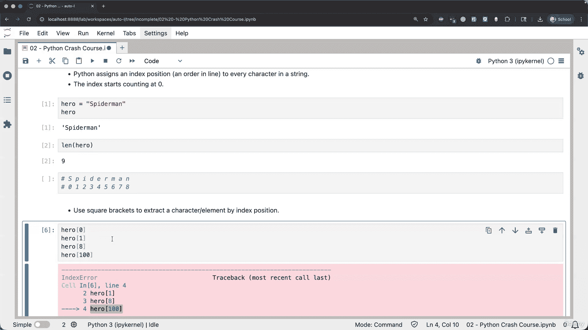

```python
# hero[100]   # 会触发 IndexError
```

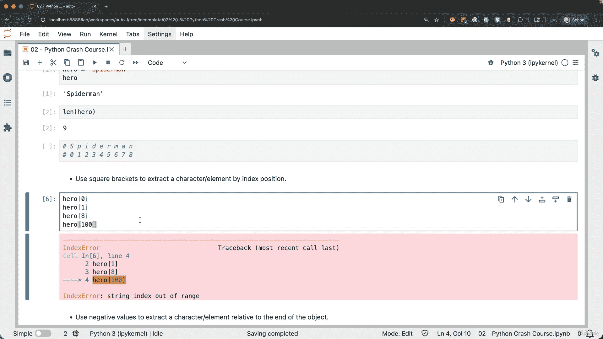

当单元格下面出现一大块红色错误信息时，不需要害怕，它只是说明代码无效，需要删除代码或者把它注释掉。输出会告诉我们错误类别是 `IndexError`，并说明指定的字符串索引 100 超出了有效索引范围，而有效范围是 0 到 8。

## ➖ Polars与Python数据分析：21.3：字符串中的负索引

上一节我们看了从前往后数的正索引，本节中我们来看看方括号里写负值时会怎样。负值的作用是从字符串末尾开始向前提取字符，也就是从后往前数。

下面展示几个负索引示例：

```python
hero[-1]   # 返回 'n'
hero[-2]   # 返回 'a'
hero[-9]   # 返回 'S'
```

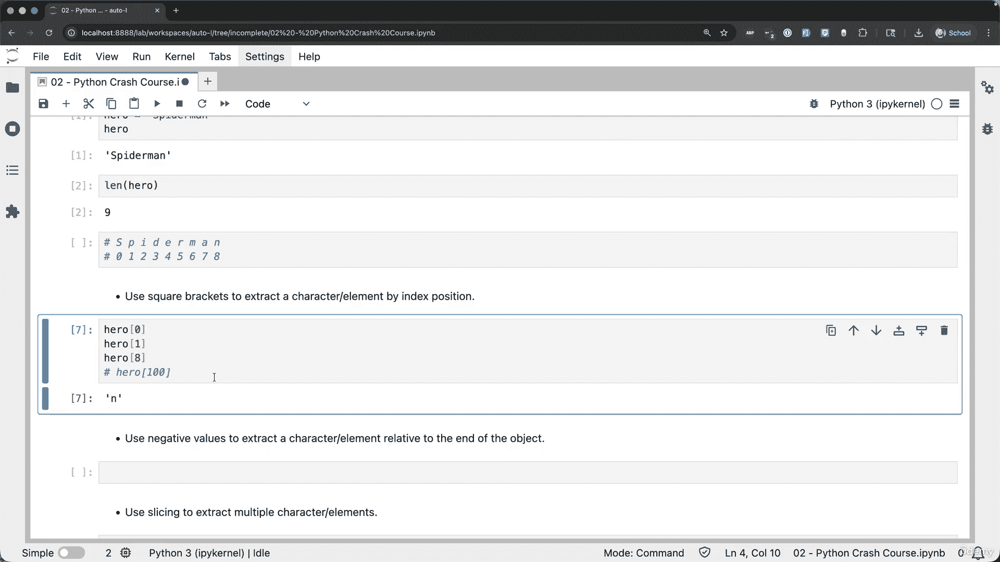

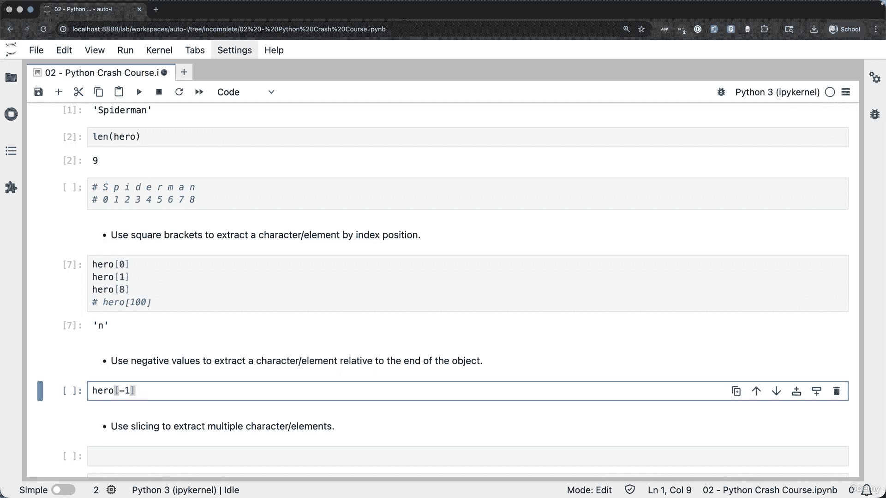

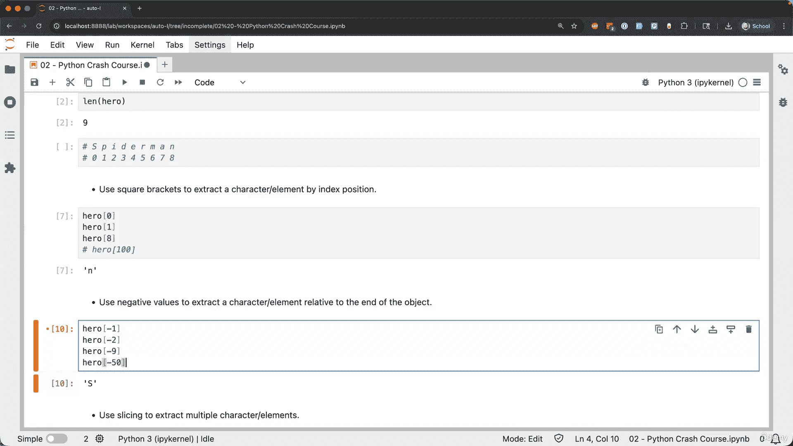

- `hero[-1]` 表示取最后一个字符，也就是 `n`。这和传入索引 8 得到的是同一个字符，只是语法不同。
- `hero[-2]` 表示取倒数第二个字符，也就是最后一个字符前面的字符，即 `n` 前面的 `a`。
- `hero[-9]` 表示从末尾往前数第 9 个字符，也就是 `"Spiderman"` 中的大写 `S`。

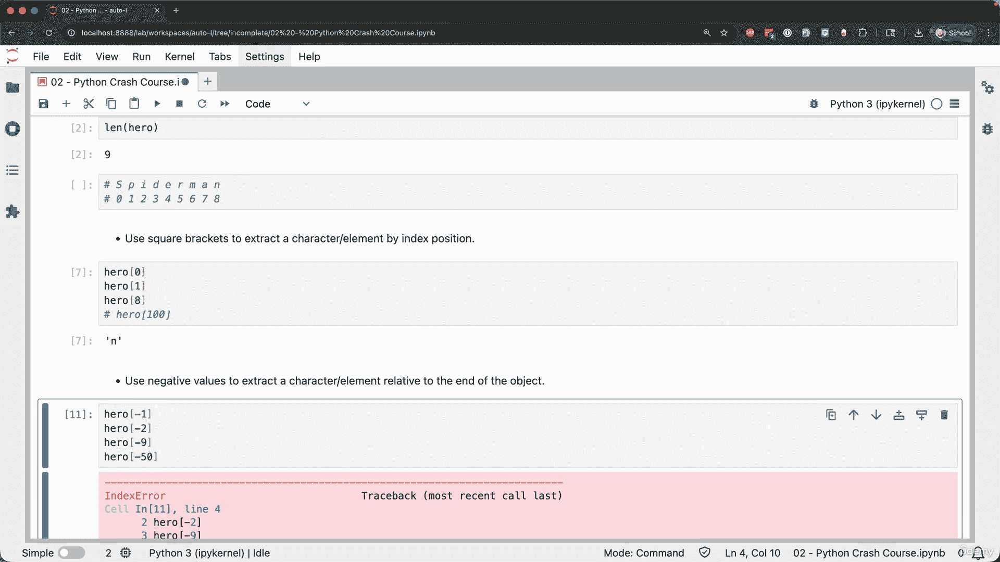

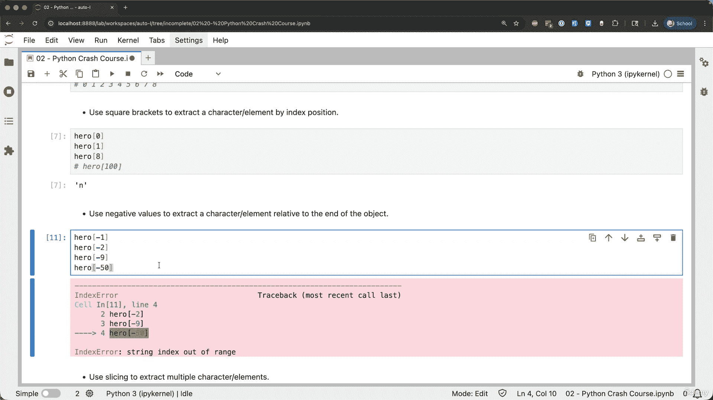

如果提供一个无效的负索引位置，比如 `hero[-50]`，就相当于问从末尾往前数第 50 个字符，但整个字符串只有 9 个字符，所以同样会触发索引错误，因为索引超出范围。这个无效示例也需要注释掉：

```python
# hero[-50]   # 会触发 IndexError
```

## ✂️ Polars与Python数据分析：21.4：字符串切片基础

现在我们已经对索引位置有了比较好的理解，可以继续看切片。单个数字索引提取的是单个字符，而切片可以提取一个子集，也就是一个连续的一个或多个字符组成的序列。换句话说，切片可以从集合中一次取出多个内容，在字符串这里就是一次取出多个字符。

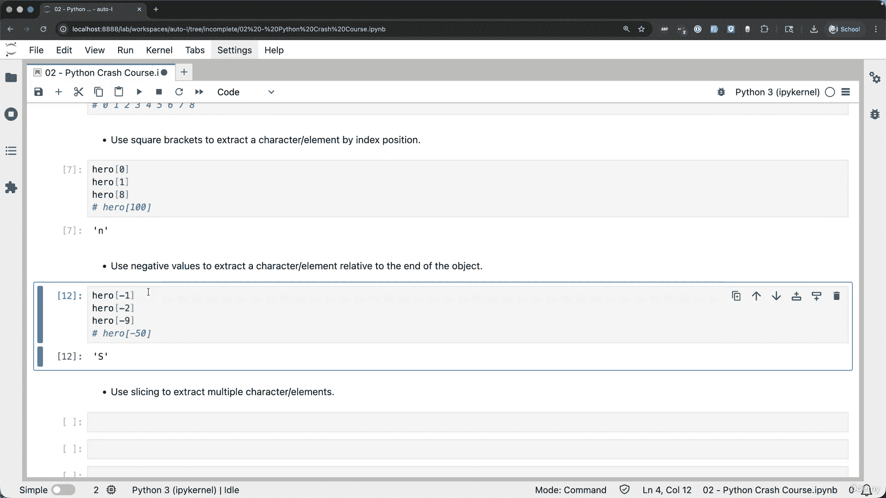

下面看一个切片示例。仍然使用 `hero`，在方括号里不只写一个数字，而是写两个数字，并用冒号隔开。例如写 `1`、冒号、`3`：

```python
hero[1:3]   # 返回 'pi'
```

冒号前面的值表示起始索引位置，也就是从哪里开始提取，这里是 `p`。冒号后面的值表示提取到哪个索引位置为止，也就是停止位置。这里有一个容易让人困惑的地方：起始位置是包含在内的，也就是会包含索引 1 上的字符；而停止位置是不包含的，也就是会一直走到那个索引，但不把停在那里的字符取出来。

在这个例子中，`p` 的索引是 1，`i` 的索引是 2，`d` 的索引是 3，但我们不包含 `d`，只是走到 `d` 为止，所以只会取索引 1 和索引 2 上的字符，结果是 `p` 和 `i`。一个简单的记忆方法是：用冒号后面的索引减去冒号前面的索引，得到的值就是提取出来的字符数量。例如 `3 - 1 = 2`，说明会提取 2 个字符，结果就是长度为 2 的字符串。

如果确实想包含索引 3 上的 `d`，就需要把停止索引写成比 3 大 1 的数，也就是 4。这样会取到索引 3 上的 `d`，结果是 `pd`：

```python
hero[1:4]   # 返回 'pid'
```

再看另一个例子：从索引 2 开始，提取到索引 6 之前，但不包含索引 6。用 `6 - 2 = 4`，说明结果会有 4 个字符，对应索引 2、3、4、5 上的字符。这里仍然是走到索引 6，但不提取索引 6 上的字符。下面是对应的公式：

$$
切片提取数量 = stop - start
$$

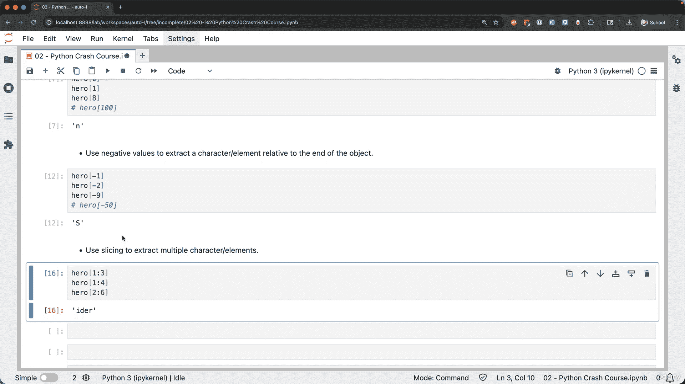

## ⚡ Polars与Python数据分析：21.5：字符串切片的简写与混合用法

上一节我们介绍了切片的基本写法，本节中我们来看看几种常见简写。一个常见操作是从字符串开头开始提取。比如从索引 0 开始，提取到索引 6 之前但不包含索引 6，这样一共会得到前 6 个字符：

```python
hero[0:6]   # 返回 'Spiderm'
```

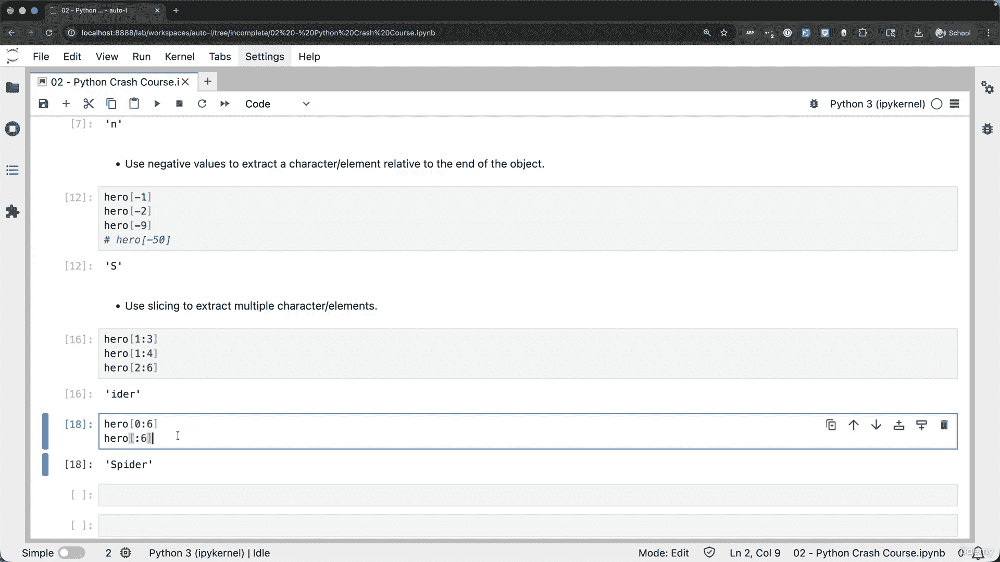

由于“从开头开始取”太常见，Python 支持一种简写：如果从字符串开头开始提取，一直到某个索引为止，可以把起始的 0 完全省略。也就是说，`hero[0:6]` 可以写成 `hero[:6]`，结果完全一样：

```python
hero[:6]   # 返回 'Spiderm'
```

冒号前面不写值，就是告诉 Python 从字符串开头开始取，等价于从索引位置 0 开始，一直取到但不包含索引位置 6，一共 6 个字符。

另一个常见简写是从某个位置一直取到字符串末尾。例如从索引 3 开始，写到索引 100。索引 100 实际上不存在，如果只在方括号里写 `100`，会触发前面看到的索引错误；但在切片里，Python 会更聪明一些，它会意识到你想取到字符串末尾之后，于是直接从索引 3 开始，一直取到字符串结束：

```python
hero[3:100]   # 返回 'derman'
```

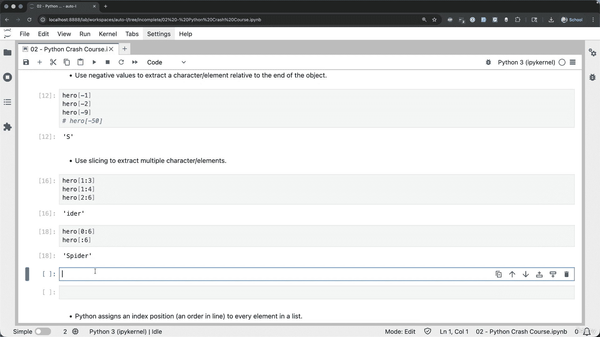

这里不管写 100 还是 200，结果都一样，因为 Python 会自动停在字符串末尾。如果不关心中间末尾索引到底是多少，可以把冒号后面的值省略。例如写 `hero[3:]`，意思是：从索引 3 开始，一直取到字符串末尾，不管后面还有多少个字符：

```python
hero[3:]   # 返回 'derman'
```

冒号后面不写值，就是告诉 Python 从冒号前面指定的位置开始，一直取到字符串结尾。这样不需要猜最后一个索引位置，也不需要写一个超出范围的数字。切片语法还允许把多种写法混合在一起。例如：

```python
hero[3:-2]   # 返回 'derm'
```

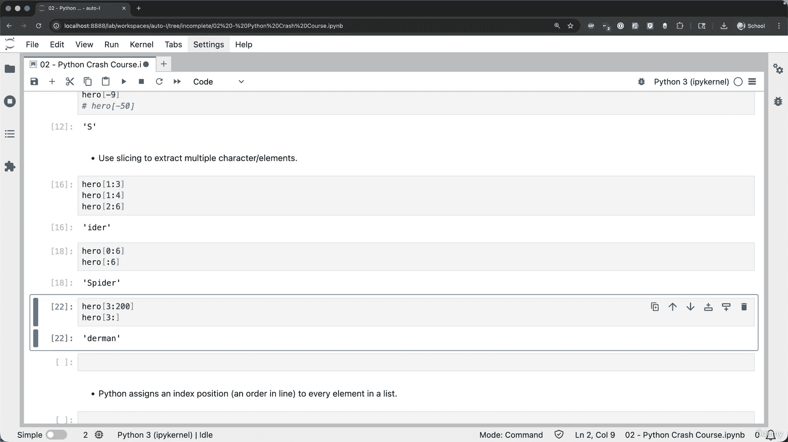

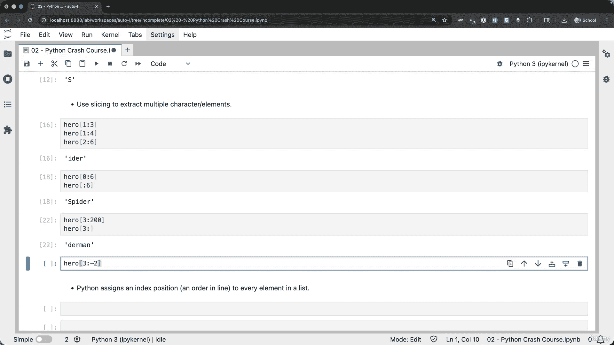

`3:-2` 表示从索引位置 3 开始，一直取到倒数第 2 个字符之前，但不包含倒数第 2 个字符。索引 3 上是 `d`，倒数第 2 个字符是 `a`，所以会一直走到 `a` 之前，但不把 `a` 包含进来。

## 📋 Polars与Python数据分析：21.6：列表中的索引与切片

以上是字符串中索引位置和切片的入门内容，但同样的原则也适用于列表中的元素。这也是 Python 的一个特点：不同数据类型之间保持相对一致。只要有一个按顺序存储值的列表，Python 就会给每个元素分配索引位置，并且同样从 0 开始。

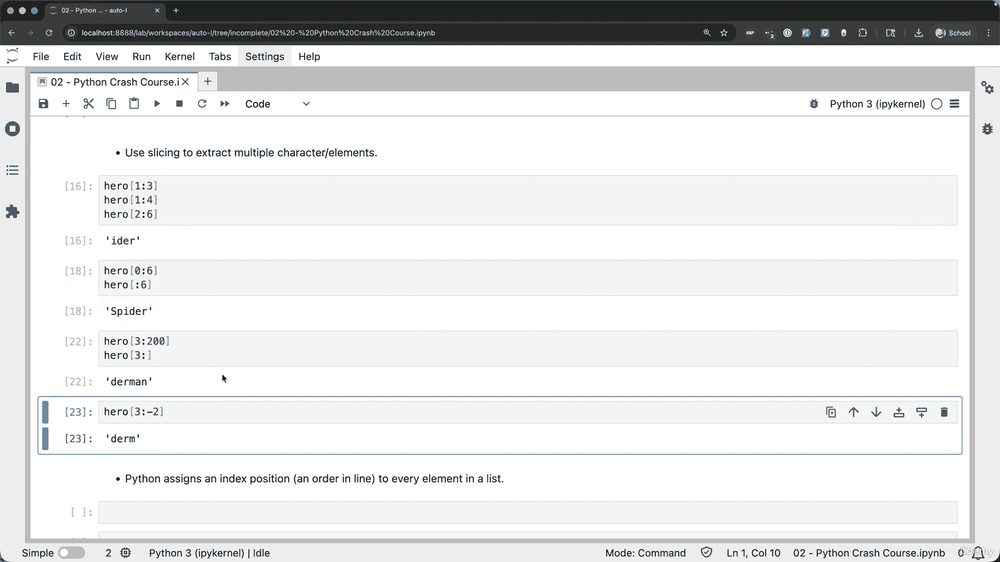

下面声明一个列表，变量名叫 `superheroes`，用方括号语法创建，并放入几个字符串：`"Batman"`、`"Superman"`、`"Wolverine"`、`"Iron Man"`，最后是童年英雄 `"Arnold Schwarzenegger"`。下面是列表示例：

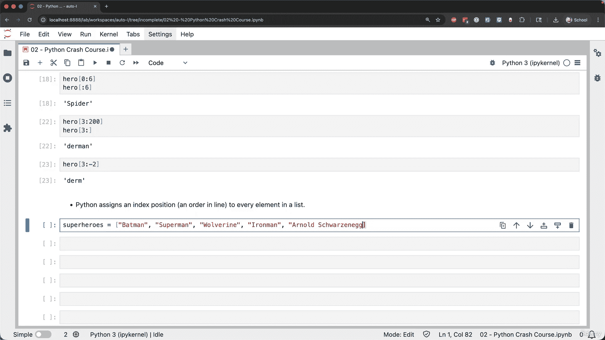

```python
superheroes = ["Batman", "Superman", "Wolverine", "Iron Man", "Arnold Schwarzenegger"]
superheroes
```

输出这个列表后，再把它传给 Python 的 `len` 函数，可以看到列表长度是 5，一共有 5 个字符串。索引从 0 开始计数，所以最后一个索引位置是 4。第一个元素 `Batman` 的索引是 0，`Superman` 的索引是 1，`Wolverine` 的索引是 2，`Iron Man` 的索引是 3，`Arnold` 的索引是 4。

下面可以在列表上使用完全相同的方括号语法。这里 `superheroes` 本身已经是列表，方括号用来根据索引位置访问元素。以下是列表索引访问示例：

```python
superheroes[0]   # 返回 'Batman'
superheroes[1]   # 返回 'Superman'
superheroes[4]   # 返回 'Arnold Schwarzenegger'
```

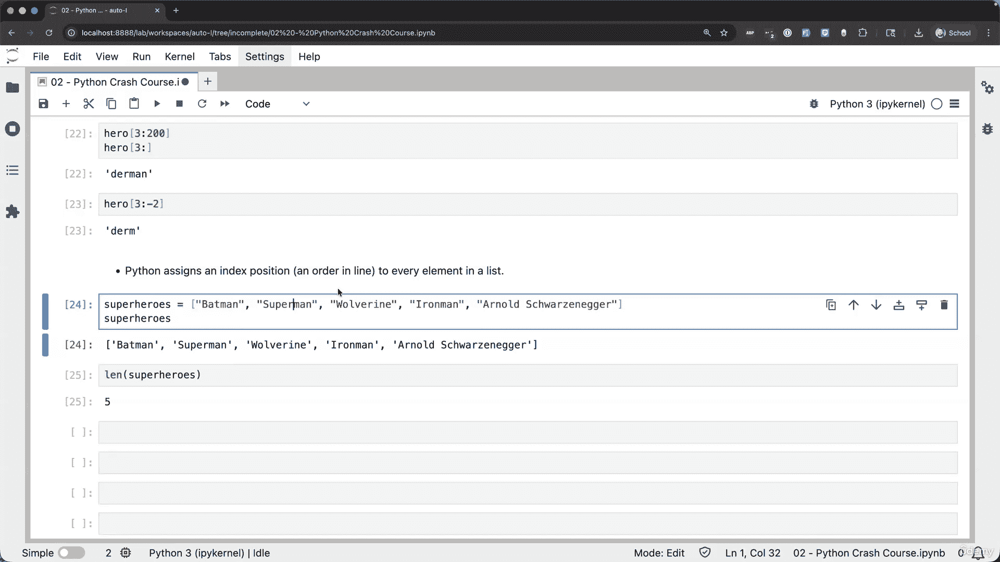

- 索引 0 是列表中的第一项，也就是 `Batman`。
- 索引 1 是第二项，也就是 `Superman`。
- 索引 4 是最后一项，也就是 `Arnold Schwarzenegger`。

如果提供一个不存在的索引，比如索引 10，同样会得到索引错误。这里的错误信息会说明列表索引超出范围，而不是字符串索引超出范围，但本质上是一样的。下面这个无效示例需要注释掉：

```python
# superheroes[10]   # 会触发 IndexError
```

方括号语法同样支持负值。例如：

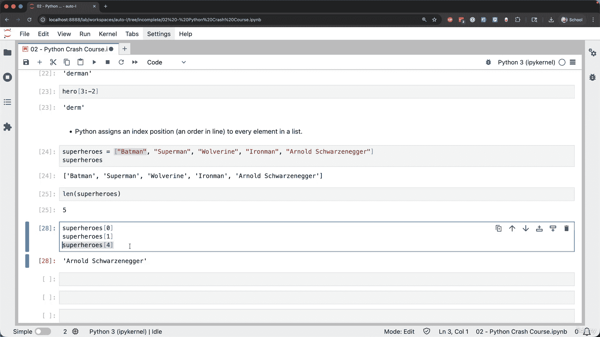

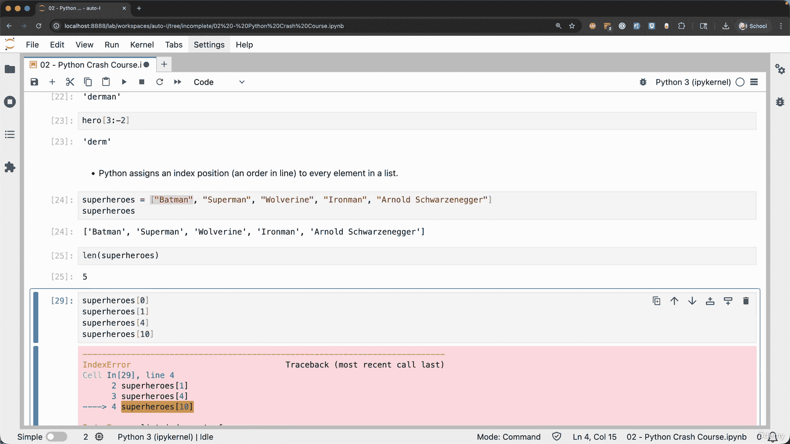

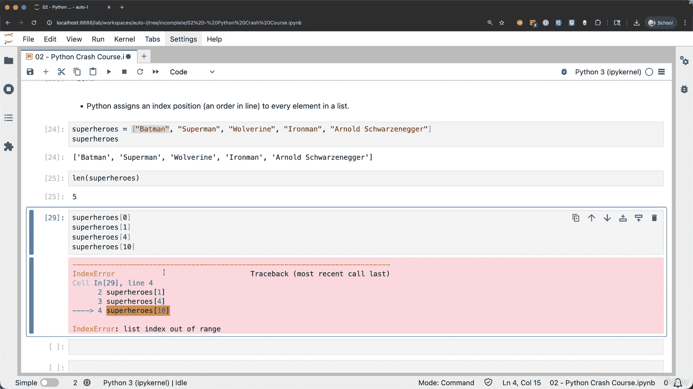

```python
superheroes[-1]   # 返回 'Arnold Schwarzenegger'
superheroes[-3]   # 返回 'Wolverine'
```

- `superheroes[-1]` 表示从末尾开始数第 1 个，也就是最后一个元素 `Arnold Schwarzenegger`。
- `superheroes[-3]` 表示从末尾开始往前数第 3 个，倒着数 1、2、3，对应 `Wolverine`。

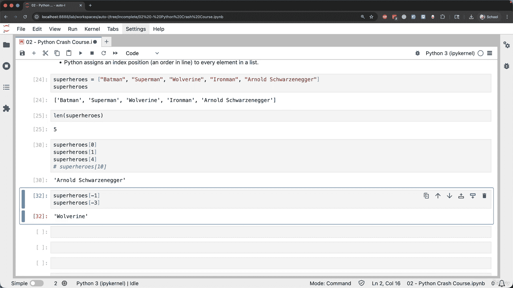

列表也支持用冒号指定起始和停止位置的切片语法。起始索引包含在内，停止索引不包含，和字符串完全一致。下面是一个切片示例：从索引 1 取到索引 3 之前，`3 - 1 = 2`，所以会得到两个元素。索引 1 是 `Superman`，索引 2 是 `Wolverine`，索引 3 是 `Iron Man`，但只取到索引 3 之前，不包含索引 3：

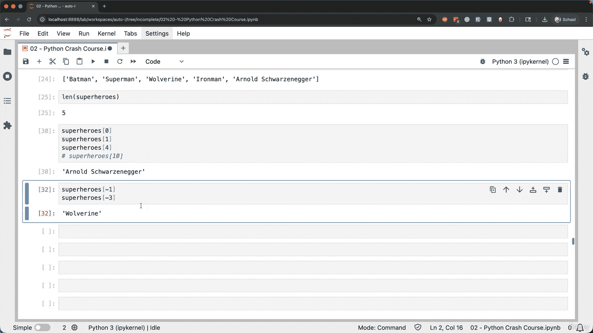

```python
superheroes[1:3]   # 返回 ['Superman', 'Wolverine']
```

因为这里要取出多个元素，Python 会把它们打包成一个新的列表，这个新列表只包含原 `superheroes` 列表中索引 1 和索引 2 上的两个字符串。

列表也可以使用熟悉的简写。例如想取前四个元素，可以写 `superheroes[0:4]`，也可以省略开头的 0，写成 `superheroes[:4]`：

```python
superheroes[0:4]   # 返回前四个元素
superheroes[:4]    # 返回同样的前四个元素
```

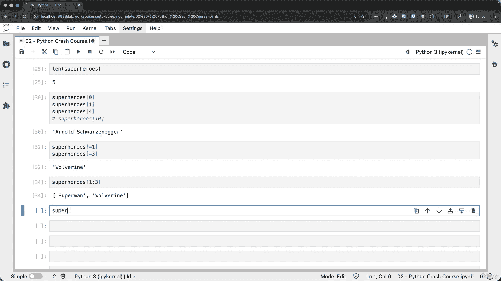

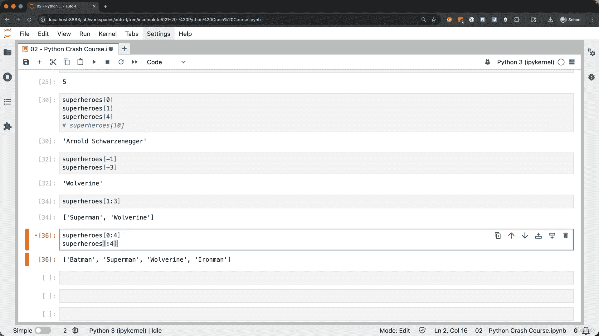

如果从列表中间某个位置一直取到末尾，例如从索引 3 写到索引 150。索引 150 不存在，已经超出列表末尾，但 Python 会从索引 3 开始，一直取到列表结束。如果不想关心中间末尾索引，可以直接省略冒号后面的值，写成 `superheroes[3:]`，也就是从索引 3 开始一直取到末尾：

```python
superheroes[3:150]   # 从索引 3 开始取到末尾
superheroes[3:]      # 从索引 3 开始取到末尾
```

## 🔗 Polars与Python数据分析：21.7：与Polars的联系

上一节我们在列表上复习了索引和切片，本节中我们来看看这些概念和后面要用的 Polars 有什么关系。字符串和列表之间这种一致性很值得体会，而且很多切片概念在开始使用 Polars 时会派上用场。访问和遍历表格数据的方式会非常相似，我们会用类似的语法来说明从哪里开始取值，比如要定位表格中的哪一行，然后指定取到哪里或者在哪里停止，从而提取一部分行。

这种语法在 Python 社区中非常常见，适用于各种按顺序存储条目的集合类型。理解字符串和列表的索引与切片，不只是为了应付几个小例子，也是为了后面更自然地理解表格数据的行选择。可以把索引位置想成“元素的编号”，把切片想成“从编号 A 到编号 B 之前取一段”，这个思路会一直沿用下去。

## 🧾 Polars与Python数据分析：21.8：总结

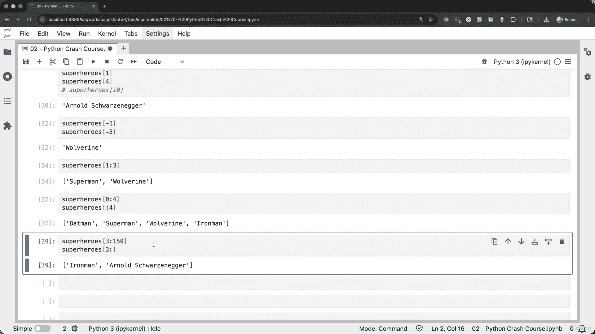

本节课中我们一起学习了索引位置和切片。索引位置是分配给集合中每个元素的数字计数，Python 从 0 开始计数，所以最后一个索引等于长度减 1。切片则是从集合中提取一个连续的条目序列，使用 `[start:stop]` 的形式，包含起始位置，不包含停止位置，提取数量可以用 `stop - start` 计算。我们还看到了起始位置省略、停止位置省略以及正负索引混合使用等写法，并且把这些原则应用到了字符串和列表上。最后我们提到，这些思路会在后面使用 Polars 访问表格数据时继续出现。

