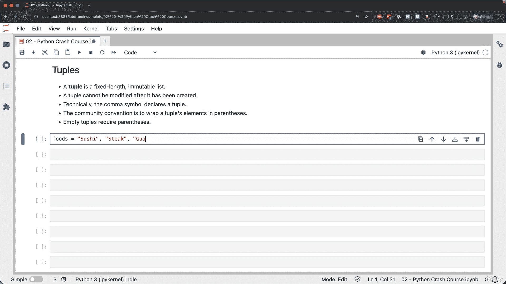
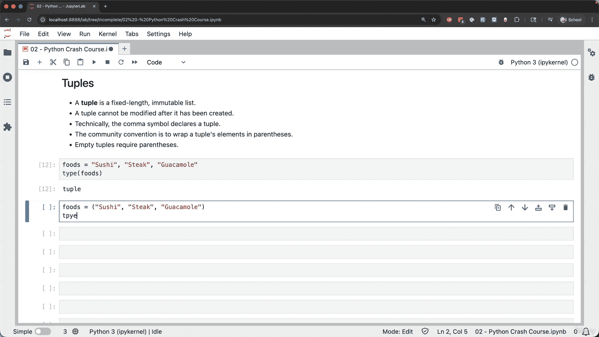
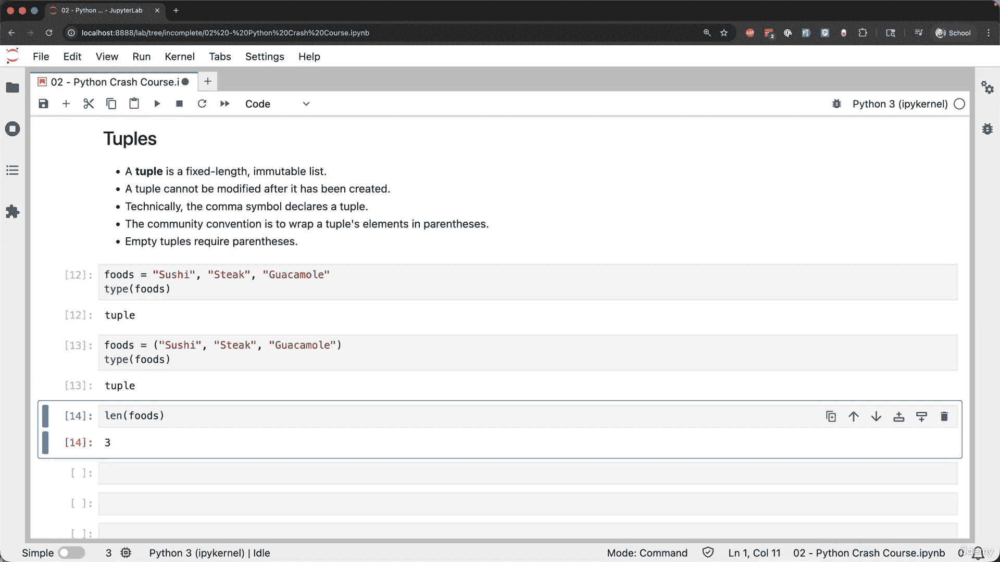
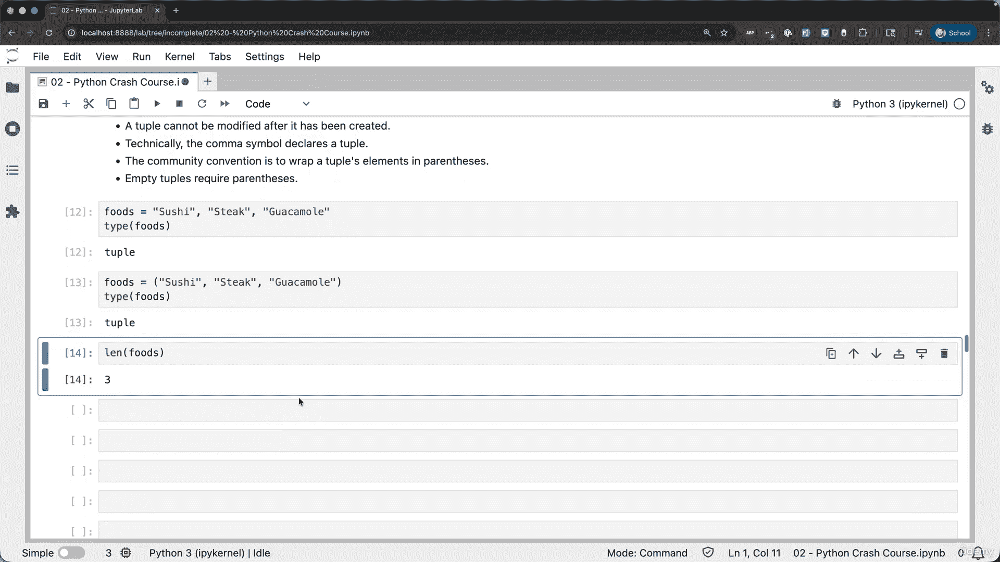
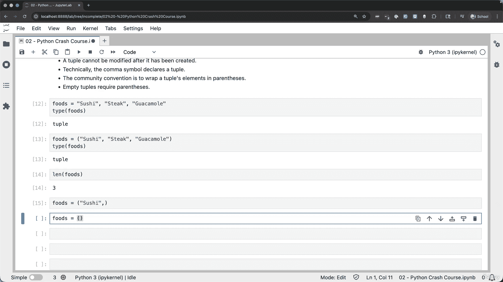
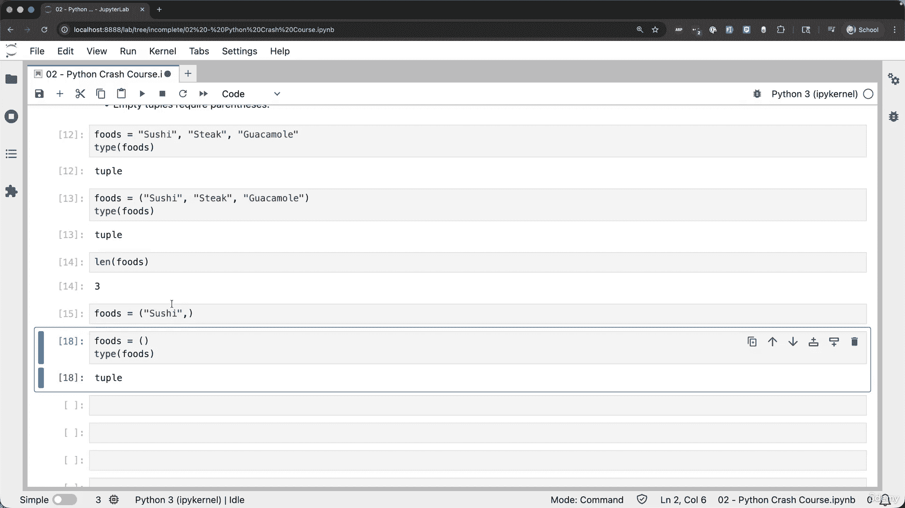
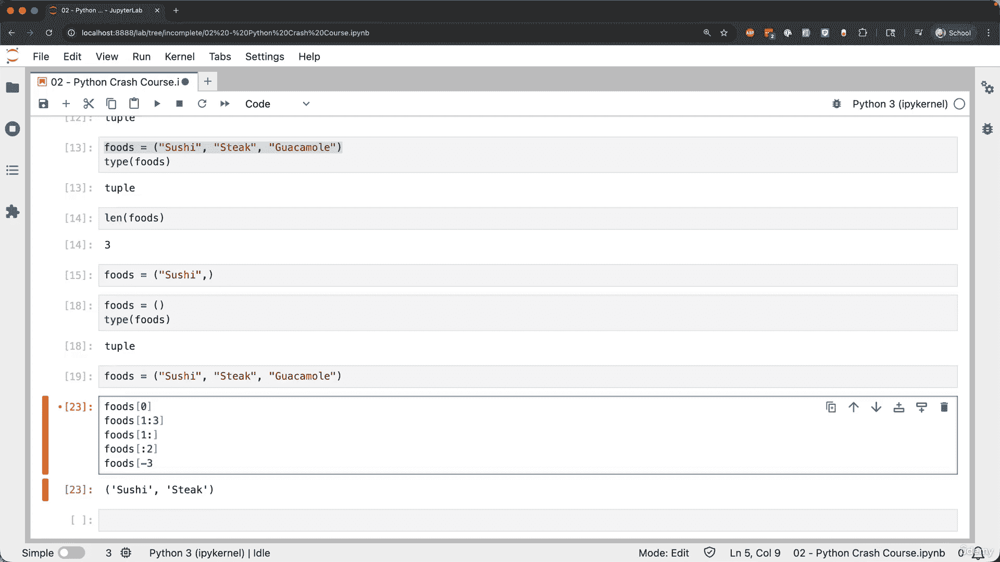
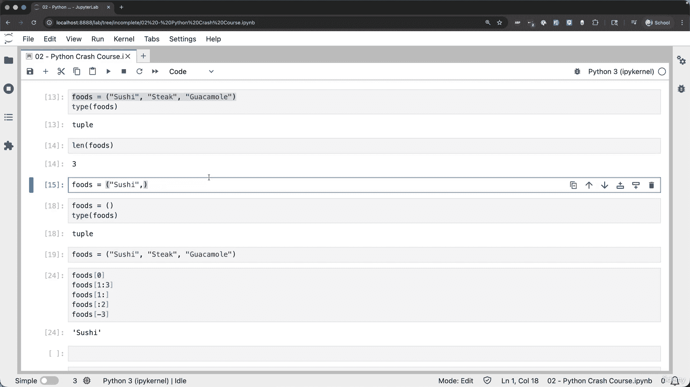

# 🐍 使用Polars和Python进行数据分析：第22节：元组

## 📖 概述

在本节课中，我们将学习Python中的下一个数据结构——**元组**（tuple）。元组有时也被称为 tuple，好消息是它与Python列表非常相似。它是一种集合类型，能够按顺序存储零个或多个元素，并且为每个元素分配一个索引位置。唯一的区别是，元组是一个**不可变容器**。这意味着一旦你创建了它，就没有办法修改它。没有添加元素、删除元素或替换元素的方法。它一旦被声明，就固定下来了。所以，每当你需要一个容器，但希望这个容器不可修改时，你就会看到人们使用元组而不是列表。此外，关于元组还有一个有趣的细节：创建元组的唯一技术要求实际上是一个**逗号分隔的值序列**。下面我们详细来看。

## 🧩 元组与列表的相似之处

元组和列表一样，是一种集合类型。它按顺序保存元素，每个元素都有一个索引位置。你可以把它想象成一条排好队的队伍，每个位置上站着一个人（元素），每个人都有自己的编号（索引）。这在很多场景下都非常有用，比如你要表示一组固定不变的数据，比如一周的七天、坐标点等。

但是，它们之间有一个关键的不同点，那就是**可变性**。列表是可变的，你可以往里面添加元素、删除元素、修改元素；而元组是不可变的，一旦你创建了一个元组，它就像被“焊死”了一样，不能再做任何改变。这一点我们会在后面反复强调。

## 🛠 创建元组：逗号是关键

让我直接来演示。比如，我要声明一个 `foods` 变量，打算创建一个包含三个元素的元组。我先把第一个字符串写出来，叫它 `"sushi"`。

然后，我要做的只是放一个逗号和一个空格。请记住，和列表声明中的元素一样，**逗号是技术必需**，而空格只是为了可读性。注意，这里与列表的一个主要区别是：声明列表时，我们必须要写一对方括号，而创建元组时，唯一的技术要求实际上只是用逗号分隔后续元素。

所以，例如，我添加第二个元组元素，一个字符串 `"steak"`，再提供一个逗号和一个空格，然后写最后一个，比如 `"guacamole"`。



下面是完整的代码：

```python
foods = "sushi", "steak", "guacamole"
print(foods)
```

我将在下方输出 `foods`。你会注意到，打印出来的表示形式会在开头和结尾加上括号。关于这一点我们稍后讨论。这完全是Python中一种独立且不同的数据类型，一个叫做“元组”的对象。

我可以把 `foods` 变量传给Python的 `type` 函数，你会看到它确实是元组：

```python
print(type(foods))  # <class 'tuple'>
```

所以，正如我们刚才看到的，创建元组的唯一技术要求就是用逗号分隔元素。没错，就是这样。

## 🎨 括号：约定优于必须

然而，从纯粹的设计或美观角度来看，社区约定是用**括号**把元组的元素包起来，这样更容易在视觉上识别元组。所以，你在真实世界的代码库中遇到元组最常见的方式，就是一连串用逗号分隔、并用括号包裹的元素。



再次强调，括号并不是技术必需，就像我们在前一个单元格中看到的那样。但它们是最常见的视觉写法。下面这两种写法实际上是等价的：

```python
foods = ("sushi", "steak", "guacamole")
```

我可以把这个新的 `foods` 声明传给 `type` 函数，你会看到它仍然是普通的元组类型：

```python
print(type(foods))  # <class 'tuple'>
```

你看，两种写法都能创建元组，只是带括号的写法更醒目、更常见。

## 📏 元组的长度



元组的长度等于其元素的数量，这与列表完全一样。例如，这里我可以把 `foods` 元组传给Python的 `len` 函数，你会看到我们得到长度为 3：



```python
print(len(foods))  # 3
```

是不是很简单？长度就是元素个数，没有其他花头。

## ⚠️ 两个有趣的边界情况

我想讨论两个有趣的边界情况。第一个是**只有一个元素的元组**。我想在这里向你展示，在Python中，哪怕一个单字符都可能产生天壤之别。

例如，让我再次声明一个 `foods` 变量。如果我像这样提供一个字符串，比如 `"sushi"`，那这就*不是*元组。没错，这是一个普通的变量声明，赋值给一个字符串。

但只要我在末尾加上一个逗号，技术上说，它就成了一个单元素元组。即使后面没有第二个元素，逗号也足够让Python明白这是一个元组。

当我执行这个单元格时，我的代码格式化器会自动给代码加上括号，但这并不是技术必需，只是一个美观上的小习惯。这是格式化器为了让代码看起来更美观、并提醒人们这是一个元组而采用的一种方式。所以，一旦我执行这段代码，我们会看到括号，但技术上并不需要括号；而如果你要声明一个单元素元组，**逗号在技术上是必需的**。

```python
foods = "sushi",
print(foods)  # ('sushi',)
print(type(foods))  # <class 'tuple'>
```

另一个情况是，在另一种场景下，括号在技术上确实是必需的，那就是**零元素元组**——一个没有元素的元组，长度为0的元组。例如，如果我直接写一对空的括号，里面什么也不写（没有逗号），这就是一个空元组。它的输出就是一对空括号。它的长度为0。为了向你证明这是一个元组，我再次把它传给 `type` 函数，可以看到它确实是元组。

```python
empty = ()
print(empty)        # ()
print(len(empty))   # 0
print(type(empty))  # <class 'tuple'>
```



## 🧰 元组的方法：少且不可变



我还想向你展示一下，当我们重新声明上面那个三元素元组时，如果我使用点号来访问这个对象上的各种属性和方法，然后按下 Tab 键，你会看到元组对象上可用的方法非常少。而且这些方法中没有一个会修改或改变元组的任何内容。再次强调，元组是固定的、恒定的、已经设定好的。一旦我们把 `foods` 声明成这样（三元素序列），就没有任何方法可以添加元素、删除元素或交换元素。它实际上就是一个固定的、按顺序排列的元素序列。

```python
foods = ("sushi", "steak", "guacamole")
# 尝试调用元组的方法，会发现只有少数几个，如 count 和 index
```

## 🎯 索引和切片：与列表相同的语法

我们用来访问字符串中的字符或列表中的元素的方括号语法，无论是按索引位置还是按切片访问，对元组同样有效。例如，这里我写一对方括号，尝试访问索引位置0，也就是第一个元素，结果是 `"sushi"`。

我还可以做列表切片。比如，我从索引位置1开始提取，也就是第二个元素 `"steak"`，提取到但不包括索引位置3。这会给我一个新的元组。注意，我们从一个元组出发，所以得到的是一个新的元组，这是一个新的、固定的、不可变的集合，只不过它里面只有两个元素。

```python
foods = ("sushi", "steak", "guacamole")
print(foods[0])      # sushi
print(foods[1:3])    # ('steak', 'guacamole')
```

同样，如果你希望从某个索引位置一直取到末尾，可以省略冒号后面的值。比如从索引位置1取到末尾，也能达到同样效果。如果你想从元组开头取，还可以省略冒号前面的值。比如这里我从开头取到（但不包括）索引位置2。当然，负数索引也可以正常工作。例如，我用 `-3` 取倒数第三个元素，就会得到 `"sushi"`。

```python
print(foods[1:])   # ('steak', 'guacamole')
print(foods[:2])   # ('sushi', 'steak')
print(foods[-3])   # sushi
```

这些语法应该都很熟悉。这里的关键是理解元组和列表之间的区别。



## 🔍 元组 vs 列表：核心区别

列表是可修改的、可改变的、可变的。你可以向列表中添加元素，从列表中删除元素。而元组是固定的：它仍然是一个有序的、有顺序的集合，仍然有长度，但一旦创建，就没有办法改变它。

再次强调，**逗号**实际上是告诉Python你正在处理元组的技术必需条件；括号在技术上不是必需的，但它们更美观，而且开发者通常用它们来作为一种良好的视觉标识，在声明元组时帮助人们一眼识别出它。

## ✅ 总结



本节课中，我们一起学习了Python中的元组。我们了解到元组是一种类似于列表的集合类型，可以按顺序存储元素，但它是不可变的。我们知道了创建元组的唯一技术必需是逗号分隔的值序列，而括号只是社区约定，用于视觉上更加清晰。我们还看到了单元素元组需要逗号，空元组需要括号。我们学习了用 `len()` 获取元组长度，也看到了元组的方法很少且不会修改元组。最后，我们验证了元组同样支持索引和切片，并对比了元组与列表的关键区别：列表可变，元组固定。记住：创建元组时，写不写括号都行，但逗号必不可少；一旦生成了元组，就别想再改动它了。本课内容到这里就结束了，我们下一节课见。

