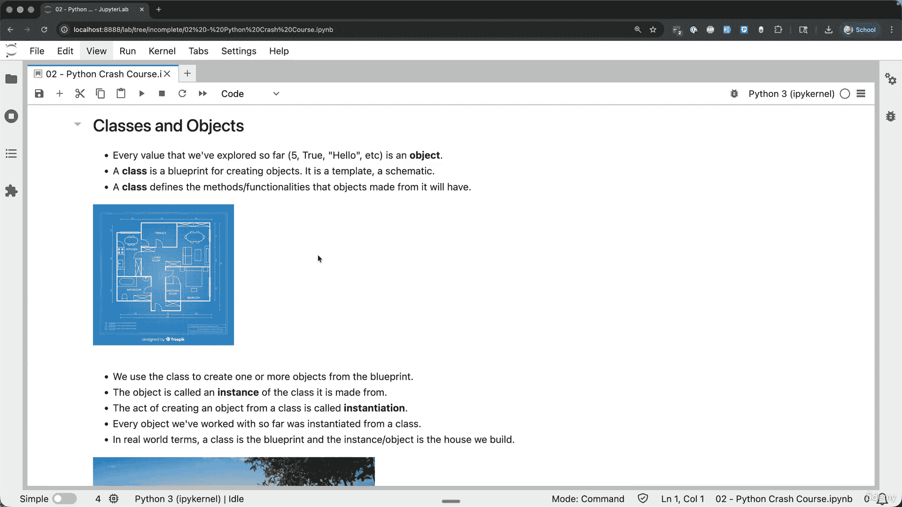
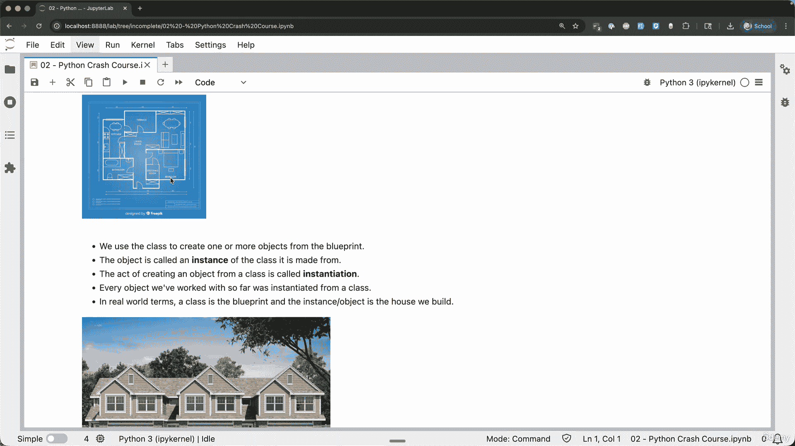
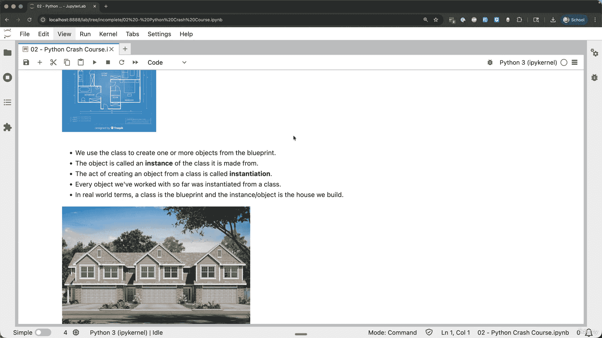
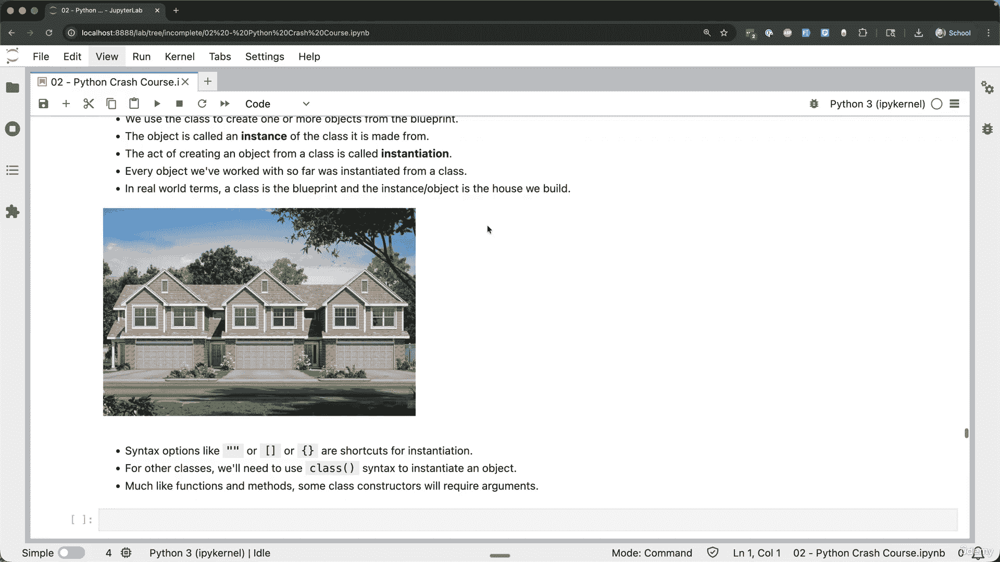
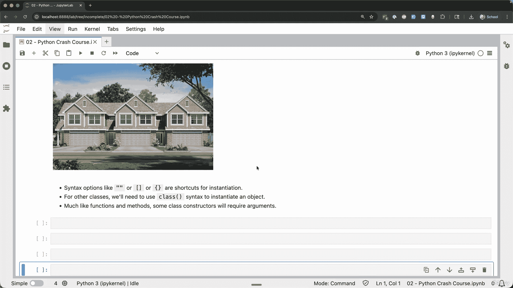
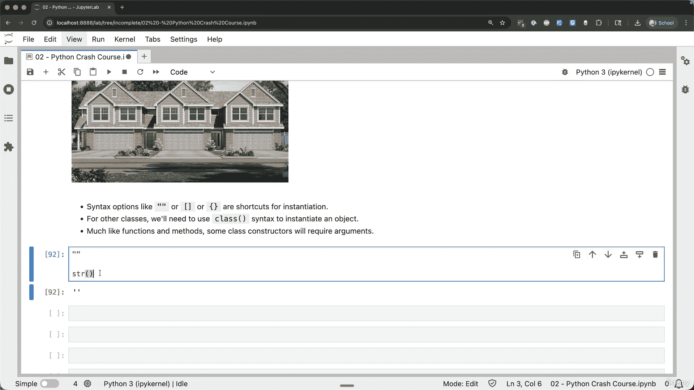
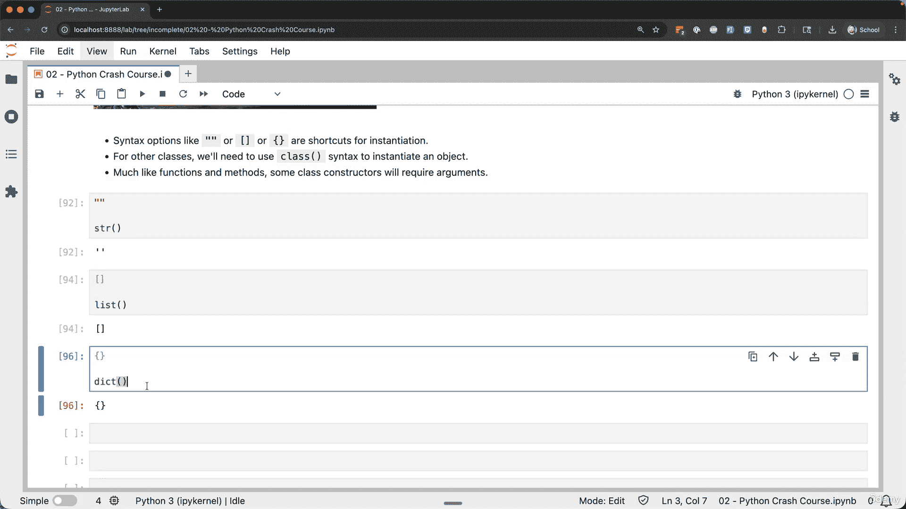

# Polars 与 Python 数据分析：第24节：类与对象 🧱


在本节课中我们将要学习 Python 中两个非常常见的术语，也就是“类”和“对象”。这两个词在刚开始看代码时会反复出现，所以先建立整体认识很重要；理解了它们，后面读写 Python 代码会更顺，也能看懂很多值背后的统一规则。简单说，本课要解决的是：Python 中的值从哪里来，类和对象是什么关系，以及怎样用类创建对象。


先说整体关系。到目前为止，我们在 Python 中探索过的每一个值，无论是整数 `5`、布尔值 `True`，还是像 `"hello"` 这样的字符串，每一个值都是对象。对象可以简单理解为一个数字数据结构，也就是 Python 语言中的一个具体值。每一个对象都来自所谓的“类”，类可以理解为创建一个或多个对象的蓝图、模板或示意图。Python 中之所以有类，是为了有一个统一位置来定义从该类创建出来的对象会拥有的所有方法和功能，这样同类对象的行为就有集中定义的地方。


以下是本节课需要先记住的几个核心概念，它们看起来抽象，但可以先当成统一说法。


- **类**：创建对象时使用的蓝图、模板或示意图，集中定义该类对象会拥有的方法和功能。
- **对象**：Python 中的一个具体值，可以理解为数字数据结构，也是由类创建出来的具体数据。
- **实例**：对象相对于它所属类的称呼，对象就是它由之创建的那个类的实例。
- **实例化**：从类创建对象的过程，也就是按蓝图造出一个具体对象。






下面用公式和简短描述概括它们的关系。


> 类 = 蓝图或模板  
> 对象 = 由类创建出的具体值  
> 实例 = 对象作为某个类的具体实例的称呼  
> 实例化 = 从类创建对象的过程


上一节从整体上看了类和对象的关系，本节用现实世界类比来加深理解。开发者可能为房子创建一张蓝图，在蓝图上指定所有房间、浴室和楼层的位置；这张蓝图不等同于实际建好的 concrete 房子。蓝图只是最终房子样子的模板或示意图。蓝图的好处是，所有房子应该长什么样的定义可以集中在一个地方。完全相同的原则也适用于 Python：Python 有很多不同的类，随着我们从 Python 生态中导入额外库，还会获得更多类，而这些类都只是模板，允许我们从中创建对象。




如果类是蓝图，那么对象就是按蓝图制作出来的具体值。回到现实类比，蓝图相当于 Python 中的类，按蓝图建出来的实际房子相当于 Python 中的对象。对象是蓝图的具体实现，而蓝图就是类。理解这个类比后，看到“类”这个词时，可以先想成模板；看到“对象”时，可以先想成模板造出来的具体东西。


上一节用蓝图解释了类，本节继续看对象、实例和实例化这几个说法。讨论对象时经常听到一个相关术语“实例”：对象称为它由之创建的那个类的实例。可以说这栋房子是这张蓝图的一个实例，而从类创建对象的动作叫实例化。我们目前用过的每一个对象、在 Jupyter 笔记本单元格中声明的每一个值，都是从类实例化出来的；这个过程在幕后有一点神奇，但技术上就是这样发生的。




理解了实例化之后，本节看我们写过的语法捷径和构造器写法。我们探索过创建各种对象的语法选项，例如用一对双引号创建字符串、用一对中括号创建列表、用一对花括号创建字典；幕后这些操作都是在从类实例化实例或对象。Python 开发团队提供这些语法选项是为了简单，因为这些数据结构非常常见，会经常出现在 Python 代码中，所以给了我们方便的快捷方式；但幕后它们都是类实例。对于许多其他类，并没有这种方便的快捷方式，需要改用替代语法从类创建实例：通常写类名，然后加一对括号来创建实例。


以下是常见数据结构的快捷写法和等价构造器写法，方便对照记忆。


- 空字符串：`""` 等价于 `str()`，其中 `str` 是 string 的缩写。
- 空列表：`[]` 等价于 `list()`。
- 空字典：`{}` 等价于 `dict()`，其中 `dict` 是 dictionary 类名的拼写。




这些快捷写法背后，实际做的是从类创建实例。可以用代码表示这种统一构造方式。


> ```python
> 对象 = ClassName(参数...)
> ```


上一节列出了快捷写法，本节继续看构造器语法和参数。创建实例的语法和调用函数或方法几乎一样，唯一区别是这里写的是类名，不是函数名。和函数、方法类似，这种实例化类的语法称为构造器，构造器可以接受输入，这些输入称为参数。有时类构造或从类实例化实例时需要参数或数据，用来定制将要创建的实例。举个例子，`""` 是创建空字符串的快捷写法，但 Python 有 `str` 类，`str()` 看起来像调用函数，实际上是用 `str` 类创建实例，产生的结果和 `""` 是完全相同的实例，`""` 只是它的快捷写法。同样规则适用于其他数据类型：`[]` 创建空列表，而 `list()` 从 `list` 类创建同样的空列表实例；`{}` 创建没有键值对的字典，而 `dict()` 从字典类创建同样的空字典。下面用代码展示这种等价关系。




> ```python
> "" == str()   # True
> [] == list()  # True
> {} == dict()  # True
> ```


这些内容都在比较高的层面上，不需要背下所有细节；重要的是理解类和实例的区别，以及创建对象时写类名加括号的语法。常见数据类型的引号、中括号、花括号只是语法快捷方式，幕后做的是同一件事：从称为类的模板创建具体对象或值。




本节课中我们一起学习了类与对象、实例与实例化，以及常见数据类型的构造器语法。类可以理解为蓝图，对象是由类创建的具体值；对象是类的实例，从类创建对象叫实例化。代码中的 `""`、`[]`、`{}` 是常见快捷写法，背后分别对应 `str()`、`list()`、`dict()` 这样的构造器；其他类通常写类名加括号创建实例，构造器还可以接受参数来定制对象。本课内容到此结束，我们下节课继续。
