# Polars与Python数据分析：25：导入模块 📦

在本节课中，我们将要学习Python里“模块”的基本概念，以及如何把模块导入到Jupyter Notebook中使用。我们会先弄清楚模块到底是什么，再理解为什么有些功能可以直接用、有些功能必须先导入，然后通过`datetime`模块练习导入、起别名、创建对象、调用方法和访问属性。这里先说明一下，初学者不需要一次记住所有细节，只要跟着例子理解“先导入、再使用”的流程即可。

在了解整体目标后，我们先从最基础的问题开始：模块到底是什么，以及它在Jupyter Notebook里应该怎么理解。

## Polars与Python数据分析：25.1：模块是什么 🧩

接下来我们谈一谈模块。严格来说，一个模块就是一个Python文件，这个文件里面放着一些代码，而这些代码可以是函数、类、过程式代码、常量等。模块这个概念在Jupyter Notebook里显得不那么重要，因为我们在Jupyter里是按单元格逐个执行代码的，而不是像普通Python文件那样一次性组织好再运行。不过，模块的第二个定义很有帮助：可以把模块简单理解成组织Python代码的容器。这样理解以后，我们就更容易明白为什么要把一堆相关代码放进同一个文件里。

在Python编程里，字符串、列表、字典这些数据类型非常常见、使用非常广泛，所以我们不需要做任何特殊操作或额外操作，就能直接访问这些类、对象或结构。但是，Python语言内置的其他一些构造并不是这样，它们不会自动出现在每个程序里。下面先列出几个关键点，帮助我们把模块和“自动可用”的区别理清楚。

以下是理解模块概念时需要抓住的核心点：

- 模块可以看成一个Python文件，里面存放函数、类、过程式代码、常量等各种代码。
- 在Jupyter Notebook里，因为代码按单元格逐个执行，模块作为“文件”的概念显得没那么突出。
- 更有用的理解方式是：模块是组织Python代码的容器。
- 字符串、列表、字典这类常见类型不需要额外操作就能直接使用。
- 但并不是所有Python内置构造都会自动可用，有些功能必须先显式导入。

举例来说，假设你想写一个处理时间数据的程序，也就是涉及日期和时间的数据。Python确实支持用对象来建模某个具体日历日期，比如2024年5月5日，也支持建模某个具体时间，比如上午8点30分，但这些对象不会自动出现在每一个Python程序里。这样设计的原因很简单：为了减少Python程序启动时需要使用的总内存。你可以把它理解成Python启动时只加载核心必需内容，而当我们想使用额外功能时，就必须明确指定要把这些功能引入到代码里。也就是说，我们要显式选择需要带入和使用的功能，而实现这件事的技术概念就是“导入模块”。

导入模块的意思就是：我们请求Python加载存放在另一个文件里的某段Python代码，然后这段代码就可以在我们的程序里使用，或者在Jupyter Notebook的上下文里使用。上面把模块和导入动机说清楚以后，接下来我们看看Python标准库，以及如何导入其中的`datetime`模块。

## Polars与Python数据分析：25.2：Python标准库与导入datetime 🗂️

上一节我们介绍了模块和组织代码的思路，本节中我们来看看Python标准库。标准库就是一组模块的集合，仍然可以把这些模块理解成Python文件，它们把一大批相关代码组织在一起。Python标准库包含各种各样的模块，例如与计算机文件系统交互的模块、生成随机数的模块、执行统计计算的模块。再次说明，这些操作很有价值，但并不是每一个Python程序都一定需要它们。所以，如果我们想要这些功能，就必须把这些模块引入或导入进来。

为了给出一个示例模块以及导入方式的例子，我们重点看`datetime`模块，它属于Python标准库。`datetime`模块包含一些功能，例如类和函数，这些功能用于处理日期和时间。我们使用一个特殊关键字`import`，然后加一个空格，再加模块名称；这里的模块名称是`datetime`，全部小写。执行这段代码后，我们就可以在Jupyter Notebook里使用`datetime`模块中所有可用功能了。

```python
import datetime
```

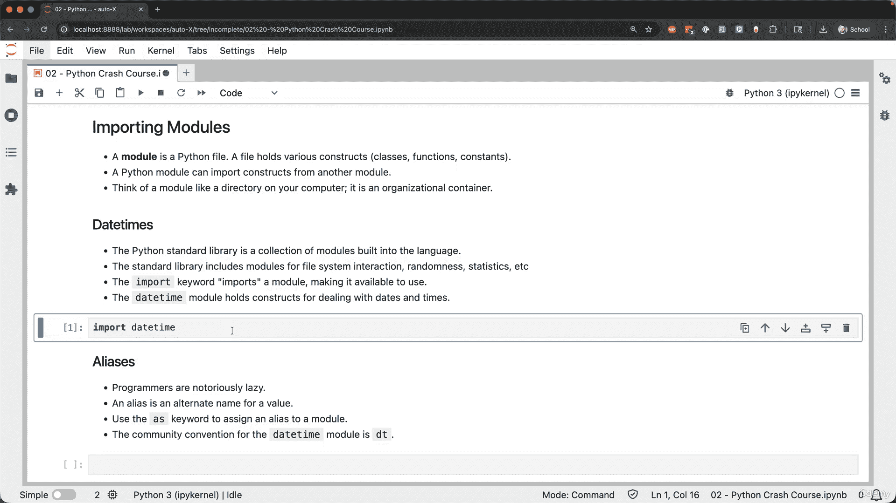

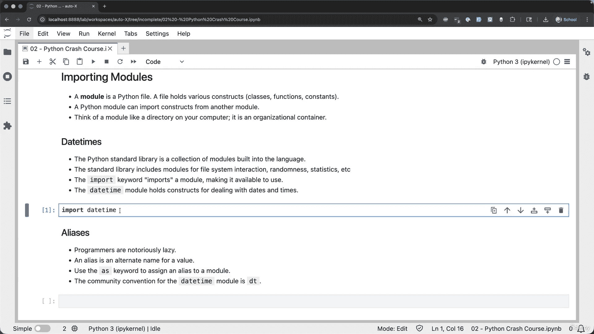

那么如何访问这些功能呢？你可以把这里的`datetime`想成一个文件夹或容器，它让你能够访问其中包含的一大批功能。在下面的代码里，如果我写刚刚导入的模块名`datetime`，然后加一个点，再按Tab键，就会看到`datetime`模块里所有可用功能。这些功能包括各种类、实例、函数等，全部与日期和时间处理相关。重点在于，这些功能都被组织好并放在`datetime`模块里面。我们不能只写`time`，因为`time`具体是放在`datetime`里面的，所以要写`datetime.time`才能访问它。

以下是导入和访问`datetime`模块时的基本写法：

- 标准库是模块的集合，可以理解为组织相关代码的Python文件。
- 使用`import datetime`把`datetime`模块导入当前Notebook环境。
- 执行导入后，就可以使用`datetime`模块里的类和函数等功能。
- 把`datetime`看成一个容器，写`datetime.`后按Tab可以查看其中功能。
- 不能只写`time`，要写`datetime.time`，因为`time`包含在`datetime`模块里。

在标准库和`datetime`导入方式的基础上，本节接下来看看别名。起别名能让代码更短，也能减少重复输入。

## Polars与Python数据分析：25.3：别名与as关键字 🏷️

在练习这些对象之前，我先快速说明一下别名。程序员通常比较“懒”，这也是我们喜欢计算机的原因之一，因为计算机可以帮我们自动化生活中很多重复性工作。别名就是我们在程序里给某个值或某个名字分配的另一个名称。屏幕上的这种语法完全有效，但很常见的做法是给导入的模块分配一个不同的名字，也就是一个昵称，而且这个昵称通常更短，这样每次引用`datetime`模块里的某个构造时，就不需要在点号前面写那么多字符。

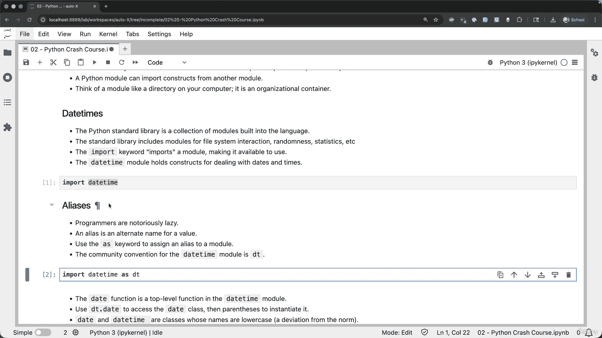

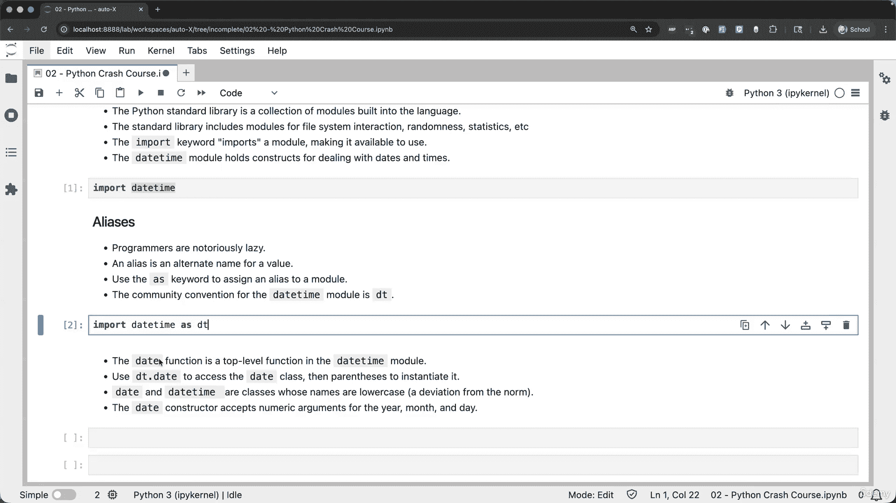

例如，这里我会复制上面完全相同的代码`import datetime`，然后在末尾添加一些额外代码，添加一个新关键字`as`。`as`允许我们给前面的模块分配一个别名或替代名称。社区里给`datetime`分配名称的惯例虽然是完全由你决定，但常见惯例就是`dt`。现在执行这段代码后，我们导入了`datetime`模块，并且作为第二步，让这个名字等于别名`dt`，`dt`基本上就是`datetime`模块。现在不必写八个字符再加一个点，只要写`dt`两个字符再加一个点，就大大减少了需要输入的字符总数。

```python
import datetime as dt
```

例如在下面，模块里有一个`date`函数或`date`类，用来建模日期和时间。不必写`datetime.date`，现在可以直接写`dt.date`，它实际上就是一个快捷方式。再次强调，我们需要这段导入代码，不能只写`date`，因为Python里没有顶层的`date`对象，但`datetime`模块顶层有一个`date`对象，它被别名`dt`引用。下面介绍别名相关的关键点，帮助我们理解为什么要这样写。

以下是别名和`as`关键字的核心作用：

- 别名是给程序里的值或名字分配的替代名称。
- `as`关键字可以给导入的模块分配别名或替代名称。
- 社区常见惯例是把`datetime`起名为`dt`，具体名称由你决定。
- 使用`dt.date`可以代替`datetime.date`，只是减少输入字符的快捷方式。
- 不能只写`date`，因为Python没有顶层`date`对象，`date`在`datetime`模块里，通过`dt`别名访问。

有了导入和别名以后，本节我们实际创建一个日期对象，并看看方法调用和属性访问的区别。

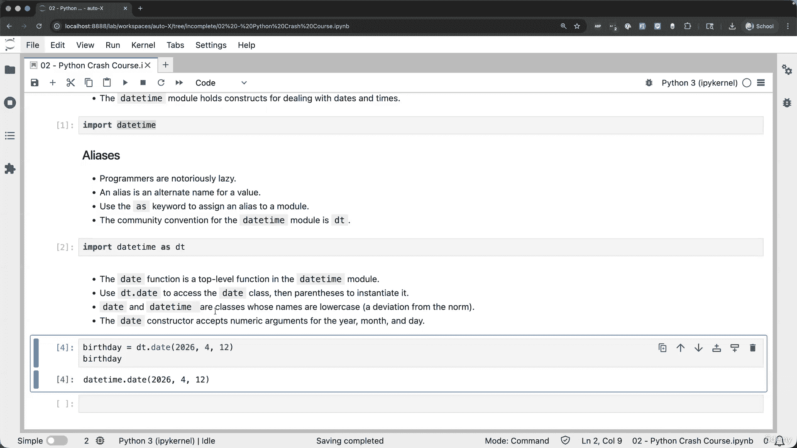

## Polars与Python数据分析：25.4：创建日期对象与访问方法属性 🧮

创建类的实例时，我们提供一对圆括号，然后在括号里提供一些参数。这个实例构造函数的三个顺序参数分别是年、月、日。假设我想建模我的生日，年份写2026，第二个参数月份写4，第三个参数日期写12，你也可以提供其他值。执行后，我们会得到一个有意思的日期对象，它建模了一个日期和时间。这里的关键收获是：我们正在从另一个模块，也就是`datetime`模块里访问功能和对象。从某种意义上说，这和列表或字典没有区别，因为它也是一种数字数据结构，是一个对象，帮助我们解决或建模某种现实世界问题或领域。唯一的区别是，它放在`datetime`模块里面，像被藏起来一样。

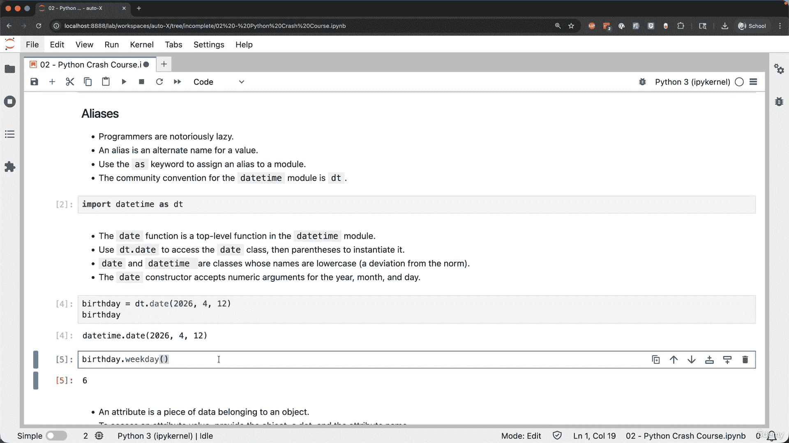

```python
birthday = dt.date(2026, 4, 12)
birthday
```

就像任何其他对象一样，我可以把这个对象赋值给变量，比如赋值给`birthday`，并在下面预览`birthday`。也像任何其他对象一样，它会有自己的一组方法。例如，我可以访问一个特殊方法`weekday`。执行后，这个方法返回一个数字，表示这个日期对应星期几：0表示星期一，1表示星期二，以此类推。所以它告诉我，这个4月12日日期对应的星期数字是6，也就是星期日。关键收获是，这只是另一个对象，也只是在这个对象上调用方法。

```python
birthday.weekday()
```

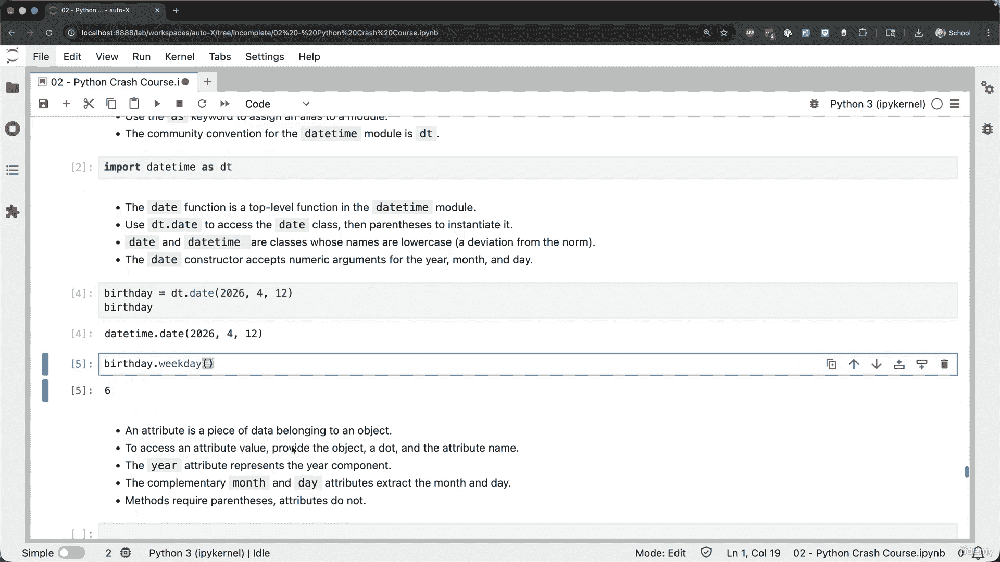

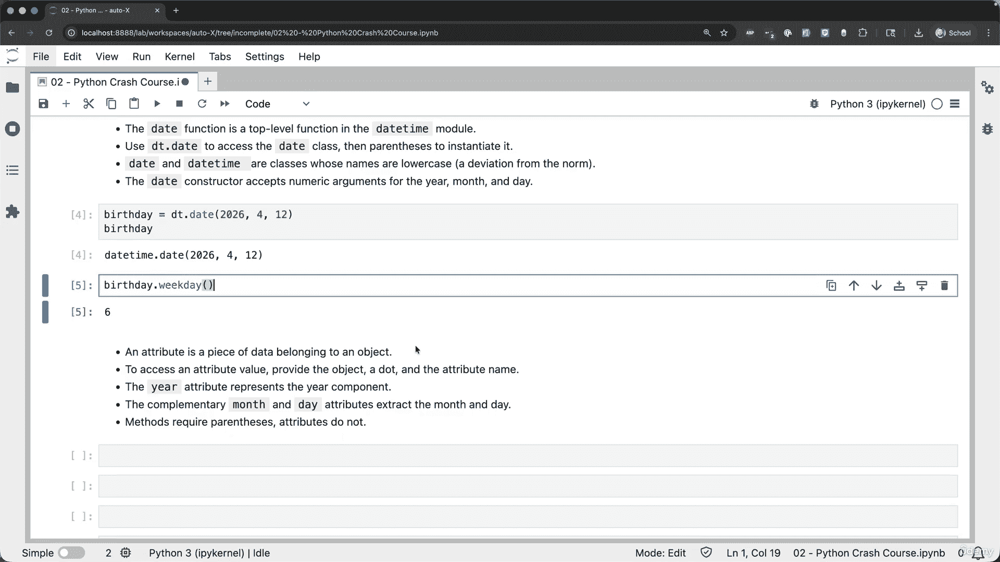

`date`对象有一个以前在其他对象上没有见过的有趣之处，它给我们机会介绍Python里的“属性”概念。我们之前讲过方法，方法是我们可以要求对象执行的行为或动作。属性更简单，可以把属性理解成属于对象的一块数据，是对象的一个特征，是对象的一个细节。方法是命令，属性只是关于对象的事实，是让对象告诉我们一些关于它自身的信息，而不是要求对象做事。

访问属性的语法是：提供对象或它的变量，比如`birthday`，然后和方法很相似，写一个点，再写属性名。两者的区别是，方法需要一对圆括号，属性不需要。例如，我们创建的这个日期对象有一个`year`属性。语法看起来就是写一个点加属性名`year`，这个属性是`date`对象特有的。它会给出对象实际表示的年份，只是年份；2026年4月12日的年份是2026。所以，我们不是要求对象为我们做什么或创建什么，只是向它询问一条信息。每个`date`对象都会知道自己的年份，可以通过`year`属性访问；还有一个对应的属性叫`month`，它会告诉我们日期对象里存储的月份；还有一个对应属性叫`day`，它会告诉我们日期对象表示的日。

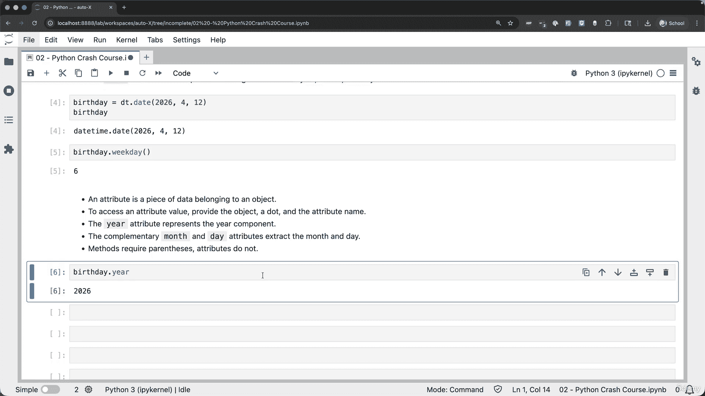

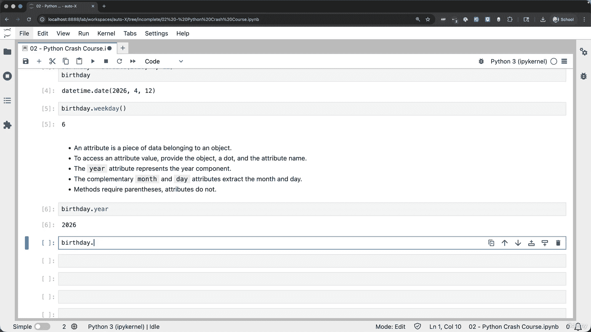

```python
birthday.year
birthday.month
birthday.day
```

下面把创建对象、调用方法和访问属性的写法集中列出，方便对照记忆。可以记成：方法调用是`对象.方法()`，属性访问是`对象.属性`。

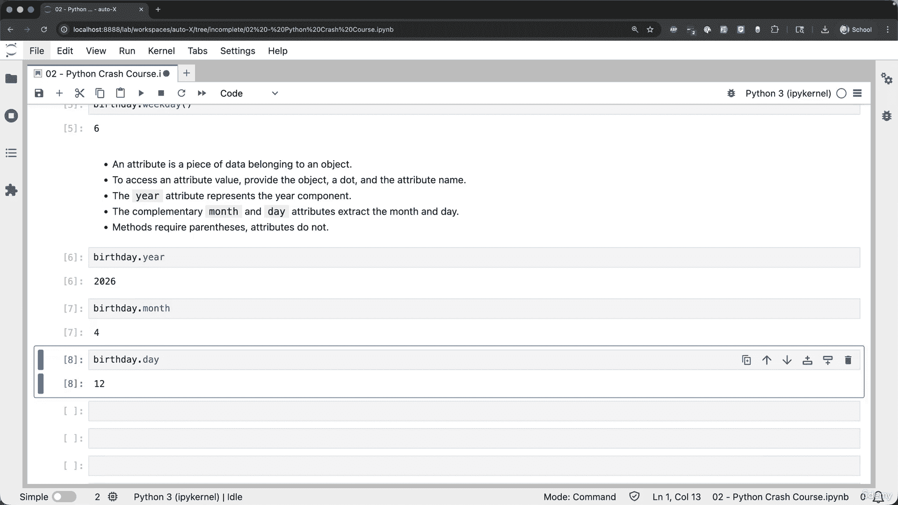

以下是创建日期对象和访问方法与属性的核心写法：

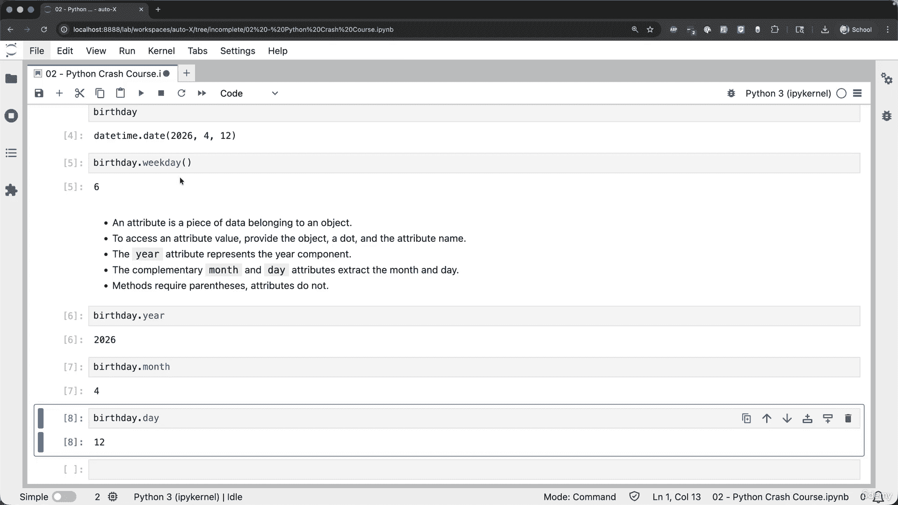

- 创建实例用圆括号，`dt.date(2026, 4, 12)`里的三个顺序参数是年、月、日。
- 创建出来的`date`对象可以赋值给变量，例如`birthday`。
- 调用方法要加圆括号，例如`birthday.weekday()`返回表示星期几的数字。
- `weekday()`返回0表示星期一，1表示星期二，6表示星期日。
- 访问属性不加圆括号，例如`birthday.year`得到年份2026。
- `date`对象还有`month`和`day`属性，分别得到月份和日。
- 方法通常需要在Python里执行额外计算或过程式代码来算出值。
- 属性更像访问对象已经拥有的信息，只是查询对象、询问它关于自身的信息。

前面我们分别看了模块、标准库、导入、别名、对象、方法和属性，本节最后把整节课的内容串起来总结。

## Polars与Python数据分析：25.5：本节课总结 ✅

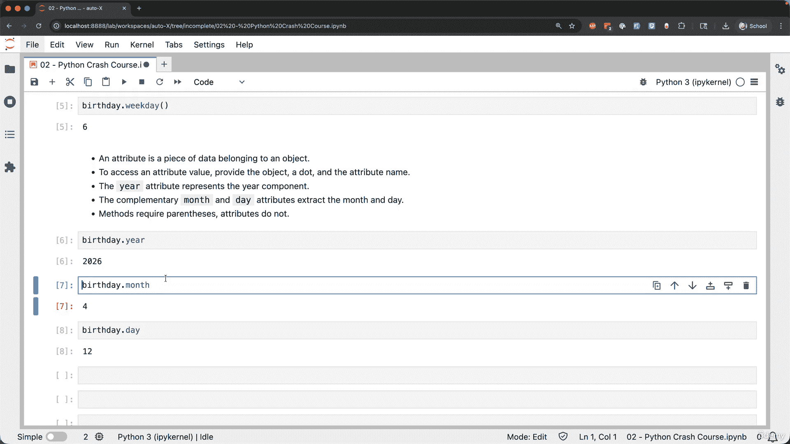

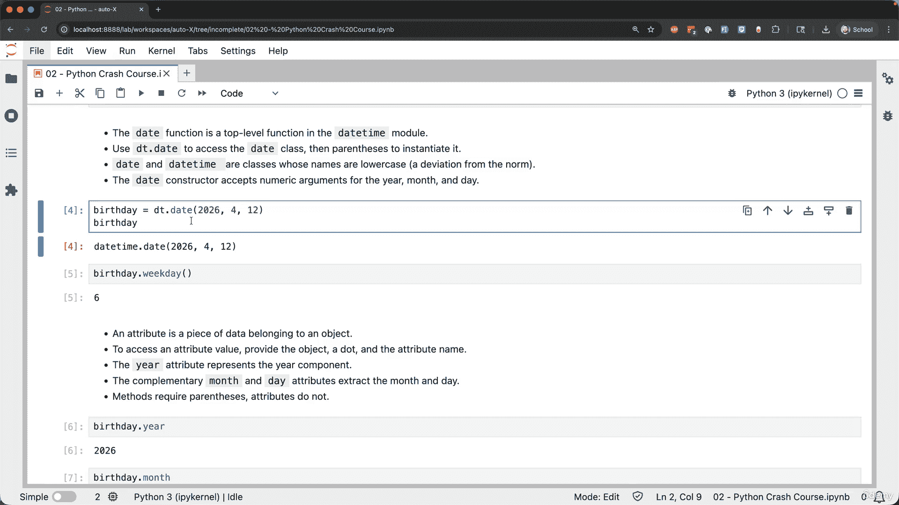

本节课中我们一起学习了导入模块的快速入门。关键收获是：并不是所有功能都会立即出现在你的程序里，所以你要使用`import`关键字把模块带入Notebook。导入模块简单来说就是加载那个文件，也可以理解成加载那个文件夹、加载那批功能到Notebook里，这样你才能使用该模块里定义的所有构造。你还可以用`as`关键字给模块分配一个可选别名，目的就是减少引用该模块时需要写的字符总数。要真正访问模块里定义的东西，我们写模块名，例如例子里的`dt`，技术上它是别名，然后写一个点，再写实际构造；这个构造可以是类，也可以是函数或常量。以上就是对导入模块的快速介绍。回过头看，本节从模块是代码文件和组织容器讲起，接着说明标准库和`datetime`模块的导入方式，再介绍别名、日期对象、方法调用和属性访问，这些内容共同构成了Python导入模块的基础流程。
