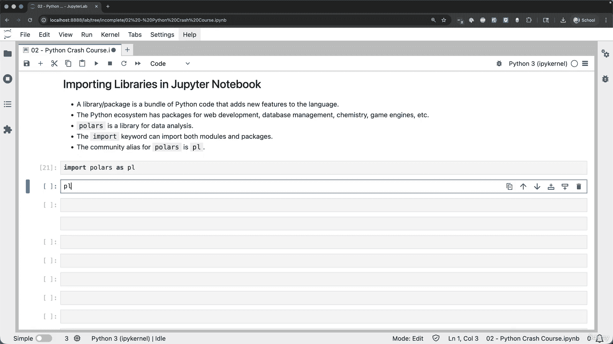
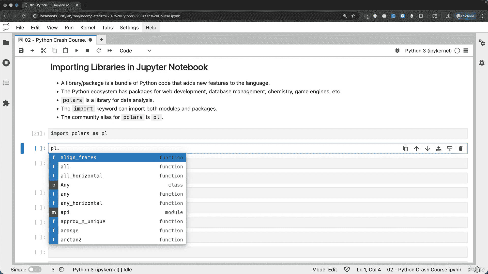
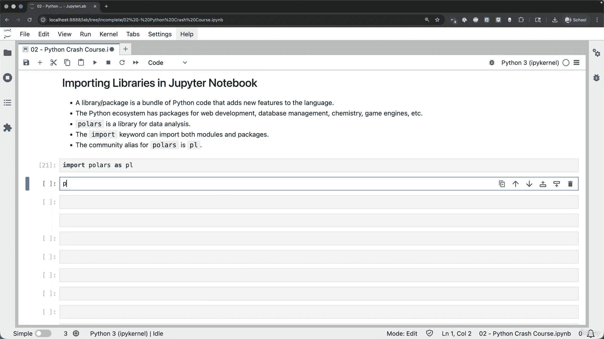

# 数据分析与Polars和Python：第26节：导入库 📚

在本节课中，我们将学习如何在Jupyter notebook中导入库（libraries）和包（packages），重点掌握`import`关键字的使用方法，并理解Python标准库与第三方包之间的区别。我们还会以Polars为例，演示如何通过别名（alias）简化调用方式，为后续的数据分析操作打下基础。

在上一节课中，我们使用了`import`关键字从Python标准库中引入了`datetime`模块，并在Jupyter notebook中成功调用了它。回顾一下，当时我们写的是`import datetime`，然后通过`datetime`这个名称来使用其中的函数和类。这个流程看似简单，但背后涉及的其实是Python生态系统中一个非常重要的概念——模块和库的组织方式。本节课，我们将在此基础上进一步探讨如何导入第三方包，以及如何利用别名让代码更简洁。

那么，什么是Python标准库呢？简单来说，Python标准库是直接内置在Python核心语言本身中的一套工具集。这意味着，无论你在哪台计算机上安装Python，都会自动获得对`datetime`模块以及标准库中其他所有模块的访问权限，不需要额外下载或安装任何东西。标准库就像Python自带的“工具箱”，里面装满了常用的功能模块，比如处理日期时间的`datetime`、处理文件路径的`os`、进行正则匹配的`re`等。这一设计让Python开箱即用，非常方便。

除了标准库之外，Python生态系统中还包含了一个概念叫做“库”（library）或“包”（package）。一个库就是一堆Python代码的集合，它能为语言添加新的功能特性。你可以把它理解为别人写好的、可复用的功能模块，我们通过导入来使用这些功能，从而避免自己从头编写所有代码。Python生态系统拥有成千上万个包，你可以根据项目需求选择性地添加到自己的项目中，这些包属于“可选依赖”的概念。

以下是Python生态系统中一些常见的包类型：

- 用于Web开发和与数据库交互的包，比如`Flask`、`Django`、`SQLAlchemy`等，它们可以帮你快速搭建网站或操作数据库。
- 用于化学和物理计算的包，比如`NumPy`、`SciPy`，它们擅长处理科学计算和复杂数学问题。
- 用于游戏引擎和其他各种用途的包，比如`Pygame`，可以让Python编写游戏。

你可以把这些包看作是可选的依赖项，我们可以把它们引入项目中，目的就是复用别人的代码，这样就不需要自己亲自编写那些复杂又费时的功能了。同时，我们可以自主决定项目中使用哪些包。具体来说，Polars就是一个用于数据分析的库（或包），它并不是Python内置的，而是我们选择在项目中使用的可选附加组件。目前，我们的开发环境中已经安装了Polars，但具体要在哪个Jupyter notebook或者什么上下文中导入使用，完全取决于我们自己。

好消息是，我们依然可以使用同一个`import`关键字来导入标准库中的模块和Python生态中的包。它们的导入方式在语法上完全一致。比如，在这里我再次使用`import`关键字，后面跟一个空格，然后写上Polars的包名（Polars）。注意，这里的Polars是一个包，它不像标准库中的`datetime`那样是Python自带的，而是已经预先安装在我们项目环境里的第三方库。导入之后，我们就可以在当前notebook中使用Polars提供的所有功能了。

另外，和标准库中的模块一样，我们也可以为这些包指定一个别名（alias）或替代名称。这样做的目的是让代码更短、更清晰，也便于在多个地方使用时保持一致性。Polars在社区中的惯例别名是`pl`，因此在这里我再次使用`as`关键字，然后提供我的缩写`pl`。这个别名是可选的，你可以不设置，也可以设置成其他名字，但遵循社区惯例是一个好习惯，这样就能与编写Polars代码的其他开发者保持一致，大家读代码时也更容易理解。现在，我将执行这个单元格，导入Polars并设置别名`pl`。

执行完成后，Polars就可以通过别名`pl`在这个notebook中使用了。这类似于之前使用的`datetime`模块及其别名`dt`。接下来，我们可以输入`pl`，然后输入一个点号（`.`），再按下Tab键（或者在你的代码编辑器中触发自动补全功能），就能看到Polars库中定义的所有顶层导出项了。这些导出项包括函数、类以及嵌套模块，换句话说，就是Polars这个包内部打包好的各种名称。你可以把`pl`想象成一个命名空间（namespace），就像`dt`一样，它是一个装有大量可选功能的容器，你可以随时根据需要调用其中的任何功能。

在后续课程中，当我们进入Polars相关的各个部分时，每一节我都会首先在Jupyter notebook中导入Polars库，这样我们就能通过别名`pl`访问它的所有特性了。这是一种固定的开头模式，确保我们每次都能使用到Polars的完整能力。

本节课中，我们一起学习了如何导入Python标准库中的模块和Python生态中的第三方包，掌握了`import`关键字和`as`别名的用法。我们还了解了标准库与第三方包的区别：标准库是Python自带的，而第三方包需要额外安装。特别地，我们演示了如何导入Polars并设置别名`pl`，为后续的数据分析操作做好了准备。通过一个小技巧，我们看到导入后可以使用`pl.`加Tab键来查看所有可用的功能，这大大提高了开发效率。下一节课，我们将继续深入Polars的更多细节，敬请期待。
