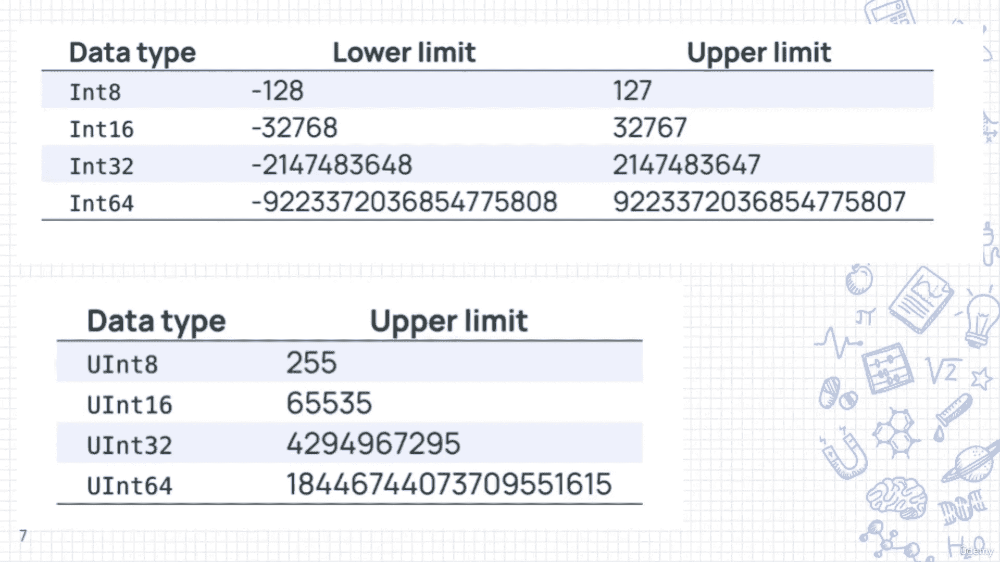
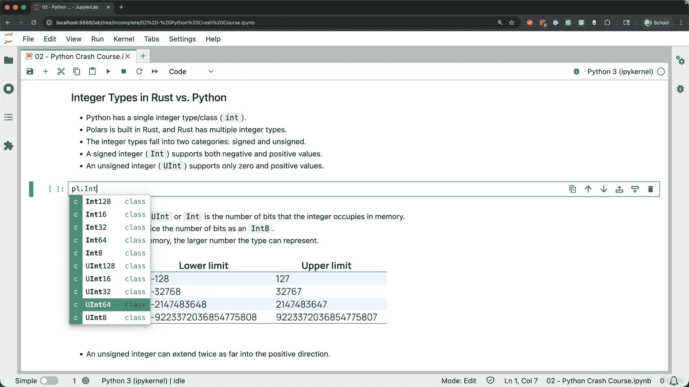

# 🧮 Polars 与 Python 数据分析：27：无符号整数与有符号整数


在本节课中，我们将要学习无符号整数与有符号整数的区别。我们会接触一些偏底层的计算机科学概念，但不会深入技术细节；目标只是建立一个总体认识，为后续深入学习 Polars 打基础。我们会从内存讲起，再说明位、字节和整数类型，最后回到 Jupyter Notebook 观察 Polars 中的整数类型。


## 💾 Polars 与 Python 数据分析：27.1：内存、分配与释放


上一节概述了本课目标，本节我们来看看计算机内存的基本概念。计算机有内存，内存是计算机上真实存在的硬件，是一个存储位置，用来保存临时数据。程序运行，例如浏览器或电子游戏，会向计算机请求内存，这个过程叫分配（allocation）。程序运行结束后把内存归还给计算机，这个过程叫释放（deallocation）。


内存的问题在于它是有限资源，每台计算机上的内存数量固定且有限，不是无限的。因此程序使用更少内存是有益的，这样更多内存可供其他程序请求。我们都遇到过同时打开很多内存密集型程序的情况，例如视频编辑器、照片编辑应用或电子游戏，当计算机可供分配给更多程序的内存变少时，计算机就会变慢。


## 📏 Polars 与 Python 数据分析：27.2：内存单位与位


上一节我们介绍了内存和分配释放，本节我们来看看内存如何计量。内存用多种单位测量，这些单位代表不同的大小或尺度。之所以有不同尺度，是因为小单位在达到一定大小时不再有帮助，这和毫米、厘米、米可以建模不同大小是同一个道理。你可能不太熟悉位，但很可能听过 MB 或 GB 这些更大的内存单位；计算机最小内存单位是位（bit）。可以把位看成一个盒子，里面存 0 或 1；也可以看成一个开关，处于开或关状态。因此位只有两个选项：是或否。所有其他内存测量单位都从位构建起来。


以下是从位到大单位的构建关系：


\[
8\ \text{bits}=1\ \text{byte}
\]

\[
1024\ \text{bytes}=1\ \text{KB}
\]

\[
1024\ \text{KB}=1\ \text{MB}
\]

\[
1024\ \text{MB}=1\ \text{GB}
\]

\[
1024\ \text{GB}=1\ \text{TB}
\]


这里有一些更细的技术细节，但这个关系大致正确，也说明小单位如何构建成大测量单位。当多个位按顺序存储时，我们就能表示更复杂的内容，例如整数和浮点数。把整数映射到字符后，我们就能表示单词。有了单词，就能形成编程语言结构，依此类推。底层会更技术化，但关键结论是：位这个简单的构建块，一个存 0 或 1 的盒子，是今天所有计算机软件的基础；所有复杂性都从简单原始构建块搭建起来。


## 🐍 Polars 与 Python 数据分析：27.3：Python 的 int 与 Rust 的整数类型


上一节我们介绍了位和内存单位，本节我们回到编程语言的数据类型。在前面内容中，我们已经探索多种 Python 数据类型，包括整数类型 int。Python 中所有整数，无论正负、大小，都由单一整数类型 int 类或 int 类型表示。

提醒一下，Polars 库是用另一种更底层的编程语言 Rust 构建的。Rust 提供多种整数类型，这也是该语言平均而言能比 Python 快很多的原因之一。原因是它可以在可能时使用更小的数据类型，从而减少程序总内存。例如，存储像 5 这样的小数字时，可能不需要像存储 10 亿这样的大数字那么多计算机内存。在 Python 中，我们始终只有单一 int 数据类型，所以存储小数字时，程序可能向计算机请求超过必要数量的内存。在 Rust 这样的语言中，我们可以优化并最小化总内存需求，方式是请求更小的整数数据类型。

存储一个值时看不到速度差异，但存储包含数百万行数据的表时，这些细小差异会显著累积。Rust 的整数类型分成两大类：无符号整数和有符号整数。


以下是有符号整数与无符号整数的基本区别：


```text
signed integer：可以表示负数和正数，类似 Python 的 int
unsigned integer：只能表示 0 和正数，不能表示负数
```


有符号整数支持负值和正值，可比作 Python 的 int 类型。无符号整数只支持 0 和正值，换句话说不能建模或表示负值。

无符号整数有益处，原因有几个。第一，现实世界中某些概念不能表示为负值，例如距离、速度或年龄，这些必须始终表示为正数，因此可以使用只表示 0 或正数的类型来建模。第二，无符号整数不需要考虑存储负号，所以在相同内存下，其正方向的范围或容量可以扩展到有符号整数的两倍。稍后会进一步说明。


## 🔢 Polars 与 Python 数据分析：27.4：Polars 中的有符号与无符号整数预览


上一节我们比较了有符号和无符号整数，本节我们预览 Polars 中可用的整数数据类型。所有有符号整数都以大写字母 I 开头，类型末尾的数字表示该整数类型在内存中占用的位数。例如，Int8 类型有 8 位内存，Int64 类型是占用 64 位的整数。使用的内存越多，该整数类型能表示的范围越大。Int8，也就是 8 位有符号整数，可以建模从 -128 到 127 的数字；Int64，也就是 64 位有符号整数，可以建模大得多的数字或范围，但它需要 8 倍于 8 位整数的内存，因此这是权衡。


以下是有符号整数类型的代码预览：


```python
pl.Int8   # 8 位有符号整数
pl.Int16  # 16 位有符号整数
pl.Int32  # 32 位有符号整数
pl.Int64  # 64 位有符号整数
```


无符号整数都以 UI 开头，U 表示 unsigned（无符号）；类型末尾数字同样表示该无符号整数在内存中占用的位数。回忆一下，无符号整数数据类型的优势是：与需要相同内存的有符号整数相比，它可以在正方向扩展两倍。例如，8 位无符号整数 UInt8 不能有负值，但可以表示 0 到 255 的数字；而有符号整数 Int8 占用同样 8 位内存，最高只能到 127。因此，使用无符号整数牺牲了负方向的可能性，但在正方向获得了两倍的容量或范围。


以下是无符号整数类型的代码预览：


```python
pl.UInt8   # 8 位无符号整数
pl.UInt16  # 16 位无符号整数
pl.UInt32  # 32 位无符号整数
pl.UInt64  # 64 位无符号整数
```


对应范围可以用下面代码直观表示：


```text
Int8  : -128 ~ 127
UInt8 : 0 ~ 255
```


不需要记住所有这些范围或类型。只要记住有符号整数和无符号整数的区别，以及整数占用内存越多，支持的值范围越大，但也会要求计算机提供更多内存，可能导致程序效率更低、更慢。多数现代计算机硬件相当强大，所以这些速度差异不一定明显；但处理更复杂、更大的程序和数据结构的结构时，差异可能累积。建议在任意编程语言中解决问题时，第一优先级始终是先得到正确解决方案，然后再优化。换句话说，不要先尝试最小化内存；计算机程序的目的是交付价值，因此先确保得到可工作的解决方案，交付你打算实现的功能、价值或答案；等一切正常后，再寻找通过减少内存来优化代码的方式。


## 🧪 Polars 与 Python 数据分析：27.5：在 Jupyter Notebook 中查看 Polars 整数类型


上一节我们预览了类型名称和范围，本节我们回到 Jupyter Notebook，看看这些整数类型在 Polars 中实际是什么样子。回到 Jupyter Notebook 后，在上一课中我们导入 Polars 库并给它别名 p。因此，每当想引用 Polars 或使用其中的构造时，就用这个别名。在单元格中写 p，然后使用点号；可以把点号理解为访问 Polars 的大厅。按 Tab 键，会看到 Polars 中可导出的所有顶层构造，例如类和函数。




以下是查看顶层构造和整数类的操作示意：


```python
import polars as pl

pl.  # 按 Tab 键查看顶层类和函数
```


如果先输入大写字母 I，甚至输入 INT，就会看到 Polars 的所有整数类。以 I 或 int 开头的类是有符号整数类，可以建模负值或正值；它们占用的总位数会递增。Int8 占用内存中的 8 位，但只能表示相对较小的数字，正如前面所说，大约从 -127 到 127。增加整数类型时，我们会使用更多内存，这也允许我们建模越来越大的数字。


以下是查看有符号整数类的示意：


```python
pl.Int8
pl.Int16
pl.Int32
pl.Int64
```


还有互补的无符号整数类，它们都以 U 或 UInt 开头。类型末尾的数字表示位数，也就是它在内存中占用多少。一个 128 位无符号整数类，例如 UInt128，所需内存是较小类型的两倍，但如果需要，它也能够在内存中建模大得多的数字。我们会在课程中看到许多 Polars 类型的使用；这些类型直接来自 Rust，与 Python 单一 int 类型相比，你可以看到更多灵活性和变化。


## 📝 Polars 与 Python 数据分析：27.6：总结




本节课中我们一起学习了无符号整数与有符号整数的基础知识。我们从计算机内存、分配和释放讲起，了解了内存是有限资源，位是最小内存单位；随后比较了 Python 单一 int 类型与 Rust、Polars 提供的多种整数类型，并说明有符号整数可以表示正负值，无符号整数只表示 0 和正值，但在相同内存下正方向范围更大。最后我们在 Jupyter Notebook 中预览了 Polars 的 Int 和 UInt 类型，并记住了先得到正确解决方案、再进行内存优化这个原则。

