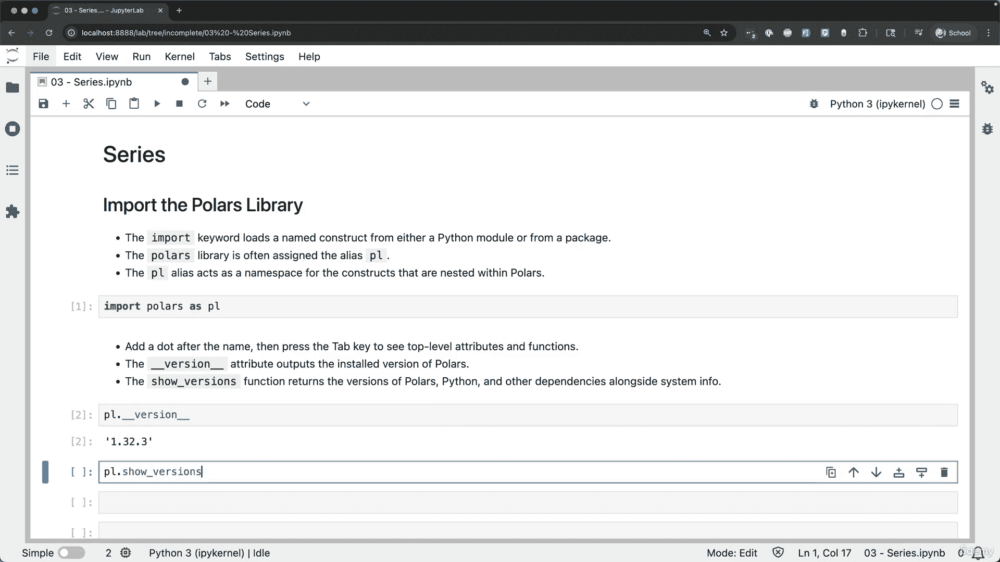
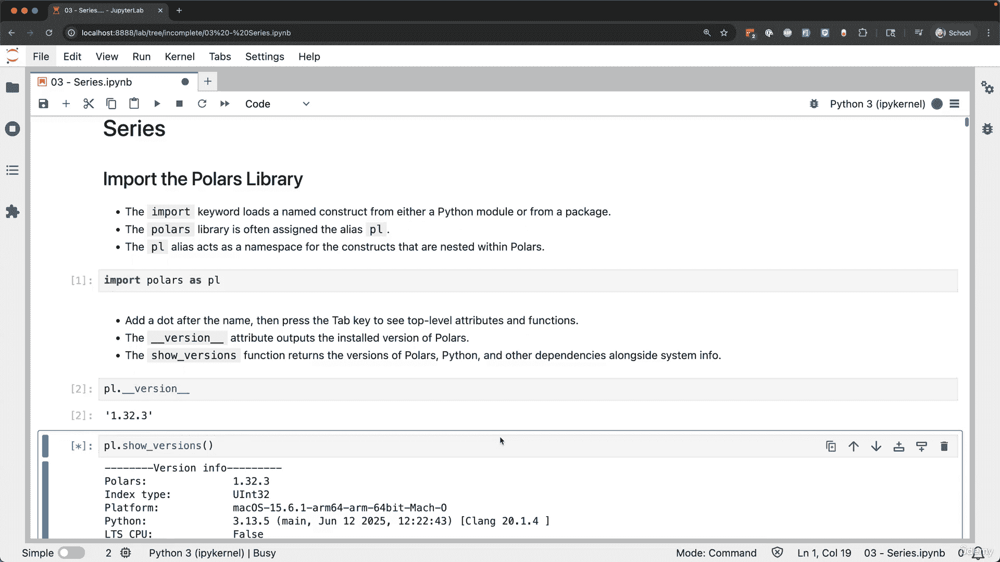
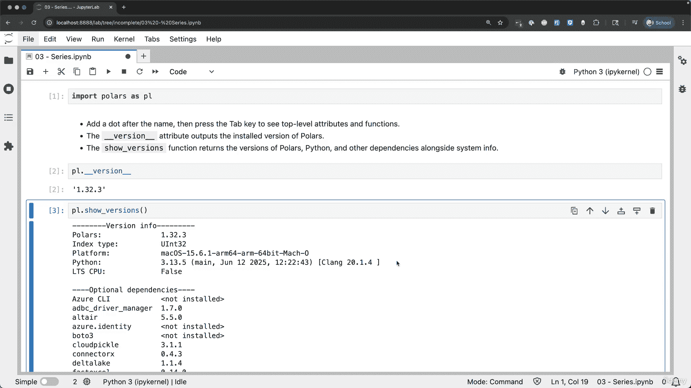
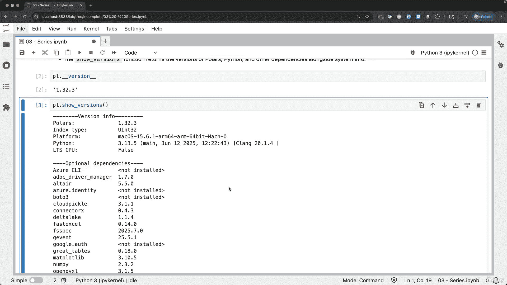
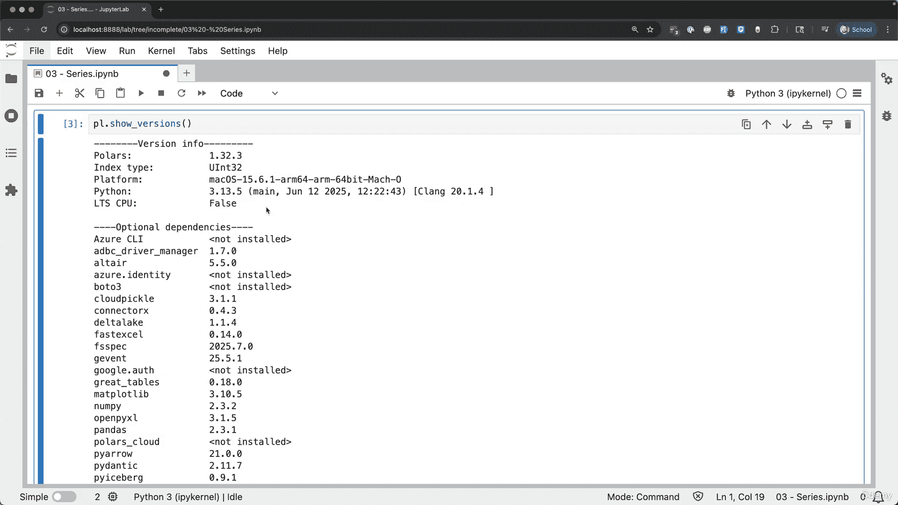

# 🧭 Polars 与 Python 数据分析：28：导入 Polars Series

在本节课中我们将要学习 Polars 库中的 Series 对象，并完成 Polars 的导入与环境检查。课程从这一部分开始进入 Polars 库的探索，而探索的起点就是 Series。Series 是 Polars 中的核心数据结构，理解它之后，后续很多数据处理操作都会更容易上手。下面先说明 Series 的基本概念，再打开本节 notebook，动手导入 Polars 并检查版本信息。

## 📦 Series 是什么

上一段我们提到本节要从 Series 开始，本节中我们来看看 Series 到底表示什么。Series 是 Polars 库中的核心数据结构，它表示一列同质数据。所谓同质数据，就是数据类型相同的数据。这个思想和 pandas 库中的 Series 完全相同。Series 可以理解为一列数据，也可以理解为一份按顺序排列、并且类型相同的数据集合。用公式表示就是：

```text
Series = 单列数据 + 同一种数据类型 + 有序数据集合
```

理解这个公式后，就能明白 Series 为什么是后续数据处理的基础对象之一。接下来我们打开本节对应的 Jupyter notebook，准备把 Polars 库导入进来。

## 🚀 导入 Polars 并设置别名

上一节我们介绍了 Series 的基本概念，本节中我们来看看如何导入 Polars 库。首先打开本节使用的 Jupyter notebook，它的名字叫 `03 series`。然后开始把 Polars 库导入 notebook。在 Python 训练营中我们见过，导入库使用同一个 `import` 关键字，用它将一个有名字的构造引入 Jupyter notebook。这个有名字的构造可以来自 Python 标准库中的模块，也可以来自 Python 生态中的包，例如 Polars。

下面列出导入整个 Polars 库并设置别名的步骤。以下是具体操作：

- 导入整个 Polars 库，在 `import` 后写一个空格，然后写全小写的 `polars`。这个库在当前开发环境中自动可用。
- 给库设置别名。别名是程序中某个名称的替代名或昵称，作用是避免每次引用某个构造时都写完整原名。
- 因为 `polars` 有六个字符，每次写完整名称比较麻烦，所以给它一个更短的别名 `pl`，只有两个字符，写起来更容易。
- 别名通常遵循社区约定，不过从技术上说，别名取什么完全由你决定。
- 设置别名的写法是在另一个空格后写 `as` 关键字，表示把 Polars 库导入成另一个名字，再在空格后指定小写 `pl`。
- 写完代码后，用 `Shift+Enter` 或 `Ctrl+Enter` 执行单元格。执行后，Polars 就可以在 Jupyter notebook 中使用。

对应的核心代码是：

```python
import polars as pl
```

这段代码执行成功后，Polars 库已经可以在 notebook 中访问。下面我们看看如何访问库里的内容，并检查 Polars 是否安装成功。

## 🔍 访问库内容与检查版本

上一节我们完成了 Polars 导入，本节中我们来看看如何访问库内构造并确认安装成功。任何时候想引用 Polars 中某个构造或名称，都可以写 `pl`，然后写一个点。这个点可以理解为访问 Polars 库的内部内容。写完 `pl.` 后按 `Tab` 键，Jupyter notebook 会出现智能提示功能。这个提示会给出 Polars 库中所有顶层构造，包括顶层类、函数、常量和其他模块，这些都是我们可以在 Polars 中访问的内容。随着课程推进，我们会逐渐熟悉其中许多名称。

先展示一个顶层属性，写法是两个下划线、单词 `version` 的小写形式、再两个下划线。这个属性会给出当前 notebook 中导入的 Polars 版本。在我的环境里是 `1.32.3`。未来观看课程时，课程材料可能更新，以便使用最新版本。如果你看到不同数字，完全没有问题。只要输出一个数字，就说明 Polars 已经成功导入、安装，并可以在 notebook 中使用。对应代码是：

```python
pl.__version__
```



接着看另一个有用的顶层函数。仍然用点访问库内容，写 `show_versions`。它是一个函数，所以需要一对括号来调用。代码如下：

```python
pl.show_versions()
```

这个函数会给出更完整的输出。输出不仅包含 Polars 版本，还包含操作系统版本、当前运行 Jupyter notebook 的 Python 具体版本，以及 Polars 生态中常用可选依赖的版本。换句话说，这些库经常和 Polars 搭配使用。你不必知道所有库，也不必安装所有库。例如，如果你想看 notebook 中可能安装的 pandas 版本，可以看到我的环境里是 `2.3.1`。许多库支持 Polars 数据，数据可以从 Polars 数据结构进入这些库，也可以反向进入 Polars。Polars 会与这些库优雅对接，接受它们的数据并转换为等价的 Polars 数据结构，例如 Series。

下面说明这个函数在排错时的用途。以下是使用建议：

- 如果你需要做技术调试，想向别人提供操作系统、Python 版本和 Polars 版本等有用技术信息，这些信息可以帮助定位技术问题。
- 建议运行 `pl.show_versions()`，复制输出内容，再粘贴给向你提供帮助的人。







到这里，Polars 已经在 notebook 中可用。下一课可以开始探索 Series 对象。

## ✅ 总结



本节课中我们一起学习了 Polars 中的 Series 概念，以及如何导入 Polars 库并检查环境。我们明白了 Series 是 Polars 的核心数据结构，表示一列同类型的有序数据，思想与 pandas 的 Series 相同。我们还用 `import polars as pl` 导入库并设置别名，用 `pl.__version__` 查看版本，用 `pl.show_versions()` 查看更完整的环境信息。完成这些准备后，下一课就可以正式探索 Series 对象。

