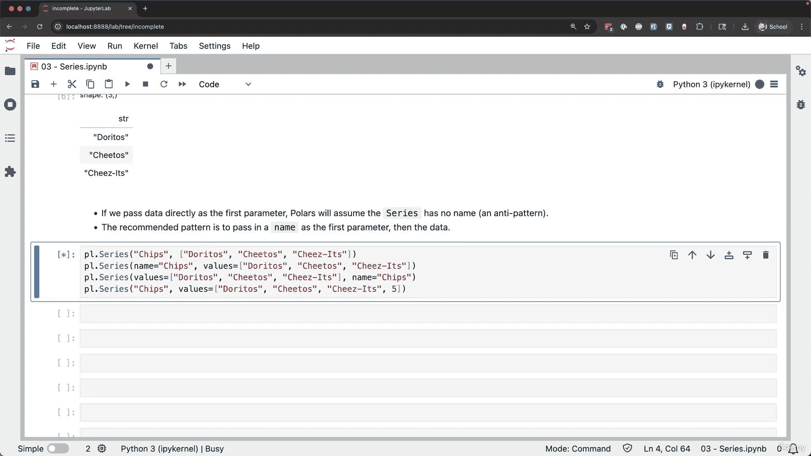
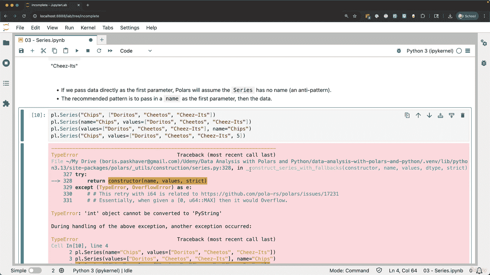
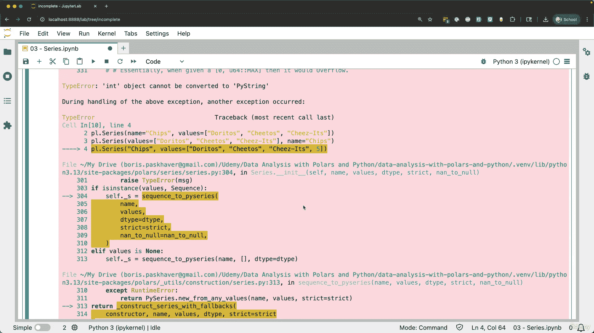
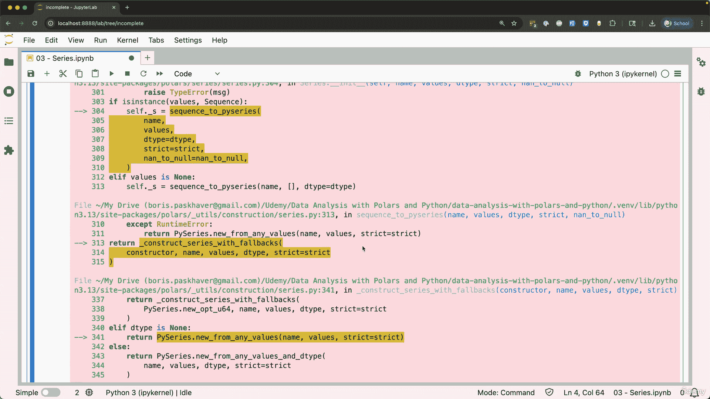
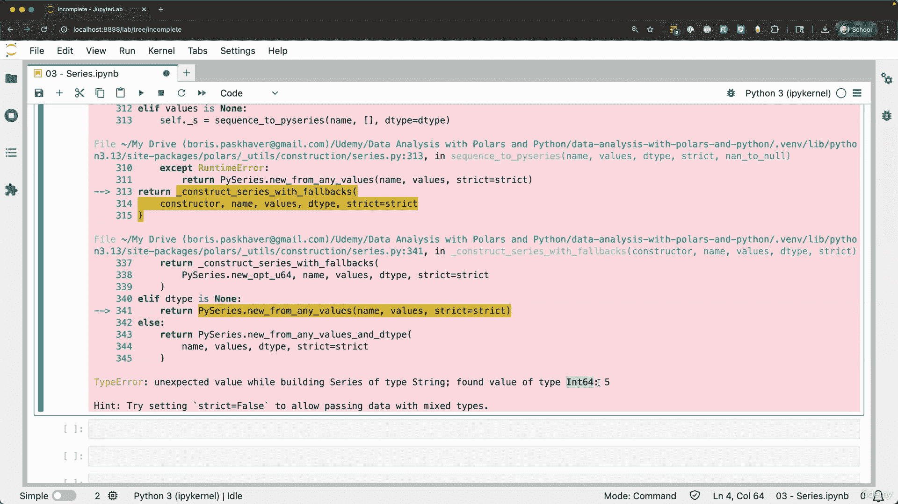
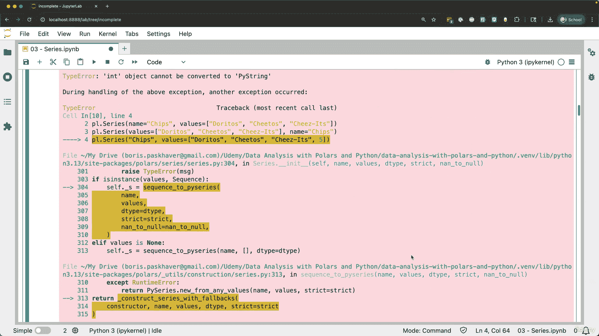
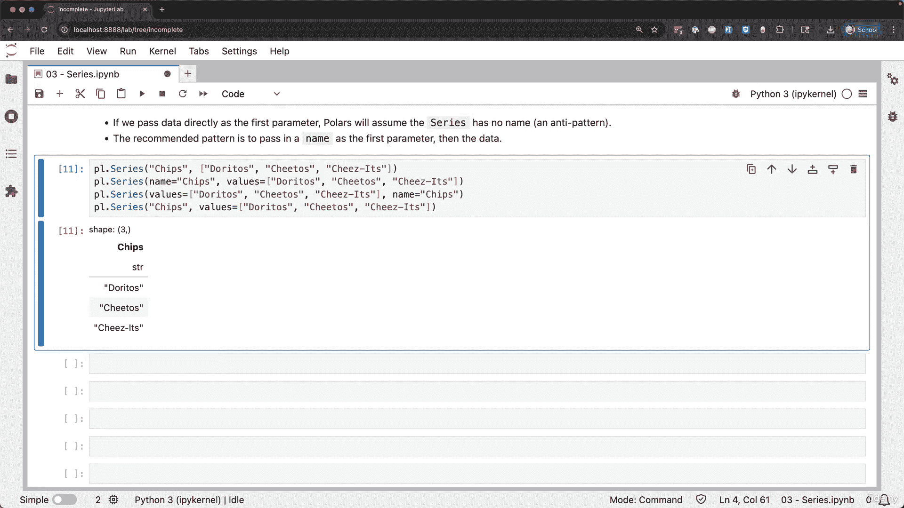

# 📊 Polars 与 Python 数据分析：29：创建 Series

在本节课中我们将要学习 Polars 的第一个数据结构 Series。Series 可以理解成一张表里的一列，它只保存同一种数据类型的数据，例如全是字符串、全是浮点数或全是整数。我们还会学习 Series 的名称、值、位置、输出信息、构造器参数和同质性规则。本课从概念开始，然后进入代码，从零创建 Series，最后验证混入不同类型时会报错。

本课的目的是让初学者能看懂 Series 的基本用法，所以讲解会尽量直白。我们会把 Series 想成 Excel 中的一列，并通过一个小小的“薯片”例子来练习。下面先从 Series 的概念开始。

## 🧩 Polars 与 Python 数据分析：29.1：认识 Series

上一节只是概述，本节中我们来看看 Series 到底是什么。Series 表示一列同质数据（homogenous data）。同质的意思是同一数据类型：一个 Series 可以是字符串 Series，也可以是浮点数 Series，还可以是整数 Series，但在任意一个给定 Series 内部，所有值必须是同一类型，不能混合不同类型。

可以用下面的公式来理解 Series 的核心结构：

```text
Series = 名称 + 同类型的一维值序列
```

Series 是一维数据结构。一维的意思是，要从 Series 中取出任意一个值，只需要一个参考点，也就是该值在序列中的位置。原文用一个可视化例子说明：Series 顶部有名称，类似 Excel 列名或数据集列名；这个例子名称是 `chips`，内部按顺序保存三个字符串 `Doritos`、`Cheetos`、`Cheeseeets`，每个值都有一个数字顺序或排队位置，这个位置就是取出该值的唯一标识。

后面会扩展到更复杂的数据结构，例如 DataFrame。DataFrame 本质上就是多个 Series 粘合或连接在一起的集合。后面还会从 CSV、Excel、JSON 等多种文件导入数据，但本课先练习最简单的方式：从零创建 Series。理解这些概念后，下一节我们进入代码，从零创建一个 Series。

## 🛠️ Polars 与 Python 数据分析：29.2：从零创建 Series

上一节我们理解了 Series 的概念，本节中我们来看看怎样从零把它创建出来。在之前的课程中已经导入 Polars 库，并给它起别名 `pl`，所以访问 Polars 中的内容时，先写 `pl` 再加一个点。这个点可以理解成进入库的“大堂”；在 `pl.` 后按 Tab 键，可以看到 Polars 的顶层名称和构造，本课要找的是大写 `S` 开头的 `Series`。

`Series` 是一个类。类可以理解成未来对象的蓝图；在类名后加括号，就是请 Python 根据蓝图创建一个实例，也就是一个具体的值。Series 构造器接受多种数据输入，例如列表、元组和字典。最简单的方式是传入列表，这个列表会表示用来填充 Series 的数据。

创建 Series 时，可以按以下思路来理解构造过程：

1. 导入 Polars 并起别名 `pl`。
2. 使用 `pl.Series` 调用 Series 类。
3. 传入一个列表，列表中的值会填充 Series。
4. 执行单元格，查看生成的 Series。

下面是建模“薯片”例子的代码。这里先采用未命名的写法，只是为了观察输出；原文后面会说明这种写法在 Polars 生态中属于反模式。

```python
import polars as pl

chips = pl.Series(["Doritos", "Cheetos", "Cheeseeets"])
print(chips)
```

执行后得到一个有效的 Polars Series。创建出来以后，下一节我们看看输出里每一项信息代表什么，并讨论命名为什么重要。

## 🔍 Polars 与 Python 数据分析：29.3：查看输出与命名

上一节已经创建了一个 Series，本节中我们来看看输出中的 `shape`、数据类型和值，以及 Series 名称的意义。输出中的 `shape` 用来告诉我们 Series 的维度，严格说是行数乘以列数；但 Series 技术上只有一列，所以列数被省略，只看到数字 `3`，表示有三行，也就是三个字符串。接下来会看到数据类型，本例子中类型是字符串，字符串在 Polars 中缩写为小写 `str`，是 strings 的简写。然后会看到具体的值。

Polars 和 pandas 有一个明显区别：Polars 打印字符串时总是带双引号，用这个视觉提醒告诉读者这些值是文本。因此这个输出表示一个包含三个值的字符串 Series。可以用下面的代码和输出结构来理解：

```python
shape = (行数, 列数)
# Series 只有一列，所以列数省略，显示为 (3,)
```

这个 Series 当前技术上没有名称，而在 Polars 生态中这属于反模式。后面扩展到 DataFrame 或由多列、多个 Series 组成的表时，理想情况下每一列都应该有自己的唯一名称，这个名称会作为列的标识，也是在大表中定位该列的方式。这个 Series 当前没有名称。在输出中看到名称和数据类型以后，下一节我们打开构造器文档，理解 `name` 和 `values` 两个参数。

## 📚 Polars 与 Python 数据分析：29.4：查看文档与理解参数

上一节我们注意到未命名 Series 是反模式，本节中我们来看看如何通过 Jupyter Lab 文档理解构造器参数，并正确传入名称。复制实例化代码后，可以把鼠标光标放在括号内，按住 Shift 键再按 Tab 键，Jupyter Lab 会弹出一个内嵌文档功能。这个文档直接可用，列出 Series 构造器中定义的所有参数。

构造器文档中，本课最需要关注的两个参数如下：

- `name`：表示 Series 的名称。
- `values`：表示 Series 实际存储的值。

参数是实参的名字，也就是一个输入名称，一个期望流入构造器的数据名称，用来定制即将实例化的 Series 类型。原文提醒，实参或参数会按顺序、按位置流向参数。所以如果直接写 `pl.Series(["Doritos", ...])`，技术上会把 Python 列表当作 `name` 参数的实参，这在技术上是错误的。Polars 团队预判到这是常见写法，因此在代码中支持这种语法，并在代码段中判断：用户不是想传名称，而是想给 `values` 参数传数据源。这仍然是反模式，因为没有在技术上把正确的东西传给正确的期望参数。

正确做法是给第一个参数 `name` 传入正确的第一顺位实参。在列表前传入 Series 名称，例如字符串 `"chips"`。参数之间用逗号分隔，这是技术要求，逗号后加空格提高可读性。代码如下：

```python
import polars as pl

chips = pl.Series("chips", ["Doritos", "Cheetos", "Cheeseeets"])
print(chips)
```

执行这个单元格后，会再次得到一个 Series，它存储三行。与之前输出唯一的不同是，现在 Series 名称会以加粗形式显示。Polars 还有一个视觉特点：会交替高亮行，例如第二位置的 `Cheetos` 有深灰色背景，这让行更容易被视觉识别。正确传入名称以后，下一节我们继续看参数传递的多种写法，包括顺序传参、关键字传参和混合传参。

## 🧾 Polars 与 Python 数据分析：29.5：多种参数传递方式

上一节我们理解了 `name` 和 `values` 的位置关系，本节中我们来看看 Python 中常见的几种参数传递方式，并把这些方式用在 Series 构造器上。这部分主要是复习 Python，而不是 Polars 本身。除了按顺序传参，还可以显式写出参数名；本课的参数名是 `name` 和 `values`。写法是在每个实参前写参数名，再加等号。

在 Python 里，给函数或构造器传参数常见有以下几种方式：

- 按位置顺序传参：`pl.Series("chips", [...])`。
- 按关键字传参：`pl.Series(name="chips", values=[...])`。
- 混合传参：位置参数必须放在关键字参数前面。

显式写参数名有几个原因。第一是清楚，能提供更多上下文，说明这些实参分别代表什么。第二个优势是 Python 会按名称把实参和参数配对，而不是按位置顺序配对，因此可以改变传入参数的顺序。例如想先提供 `values`，只要先写 `values` 名称，就可以反转参数顺序，仍然得到完全相同的 Series。

也欢迎混合使用位置参数和命名关键字参数，但在这种情况下，位置参数必须先出现。例如 `"chips"` 不带参数名也可以，Python 会说 `"chips"` 是第一个顺位实参，必须对应第一个参数 `name`，于是把它与 `name` 关联；后面写出的关键字参数会与对应实参关联。可以先写几个位置参数，再跳到关键字参数，这在想给较后位置的参数传值时很有帮助。例如想给 `strict` 参数传值，又不想给中间参数传参，可以先给 `name` 参数传实参，再显式跳到 `strict` 参数传入它的值，忽略其他参数。

下面用代码展示这些写法：

```python
# 按关键字传参
pl.Series(name="chips", values=["Doritos", "Cheetos", "Cheeseeets"])

# 关键字参数可以反转顺序
pl.Series(values=["Doritos", "Cheetos", "Cheeseeets"], name="chips")

# 混合传参：位置参数在前
pl.Series("chips", values=["Doritos", "Cheetos", "Cheeseeets"])

# 跳到 strict 参数，忽略中间参数
pl.Series("chips", values=["Doritos", "Cheetos", "Cheeseeets"], strict=True)
```

这些只是传参方式的一次复习。掌握参数传递以后，下一节我们回到 Series 的核心规则，验证同一个 Series 中的数据类型必须一致。

## ✅ Polars 与 Python 数据分析：29.6：验证同质性

上一节我们练习了参数传递，本节中我们来看看 Series 同质性的硬性要求，以及混入不同类型时 Polars 会怎样报错。本课已经练习了实例化或创建 Series，而 Series 存储单一同质数据类型。为了快速展示这一点，可以尝试混入一个不同类型值，例如整数 `5`，Polars 会立即报出违规，因为 Series 必须包含同一类型的数据。

关于 Series 的数据类型，可以记住下面几条规则：

- 同一个 Series 只能保存同一类型的数据。
- 字符串、浮点数、整数可以分别组成 Series，但不能在同一个 Series 中混用。
- Polars 会根据第一个元素推断 Series 的准确类型。
- 如果第一个元素是字符串，Polars 会假设数据源中所有值都必须是字符串。

例如下面的代码会在构造时出错：

```python
pl.Series("chips", ["Doritos", "Cheetos", "Cheeseeets", 5])
```

报错信息的大意是：在构建字符串类型的 Series 时发现意外值，原本期望字符串类型，却找到了不同类型的整数值 `5`。这个例子提醒我们，Series 必须同质，必须由精确的单一相同类型的数据组成。完成同质性验证以后，下一节我们对本课内容做一个收束。







## 🧠 Polars 与 Python 数据分析：29.7：本课总结









前面几节我们学习了概念、创建、输出、命名、参数传递和同质性验证，本节中我们对这些内容做总结。本节课中我们一起学习了 Polars 的第一个数据结构 Series：它表示一列同质数据，是一维数据结构，只需要一个位置参考点就能取出任意值；它顶部可以有名称，内部值按顺序排列，并且所有值必须是同一类型。我们还从零创建了 Series，查看了 `shape`、`str` 数据类型和双引号字符串输出，理解了未命名 Series 的反模式，学习了 Jupyter Lab 中 Shift+Tab 查看文档，理解了 `name` 和 `values` 参数，练习了顺序传参、关键字传参、混合传参以及跳过中间参数给 `strict` 传值。最后验证了混入整数会触发 Polars 报错，再次确认 Series 必须同质且类型精确单一。本课到此结束，下节课继续。

