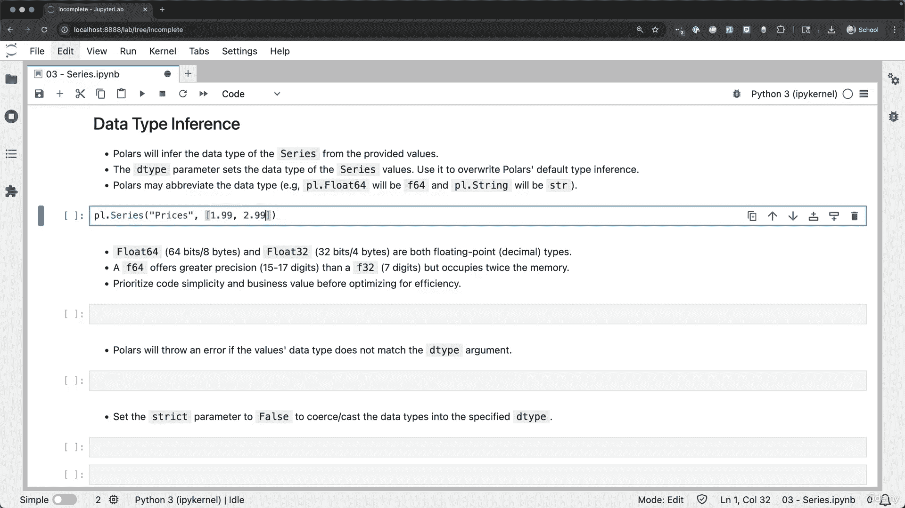

# 📊 Polars 与 Python 数据分析：第30节：数据类型推断

在本节课中，我们将要学习 Polars 如何推断 Series 的数据类型，如何通过 dtype 参数手动指定类型，以及 strict 参数在类型转换中的作用。我们还会快速了解 Float64 与 Float32 在内存和精度上的差别。这些内容对后续处理真实数据很重要，因为很多数据问题都和类型推断、类型转换有关。

## 🧠 默认类型推断：从值到 Series 类型

上一课我们看到，Polars 会根据提供值的数据类型推断 Series 的数据类型。换句话说，你给 Polars 一串数字，它会检查这些数字长什么样，然后自动决定这一列应该用哪种类型来存储。这里我们创建一个新的 Polars Series，并给它命名 prices，再提供一组浮点值。浮点数就是包含小数或分数部分的数字。例如 1.99、2.99 和 3.49。

```python
import polars as pl

prices = pl.Series(
    name="prices",
    values=[1.99, 2.99, 3.49],
)
```

运行后我们会得到一个 Series，而且你会注意到 Polars 会根据这里传入的参数推断 Series 的数据类型为浮点类型。这里的类型标记是 F64，F 是 float（浮点）的缩写，64 表示每个数字在内存中占用的内存量。这里的 64 意味着 64 位，位是内存的计量单位，用来表示每个值在计算机中占用多少内存。换句话说，`Float64` 中的 64 不是一个普通的数字，而是内存宽度的标记。

如果我把这段代码复制到下方，把光标放在括号内，按 Shift+Tab 查看文档，会看到一个参数叫 dtype，它是 data type（数据类型）的缩写。这个参数允许我们自定义推断出的 Series 数据类型，也就是在我们想覆盖 Polars 默认推断结果时使用。上一节我们看了默认推断，本节中我们来看看如何手动指定类型。

## 🛠️ 使用 dtype 参数自定义类型

例如，如果我只想复现上一个例子，并得到完全相同的 Series，我可以给 dtype 参数传入一个位置参数，类型为 Float64。这里我再次从 Polars 库中取用，库的别名是 pl，然后输入一个点。Polars 的所有数据类型实际上都定义在库的顶层，因此我开始输入时会过滤结果。如果我输入大写的 Float，会看到 Polars 中可用的两种浮点类型：Float32 和 Float64。我选择第二个并按回车，这样我就指定了 Series 的数据类型应该是 Float64 类型。这样会得到完全相同的 Series。反过来，如果我想给 dtype 参数提供参数名，也完全可以这样做。这里我可以写出 dtype，它是 data type 的缩写，提供一个等号，同样得到完全相同的 Series。

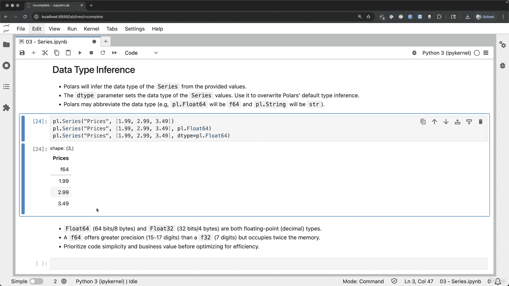

```python
prices_float64 = pl.Series(
    name="prices",
    values=[1.99, 2.99, 3.49],
    dtype=pl.Float64,
)
```

在了解怎样手动指定类型之后，我们有必要快速说明一下内存和精度的关系，因为这会影响你选择 Float64 还是 Float32。对于第一次接触这个概念的人来说，64 位和 32 位的差别值得先弄清楚。

## 💾 Float64、Float32、内存与精度

再次说明，Float64 中的 64 指的是计算机内存中的位数，也就是浮点数将占用的内存量。因此 64 位是每个 64 位浮点数占用的内存量。Polars 中互补的类型是 Float32，它只占用 32 位，也就是一半的内存。选择更大数据类型的好处是以占用更多内存为代价，换取更高的精度。精度指的是 Polars 开始对数字进行舍入之前，小数点后可以保留的位数。因为 Float64 有更多内存可用，它会给你 15 到 17 位精度。这意味着数字在小数点后可以提供 15 到 17 位数字，只有超过这个范围后，Polars 才需要开始对这个数字进行舍入。Float32 从技术上说更高效，因为只使用一半内存，但你只能得到 7 位精度。

可以用下面的关系来记忆：

```text
Float64：64 位内存，约 15~17 位小数精度
Float32：32 位内存，约 7 位小数精度
```

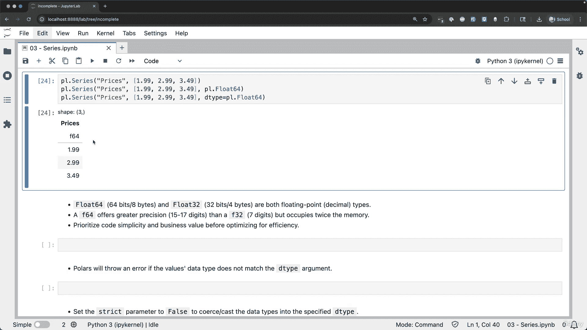

在像这里只有两位小数的场景中，我们可以把所有数字建模为 Float32，从技术上说会得到一个更高效、占用内存更少的程序。话虽如此，我仍然建议：运行代码时，首要目标永远是让程序能工作、让方案真正产生价值，并且保持代码简单，然后才去考虑优化效率。构建解决方案时，很容易被“尽可能减少所有可能的内存占用”吸引，但我建议把这件事推迟到最后。原因有很多：第一，很多时候你根本注意不到差别；第二，当你试图解决手头问题时，这不应该成为你的首要任务。事实上，这也是 Polars 团队默认推断为 Float64 而不是 Float32 的原因之一。他们并不关心把每一小位内存都优化到极致；Polars 开箱即用已经非常快、非常优化。因此，你不应该为了追求所谓最优解而试图压榨每一 bit 内存。相反，应该优先考虑简单性、可读性，以及让程序按预期工作。不过我还是想展示给你看：如果你确实想改变数据类型，这里的写法完全一样，也就是行内第三个参数 dtype。与其告诉 Polars 应把它当作 Float64，我可以改为访问互补的 Float32 类，然后会得到一个每个值类型都是 32 位浮点数的 Series，这些数字每个在计算机中只占用一半内存，也就是只有 32 位。

```python
prices_float32 = pl.Series(
    name="prices",
    values=[1.99, 2.99, 3.49],
    dtype=pl.Float32,
)
```

上面的例子说明了怎样选择浮点类型。接下来我们看看类型不匹配时会发生什么，因为 Polars 对 Series 内部数据的同质性要求很严格，这和我们上一课看到的行为一致。

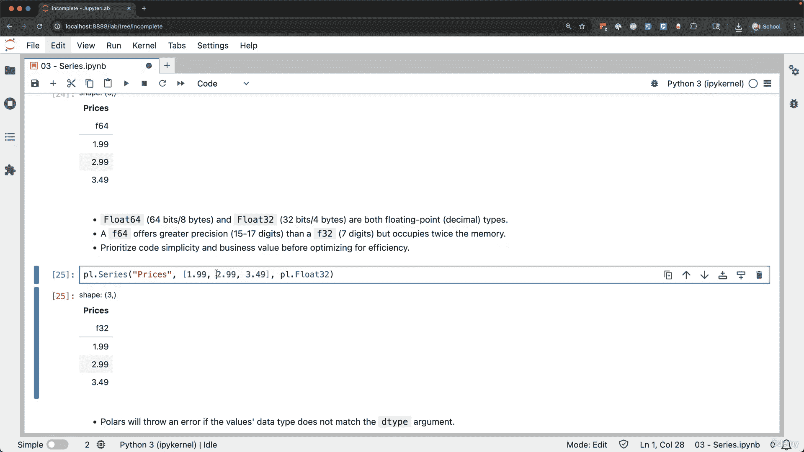

## ⚠️ 类型不匹配与异常

正如上一课看到的，如果数据源中的数据类型不匹配，Polars 会抛出异常或错误。这是因为 Series 内的数据必须是同质的，必须是同一类型。Polars 抛出异常的另一种情况是：我们给 dtype 参数提供了一个数据类型，但这个类型与数据源中值的类型不匹配。例如，我可以把下面的 Series 实例化代码复制下来，这次可能带上显式的 dtype 参数。我会要求 Polars 把这组值当作字符串集合，而字符串在 Polars 顶层对应的数据类型是大写的 String。也就是说，我要求把这些值当作字符串类型，但我传入的是一组浮点值。这实际上会触发异常和错误。向下滚动可以看到，这是一个 TypeError，Polars 表示无法将这个浮点对象转换为实际请求的 Python 字符串类型。

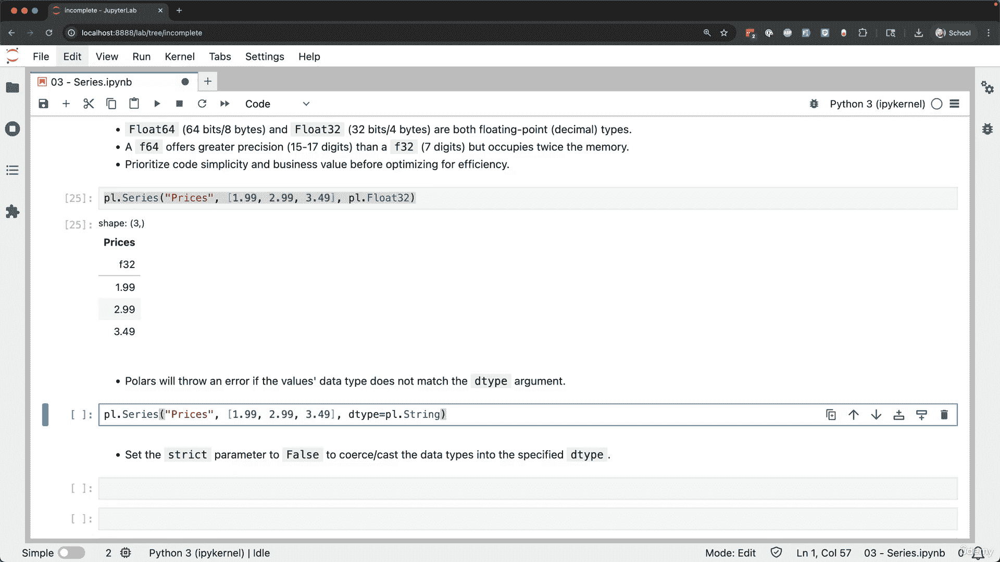

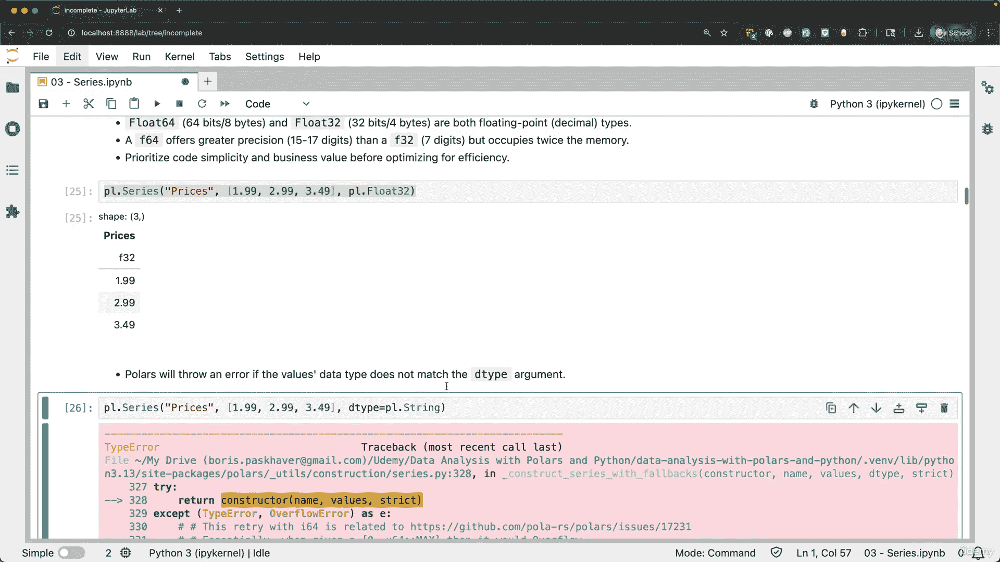

```python
pl.Series(
    name="prices",
    values=[1.99, 2.99, 3.49],
    dtype=pl.String,
)
```

那么如何解决这个问题？这里还有一个可以提供的额外参数。我可以先把这段代码注释掉并重新执行，以避免嘈杂的输出。然后把代码复制到下方。这个特殊参数叫 strict，默认情况下它被设置为 True，这意味着 Polars 会严格处理，要求数据类型与提供数据集中的每个值匹配。如果我提供 strict 参数，并把它设置为布尔值 False，我们就是在要求 Polars 不那么严格，换句话说，更宽容一些。

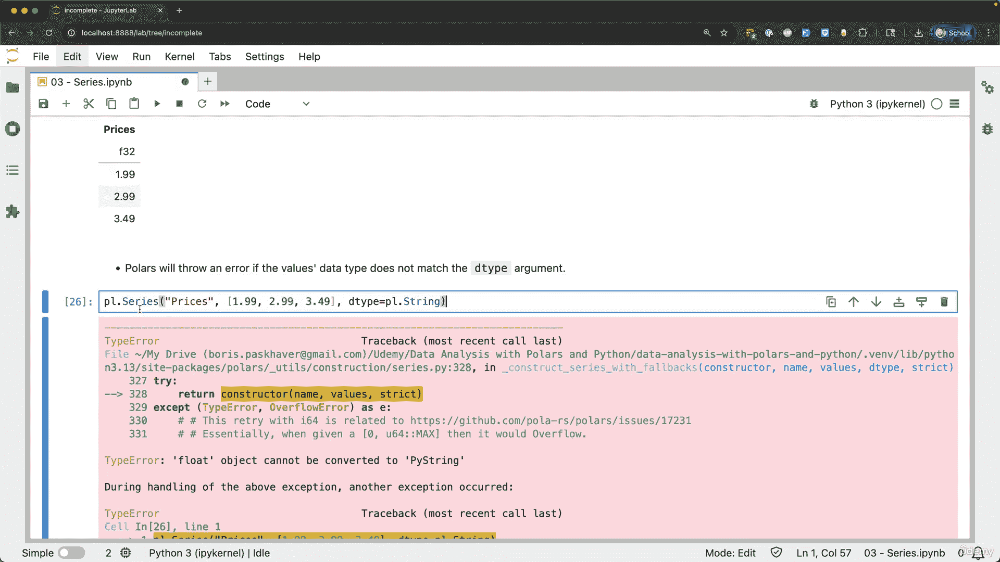

## 🔄 使用 strict=False 进行宽容转换

当 strict 设置为 False 时，Polars 会这样处理：你告诉我要把 Series 中值的类型当作字符串，而你给我的是一个浮点值列表。那么我会尝试把所有这些值转换为字符串数据类型。可以看到，这里我们降低了严格程度，因为数据类型与字符串类型并不匹配，但 Polars 仍会返回一个字符串 Series。我们可以通过两种方式立即判断它是字符串 Series：第一，类型显示为 STR；第二，与普通数值区分开，Polars 会为每个字符串打印双引号。

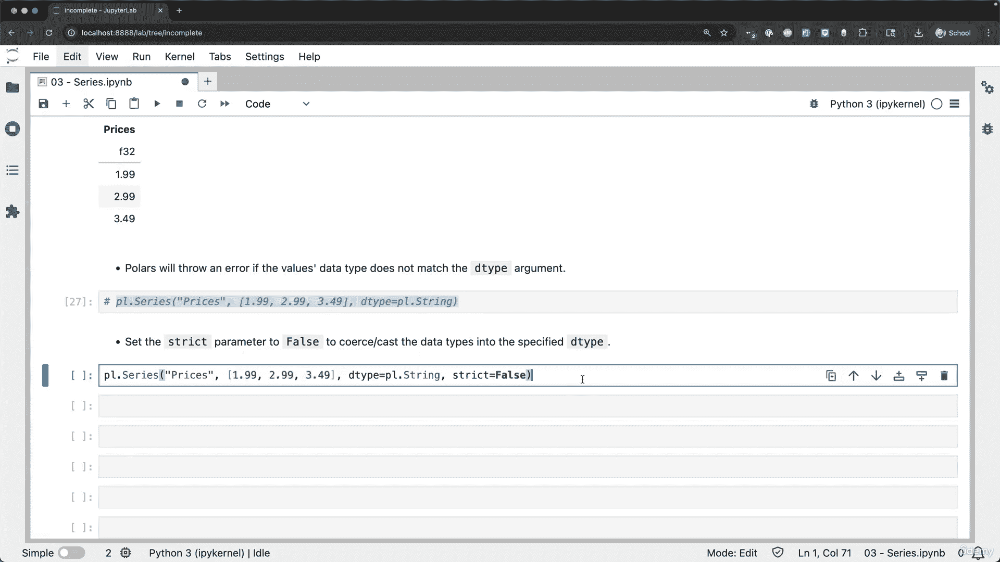

```python
pl.Series(
    name="prices",
    values=[1.99, 2.99, 3.49],
    dtype=pl.String,
    strict=False,
)
```

```text
shape: (3,)
Series: 'prices' [str]
[
    "1.99"
    "2.99"
    "3.49"
]
```

这种设置在从外部世界接收数据集时特别有帮助。例如，假设我从某个地方导出数据，不幸的是某一列中的数据不是同质的，某个系统在同一列中给了我们多种数据类型。这里在这个 Python 列表里，假设有一个字符串形式的数值，比如 4.49。所以这是一个字符串，不是小数或浮点值。处理方式是要求 Polars 不严格，并把 Series 中的每个值都当作字符串。Polars 会把这三个浮点值转换为它们对应的字符串表示，然后保留这个字符串，最终得到一个字符串 Series。可以看到所有浮点值都被转换了。

```python
mixed_to_string = pl.Series(
    name="mixed",
    values=[1.99, 2.99, 3.49, "4.49"],
    dtype=pl.String,
    strict=False,
)
```

反过来，如果我保留完全相同的代码，但把类型改为 Float64，现在我们就是在要求 Polars 尝试把数据集合中的所有值转换为 Float64 类型。这三个值不需要转换；这个字符串可以转换。因此我们会得到一个保存浮点值的 Series，更具体地说是 Float64。这里必须小心，因为如果存在无法转换的值，比如从某个奇怪系统得到的一串无意义字符串，Polars 就无法把这串无意义字符串转换、投射或强制转换为等价的浮点表示。于是我们会得到另一个值，也就是 null。我们会在本节稍后讨论 null。null 从根本上表示缺失值、不存在的值。Polars 无法把无意义内容转换为浮点数，所以给我们 null 这个值来表示缺失值和不存在的值。

```python
mixed_to_float = pl.Series(
    name="mixed",
    values=[1.99, 2.99, 3.49, "4.49"],
    dtype=pl.Float64,
    strict=False,
)
```

```python
unconvertible_to_float = pl.Series(
    name="mixed",
    values=[1.99, 2.99, 3.49, "not_a_number"],
    dtype=pl.Float64,
    strict=False,
)
```

因此，使用 strict 参数时必须小心，并仔细检查进入程序的实际数据是什么，因为 Polars 会根据你请求的数据类型、转换的严格程度以及解析方式，把这些数据转换为不同的值。

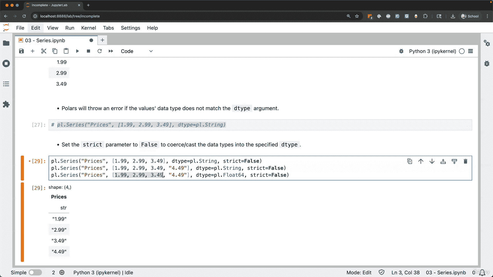

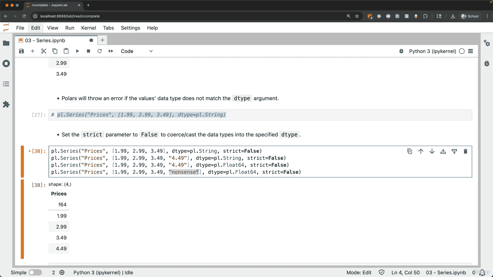

## ✅ 总结

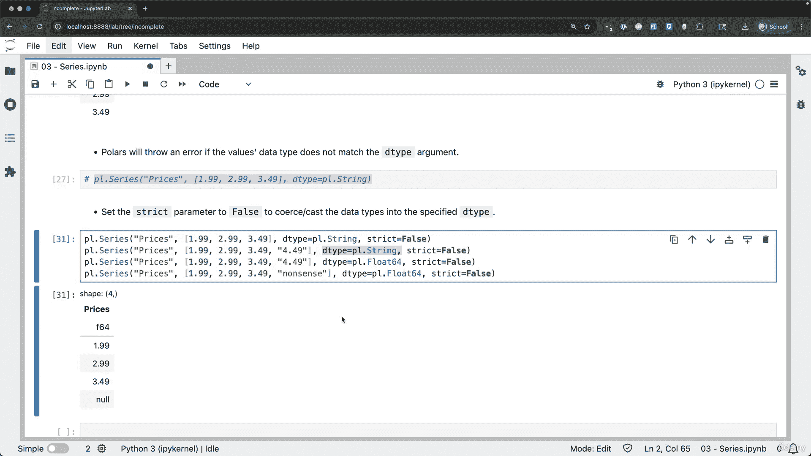

本节课中我们一起学习了 Polars 的数据类型推断和手动类型指定。我们知道了 Polars 会根据传入值自动推断 Series 类型，例如浮点值默认会得到 Float64；也知道了可以用 dtype 参数覆盖默认推断，例如指定 `pl.Float32` 或 `pl.String`。我们还了解了 Float64 与 Float32 在内存占用和精度上的差异：Float64 占 64 位、精度约 15 到 17 位小数，Float32 占 32 位、精度约 7 位小数。最后我们学习了 strict 参数：默认 True 时类型不匹配会报错；设置为 False 时 Polars 会尝试宽容转换，可能得到字符串 Series、浮点 Series，无法转换的值则会变成表示缺失值的 null。理解这些机制后，处理外部数据时就能更清楚地判断类型转换的结果。

