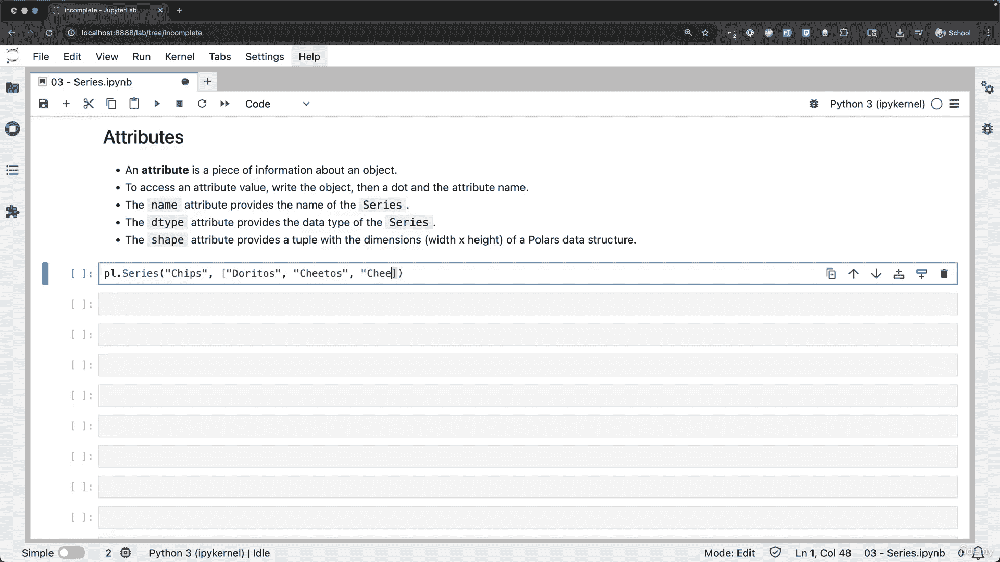
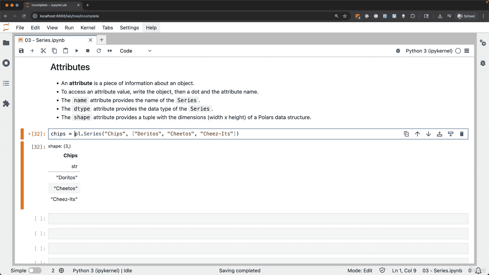
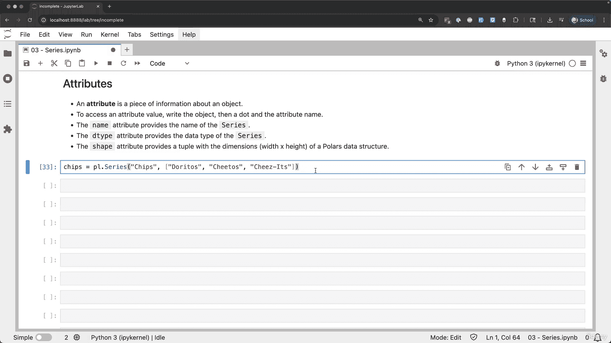
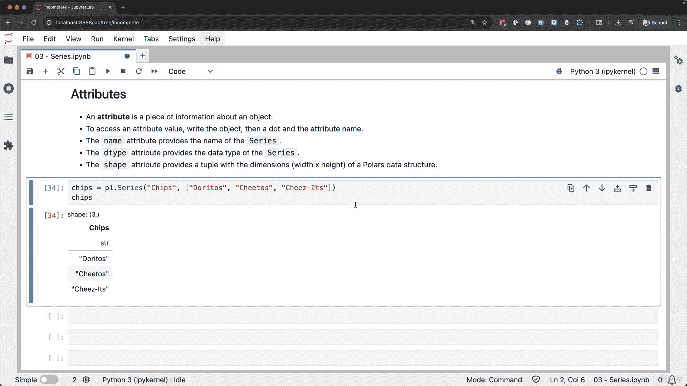
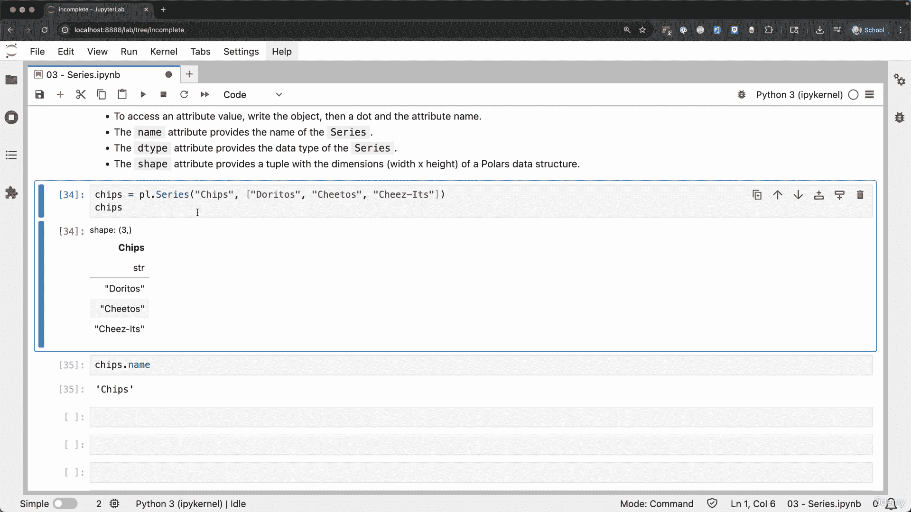
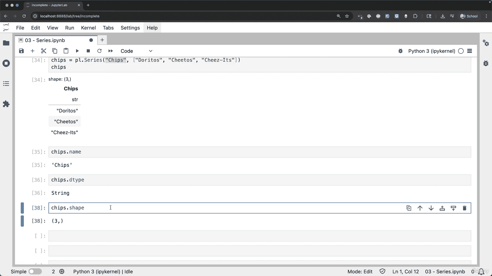

# 📊 Udemy - 使用 Polars 和 Python 进行数据分析：第 31 节：属性（Attributes）

## 🎯 概述

在本节课中，我们将学习 Polars 中 Series（序列）对象上可用的**属性（Attribute）**。我们会通过实际例子来理解属性是什么、它和后面要讲的方法（Method）有什么区别，以及如何用代码访问这些属性。本文的目标是让初学者也能轻松掌握，所以我们会用最直白的大白话解释每个概念。

## 🔍 什么是属性？

在开始动手写代码之前，我们先来搞清楚一个基本概念：**属性**到底是什么？

属性是对象上携带的**一条信息**。你可以把它理解成关于这个对象的一个细节或特征。换句话说，属性就是对象能告诉你的一件关于它自己的事情，比如“我的名字是什么”、“我的类型是什么”、“我有多长”。

这里要特别注意：属性跟**方法（Method）**是两码事。方法是我们给对象下达的一条**命令**，是要求对象去做的一个动作。方法通常涉及某种更复杂的计算，而属性只是单纯地向对象索取一个数据片段、一个关于当前对象状态的信息。

我们可以用下面的公式来对比：

```
属性 = 对象上的数据（一条静态信息）
方法 = 对象执行的命令（一个动态动作）
```

简单记：**属性是“什么”，方法是“做什么”**。

## 🛠️ 创建示例 Series

为了演示属性，我们首先要创建一个 Polars Series。我们沿用之前课程中的例子，创建一个叫做 `chips` 的 Series。

先回忆一下创建 Series 的代码：

```python
import polars as pl

pl.Series(["Doritos", "Cheetos", "Cheeselets"])
```

这段代码本身是有效的，但它只创建了一个临时对象。如果我们不把它保存到变量里，在后面的单元格中就无法再访问它了。所以我们需要把它赋值给一个变量，使用我们熟悉的变量赋值语法：选择变量名，然后写等号，再写右侧的值。

```python
chips = pl.Series(["Doritos", "Cheetos", "Cheeselets"])
```

注意，默认情况下，这行操作不会在单元格下方输出任何内容。如果你想看到这个 Series，可以直接输出 `chips` 变量：

```python
chips
```

输出结果会显示整个 Series 的内容，如下所示：

```
shape: (3,)
Series: 'chips' [str]
[
    "Doritos"
    "Cheetos"
    "Cheeselets"
]
```

好了，现在我们已经有了一个名为 `chips` 的 Series 对象，接下来就可以开始探索它的属性了。



## 🧩 访问属性的基本方法





在 Jupyter Lab 中访问属性的方式非常简单：我们提供代表该对象的变量（这里是 `chips`），然后输入一个点（`.`），接着输入属性名称。属性名后面**不需要跟括号**，这一点和方法不同——方法需要加括号来调用。

另外，在 Jupyter 中有一个很方便的技巧：输入 `chips.` 后按下 Tab 键，它会列出这个 Series 对象上所有可用的顶层属性和方法。这样我们就能快速浏览有哪些可用的属性。

## 🏷️ 属性示例 1：name（名称）

我们来看第一个属性：`name`。

这个属性会告诉我们 Series 的名称。注意，这个名字不是我们自己定义的变量名（虽然在这个例子里变量名也叫 `chips`，但这是两回事），而是我们创建 Series 时在实例化代码中提供的名字。

```python
chips.name
```

执行后，我们会得到：

```
'chips'
```

这里得到的 `chips` 是 Series 内部的名称，它来源于创建时的字符串。也就是说，在 `pl.Series(["Doritos", ...])` 这个构造过程中，我们没有显式指定名称，所以 Polars 默认使用了第一个参数？等一下——实际上我们创建的时候并没有传入名称参数，但 Polars 会自动给 Series 命名为变量名？让我们仔细看看代码：`chips = pl.Series(["Doritos", "Cheetos", "Cheeselets"])`。在这个调用中，我们没有指定 `name` 参数，但 Polars 会默认将 Series 的名称设置为空？但是我们在 Jupyter 输出中看到了 `Series: 'chips' [str]`，这说明名称确实被设置为了 `chips`。这是因为当我们把 Series 赋值给变量 `chips` 时，Polars（在某些情况下）会使用变量名作为默认名称？实际上，Polars 的 `Series` 构造函数的第一个位置参数是 `name`，我们传递的是一个列表，所以名称默认为空字符串？但输出显示 `'chips'`，这可能是由于在 Jupyter 中变量名绑定导致？我们不必深究，按照教程的实际情况来。

这里直接按原文解释：这个 `name` 属性返回的是 Series 的名称，即创建时提供的名称（在实例化代码中，即 `pl.Series` 的第一个参数，不过我们这里没有显式提供，但输出确实显示了 `chips`）。我们把它当作是创建 Series 时设置的名字即可。重点是不要把这个名称和我们的变量名混淆。

## 📦 属性示例 2：dtype（数据类型）

下一个属性是 `dtype`，它是 `data type`（数据类型）的简称。这个属性告诉我们 Series 中值的类型。

```python
chips.dtype
```



执行后，我们得到：



```
polars.datatypes.String
```

也就是说，这个 Series 的数据类型是 Polars 的字符串类型（`String`）。如果你用的是旧版本，可能显示为 `Utf8`，但新版本就是 `String`。这个属性非常有用，因为不同类型的数据可能需要不同的处理方法。

## 📏 属性示例 3：shape（形状）

第三个属性是 `shape`。它给出 Series 的维度，也就是它有多少行和多少列。

来访问一下：

```python
chips.shape
```

得到：

```
(3,)
```

这里是一个元组，只有一个值 `3`。这是因为我们的 Series 从技术上讲只有一列，但 Polars 在输出时不会写一个 `1`，所以只展示了行数。因此 `(3,)` 表示这个 Series 有 3 个值，等价于长度是 3，总共有 3 行。

## 💡 属性的意义

以上我们展示了 Series 上可用的三个典型属性：`name`、`dtype` 和 `shape`。本课的目的并不是让你死记硬背这三个属性，而是让你直观地看到**属性**和**方法**的区别：属性是对象上携带的一段数据，而方法是我们向对象发出的命令。属性是静态的、直接的，方法则往往需要计算和操作。

关于方法，我们将在接下来的课程中详细探索，所以不用担心，现在你只需要记住：

```
属性 = 对象的静态信息
方法 = 对象的动态操作
```

## 🏁 总结



本节课中，我们一起学习了 Polars Series 对象的**属性**。首先我们明确了属性的定义：它是对象上携带的一条信息、一个细节或特征。接着我们对比了属性和方法的区别：属性是数据，方法是命令。然后我们创建了一个名为 `chips` 的 Series，并通过实际代码访问了三个属性：`name` 返回 Series 的名称，`dtype` 返回数据类型，`shape` 返回形状（行数）。我们还学习了在 Jupyter 中通过点号加 Tab 来快速查看可用属性和方法的小技巧。请记住，属性后面不需要括号，而方法需要。在下一节中，我们将进一步探讨方法的使用，敬请期待。

