# Polars 与 Python 数据分析：第32节：缺失值处理 📊


在本节课中，我们将要学习 Polars 中如何表示缺失值，以及缺失值在 Series 中如何出现、如何影响计算。上一节或前两节中，我们已经第一次在 Polars Series 中看到 `null` 值。本节会把这个概念拿到代码里快速实践：先创建包含缺失值的温度 Series，再观察算术运算，最后区分 `null` 与 `NaN`。初学者可以先把 Series 理解为一列数据，把 `null` 理解为“这个位置没有值”。真实世界的数据集经常有缺失值，某些计算也可能产生缺失值，所以理解这个特殊标记很重要。


## 🧭 本节概述


在数据分析中，缺失值不是罕见情况，而是很常见的现象。它可能来自采集失败、记录遗漏，也可能来自某次计算没有得到有效结果。Polars 使用特殊的 `null` 值来表示缺失条目或缺失值。本节的目标不是深入所有清洗技巧，而是先看清 `null` 在 Series 中的样子，并理解它在运算中的基本行为。完成这个基础认识后，后续处理缺失值、填充缺失值或删除缺失值都会更容易理解。


## 🧪 创建包含缺失值的 Series


上一节我们说明了 `null` 是 Polars 中的缺失标记，本节中我们来看看它在实际代码中长什么样。先创建一个新的 Series，命名为 `temperatures`，也就是温度数据。假设我们是科学家，在某个地区连续几天测量温度，其中某一天忘记测量，就用 Python 的 `None` 占位。代码如下：


```python
import polars as pl

temps = pl.Series("temperatures", [0.0, 85.3, 87.3, None, 92.4])
print(temps)
```


Python 和 Polars 一样，都有自己的数据类型来表示“值不存在”，其中 Python 用大写的 `None` 表示。`None` 是一个具体的类型，也是一个具体的值，但它在这里是一个占位符，用来表示某个东西缺失或不存在。我们仍然给列表提供了第四个元素，只是这个元素是 `None`，而不是浮点数。列表最后又以一个有效浮点值 `92.4` 结束。输出这个 Series 时，Polars 仍然能推断出它一共有五个条目，也仍然能推断出温度 Series 的类型是浮点型，但第四行打印出来的值是 `null`。


> 关键点：Polars 会自动把 Python 的 `None` 转换为 Polars 中表示缺失值的 `null`，同时保留 Series 的核心数据类型。


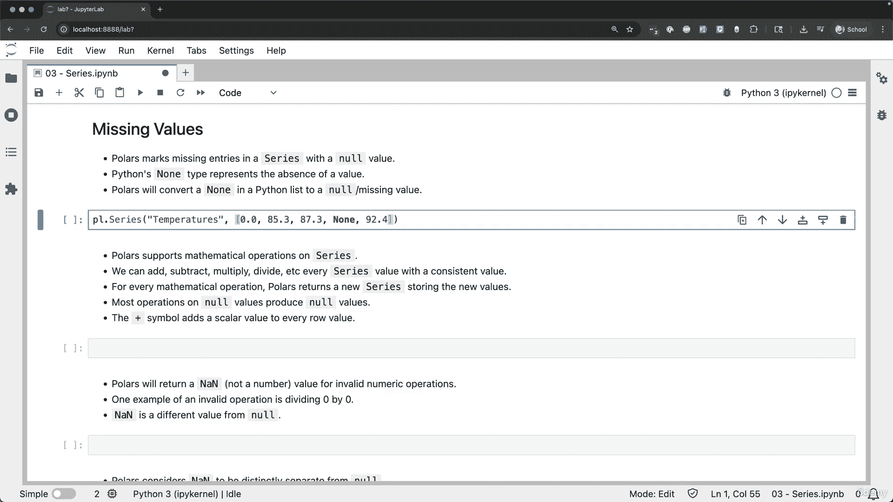

这个过程可以用一个简单关系表示：


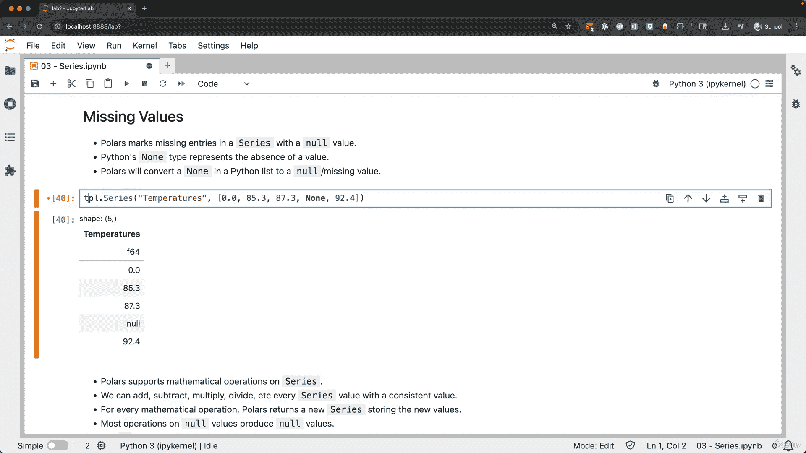

\[
\text{Python None} \rightarrow \text{Polars null}
\]


尽管第四项是缺失值，Polars 仍然保留这个 Series 的核心数据类型为浮点型。接着把 Series 赋值给变量 `temps`，再输出 `temps`，这样就不会忘记它当前的样子。完成创建后，我们接着看含缺失值的 Series 做算术运算时会发生什么。


## ➗ 缺失值在算术运算中的传播


创建 Series 后，本节中我们来看看数学运算。Polars 支持多种算术操作，包括加法、减法、乘法和除法，这些操作都使用常见的数学符号，例如加号表示加法、减号表示减法。我们会在几节课后深入这些运算，这里先关注一个关键规则：当 Series 中存在 `null` 或缺失值时，大多数从 `null` 开始的操作都会产生 `null`。


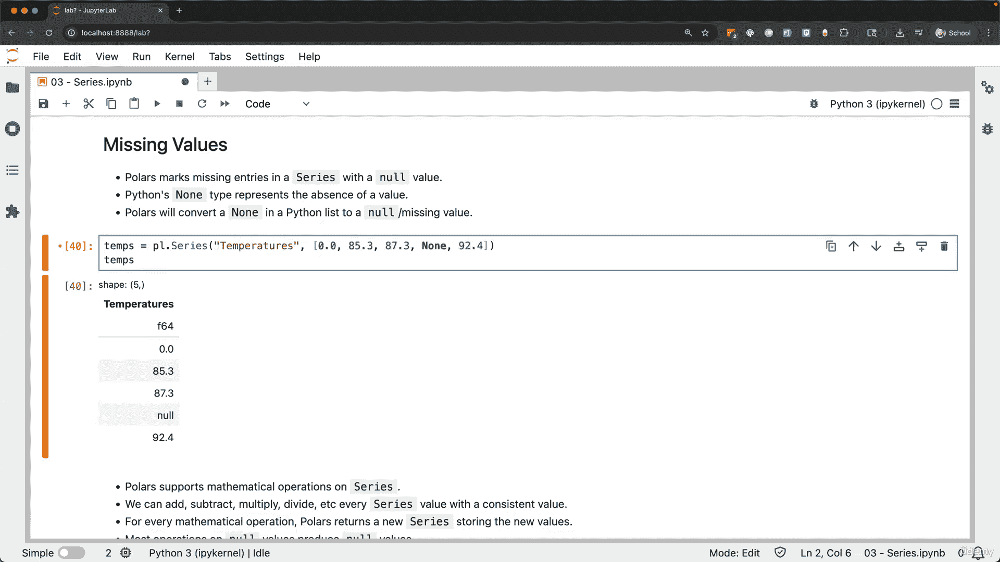

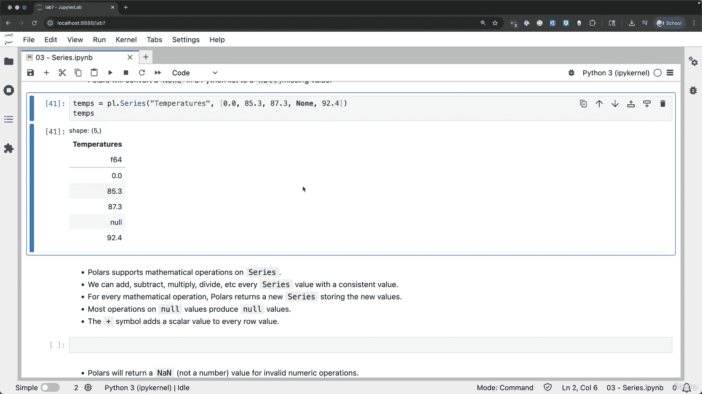

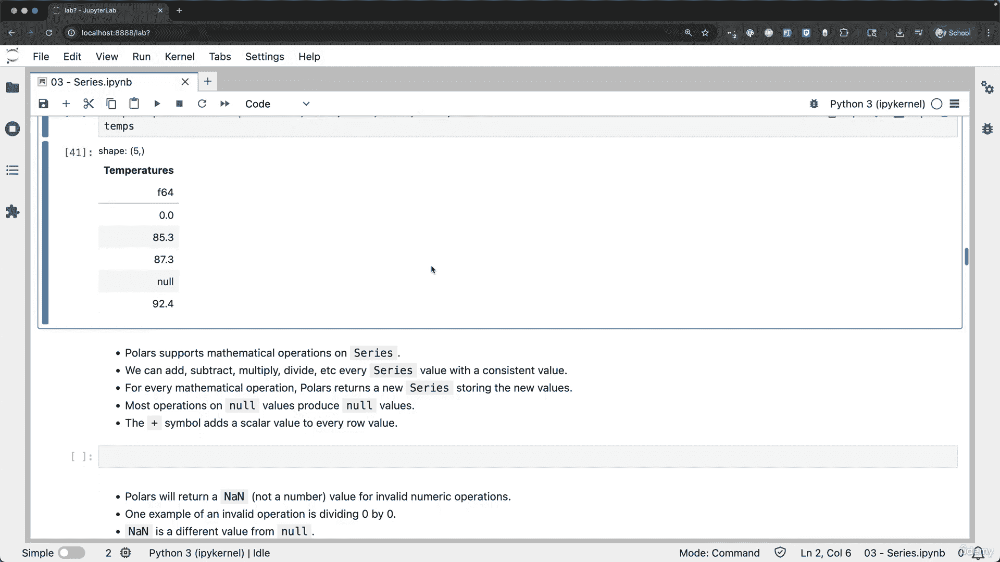

一个简单例子是给 `temps` 中的每个值加上固定的浮点数 `5.5`。可以使用数学加号，也就是加法运算符，对温度 Series 中的每个值执行加法：


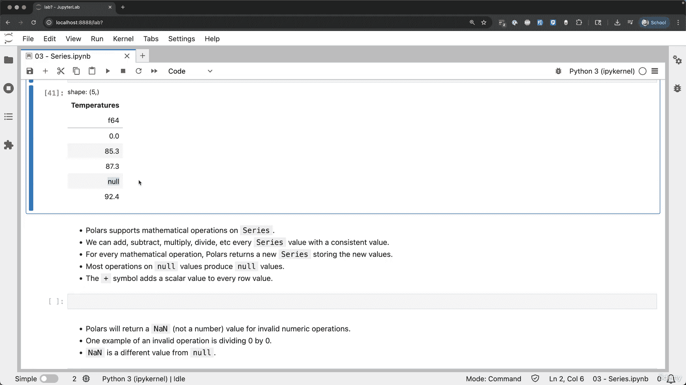

```python
result = temps + 5.5
print(result)
```


每次执行某种操作时，Polars 通常会返回一个全新的 Series，而不是修改、更新或改变原来的 `temps`。它会以原始 Series 为基础执行操作，然后返回一个完成计算的新 Series，相当于返回一份带有运算结果的副本。这个例子里确实给每个值都加了 `5.5`，但当 Polars 遇到 `null` 时，没有办法给“没有东西”或“缺失”加上 `5.5`，所以大多数针对 `null` 缺失值的数学运算都会在结果 Series 中继续得到 `null`。


这个传播规则可以写成：


\[
\text{null} + 5.5 = \text{null}
\]


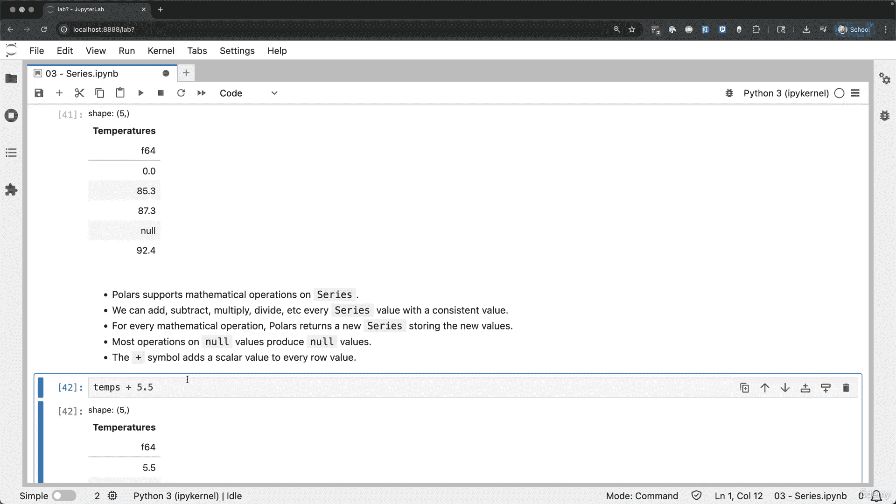

以下是该运算需要记住的几点：


- `temps + 5.5` 会返回一个全新的 Series。
- 原来的 `temps` 通常不会被修改。
- 非缺失值会正常加上 `5.5`。
- `null` 所在的位置仍然会是 `null`。


理解 `null` 在算术中的传播后，下一步要把它和另一个容易混淆的值 `NaN` 分开。


## 🔍 区分 null 与 NaN


上一节我们处理了 `null` 的算术传播，本节中我们来看看 `NaN`。Polars 中还会出现 `NaN`，它是 “not a number” 的缩写，意思是“不是数字”。`NaN` 是另一种值，通常在无效的数值操作或数值计算中出现。原文强调，`null` 表示缺失值，而 `NaN` 表示无效数值操作，二者在技术上是不同类型的值。


先打印 `temps`，会看到第一个位置是 `0.0`。接着尝试做除法操作，对原始温度 Series 中的每个值统一除以 `0`。Python 和 Polars 中除法的写法相同，使用正斜杠 `/`。大多数运算符，包括加号、减号和除号，通常会在两边加空格，只是为了代码更易读。这里尝试把 `temps` 中的每个值都除以 `0`：


```python
divided = temps / 0
print(divided)
```


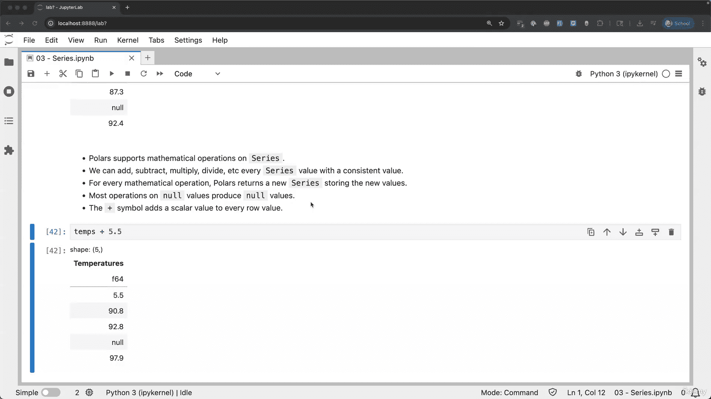

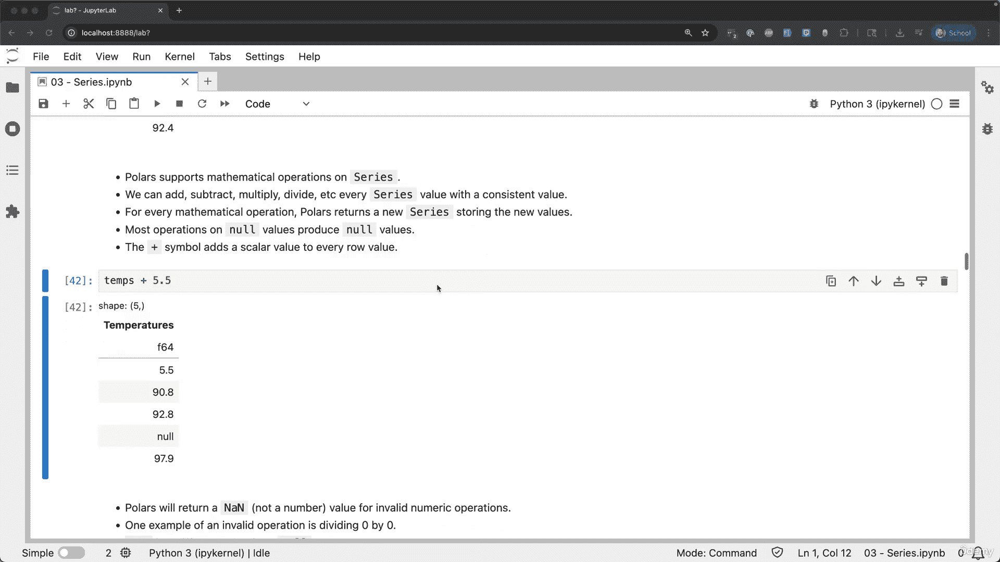

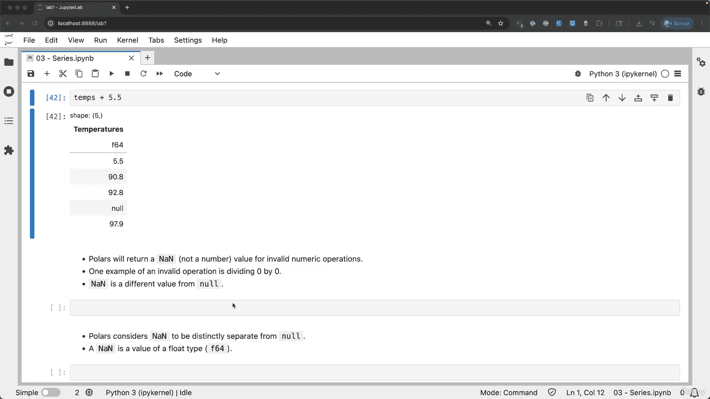

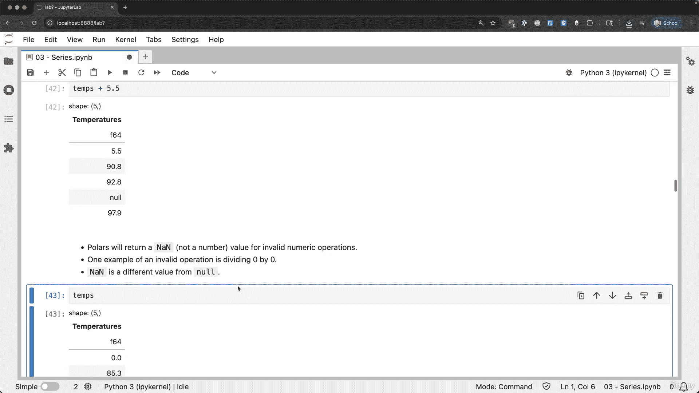

在数学中，除以 `0` 不是有效操作，也不是合法运算，但它和“值缺失”不是同一件事。输出会得到一个全新的 Series：`5.5 / 0` 会得到 `NaN`，本例中原本是 `0.0` 的位置除以 `0` 也会得到 `NaN`；其他浮点值除以 `0` 会得到 `inf`，也就是无穷大；而原本是 `null` 的缺失行除以 `0`，仍然会产生缺失值。


这些结果可以概括为：


\[
5.5 / 0 = \text{NaN}, \quad 0.0 / 0 = \text{NaN}, \quad 85.3 / 0 = \text{inf}, \quad \text{null} / 0 = \text{null}
\]


以下是 `null` 与 `NaN` 的主要区别：


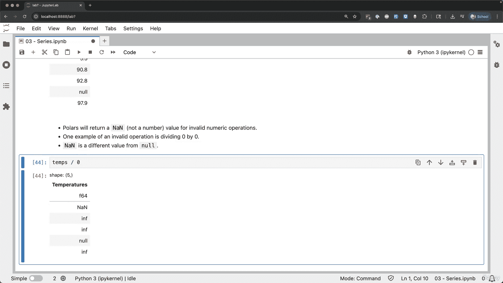

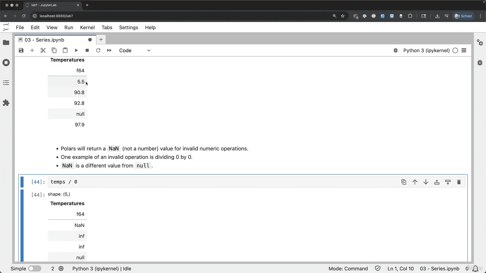

- `null` 表示值缺失或不存在。
- `NaN` 表示无效的数值操作，也就是“不是数字”。
- `inf` 表示无穷大，可能由除以 `0` 等运算产生。
- 做相等比较时，Polars 不认为 `NaN` 等于 `null`，反过来也不认为 `null` 等于 `NaN`。


> 记忆重点：`null` 是“这里没有值”，`NaN` 是“这里算出了一个无效数字”。它们是两种不同的类型，用来描述不同情况。


到这里，我们已经把缺失值的基本表现、算术传播和 `null` 与 `NaN` 的区别都过了一遍。下面做一个小结。


## ✅ 本节总结


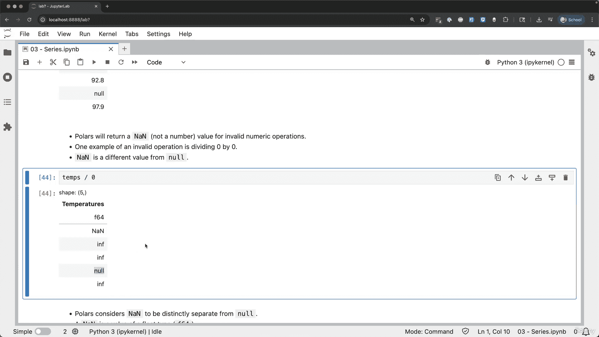

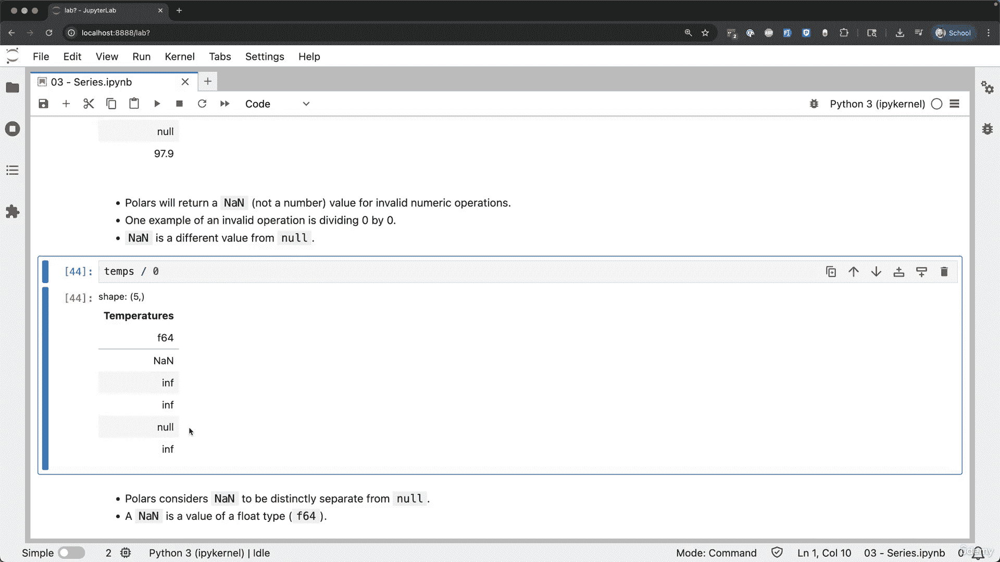

本节课中我们一起学习了 Polars 中缺失值的表示与行为。开头我们创建了包含 `None` 的温度 Series，看到 Python 的 `None` 会被自动转换为 Polars 的 `null`，同时 Series 仍保持浮点类型。接着我们观察了 `null` 在加法中的传播，理解大多数数学运算遇到 `null` 会返回 `null`，并且运算通常返回新 Series，不修改原 Series。最后我们区分了 `null` 与 `NaN`：`null` 表示缺失值，`NaN` 表示无效数值操作，二者不相等。以后在 Series 或其他 Polars 数据结构中看到 `null`，可以先把它理解为“这个值缺失或不存在”，再根据实际业务决定删除、填充还是保留。

