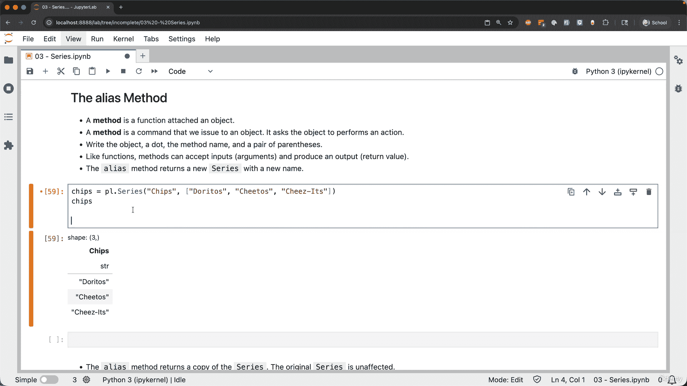
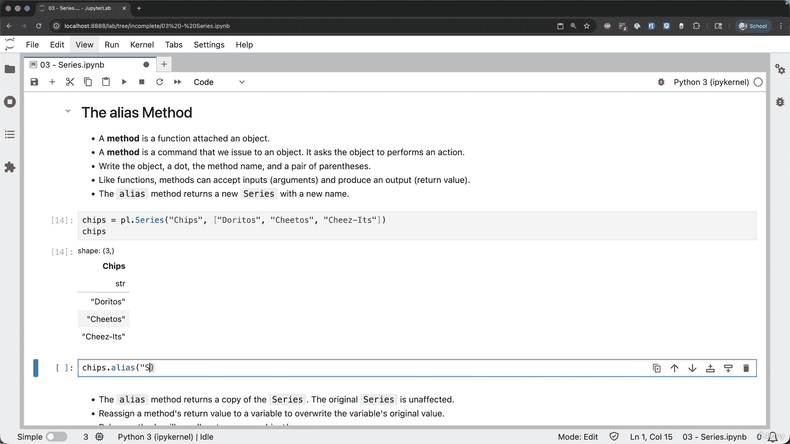
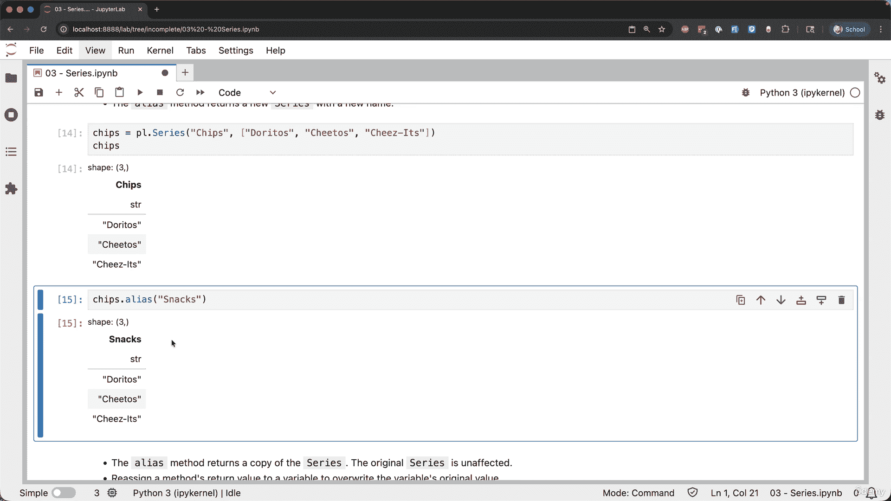
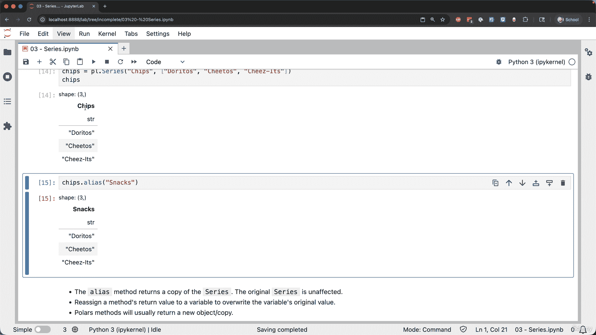
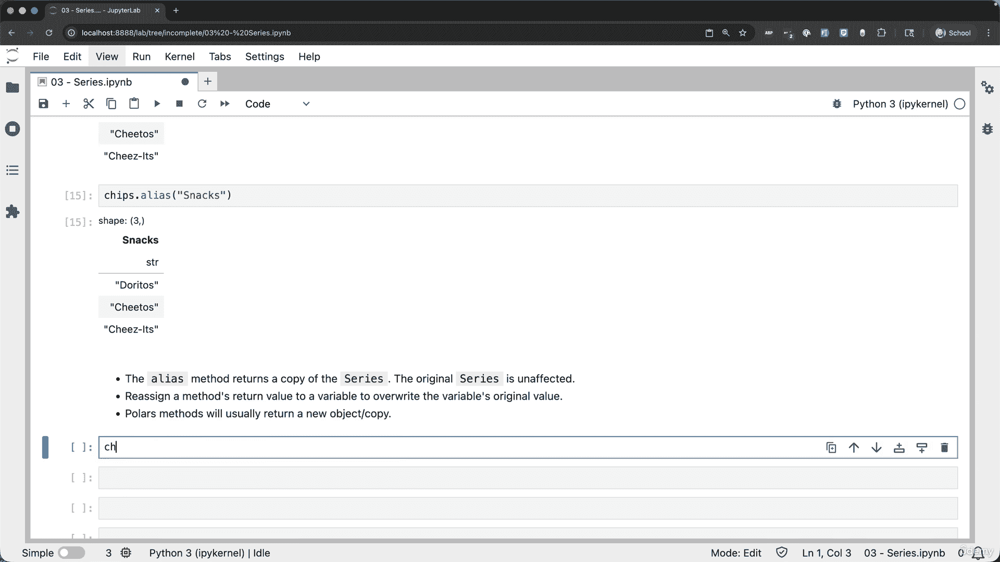
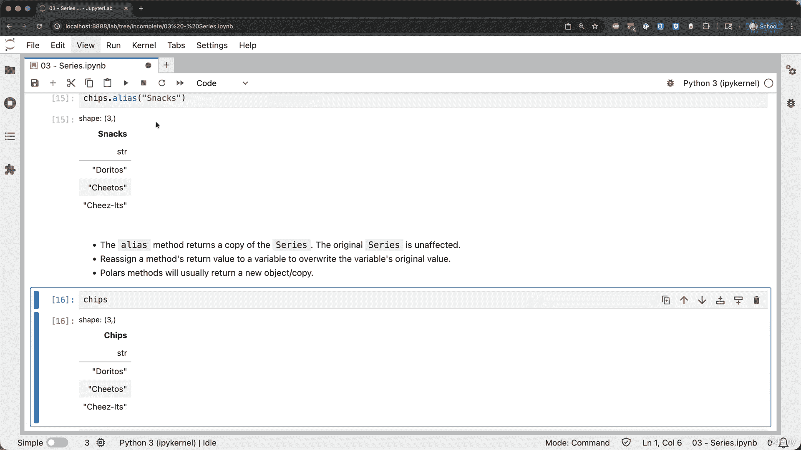
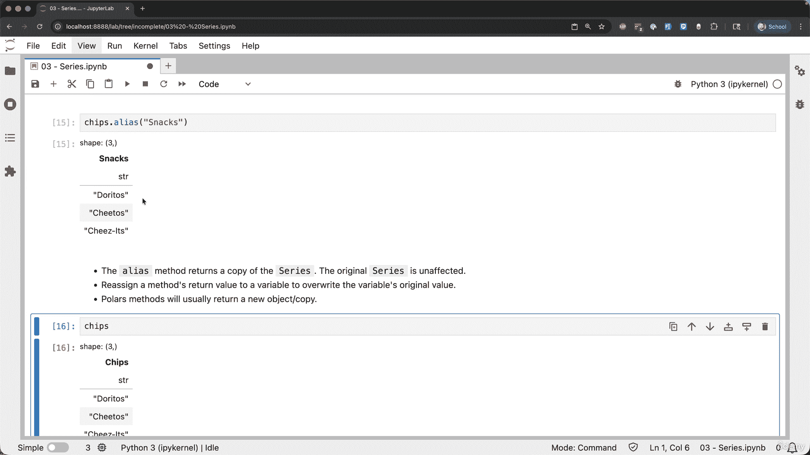
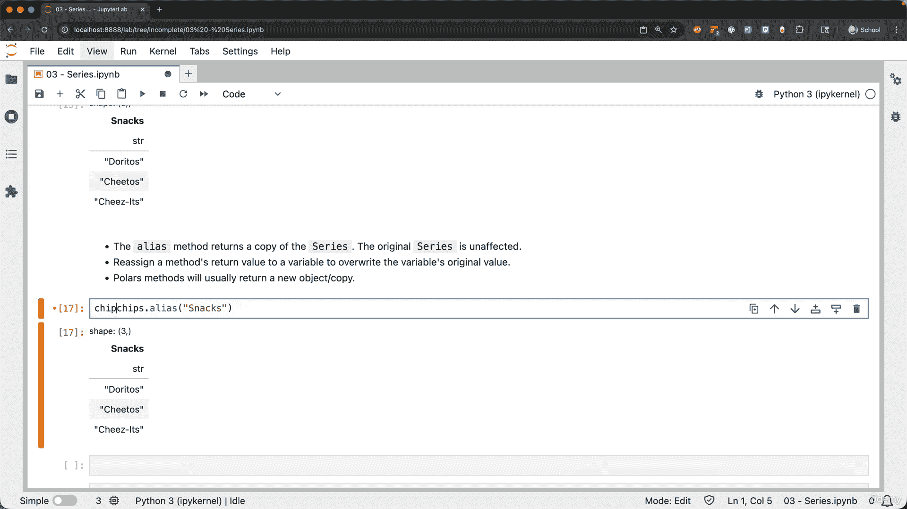
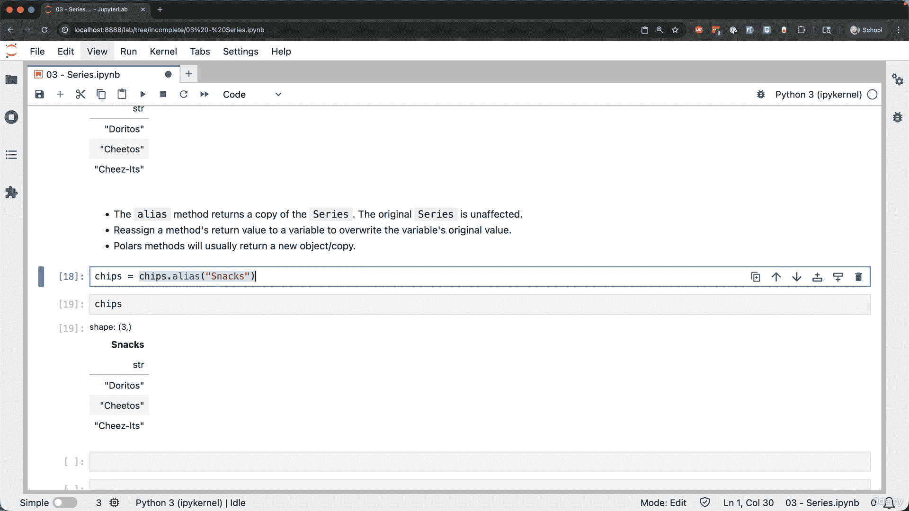

# 📊 Polars 与 Python 数据分析：33：alias 方法

在本节课中，我们将要学习 Polars Series 上的方法，重点认识 `alias` 方法。上一节我们介绍了 Series 上可用的属性，本节中我们来看看与属性互补的构造，也就是方法，并说明如何用 `alias` 给 Series 重命名，以及为什么它返回的是副本而不是直接修改原对象。课程会先讲属性和方法的区别，再讲方法调用语法，最后用代码演示 `alias` 的行为和赋值方式。这样安排可以让初学者先建立概念，再动手理解结果。

## 🧩 Polars 与 Python 数据分析：33：属性与方法的区别

到这里，我们已经讨论了 Polars Series 上可用的属性。属性是存放在对象上的一份数据，是对象能够告诉我们关于自身的一个细节或特征。与属性互补、需要一起介绍的概念是方法。可以把方法理解成挂在对象上的函数，是对象能够执行的动作或行为；也可以把方法理解成我们向对象发出的命令。属性读取的是某条信息，而方法要求对象执行某种动作或计算。理解这一点很重要，因为后面看到的 `alias` 不是去读取 Series 的名称，而是要求 Series 基于原名生成一个新名称的副本。

上一段我们分清了属性和方法，本节中我们来看看方法的调用语法。方法的语法和属性非常相似：先写出对象，或者写出代表对象的变量；然后写一个点；再写方法名；最重要的是，最后要写一对圆括号。圆括号才是真正调用或执行方法的地方。和函数一样，方法可以接收输入，这些输入称为参数；方法也可以产生输出，这个输出称为返回值。返回值是方法交还给外部世界的内容，也是 Jupyter Notebook 会在单元格下方打印出来的内容。下面用代码概括这个语法：

```python
# 读取属性：访问信息
series.attribute

# 调用方法：执行动作或计算
series.method(参数)

# 调用 alias 方法：传入新名称
series.alias("新名称")
```

## 🏷️ Polars 与 Python 数据分析：33：alias 方法的基本用法

上面我们知道了方法要通过圆括号调用，本节中我们来看看 Series 上第一个要介绍的方法：`alias`。我们先回顾 Python 里“别名”这个术语：别名就是一个昵称或替代名称；在 Python 中，我们用 `as` 关键字给导入的模块起别名，例如 `import polars as pl`，这样 Polars 就有了别名 `pl`。Series 上的 `alias` 方法非常类似，它处理的是 Series 的名称；使用 `alias` 方法，我们可以给 Series 提供一个新名称。以下是 `alias` 方法的关键点：



- `alias` 方法用于给 Series 重命名。

- 它接收一个名为 `name` 的参数，这个参数表示结果 Series 将使用的新名称。

- 它返回一个新的 Series，而不是在原地修改原 Series。

这里沿用上一课代码中的 `chips` Series。在下方代码中，我们再次取出 `chips`，写一个点，然后写方法名 `alias`，再用一对开括号和闭括号调用它。`alias` 方法接收一个参数 `name`，代表结果 Series 的新名称。假设我们想把该 Series 重命名为 `snacks`，可以写成：







```python
chips.alias("snacks")
```



执行这段代码后，会得到一个全新的 Series，其中原来的名称 `chips` 被替换成了 `snacks`。这里的重点在于：`alias` 方法返回的是原 Series 的副本。原来标题为 `chips` 的 `chips` Series 没有被改变、没有被变更，也没有以任何方式被修改。为了证明这一点，可以在该单元格后面再输出 `chips`，你会看到它仍然带有名称 `chips`。因此，`alias` 方法做的是创建副本：它以原 Series 为基础创建一个复制品，并返回这个带有新名称 `snacks` 的复制品。

## 📝 Polars 与 Python 数据分析：33：保存 alias 的结果

刚才我们验证了 `alias` 返回副本，本节中我们来看看如果想让改动保留下来该怎么做。这一点很重要：如果你确实想保存或保留这些改动，就必须记住接收 `alias` 方法的返回值，也就是它交还给你的输出，并把它重新赋值给原来的变量，这样才能替换原变量。例如，如果你希望这个 Series 仍然赋值给 `chips` 变量，而不想把结果赋给一个新变量，就可以取出 `chips` Series，调用 `alias` 方法并传入参数 `snacks` 来创建新 Series，然后把它重新赋值回 `chips` 变量，写法如下：

```python
chips = chips.alias("snacks")
```





这样写会让改动真正持久化，也就是用新生成的 Series 替换 `chips` 变量。作为 Python 基础知识的快速提醒：等号右边的内容会先发生。Python 会先计算或求值等号右边的表达式，然后把这个表达式产生的值或对象赋值回原来的变量。回顾刚才那个单元格执行的时刻：`chips` 原来是标题为 `chips` 的 Series；我们以这个 Series 为基础，用 `alias` 方法创建了一个新 Series，它的名称不同，叫 `snacks`；然后我们取出第二个 Series，也就是那个副本，把它重新赋值回 `chips` 变量。这个顺序解释了为什么 `alias` 本身不会改原对象，而重新赋值可以让变量指向新的副本。



## ✅ Polars 与 Python 数据分析：33：总结



到这里，关于 `alias` 的用法和赋值方式已经讲完。本节课中我们一起学习了 Polars Series 上的 `alias` 方法。我们首先区分了属性和方法：属性读取对象上的信息，方法要求对象执行动作或计算；然后说明了方法调用的语法是“对象.方法名(参数)”，圆括号负责真正执行方法，方法可以接收参数并返回返回值。接着我们重点看了 `alias` 方法，它用单个 `name` 参数给 Series 提供新名称，并返回一个带有新名称的副本，不会修改原 Series。最后我们说明了如果想让重命名结果保留下来，需要把 `alias` 的返回值重新赋值给变量，例如 `chips = chips.alias("snacks")`。这就是对 `alias` 方法的一次快速介绍，它的核心作用就是给 Series 重命名。

