# 📊 Polars 与 Python 数据分析：34：使用 read_csv 函数导入 CSV 文件

在本节课中，我们将要学习如何用 Polars 的 `read_csv` 函数导入第一个真实数据文件。学到这个位置，如果还要每次从零手动创建数据集，确实会让人觉得很麻烦，所以从这一节开始，我们会把数据来源扩展到外部文件。开始导入之前，我们会先快速回顾 CSV 文件格式，尤其是给从来没有接触过这种格式的人做一个铺垫。随后我们会看 Polars 的 `read` 函数家族、如何写文件路径、如何检查返回的 DataFrame、如何把单列 DataFrame 转成 Series，以及如何用方法链把导入和转换连成一行代码。最后我们还会说明，为什么后面每节课开头都会重新导入一次数据，让每一节课都能独立运行。

## 🧾 Polars 与 Python 数据分析：34.1：先理解 CSV 文件格式

上一段我们说了要先回顾文件格式，本节中我们来看看 CSV 到底是什么。CSV 是“逗号分隔值”的缩写，英文全称是 comma separated values。一个 CSV 文件本质上是一个纯文本文件，扩展名是 `.csv`，它用文本的形式来存储数据。它的组织方式很朴素：文件里的每一行代表一条记录或一个条目，而每一行内部的不同值用逗号分开，这就是它叫“逗号分隔值文件”的原因。

下面用公式和代码描述 CSV 的核心结构，这样更容易建立直觉：

```text
CSV 文件 = 第一行列名 + 后续每一行一条记录
每一行 = 值1, 值2, 值3, ...
列名顺序 = 每一行中值的位置顺序
```

如果把这个结构写成一个小例子，可以看成下面这样。第一行会列出数据集的全部列名，列名之间用逗号分隔。这个示例数据集一共有四列，分别是 `name`、`strength`、`magic`、`speed`。从第二行开始，每一行对应一条数据记录，每一个值按照它在行中的位置对应到前面的列。比如 `Zorblax,9,2,5` 这一行里，`Zorblax` 对应名字列，`9` 对应力量列，`2` 对应魔法列，`5` 对应速度列，这一整行就是一条记录。后面还可以继续有很多行，每一行都代表数据集里额外的一条记录。用文本和逗号来存数据，就是这样一种简单直接的方式。

```csv
name,strength,magic,speed
Zorblax,9,2,5
...
```

## 🛠️ Polars 与 Python 数据分析：34.2：认识 read 函数家族和 read_csv

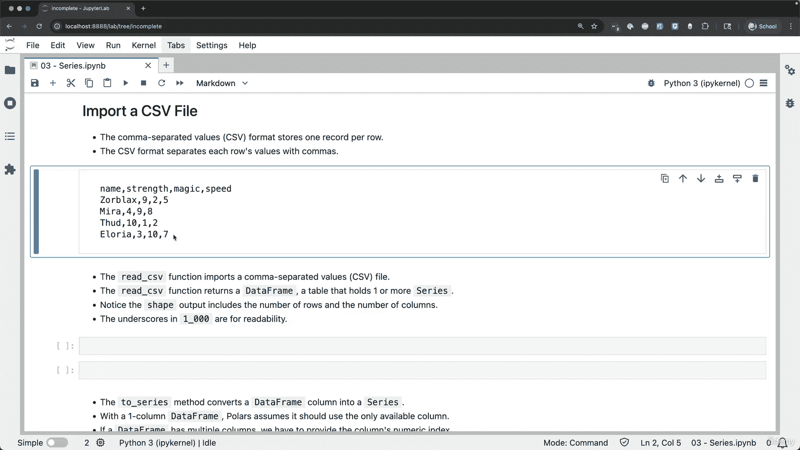

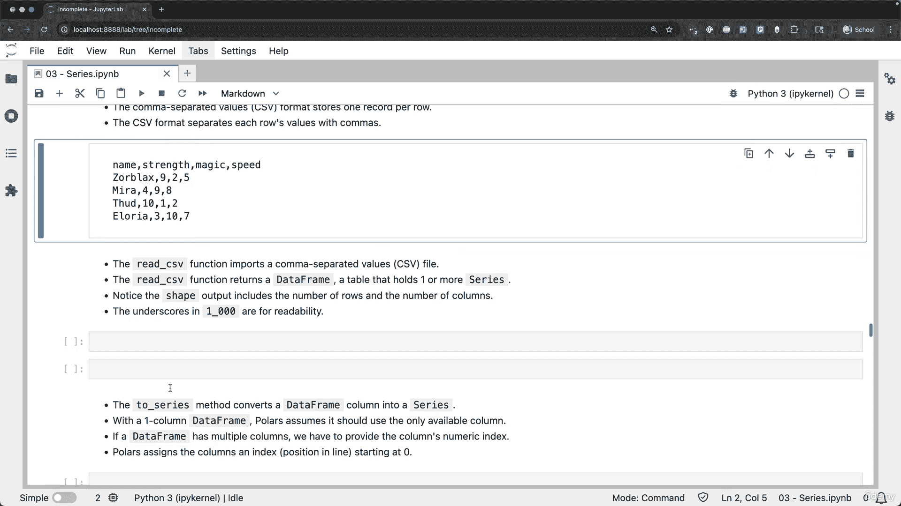

理解了 CSV 的文本结构之后，本节中我们来看看 Polars 怎么把这种文件读进来。Polars 支持导入很多种文件格式，CSV 只是其中最流行的一种。我们在单元格里使用 `p`，它是 Polars 的别名。输入 `p.read` 之后按 Tab 键，就能看到自动补全列表，里面有一大批以 `read` 开头的顶层函数，这些函数分别用于导入不同的文件格式。以下是 Polars 中常见的 `read` 函数示例：

- `read_csv`：导入 CSV 文件，也是本节课要用的函数。

- 其他函数还可以导入 Excel 文件、Parquet 文件、JSON 文件等格式。

- 甚至还可以从剪贴板导入数据；剪贴板就是我们在浏览器等地方复制内容后，系统临时保存复制内容的位置，这个函数会从剪贴板里的内容集合中读取数据。

我们要使用的是 `read_csv` 函数，注意函数名中间有一个下划线。它是一个函数，所以调用时必须带上括号。我们可以用 Shift+Tab 查看它的文档，里面有很多参数，但最重要的通常是第一个参数 `source`，它期望传入一个字符串，表示要导入文件的位置或路径。到目前为止，我们的数据集都放在和当前 Jupyter Notebook 相同的目录或文件夹层级里，这个目录叫 `series`，所以可以直接写文件名。以后如果要进入另一个文件夹寻找嵌套文件，就需要写出目录名；但当前要用的文件就在同一个文件夹里，因此不需要操心目录，只写文件名即可。

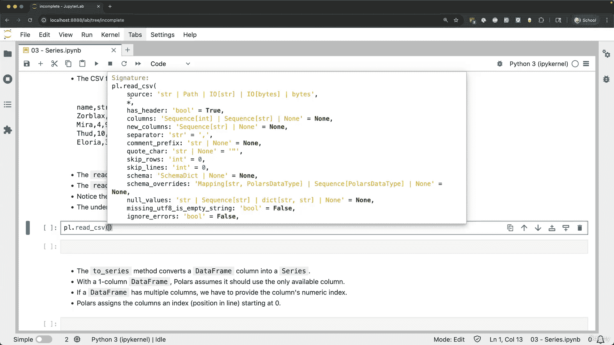

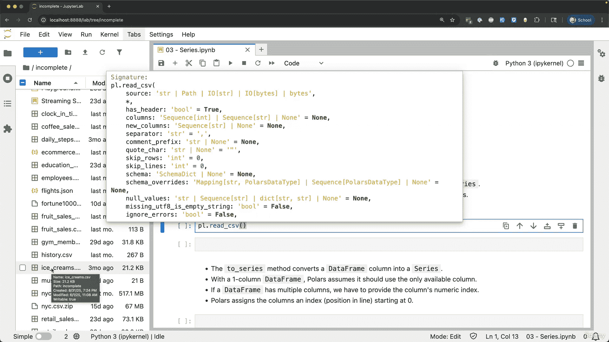

## 📁 Polars 与 Python 数据分析：34.3：写对文件名和扩展名

上一节我们知道了 `read_csv` 的第一个参数是路径，本节中我们来看看具体怎么写这个路径。先把面板隐藏起来，然后写出文件名。这里要特别注意大小写敏感，文件名必须和保存时的名字完全一致。我们要写的文件名是 `ice_creams.csv`，全部小写，两个单词之间用下划线连接。非常重要的一点是，必须把真正的文件扩展名 `.csv` 也写出来；虽然我们调用的是 `read_csv` 函数，但 Polars 仍然需要完整的文件名，包括 `.csv` 扩展名。执行这行代码后，文件就会被导入进来。

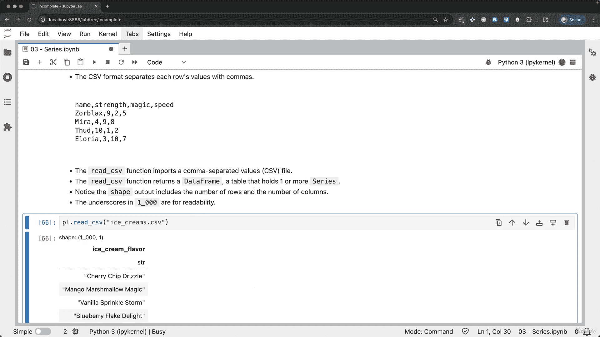

下面是对应的导入代码：

```python
p.read_csv("ice_creams.csv")
```

## 📦 Polars 与 Python 数据分析：34.4：返回的是 DataFrame 和它的 shape

文件导入之后，本节中我们来看看 `read_csv` 返回的到底是什么对象。这个函数返回的不是 Series，而是 Polars 里的另一种数据结构，也就是我们之前简单提过的 DataFrame。DataFrame 是一张表，可以存储一列或多列；也可以把它理解成存储一个或多个 Series 的表。这里容易让人困惑的地方是：哪怕 DataFrame 里只有一列，它仍然是 DataFrame，而 Series 是单独的一列。DataFrame 在技术上并不要求必须有多列，它可以只有一列，当前这个结果就是只有一列的情况。

输出结果里的 `shape` 会告诉我们这个 DataFrame 有多少行、多少列。当前形状是 `(1000, 1)`，表示有 1000 行、1 列。这里 `1` 和 `000` 之间的下划线只是为了提高可读性，让数字更容易看懂，没有其他技术含义。DataFrame 的输出看起来和 Series 有些相似：列名直接来自数据集，列类型显示为 `STR`，也就是字符串。Polars 知道我们有 1000 行数据，也默认不想一次性把 1000 行全部打印出来，因为那样会把屏幕撑爆。所以默认情况下，它会打印前 5 行，然后打印一行带省略号的内容，表示数据中间有间隔，最后再打印后 5 行。这里要说明的是，1000 行数据没有被裁剪、删除或移除，省略号只是视觉提示，表示中间有一段数据没有显示出来，但这些数据仍然被保存着。

可以把形状和默认显示理解成下面的公式和注释：

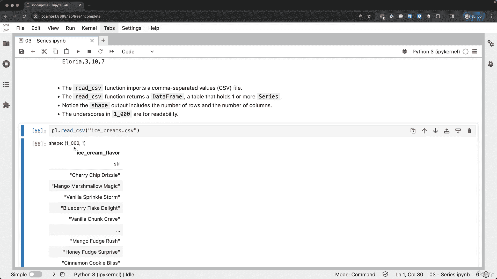

```python
# 形状公式
DataFrame.shape = (行数, 列数)
# 当前结果
(1000, 1)

# 默认显示规则
显示前5行 + "..." + 显示后5行
# 这不是删除数据，只是省略显示
```

接下来，我们把 `read_csv` 的返回值，也就是一个 Polars DataFrame，赋给变量 `ice_creams`，然后在下面输出 `ice_creams`。如果我们不确定手头的数据是 DataFrame 还是 Series，可以使用 Python 内置的 `type` 函数。`type` 可以接受任何 Python 对象或来自任何库的值，并告诉我们它的类型，也就是它的类或构造蓝图。把 `ice_creams` 传进去，就能看到它是 Polars 的 DataFrame。

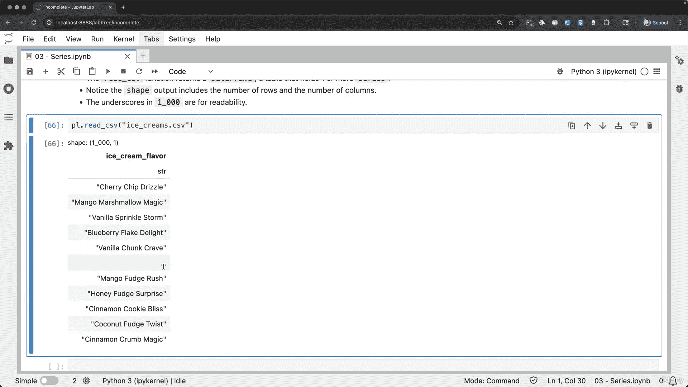

```python
ice_creams = p.read_csv("ice_creams.csv")
print(type(ice_creams))
```

## 🔄 Polars 与 Python 数据分析：34.5：用 to_series 把单列 DataFrame 转成 Series

上一节我们确认了导入结果是 DataFrame，但这一节的重点是 Series，所以本节中我们来看看怎样立刻把这个 DataFrame 转成 Series。好在 DataFrame 上有一个很方便的方法，叫 `to_series`，名字很直观。因为方法是在实际对象、实例或值上调用的，所以调用时要带上括号。如果 DataFrame 有多列，这里会遇到一个小问题：Polars 不知道应该把哪一列转换成对应的 Series。但当前 DataFrame 只有一列，所以 Polars 会按逻辑推断，必须把这个唯一的列转换成 Series。执行之后，我们得到的就是一个 Series。一个视觉上的判断依据是，`shape` 输出不再包含之前 DataFrame 里的那个列数 `1`，而是只显示行数部分。

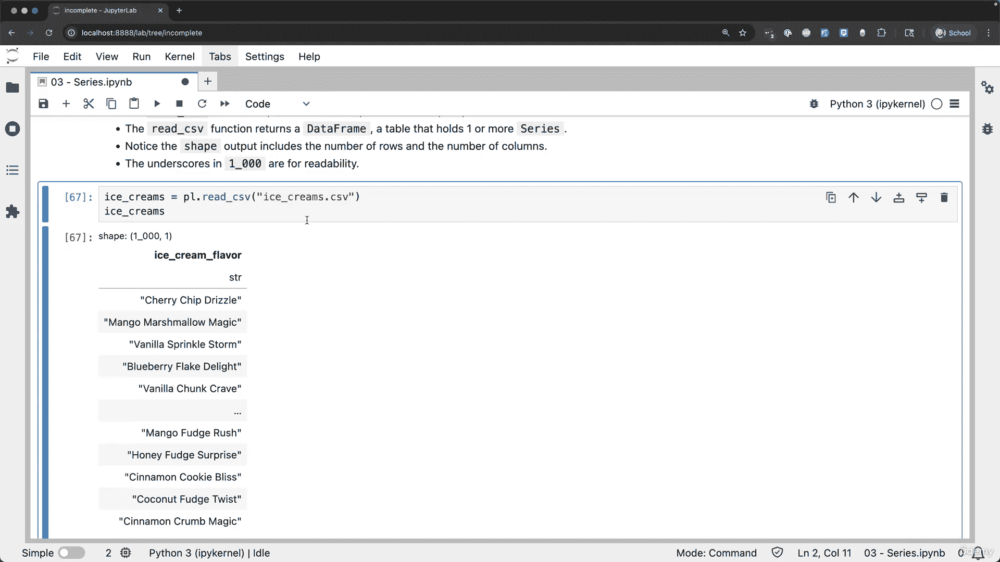

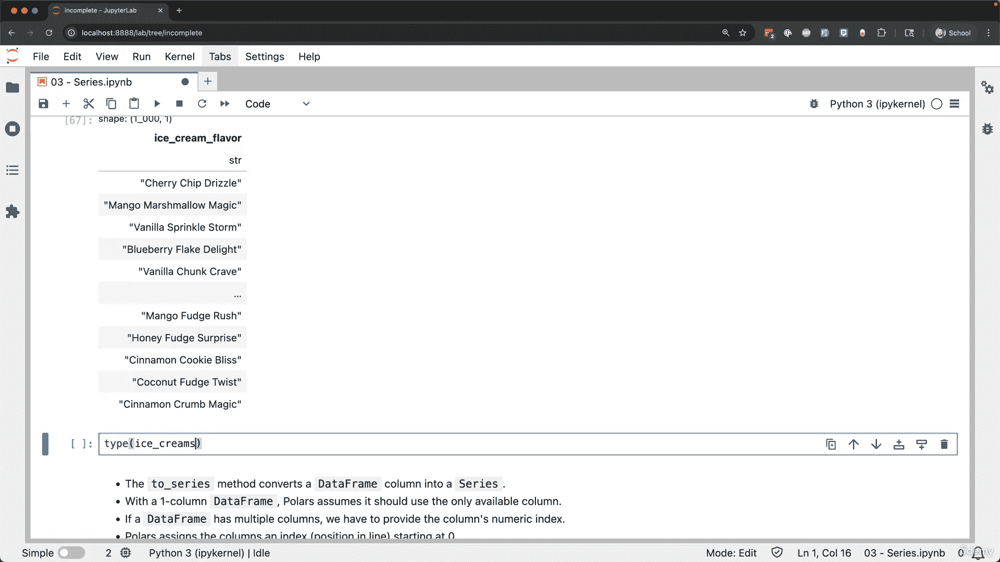

下面是转换代码：

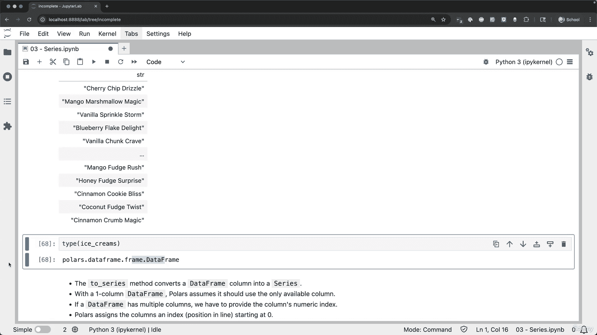

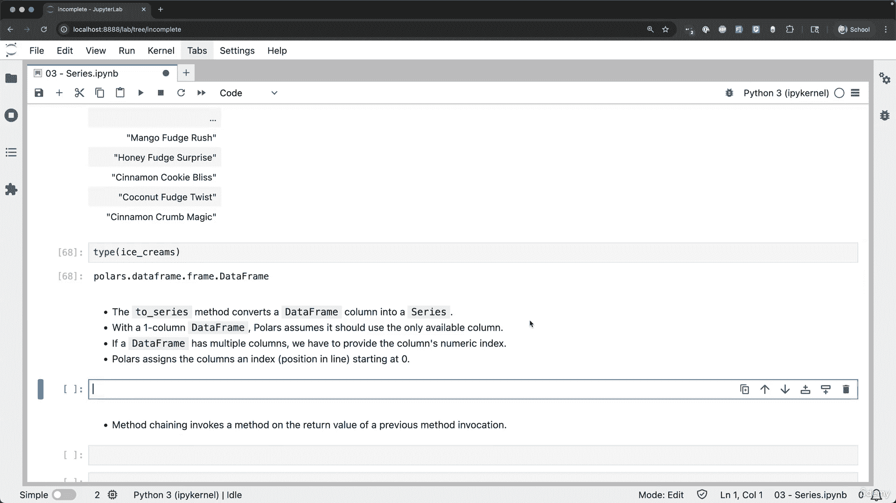

```python
ice_creams_df = p.read_csv("ice_creams.csv")
ice_creams_series = ice_creams_df.to_series()
print(ice_creams_series)
```

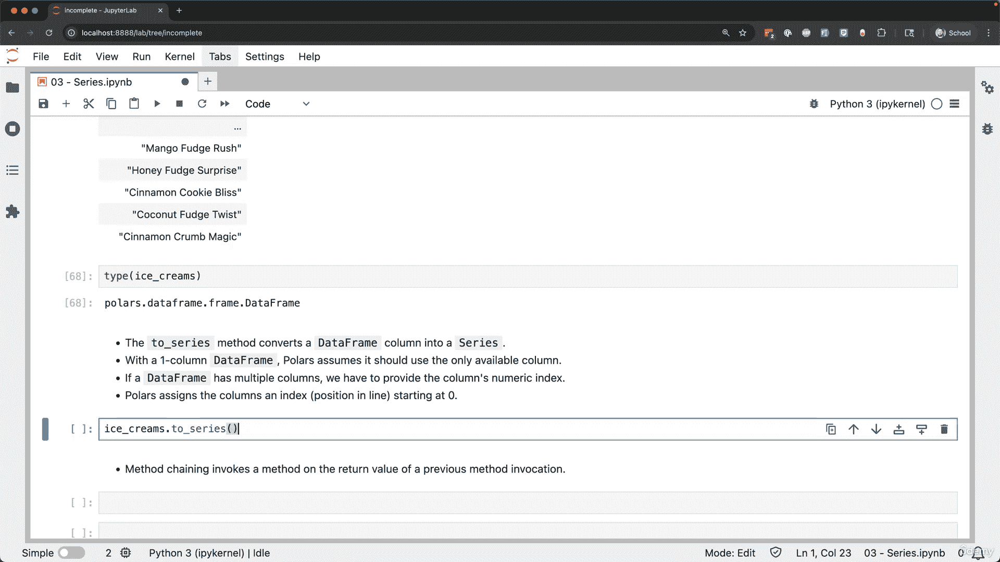

## ⛓️ Polars 与 Python 数据分析：34.6：用方法链直接得到 Series

刚才是先赋值再调用方法，本节中我们来看看更紧凑的写法，也就是方法链。方法链就是连续调用一串方法：把上一个方法调用或上一个函数的返回值，直接拿来做下一个方法调用的对象。它之所以叫“链”，是因为这些调用形成了一条链，或者说一串连续的调用，每一步都基于上一步的返回值继续操作。

下面用公式表示方法链的核心思路：

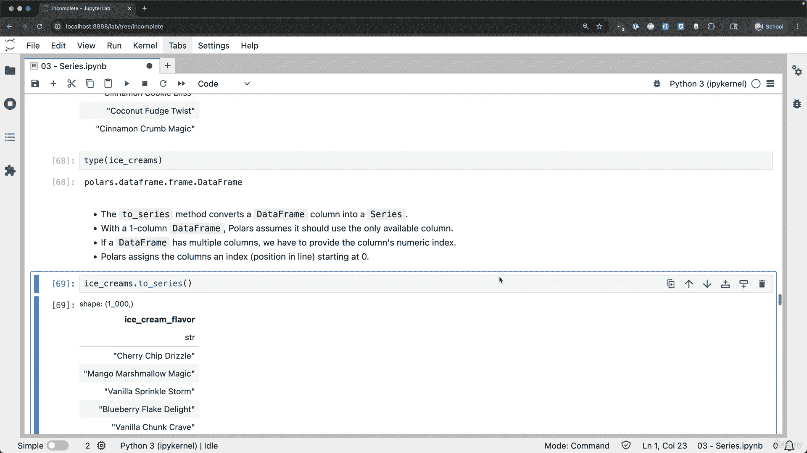

```text
链式结果 = 函数返回值.方法1().方法2()
```

回到 `read_csv` 的代码：`read_csv` 返回一个 DataFrame，而 DataFrame 支持 `to_series` 方法。当然，我们可以先把 DataFrame 赋给变量，再在变量上调用方法，但如果我们最终就是想要 Series，就没有必要创建这个中间变量。可以直接在 `read_csv` 返回的 DataFrame 上继续链上 `to_series()`。这样逻辑和上面完全一样，只是跳过了把 DataFrame 赋给变量这一步；我们会拿 `read_csv` 的返回值调用 `to_series`，得到一个真正的 Polars Series，再把它赋给 `ice_creams` 这样的变量，并打印出来。以下是链式写法：

```python
ice_creams = p.read_csv("ice_creams.csv").to_series()
print(ice_creams)
```

## 🧹 Polars 与 Python 数据分析：34.7：每节课开头重新导入数据

在前面几节里，我们已经学会了导入文件、检查类型、转换 Series 和链式调用。接下来要说明一个课程组织上的习惯：从后面开始，每节课开头我都会放一段从头执行的代码。这样做的原因是，任何一节课里都可能对数据做某种修改或变动，而我希望每节课都完全独立，这样你可以从课程里的任意一节课加入，并从那一刻继续学习，不需要依赖前面某节课的预先设置。因此，只要某节课需要导入数据集，我就会在这节课最开头导入，未来屏幕上用来导入 Series 的代码就会是下面这种形式。

```python
import polars as p

ice_creams = p.read_csv("ice_creams.csv").to_series()
print(ice_creams)
```

现在我们就得到了一个漂亮的、包含 1000 行的 Series，它和之前手动创建的 Series 一样，只不过这次数据来自 CSV 文件。再强调一次，CSV 是“逗号分隔值”的缩写，它代表一种文本文件格式，一种用逗号分隔每一行中各个值的文本存储格式，而每一行代表数据集里的不同记录或条目。理解这个格式之后，后面再遇到各种 CSV 数据，我们就知道它大概是怎么组织起来的了。

## ✅ Polars 与 Python 数据分析：34.8：本节总结

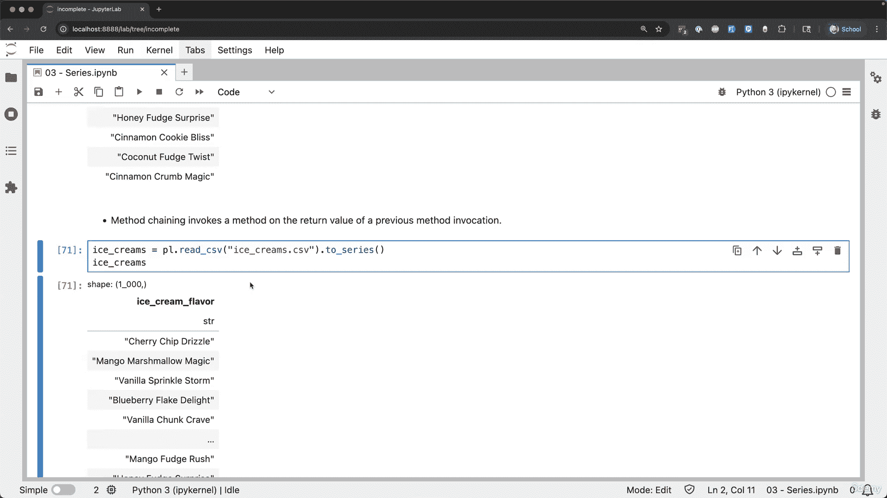

本节课中，我们一起学习了如何用 Polars 的 `read_csv` 函数导入 CSV 文件，并快速回顾了 CSV 这种纯文本格式的结构：第一行是列名，后面每一行是一条记录，行内值用逗号分隔。我们还认识了 Polars 的 `read` 函数家族，知道了 `read_csv` 的第一个重要参数是文件路径，写文件名时要注意大小写并保留 `.csv` 扩展名。导入后得到的是 DataFrame，可以用 `shape` 查看行列数，默认只显示前 5 行和后 5 行，中间用省略号表示省略显示。对单列 DataFrame，可以用 `to_series` 转成 Series，也可以用方法链把 `read_csv(...).to_series()` 连成一行。最后我们说明了每节课开头重新导入数据的原因，是为了让每节课都能独立运行，方便从任意一节开始学习。

