# 🧠 Udemy - 使用 Polars 与 Python 进行数据分析（第一部分）：第36章：内存优化与 schema_overrides 参数


在本节课中，我们将要学习如何在使用 Polars 读取 CSV 数据时，通过 `read_csv` 函数的 `schema_overrides` 参数来控制列的数据类型，从而减少数据占用的内存。这个主题看起来很基础，但它直接关系到程序运行时占用的内存大小，以及后续运算能否更快完成，所以在实际分析数据时很有价值。接下来我们会从一个名为 `daily steps` 的数据集开始，一步步理解 Polars 的类型推断、内存估算方式，以及如何手动指定更合适的数据类型。


**📥 一、导入 daily steps 数据集并使用 Jupyter 的 Tab 补全**


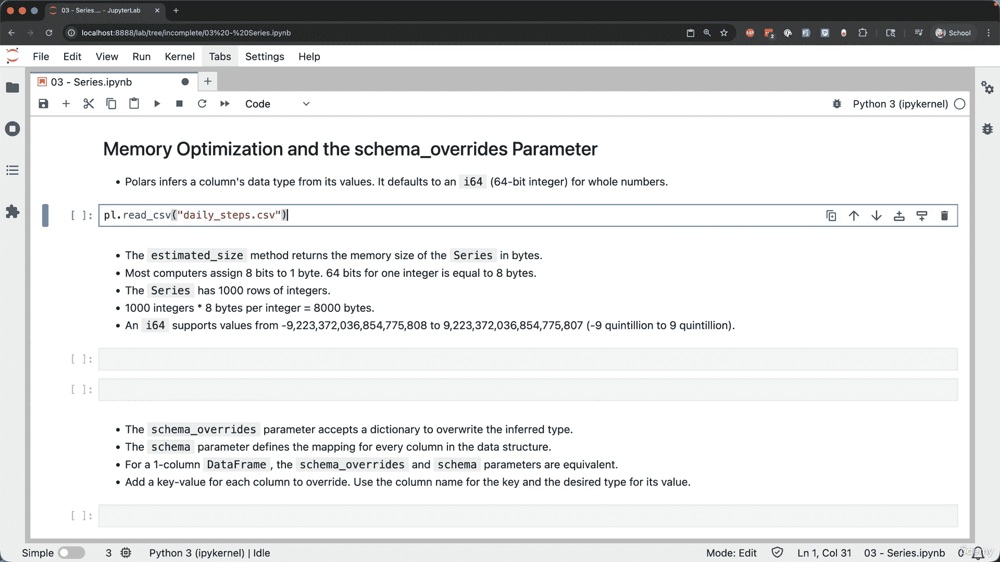

上一节我们介绍了 Polars 的基本读取方式，本节中我们来看看如何导入一个新的数据集，并利用 Jupyter Notebook 的补全功能减少手动输入。首先使用 `read_csv` 函数导入一个新的数据集，这个数据集名为 `daily steps`。Jupyter Notebook 有一个很酷的功能，它支持 Tab 补全，使用体验和终端里的 Tab 补全很像。输入文件名的前几个字符后，按下 Tab 键，就会触发一个提示弹窗，显示所有以当前输入为前缀的匹配项。用方向键选中想要的文件名后，按下回车键即可把它固定到代码中。拿到完整文件名后，不要忘记闭合字符串引号，并补上函数末尾的右括号。

```python
import polars as pl

df = pl.read_csv("daily_steps.csv")
```


这个数据集表示一组步数记录，记录的是在 1000 天里走过的步数，总共有 1000 条记录。这些数据全部是随机生成的。导入完成后，我立即想把这个 DataFrame 转换成一个 Polars Series，因此会调用 `to_series` 方法，并把得到的 Series 赋值给一个名为 `daily_steps` 的变量。随后可以用 `head` 方法并传入参数 `5`，预览前五行数据。

```python
daily_steps = df.to_series()
daily_steps.head(5)
```


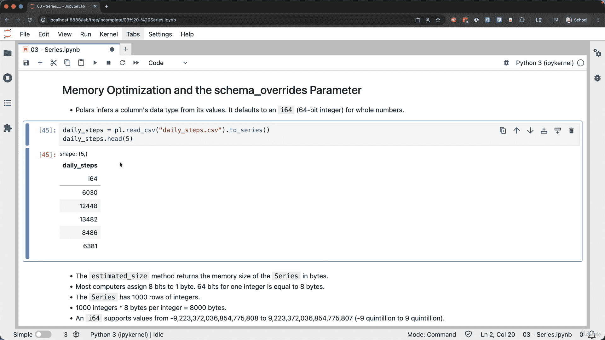

在 Jupyter 中操作文件时，Tab 补全的步骤大致如下，这些步骤能帮助初学者减少拼写错误。

- 输入文件名的前几个字符。
- 按下 Tab 键，触发匹配项弹窗。
- 用方向键选择目标文件。
- 按下回车键确认选择。
- 补全字符串引号和函数右括号。


**🔢 二、理解 Polars 的类型推断与整数类型**


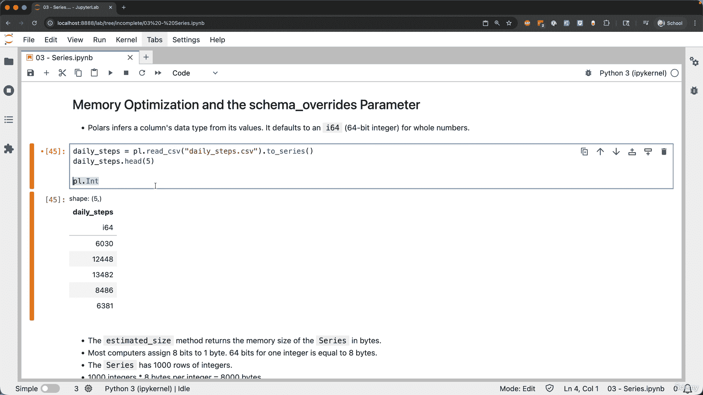

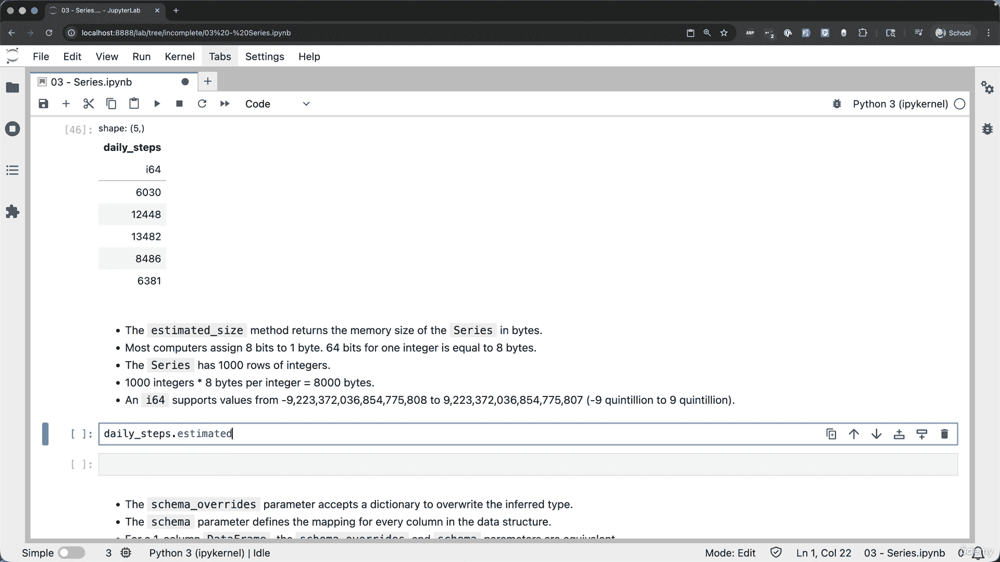

前面我们完成了数据导入和 Series 转换，本节中我们来看看 Polars 是如何理解一列数据的类型的。和之前看到的情况一样，Polars 解析数据集时，会根据列中包含的值推断每一列的数据类型。Polars 看到的是整数，而不是字符串或浮点数，因此它会假设这是一列整数。更进一步，Polars 还会选择一个具体的整数类型，这里选择的是 64 位整数，也就是 `i64`，或者写作 `Int64`。

Polars 的整数类型来自 Rust，因此它提供了多种不同的整数类型。可以在代码中访问 `pl` 库，输入一个点，然后输入大写 `I` 开头的 `Int`，再按下 Tab 键，就能看到 Polars 中所有可用的整数类。常见整数类型包括以下这些。

- `Int8`
- `Int16`
- `Int32`
- `Int64`
- `UInt8`
- `UInt16`
- `UInt32`
- `UInt64`


需要说明的是，Polars 不会聪明到自动分析数据集中数值的范围，然后选择尽可能小的整数类型。它只会默认使用 64 位整数，也就是 `Int64`。这是一个合理的默认值，但如果实际处理的值小得多，比如这里只有几千，那么可能并不需要这么大的整数类型来容纳所有可能的值。如果能选择更小的数据类型，不只是更小的整数类型，也包括更小的浮点类型，就可以减少 Series 占用的总内存。这样做不仅能把更多内存还给计算机，还能加快在 Series 上执行操作的速度。接下来先介绍一个 Series 上可用的方法，名为 `estimated_size`。这个方法会返回 Series 数据在当前计算机上占用的估计内存量，单位是字节。

```python
daily_steps.estimated_size()
```


这里调用 `estimated_size` 后，会得到 `8000`，也就是 8000 字节。接下来要解释这个数字是怎么算出来的。在 Python 基础课程中介绍过，计算机内存的最小计量单位是 bit，也就是位。可以把 bit 想成一个小盒子，里面表示 0 或 1，也像一个只能开或关的灯开关。计算机科学中会用一串 bit 来表示更大、更复杂的信息，但一切都从 bit 这个原始构建块开始。8 个 bit 等于 1 个 byte，也就是 1 字节。一个 64 位整数中的每一个值都是 64 位整数，因此一个 64 位整数会占用 8 字节，因为 8 bit 等于 1 byte，64 bit 就是 8 byte。如果一个 Series 中有 1000 个整数，每个整数占用 8 字节，那么总内存就是 8000 字节。

以 1000 个 64 位整数为例，内存计算可以拆成以下几步，这样更容易理解数字的来源。

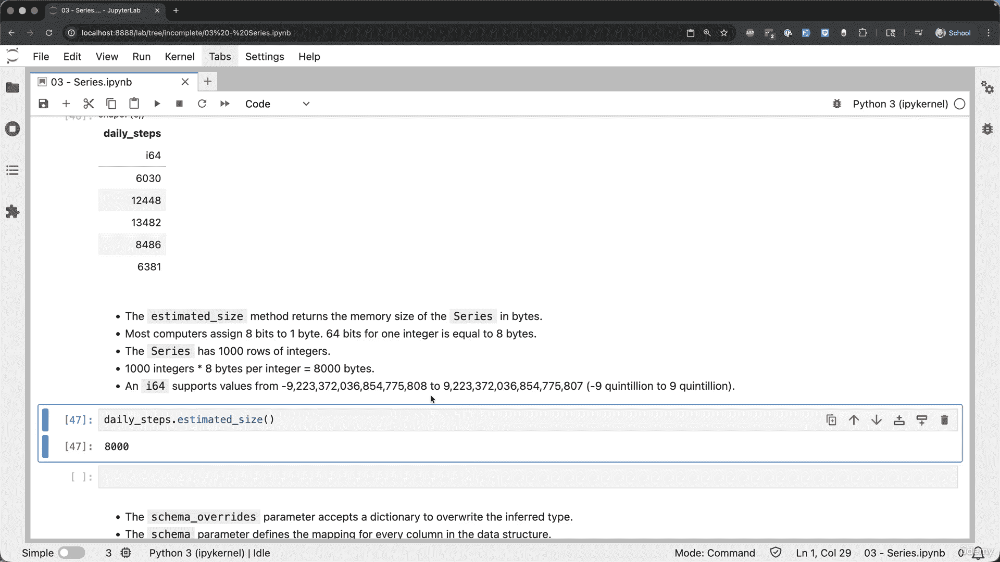

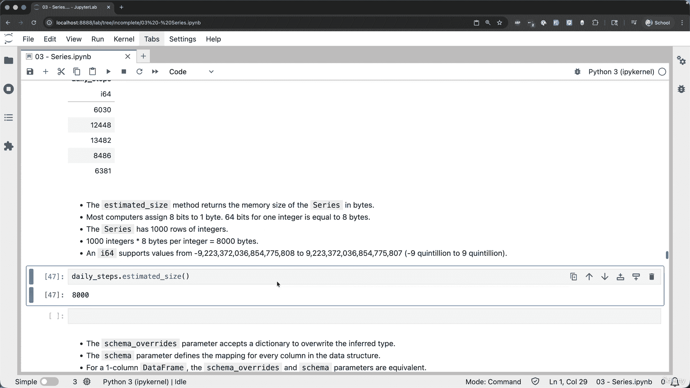

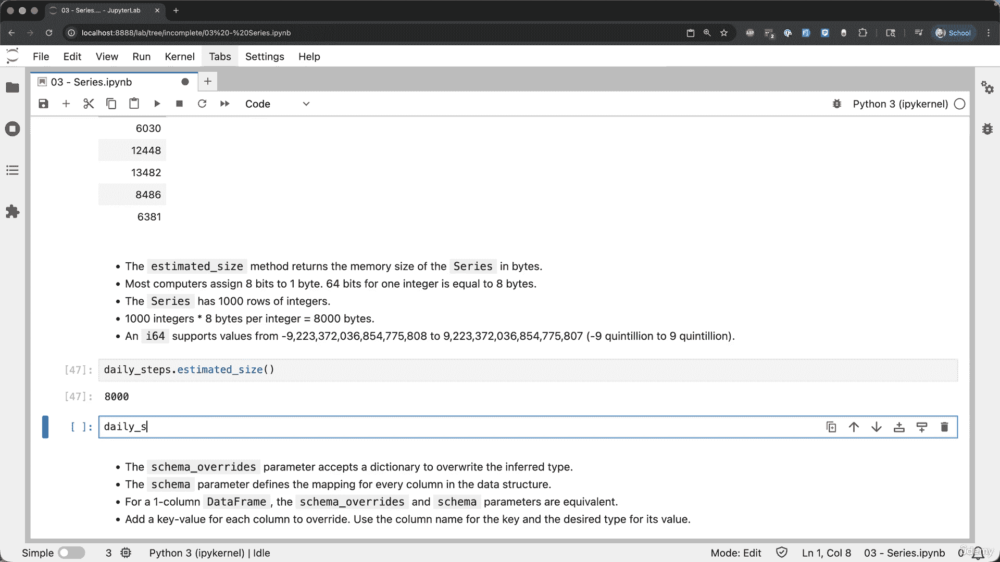

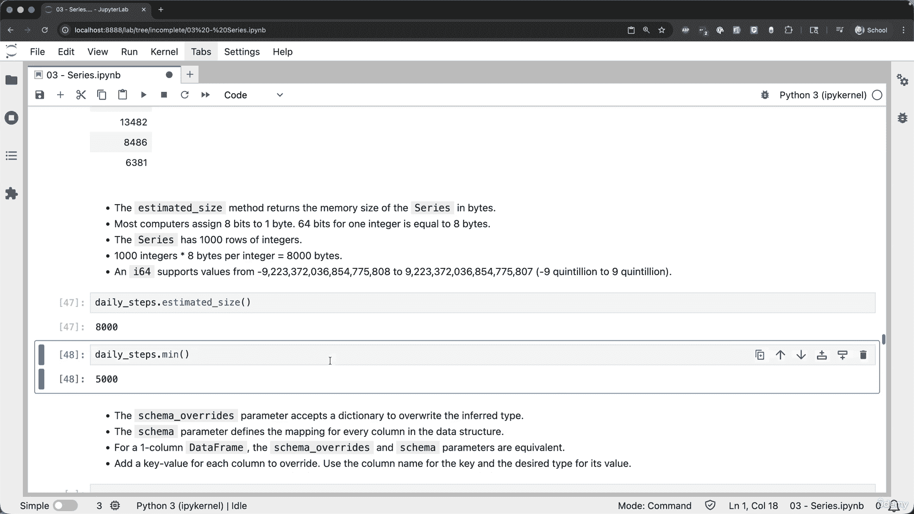

- 单个 64 位整数占用 `64 bit`。
- 因为 `8 bit = 1 byte`，所以单个整数占用 `64 / 8 = 8 byte`。
- 数据一共有 `1000` 个整数。
- 总内存约为 `1000 × 8 = 8000 byte`。


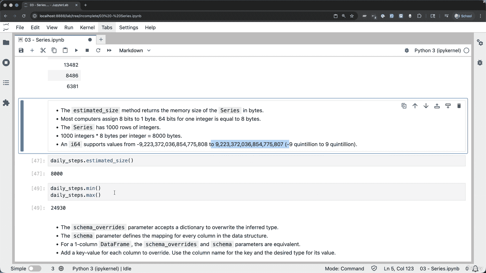

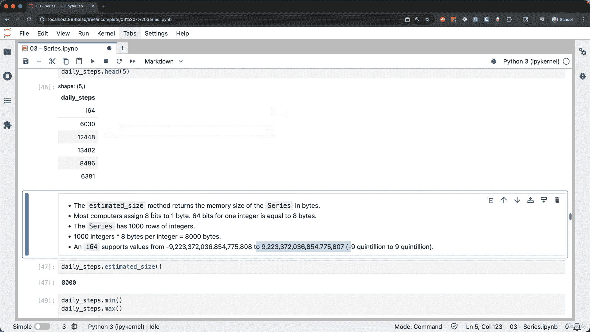

这个方法叫“估计大小”，原因是这个数字不包含实际的 Polars Series 对象、Python 对象以及相关方法等内容，只计算 Series 中核心数据的整数部分。不过它仍然提供了一个很有用的指标，可以告诉我们这个 Series 大致占用了多少内存。这里的 64 位整数问题在于，对于我们存储的数据来说，这个整数类型相当大。`Int64` 支持从负 9 quintillion 到正 9 quintillion 的值，也就是大约负 `9×10^18` 到正 `9×10^18`。而我们的数据根本不需要接近这个范围。为了展示 Series 中数值的范围，可以介绍两个互补的方法：第一个叫 `min`，返回 Series 中的最小值，这里是 `5000`；与 `min` 互补的方法是 `max`，返回 Series 中的最大值，这里是 `24930`。因此不需要这种规模的数量级来支持从 5000 到 25000 的整数值。

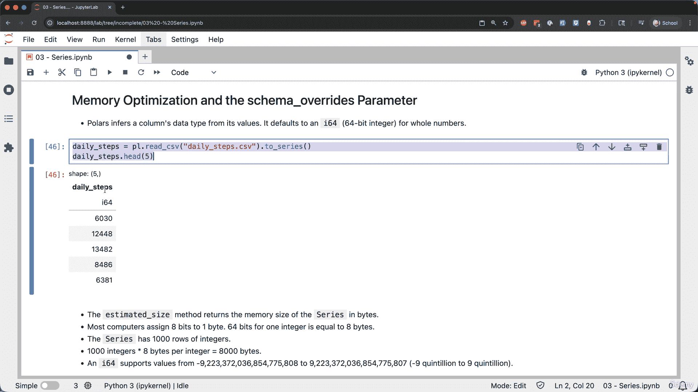

```python
daily_steps.min()
daily_steps.max()
```


**🛠️ 三、使用 schema_overrides 选择更小的整数类型**


上一节我们看到了默认的 `Int64` 会占用较多内存，本节中我们来看看如何让 Polars 为 `daily steps` 列选择不同的整数数据类型，以减少总内存占用。可以通过 `schema_overrides` 参数实现这个目标。先回到前面的原始导入代码并复制它，`daily steps` 是文件中对应的列名。把代码粘贴下来后，添加一个额外参数 `schema_overrides`，并将它设置为一个字典。

```python
df = pl.read_csv(
    "daily_steps.csv",
    schema_overrides={"daily steps": pl.Int16}
)
```


这个参数的工作方式是：字典的键是已有的列名，比如 `daily steps`；字典的值是希望使用的 Polars 数据类型。也就是说，我们希望把这一列中的数据当成什么类型来处理。前面看到过，Polars 的所有数据类型都位于库的顶层，因此可以访问 `pl`，然后输入 `int`，按下 Tab 键查看候选类型。这里不选默认的 64 位整数，而是选择一个更小的类型，比如 16 位整数 `Int16`。执行这段代码后，Polars 会使用更小的 16 位整数类型。需要注意，如果某个值超出了所选数据类型的范围，就会看到一个错误或异常，提示必须换成更大的数据类型。既然这段代码可以正常工作，就说明所有值确实都可以用 16 位整数表示。

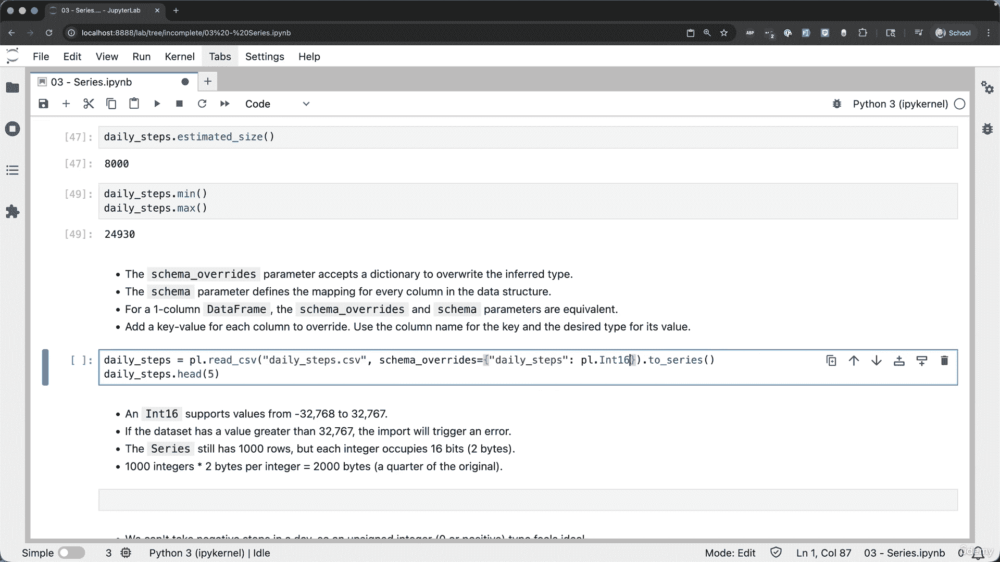

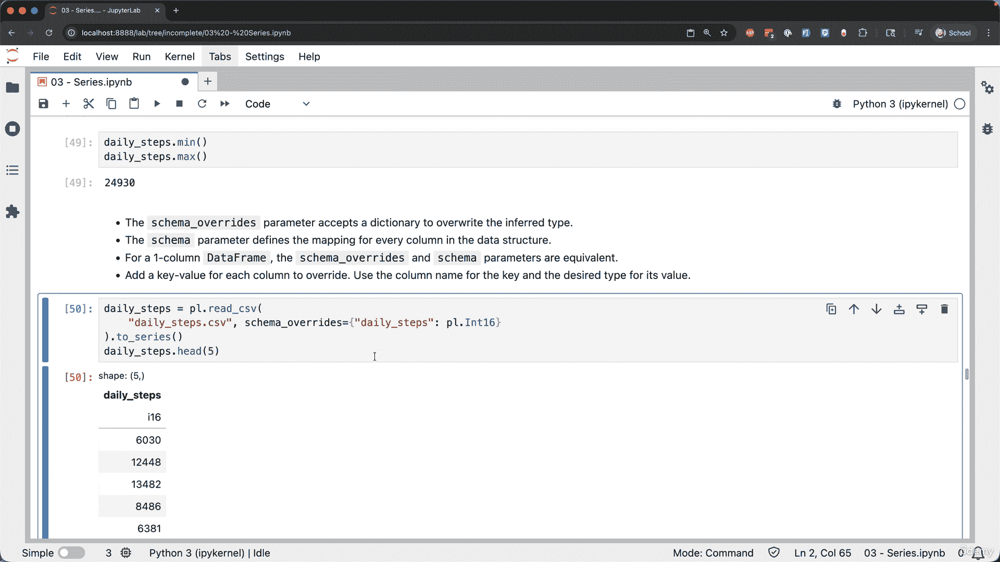

接下来讨论 `schema_overrides` 参数到底在做什么。参数名里有 `overrides`，意思是指定数据中哪些列需要覆盖 Polars 的默认推断。例如，如果数据集有 100 列，而只想覆盖其中一列，就可以使用 `schema_overrides` 参数，只提供这一个键值对，让 Polars 为这个特定列分配不同的数据类型。还有一个互补参数叫 `schema`，它的工作方式完全相同：键是列名，值是数据类型。但 `schema` 参数要求提供每一列到每一种数据类型的完整映射。如果数据集有 100 列，`schema` 就需要一个包含 100 个键值对的字典，其中包括那些可能根本不想修改的列。也许 Polars 对某些列的默认推断本来就是正确的，但使用 `schema` 参数时仍然必须把它们全部写出来，这会使得代码冗长很多。

`schema` 和 `schema_overrides` 的区别可以用下面的对比来理解，这个对比能帮助我们在实际写代码时做出选择。

- `schema_overrides` 只需要写出想覆盖默认推断的列。
- `schema_overrides` 适合只修改少数列的数据类型。
- `schema` 需要写出所有列以及它们对应的数据类型。
- `schema` 即使某些列不需要修改，也必须完整列出。
- 在当前场景中，数据集只有一列，所以 `schema` 和 `schema_overrides` 的效果完全一样。


从上面的对比可以看出，在当前这个只有一列的数据集中，`schema` 和 `schema_overrides` 的作用相同，因为本来就只有一列需要映射。但一般情况下，`schema_overrides` 是更好的选择，因为它允许精确针对想要设置自定义数据类型的特定列，而不必提供所有列。再次执行 `Int16` 的代码后，现在每个整数占用 16 bit，也就是 2 字节，而不是 64 bit 和 8 字节。因此内存减少了 75%，只占用原始空间的 25%，因为 16 是 64 的四分之一。

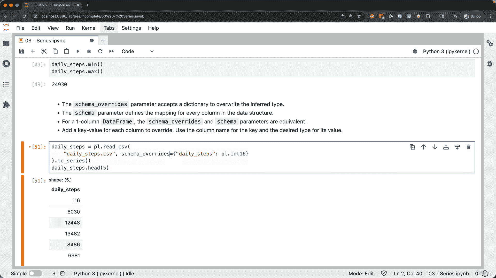

```python
16 / 64 = 25%
1 - 25% = 75%
```


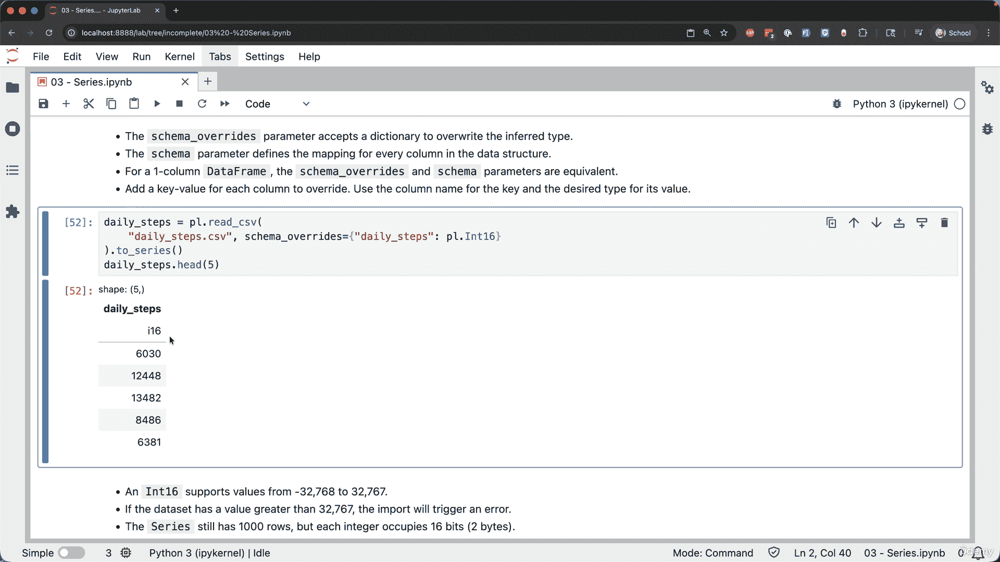

接下来重新对 `daily steps` 调用 `estimated_size` 方法。现在仍然有 1000 个整数，但每个 16 位整数在内存中占用 2 字节，因此总估计大小会变成 2000 字节。需要提醒的是，16 位整数支持从负 32000 到正 32000 的值，原文给出的范围是近似值。也就是说，它有能力支持当前数据集中的所有可能值。再次强调，Series 中的每个整数现在占用 16 bit，也就是 2 字节。

```python
df.to_series().estimated_size()
```


**🔼 四、进一步使用无符号整数 UInt16**


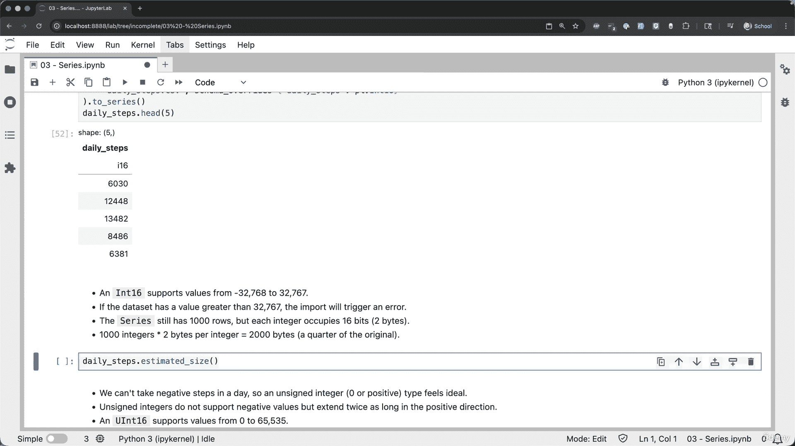

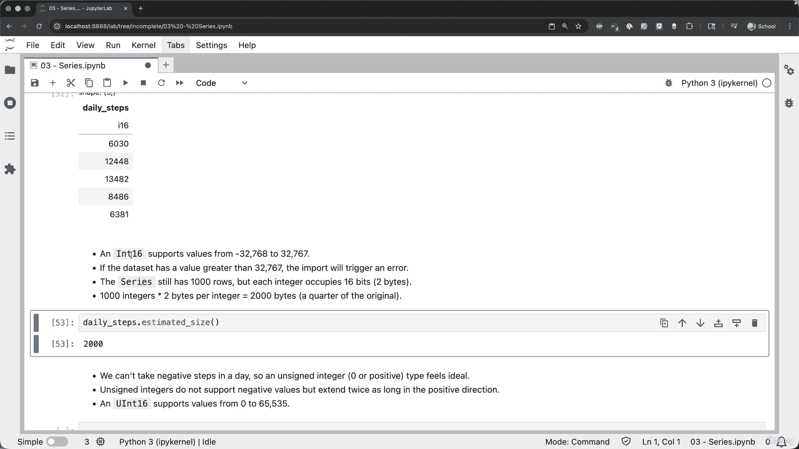

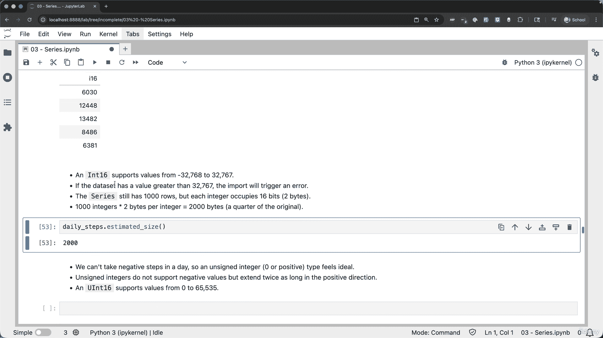

前面我们把类型从 `Int64` 缩小到了 `Int16`，本节中我们来看看还能不能继续优化数据建模方式。严格来说，还可以再进一步。步数是一个很好的例子，因为它几乎不可能出现负值，我们不会在一天里走负数的步数。因此，与其选择支持负值的 16 位整数 `Int16`，不如选择 16 位无符号整数，也就是以 `u` 开头的类型。无符号整数的好处是放弃负数支持，不能用无符号整数表示负数，但可以在正数方向获得两倍的范围。使用完全相同的 16 bit，无符号整数在正数方向可以走到大约 65000。这样即使明天走了 35000 步，在某些日子里这个数字是合理的，也能有更大的范围来容纳，并且更贴近真实世界的情况。

无符号整数类型也有多种选择，常见类型包括以下这些，类型名末尾的数字表示它占用的位数。

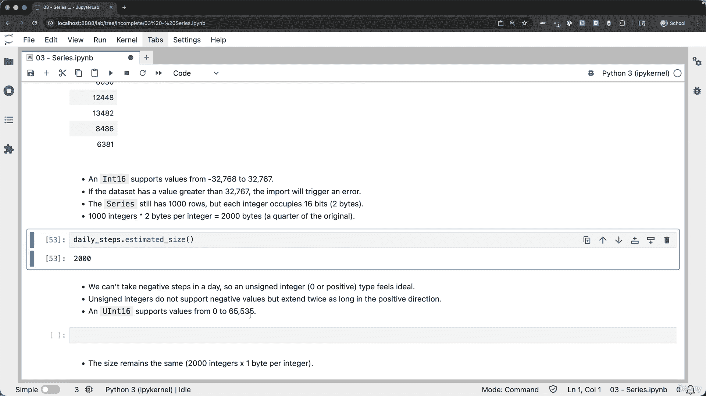

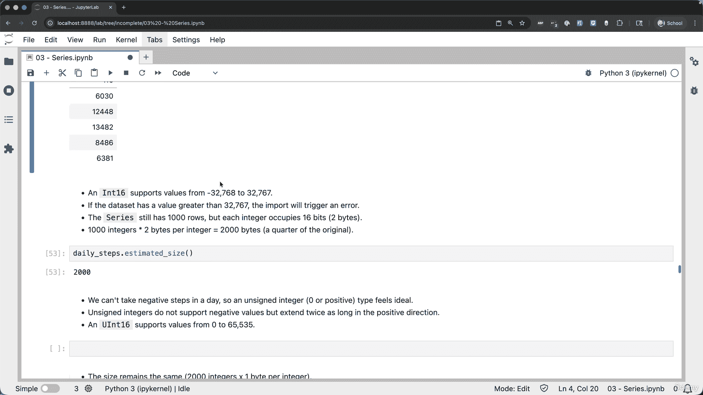

- `UInt8`
- `UInt16`
- `UInt32`
- `UInt64`


示例和前面完全一样，复制之前的代码即可。唯一区别是仍然要提供 `schema_overrides` 参数，因为要覆盖 `daily steps` 列默认的 64 位整数推断。提供键，也就是列名，列名必须完全匹配；提供值，也就是希望该列中的值采用的数据类型。这里选择互补的无符号整数类型 `UInt16`。

```python
df = pl.read_csv(
    "daily_steps.csv",
    schema_overrides={"daily steps": pl.UInt16}
)
```


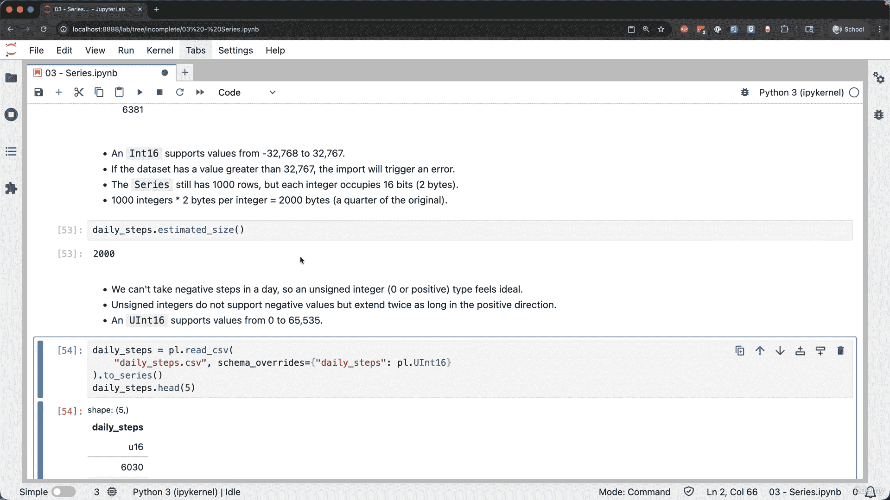

选择 16 位无符号整数后，一切工作方式相同，总内存消耗仍然保持为 2000 字节，因为一共有 1000 个整数，每个整数在内存中占用 2 字节。因此这里并没有进一步减少内存消耗，但这种建模方式更符合数据的真实角色。无论如何，本节课的关键要点是 `schema_overrides` 参数，以及互补的 `schema` 参数。使用 `schema` 时，需要提供所有列到数据类型的完整映射；而使用 `schema_overrides` 时，可以只针对想修改的列。可以利用这些参数减少 Polars 为某列值使用的数据类型，从而减少总内存占用。


**📌 五、总结**


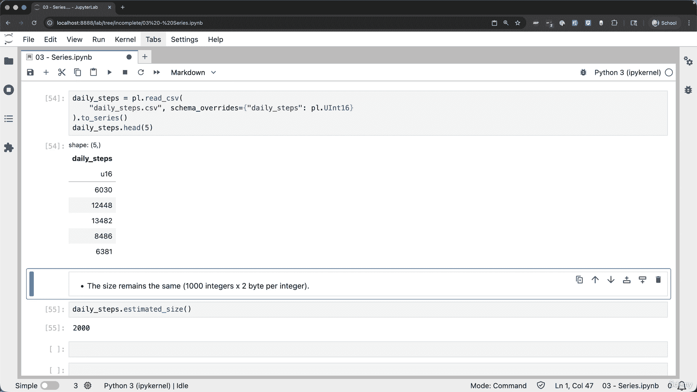

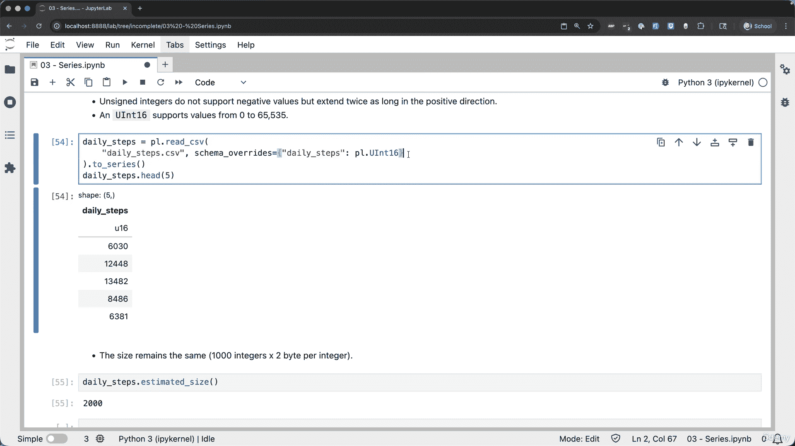

本节课中我们一起学习了 Polars 读取 CSV 时的内存优化方式。我们从导入 `daily steps` 数据集开始，了解了 Jupyter 的 Tab 补全、Polars 的默认类型推断、`Int64` 的内存计算方式，以及 `estimated_size` 方法如何估算 Series 的核心数据大小。随后我们使用 `schema_overrides` 把 `daily steps` 列从 `Int64` 改为 `Int16`，把估计内存从 8000 字节降到 2000 字节，并理解了 `schema_overrides` 与 `schema` 的区别。最后我们还尝试了 `UInt16`，它不会进一步降低这里的内存占用，但能更贴近“步数不应该为负”的现实含义。掌握这些内容后，就可以在实际数据分析中更主动地控制数据类型和内存占用。 
