# 📊 Udemy Polars 与 Python 数据分析：第37节：Series 排序

在本节课中我们将要学习 Polars 中 Series 的排序操作。排序是处理一列数据时非常常见的动作，它可以把原本没有顺序的值，按照从小到大、从大到小，或者按照字母顺序重新排列。我们会重新导入之前课程用过的两个数据集，一个是字符串类型的 ice creams，另一个是整数类型的 daily steps；更准确地说，daily steps 是无符号整数。认识这两个 Series 之后，我们会从数值列开始，逐步查看 `sort` 方法、`descending` 参数和 `in_place` 参数的作用。Series 可以先简单理解为一列数据，而排序就是围绕这一列数据展开的基础操作。

## 🧰 Udemy Polars 与 Python 数据分析：第37.1节：准备数据与排序入口

在正式进入排序之前，我们先把本课要用的两个 Series 准备好。上一段已经说明了本课目标，本节先重新导入之前课程中的两个数据集，让后续示例有统一的数据基础。`ice creams` 是一个字符串 Series，`daily steps` 是一个整数 Series，更具体地说是无符号整数。下面的代码用来说明这两个对象的基本形态：

```python
ice_creams = ...  # 字符串 Series
daily_steps = ...  # 无符号整数 Series
```

准备好数据后，我们会先对 `daily steps` 这个 Series 进行操作。下面是本节涉及的数据对象和入口方法，便于先建立整体印象：

- `ice_creams`：字符串 Series
- `daily_steps`：无符号整数 Series
- `sort()`：Series 的排序方法，默认返回新的 Series

数据准备好之后，下一步就是看数值 Series 如何通过 `sort` 方法完成排序。上一节我们准备了两个 Series，本节中我们来看看 `daily steps` 的默认升序排序结果，以及原 Series 是否会发生变化。

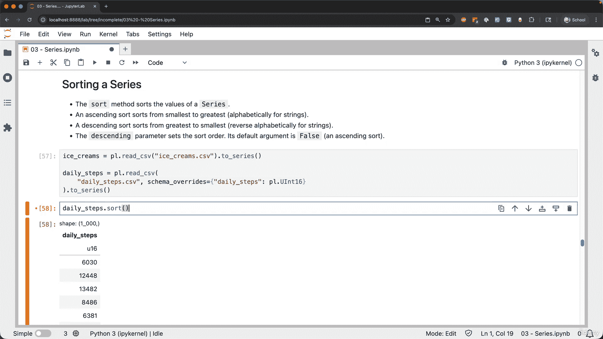

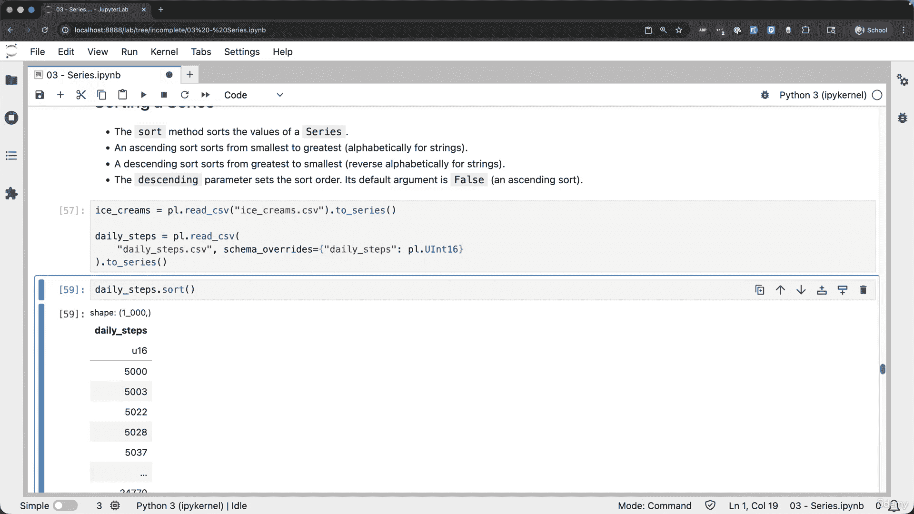

## 🔢 Udemy Polars 与 Python 数据分析：第37.2节：数值 Series 的升序与降序排序

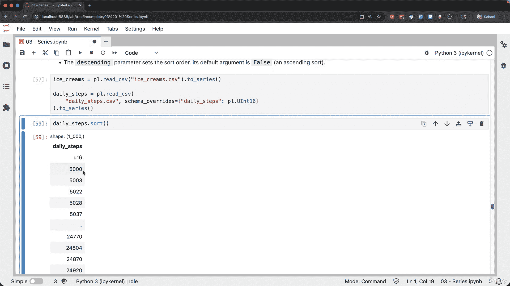

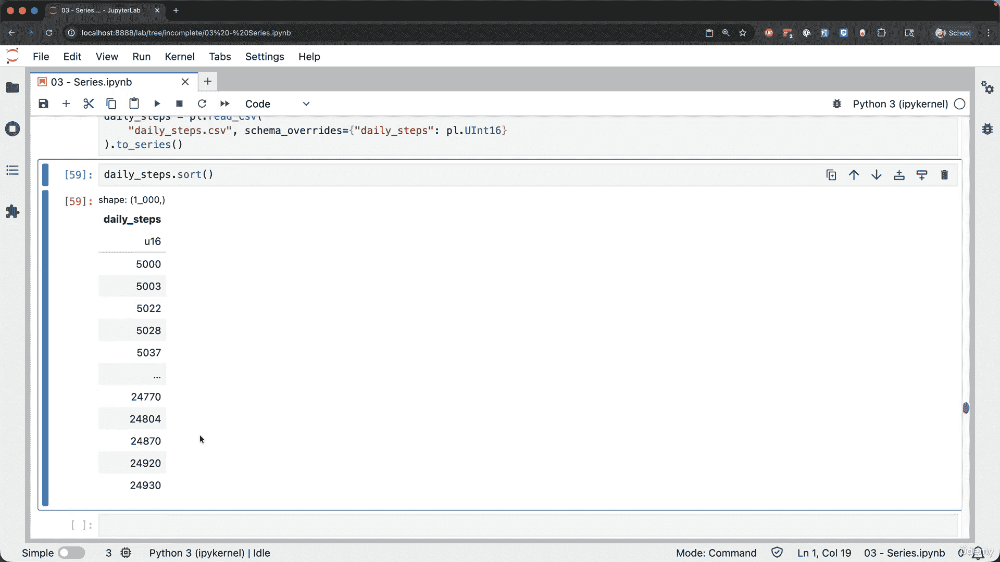

`daily steps` 有一个 `sort` 方法，它会返回一个新的 Series，默认把所有值按升序排列。升序的意思是从最小值到最大值，可以用下面的公式表示：

```text
升序：最小值 -> 最大值
```

下面是 `daily steps` 的初始状态和默认排序写法：

```python
daily_steps  # 原始顺序，没有排序
daily_steps_sorted = daily_steps.sort()
```

初始的 `daily steps` Series 中，数值并没有按任何顺序排列，这就是数据在 CSV 文件中存储时的原始顺序。调用 `sort` 方法后，会得到一个全新的 Series，原来的 `daily steps` 不会被影响，也不会被修改。新 Series 从最小的值 5000 开始，然后逐步上升，直到数据集中最大的值出现在末尾。这个过程就是从小到大的升序排序。

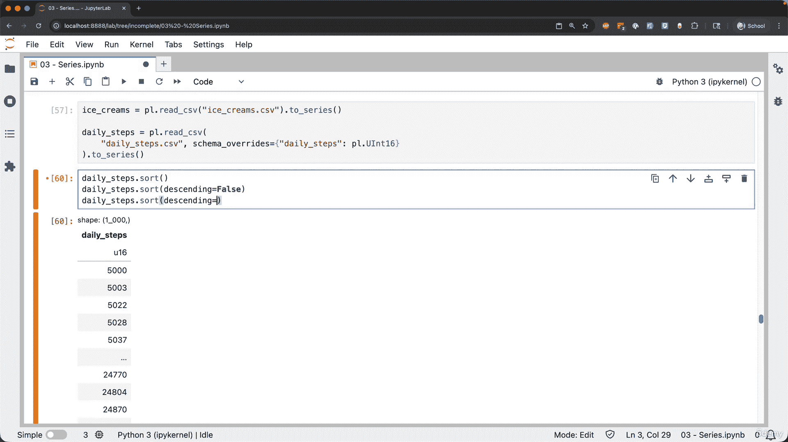

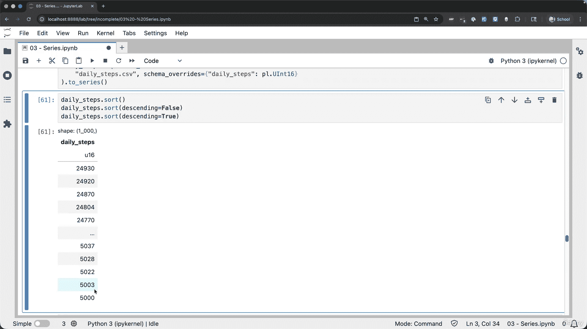

排序方向由 `sort` 方法的一个参数控制，这个参数叫 `descending`。它默认是 `False`，所以下面两行代码等价：

```python
daily_steps.sort()
daily_steps.sort(descending=False)
```

显式写出 `descending=False`，表示不进行降序排序，也就是执行升序排序，因此结果相同。如果想要降序排序，也就是从最大值到最小值，可以给 `descending` 参数传入 `True`。降序可以用下面的公式表示：

```text
降序：最大值 -> 最小值
```

对应的代码是：

```python
daily_steps.sort(descending=True)
```

这样会得到一个新的 Series，最大的值排在前面，然后逐步向下排列到最小的值。对于浮点数 Series，规则同样适用：数值升序是从小到大，数值降序是从大到小。

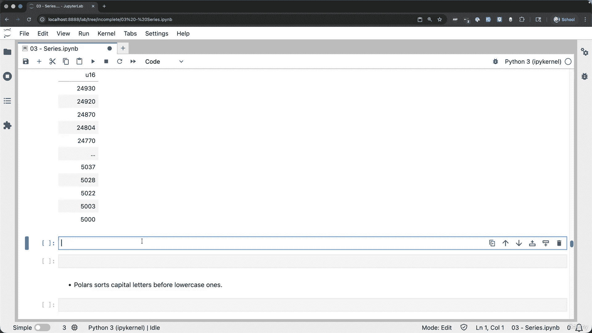

数值排序的规则清楚之后，字符串排序的逻辑也值得单独说明。上一节我们看了数值列的大小排序，本节中我们来看看 `ice creams` 这类文本列如何按字母顺序排序，以及大小写字母之间的特殊规则。

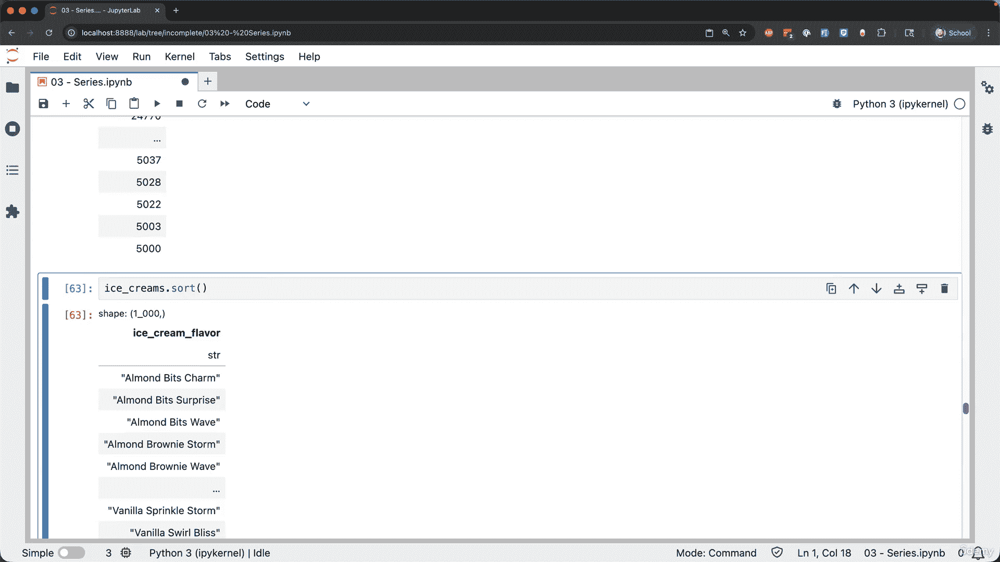

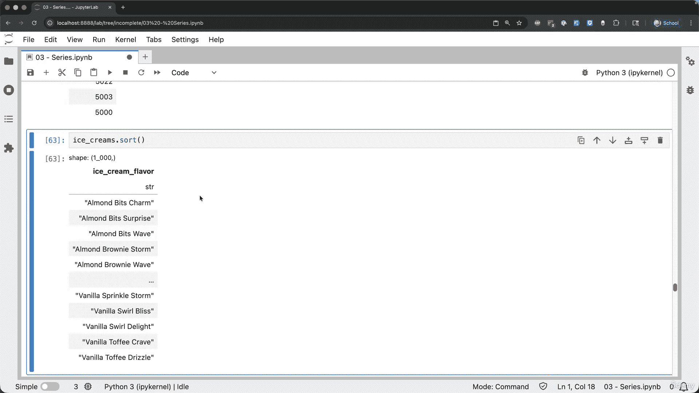

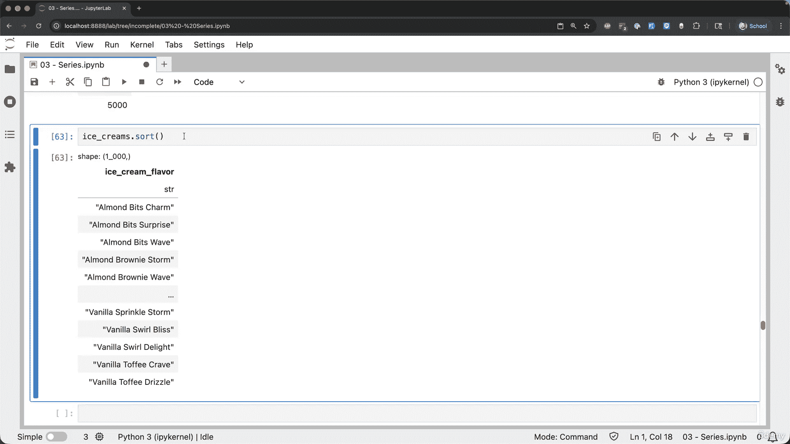

## 🔤 Udemy Polars 与 Python 数据分析：第37.3节：字符串 Series 与字母顺序排序

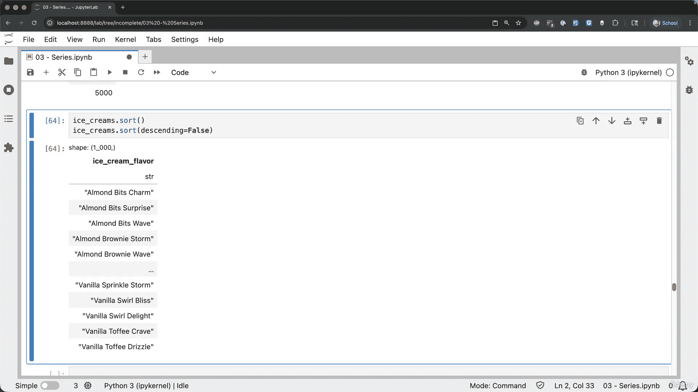

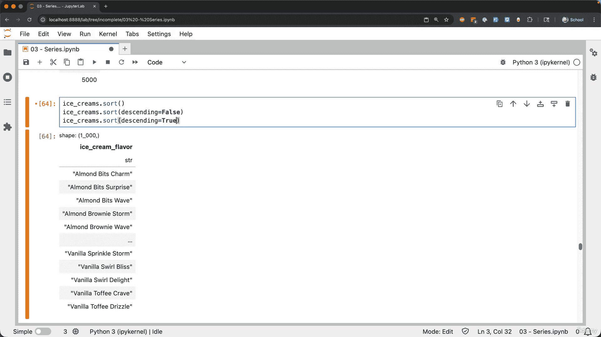

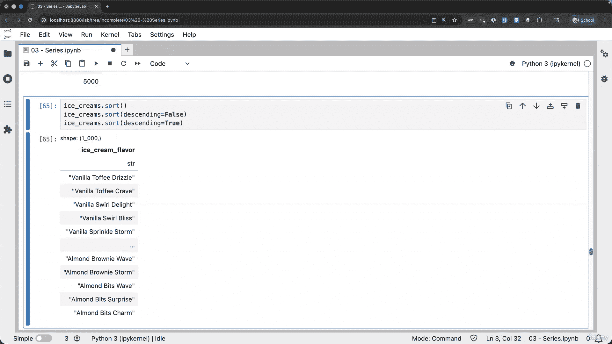

对于 `ice creams` 这样的文本或字符串列，默认的升序排序就是按字母顺序排列，从 A 开始，逐步排到 Z。下面的代码展示默认升序排序的写法：

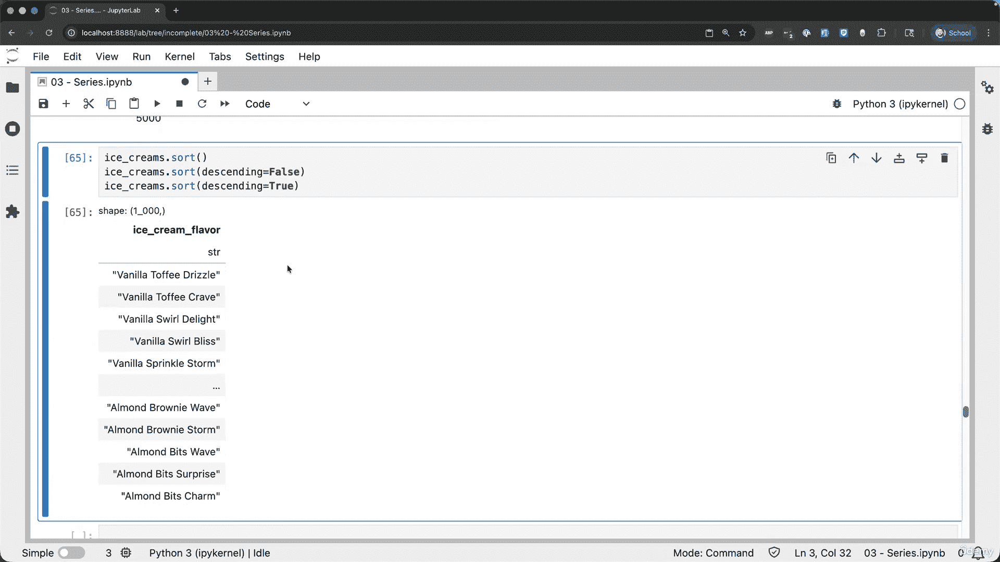

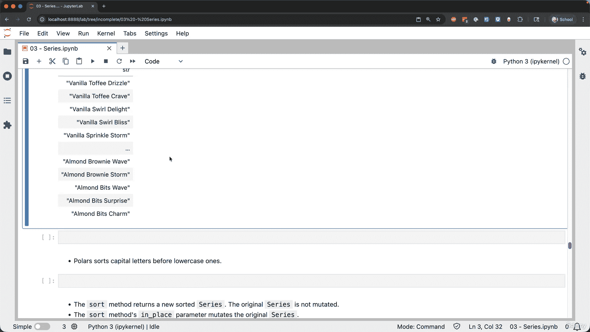

```python
ice_creams_sorted = ice_creams.sort()
```

假设 `ice creams` 当前没有排序，调用 `sort` 方法后，结果会按字母顺序排列，本例中会从 A 开始，一直排到 V。上一行代码和下面这行代码完全相同，因为 `descending` 参数的默认值就是 `False`：

```python
ice_creams.sort(descending=False)
```

如果希望按反向字母顺序排列，也就是从 Z 到 A，可以给 `descending` 参数传入 `True`：

```python
ice_creams.sort(descending=True)
```

这样所有值会按反向字母顺序排列，从 Z 开始，到 A 结束。

这里有一个非常重要的注意点，这个规则在 Polars 中成立，在普通 Python 中也成立：大写字母会排在小写字母之前。可以用下面的关系表示：

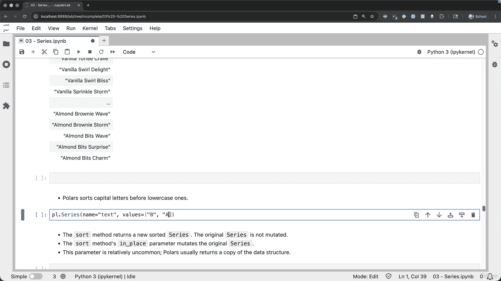

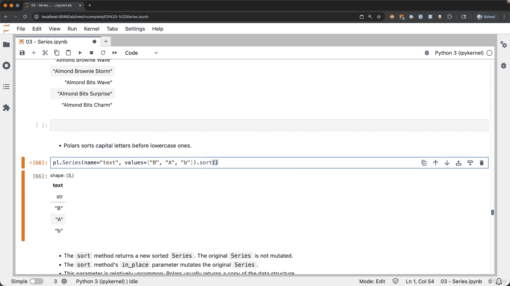

```text
所有大写字母 < 所有小写字母
```

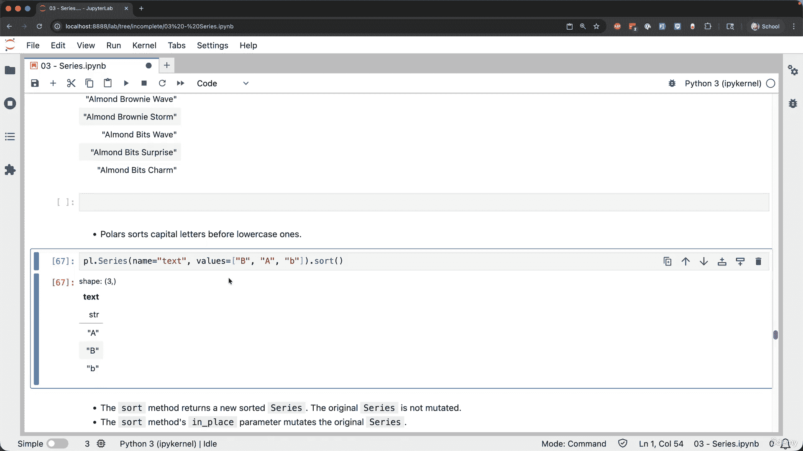

举例来说，大写 A 会排在大写 B 之前，而大写 A 和大写 B 都会排在小写 a 之前。为了证明这一点，可以创建一个新的 Series，名字叫 `text`，值数组包含三个字符串：大写 B、大写 A、小写 b。代码如下：

```python
text = pl.Series("text", ["B", "A", "b"])
text_sorted = text.sort()
# 排序结果顺序：A, B, b
```

创建出来的 `text` 是未排序顺序。调用 `sort` 方法后，默认会按字母顺序排序，等价于升序排序。结果中大写 A 排在大写 B 之前，而大写 A 和大写 B 都排在小写 b 之前。这个例子直观展示了大写字母整体排在小写字母之前的规则。

了解了普通排序和字符串排序后，还需要认识一个特殊参数，它会让排序直接修改原始 Series。上一节我们反复看到 `sort` 返回新对象，本节中我们来看看 `in_place` 参数如何改变原始数据，以及为什么一般不建议使用它。

## 🧪 Udemy Polars 与 Python 数据分析：第37.4节：in_place 参数与原地排序

本课最后要介绍一个特殊参数，叫 `in_place`。这个参数在 Polars 中相对少见，一般也不建议使用，但需要认识它，因为不仅 `sort` 方法中可能出现，Polars 库的其他方法中也可能出现类似参数。

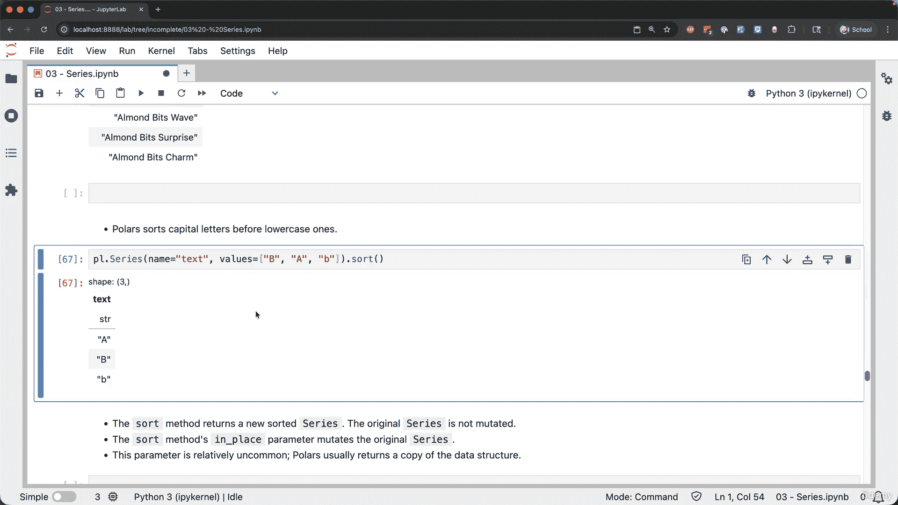

默认情况下，Polars 中所有方法、所有可以要求对象执行的操作，都会返回一个全新的对象。前面调用的 `ice_creams.sort()` 和 `daily_steps.sort()` 都没有修改底层 Series。比如直接输出 `ice_creams`，可以看到它仍然是原始数据集导入时的未排序顺序。每次调用 `sort` 方法，都会得到一个全新的 Series，它是从原始 Series 复制出来的一份副本，排序发生在副本上，所以返回的是一个新对象。

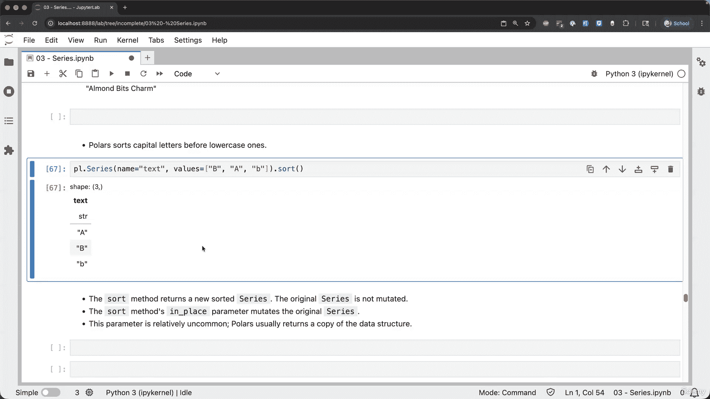

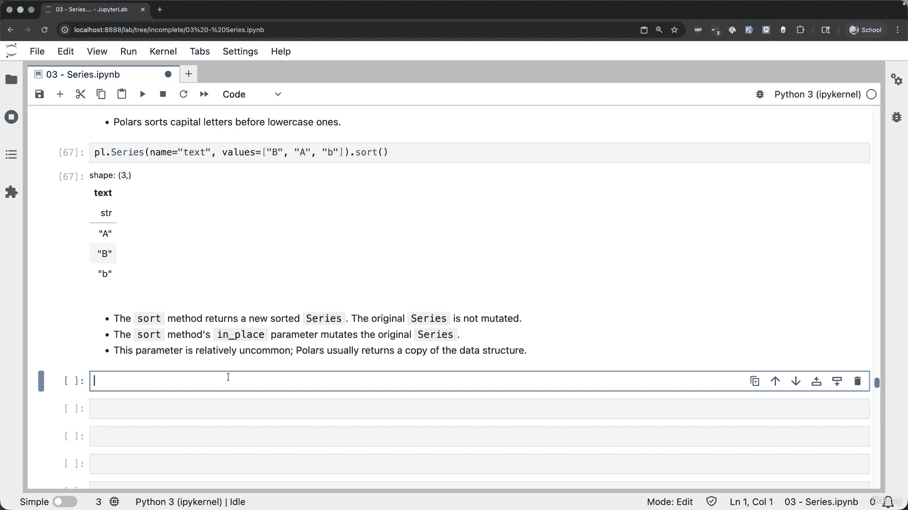

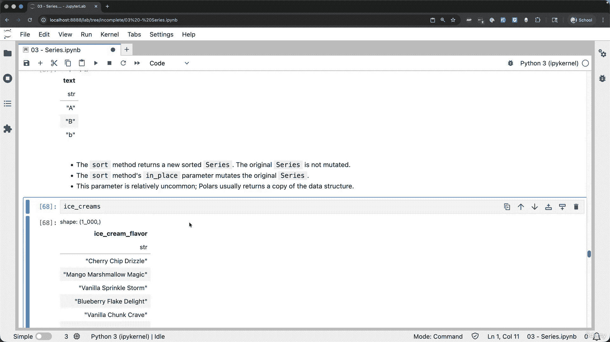

如果想把排序后的变化保存下来，比如希望保留一个按字母顺序排好的 `ice creams` Series，可以调用 `sort` 方法，并把结果赋值给一个新变量，例如 `sorted_ice_creams`。也可以直接重新赋值给原变量 `ice_creams`，从而覆盖原来的变量引用。下面列出两种常见保存方式：

- 保存到新变量：`sorted_ice_creams = ice_creams.sort()`
- 覆盖原变量：`ice_creams = ice_creams.sort()`

这是大多数 Polars 方法的通用做法，因为它们通常会返回一个新对象，也就是在内存中创建一个全新的数据结构。下面用代码概括这种默认行为：

```python
ice_creams_sorted = ice_creams.sort()
# ice_creams 本身不变，ice_creams_sorted 是新的排序结果
```

`sort` 是一个小小的例外，因为它有 `in_place` 参数。`in_place` 默认是 `False`，这会强制创建一份副本。如果把 `in_place` 参数设置为 `True`，排序会直接在原始 Series 上进行。也就是说，这个参数不会创建排序后的副本，而是会修改原始 `ice_creams` Series。下面的代码展示原地排序：

```python
ice_creams.sort(in_place=True)
```

注意执行这段代码后，虽然也会得到一个排序后的 Series，但与此同时 `ice_creams` 已经被修改。如果在调用之后输出 `ice_creams`，可以看到原始 Series 现在已经是排序状态，按字母顺序从小到大排列，从 A 到 Z，并且这个操作是永久的。这是 Polars 中少数允许这种原地修改的方法之一，大多数方法仍然只是返回副本。

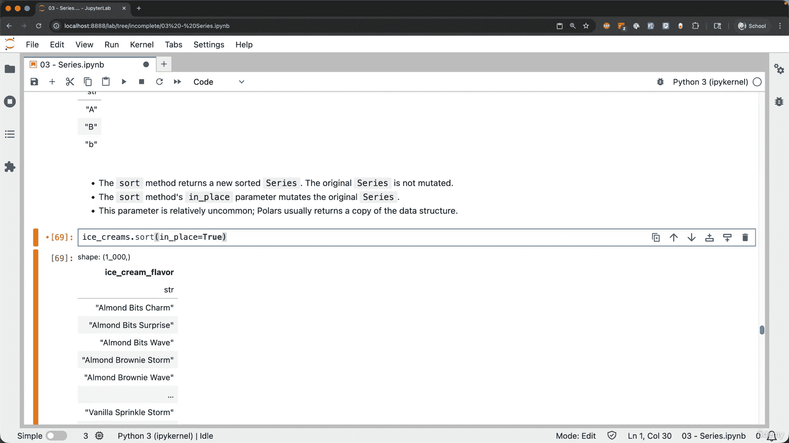

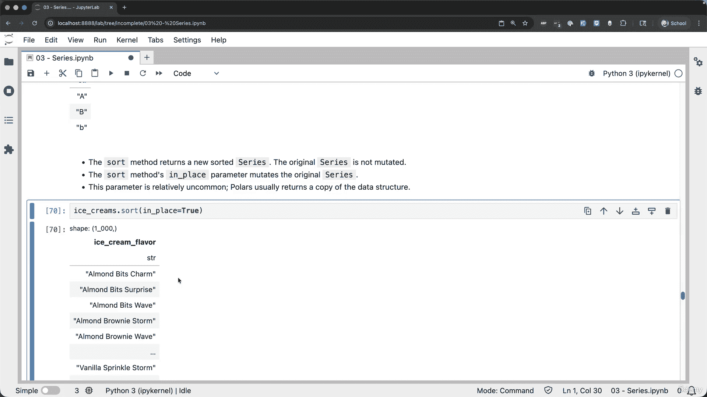

## ✅ Udemy Polars 与 Python 数据分析：第37.5节：总结

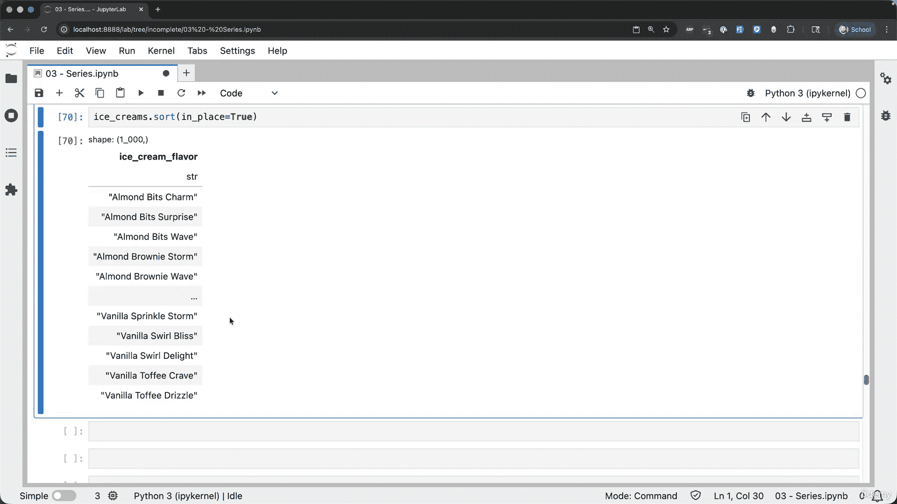

前面几节分别介绍了数据准备、数值排序、字符串排序和原地排序，本节对整节课的内容做一个收束。本节课中我们一起学习了 Polars 中 Series 的 `sort` 方法，以及 `descending` 参数和 `in_place` 参数的基本用法。排序是列数据处理中非常常见的操作，理解默认返回新对象、如何控制排序方向，以及何时会修改原始 Series，对后续数据分析很重要。

下面是本节需要记住的核心要点：

- `sort()` 默认按升序返回一个新的 Series，原 Series 不变。
- `descending=False` 表示升序，`descending=True` 表示降序。
- 字符串默认按字母顺序升序排列，降序则是反向字母顺序。
- 大写字母整体排在小写字母之前。
- 想保存排序结果时，可以赋值给新变量，也可以重新赋值给原变量。
- `in_place=True` 会直接修改原始 Series，一般不建议使用，但需要认识它。

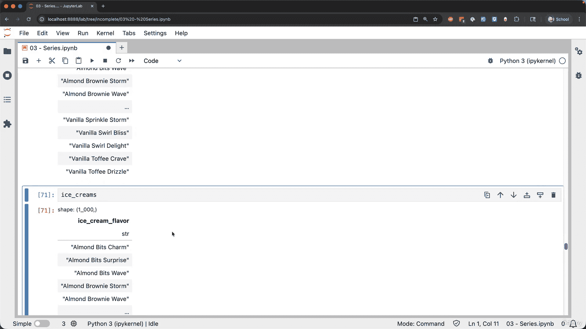

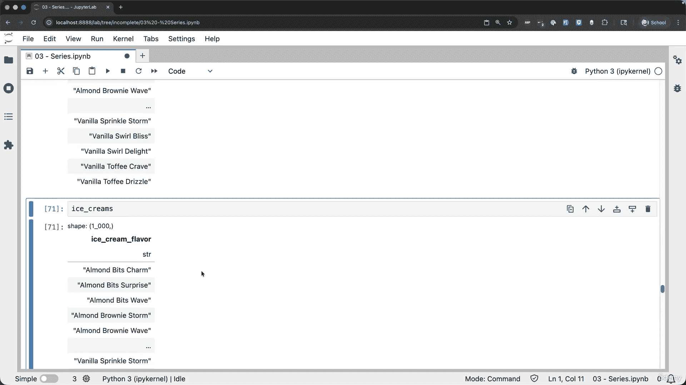

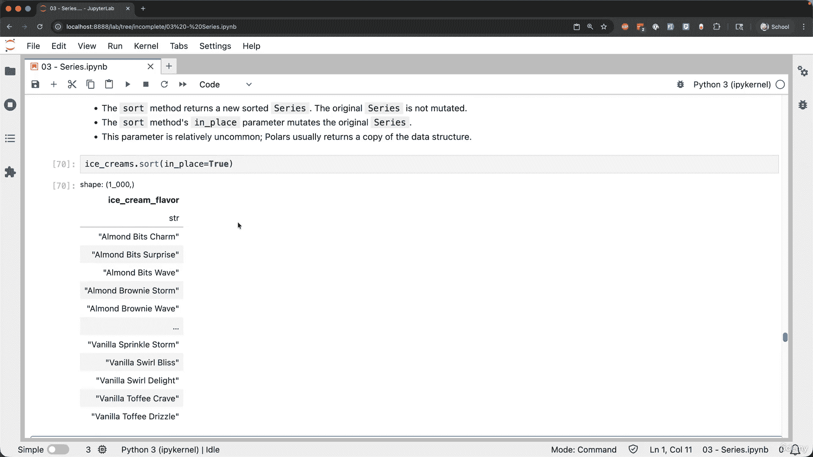

以上就是本节关于 Series 排序的完整内容。通过这些示例，可以把数值排序、字符串排序和原地排序区别开来，为后续更复杂的数据处理打好基础。

