# 📊 Polars 与 Python 数据分析：38：常用数学方法

在本节课中，我们将要学习 Polars Series 上的一组常用数学方法。这些方法覆盖长度、计数、缺失值统计、求和、平均值、乘积、最大值、最小值、中位数、众数、标准差和汇总描述等常见操作。学会这些方法后，日常数据分析中的很多统计计算可以直接通过链式调用完成，不需要手动写循环，也不需要把数据转换成其他结构。

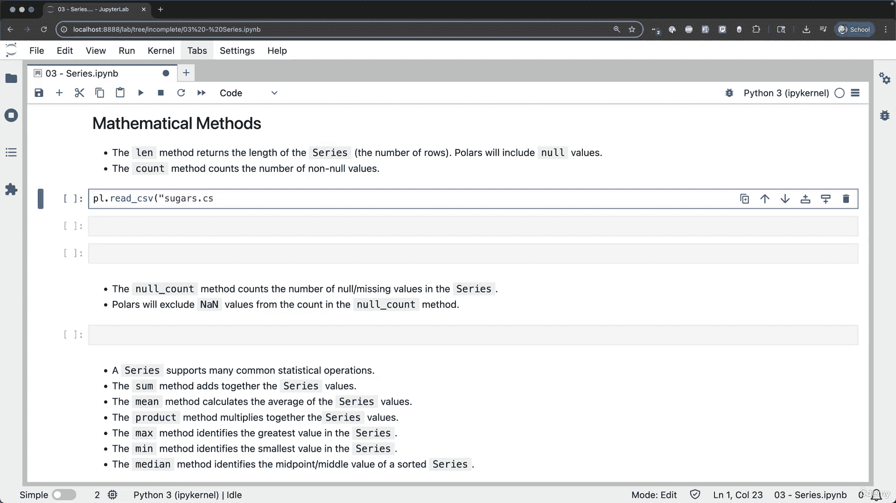

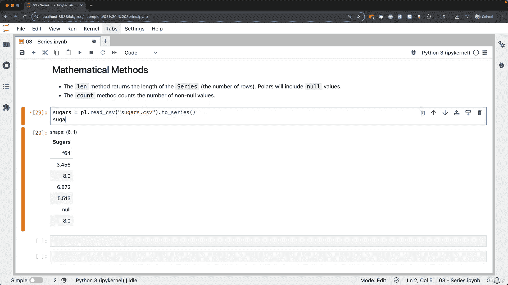

## 📥 Polars 与 Python 数据分析：38：导入 sugars 数据并认识缺失值

上一节我们介绍了 Polars 的基本数据结构，本节中我们来看看如何把一列数据转成 Series，并观察其中的缺失值。首先导入一个新的 CSV 文件，仍然使用 `read_csv` 函数，这个文件名为 `sugars.csv`。可以把它想象成一组测量数据，例如不同配方中糖的克数。这个数据集很短，只有六行，导入后得到一个 DataFrame。

```python
import polars as pl

df = pl.read_csv("sugars.csv")
sugars = df.to_series()
print(sugars)
```

这里使用 `to_series` 方法快速把 DataFrame 转成 Series，并赋值给变量 `sugars`，最后输出 `sugars` 查看结果。现在得到一个六行的 Series。需要特别注意，其中有一个 `null` 值，`null` 表示缺失值或不存在值。也就是说，在 `sugars.csv` 文件中，这一行本身没有填写任何条目：前面有一个数字，中间是空行，后面又有一个数字。

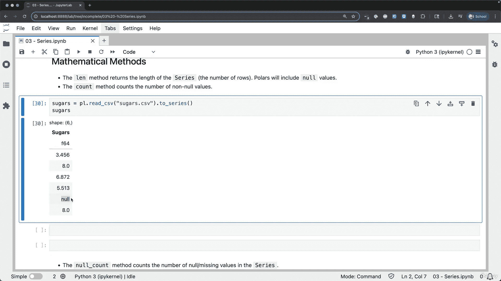

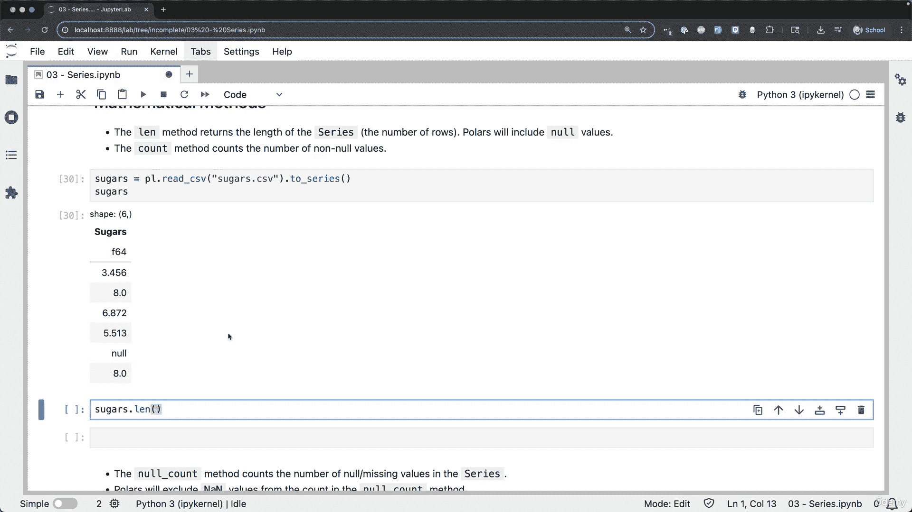

```python
null = 缺失值
```

## 📏 Polars 与 Python 数据分析：38：长度、计数与缺失值统计

完成数据导入和缺失值观察后，本节来看看 Series 上最基础的长度与计数方法。第一个方法是 `len`，名称和 Python 中的 `len` 一样，但这里它是 Series 的方法，是 length 的缩写。`len` 方法返回 Series 的总行数，也就是数据中一共有多少行，这个数字和上方显示的行数一致，只是换成了方法调用的方式获得。

```python
sugars.len()  # 6
```

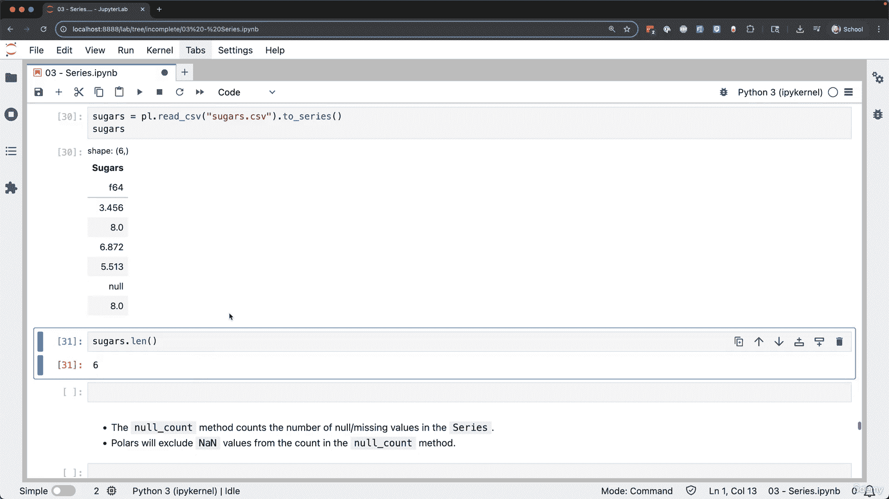

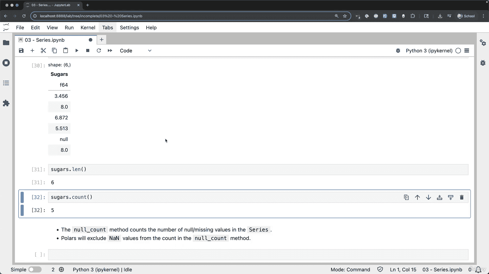

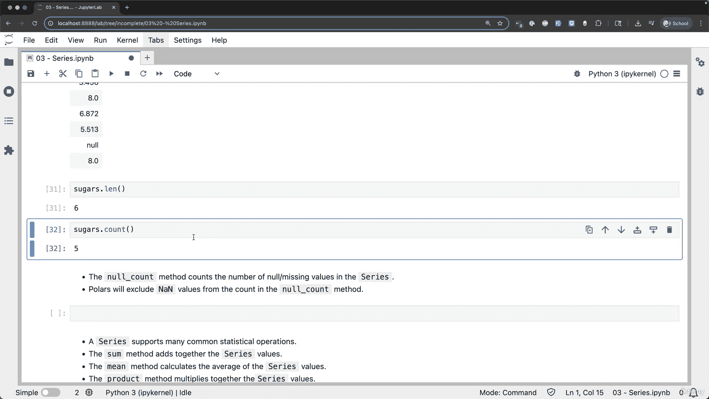

可以看到结果为 6。接下来有一个互补的方法叫 `count`。`count` 的名称和 `len` 很像，但含义不同：`count` 返回的是存在值的数量，也就是非缺失值的数量。在上面的 Series 中一共有六行，但只有五个有效的浮点数，因此 `count` 返回 5，表示原始 Series 中有五个有效的存在值。

```python
sugars.count()  # 5
```

如果只想统计缺失值数量，可以使用互补的 `null_count` 方法，它会返回缺失值的个数。对 `sugars` 调用 `null_count` 方法后，由于六个条目中只有一个 `null` 值，因此返回值为 1。

```python
sugars.null_count()  # 1
```

这里快速提醒：Polars 中的 `null` 和 `NaN` 不同。`NaN` 是 Not a Number 的缩写，pandas 使用它来标记缺失值；Polars 使用 `null` 表示缺失值，而 `NaN` 用于表示无效的数学运算结果，它和缺失值属于不同类型的概念。`null_count` 方法统计的是缺失值数量，也就是 `null` 值的数量。

## ➕ Polars 与 Python 数据分析：38：常见数学运算

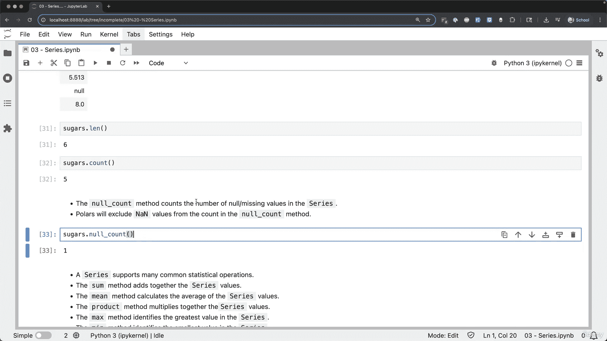

掌握长度和计数后，本节进入常见数学运算。接下来快速浏览一批非常常用的数学操作。多数操作会自动忽略 `null` 值；例如求和时，会把 Series 中所有可能的值相加，但跳过缺失的 `null` 值。以下列出常用方法及其含义。

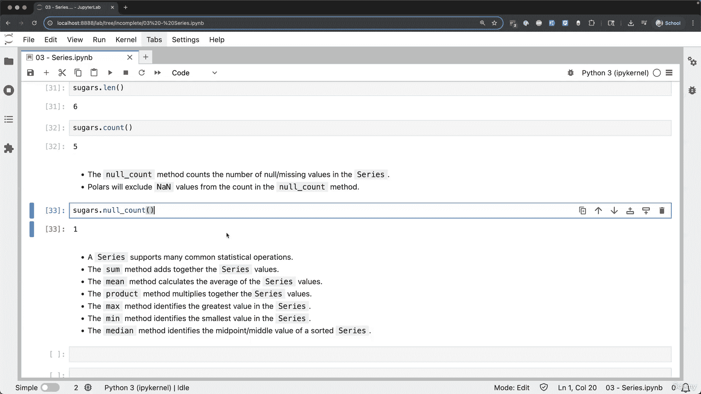

- `sum`：对所有有效值求和，返回累加后的总和，示例结果为 `31.841`。

- `mean`：返回平均值，`mean` 就是 average 的同义词。

- `product`：把所有有效值相乘，得到一个较大的乘积结果。

- `max`：返回 Series 中的最大值，示例中最大值为 `8.0`。

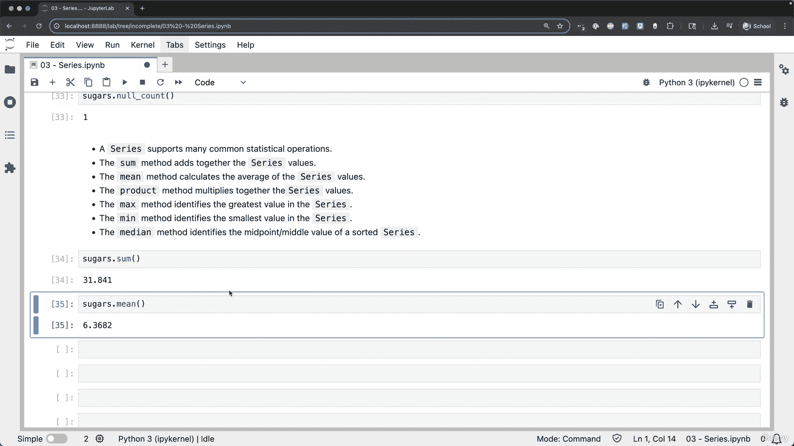

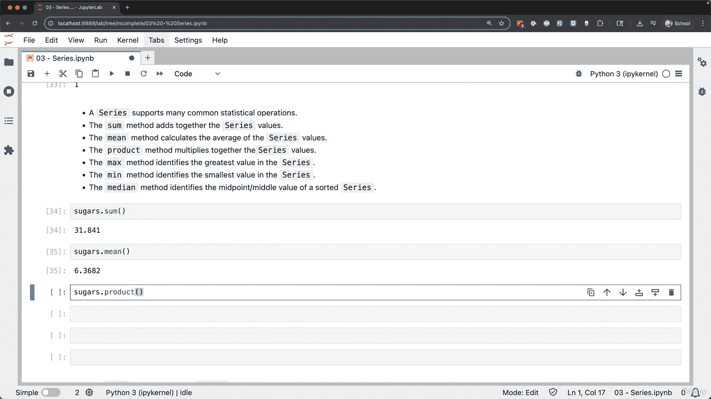

- `min`：返回 Series 中的最小值，也就是最小条目。

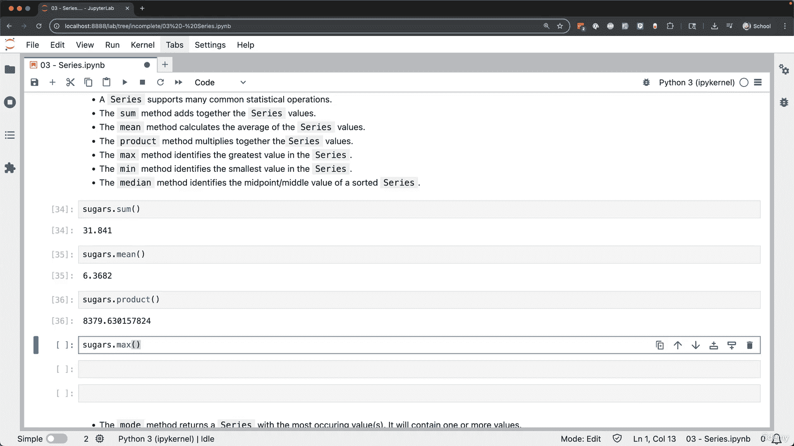

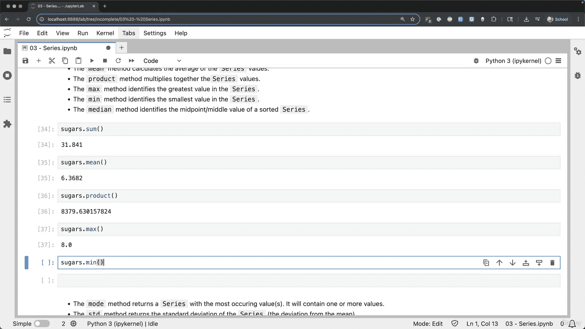

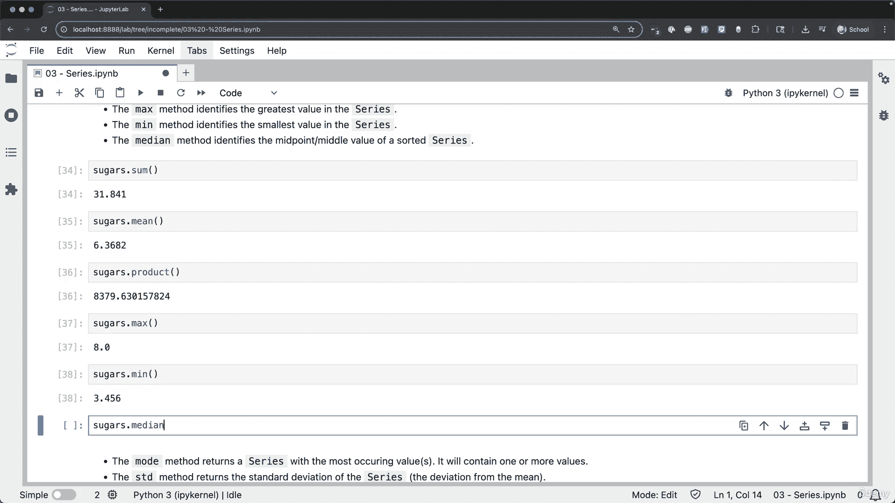

- `median`：返回中位数，即 Series 排序后位于中间位置的值。

```python
sugars.sum()      # 31.841
sugars.mean()
sugars.product()
sugars.max()      # 8.0
sugars.min()
sugars.median()
```

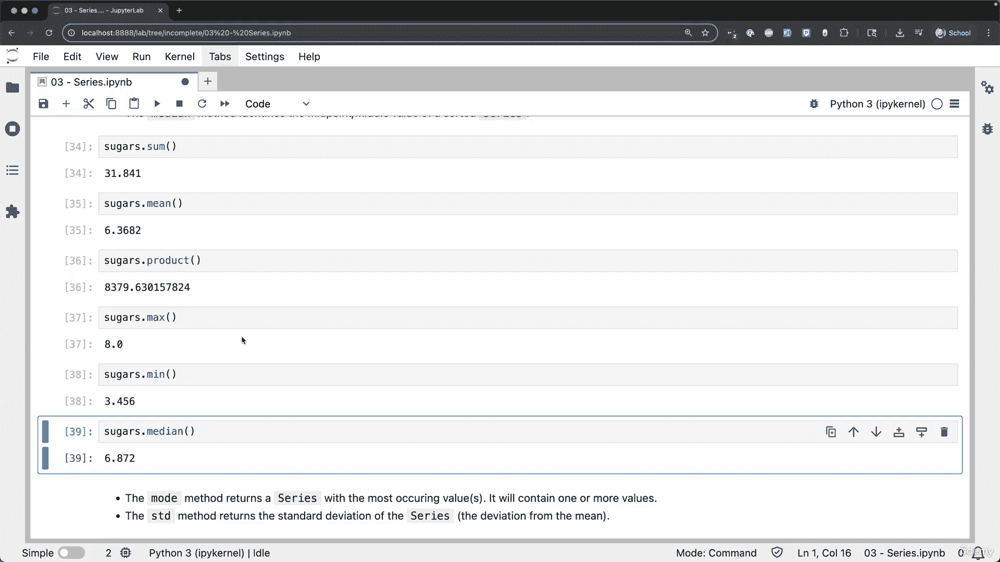

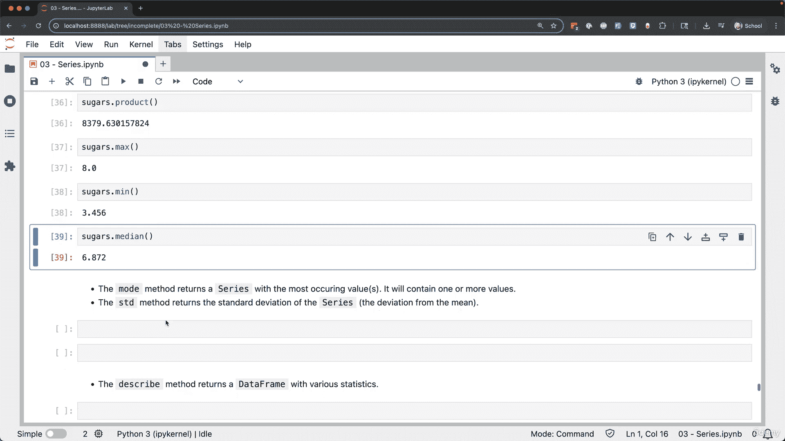

这些操作大多不需要额外处理缺失值，Polars 会按照自己的规则忽略 `null` 后进行计算。对于初学者来说，可以先把它们理解为“对有效数据做统计”的快捷方法。

## 📈 Polars 与 Python 数据分析：38：众数、标准差与 describe

常用聚合方法了解后，本节看看众数、标准差和汇总描述。另一个常见数学操作是众数。众数是出现次数最多的值，也就是出现频率最高的那个值。在简单的 sugar Series 中，`8.0` 出现了两次，其他每个值都只出现一次，因此 `8.0` 就是众数。

```python
sugars.mode()
```

调用 `mode` 方法后，返回的是一个 Series，这一点值得注意。这个 Series 只有一行，该行给出众数。之所以返回 Series，是因为可能存在多个值出现次数完全相同、共同并列最高频的情况；Series 数据结构支持两行来保存两个并列众数。如果 `mode` 方法只返回单个值，那么这种类型就无法支持多个众数的可能性。

```python
众数 = 出现次数最多的值
```

还有 `std` 方法，它是 standard deviation 的缩写，也就是标准差。标准差描述数据相对均值的偏离程度，表示数值围绕平均值分布或变化的程度。即使统计知识有些生疏，也可以直接使用这个方法；如果对统计更熟悉，就会知道它是常见的离散程度度量。

```python
sugars.std()
```

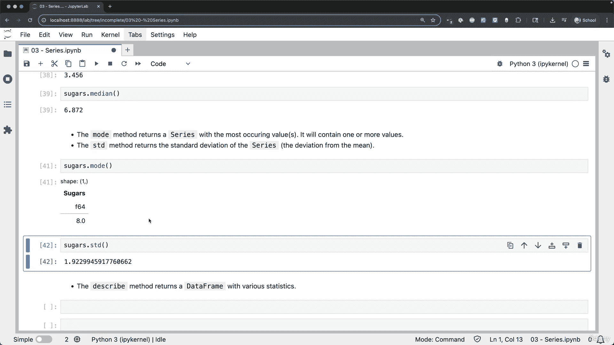

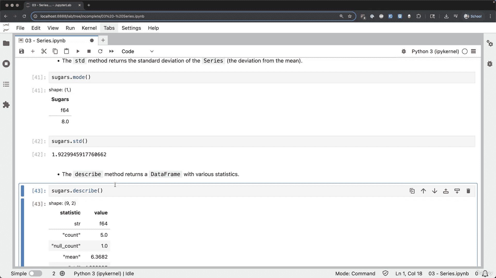

这里最强大的方法之一是 `describe`。对 `sugars` 调用 `describe` 后，会得到一组计算的集合或汇总，并以一个方便查看的 DataFrame 呈现。这个 DataFrame 包含两列，列出各种统计量。之前显式调用过的许多方法，例如 `count`、`null_count`、`mean`、`min` 和 `max`，都会以字符串形式出现在 statistic 列中，对应的 value 列则保存该计算或测量结果。

```python
sugars.describe()
```

在 `describe` 的结果中，可以看到有效值总数、缺失值或不存在值总数、总条目数 6、平均值或均值、最小值、最大值等统计量。这些值应当与前面通过对应方法得到的数据一致。这样一次调用就能快速了解一列数据的整体统计情况。

## ✅ Polars 与 Python 数据分析：38：本课总结

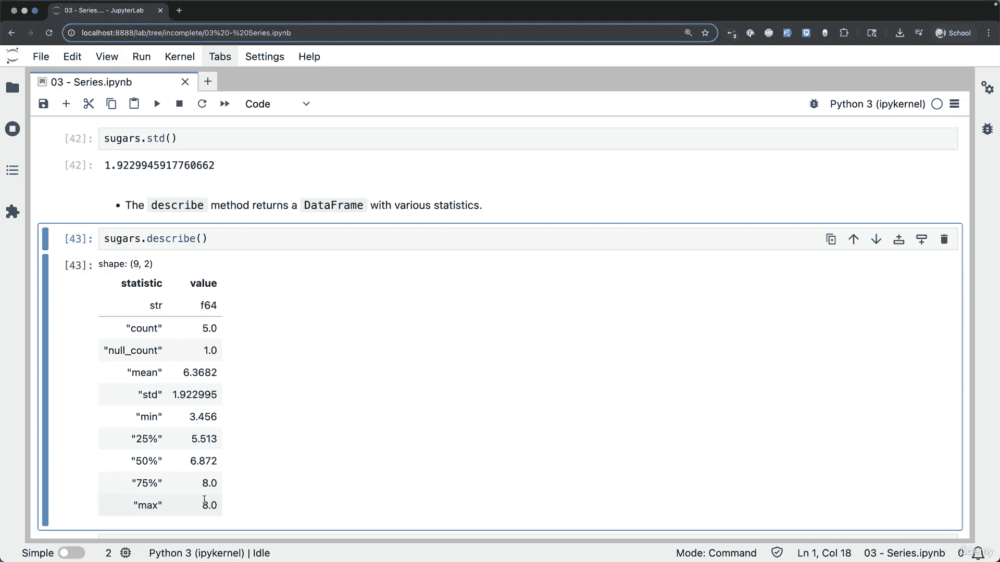

本节课中，我们一起学习了 Polars Series 上常用的数学方法。我们从 `sugars.csv` 导入数据并转成 Series，认识了 `null` 缺失值，学习了 `len`、`count`、`null_count`，也了解了 `sum`、`mean`、`product`、`max`、`min`、`median`、`mode`、`std` 和 `describe` 等常见数学操作。这些方法构成了 Polars 数据分析中非常基础的一类工具，后续做统计和清洗时可以反复使用。

