# 🍬 Polars 与 Python 数据分析：39：舍入方法

在本节课中，我们将要学习 Polars 中几个用于数值舍入的 Series 方法，包括 ceiling、floor 和 round，以及 round 方法中的 decimals 参数。下面先列出本节会涉及的三种舍入方法，方便建立整体印象。

以下是本节会涉及的三种舍入方法：

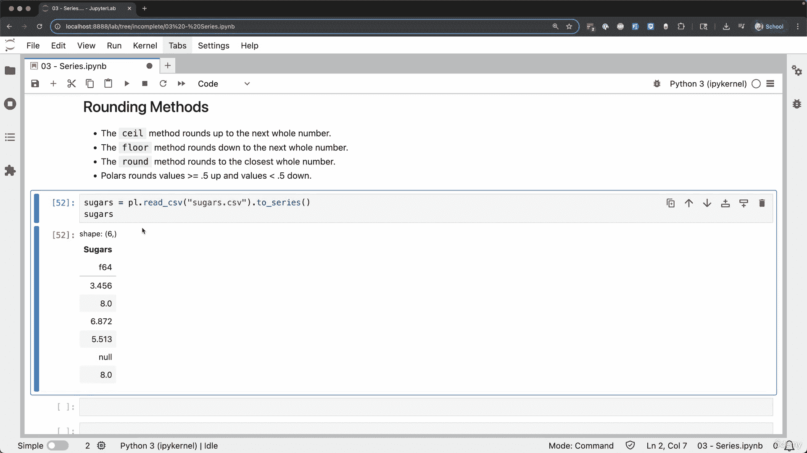

- `ceiling`：把数值向上舍入到下一个整数。
- `floor`：把数值向下舍入到下一个整数。
- `round`：把数值舍入到最接近的整数，并可通过 `decimals` 控制小数位。

上一节我们处理过 sugar 序列，本节中我们先重新执行上一节课的代码，把 sugar 序列加载进来。下面的代码就是重新载入示例数据的过程，后面的例子都会围绕这个序列展开。

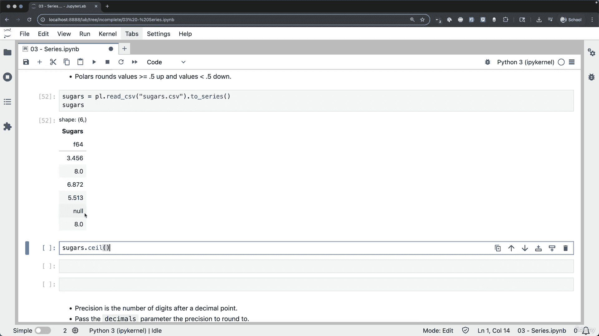

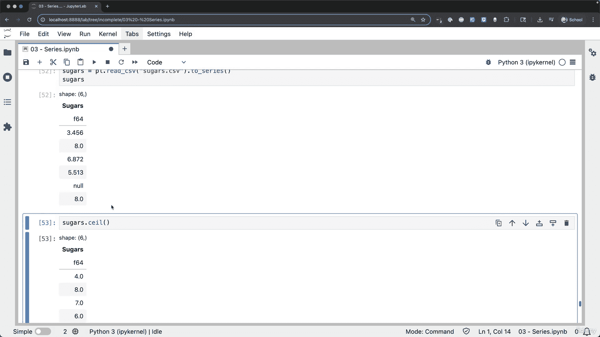

```python
# 重新执行上一节课的代码，载入 sugar 序列
sugar = ...
```

数据准备好后，本节中我们来看看第一个方法：ceiling。Ceiling 这个名字来自“天花板在头顶上方”这个含义，所以可以记住它是向上处理数值的方法，其缩写为 CEIL。Ceiling 方法会把每个数字向上舍入到下一个整数，对应的数学表达如下。

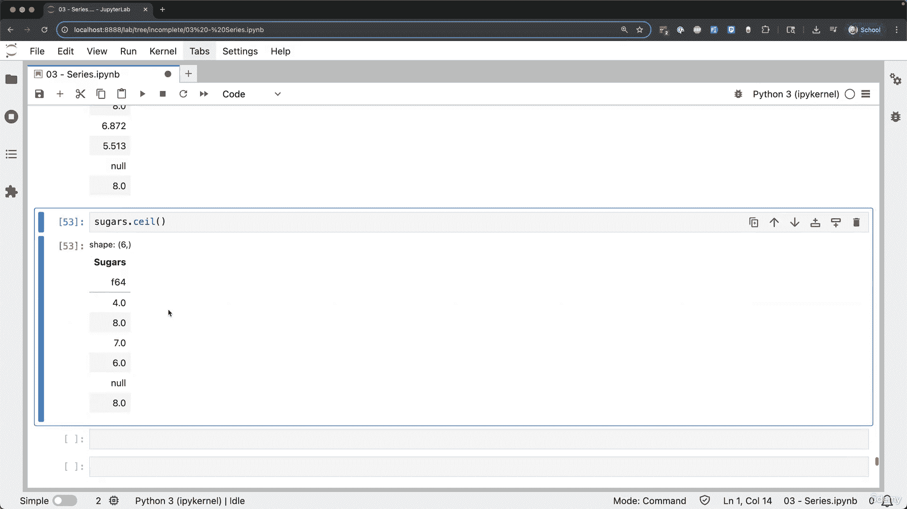

\[
\operatorname{ceil}(x)=\lceil x\rceil
\]

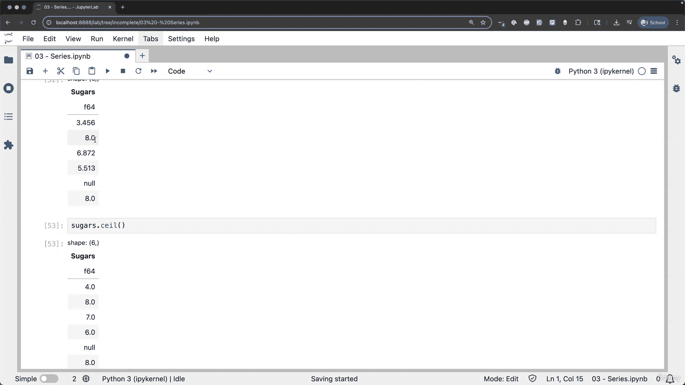

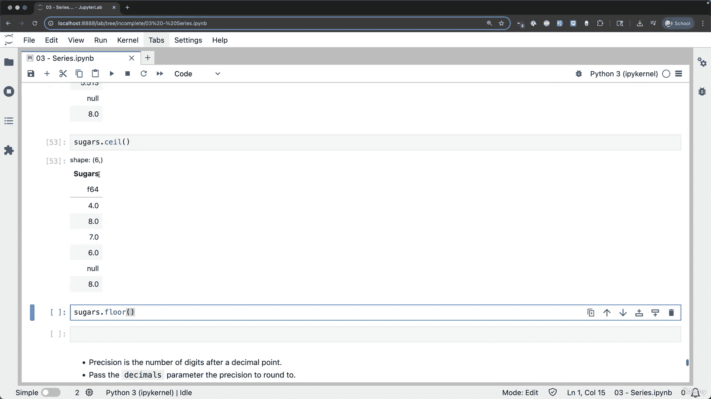

例如，某个值会被向上舍入到 4；如果某个数已经是整数，比如 8.0，它不会被继续向上舍入，而是保持原来的 8.0；另外两个值会分别向上舍入到 7.0 和 6.0。遇到 null 或缺失值时，结果序列中仍然会是 null 或缺失值。可以看到，ceiling 方法的作用就是把每个数字向上舍入到下一个整数，下面的代码展示了这种调用方式。

```python
sugar.ceil()
```

这就是 ceiling 的基本作用；接下来我们看看与它互补的 floor 方法。Floor 的地板在脚下，所以可以记住 floor 表示“向下”。它会取出每个值并向下舍入到下一个整数，对应的数学表达如下。

\[
\operatorname{floor}(x)=\lfloor x\rfloor
\]

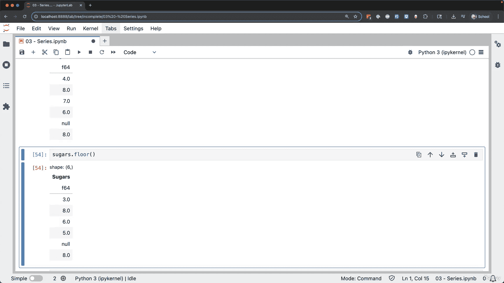

例如此处的一个值会向下舍入到 3；8 会保持为 8，因为它已经是整数；另一个值会向下舍入到 6；还有一个值会向下舍入到 5。这样得到的结果序列与上面的 ceiling 结果不同，下面的代码展示了 floor 的调用方式。

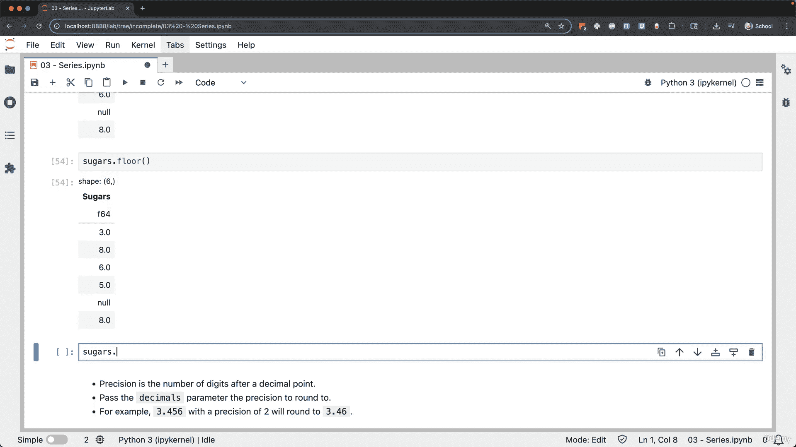

```python
sugar.floor()
```

floor 与 ceiling 的方向相反；接下来我们看看 round 方法。Round 方法会舍入到最接近的整数。快速回顾数学规则：如果一个值的小数部分大于等于 0.5，就向上舍入；如果小于 0.5，就向下舍入，其规则可以写成下面的形式。

\[
\operatorname{round}(x)=
\begin{cases}
\lfloor x\rfloor, & x-\lfloor x\rfloor < 0.5\\
\lceil x\rceil, & x-\lfloor x\rfloor \ge 0.5
\end{cases}
\]

例如 3.456 更接近 3 而不是 4，所以会舍入到 3；其中一个值会保持不变；6.87 更接近 7 而不是 6，所以会向上舍入；类似地，另一个值也会向上舍入。也就是说，round 方法可能根据“离哪个整数更近”来决定向上还是向下，下面的代码展示了 round 的基本调用方式。

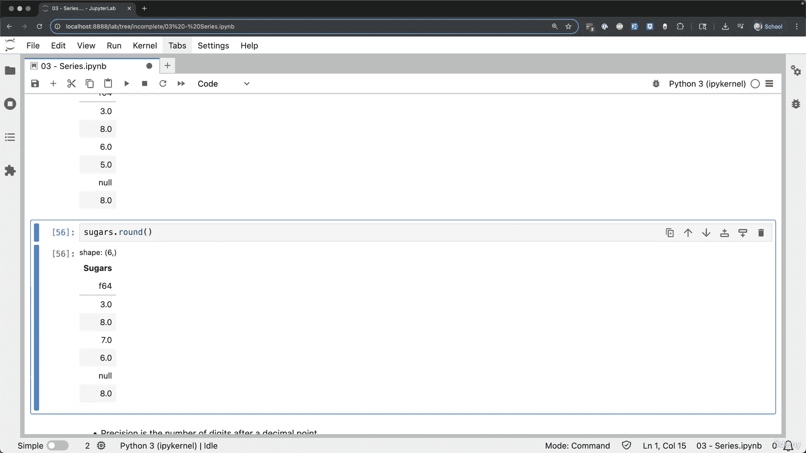

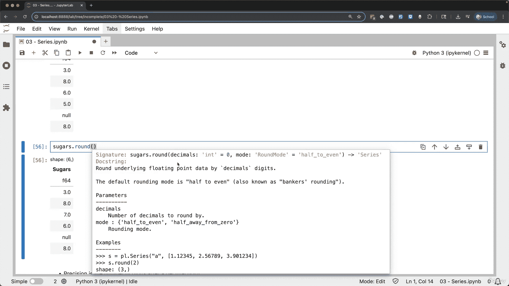

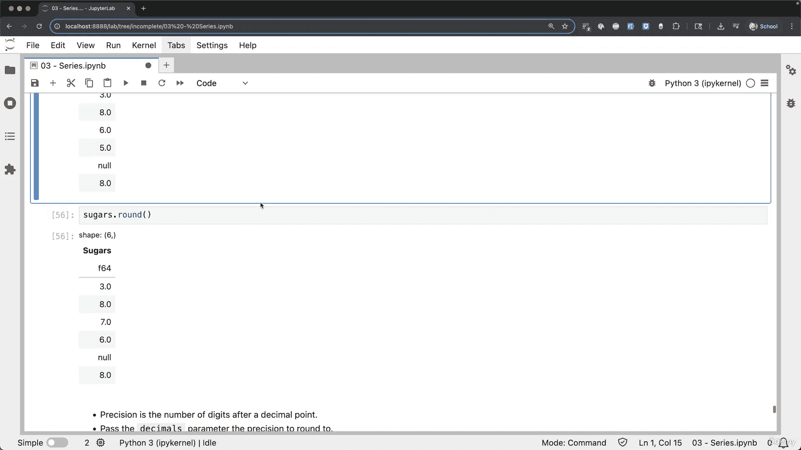

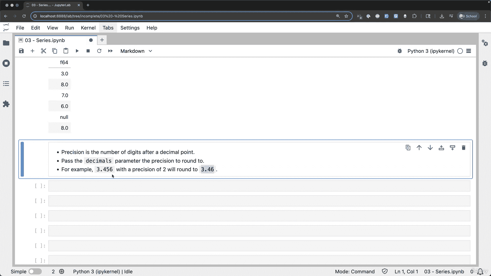

```python
sugar.round()
```

round 方法还有一个很实用的地方：它接受一个名为 decimals 的参数，用来控制数值的精度。这里的 precision 指小数点后的数字位数；如果把自定义精度传给 decimals 参数，它就会自动按该精度舍入。例如有一个值 3.456，如果要求精度为 2，它不一定会按普通的整数方向向上或向下，而是把结果舍入成两位小数，也就是 3.46。下面先单独查看 sugar 序列，可以看到部分浮点值确实具有三位小数，也就是小数点后有三位数字。

```python
sugar
```

如果希望得到一个只保留两位小数的替代视图，仍然可以使用同一个 round 方法，只是传入参数 2，把它交给 decimals 参数。这里不是把数值向上或向下取整到整数，而是改变精度的格式；原值不会被替换，返回的是按两位小数舍入后的结果。也就是说，每个值会被舍入为两位小数，舍入时仍可能向上或向下，并遵循传统数学规则，下面的代码展示了这种用法。

```python
sugar.round(decimals=2)
```

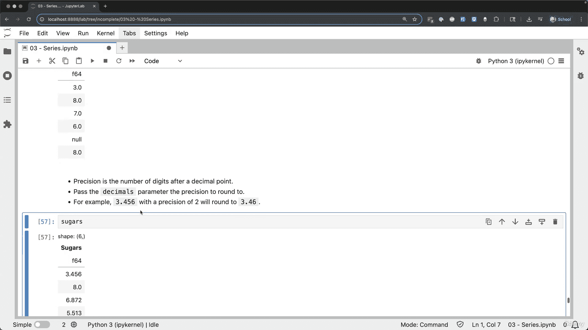

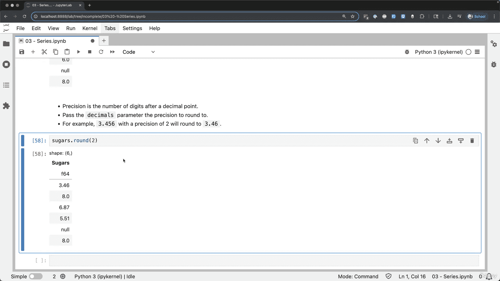

到这里，三个方法的主干内容已经介绍清楚；下面做一个简短总结。本节课中我们一起学习了 ceiling、floor 和 round 方法：ceiling 把数值向上舍入到下一个整数，floor 把数值向下舍入到下一个整数，round 把数值舍入到最接近的整数，并且可以通过 decimals 参数控制小数点后的位数。以上就是对 ceiling、floor 和 round 这几个 Series 数值舍入方法的快速介绍。

