# 📊 Polars与Python数据分析：第1部分第40节：Polars与Pandas的区别

在本节课中，我们将学习Polars的Series对象和Pandas的Series对象之间有哪些不同。我们会从创建Series实例开始，一步步观察它们在可视化、索引、缺失值处理以及混合数据类型行为上的差异。即使你之前从未使用过Pandas，也没有关系，这节课会尽量用大白话把关键概念讲清楚。

## 🔍 为什么要把Polars和Pandas放在一起比较

在前面的课程中，我们已经比较熟悉Polars的Series了。为了加深理解，我们有必要和Pandas的Series对象做一个快速对比。Pandas是Python数据科学生态系统中Polars的竞争对手之一，这两个库都提供了Series这种数据结构。如果你没有Pandas使用经验，完全可以放心；你可以选择跳过这一课，也可以因为好奇这两个库之间的差异而继续听下去。不管哪种选择，了解两者的细微差别对于后续灵活使用Polars都会很有帮助。

从概念上说，Polars和Pandas的Series非常相似：它们都表示一列同质数据，也就是同一个数据类型的数据。这一点是两者共同的基石。那么，怎样才能最直观地看出它们的差异呢？最好的方式就是分别从两个库中创建一个Series实例，然后并排观察。

## 🛠️ 创建两个库的Series实例

首先，我们来导入Pandas库。这个库已经可以在我们的工作区中使用。我们使用`import`关键字导入，库名是全小写的`pandas`，然后通过`as`关键字给它一个社区常用的别名`pd`。执行这一行代码后，Pandas就成功进入了我们的notebook。和Polars一样，输入`pd.`之后按Tab键，就能看到Pandas库的所有顶层导出。

这些导出中包含了`Series`类，同样是以大写S开头。我们输入括号，就完成了实例化语法。在括号内，可以按Shift+Tab查看Series的参数。你会发现，Pandas Series的参数和Polars Series有些相似，也有些不同。Polars Series的`name`参数排在第一位；相比之下，Pandas Series虽然有`name`参数，但它排在第四位。第一个参数是`data`，它表示数据源，也就是将要填充Series的值。另外，Pandas还有一个非常有趣的`index`参数，而Polars Series并不支持这个参数。

我们先来创建一个Pandas Series，使用与之前课程完全相同的值。下面的代码会创建一个字符串列表，包括`"Doritos"`、`"Cheetos"`和`"Cheese Its"`，然后用`name`参数把Series命名为`chips`，最后赋值给变量`pd_series`，这样我们一看到变量名就知道它来自哪里。

```python
import pandas as pd

pd_series = pd.Series(
    data=["Doritos", "Cheetos", "Cheese Its"],
    name="chips"
)
print(pd_series)
```

接下来我们再用Polars做完全一样的事情。我们访问Polars库中的`Series`类。提醒一下，Polars的`name`参数是第一个参数，但如果你使用关键字参数，参数的顺序其实可以任意指定。这里我们仍然使用相同的名字`chips`，然后第二个参数`values`传入和上面完全相同的Python列表。最后把结果赋值给变量`pl_series`并输出。

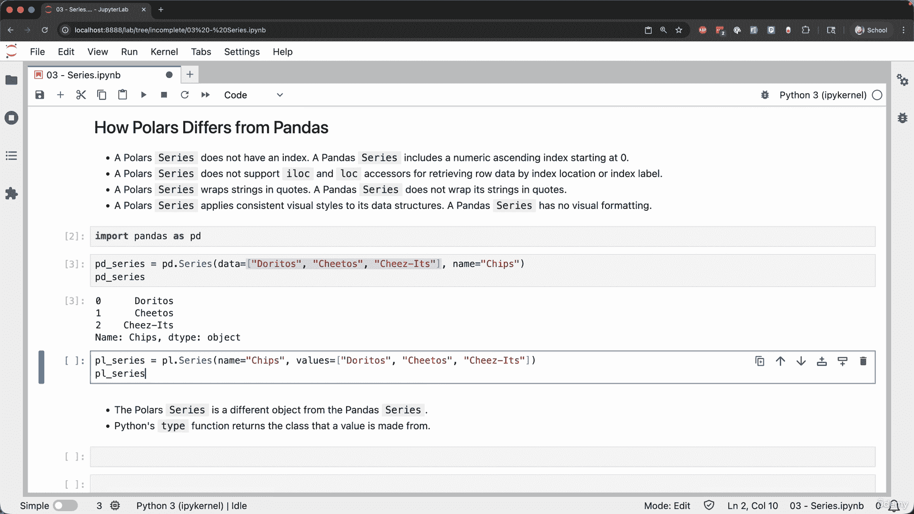

```python
import polars as pl

pl_series = pl.Series(
    name="chips",
    values=["Doritos", "Cheetos", "Cheese Its"]
)
print(pl_series)
```

把这两个Series并排放在一起，第一个区别立刻映入眼帘：数据的可视化渲染方式完全不同。Pandas Series在上方，输出更像是纯文本格式。每个值的左侧都有一个数字，这个数字叫做索引（index），我们稍后马上会详细讨论。Series的名字`chips`写在下方。另外，你会看到`dtype`一栏，它表示Series值的数据类型，显示为`object`，尽管技术上这些值是字符串。Pandas库习惯用`object`来表示字符串，同时也表示其他各种更复杂的对象。作为对比，Polars的数据类型显示在顶部，准确地标为`String`或`str`，Series名字也放在顶部。

当然，Polars的可视化效果要更美观一些：名字在顶部加粗显示，值会带有交替背景色，每隔一行就有灰色背景，这样读起来更省力。另外，你还会注意到Pandas Series不会用双引号包裹字符串，而Polars会为每个字符串值渲染出双引号，这样一眼就能看出每一行存的是字符串。

## 🏷️ 索引：Pandas有，Polars没有

现在回到刚才左侧的那个数字结构。正如前面所说，它叫做索引（index）。索引是每一行唯一标识符的集合，它类似于Python列表中元素的下标位置：Series中的第一个元素索引位置是0，第二个是1，然后是2，依此类推。因此，索引值在这里是唯一的，它们作为Series值的唯一标识符。Pandas中的每一个对象，无论是Series还是DataFrame这种表格结构，都会有一个索引；如果你不提供索引，Pandas会自动生成一个默认索引，就像刚才我们看到的0、1、2那样。当然，我们也可以自定义索引，提供一组自定义的值来充当这些标识符。严格来说，这些索引标识符不一定非要唯一；它们可以唯一，也理应唯一，但并不是强制约束。

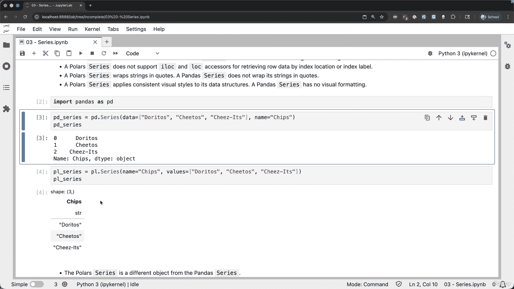

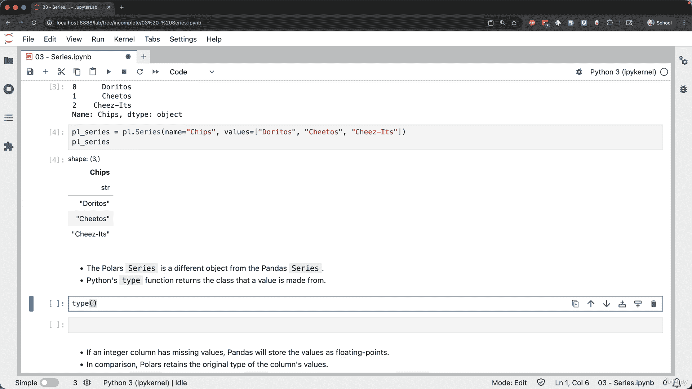

然而，在Polars中，我们根本看不到索引。Polars非常强调列式操作，也就是基于列的计算方式，所以它完全不关心索引。以下是Pandas和Polars在索引方面的几个关键区别：

- Pandas Series总是带索引，默认是0到n-1的整数序列。
- Pandas允许自定义索引，而且索引值不一定严格唯一。
- Polars Series完全没有索引，它将重心放在整列操作上。

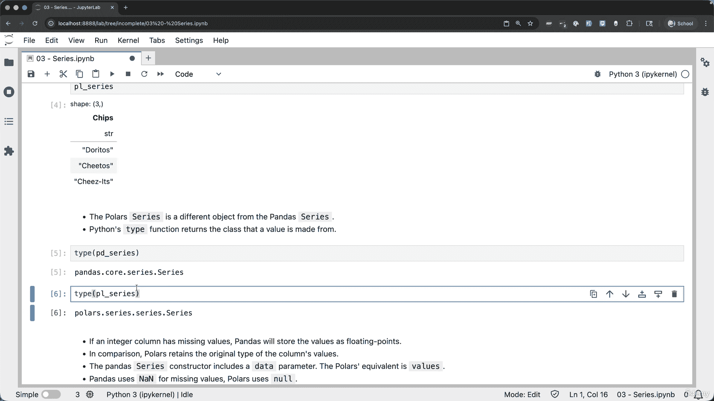

我还想再次强调，在notebook中，`pd_series`和`pl_series`是两种截然不同的对象。为了证明这一点，我们可以使用Python内置的`type()`函数，它返回对象所属的类或蓝图。把`pd_series`传给`type()`，可以看到它确实来自Pandas库的`Series`类；再把`pl_series`传给`type()`，可以看到它是来自Polars库的完全不同的`Series`。好消息是，如果你有需要，这两个库之间的Series转换并不困难，它们都提供了相应的转换方法。

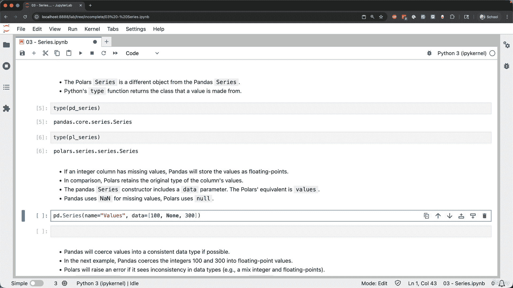

```python
type(pd_series)
# pandas.core.series.Series

type(pl_series)
# polars.series.Series
```

## 🚫 缺失值处理：NaN 与 null

接下来，我想展示另一个重要的差异：两个库如何处理缺失数据和数据类型变化。这次我们还是分别从两个库各创建一个Series。先用`pd.Series`创建，命名为`values`，然后在`data`参数中放入一个列表，列表里有两个整数，分别是`100`和`300`，并在中间放入Python的`None`对象，它表示缺失值。执行这段代码之后，我们用Polars做同样的事情：创建Polars Series，也命名为`values`，注意它的参数名是`values`，和Pandas的`data`不同，但传入的列表完全一样。

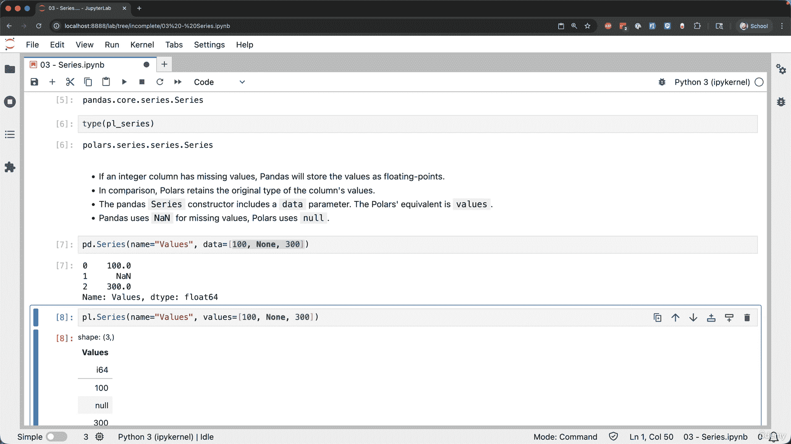

```python
pd_series_missing = pd.Series(
    data=[100, None, 300],
    name="values"
)

pl_series_missing = pl.Series(
    name="values",
    values=[100, None, 300]
)
```

把这两个Series并排比较，很快就能看到不同。首先，每当Pandas需要表示缺失值时，它都会使用`NaN`，也就是“Not a Number”的缩写。为什么会让人困惑呢？因为如果这一列是其他数据类型，比如字符串或布尔值，Pandas依然会使用`NaN`，但这些缺失值严格来说并不是数字，这就容易造成误解。而Polars对于缺失值使用`null`。另一个关键区别是：为了存储缺失值，Pandas需要把这一列的值转换成浮点数。我们提供的列表本来以整数为主，但Pandas无法在整数列中存放缺失值，所以它会自动把整数强制转换成对应的浮点数，这样才能容纳缺失值。这算是Pandas的一个技术设计决定，也是它比较奇怪的地方。Polars则要优雅得多：它能够很好地处理由`None`表示的缺失值，保持原本想要的整数类型，默认使用64位整数类型，然后保留这个类型，同时用`null`表示缺失值。也就是说，不管Polars Series准备存储什么数据类型，它都能在保留原始数据类型的同时，仍然支持缺失值。

以下是缺失值处理上两者的核心差异：

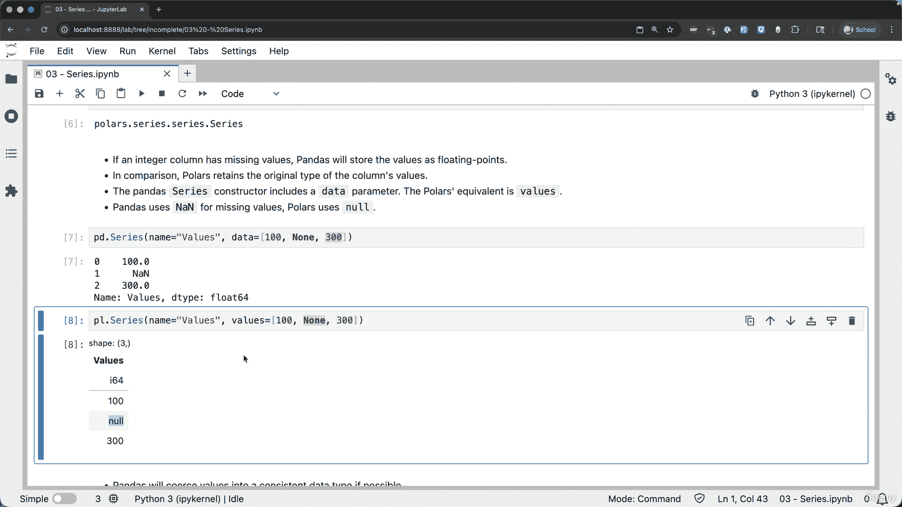

- Pandas使用`NaN`表示缺失值，即使列是字符串或布尔值也如此。
- Pandas为了存`NaN`，会把整数列自动转成浮点列。
- Polars使用`null`表示缺失值，并且尽可能保持原列的数据类型不变。

## 🧬 混合数据类型的处理：Pandas自动推断，Polars默认报错

我想再举一个例子来展示这两个Series对象的区别，那就是当数据集中包含不同类型时，两个库会如何应对。我们再次用`pd.Series`构造函数创建Pandas Series，命名为`values`。对于`data`参数，我们提供一个列表，结构和上面类似：两个整数中间夹一个`None`。不过这次，第二个整数改成浮点值，比如`300.0`。Pandas会非常“大度”地处理这种情况：它会把所有值强制转换成一个统一的数据类型，让所有条目都能被容纳。`100`会变成浮点数，因为我们有`300.0`；同时，为了容纳中间的缺失值，它也必须转换成浮点数。为了证明就算没有缺失值也会发生这种转换，我们可以把`None`暂时去掉。当列表里同时出现整数和浮点数时，Pandas会选择“超类型”（supertype），也就是能够同时容纳两者的数据类型。为什么最终选择浮点呢？因为我们可以把整数表示成对应的浮点数，但反过来却不一定成立。比如，如果值是`300.5`，我们可以把`100`转换成`100.0`，但我们不能把`300.5`转换成`300`，因为那会丢失数据。因此，Pandas会选择浮点这个超类型，以便同时支持整数值和浮点值。

回到原来的例子，我们再来看看等价的Polars Series会怎样。同样，`name`设为`values`，`values`参数复制上面包含三个条目的相同列表。在这个例子里，Polars就严格得多了。它有一堆安全检查，用来确保列的值是同质的，也就是类型一致。Polars不想对类型做任何假设，更不希望在未经允许的情况下把数据强制转换成别的类型。所以，当Polars发现整数和浮点数混在一起时，默认会抛出一个异常，也就是`TypeError`，它的大致含义是：“我无法把你的浮点值300解释为整数，我不知道你想让数据往哪个方向走。所以我不做任何推断，请你来告诉我该怎么做。”

如果我们确实想模拟Pandas那种“宽松”的行为，可以设置`strict`参数为`False`。这相当于关闭了安全检查，让Polars允许不同数据类型出现在同一列中。这样做之后，Polars就会在我们明确批准的情况下得出和Pandas相同的结论：把`100`强制转换成浮点数，以容纳`300.0`。注意，这里是为了容纳浮点数，而不是为了容纳缺失值，因为浮点数可以支持整数，但反过来不行。于是最终我们会得到一个64位浮点列，中间仍然用`null`表示缺失数据。

```python
pl_series_mixed = pl.Series(
    name="values",
    values=[100, None, 300.0],
    strict=False
)
```

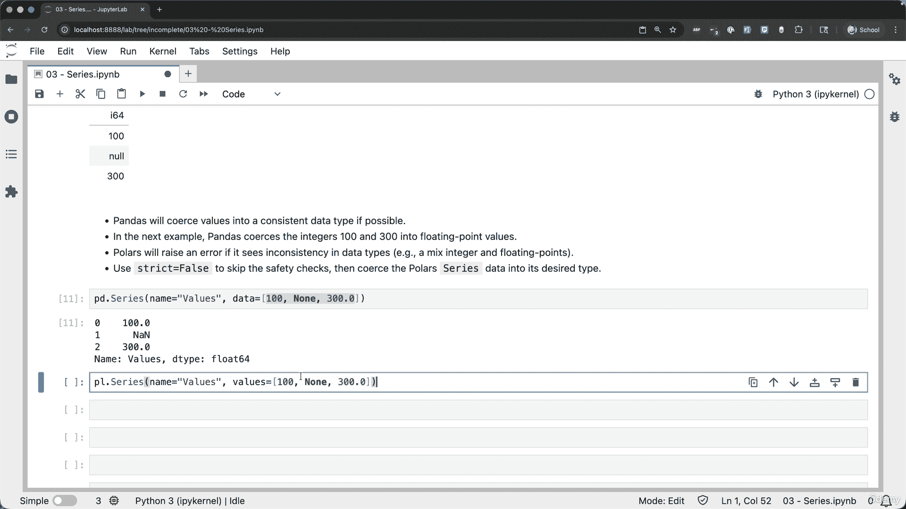

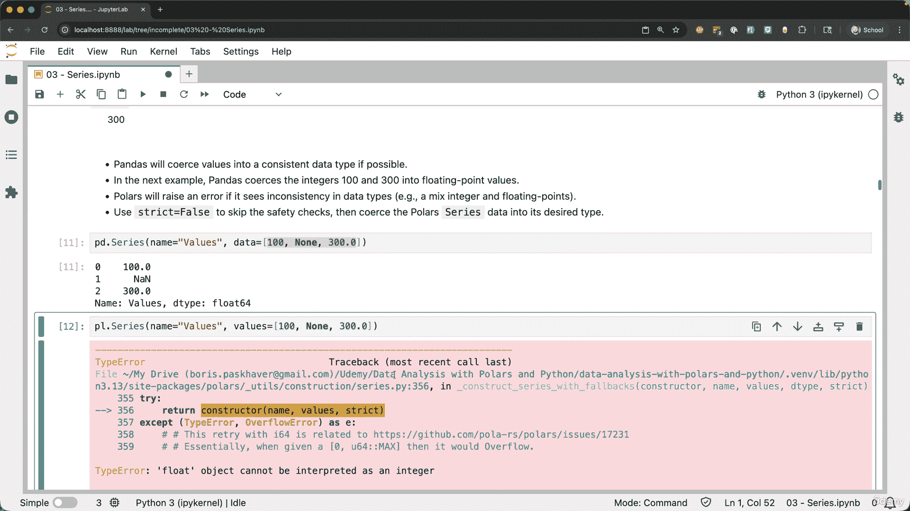

为了让这两个库的差异更加清晰，这里是混合类型处理方式的对比列表：

- Pandas会自动选择“超类型”来统一整列数据，比如整数和浮点混用时，会选择浮点。
- Polars默认不做任何类型推断，遇到混合类型直接抛出`TypeError`，要求用户显式指定。
- 把Polars的`strict`设置为`False`后，Polars的行为会变得和Pandas类似，但仍然使用`null`表示缺失值。

## 📝 总结

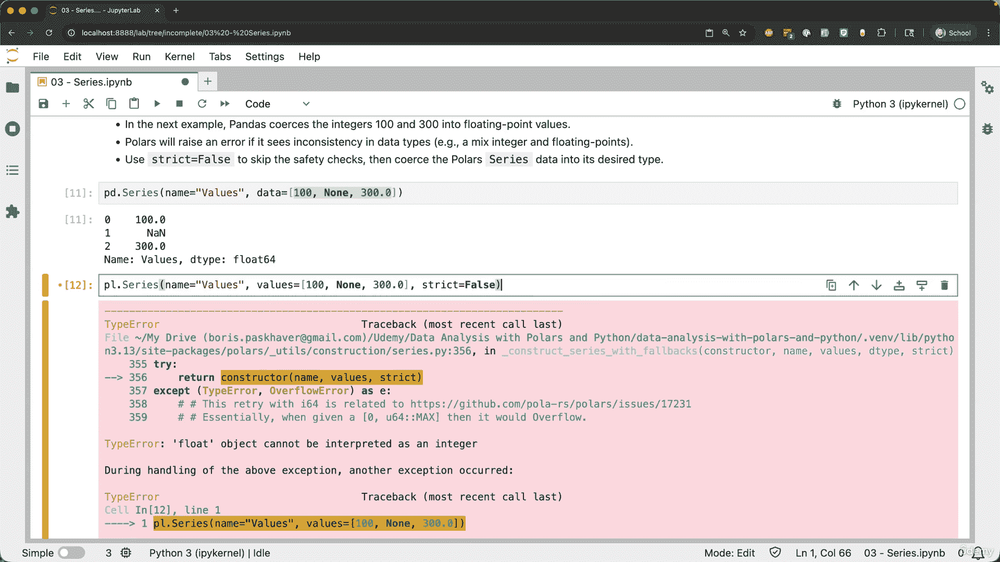

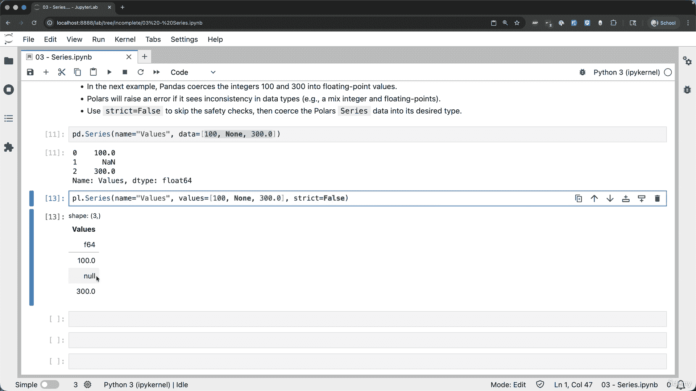

本节课中，我们一起学习了Pandas和Polars在Series上的诸多差异。我们看到了Pandas和Polars在可视化渲染上的不同、索引机制的差别、缺失值用什么符号表示，以及面对混合类型数据时各自的行为。如果你正从Pandas转向Polars，这些小细节非常值得留意：索引是否存在、缺失值用什么表示、混合类型如何处理，都会影响你的日常操作。不过除此之外，你也会发现，这两个库其实都使用Series对象来表示单列同质数据，大的框架是相通的。好了，本节课的内容就是这些，我们下节课再见。
