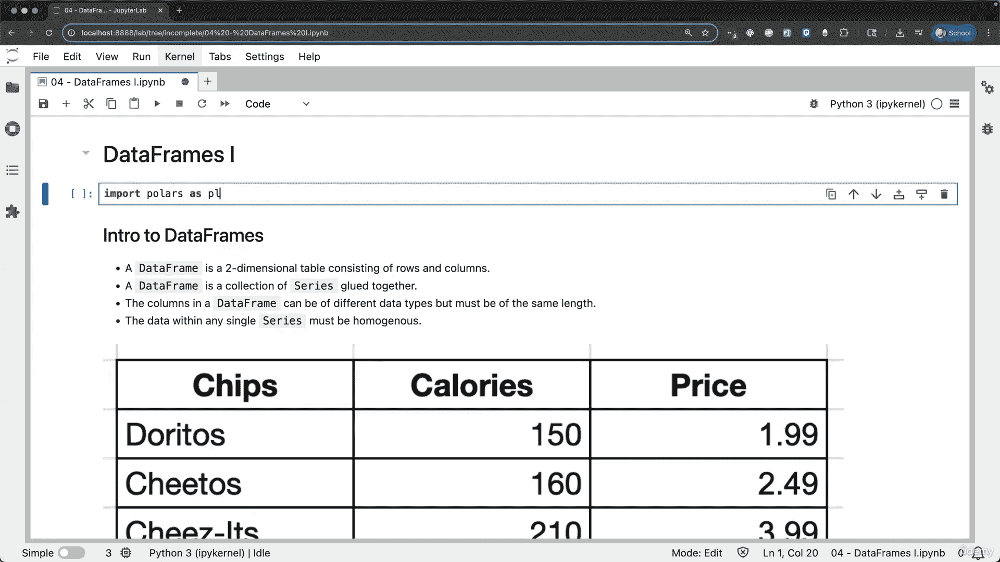
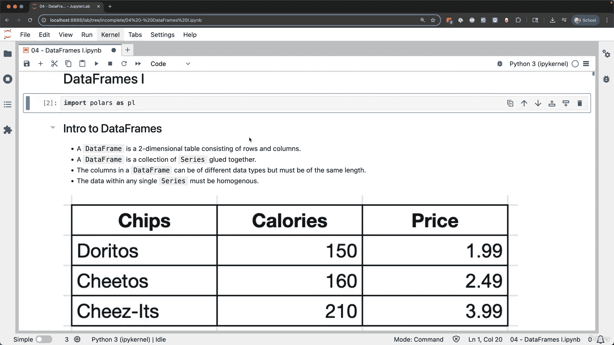
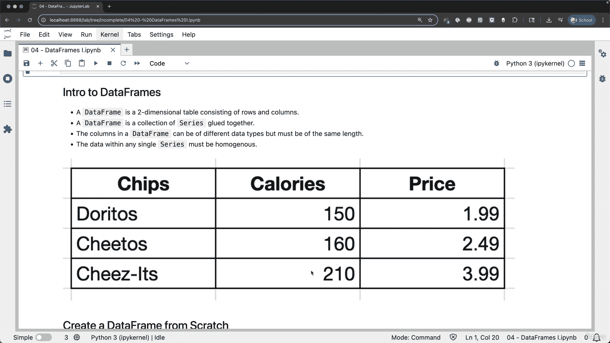

# 📊 Udemy《Polars 与 Python 数据分析》：第 41 节：DataFrame 入门


在本节课中我们将要学习 Polars 库里的核心表格结构 DataFrame。课程会先从准备工作开始，打开本节使用的 Jupyter Notebook，导入 Polars 并设置别名；然后回顾上一节的 Series，再把它和 DataFrame 做对比；接着用一张类似 Excel 的表格解释 DataFrame 的列、行、数据类型和二维定位方式；最后说明后续会练习从零创建 DataFrame，以及从数据集中导入 DataFrame。整个内容会尽量用直白的方式讲清楚，让初学者先建立整体印象，再逐步理解细节。


## 🧭 Udemy《Polars 与 Python 数据分析》：第 41 节：准备与导入库


欢迎进入课程的下一部分。本节中我们开始探索 Polars 库的主力组件，也就是 DataFrame。为了开始这部分内容，本节会使用一个新的 Jupyter Notebook，名字叫 `04 data frames 1`，请在 Jupyter Lab 中打开这个 Notebook。和往常一样，我们第一步是导入 Polars 库，并给它设置别名 `pl`。在第一个单元格中写入下面的代码，然后运行该单元格即可。




```python
import polars as pl
```


完成导入后，环境就准备好了。这里的导入看起来很简单，但它是后面所有 DataFrame 操作的基础，因为后面的代码都会通过 `pl` 这个别名来调用 Polars 的功能。导入完成后，我们就可以进入数据结构本身的讨论。


## 🧱 Udemy《Polars 与 Python 数据分析》：第 41 节：从 Series 到 DataFrame


上一节我们介绍了 Series，它可以理解为一列数据，是一组同质数据的集合。本节中我们来看看 DataFrame。DataFrame 是 Polars 库中负责表格的部分，它是一个同时包含行和列的二维数据结构。DataFrame 可以有任意数量的行，也可以有任意数量的列。换句话说，行数和列数都没有固定限制，具体取决于你手里的数据。


另一种理解 DataFrame 的方式，是把它看成多个 Series 粘在一起形成的整体。也就是说，DataFrame 里的每一列都可以有不同的数据类型：可以有一列布尔值，另一列浮点数，再另一列字符串。这里有一个关键限制：所有列的长度必须相同，而且每一列内部必须是同质的，也就是同一列里的数据类型要一致；但不同列之间可以使用不同的数据类型。可以用下面的公式概括这个结构。


```text
DataFrame = 多列 Series 拼接
列长度相等 ∧ 每列内部类型一致 ∧ 不同列类型可以不同
```


理解这一点很重要，因为它解释了 DataFrame 为什么既能像表格一样组织多列信息，又能让每一列保存不同类型的数据。接下来我们用一个具体表格例子来看这种结构长什么样。


## 📋 Udemy《Polars 与 Python 数据分析》：第 41 节：表格示例




前面已经说明了 DataFrame 是二维表格结构，下面看一个非常基础的例子。这个例子和 Excel 等电子表格软件里的表是同一类东西：一张表一共有三列，分别是 `chips`、`calories` 和 `price`。其中 `chips` 是字符串列，也就是字符串 Series；`calories` 是整数列；`price` 是浮点数列。每一行代表一条记录或一个条目，例如 Doritos 这包薯片有 150 卡路里，价格是 1.99，其他行也以此类推。DataFrame 就是用来建模这种表格结构的。


以下是这个示例表格中的关键信息。


- `chips` 列保存薯片名称，类型是字符串。
- `calories` 列保存卡路里数值，类型是整数。
- `price` 列保存价格数值，类型是浮点数。
- 每一行代表一条完整记录，例如 Doritos 对应 150 卡路里和 1.99 的价格。


```text
chips      calories    price
Doritos    150         1.99
...        ...         ...
```


通过这个例子可以看到，DataFrame 的列可以有不同数据类型，但每一列内部保持同一种类型，所有列的长度也保持一致。理解了表格的样子之后，我们再来看为什么说 DataFrame 是二维数据结构。


## 📐 Udemy《Polars 与 Python 数据分析》：第 41 节：为什么叫二维结构


知道了 DataFrame 是一张表之后，我们再来看“二维”这个说法的来源。之所以叫二维，是因为要定位表中的任意一个值，需要两个参考点，而不是一个参考点；必须同时知道它在哪一行、哪一列，通过行和列的交点才能找到这个值。例如要定位数值 210，就需要知道它出现在哪一行，也需要知道它出现在哪一列，需要两个参考点才能追踪到任意一个值，所以它是二维数据结构。在数据分析术语里，Series 则是一维结构，因为只需要行号这一个参考点，就能定位任意一个值。


可以用下面的公式表示这种定位方式。


```text
DataFrame 值定位 = (行号, 列名)
Series 值定位   = (行号,)
```


这个对比能帮助初学者区分 Series 和 DataFrame：Series 更像单独一列，DataFrame 更像由多列拼成的完整表格。到这里，本节关于 DataFrame 的基础介绍就结束了。


## ✅ Udemy《Polars 与 Python 数据分析》：第 41 节：本节小结




本节课中我们一起学习了 DataFrame 的基本概念：它是 Polars 库中的表格组件，是包含行和列的二维数据结构，可以看成多个 Series 拼接而成；不同列可以有不同数据类型，但所有列长度相同，且每列内部类型一致；我们还用 `chips`、`calories`、`price` 的表格例子说明了记录和列类型，并用行号与列名解释了二维定位。本节内容是对 DataFrame 的快速介绍，接下来我们会练习从零创建 DataFrame，也会练习从数据集中导入 DataFrame。下节课见。
