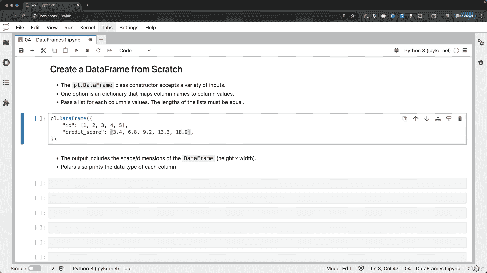
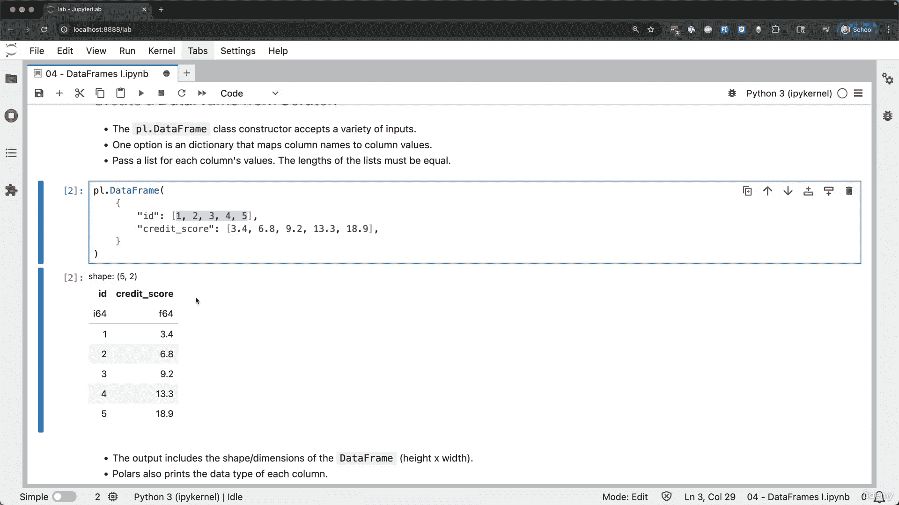

# 🧭 Polars与Python数据分析：42：从零创建DataFrame

在本节课中我们将要学习如何从零开始创建一个示例DataFrame。和往常一样，我们会从Polars库入手，并回顾前面已经见过的顶层类使用方式。内容会围绕构造器输入、字典写法、列长度约束、输出查看、类型推断以及shape含义展开，目标是让初学者能直接照着代码做出第一张表。下面先给出整体路线，然后按步骤展开。

## 📦 Polars与Python数据分析：42.1：导入Polars库并认识DataFrame构造器

上一节我们介绍了Polars中一些顶层类的基本用法，本节中我们来看看如何导入库并定位到DataFrame构造器。和往常一样，导入Polars时使用别名`pl`：

```python
import polars as pl
```

正如上一节所见，Polars中所有可用的顶层类都可以直接通过`pl`访问，例如`Series`。现在我们要实例化的类叫作`DataFrame`，注意`D`和`F`都大写。这个构造器同样接受非常多种输入形式，本次练习只选择其中一种最直观的方式。

以下是本节涉及的核心对象和导入方式，供初学者对照：

- `pl`：Polars库的常用别名。
- `pl.Series`：Polars中可用的顶层类示例。
- `pl.DataFrame`：本次要实例化的DataFrame类，名称中的`D`和`F`为大写。

## 🧱 Polars与Python数据分析：42.2：用Python字典提供列名和列值

上一节我们认识了DataFrame构造器，本节中我们来看看如何把普通Python字典传给它。字典使用花括号`{}`，字典的键用来表示列名，字典的值用来表示该列中的数据。这样写的好处是列名和列值成对出现，初学者很容易看懂。

例如，先创建一个`ID`列，就把字典键写成`ID`，并把它的值赋成一个普通Python列表，列表里放几个示例整数值，取1到5：

```python
df = pl.DataFrame({
    "ID": [1, 2, 3, 4, 5]
})
```

接着在字典里再提供一组键值对，这组键值对会构成新DataFrame中的另一列。这里再增加一列，列名取为`credit score`，同样给它提供一个列表。注意这个列表的长度必须匹配，因为`ID`列表一共有5个值，所以这个列表也必须有5个值。也就是说，DataFrame中所有列的长度都必须相同；列的数据类型可以不同，但值的数量必须一致。这里放入一些随机浮点值，例如3.4、6.8、9.2、13.3和18.9，这些数值完全是随机的：

```python
df = pl.DataFrame({
    "ID": [1, 2, 3, 4, 5],
    "credit score": [3.4, 6.8, 9.2, 13.3, 18.9]
})
```

以下是创建DataFrame时需要记住的字典与长度规则，方便快速检查：

- 字典的键：表示列名。
- 字典的值：表示该列的值，通常写成Python列表。
- 所有列长度必须一致：`len(ID) = len(credit score) = 5`。
- 各列数据类型可以不同，但值的数量必须相同。

> 核心约束可以写成公式：`len(第1列) = len(第2列) = ... = len(第n列)`。如果长度不一致，构造DataFrame时就会出问题。

## 🔍 Polars与Python数据分析：42.3：执行代码并查看DataFrame输出

上一节我们写好了字典和列表，本节中我们来看看执行单元格后输出是什么样。执行上面的代码后，就会得到第一个DataFrame。它的输出和之前见过的Series输出有些相似，但这里可以看到多列内容，并且每一列的名称会以粗体高亮显示。对每一列，输出中还会写出类型标识；在这个例子里，一列是整数列，另一列是浮点列。



以下是查看输出时可以关注的几个位置，初学者可以按顺序观察：

- 列名：每列的名称会显示出来，并且名称会加粗高亮。
- 类型标识：每列会写出自己的数据类型。
- 列值：两列各自显示对应的值。
- 顶部`shape`：显示DataFrame的维度，也就是行数和列数。

Polars会根据这些示例输入推断数据类型。它会选择一个具体的整数类型，也会选择一个具体的浮点类型。然后，两列各自的值会显示在对应列中。最后，在最上方可以看到DataFrame的`shape`，它反映DataFrame的维度，也就是行数乘以列数。这里一共有5行、2列，所以总共存储了10个值。

## 🧠 Polars与Python数据分析：42.4：理解数据类型推断和shape

上一节我们查看了输出，本节中我们来看看输出背后的两个核心概念：类型推断和shape。DataFrame的类型推断不需要初学者手动指定，Polars会从样本输入中自行判断。对于整数列，它会选择一个具体的整数类型；对于浮点列，它也会选择一个具体的浮点类型。这样做的好处是创建DataFrame时不用一开始就写很多类型声明。

shape可以理解成表的尺寸。公式如下：

```text
shape = (行数, 列数)
总存储值数量 = 行数 × 列数
```

本例中：

```text
shape = (5, 2)
总存储值数量 = 5 × 2 = 10
```

以下是本节需要掌握的两个结论，便于后面继续使用DataFrame：

- `shape`反映维度：第一个数字是行数，第二个数字是列数。
- 总存储值数量：行数乘以列数，本例为`5 × 2 = 10`。
- 类型推断：Polars会从样本输入中推断整数类型和浮点类型。

## ✅ Polars与Python数据分析：42.5：小结与下一节预告

上一节我们理解了类型推断和shape，本节中我们对整节内容做一个小结。以上内容就是DataFrame基础的一个快速介绍。可以看到，DataFrame本质上就是一张表，由一列或多列组成。创建时可以传入普通Python字典，用键表示列名，用值表示列数据，同时要保证所有列长度一致。输出中会显示列名、类型、列值和shape，Polars会自动推断数据类型。



本节课中我们一起学习了如何从零创建DataFrame，包括导入Polars、使用`pl.DataFrame`、用字典组织列名和列值、检查列长度、执行代码查看输出，以及理解类型推断和`shape`的含义。在下一节课中，我们将使用`read_csv`函数，从CSV文件中导入一个DataFrame。

