# 📘 使用 Polars 和 Python 进行数据分析：44：没有索引也没问题

在本节课中，我们将要学习 Polars 数据框没有 pandas 那种默认索引时该怎么办，以及如何用 `with_row_index` 添加一列类似 pandas 索引的行号列。我们还会解释 `offset`、`name`、`row_index_name`、`row_index_offset` 这些参数的作用，让初学者能够把索引理解为数据框左侧的行号标识，而不是数据本身的一部分。下面从 pandas 的索引概念开始，逐步过渡到 Polars 的写法。

### 🔍 使用 Polars 和 Python 进行数据分析：44：回顾 pandas 的索引

如果你以前用过 pandas 库，可能已经熟悉 `index` 这个概念。`index` 是数据框左侧的一串递增数值，它充当数据集中每一行的唯一标识符集合。pandas 的标准数值索引会把第一行分配为位置 0，第二行分配为位置 1，一直到最后一行结束。这个思路很像 Python 列表的索引位置：列表中的每个元素也会按顺序分配一个数字顺序，也就是从 0 开始的索引位置。理解这一点后，就能明白索引本质上是“行号”，方便定位和引用行。了解了 pandas 的索引概念后，本节中我们来看看 Polars 默认是否带索引。

### 🧩 使用 Polars 和 Python 进行数据分析：44：给 Polars 数据框添加行索引

Polars 的数据框默认没有任何形式的索引，但有一个方便的方法叫 `with_row_index`，可以用来创建行索引。先重新执行上一课的代码，导入 `employees` 数据框，作为后续示例的基础。示例代码如下。

```python
import polars as pl

employees = pl.read_csv("employees.csv")
```

接下来对 `employees` 数据框调用 `with_row_index` 方法，它会在数据框左侧自动创建一列新列。可以看到这列名叫 `index`，类型是无符号 32 位整数，因为索引值不能为负数，只能是 0 和正数。索引会从 0 开始，给每一行按顺序分配一个数字。核心概念可以用公式描述为：`第 i 行索引 = offset + i`，其中 `i` 从 0 开始。示例代码如下。

```python
employees.with_row_index()
```

默认索引从 0 开始，接下来看看起始值如何调整。

### 🔢 使用 Polars 和 Python 进行数据分析：44：用 offset 设置索引起始值

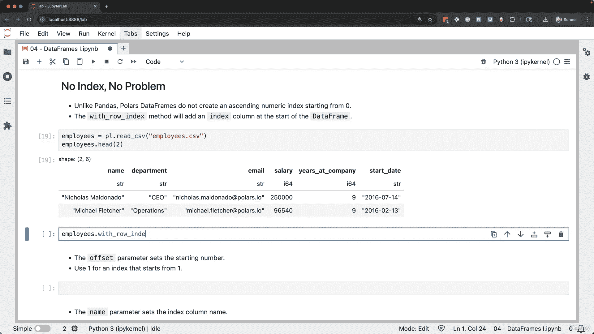

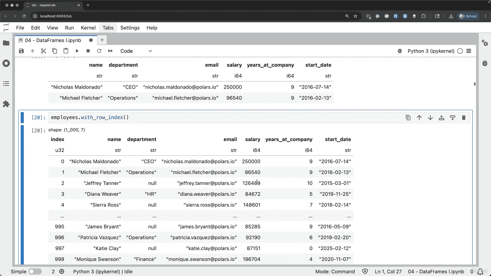

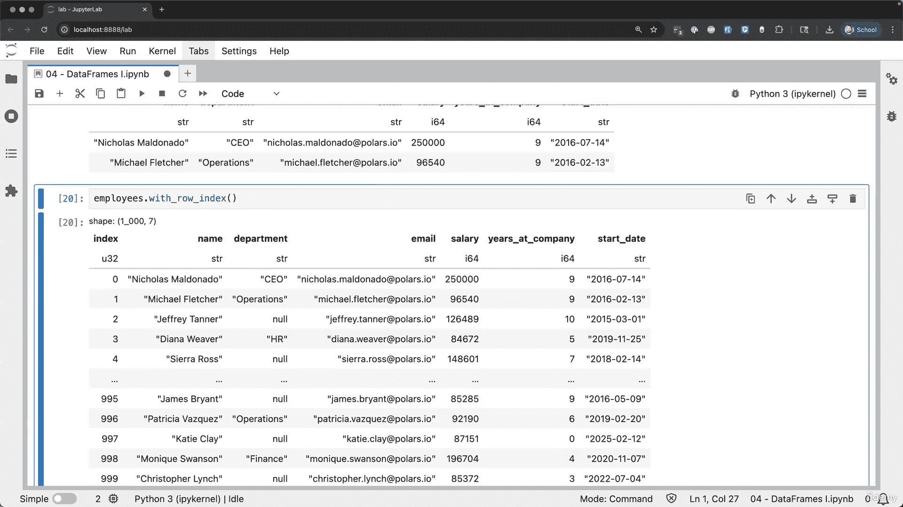

如果不想使用从 0 开始的索引，`with_row_index` 有一个参数叫 `offset`，用来设置索引的起始值，也就是开始计数的值。默认情况下 `offset` 是 0，这正是上面看到的效果。如果给 `offset` 传入 1，再调用 `head` 方法预览前五行，就会得到同样的索引列，但计数从 1 开始，看起来很像行数计数。示例代码如下。

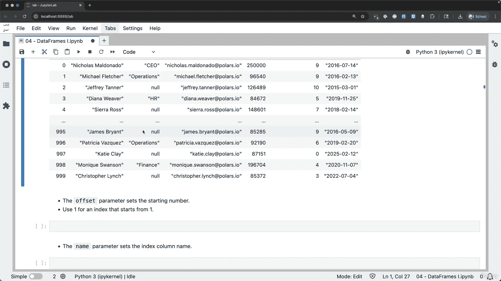

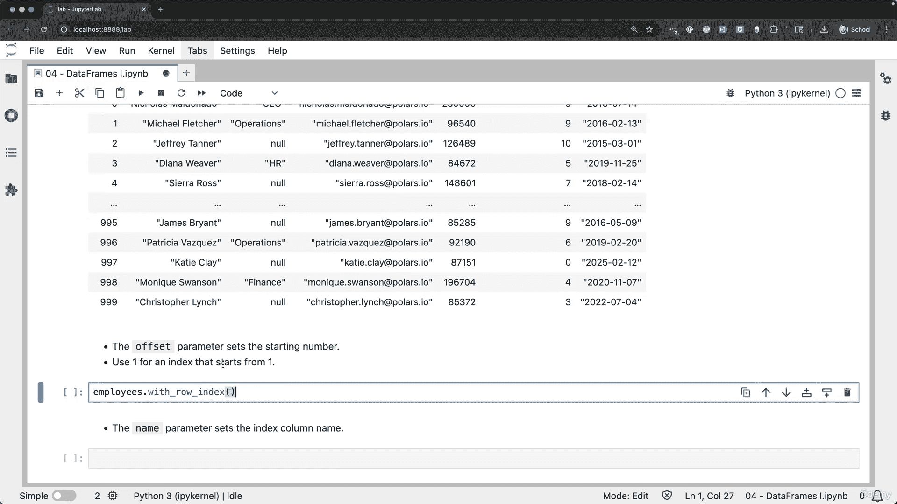

```python
employees.with_row_index(offset=1).head()
```

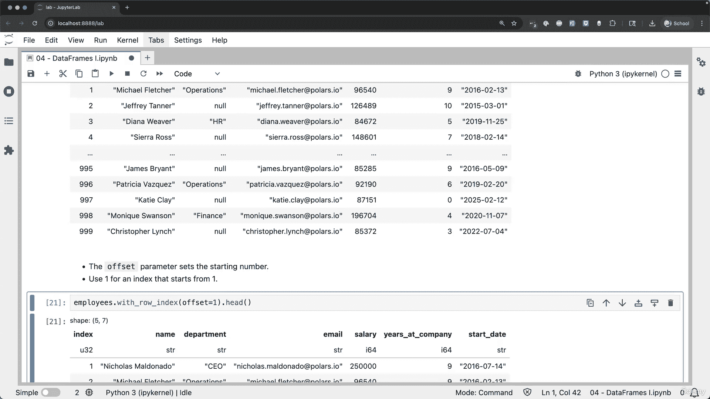

如果需要，也可以传入任意数值，例如 58。假设你有一批数据，其中部分数据丢失了，你想表示 Nicholas Maldonado 是公司第 58 位入职的员工，就可以把索引起始值设为 58。示例代码如下。

```python
employees.with_row_index(offset=58)
```

起始值可以改，接下来看看列名如何改。

### 🏷️ 使用 Polars 和 Python 进行数据分析：44：用 name 自定义索引列名

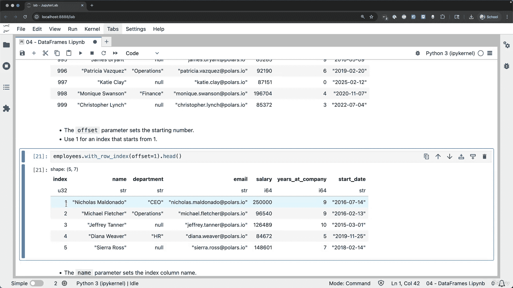

如果想让索引列不叫默认的 `index`，`with_row_index` 还提供了 `name` 参数，用来自定义这一列的名称。例如把 `name` 设成字符串 `"I"`，就会得到从 58 开始的第一行索引，并且列名是 `I`。示例代码如下。

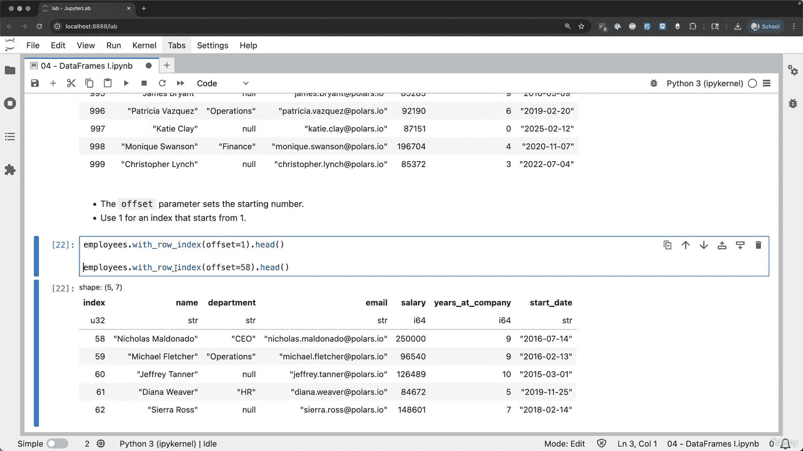

```python
employees.with_row_index(offset=58, name="I")
```

这些操作都包含在 `with_row_index` 方法中。除事后添加索引列之外，导入 CSV 时也可以直接生成索引，下面看具体写法。

### 📥 使用 Polars 和 Python 进行数据分析：44：导入 CSV 时直接添加索引

除了在数据框上调用方法，还可以在导入数据时给 `read_csv` 函数自定义参数，自动附加索引列。以下是 `read_csv` 中与索引相关的常用参数介绍。

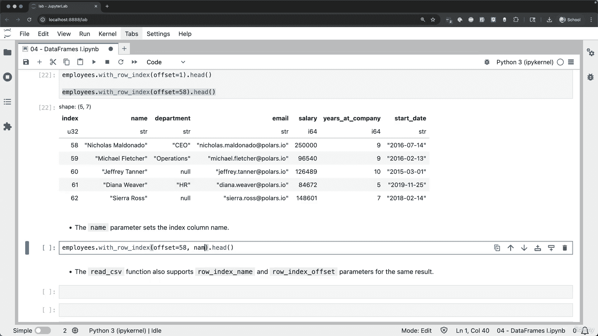

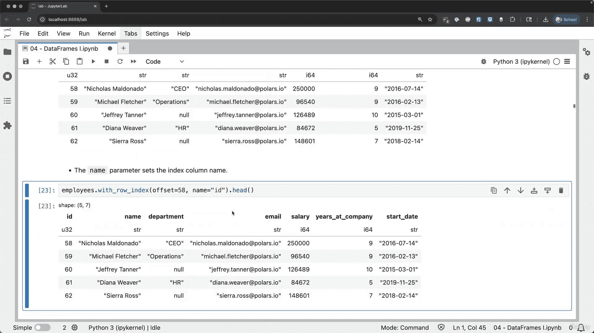

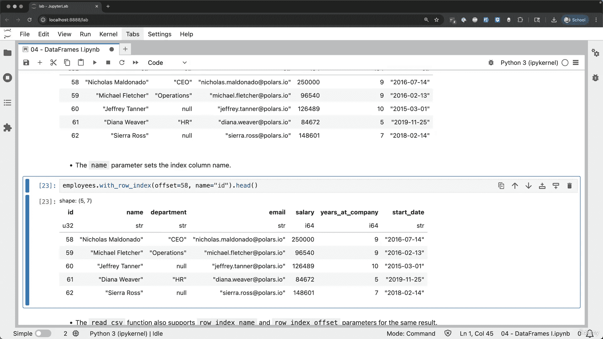

- `row_index_name`：默认值是 `None`，表示不创建行索引；给它一个名称，Polars 就会自动在左侧附加索引列。

- `row_index_offset`：用来设置起始数字或起始索引位置；默认从 0 开始，传入 1 就会从 1 开始计数。

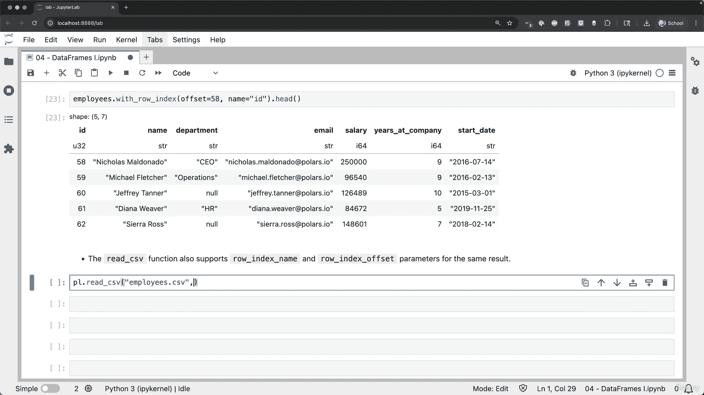

示例代码如下。

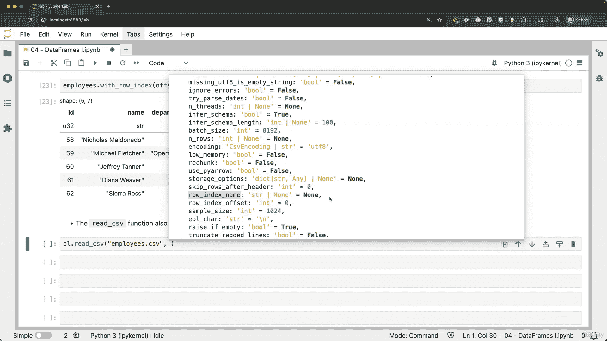

```python
pl.read_csv("employees.csv", row_index_name="ID")
```

上面的代码会生成一个左侧的 `ID` 列，索引从 0 开始。如果希望从 1 开始，可以同时传入 `row_index_offset=1`，示例代码如下。

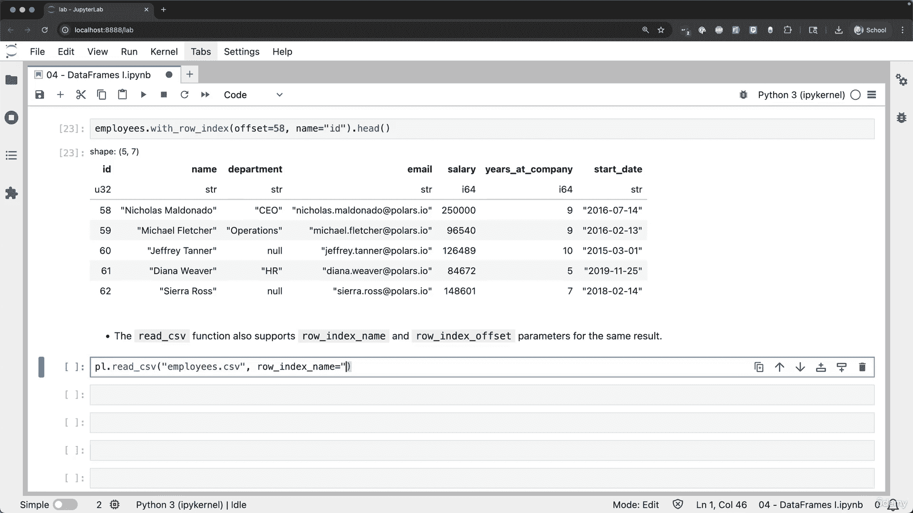

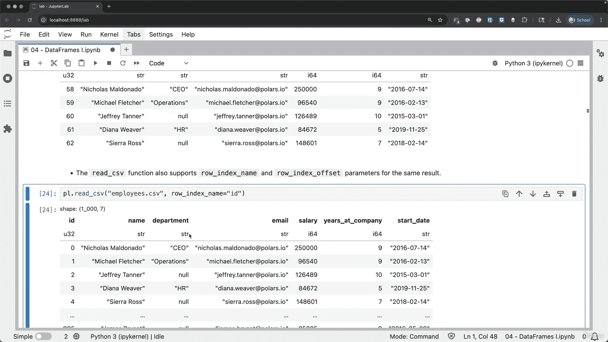

```python
pl.read_csv("employees.csv", row_index_name="ID", row_index_offset=1)
```

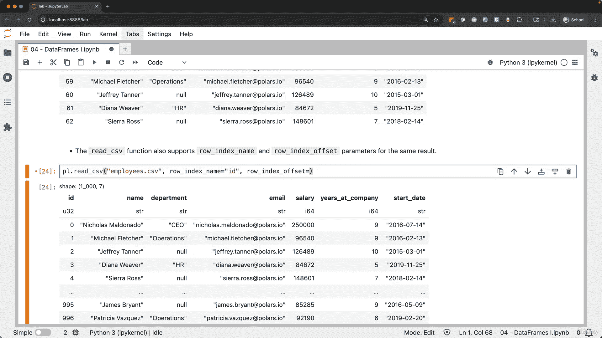

这样就会得到一个左侧的 `ID` 列，作为索引列使用，并且计数从 1 开始。到这里，给 Polars 数据框添加类似 pandas 索引的方法就介绍完了。

### ✅ 使用 Polars 和 Python 进行数据分析：44：总结

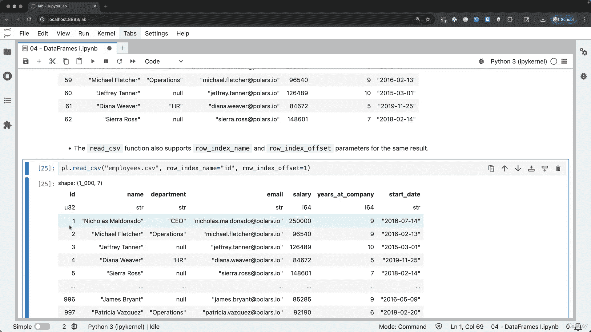

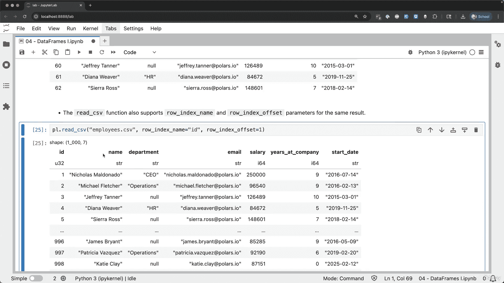

本节课中我们一起学习了 Polars 数据框默认没有索引，以及如何用 `with_row_index` 添加类似 pandas 索引的行号列。我们介绍了 `offset` 用来设置起始值，`name` 用来自定义索引列名，也介绍了导入 CSV 时通过 `row_index_name` 和 `row_index_offset` 直接生成索引列。整体可以记成公式 `第 i 行索引 = offset + i`，其中 `i` 从 0 开始。掌握这些内容后，就能在 Polars 中灵活创建和使用行索引。
