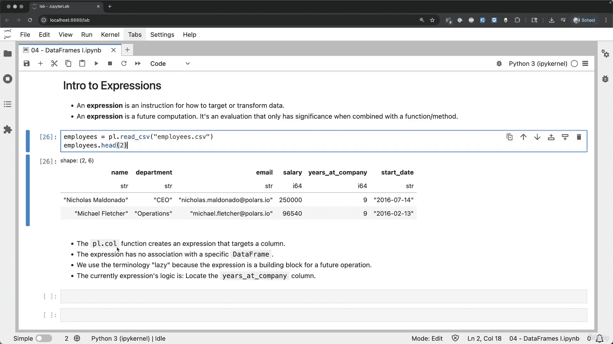
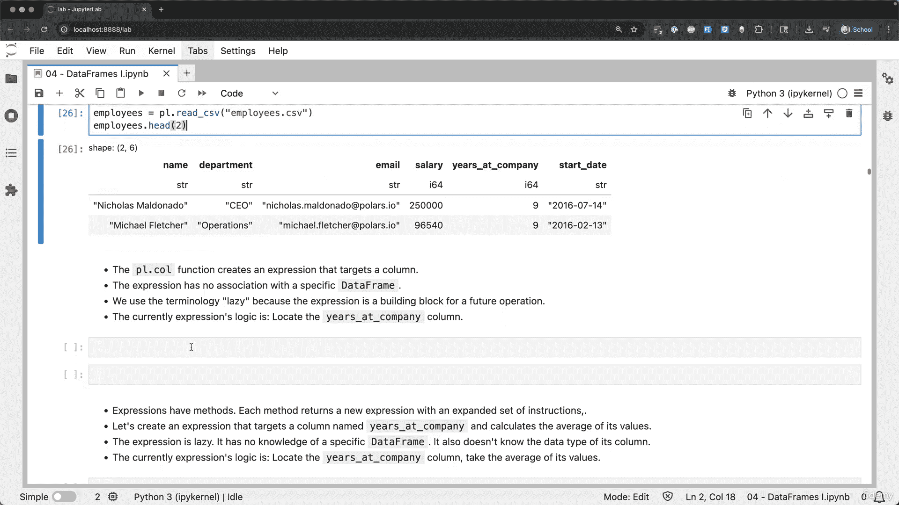
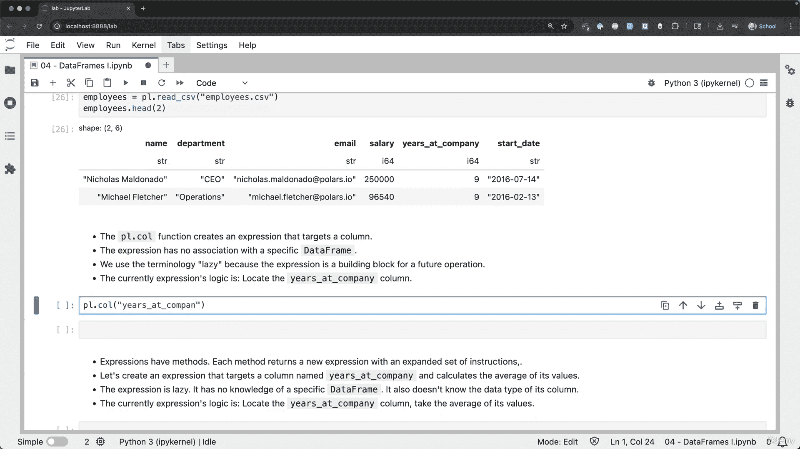
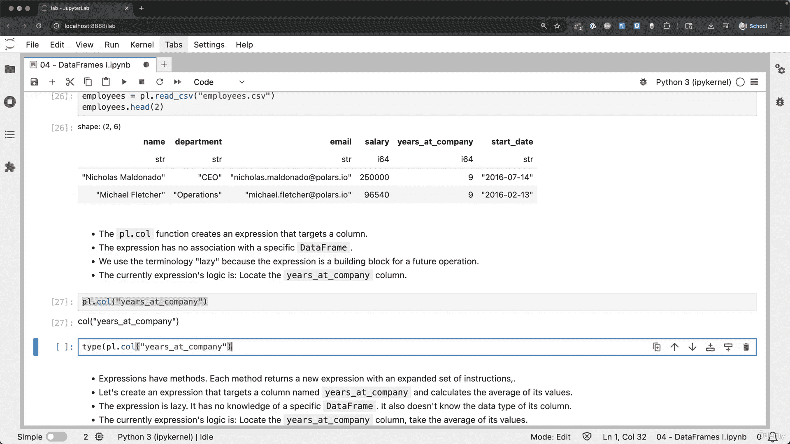
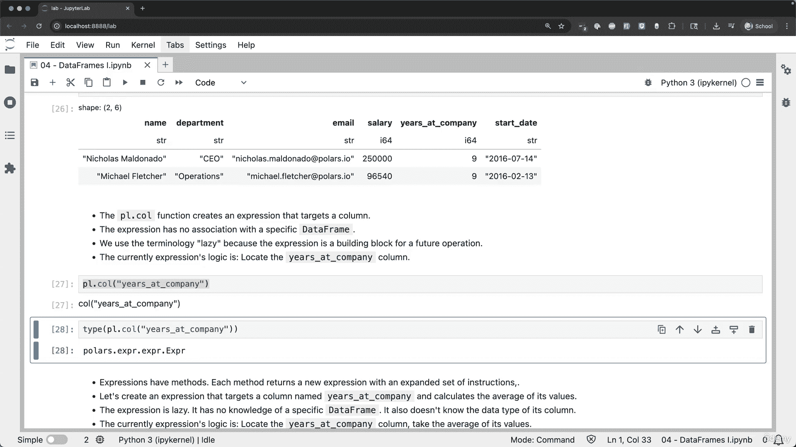
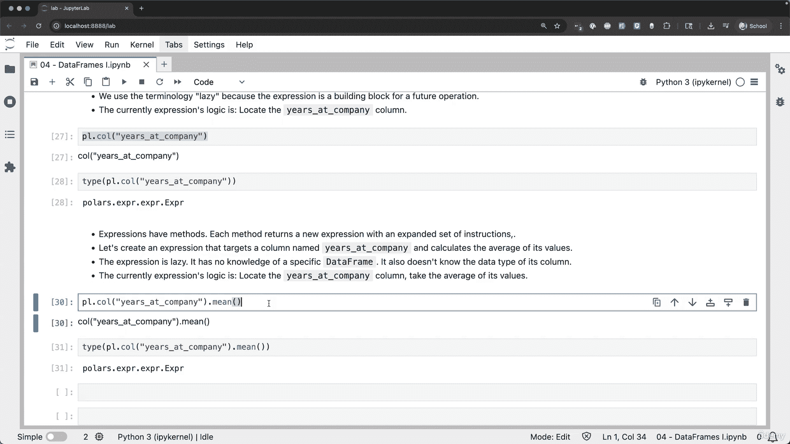

# 📘 使用Polars和Python进行数据分析：第1部分 第45讲：表达式入门

在本节课中，我们将要学习Polars中的一个核心组件，那就是表达式（Expression）。表达式在Polars里扮演着极其重要的角色，几乎所有的数据处理操作都会直接或间接地用到它。我们会从最基础的问题开始，先搞清楚表达式到底是什么。然后我们会动手创建一个最简单的表达式，并深入理解为什么说表达式是懒惰的。接着，我们还会学习如何在已有表达式的基础上调用方法，从而生成新的表达式。整个过程都会配合代码示例，方便你跟着一起操作。

## 🔍 什么是表达式？

首先，我们来解决最基本的疑问：表达式是什么？简单来说，表达式是一条指令，它描述了如何定位或者转换某些数据。你可以把表达式想象成一张便签，上面写着“请对某一列做某个操作”。不过，这里有一个非常重要的点：表达式是一种未来的计算。也就是说，它并不会在你写出来的一瞬间执行，而是要等到某个特定上下文要求它执行时才会真正运行。换句话说，表达式只有在与另一个函数或方法结合之后，才会有实际意义。

我理解这个概念可能让人有点困惑，尤其是第一次接触Polars的时候。不过，我的理解方式是：表达式就像一个步骤，或者一条指令，只不过这条指令还没有被真正执行。我们有条通往目标的路径，但还没有迈出脚步。在实际开发中，我们会从一个表达式开始，基于它再创建另一个表达式，然后不断重复这个过程，最终构建出一整串指令。Polars会在合适的时机一次性执行这串未来的指令。

以下是表达式核心特性的几个要点：

- 表达式是用于定位或转换数据的指令。
- 表达式属于未来计算，不会立即执行。
- 只有在与其他函数或方法结合时，表达式才有真正的意义。

这些概念听起来可能有些抽象，但请不用担心。随着我们不断地实践和操作，一切都会变得越来越清晰。接下来，我们马上动手尝试创建一个表达式。



## 🛠️ 使用 `pl.col` 创建基础表达式



上一节我们已经从概念上了解了表达式是什么。现在，我们来看看一种非常常见的创建基础表达式的方法，那就是使用Polars的顶层函数`col`。`col`这个名字其实就是英文单词column的缩写，中文意思就是“列”。你可以把这个函数理解成一个专门用来定位列的工具：它会创建一个表达式，而这个表达式的唯一目的就是指向某一列。这个表达式传达给Polars的指令是：“请定位到具有这个名称的列。”

下面我们来看实际代码。我们从Polars库中取出`col`函数，并传入一个字符串作为列名。这里，我们选择的列名是`Years at Company`。运行下面的代码，你会看到对应的表达式输出。



```python
import polars as pl

expr = pl.col("Years at Company")
print(expr)
```

看到这个表达式后，我要再次强调：这个表达式与上面提到的员工数据框（employees DataFrame）是完全独立的。这一点非常关键，因为它体现了表达式的一个重要特性。让我们来拆解一下这个表达式的含义：它只是一个步骤，内容就是“定位某个叫做Years at Company的列”。Polars并不知道这个表达式将来会和哪个数据框搭配使用，甚至不知道它会和多个数据框中的哪一个配合。好消息是，这个表达式本身可以被用于任意多个不同的数据框。Polars唯一在乎的是，在使用这个表达式的时候，那个数据结构里必须有一个名为`Years at Company`的列。除此之外，表达式对数据框没有任何其他要求。

我们经常用“懒惰”这个词来形容表达式，原因就在这里。表达式不会急切地去执行什么操作，它只是一个用于未来操作的积木块。在我们创建这个表达式的时候，实际上并没有发生任何计算。我们并没有真的去某个数据框里查找`Years at Company`列，我们只是定义了一条指令，一个步骤，这个步骤会在未来的某个操作中去定位这个列。

为了进一步验证这个事实，我们可以把`col`函数的返回值传给Python内置的`type`函数。`type`函数会告诉我们这个值所属的类。结果你会看到，这个类的名字是`polars.Expr`，这个类名其实也就是Expression（表达式）的缩写。

```python
expr = pl.col("Years at Company")
print(type(expr))  # <class 'polars.Expr'>
```

你看，一切都符合预期。换句话说，我们在创建表达式的时候，只是为未来的工作准备好了一块积木，而不是真的去执行什么。

## 🧬 在表达式上调用方法，构建新表达式

了解了表达式是懒惰的之后，我们来看看如何利用表达式构建更复杂的操作。Polars的表达式对象身上带有许多方法，每当我们对某个表达式调用一个方法，就会从它身上创建出一个新的表达式。你可以把这一点想象成：我们手头有一块积木，然后调用积木自带的方法，从这块积木上产生另一块新的积木。换个等价的说法就是：我们有一条指令，然后对这条指令调用一个方法，从而得到一条新的指令。



这些新的指令同样也是懒惰的，它们并没有被立刻应用到任何数据上。我们只是在程序里不断堆叠这些顺序步骤，为将来某个时刻一次性执行做准备。

现在，我们来实际操作一下。我们还是使用之前那行代码：在Polars的顶层调用`col`函数，去定位一个叫作`Years at Company`的列。这个列可以存在于任意数据框中。代码跟我们之前写过的完全一样：

```python
expr = pl.col("Years at Company")
```



接着，这个表达式对象上有一个方法叫做`mean`。`mean`在数学中就是平均值的意思。所以，我们对这个表达式调用`mean`方法，会得到另一个表达式。而且，我们可以再次把这个完整的操作交给`type`函数来验证结果。

```python
mean_expr = pl.col("Years at Company").mean()
print(mean_expr)
print(type(mean_expr))  # <class 'polars.Expr'>
```

可以看到，结果依然是`polars.Expr`，也就是说，我们确实创建了一个新的表达式。那么，我们在这里做的事情，本质上就是创建了一个新的逻辑步骤，也就是一条新指令。最开始，我们的指令只是“定位一个叫作Years at Company的列”。现在，我们对这条指令进行了扩展，变成了“定位一个叫作Years at Company的列，然后计算这个列的平均值”。

你可以用下面的流程来理解这一步：

```python
# 原有指令：定位列
expr1 = pl.col("Years at Company")

# 新指令：定位列 + 计算平均值
expr2 = expr1.mean()
```

到了这一步，这个表达式依然不知道它将被应用到哪个数据框上。它也不知道在任何一个数据框中，`Years at Company`列的数据类型到底是什么。这个列在有的数据框里可能是整数类型，在另一个数据框里可能是浮点类型，甚至在不同数据框之间也可能分别是这两种类型。这些统统不是表达式需要关心的事情。关键在于，我们正在定义一个步骤、一条指令，一个用于未来操作的积木块。再次强调，这个表达式对员工数据框还是一无所知。

不过别着急，在非常近的下一节课中，我们就会看到如何把Polars表达式与数据框上的另一个方法或函数结合起来。一旦结合起来，我们就能真正执行这个步骤，真正执行这条指令。关于这一点，我们下一节课继续讨论。

## 📝 总结



本节课中，我们一起学习了Polars中一个至关重要的概念：表达式。我们知道了表达式是描述如何定位或转换数据的指令，同时也是一种未来的计算，不会立即执行。我们还学习了如何使用顶层函数`pl.col`来创建一个指向特定列的基础表达式，并且明白了这个表达式与任何具体的数据框都是相互独立的。随后，我们通过调用表达式上的`mean`方法，学会了如何从已有表达式构建新的表达式，并且用`type`函数验证了返回结果依然是`polars.Expr`。最后，我们还解释了为什么表达式是懒惰的，以及它为什么可以作为未来操作的积木块。希望这些内容能为你后续学习Polars打下坚实的基础。

