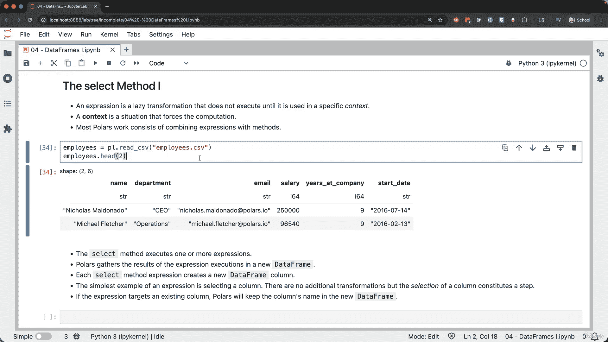
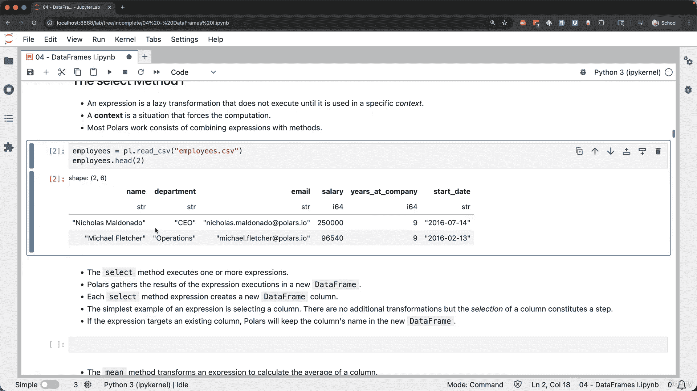
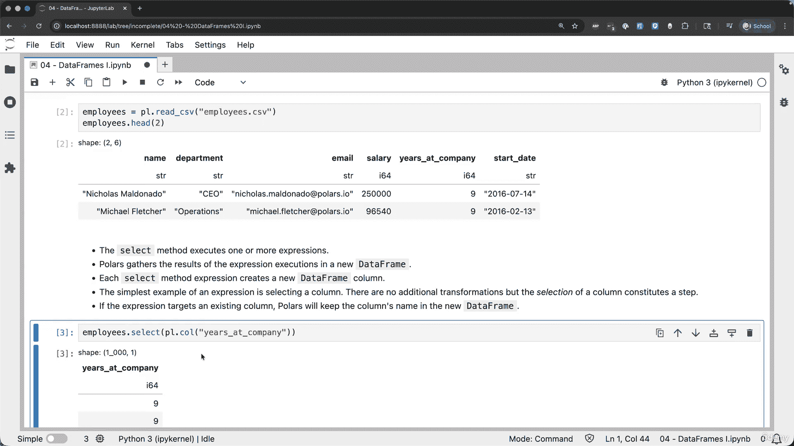
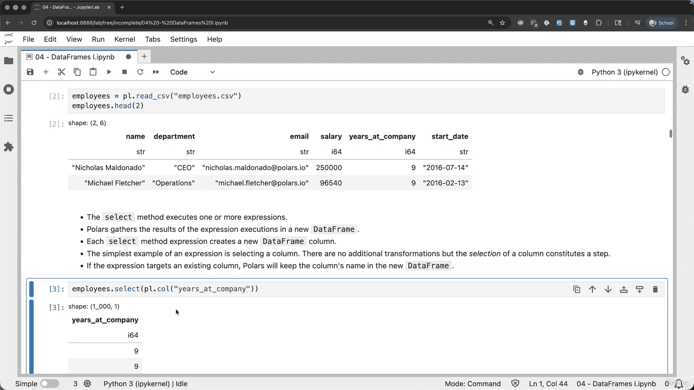
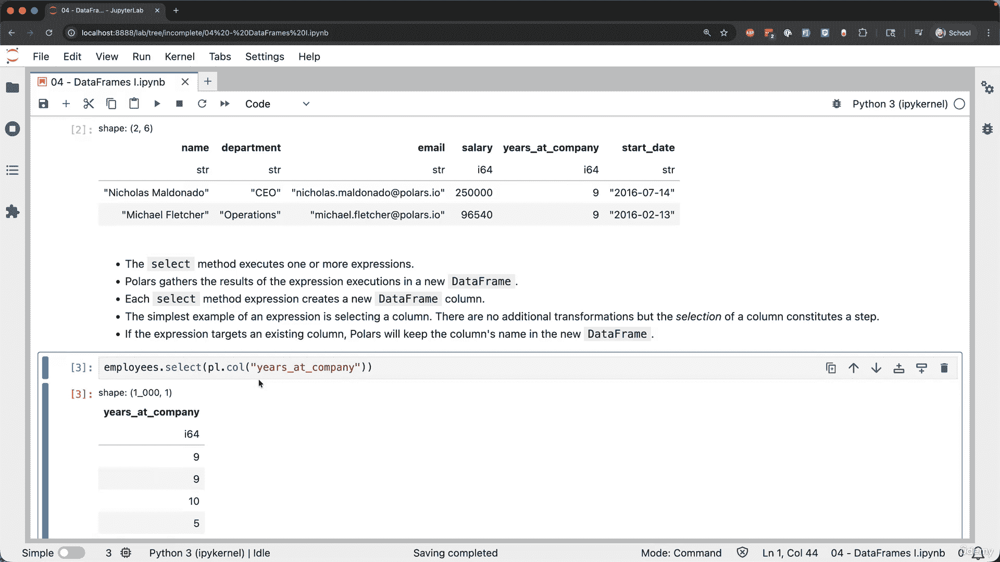
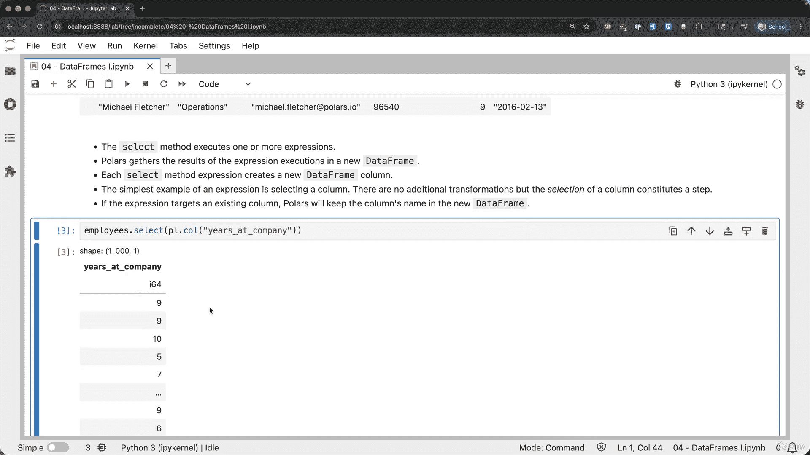
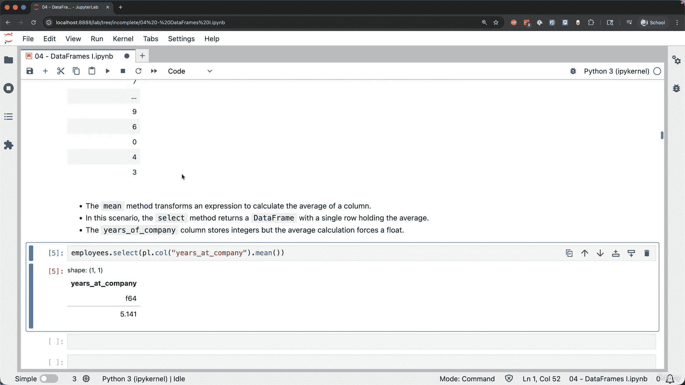
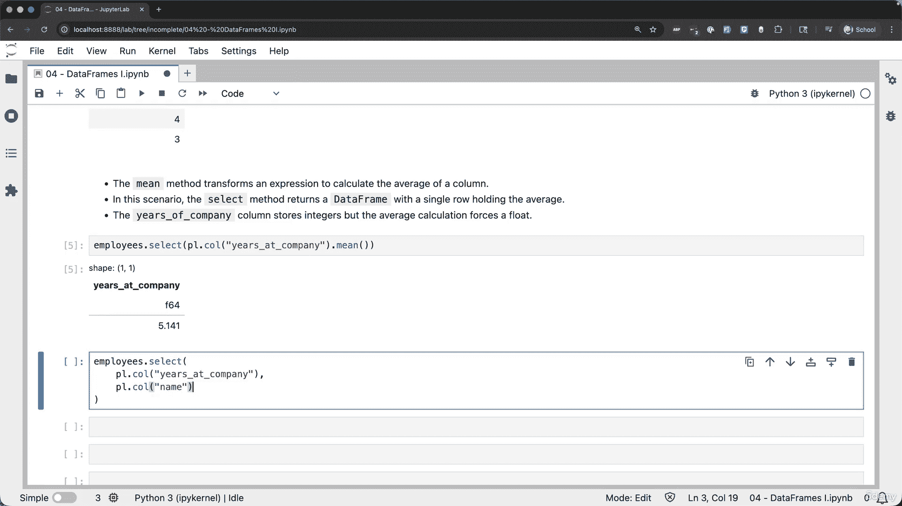
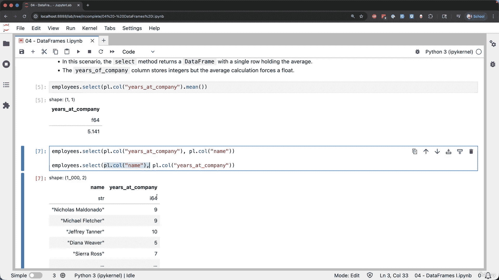

# Data Analysis with Polars and Python：第1部分第46讲：select方法（一） 😊

## 概述 🎯

在本节课中，我们将学习Polars中第一个让表达式真正执行的方法——`select`。上一节课我们介绍了表达式对象，它被描述成一种惰性变换。所谓惰性，指的是表达式在某个上下文中被要求执行之前，不会真正运行。表达式更像是一张菜谱，只描述了要做什么，但还没有下锅。本节课，我们就来看看如何让这张菜谱真正变成一盘菜。同时，我们还会学习`select`方法的基本用法、如何传递复杂表达式、如何一次传递多个表达式，以及这些表达式是如何被并行执行的。

## 回顾：表达式是惰性的构建块 🧱



在上一节课中，我们介绍了Polars中的表达式对象，并将其描述为一种惰性变换。一个表达式代表一个步骤，或者说是一连串指令，这些指令会在未来的某个时间点被执行。我们也可以把表达式看作积木块，在一个表达式上调用方法，会生成一个带有更多指令的新表达式。也就是说，表达式本身不会执行，直到在某个上下文中被要求执行。这种设计让表达式可以灵活组合，同时也保证了Polars的高效。



那到底怎么让表达式执行呢？这就引出了本节课的主角——`select`方法。你需要记住，表达式本身只是一张“菜谱”，而`select`就是那个真正开火炒菜的动作。

## 初识 select 方法 🚀

本节课我们介绍第一种让表达式执行的方式，那就是在数据帧（DataFrame）上调用`select`方法。我们调用`select`时，这个方法可以接受任意数量的表达式，一个也好，多个也行。然后，`select`会并行地执行这些表达式。所谓并行，就是同时执行多个任务，而不是一个一个排队。执行完毕后，`select`会把所有计算结果收集起来，组合成一个新的数据帧。

我们先用之前的员工数据帧来演示。首先执行导入代码，然后使用Polars顶层提供的`col`函数来定位一个名为“Years at Company”的列。代码如下：

```python
import polars as pl

employees = pl.read_csv("employees.csv")
expr = pl.col("Years at Company")
```

再次强调，这个表达式对象完全不知道它将要作用在哪个数据帧上，它只是一个通用的积木块。它既不知道数据有多少行，也不知道有哪些列，它只负责描述“我要定位这个列”这个指令。接下来，我们要做的是在`employees`数据帧上调用`select`方法。`select`会强制让传入该方法的表达式执行。现在，我们先只传一个表达式。我们把上面这行完整的表达式对象作为`select`的参数，代码如下：

```python
result = employees.select(pl.col("Years at Company"))
print(result)
```



如果你觉得这种语法有点让人困惑，完全没有关系。你完全可以先把表达式赋值给一个变量，这样代码看起来会更简洁，也更方便复用。例如：







```python
expr = pl.col("Years at Company")
result = employees.select(expr)
print(result)
```

我们来看结果。记住，我们的表达式代表的是一条只有一步的指令，也就是“定位名为Years at Company的列”。当这个表达式应用到员工数据帧上时，数据帧里确实存在“Years at Company”这一列，所以这段代码实际上就是把这列提取出来，或者说选中它。也就是说，我们只是从员工数据帧中取出了这一列。当然，这个例子很简单，但核心思想是一样的：我们用`select`方法作为激活器，真正让表达式执行起来。没有`select`，表达式就永远只是一张静态的菜谱。

## 传递更复杂的表达式 ⚙️

下面再看一个例子，和上一节课的做法很相似。我们来构造一个更复杂的表达式，也就是更复杂的指令序列。首先用`col`函数定位“Years at Company”列，然后调用`mean`方法，这样我们就得到了一个扩展后的表达式。代码像这样：

```python
expr = pl.col("Years at Company").mean()
```

这个表达式现在包含两步指令：第一步是定位这一列，第二步是计算这一列的平均值。现在，我们把这个完整表达式再次作为参数传给`select`方法：

```python
result = employees.select(pl.col("Years at Company").mean())
print(result)
```

现在，我们给Polars的指令是：在给定的员工数据帧上，选出“Years at Company”这一列，然后计算这一列数值的平均值。所以这次的输出和之前完全不同。之前我们只是提取了一列，现在我们是在选择一个计算。结果是一个单列数据帧，里面就是“Years at Company”列的平均值。



你可以看到，默认情况下，无论我们提取的是什么，Polars都会保留原始列名。所以这里列名依然是“Years at Company”，但实际的值变成了平均值。而前面那个例子中，列名同样是“Years at Company”，但实际值是从数据帧里取出的原始1000个数值。这就是差别所在。也就是说，列名只是一个标签，真正的数据内容完全取决于你写的表达式。

## 一次传递多个表达式 📚

正如前面提到的，`select`可以接受任意数量的表达式。下面再演示一个例子。我们再次调用`select`方法，这次传入两个表达式，用逗号和空格分隔。为了阅读方便，我们还可以把表达式拆成多行，这并不违反任何技术规则，纯粹是为了让代码更容易看懂。让我们先用`col`函数定位“Years at Company”列。如果我还想提取另一列，有几种方法可以做，但这里我们练习一下传入第二个表达式。所以，在`select`的第一个参数之后，第二个参数是用另一个`col`函数创建的表达式，比如我们想定位“Name”列。代码如下：

```python
result = employees.select(
    pl.col("Years at Company"),
    pl.col("Name"),
)
print(result)
```



现在，我们有两个独立的表达式，也就是两个独立的指令序列，每个序列只有一步，那就是定位特定的一列。所以我们得到一个两列的数据帧。需要注意的是，传入表达式的顺序决定了结果数据帧中列的顺序。之所以“Years at Company”在前面，是因为它是在传入的第一个表达式里首先指定的。你写表达式的时候，其实就是在告诉Polars你希望结果长什么样。

如果我把下面的例子复制过来，但是调换两个表达式的顺序。现在把定位“Name”列的表达式放在前面。那么在结果数据帧中，Name列就会排在最前面，然后是“Years at Company”列。代码如下：

```python
result = employees.select(
    pl.col("Name"),
    pl.col("Years at Company"),
)
print(result)
```

另外还要注意，这些表达式会尽可能并行执行。这意味着Polars不会顺序执行它们。它不会说“先定位Name列，等这个逻辑完成后再去定位Years at Company列”。相反，Polars会把工作拆分，同时启动两个进程或两个线程，不管底层是怎么实现的，总之是让它们同时运行，也就是并行执行。当两者都完成时，无论完成的顺序如何，Polars再把这些数据值收集起来，组合成最终数据帧中的列。这正是Polars速度快的众多原因之一：它能够拆分工作并并行化处理，从而大幅提升计算效率。

## 总结 📝



本节课我们快速介绍了`select`方法。它强制让表达式真正执行或计算，而表达式本身只是一张惰性的菜谱。我们学会了用`select`传递单个表达式，也学会了构造复杂表达式，比如求平均。我们还学会了同时传递多个表达式，并了解了列顺序由表达式顺序决定，以及并行执行的特点。当然，这只是`select`方法的第一次登场，后面还有更多内容等着我们。下一节课，我们会继续深入探讨`select`方法的更多细节，敬请期待。
