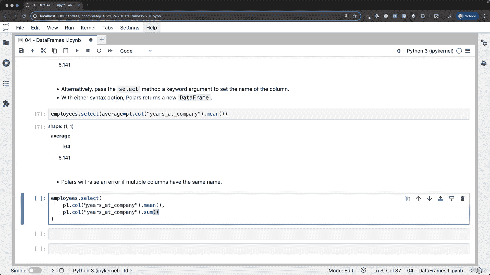
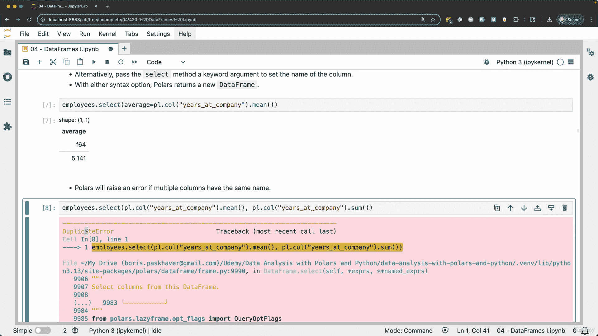
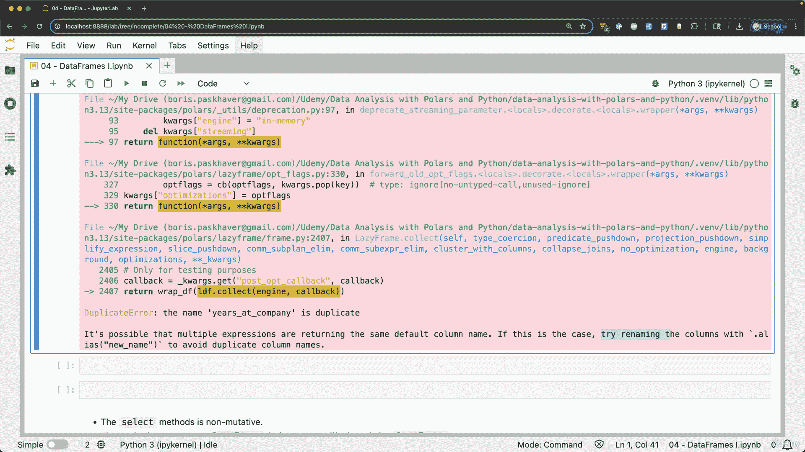
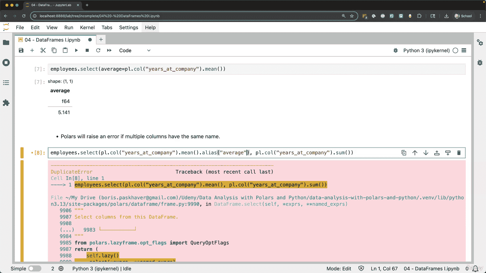
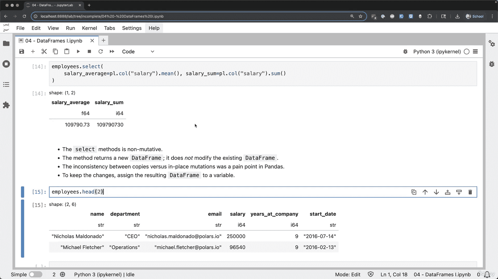

# 使用Polars和Python进行数据分析：第1部分第47节：重命名列 📝

在本节课中，我们将学习如何使用 `alias` 方法为表达式生成的列重命名。默认情况下，当我们用 `select` 这样的方法使用表达式时，Polars 会保留原始的列名。我们将通过多个示例演示如何重命名列，并探讨为什么这项操作非常重要——因为 Polars 对数据框有一个非常严格的限制：列名不能重复。我们还会介绍另一种重命名列的语法，以及 `select` 方法本身不会改变原始数据框这一重要特性。

## 一、默认行为：表达式保留原始列名

当我们使用 `select` 方法并传入一个表达式时，Polars 默认会保留表达式所针对的原始列名。这一点无论我们执行什么操作都不会改变。

举个例子，在下方导入 employees 数据框之后，我们可以调用 `select` 方法。这里让我们创建一个简单的表达式，继续使用 `col` 函数，目标列是 `years at company`。这个表达式会提取整个列，你可以看到输出的列名仍然是 `years of company`，这正是我们指定的原始名称。

不管操作是什么，结果都一样。例如，如果我们想计算这一列数值的平均值，可以将表达式修改为计算均值或平均值，然后会得到一个完全不同、只包含一行的数据框。但请注意，列名依然保持不变，仍然是 `years at company`。

也就是说，默认情况下，以下代码：

```python
df.select(pl.col("years at company").mean())
```

输出的列名依然是 `years at company`，而不是 `mean` 或 `average`。

## 二、使用 `alias` 方法重命名列

`alias` 方法是我们可以调用在表达式上的一个方法。你可以把它理解为：把一条指令作为基础，再创建另一条带有额外步骤的指令。在这里，我创建了一个实际的表达式，然后以它为基础生成另一个计算平均值的表达式，接着在这个基础上我们继续链式调用另一个方法，也就是 `alias` 方法。

`alias` 的作用是告诉指令：将生成的列重命名为我们传入的参数。例如，如果我想把列重命名为 `average`，可以传入一个字符串 `"average"`。然后就会得到一个包含单一列且列名为 `average` 的新数据框。

```python
df.select(pl.col("years at company").mean().alias("average"))
```

在我看来，`alias` 方法是你日常操作中更常见的写法。不过，我还想介绍另一种等效的语法。

## 三、备选语法：使用关键字参数指定列名

这种语法涉及把你想用的列名当作关键字参数，并将表达式赋值给它。下面我们来演示一下。我会再次调用 `select` 方法，然后复制上面那个表达式，一直到计算平均值那部分。但这一次，我不调用 `alias` 方法，而是把想要的列名写在参数位置。比如，如果我希望列名是 `average`，就直接写 `average`，然后加上一个等号。

这里有一个有意思的地方：`average` 并不是 `select` 方法本身期望的参数名，它是我们自己选择的任意名称。但它的作用就是指定该表达式在 `select` 方法执行时生成的列名。

```python
df.select(average=pl.col("years at company").mean())
```

可以看到，这里得到的结果与上面使用 `alias` 方法的结果完全一样。





## 四、为什么重命名很重要？Polars 禁止重复列名

那么，为什么重命名很重要呢？因为 Polars 对数据框有一个非常严格的限制：数据框中不能包含重复的列名。换句话说，每个列名都必须是唯一的。如果你碰巧创建了两个针对同一列的不同表达式，就很容易出现问题。

默认情况下，这两个表达式都会保留原始列名，因此就会产生重复。我们来看一个例子。假设我们要从 employees 数据框中创建一个新数据框，同时计算 `years at company` 列的平均值以及这些数值的总和。那么我们可能会创建两个独立的表达式：第一个使用 `col` 函数，目标列 `years at company`，然后调用 `mean` 方法计算平均值；逗号后面，我再传入第二个独立表达式，它和上面看起来很相似，同样目标列 `years at company`，但调用不同的方法，比如 `sum`，用来计算这些值的累计总和。

问题在于，这会生成一个具有两个列名相同的数据框，因为默认情况下 Polars 都会保留这个列名。你可以看到，这里我们会得到一个重复列名的错误。如果我们滚动到最底部，会看到错误信息显示“`Year at Company` is a duplicate column name”，并提示：可能存在多个表达式返回了相同的默认列名。如果出现这种情况，请尝试使用 `alias` 方法来重命名列，以避免重复列名。

## 五、使用 `alias` 解决重复列名问题





让我们看看如何解决这个问题。第一种选择就是使用 `alias` 方法。对于第一个表达式，我可以加上 `alias` 方法，给这一列命名为 `average`。单凭这一点其实就够了，因为第一个表达式生成的列叫 `average`，第二个表达式则保留原始列名 `years at company`。这样一来，就没有重复列名了。

当然，如果我们重命名其中一个列是为了提供更多上下文或更清晰地表达这个值的含义，那么从可读性角度看，最好把另一个列也重命名，因为这个列本质上现在表示的是总和的含义。所以类似地，在这里我可以选择性地添加 `alias` 方法，并为这一列提供名称，比如就叫 `sum`。这样我们就得到了一个包含 `average` 和 `sum` 两个列的数据框。

```python
df.select(
    pl.col("years at company").mean().alias("average"),
    pl.col("years at company").sum().alias("sum"),
)
```

不过，请记住，`alias` 本身并不能保证绝对安全，因为你仍然可能意外地让两个列拥有相同的名称。这种情况完全可能发生。举个例子，假设我再次调用 `select` 方法，想计算两个不同列的平均值。第一列是 `years at company`，我调用 `mean` 方法，然后给这一列命名为 `average`。接着，我想把下方这个表达式复制一份，只把目标列换成 `salary`。不幸的是，这会要求数据框有两个重复名为 `average` 的列，所以我们又会遇到同样的问题。

当然，我们可以通过为每个列指定一个独特且唯一的名称来修改这个问题。比如，这里我可以把前一个改成 `years average`，后一个改成 `salary average`，这样就解决了。如果你想更直观一些，可以这样写：

```python
df.select(
    pl.col("years at company").mean().alias("years average"),
    pl.col("salary").mean().alias("salary average"),
)
```

## 六、备选语法处理重复列名

接下来，我还想展示使用关键字参数这种备选语法时的等效示例。让我把上面这个出错的例子复制过来，比如这里两个表达式都针对同一个列——假设都是 `salary`，我们分别计算平均值和总和。这样我们会得到两个 `salary` 列，这是不可接受的。

第一种解决方案是调用 `alias` 方法，确保它们都有不同的名称。另一种方案是使用关键字参数——我可以在这里写 `salary_average`，然后按等号，将其设置为对应表达式，这个表达式生成的列就会使用这个名字；下方逗号之后，再写 `salary_sum`。你可以看到，最终结果与使用 `alias` 方法完全相同：一个数据框，包含这两个指定的列名。

```python
df.select(
    salary_average=pl.col("salary").mean(),
    salary_sum=pl.col("salary").sum(),
)
```

## 七、重要特性：`select` 返回新数据框，原始数据框不变

最后，我想在本节课中提到一点：`select` 方法总是返回一个新的数据框。所有列名的修改都只应用于新生成的数据框，原始数据框（在这里是 employees）不会受到任何影响。如果我们回过头看看 employees，在整个过程中它都没有改变。每次使用 `select` 方法时，我们给它一个或多个表达式，它会基于原始数据源 employees 创建一个新的数据框。

所以再次强调，如果你想保留这些工作成果，就需要把结果赋值给一个变量，当然前提是你想在 notebook 中稍后使用这个变量。如果你只是想输出结果数据框看一下数值，那完全没有问题。但请务必记住，所有这些操作都是不可变的——它们不会更改、修改或变动原始数据框。

## 总结



在本节课中，我们一起学习了如何使用 `alias` 方法为 `select` 表达式生成的列重命名，也了解了另一种使用关键字参数的等效语法。重点在于，Polars 不允许数据框中出现重复列名，当多个表达式默认返回同一列名时，我们必须借助重命名来避免错误。最后，我们还确认了 `select` 方法不会修改原始数据框，而是返回一个全新的、应用了这些列名变更的数据框。希望这些内容对你有所帮助，下一节课我们再见。😊

