# 📊 Polars 与 Python 数据分析：48：select 方法（二）

在本节课中我们将要学习 `select` 方法支持的多种语法选项，并重点理解为什么 Polars 开发团队推荐使用 `pl.col` 创建列表达式。过去几节课中我们使用的写法，是在 Polars 顶层通过 `col` 函数创建表达式对象，再把这个表达式对象传给 `select`。这种基于列的表达式写法最动态、最灵活，我们可以利用表达式对象上的方法构建更复杂、更有意思的表达式。本课要介绍的几种写法没有表达式那么强大和灵活，它们更基础，但优点是代码可能更少。我们也要认识这些写法，原因是阅读别人的 Polars 代码时可能会遇到不同的列定位方式，知道它们存在会很有帮助。

## 🧭 Polars 与 Python 数据分析：48.1：导入数据与示例背景

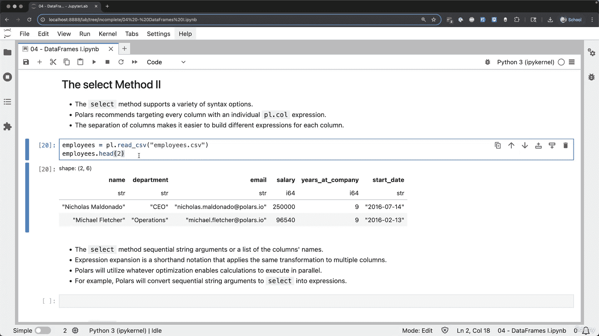

上一段我们说明了本课目标和语法背景，本节中我们来看看示例数据如何导入。首先执行代码导入 `employees` 数据框，后续所有示例都围绕这个数据框展开。这个数据框中有员工姓名、工资、在公司年限等列，方便我们观察 `select` 在不同写法下返回的结果。为了把注意力放在语法差异上，我们只选取少量列进行演示，并且会通过 `head` 方法限制输出行数，避免结果太长影响阅读。

```python
import polars as pl

employees = pl.read_csv("employees.csv")
```

## 🔤 Polars 与 Python 数据分析：48.2：用纯字符串指定列

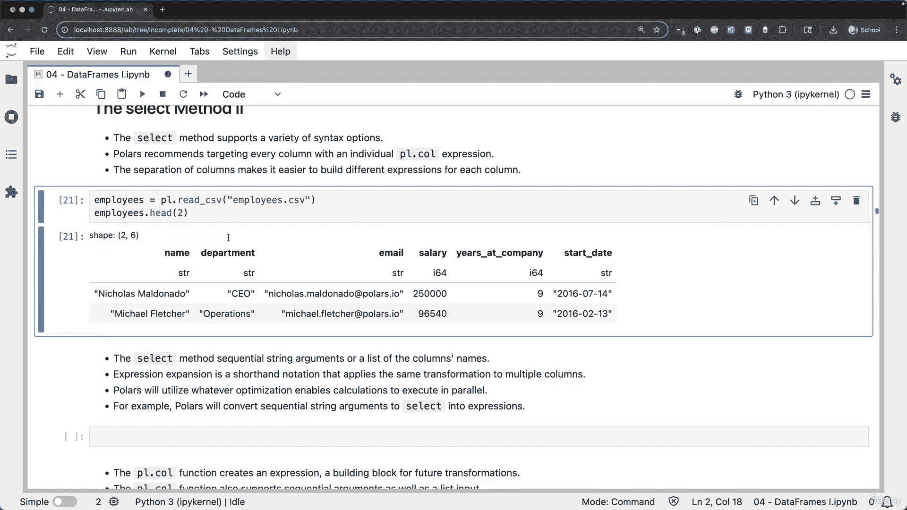

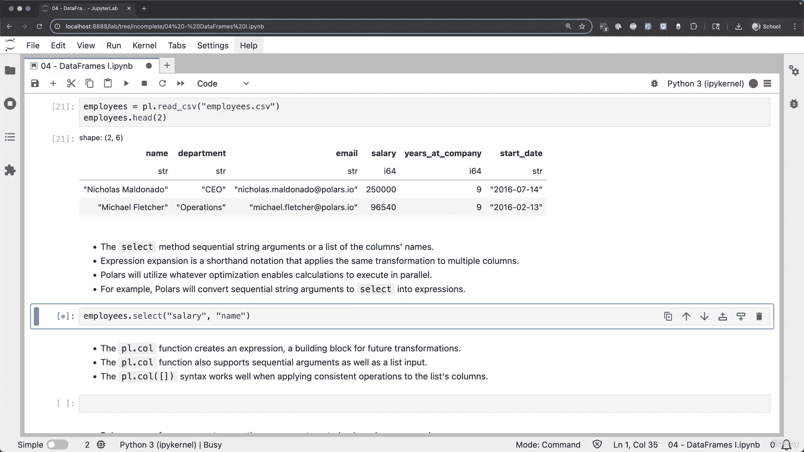

上一节我们准备好了数据，本节中我们来看看第一种语法选项：直接向 `select` 传入纯字符串。在数据框上调用 `select` 方法时，可以传入普通字符串，每个字符串指定一个要定位的列。例如，如果想先定位 `salary` 列，再选择 `name` 列，就把这两个列名作为字符串传入。Polars 会返回一个新的数据框，其中只包含这两列，并且列的排列顺序与传给 `select` 的参数顺序完全一致。下面代码展示这种写法：

```python
employees.select("salary", "name")
```

这种写法代码很短，适合只做简单的列提取。需要记住，返回结果中的列顺序由参数顺序决定，而不是由原数据框顺序决定。

## 📋 Polars 与 Python 数据分析：48.3：用单个 Python 列表传入字符串

上一节我们传入的是多个字符串参数，本节中我们来看看第二种语法选项：把一个 Python 列表传给 `select`。可以把两个字符串包在一个列表中，这样从技术上说只传入了一个参数，这个参数是一个 Python 列表，列表中包含两个元素。返回的数据框与上一节完全相同。Polars 看到这种语法时，会在幕后把列表中的每个字符串分别提取成对应的表达式。也就是说，幕后会创建一个定位 `salary` 的表达式，再创建一个定位 `name` 的表达式。下面代码展示这种写法：

```python
employees.select(["salary", "name"])
```

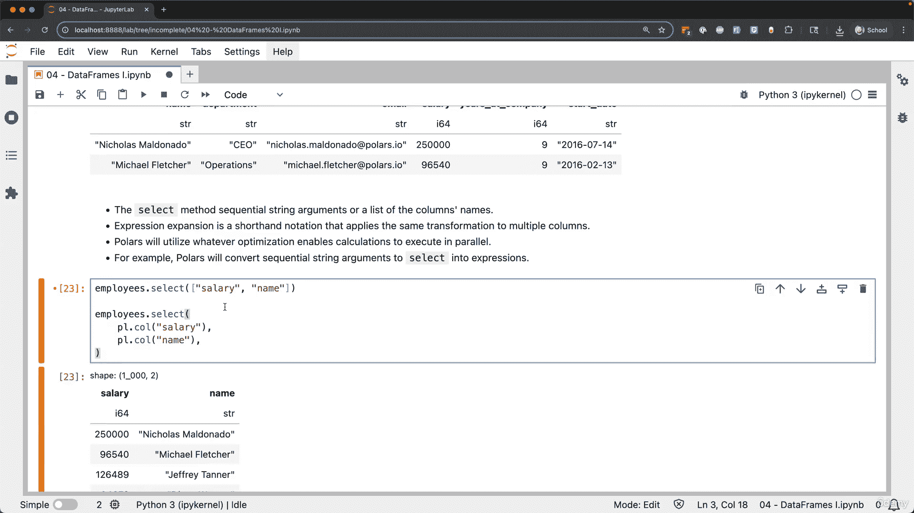

这种写法的优点是代码仍然简洁，但缺点是我们没有在代码里显式构建表达式对象。Polars 幕后确实会创建表达式，但我们自己手里没有一个可继续调用的表达式对象。用纯字符串或字符串列表时，基本只能做列提取，不能在这个语法上继续计算平均值、求和、最大值或最小值。表达式写法更灵活，原因就在这里。

## 🧱 Polars 与 Python 数据分析：48.4：把多个列名传给 col 函数

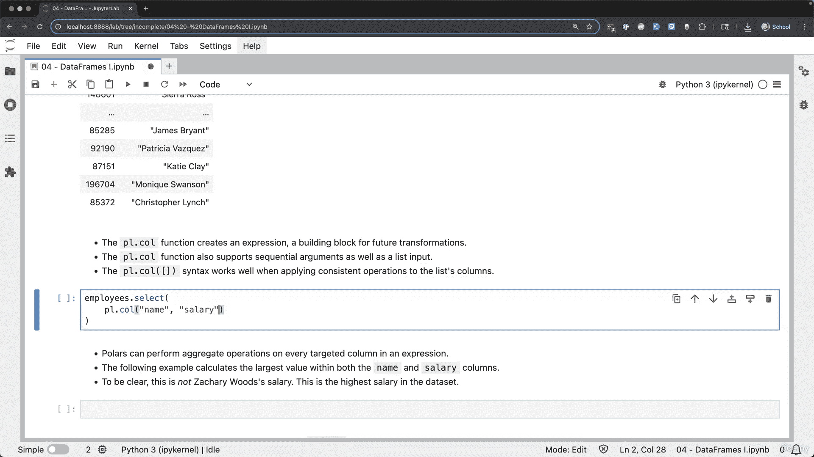

上一节我们看到字符串和列表可以传给 `select`，本节中我们来看看同样这些参数也可以传给 `col` 函数本身。除了把字符串或列表传给 `select`，还可以把相同形式的参数传给 `col` 函数。例如再次调用 `select`，并依赖 Polars 顶层 `col` 函数，但这次不只传一个列名，而是传两个顺序参数：`name` 和 `salary`。这样会提取出指定的两列。这个结果在技术上仍然是一个表达式对象，只不过它是一个更细致、更复杂的表达式对象。可以把它理解为一个更复杂的步骤，它表达的是“不只定位一列，而是同时定位 `name` 和 `salary` 两列”。下面代码展示这种写法：

```python
employees.select(pl.col("name", "salary"))
```

`col` 函数也接受列表。如果想把列名作为字符串列表传入，而不是作为顺序参数传入，可以这样写：

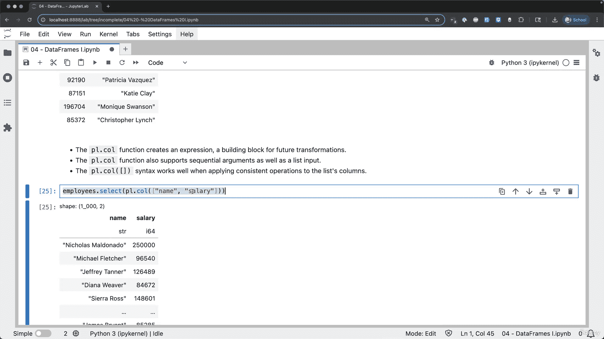

```python
employees.select(pl.col(["name", "salary"]))
```

这两种写法的工作方式相同。这个语法的优势是：我们得到的是一个表达式对象，而表达式是一个综合对象，上面有很多方法可用。下一节我们会利用这些方法做聚合计算。

## 📈 Polars 与 Python 数据分析：48.5：在表达式上调用 max 做聚合

上一节我们得到了多列表达式对象，本节中我们来看看如何在表达式上调用聚合方法。表达式对象上有很多方法，例如 `mean` 和 `sum`，可以对目标列执行操作。也可以调用 `max` 方法，`max` 会取出给定列中的最大值。在本例中，表达式包含两列，因此会分别得到 `years at company` 列的最大值和 `salary` 列的最大值。需要再次强调，这两个值并不属于同一行，也不是同一行记录上的两个字段；它们只是各自列中的最大值。`years at company` 列的最大值之所以出现，是因为它被包含在表达式构建中；`salary` 列的最大值之所以出现，是因为它也被附加到了同一个列表中。我们构建了一个定位两列的表达式，并对每一列执行相同的最大值聚合计算。下面代码展示这个核心概念：

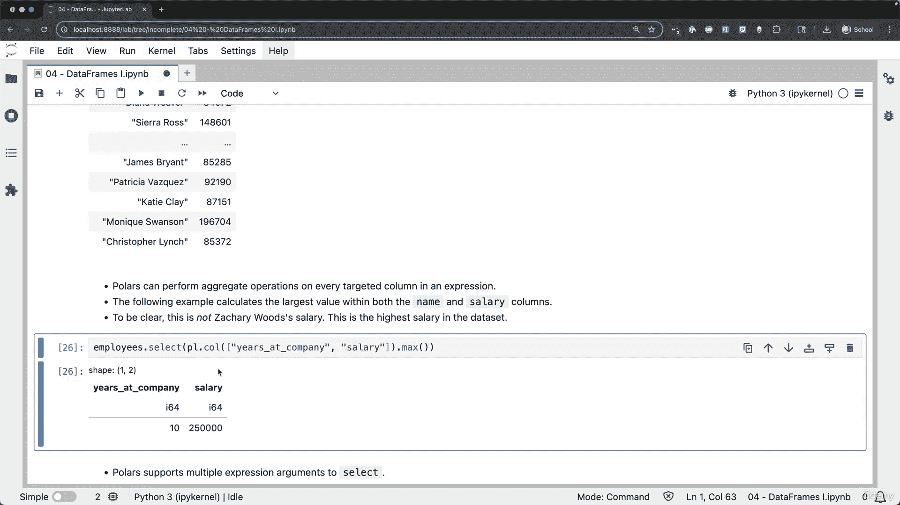

```python
employees.select(
    pl.col("years at company", "salary").max()
)
```

这个例子说明，表达式写法不仅能提取列，还能在提取的同时做计算。与纯字符串写法相比，表达式写法把“定位列”和“对列做操作”放在了同一个对象上，因此更灵活。

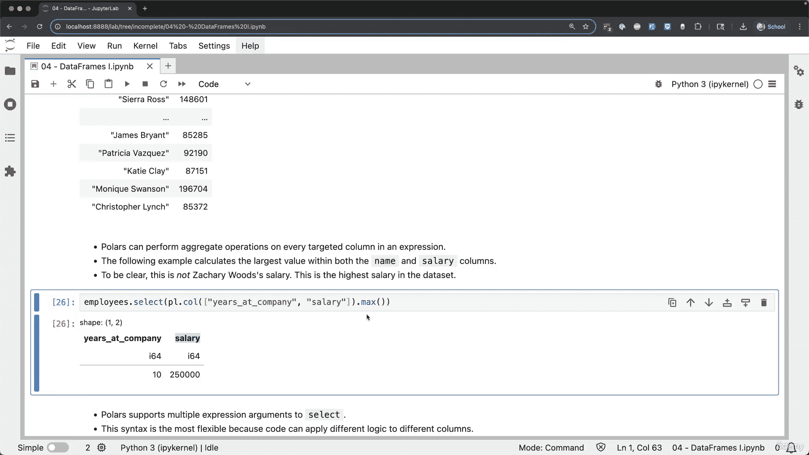

## 🧮 Polars 与 Python 数据分析：48.6：向 select 传入多个独立表达式

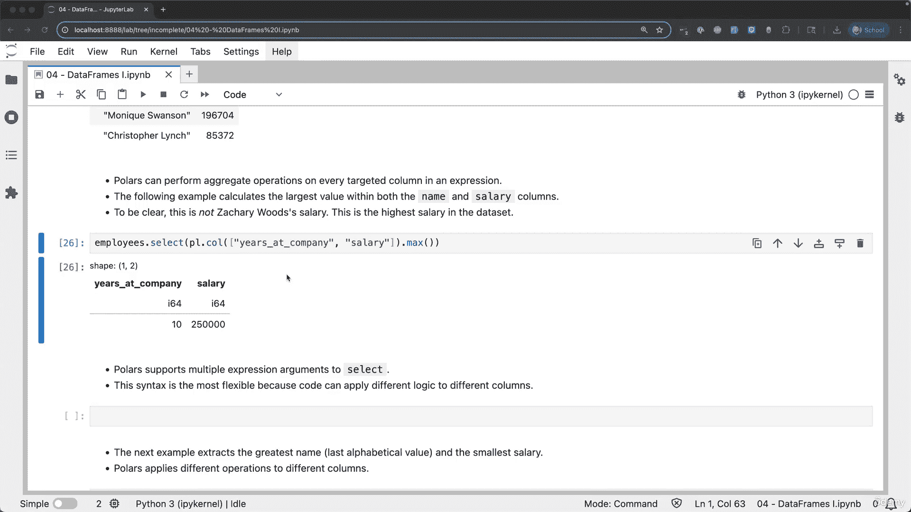

上一节我们对一个多列表达式执行了同一个聚合，本节中我们来看看如何向 `select` 传入多个独立表达式。正如之前课程所见，Polars 支持向 `select` 传入多个表达式。例如在数据框上再次调用 `select`，提供两个表达式：第一个表达式定位 `name` 列，第二个表达式定位 `salary` 列。为了确保输出不会撑满屏幕，可以调用 `head` 方法。这样可以看到分别提取出的 `name` 列和 `salary` 列。下面代码展示这种写法：

```python
employees.select(
    pl.col("name"),
    pl.col("salary")
).head()
```

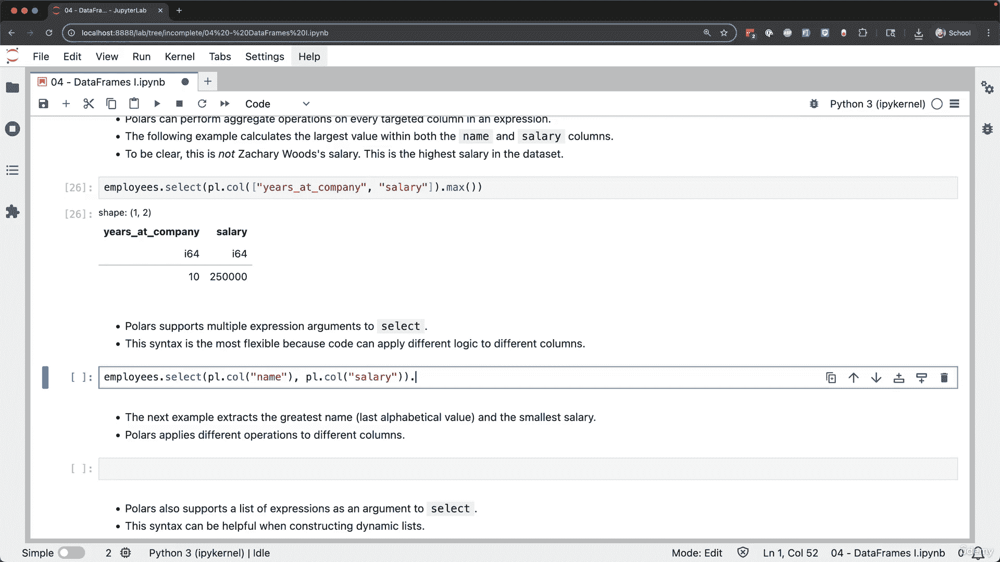

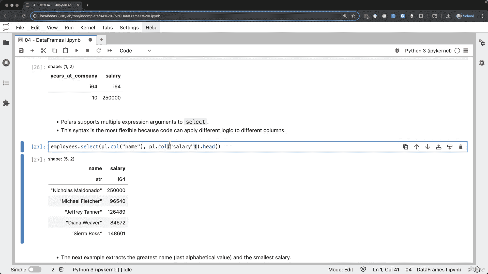

这里两个列是两个独立表达式，每个表达式都是单独的表达式对象。因此我们可以对每个表达式调用不同方法，包括不同的聚合方法。下一节会演示对姓名列取最大值、对工资列取最小值。

## 🔀 Polars 与 Python 数据分析：48.7：对不同表达式使用不同聚合方法

上一节我们传入两个独立表达式，本节中我们来看看如何对它们分别执行不同计算。假设想提取 `name` 列中最大的名字，也就是姓名在字母表中最靠后的员工。需要记住，字符串列的最大值按字母顺序判断，因此最大值就是最接近字母表末尾的那个字符串。同时假设还想提取 `salary` 列中最小的工资。这里第一个表达式定位 `name` 列，并在表达式对象上调用 `max` 方法取出最大值；第二个表达式定位 `salary` 列，并调用互补的 `min` 方法取出最小值。下面代码展示这种写法：

```python
employees.select(
    pl.col("name").max(),
    pl.col("salary").min()
)
```

Polars 会尝试并行计算这两个表达式。最终返回 `name` 列中的最大名字，例如示例中的 `Zachary Woods`，以及 `salary` 列中的最小工资，例如示例中的 `55000`。这个例子进一步说明，多个独立表达式可以各自携带不同指令，因此比单纯字符串提取强大得多。

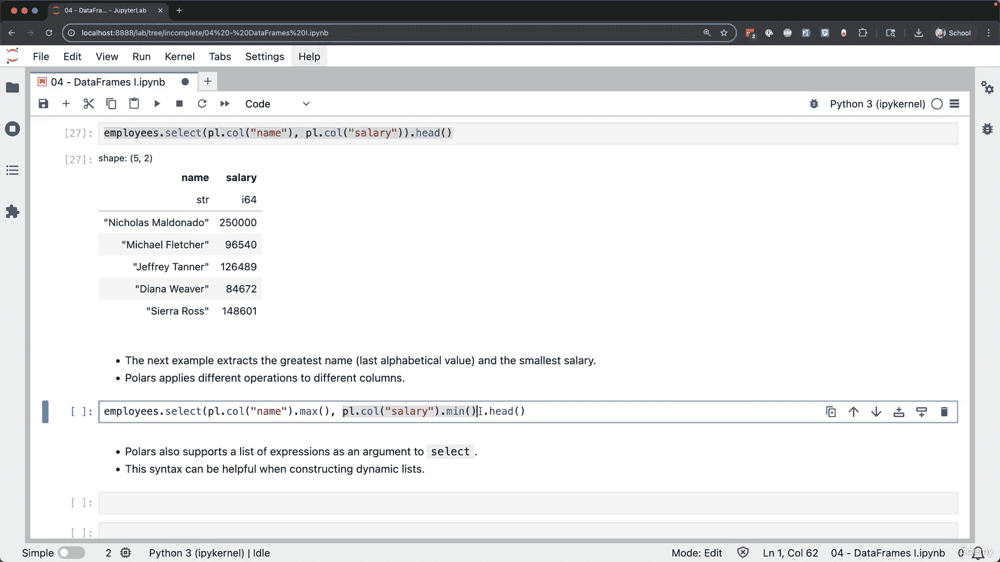

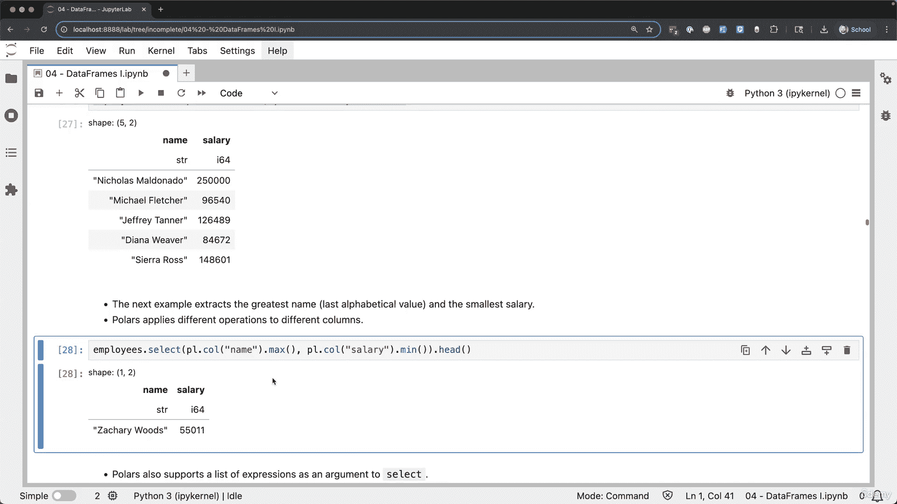

## 🗂️ Polars 与 Python 数据分析：48.8：向 select 传入表达式列表

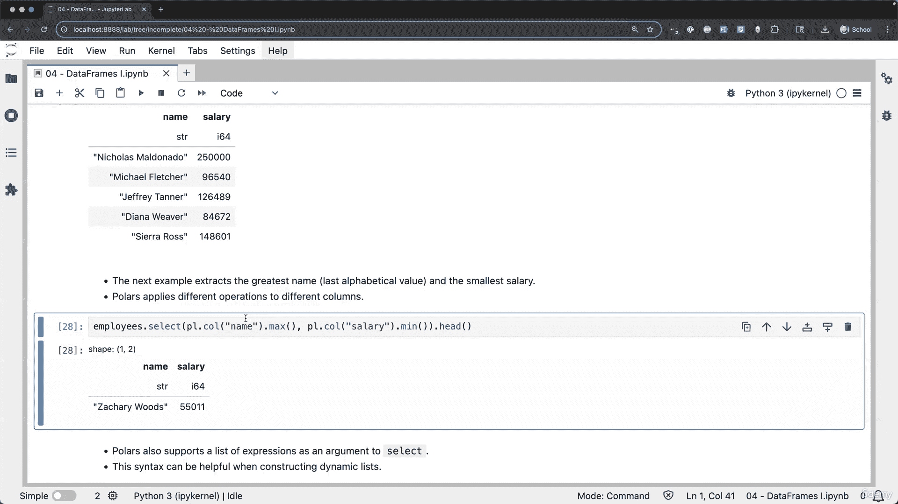

上一节我们传入了多个表达式参数，本节中我们来看看如何把表达式放进一个列表再传给 `select`。例如再次取出 `employees` 数据框并调用 `select`，这次创建一个 Python 列表，在列表里打包两个表达式。仍然使用 `col` 函数：第一个表达式定位 `name` 列，第二个表达式定位 `salary` 列。我们创建了两个表达式，把它们包在 Python 列表中，再把列表传给 `select`，最终得到预期的两列。下面代码展示这种写法：

```python
employees.select([
    pl.col("name"),
    pl.col("salary")
])
```

这种语法的优势是：我们现在可以利用动态代码创建动态列表，并把动态列表作为创建提取算法或提取逻辑的基础。下一节会用一个动态列名列表演示这种能力。

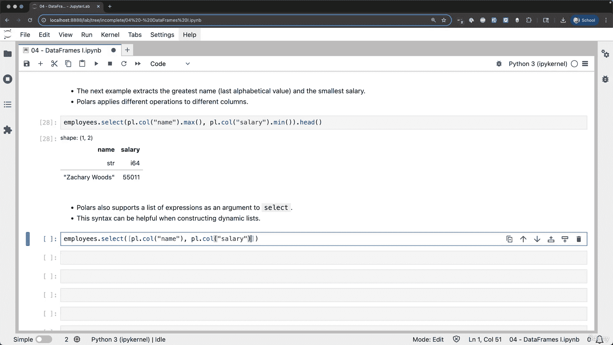

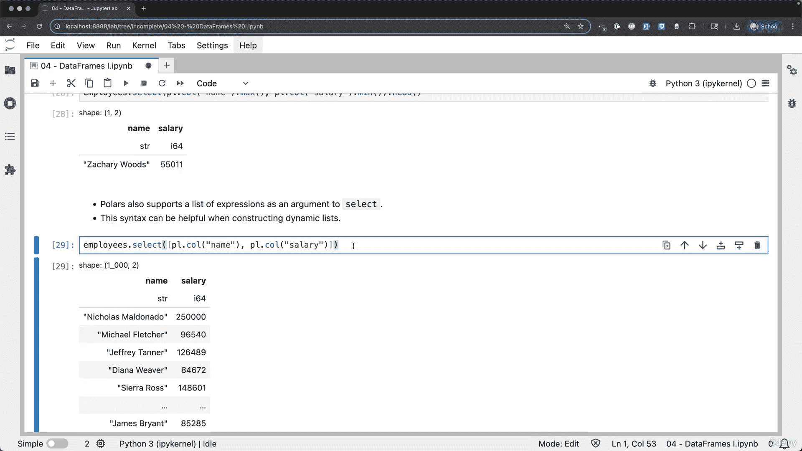

## 🔁 Polars 与 Python 数据分析：48.9：用列表推导式动态生成表达式

上一节我们使用了固定的表达式列表，本节中我们来看看如何根据动态列名列表生成表达式列表。例如声明一个变量 `columns`，给它提供两个列名，例如 `salary` 和 `years at company`。这个列表可能在程序运行时动态计算出来，也可能允许用户选择数据框中想要定位的列。也许明天这个列表会有五个动态值，也许后天只有一个值。可以想象这个列表是动态构造的。因为 Python 列表提供了这种能力，所以可以写出更强大的代码：取出 `employees` 数据框，调用 `select`，并使用列表推导式为列表中的每个值创建一个表达式。列表推导式语法使用一对方括号，并写成 `for column in columns`。换句话说，对于上面列表中的每个字符串，都要执行一个操作；这个操作写在语法开头，例如使用 `pl.col` 函数创建表达式，并把当前迭代的动态列名字符串传进去。迭代时会先处理 `salary`，再处理 `years at company`。对于列表中的每个条目或元素，都生成一个定位该列名的表达式。还可以扩展这个表达式，例如计算最大值。下面代码展示核心写法：

```python
columns = ["salary", "years at company"]

employees.select([
    pl.col(column).max() for column in columns
])
```

对上面列表中的每个元素，代码都会创建一个表达式，定位 `employees` 数据框中的对应列，并计算该列最大值。执行后会得到 `salary` 的最大值和 `years at company` 的最大值。如果第二天想再加入 `name` 列，列表就变成三个元素；列表推导式会生成另一个包含三个元素的列表，这次是三个表达式的列表，这个列表完全可以作为 `select` 的参数传入，于是会得到这三列各自的最大值。下面代码展示扩展后的写法：

```python
columns = ["salary", "years at company", "name"]

employees.select([
    pl.col(column).max() for column in columns
])
```

这也是 Polars 团队提供多种 `select` 语法选项的原因之一：我们可以用动态代码构建动态列表、动态顺序参数，再把它们传给 `select`。动态列表的长度可以变化，表达式也可以在列表推导式中统一生成，这让代码更适合处理用户选择、配置变化等场景。

## ✅ Polars 与 Python 数据分析：48.10：本课回顾与推荐写法

上一节我们演示了动态表达式列表，本节中我们来回顾并总结推荐写法。再次回顾课程开头的内容：使用 `pl.col` 函数创建表达式通常是推荐路线，因为它提供了能力和灵活性，可以通过 Polars 团队在表达式上提供的各种方法构建动态表达式。如果坚持使用基本字符串，只做简单列提取时也是不错的选择。但只要想做比简单提取更高级的事情，就需要通过指令构建逻辑，而实现这一点的方式就是构建表达式。下面用列表概括本课涉及的几种写法及其定位：

- 纯字符串写法：`employees.select("salary", "name")`，代码少，适合简单提取，但拿到的是结果而不是可继续操作的表达式对象。

- 字符串列表写法：`employees.select(["salary", "name"])`，本质上仍是简单提取，Polars 幕后会转换成表达式，但代码里没有显式表达式对象。

- `pl.col` 多列写法：`employees.select(pl.col("name", "salary"))`，得到表达式对象，可以继续调用聚合方法。

- 多表达式写法：`employees.select(pl.col("name").max(), pl.col("salary").min())`，可以对不同列执行不同计算。

- 表达式列表与列表推导式写法：`employees.select([pl.col(c).max() for c in columns])`，适合动态列名和动态逻辑。

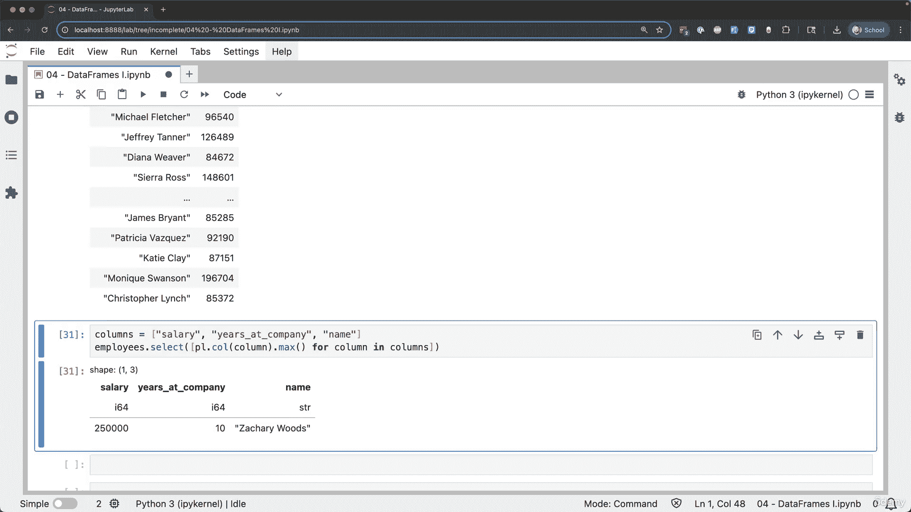

本节课中我们一起学习了 `select` 方法支持的多语法选项，包括纯字符串、字符串列表、`pl.col` 多列参数、多个独立表达式、表达式列表，以及用列表推导式动态生成表达式。我们也理解了推荐使用 `pl.col` 表达式的原因：它最动态、最灵活，能让我们在定位列之后继续调用方法做聚合和复杂计算。对于简单提取，字符串写法可以少写代码；对于更高级的逻辑，构建表达式是更合适的路线。

