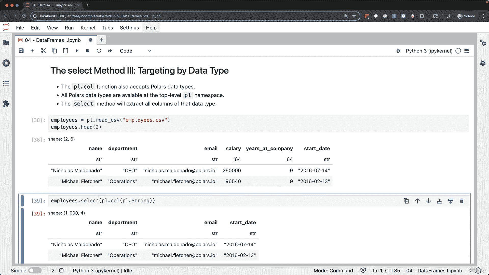
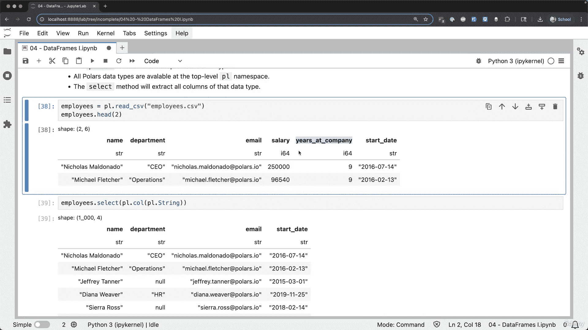
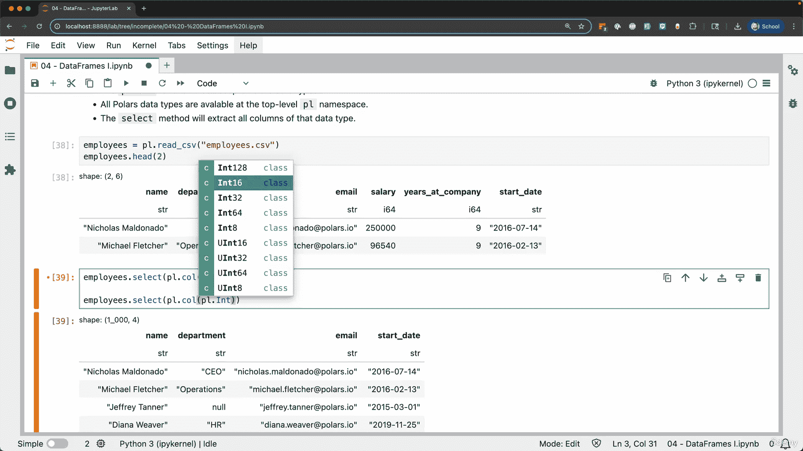
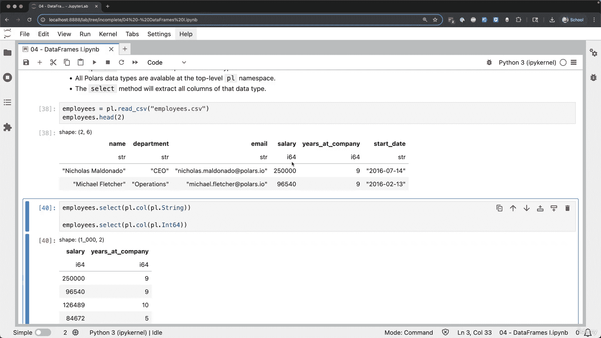
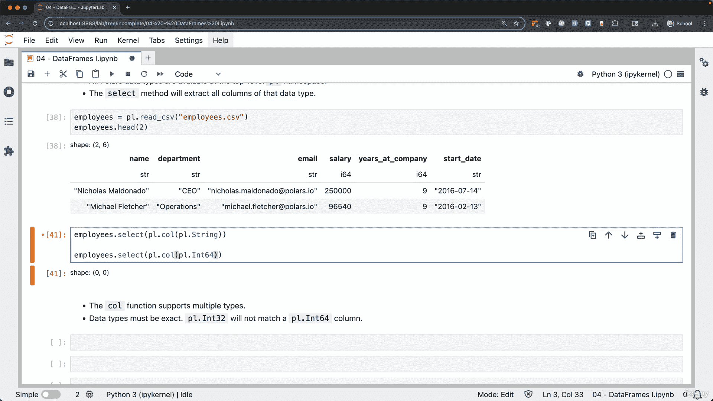
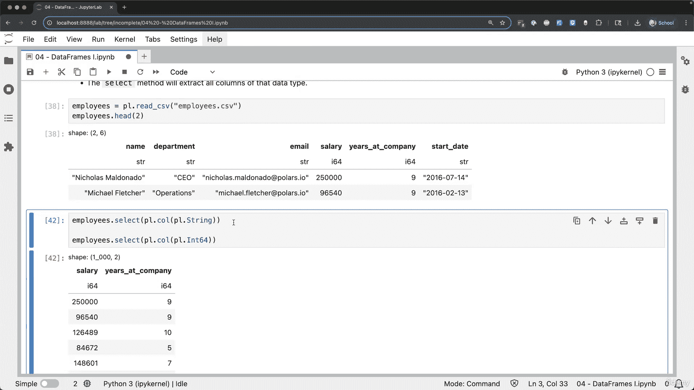
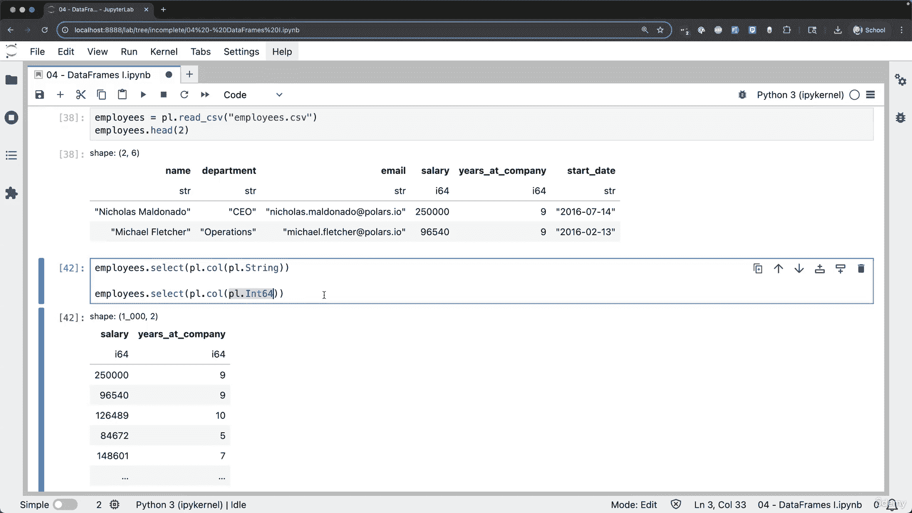
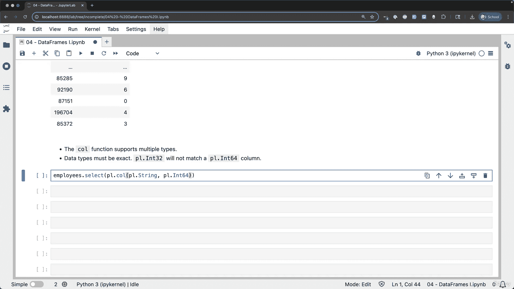
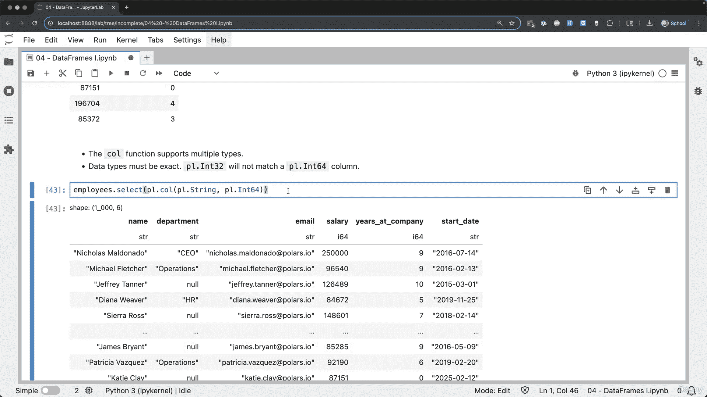

# 🚀 Polars 与 Python 数据分析：第49节：select 方法（三）——按数据类型定位列

## 🧭 Polars 与 Python 数据分析：第49.1节：本节概述

在本节课中，我们将要学习如何让 Polars 的 `select` 方法不按列名定位列，而是按列的数据类型定位列。本节从一个好消息开始：Polars 顶层的 `col` 函数比我们目前看到的更强大。它除了可以接受列名字符串，还可以接受数据类型。这个表达式会要求 `select` 这类方法按照列的数据类型来筛选列，而不是按照列名来筛选。下面通过代码演示具体做法。

为了先建立核心概念，可以把“按数据类型选择列”写成下面这个公式。

\[
\text{按数据类型选择列} = \text{pl.col(数据类型)}
\]

上一段给出了总体思路，接下来我们进入字符串列的示例。

## 🔤 Polars 与 Python 数据分析：第49.2节：按字符串数据类型定位列

上一节我们说明了 `col` 函数可以接收数据类型，本节中我们来看看如何用它定位字符串列。我们会执行代码，把 `employees` 数据框导入进来。然后在下方调用数据框的 `select` 方法。这里会把代码拆成多行来写；即使代码格式化工具最终把它缩减成一行，多行写法也能让代码更容易阅读。

在 `employees` 数据框中，四个字符串列分别是下面这些列。

- `name`
- `department`
- `email`
- `start_date`

这些列都包含字符串值。我们可以创建四个独立表达式，分别定位这四个列名，但是按数据类型定位会更简单。这里会调用 Polars 顶层的 `col` 函数；过去我们给这个函数传字符串来指定要定位的列，这一次改为传数据类型。Polars 的所有数据类型都可以在库的顶层 `pl` 命名空间里直接使用。

下面给出按字符串类型选择列的示例代码，代码中使用了 `pl.String`。`String` 的首字母大写，它是 Polars 的字符串类型，也是这里要找的数据类型。

```python
import polars as pl

employees = pl.read_csv("employees.csv")

string_columns = employees.select(
    pl.col(pl.String)
)

print(string_columns)
```





在上面的代码中，`pl.col(pl.String)` 创建了一个表达式，目标是给定数据框中的每一个字符串列。`select` 方法会强制执行这个计算，并返回 `employees` 数据框中的所有字符串列。在编辑器里输入时，可以使用 Tab 键调出自动补全，并搜索首字母大写的 `String`，从而确保选到正确的 Polars 类型。字符串列示例完成后，下面继续看整数列的处理方式。

## 🔢 Polars 与 Python 数据分析：第49.3节：按整数数据类型定位列



上一节我们按字符串类型定位了列，本节中我们来看看如何按整数类型定位列。假设我们同样想定位所有数值列，例如 `salary` 和 `years_at_company`，这两列的数据类型都是 `Int64`，也就是 64 位整数。这里的原理与字符串列相同：调用 `select` 方法，并传入一个由 `col` 函数创建的表达式；`col` 函数接收的参数这次是整数数据类型。

下面给出按 `Int64` 类型选择列的示例代码，其中通过 `pl.Int64` 指定 64 位整数类型。

```python
import polars as pl

employees = pl.read_csv("employees.csv")

integer_columns = employees.select(
    pl.col(pl.Int64)
)

print(integer_columns)
```

这段代码会返回 `salary` 和 `years_at_company` 这两个整数列。这里有一个非常重要的注意点：数据类型必须完全匹配。举例来说，当 Polars 读取 CSV 并看到整数数值时，默认会把它分配为 `Int64` 类型。我们之前也看到，可以通过 `schema` 或 `schema_overrides` 参数来自定义类型；但默认情况下，整数列就是 `Int64`。这意味着，如果我们尝试定位另一种整数类型，例如 32 位整数 `Int32`，就会得到一个空数据框，因为数据框中没有这种类型的列可供提取。因此，使用按类型定位时必须小心类型是否一致。下面把类型匹配相关要点整理出来。

- Polars 读取 CSV 中的整数时，默认类型是 `Int64`。
- 可以通过 `schema` 或 `schema_overrides` 参数自定义列类型。
- 目标类型必须与列的实际类型完全一致，否则结果会是空数据框。
- 例如用 `pl.col(pl.Int32)` 去匹配 `Int64` 列，结果会是空数据框。



理解类型完全匹配之后，我们再回到 `col` 函数本身，看看它更强大的用法。

## 🧩 Polars 与 Python 数据分析：第49.4节：一次传入多个数据类型





上一节我们介绍了按整数类型定位列，并强调了类型必须精确匹配，本节中我们来看看如何一次传入多个数据类型。`col` 函数比目前展示的还要强大：除了接受单个数据类型，它还可以接受一个数据类型序列。下面再次使用 `employees` 数据框，并再次调用 `select` 方法；这次用 Polars 顶层的 `col` 函数创建一个表达式，传入的不是一个参数，而是两个依次排列的参数，这两个参数都是 Polars 数据类型。



下面给出同时选择字符串列和 64 位整数列的示例代码，其中先传入 `pl.String`，再传入 `pl.Int64`。输入时不要害怕使用 Tab 键调出自动补全，要确保定位到正确的类。

```python
import polars as pl

employees = pl.read_csv("employees.csv")

string_and_integer_columns = employees.select(
    pl.col(pl.String, pl.Int64)
)

print(string_and_integer_columns)
```

这段代码会提取所有数据类型为字符串或 64 位整数的列。如果一个数据框有 100 列，其中假设有 8 列属于这两种数据类型，这种写法会比逐个写出每个列名更强大，也更不冗长。对于初学者来说，可以把它理解为“按类型批量抓列”：只要类型符合，就不需要一列一列点名。下面列出这种多类型写法的直接好处。

- 可以一次匹配多种数据类型。
- 列数量很多时，代码更短、更易读。
- 不需要逐个写出列名，减少重复劳动。
- 类型准确时，结果更集中，便于后续分析。

到这里，按数据类型定位列的主要用法已经完整展示，下面进行本节总结。

## ✅ Polars 与 Python 数据分析：第49.5节：本节总结





本节课中，我们一起学习了 Polars 中 `select` 方法按数据类型定位列的用法。我们知道了 `pl.col` 不仅可以接收列名，还可以接收 `pl.String`、`pl.Int64` 这类数据类型；`select` 会强制执行表达式并返回匹配的列。我们还看到，数据类型必须完全匹配，默认 CSV 整数列通常是 `Int64`，如果目标类型写成 `Int32`，结果会是空数据框。最后，我们学习了可以一次传入多个数据类型，例如 `pl.col(pl.String, pl.Int64)`，在列很多时这种写法更简洁。掌握这些内容后，就可以在数据框列很多时，用类型批量筛选需要的列。

