# Polars与Python数据分析：50：表达式作为构建模块 🧱

在本节课中我们将要学习如何把 Polars 表达式当作未来可复用的构建模块来使用。核心观点是：**表达式是一个惰性步骤，在被应用到具体操作或具体上下文之前不会执行**。我们会先重新导入员工数据集，再导入待办数据集，然后定义一个通用表达式，把它复用到两个不同的数据框中，最后介绍日期时间类型和 `try_parse_dates` 参数。下面用大白话一步步整理，让初学者也能看懂。

在正式定义表达式之前，先把数据准备好，因为后面的例子都要用到这些数据。本节中我们来看看如何导入员工数据和待办数据，并观察它们共同拥有的列。

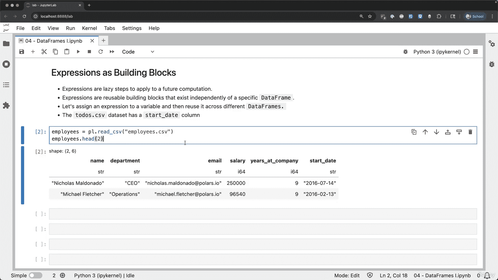

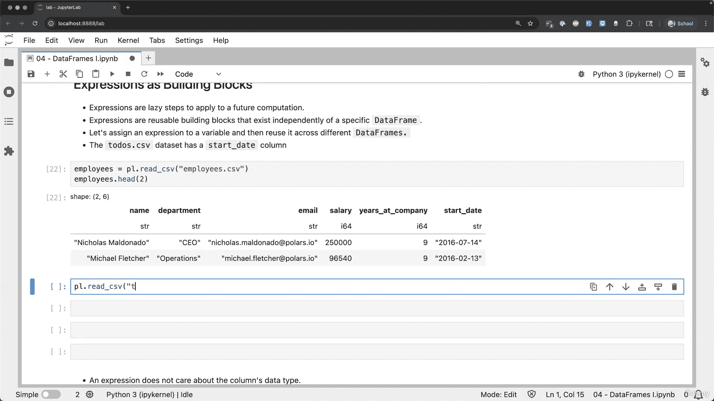

## Polars与Python数据分析：50.1：导入员工与待办数据集 📥

在概述中我们明确了本节目标，这一小节中我们来看看如何准备数据。首先重新执行代码，把员工数据集导入到一个员工数据框中，然后在下方导入课程文件中另一个可用的数据集。这里再次使用顶层的 `read_csv` 函数，该数据集位于 `todos.csv` 中。

以下是导入员工数据和待办数据的代码示例。

```python
import polars as pl

employees = pl.read_csv("employees.csv")
todos = pl.read_csv("todos.csv")

print(todos)
```

查看这个待办数据框可以看到，它比较短，但包含一个待办事项列和一个开始日期列。我们把导入结果赋值给变量 `todos`，并在下方输出。马上能发现两个数据框共享一列，也就是开始日期列：在 `todos` 中能看到它，在 `employees` 中也能看到它。接下来我们看看如何利用这个共同列定义一个通用表达式。

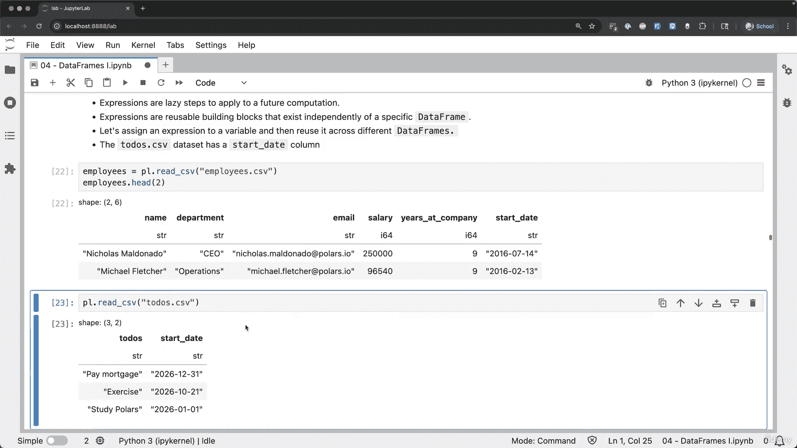

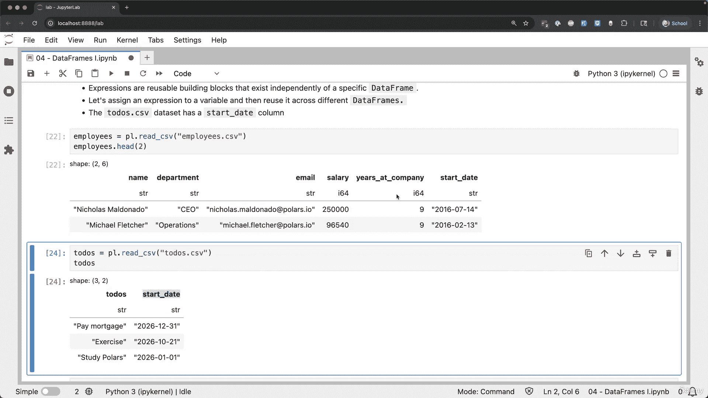

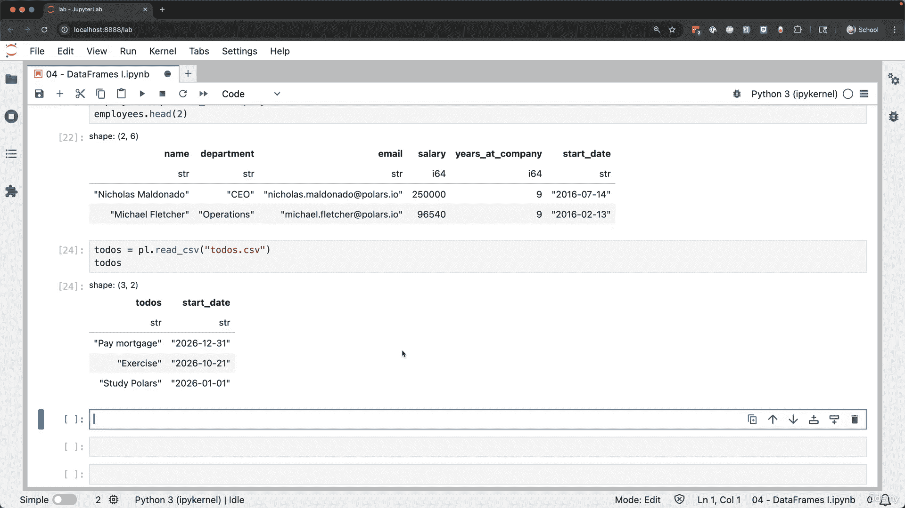

## Polars与Python数据分析：50.2：定义通用表达式 🧩

上一节我们导入了数据并发现两个数据框都有开始日期列，本节中我们来看看如何定义一个不依赖具体数据框的通用表达式。这个表达式不会知道它将被应用到哪些数据框，甚至不知道目标列的数据类型。核心概念可以用下面公式描述：

```text
表达式 = 惰性指令序列
执行结果 = 数据框 + 表达式 + 上下文操作
```

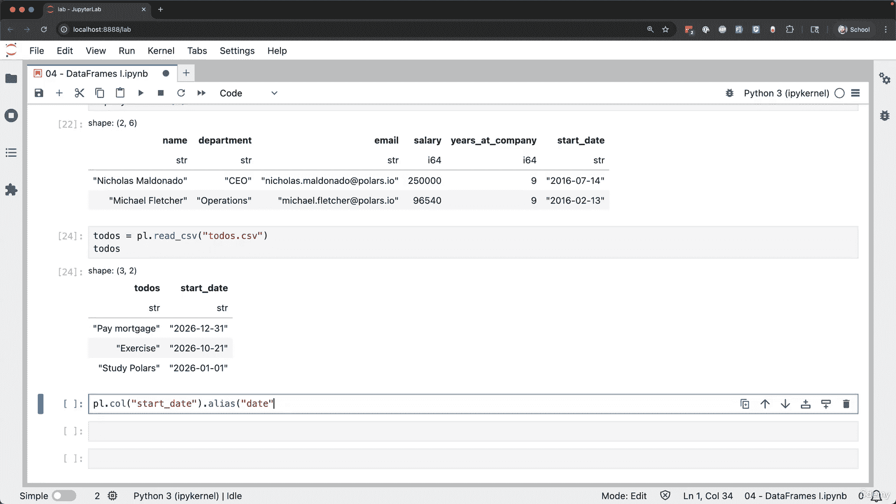

下面使用顶层 `column` 函数目标一个名为开始日期的列，然后调用 `alias` 方法扩展这个表达式，让它同时完成列重命名。我们把列名设为 `date`，这个操作会产生一个 Polars 表达式，并赋值给变量 `start_date`。此时 `start_date` 存储的是一个 Polars 表达式对象。

以下是定义通用表达式的代码示例。

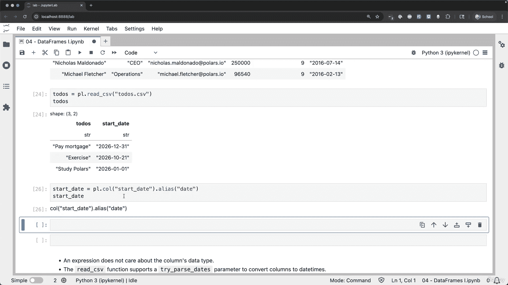

```python
start_date = pl.col("start_date").alias("date")
```

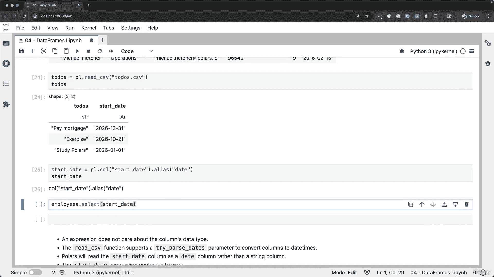

这个表达式完全独立于任何将要使用它的数据框，当然也可以把它应用到一个或多个数据框中。它现在只是一系列未执行的指令，等待被应用到具体上下文或具体操作中。下一节我们来看看如何把同一个表达式应用到两个不同的数据框。

## Polars与Python数据分析：50.3：把同一表达式应用到两个数据框 🔁

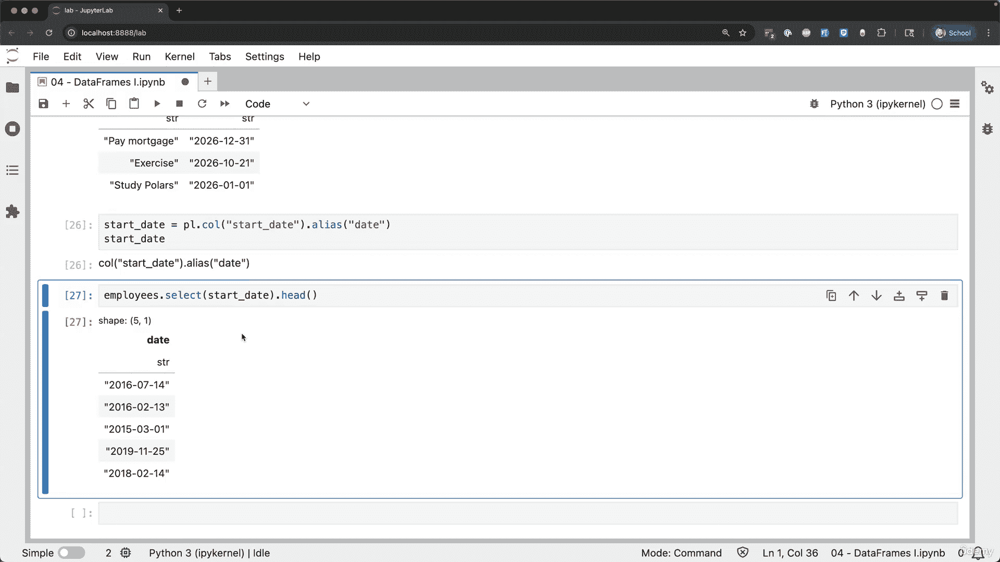

上一节我们定义了通用表达式，本节中我们来看看如何把它复用到员工数据框和待办数据框。首先取员工数据框，调用 `select` 方法并传入上面的 `start_date` 表达式，再调用 `head` 方法输出前几行。

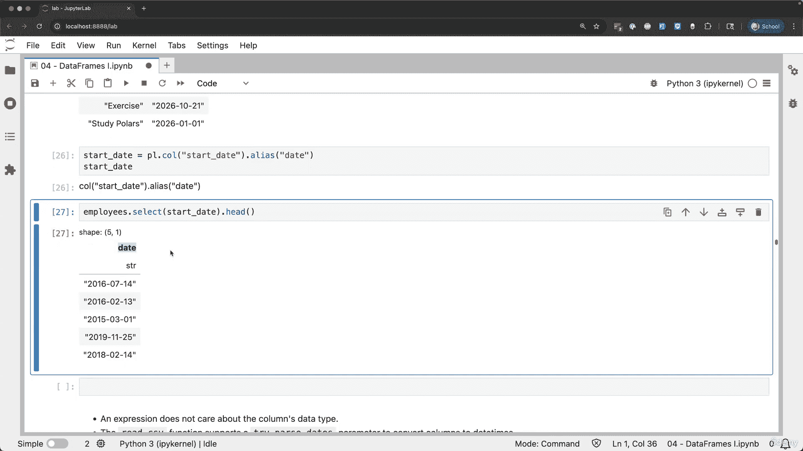

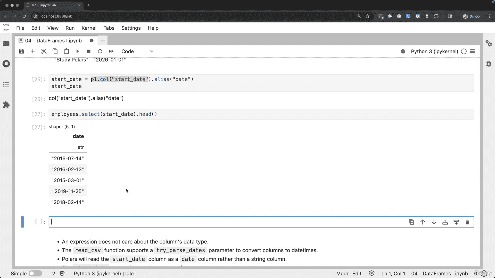

以下是应用同一个表达式到员工数据框的代码示例。

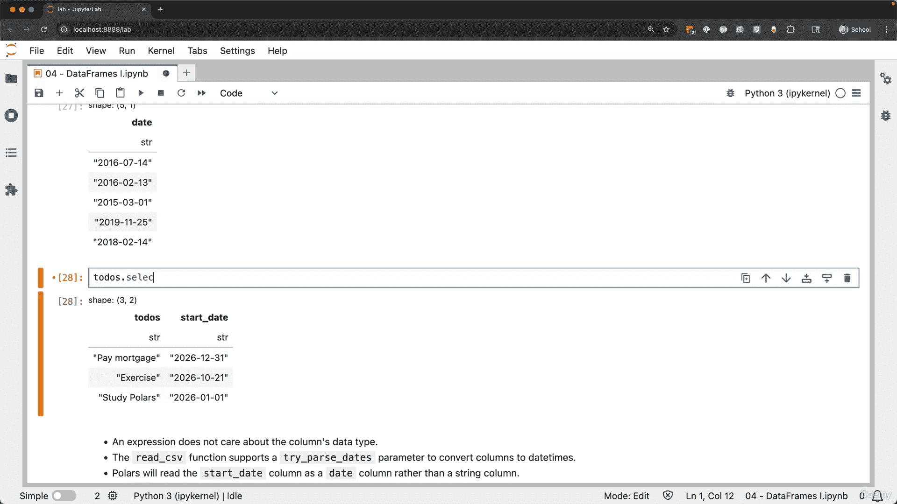

```python
employees.select(start_date).head()
```

可以看到，代码确实从员工数据框中提取了开始日期列，并把该列重命名为 `date`，说明表达式按预期工作。当然，也可以把完全相同的表达式对象用到待办数据框上。下面是复用到待办数据框的代码示例。

```python
todos.select(start_date)
```

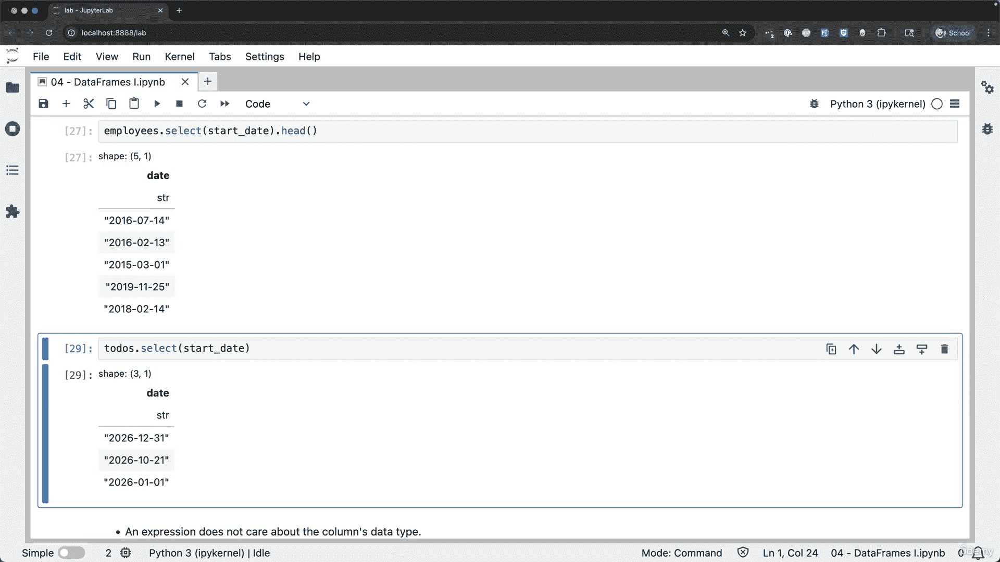

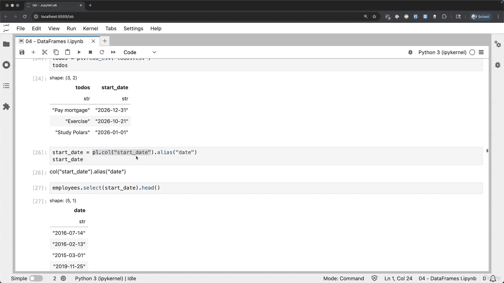

这样就从待办数据框中拉出了一列，并把它重命名为 `date`。同一个完全相同的表达式作用到了两个完全不同的数据框上。接下来我们进一步看看，为什么表达式也不关心目标列的数据类型。

## Polars与Python数据分析：50.4：日期时间与 try_parse_dates 📅

上一节我们展示了同一个表达式可以用于不同数据框，本节中我们来看看日期时间类型以及 `try_parse_dates` 参数。到目前为止，我们还没有详细讨论日期时间。日期时间是一种特殊对象，表示一天中的某个时间或某个时刻。可以看到待办数据中有一个开始日期列，但 Polars 默认把它导入成了字符串列。

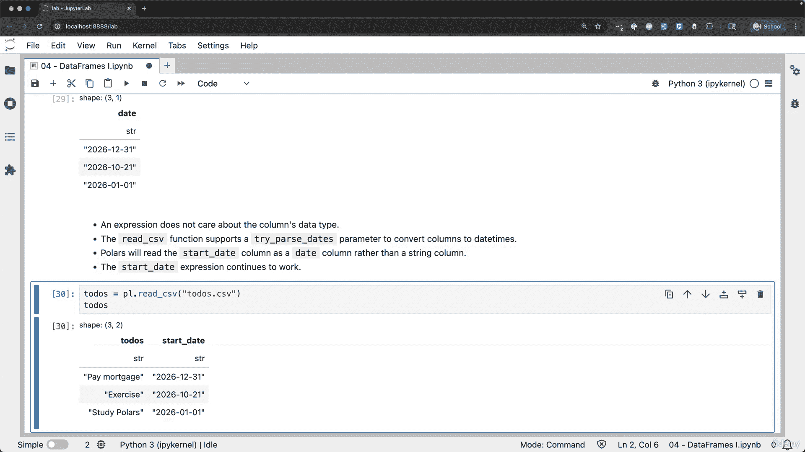

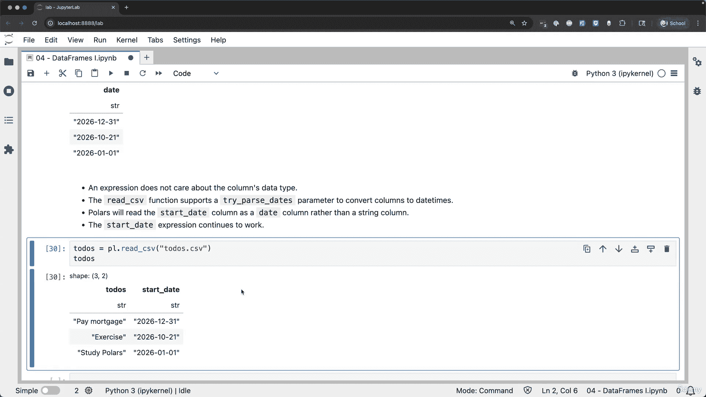

`read_csv` 函数有一个很有用的参数，叫 `try_parse_dates`。对于任何存储日期时间信息的列，Polars 会尝试把字符串列转换为等价的日期时间列，也就是存储日期对象的列。这样做的原因是，有些操作只能对日期做，不能对普通字符串做。以下是日期类型带来的常见操作优势。

- 可以给一个日期加上时间。
- 可以计算一个给定日期和另一个日期之间的距离。
- 字符串只是文本字符的集合，Python 会把它看成一串由连字符分隔的数字；转换成日期后，把日期类型存储在 Series 中就能获得大量日期相关功能。

因此我们给这个参数传入布尔值 `True`。它叫 `try_parse_dates`，是因为 Polars 有可能无法把某一行值转换成日期时间，例如列中值的存储方式不匹配，或者 Polars 无法理解日期时间的存储方式。本例中的数据集比较简单，四位年份、月份和日期用连字符分隔，这是非常常见的格式，所以 Polars 能够识别。

以下是在导入待办数据时开启日期解析的代码示例。

```python
todos = pl.read_csv("todos.csv", try_parse_dates=True)
```

现在再看这个数据框，开始日期列的数据类型已经完全不同了，它现在是一个日期列，也就是存储日期值的列。接下来我们看看旧表达式在这种类型变化后是否还能继续工作。

## Polars与Python数据分析：50.5：旧表达式继续工作 🔧

上一节我们介绍了日期时间类型和 `try_parse_dates`，本节中我们来看看列类型改变后，原来的表达式是否仍然有效。无论开始日期列现在是字符串还是日期，旧代码都会以完全相同的方式继续工作。我们可以取待办数据框，调用 `select` 方法强制执行一个或多个惰性表达式，并传入上面的 `start_date` 表达式。

以下是列类型变化后继续使用旧表达式的代码示例。

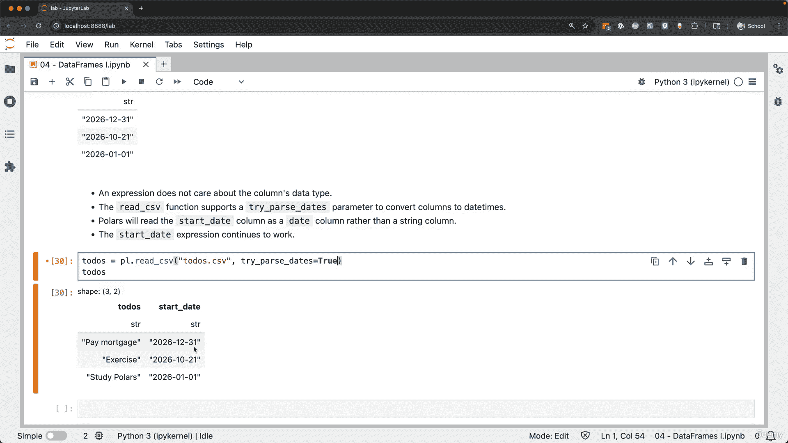

```python
todos.select(start_date)
```

这段代码会目标开始日期列，把它拉出来，然后重命名为 `date`。这证明表达式不仅不关心、也不知道它将被应用到什么数据框，它也不知道自己将目标什么列类型。它只是一系列未执行的指令，我们随着时间构建它，然后把它应用到上下文或类似 `select` 的操作中。以下是表达式作为构建模块的关键特征。

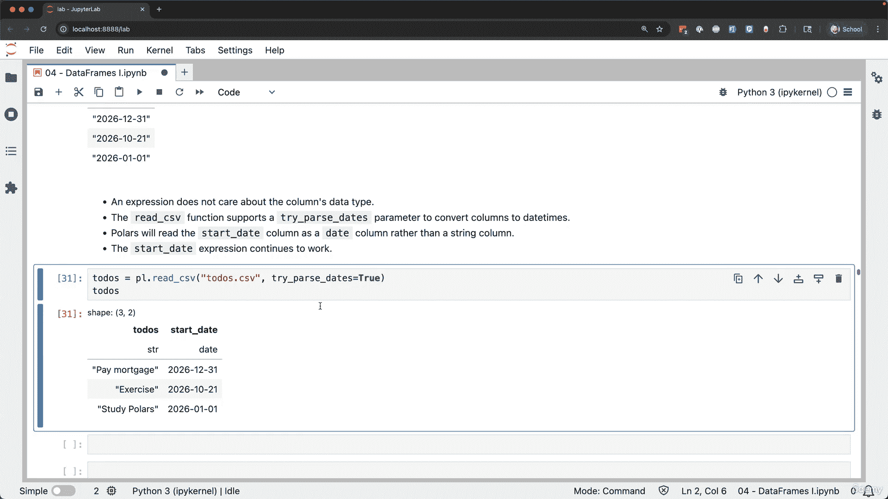

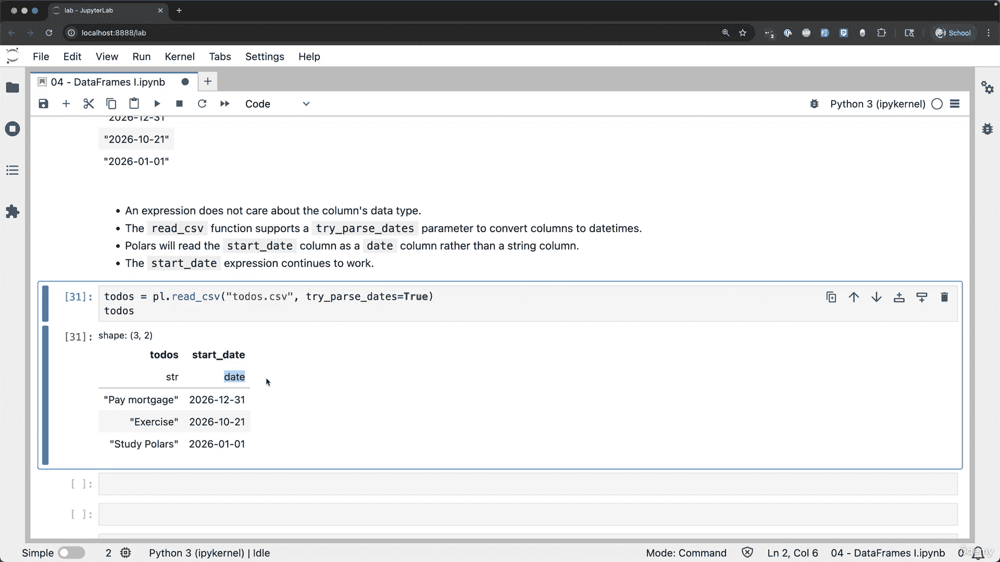

- 惰性：不应用就不执行。
- 独立：不绑定具体数据框和具体列类型。
- 可复用：同一个表达式可以用于多个数据框。
- 上下文执行：通过 `select` 等操作触发执行。

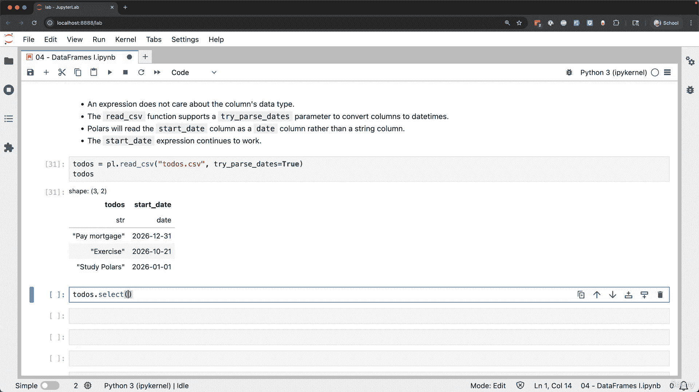

## Polars与Python数据分析：50.6：本节总结 🎓

本节课中我们一起学习了 Polars 表达式作为构建模块的核心思想。我们重新导入了员工数据和待办数据，发现它们共享开始日期列；定义了一个通用的 `start_date` 表达式，并用 `alias` 扩展为同时重命名列；然后把同一个表达式应用到两个不同数据框，验证了表达式不依赖具体数据框；接着介绍了日期时间对象、`try_parse_dates` 参数以及日期类型带来的操作能力；最后确认了即使列类型改变，旧表达式仍然可以继续工作。

以下是本节课的要点总结。

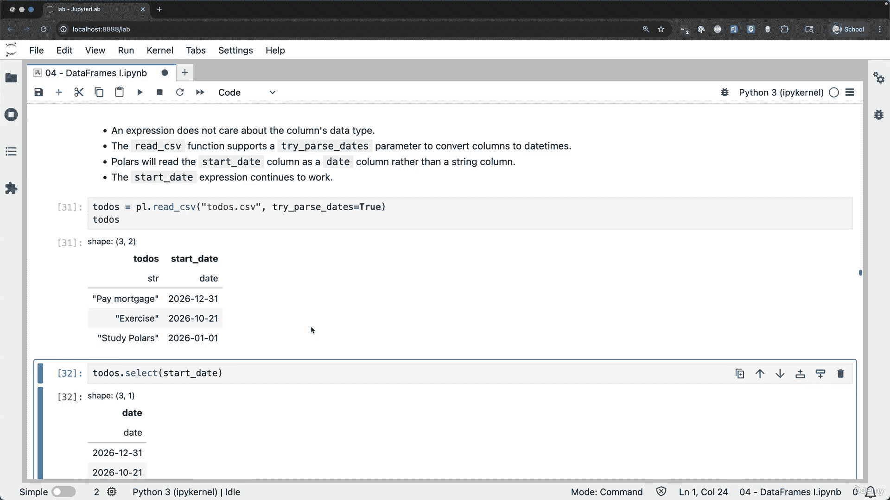

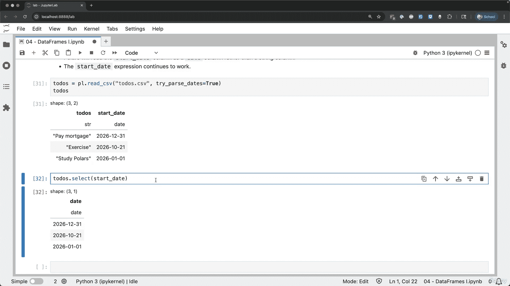

- 表达式是惰性步骤，只有被应用到具体操作或上下文时才执行。
- 表达式不知道目标数据框，也不知道目标列的数据类型。
- 同一个表达式可以复用到多个数据框。
- `try_parse_dates=True` 可以让 Polars 尝试把字符串列解析为日期时间列。
- 表达式本质上是一系列未执行指令，是后续组合和复用的构建模块。

