# 📊 Polars 与 Python 数据分析：51：统计值的表达式

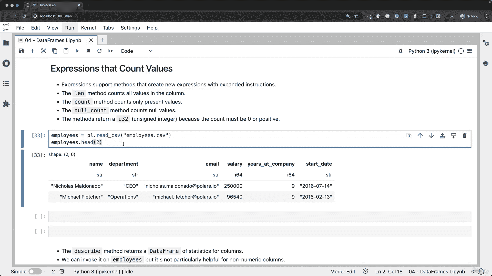

在本节课中，我们将复习并介绍一组与“统计某个列里有多少个值”有关的表达式。这些表达式可以帮助我们快速知道一列的总长度、有效值数量、缺失值数量，以及如何把统计范围缩小到需要的列。课程会从导入 employees 数据集开始，然后一步步演示不同写法，并说明怎样复用表达式对象和按数据类型选择列。

---

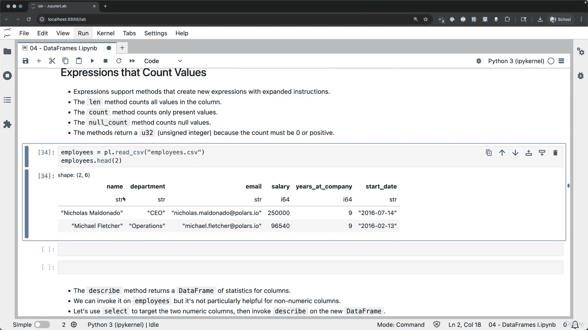

## 📥 导入数据与第一个计数表达式

上一节我们介绍了表达式的基本用法，本节中我们来看看如何用表达式统计列中的值。首先，我们执行代码来导入 employees 数据集。导入数据之后，在下方取 employees 数据框，并调用 `select` 方法。

```python
employees = pl.read_csv("employees.csv")

employees.select(
    pl.col("department").len().alias("dept_length")
)
```

接下来，我们会在 `select` 中传入几个表达式，每个表达式都在行内创建。和通常做法一样，先从 polars 顶层的 `column` 函数开始，也就是 `pl.col`，目标是 `department` 列。

第一个要调用的方法是 `length` 方法，也就是 `len`。它会统计这一列中所有值的总数。执行这段代码后，可以看到 `department` 列一共有 1000 个值。

```python
len(department) = 1000
```

然后我们会再加入一个表达式。这里需要注意，如果第二个表达式再次目标 `department` 列，默认列名仍然是 `department`，于是结果里会出现两个重复列。因此，后续要养成一个习惯：创建表达式后立刻调用 `alias` 方法，给结果列一个明确且不重复的名字，例如 `dept_length`。

以下是本节会用到的基本计数方法，先有一个整体印象。

- `len()`：统计列中的值总数。

- `count()`：统计存在值数量，也就是非 null 的实际值数量，例如本例中的具体字符串。

- `null_count()`：统计缺失值数量，也就是 polars 用 null 表示的缺席值。

创建完第一个表达式后，可以复制这一行，因为大部分逻辑都很相似：先目标某一列，再调用不同方法生成不同表达式，最后持续调用 `alias` 方法重命名结果列。接下来演示 `count` 方法，它统计存在值数量。存在值就是不为 null 的值，在本例中就是实际存在的字符串。这个结果可以命名为 `dept_count`。

存在值的补集是缺失值，也就是缺席值。polars 会用 null 表示缺失值。在这个表达式上，可以调用另一个方法 `null_count`，并把结果命名为 `dept_null_count`。执行后可以看到，`department` 列总共有 1000 个值，其中 845 个是有效部门字符串，155 个是 null，也就是缺失或不存在。这里有一个核心关系：

```python
len(column) = count(column) + null_count(column)

总长度 = 非空值数量 + 缺失值数量
```

以上是单列计数表达式的基本写法，下一节我们来看看如何通过复用表达式对象减少重复代码。

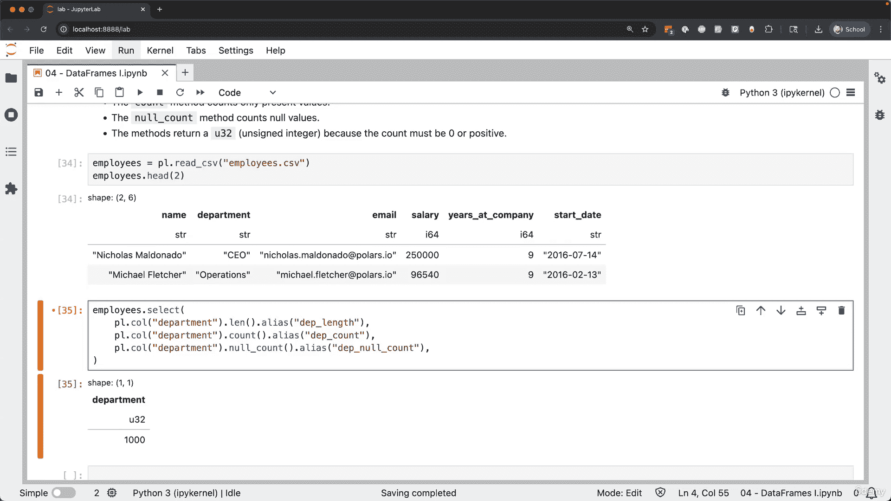

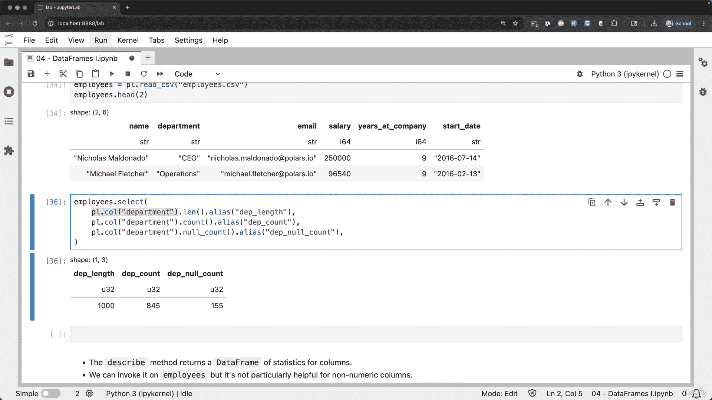

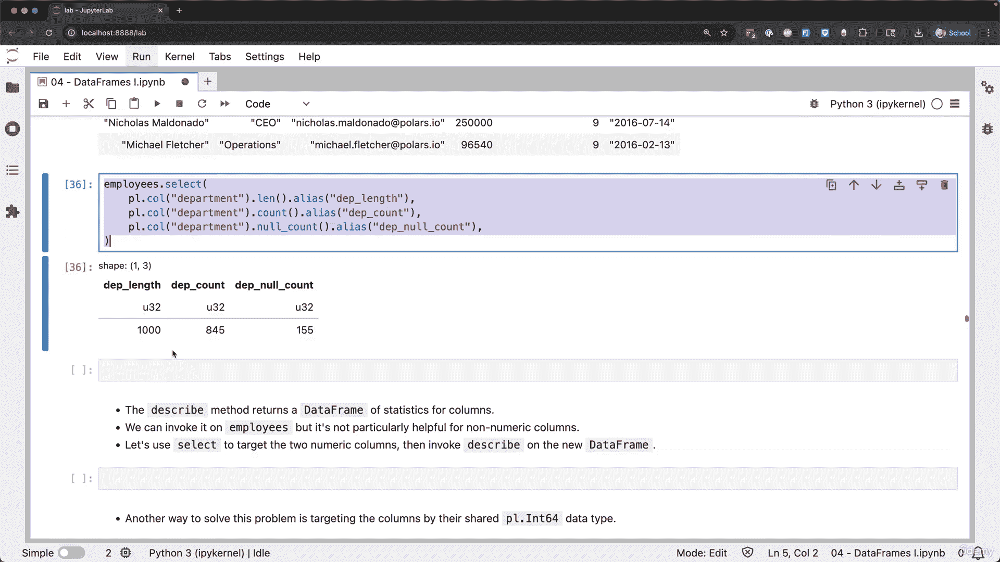

---

## ♻️ 复用表达式对象

上一节我们逐个创建了针对 `department` 列的表达式，本节中我们来看看怎样让代码更简洁。你可能会注意到，每个表达式都以同一个 `department` 列作为目标。这时可以引入基本 Python 思路，得到更高效或更简洁的写法。例如，把下面这段逻辑复制下来后，可以识别出每个表达式开头都目标同一个 `department` 列。

以下是复用表达式对象的基本步骤，先有一个整体印象。

- 先把 `pl.col("department")` 赋值给变量，例如 `department`。

- 这个变量是一个有效表达式对象，可以反复使用。

- 在下方对同一个表达式对象调用 `len` 方法，就能创建新表达式。

- 所有操作都是非变异的，也就是不会修改原对象，而是返回新对象。

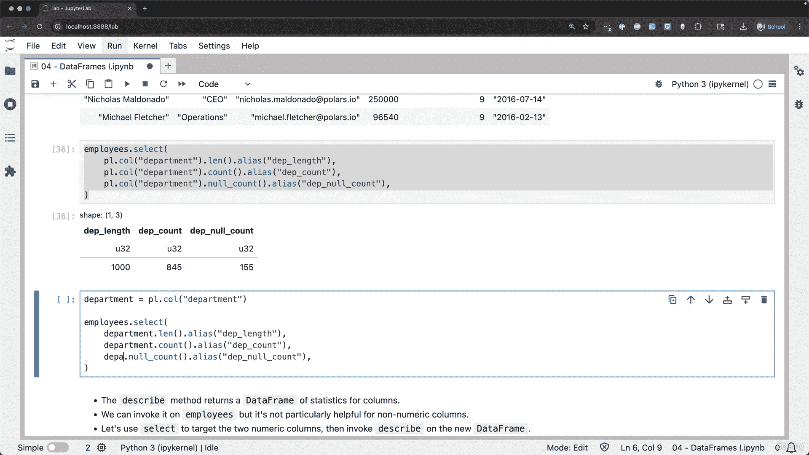

```python
department = pl.col("department")

employees.select(
    department.len().alias("dept_length"),
    department.count().alias("dept_count"),
    department.null_count().alias("dept_null_count")
)
```

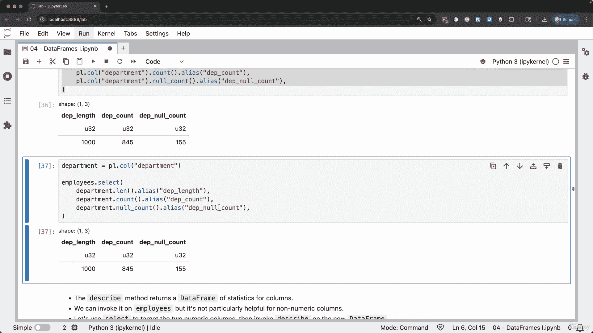

需要记住，所有操作都是非变异的。对数据框调用方法时，总是产生新对象；对表达式调用方法时，也同样总是产生新对象。因此可以保留原始表达式，把它当作一个基础或起点，用它作为基础创建下方许多相似表达式。

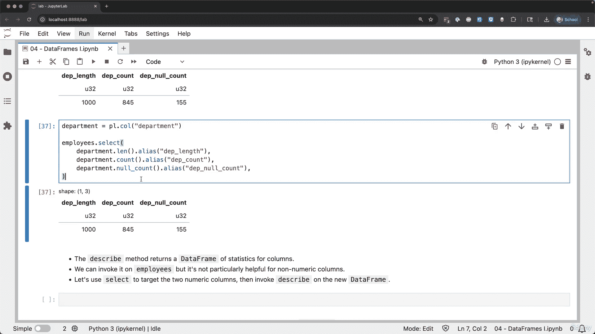

这样就不必反复调用 `column` 函数并目标 `department`，只需把上方变量传入即可。这个变量已经代表一个创建好的表达式对象，然后会从它创建新对象。更准确地说，是一个新的表达式对象。这里也可以按同样方式处理。现在可以看到，代码比上一个单元格少了一些，同时返回完全相同的数据框。

以上是表达式对象复用的思路，下一节我们来看看怎样用 `describe` 方法一次性查看多列统计信息。

---

## 📋 使用 describe 汇总统计

上一节我们介绍了如何复用表达式对象，本节中我们来看看另一种统计存在值和缺失值的方法。可以在数据框上使用 `describe` 方法。在下方取完整的 employee 数据框，并调用 `describe` 方法。默认情况下，它会对数据框中的每一列执行统计。

```python
employees.describe()
```

执行后会得到一个新的数据框，其中有一个统计列，原文称为 `sta` 列，可以理解为统计项列。对于每一个原始列，会看到存在值数量、缺失值或缺席值数量。可以看到，`department` 列的这些值与前面观察到的结果一致。随后还会出现大量数学统计量，这些统计量对字符串列没有意义，但对数值列有意义。

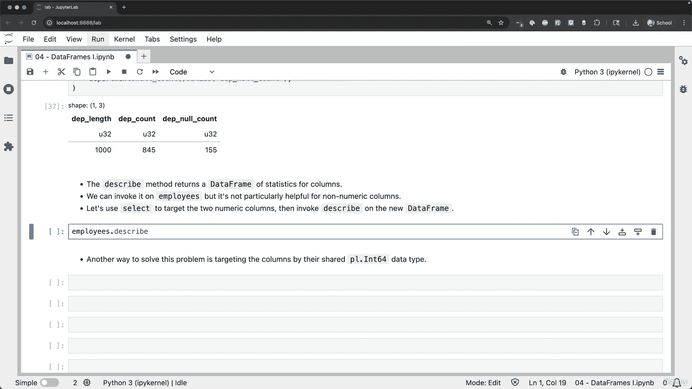

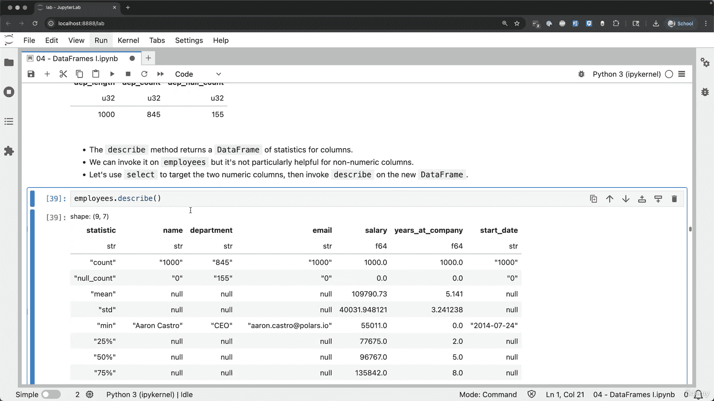

例如，平均值在 `salary` 和 `years at company` 这类列上有意义，但在 `emails` 列上没有意义。因此，可以在调用 `describe` 之前先缩小目标列。先调用 `select` 方法目标一些列，从 `salary` 列开始，再目标 `years at company` 列。这样会把这两列抽取到一个新数据框中，然后在这个数据框上使用 `describe` 方法执行统计计算。

```python
employees.select(
    pl.col("salary"),
    pl.col("years_at_company")
).describe()
```

现在会得到一个只包含两个数值列的数据框。目标数值列有很多方式。如果想简单目标多个列，不需要创建两个独立表达式，可以把连续的列名放入同一个参数，也就是一次 `column` 函数调用中。下面是完整的 `pl.col` 调用，把两个列名作为参数传入，创建一个目标这两列的表达式的写法。

```python
employees.select(
    pl.col("salary", "years_at_company")
).describe()
```

把这个表达式传入 `select`，在新数据框中目标这两列，然后对数据框调用 `describe`。会得到完全相同的结果。以上是先用 `select` 缩小列范围再统计的方法，下一节我们来看看如何按数据类型选择列。

---

## 🔢 按数据类型选择列

上一节我们介绍了先选列再统计的方法，本节中我们来看看如何按数据类型选择列。在 employees 数据框中，`salary` 和 `years_at_company` 这两列都是 64 位整数类型，也就是 `Int64`。因此可以基于数据类型目标列。

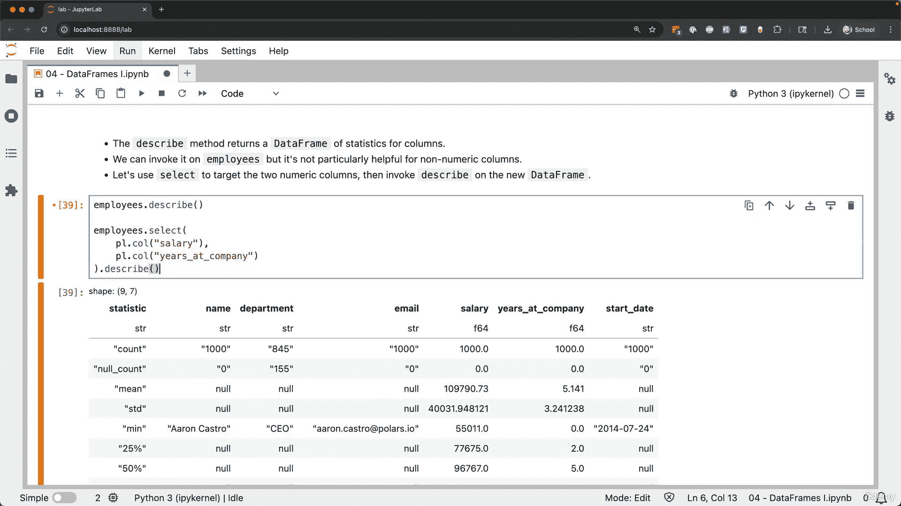

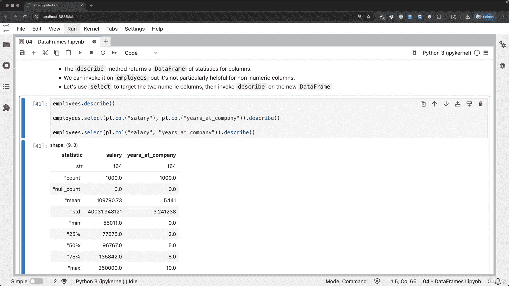

以下是按数据类型选择列并统计的写法。

- 使用 `pl.col` 调用 `column` 函数。

- 这里不传字符串列名，而是传入 polars 数据类型。

- 传入 `Int64` 数据类型，它会匹配这两个列的数据类型。

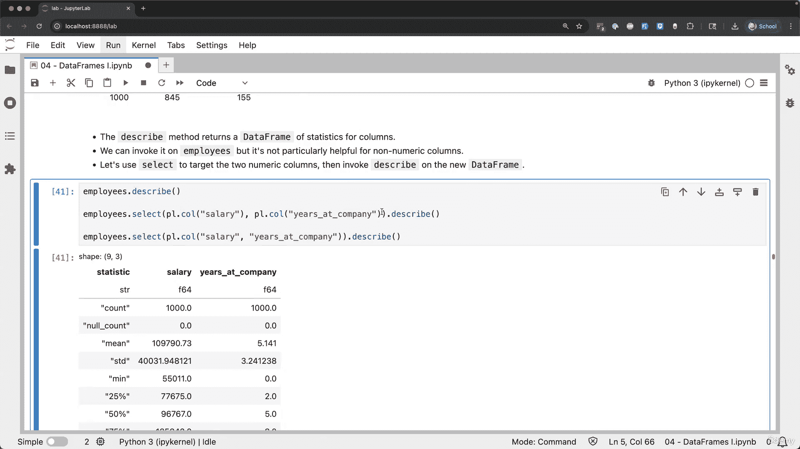

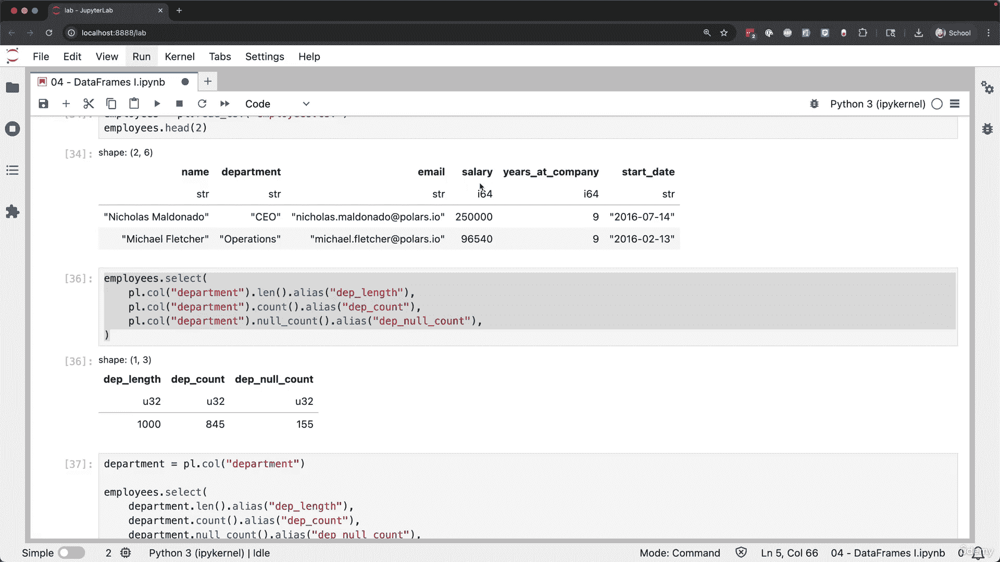

- 得到一个只包含这两列的数据框，再调用 `describe`。

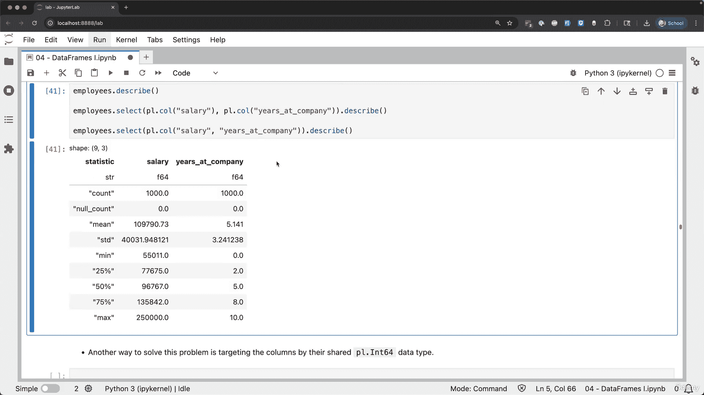

```python
employees.select(
    pl.col(pl.Int64)
).describe()
```

现在可以看到数学计算，包括 `salary` 和 `years_at_company` 列的缺失值数量和存在值数量。`describe` 方法很适合想查看数据框中所有列的两个聚合统计量的场景。但如果处理的是非数值列，这些计算会没有太大用处。具体使用哪种写法，取决于想写的代码。

以上是按数据类型选择列的方法，下一节我们对本节课内容做总结。

---

## ✅ 总结

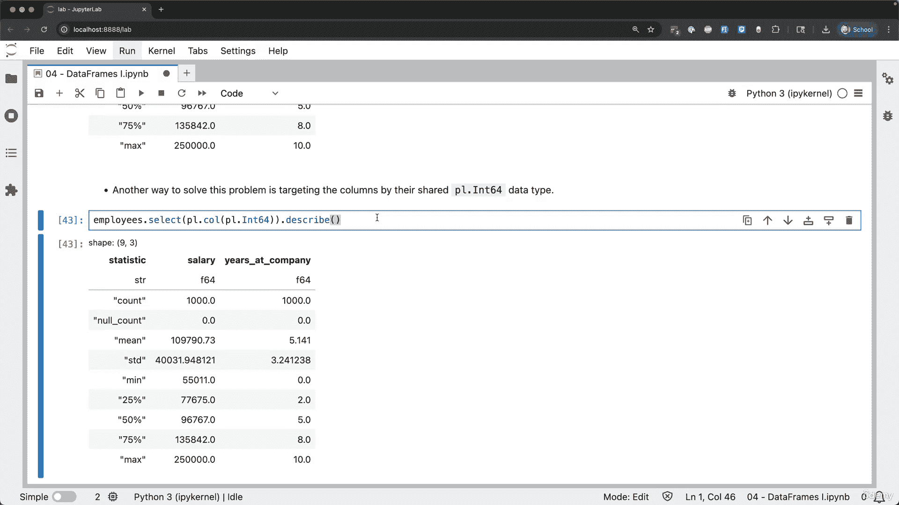

本节课中我们一起学习了 Polars 中多种统计列内值数量的方法。我们从导入 employees 数据集开始，使用 `len`、`count` 和 `null_count` 分别统计总长度、存在值和缺失值，并用公式 `len = count + null_count` 理解它们的关系。随后介绍了用变量复用表达式对象，减少重复代码，并说明这些操作都是非变异的。接着使用 `describe` 对数据框进行汇总统计，并通过 `select` 缩小统计范围，或按 `Int64` 数据类型选择数值列。最后总结了不同写法适用于不同场景，需要根据列类型和统计目标选择合适的方法。

