# 📊 Data Analysis with Polars and Python：第52节：提取一行或多行

在本节课中，我们将学习如何根据**行位置**或**行号**，从 DataFrame 中提取一行或多行数据。这个操作看起来简单，但背后其实藏着 Polars 设计上的一个重要权衡。我们不仅会学会两个实用方法，还会理解为什么 Polars 在处理行操作时和 pandas 有些不一样。

## 1️⃣ 回顾：pandas 中的索引概念

如果你之前用过 pandas，那你大概率见过 DataFrame 左边那一串**连续递增的数字**。这些数字从 0 开始，一行一个，顺序排列，就是所谓的**索引（index）**。pandas 会给每一行分配一个数字顺序，这个顺序就是索引。

但严格来说，**Polars 并不维护这种索引**。为什么？这要回到 Polars 的设计原则上。

Polars 团队决定把数据存储成**列式格式（columnar format）**。这个词听起来有点专业，说白了就是“按列存储”。在你的计算机内存里，Polars 会把每一列（或者每一个 series）的内容**连续地**存放在一起。

举个例子，假设有这么两列数据，一列是姓名，一列是其他信息。在内存里，Nicholas Maldonado 和 Michael Fletcher 这两个名字会被放在相邻的位置，而不是和它们各自所在行的其他信息放在一起。这就是列式存储。

另一种存储方式自然是**行式存储**：把同一行的各个值挨在一起存放。这样做的道理是：值在内存中离得越近，CPU 从一个内存位置跳到下一个位置、读取出所有值的速度就越快。

所以，任何做 DataFrame 库的团队，都必须做一个取舍：要么优先支持按行位置或按行值查找，要么优先支持按列查找值。Polars 团队分析后认为，数据分析中绝大多数操作都是**面向列**的。为了让这些操作跑得更快，他们选择了按列存储数据。

## 2️⃣ 列式存储带来的影响

正因为按列存储，当你想要根据**行位置**提取某一行时，Polars 就需要从这一列的数据块里取出一个值，再到那一列的数据块里取出对应的值，再到下一列取……最后把这些值拼到一起。

因此，所有**基于行的操作**，实际上可能并不是“最快”的。当然，我们执行这些代码时，依然是一瞬间就出结果，肉眼根本感觉不到慢。但你需要知道，这就是 Polars 团队做的一个**权衡**：让列操作大大提速，而行操作就会相对慢一点点。

## 3️⃣ 准备工作：加载数据

我们先来运行代码，导入 employees 数据帧。这节课的所有操作，都会基于这个数据帧来演示。请你打开编辑器，把数据加载好，然后跟着我们一起写方法调用。

## 4️⃣ 提取单行：使用 `row` 方法

第一个要介绍的方法是 **`row`**。它的作用是根据行的索引位置，把那一行的所有值提取出来。

这里要再强调一下：所谓的“索引位置”或“行顺序”，其实只是人为设定的一种概念。在 Polars 内部，这一行本身并没有真正的索引，也没有被分配一个固定的索引编号。但是 Polars 能够理解你的意图，它会根据行在数据帧里的顺序，把那一行的值给你取出来。

它的工作原理，和 Python 以及 pandas 中的索引位置是一样的：第一行的顺序编号为 `0`，第二行是 `1`，第三行是 `2`，以此类推。也就是说，索引从 `0` 开始计数，一直数到最后一行。

那么，怎么调用呢？很好办：

```python
# 提取第一行（索引为 0）
employees.row(0)
```

当我们调用 `row(0)` 时，我们其实是在对 Polars 说：“请你横着走一遍所有列，把索引为 `0` 的那一行的所有值都聚合起来。” 这个方法的返回值，是一个 **Python 元组（tuple）**，里面按顺序装着那一行的所有值。

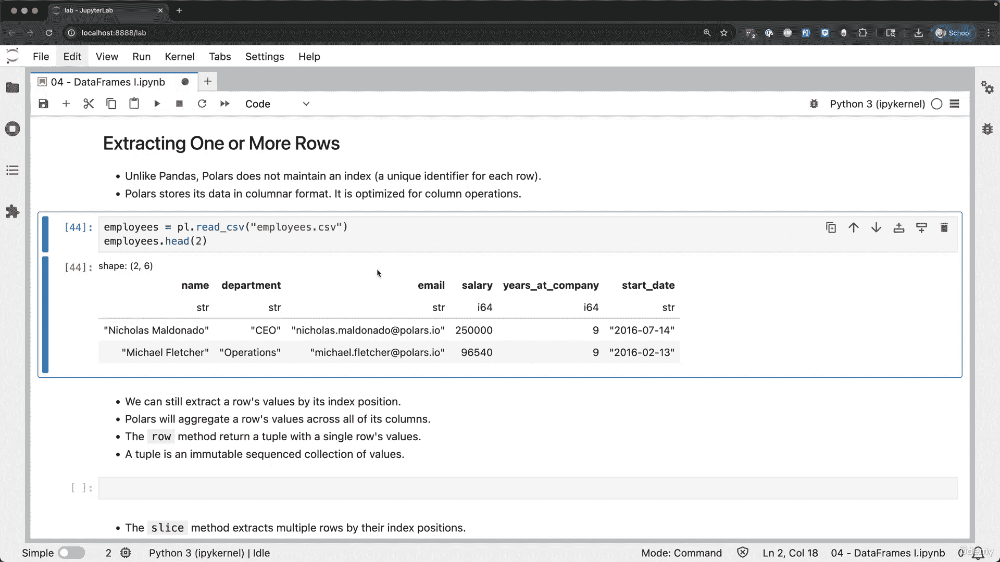

再举个例子：如果你想取第二行，那索引位置就是 `1`：

```python
employees.row(1)
```

如果你想取第 101 行，那索引位置就是 `100`：

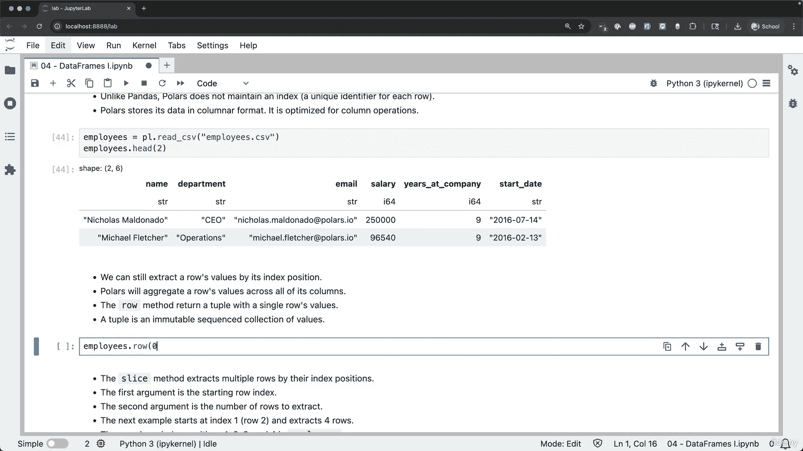

```python
employees.row(100)
```

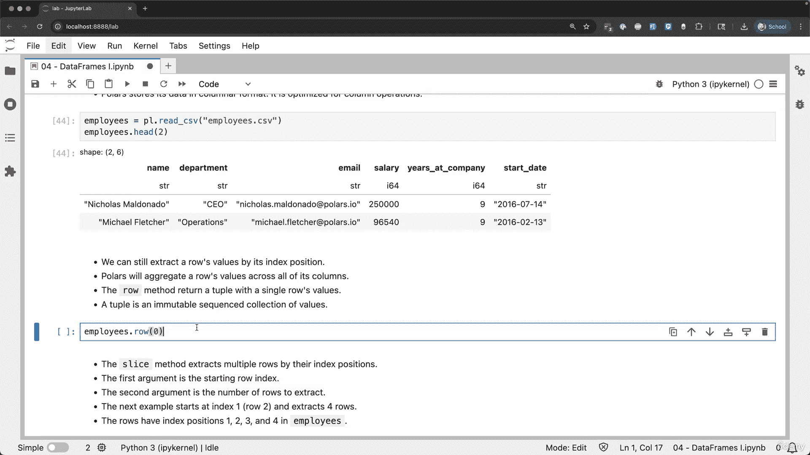

无论索引是多少，`row` 方法都会根据位置，把那一行从数据帧里“拉”出来。

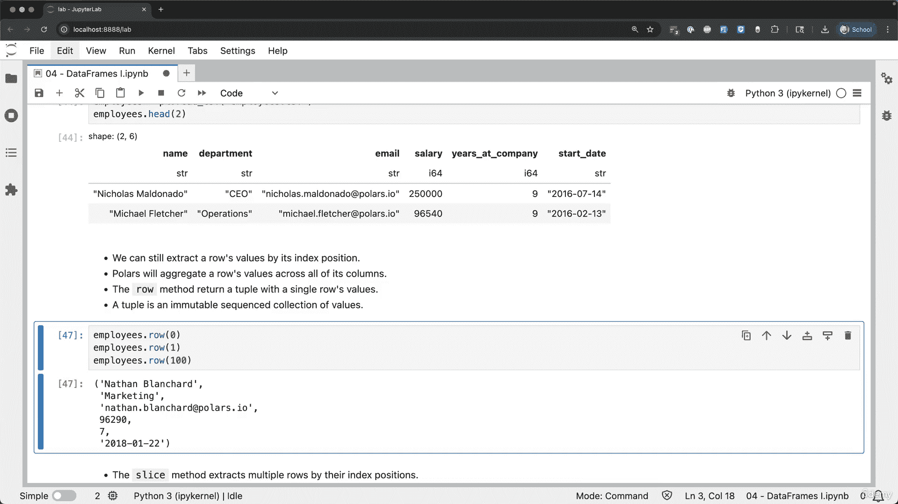

## 5️⃣ 提取多行：使用 `slice` 方法

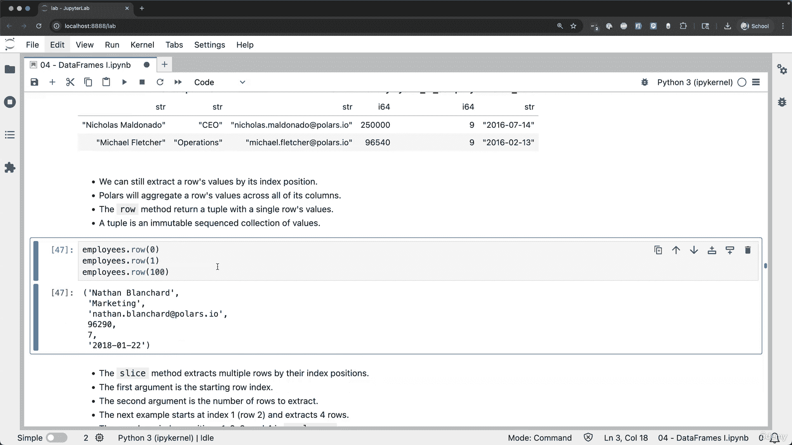

如果你想一次性提取**多行**，那就不能用 `row` 了，要用另一个方法—— **`slice`**。这个方法名字听起来就很像“切片”，它做的事情也正是从数据帧中切出一块来。

调用方式如下：

```python
employees.slice(1, 4)
```

这里有两个参数，第一个参数是**起始行索引**。比如你传入 `1`，意思就是“从索引为 `1` 的那一行开始”，也就是数据帧里的第二行。第二个参数是**要提取的行数**。比如你传入 `4`，意思就是“从起始位置开始，一共提取 4 行”。

因为一次要返回 4 行数据，所以需要一个能够容纳多行的结构。`slice` 方法会返回一个**新的 DataFrame**。

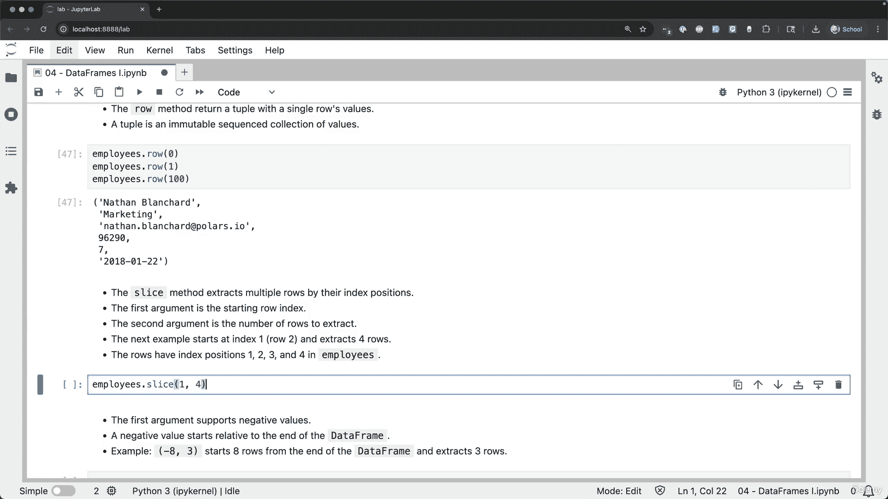

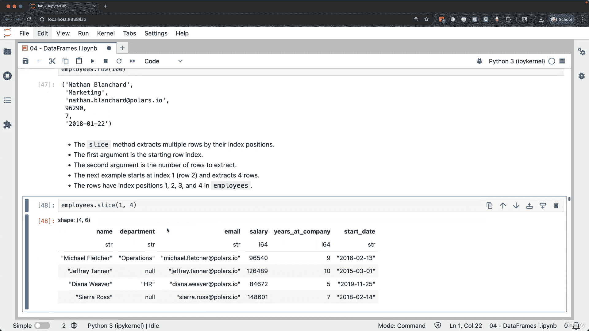

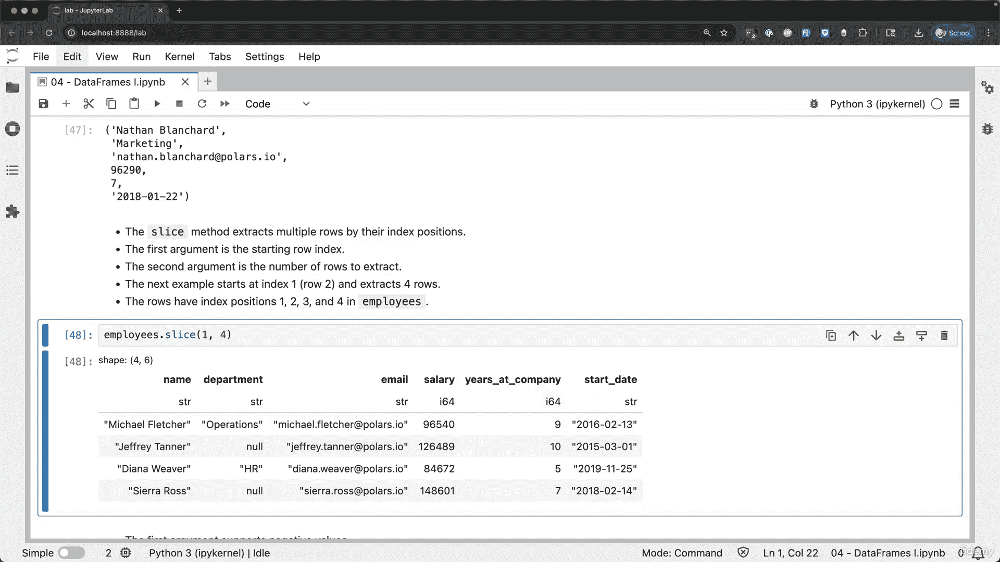

你可能会好奇，返回的结果到底是什么样？从前面那个例子来说，`employees.slice(1, 4)` 会从索引 `1` 开始，把索引 `1`、`2`、`3`、`4` 这 4 行全部取出来。所以你翻看结果时，会看到 Michael Fletcher（原本在索引 `1`）出现在新 DataFrame 的第一行，后面跟着原始数据帧里的第 2、3、4 行数据。

## 6️⃣ `slice` 的进阶用法：支持负索引

`slice` 方法还有一个很酷的功能：它支持**负数值**。当你把第一个参数传成负数时，它会相对于数据帧的**末尾**来计算起始位置。

来举个例子，这样写：

```python
employees.slice(-8, 3)
```

这里第一个参数是 `-8`，意思是“从数据帧底部往上数 8 行”，也就是从倒数第 8 行开始。第二个参数依然是 `3`，表示从那个位置开始，继续提取 **3 行**。

所以，这个调用的含义是：从距离数据帧末尾还有 8 行的位置开始，连续取 3 行。取完之后，整个数据帧应该还剩 5 行没有动，而我们取到的只是这 3 行组成的“切片”。

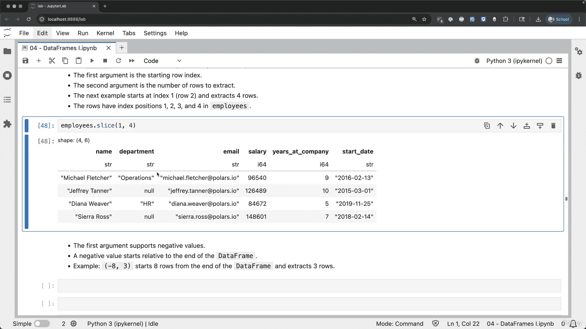

你完全可以把 `slice` 理解成“切一块蛋糕”：你告诉 Polars 从第几块开始切，要切几块，它就把那一整块给你。这种方法在处理大数据时尤其好用，比如你想查看中间某一段数据，又不想加载全部。

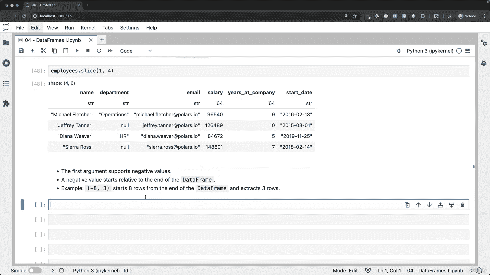

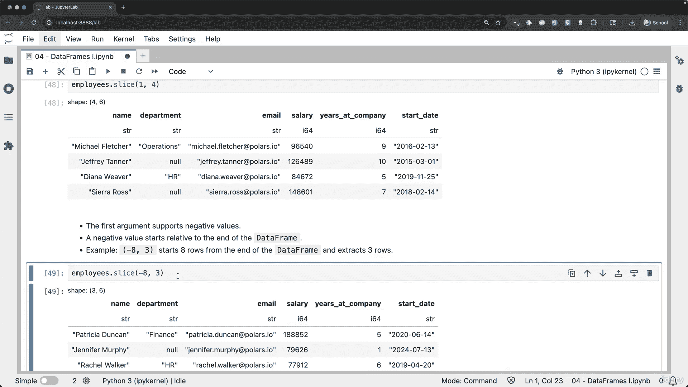

## 7️⃣ 总结

本节课中，我们一起学习了如何根据**索引位置**从 DataFrame 中提取一行或多行。我们知道了 pandas 里的索引是一个递增序列，而 Polars 出于列式存储的设计原则，并没有维护这样的索引。我们学了两种方法：使用 `row(索引)` 提取单行，它会返回一个元组；使用 `slice(起始索引, 提取行数)` 提取多行，它会返回一个新的 DataFrame。同时，我们还发现 `slice` 支持负数起始索引，可以从数据帧的底部向前定位。

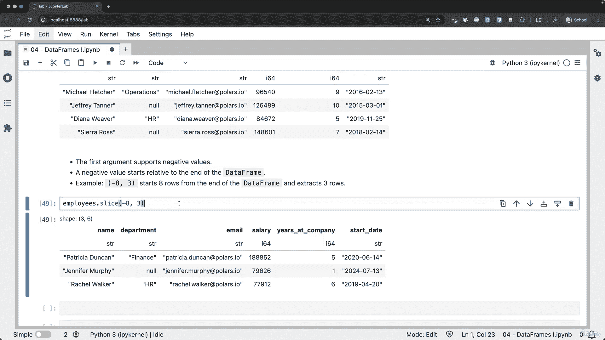

最后，再次强调一下：在 Polars 内部，这些行操作其实并没有直接依托一个真正的“索引”，而是靠 Polars 自己执行计算和逻辑，从每一列中分别取出对应的值，再组合起来。因为数据是以列式格式存储在内存里的，所以行操作会比列操作稍微慢一点——但别担心，这种慢在绝大多数场景下你根本感知不到，而列操作的速度优势，才是 Polars 真正让你爽到的地方。
