## 📊 Polars 与 Python 数据分析：53：列表切片语法

在本节课中，我们将要学习 Polars 对 Python 列表切片语法的支持。具体来说，我们要弄清楚如何根据行的索引位置，从一个 DataFrame 中提取一行或者多行数据。这个主题看起来和普通 Python 列表操作很像，但放到二维表格上以后，会有一些容易混淆的细节，因此本课会从基本语法讲到常见坑点，再说明 Polars 团队为什么不推荐这种写法。理解这些内容，可以帮助初学者看懂旧代码，也能帮助大家养成优先使用库方法的习惯。

### 🧭 Polars 与 Python 数据分析：53.1：本课概述与目标

上一段我们明确了本课的主题，本节中我们来看看具体目标。Polars 支持 Python 的列表切片语法，可以基于索引位置从 DataFrame 中取出一行或多行。这个能力主要是为了和 pandas 以及 Python 的通用习惯保持一致。也就是说，如果你以前在 Python 列表或 pandas 中见过类似写法，那么在 Polars 中也能找到对应形式。不过，这种一致性不等于推荐做法，Polars 团队更希望用户使用方法来完成取行操作。

这里需要先说明一个核心态度：列表切片语法在 Polars 中可以使用，但通常不建议使用。下面的小节会解释原因，并展示各种切片形式。理解这些形式以后，我们还要记住：它们主要用于教学目的，真正写业务代码时应当优先选择 Polars 提供的方法。

### 🚫 Polars 与 Python 数据分析：53.2：为什么不推荐列表切片语法

了解了本课目标后，本节中我们来看看 Polars 团队的态度。原文明确说，这种写法实际上被 Polars 团队不推荐，他们推荐使用库提供的方法来提取行。例如，`slice` 方法就是推荐替代列表切片语法的工具之一。这里的关键不是语法能不能运行，而是从可维护性、性能和表达清晰度考虑，方法通常更合适。

下面列出 Polars 团队不推荐列表切片语法的两个核心理由。

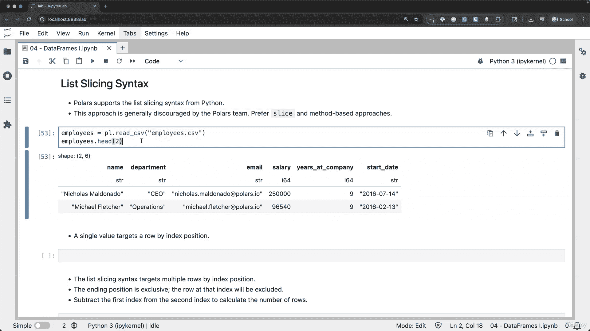

- 第一，Polars 的方法可以保证以尽可能高效的方式执行操作，库团队会针对方法做优化。

- 第二，Polars 团队从 pandas 库的一些错误或歧义中吸取了经验。在 pandas 中，很多时候完全相同的语法可能执行不同的动作，尤其当列表切片同时涉及行子集和列子集时，问题更明显；有时你按顺序传入切片，有时又要把它们包在括号或元组里，规则多、写法冗长，记起来也容易混乱。

因此，Polars 团队一般建议使用库通过方法提供的工具和功能，而不是套用列表切片语法。Polars 之所以仍然支持列表切片语法，原因很简单：为了和 pandas 保持一致，也为了和 Python 的一般习惯保持一致。这个背景说明完以后，我们就可以进入实际代码演示了。

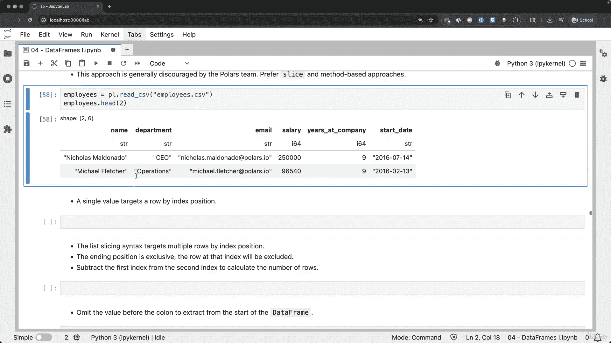

### 🧮 Polars 与 Python 数据分析：53.3：加载数据与单行提取

上一节我们解释了为什么不推荐列表切片语法，本节中我们来看看最基本的形式。先运行代码，把 `employees` 数据集加载进来。下面的示例都基于这个数据集展开，重点观察索引位置如何对应到具体行。

```python
# 先加载 employees 数据集
employees
```

基本的 Python 列表切片语法是：在一个集合后面写一对方括号，里面放一个数字索引位置，就能取出对应元素。同样的原则也适用于 DataFrame。下面这个表达式会取出索引位置为 `5` 的行，也就是 DataFrame 中的第六行，因为索引从 `0` 开始计数。

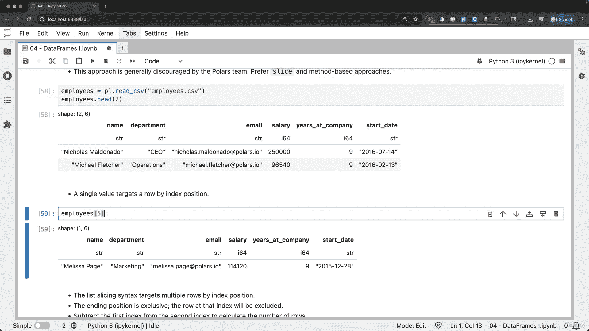

```python
employees[5]
```

即使是这样一个简单例子，也容易产生歧义。Polars 主要基于列式数据存储，所以不熟悉 Polars 的人看到这个语法时，可能会想：这到底是取索引为 `5` 的行，还是取索引为 `5` 的列？这种直觉上的不明确，正是列表切片语法容易让人困惑的一个例子。无论如何，这个写法会按索引位置取出一行，也就是 DataFrame 中的第六行。

### 📐 Polars 与 Python 数据分析：53.4：使用范围切片提取多行

上一节我们取出了单独一行，本节中我们来看看如何一次取出多行。Python 列表切片语法支持一个范围：在方括号中写上下界，并用冒号分隔。下面这个例子从索引 `5` 开始，一直取到索引 `8`，但不包含索引 `8`。

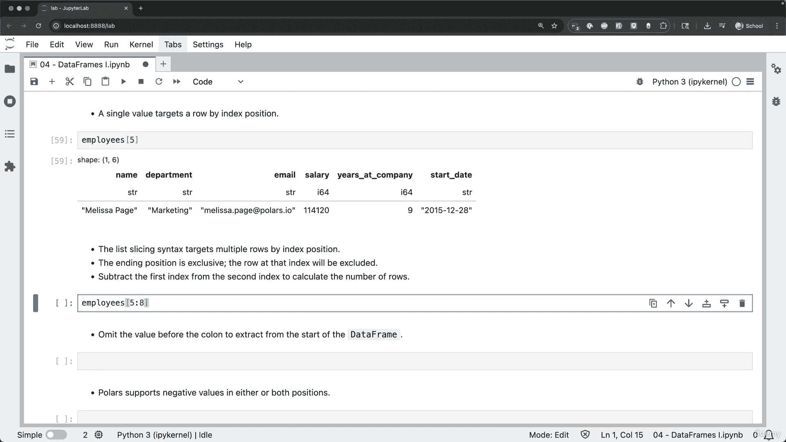

```python
employees[5:8]
```

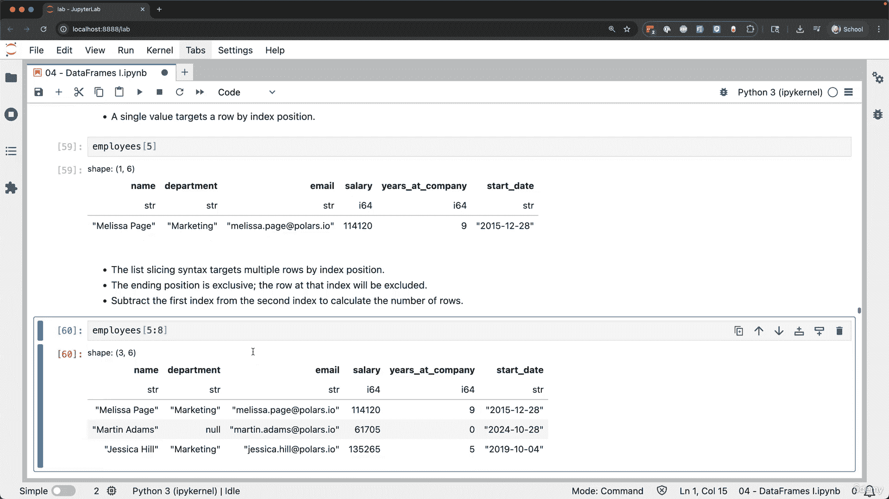

和 Python 一样，上界是排他的，意思是会走到上界附近，但不把上界位置的值包含进结果。因此，这个表达式会返回一个包含三行的 DataFrame，分别对应索引位置 `5`、`6` 和 `7`。我们会到达索引位置为 `8` 的那一行，但不会把它放进结果集。这个规则很重要，因为初学者常常误以为上界也会被包含。

如果你想快速算出切片会包含多少行，可以用一个简单公式：用冒号后面的数字减去冒号前面的数字。下面是这个公式。

\[
\text{返回行数} = \text{上界索引} - \text{下界索引}
\]

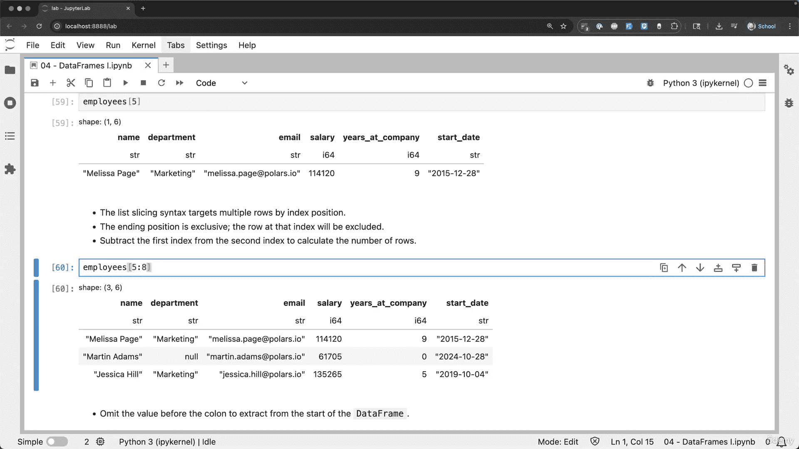

例如 `8 - 5 = 3`，所以结果集包含三行。上界之所以设计成排他的，就是为了让返回行数可以直接用这个减法算清楚。理解这一点以后，再看各种切片写法就不容易糊涂了。

### 🎯 Polars 与 Python 数据分析：53.5：省略起始索引

上一节我们使用完整范围进行切片，本节中我们来看看省略起始索引的写法。如果你熟悉 Python，可能知道在列表切片中，如果从数据集开头开始取，一直到某个索引之前，那么冒号前面的数字可以省略。换句话说，从开头取到指定索引时，起始位置总是 `0`，因此可以把它省略掉。

在 Polars 中也可以这样做。下面这个表达式会从 DataFrame 的开头开始取，一直取到但不包含索引位置 `4`。因为索引从 `0` 开始，所以结果包含索引 `0`、`1`、`2`、`3`，一共四行。

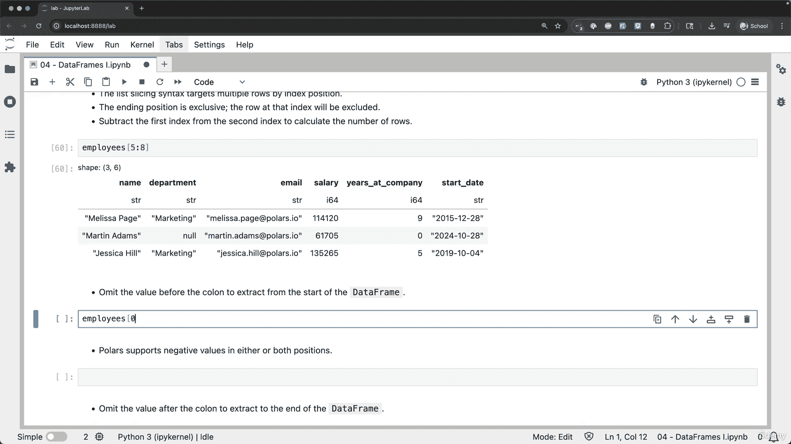

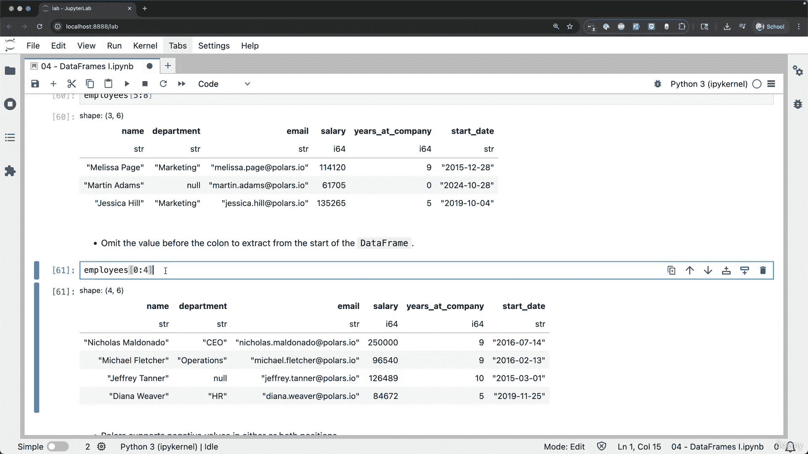

```python
employees[:4]
```

这个写法与写 `employees[0:4]` 含义相同。省略起始索引可以让代码更短，也更符合 Python 用户的习惯。不过要注意，这里依然遵循上界不包含的规则，所以理解索引边界仍然是关键。

### 🔁 Polars 与 Python 数据分析：53.6：使用负数索引

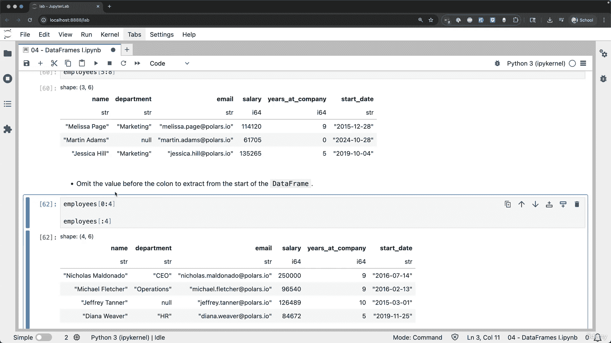

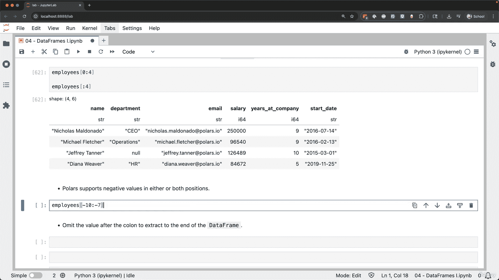

上一节我们省略了起始索引，本节中我们来看看负数索引。Python 的列表切片语法允许在起始位置、结束位置或者两者中都使用负值。下面这个例子从 `-10` 开始，表示从 DataFrame 末尾往前数 10 行，一直取到但不包含从末尾往前数 7 行的位置。

```python
employees[-10:-7]
```

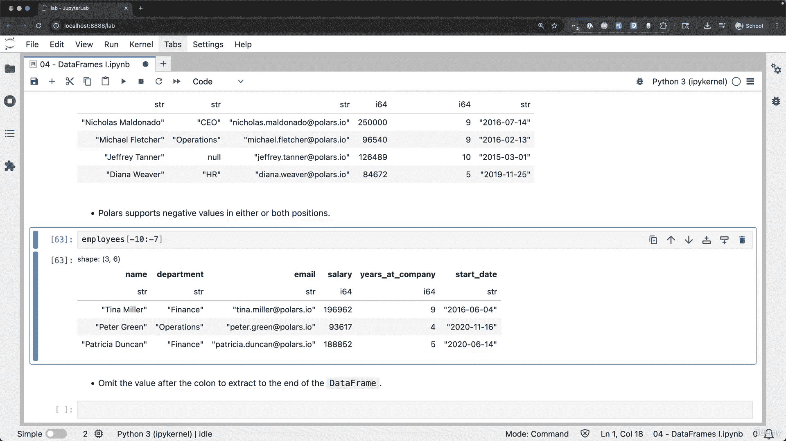

这个切片会从 DataFrame 末尾往前数 10 行开始，取出接下来的三行。从技术上说，这里对应的是 `-10`、`-9`、`-8` 这三个位置，而结束位置是 `-7`，也就是从末尾往前数 7 行，并且不包含该行。通过负数索引，我们可以方便地从数据尾部截取一段连续行。

如果你熟悉列表切片语法，可能还知道另一种情况：从某个位置开始一直取到列表末尾时，可以省略最后的索引位置。同样的规则也适用于 DataFrame。下面这个例子从 `-2` 开始，表示从 DataFrame 末尾往前数两行，然后一直取到结尾。

```python
employees[-2:]
```

这个写法基本上等同于 `tail` 方法，也就是从 DataFrame 末尾取出最后两行。到这里可以看到，Python 的列表切片选项在 Polars 中基本都可用，而且大多数情况下会按预期工作。不过要再次强调，这种语法严格来说只适合教学演示，实际项目中一般不建议使用；Polars 中总会有基于方法的写法来完成同样的提取，而那些方法才是应当优先选择的方案。

### ✅ Polars 与 Python 数据分析：53.7：本课总结

上面我们逐个看了单行提取、范围切片、省略起点、负数索引和省略终点这些形式，本节中我们来做个收尾总结。本节课中我们一起学习了 Polars 对 Python 列表切片语法的支持：可以用 `df[index]` 按索引取一行，可以用 `df[start:stop]` 按范围取多行，上界不包含，返回行数可以用上界减下界计算，也可以省略起始索引、使用负数索引或者省略结束索引。

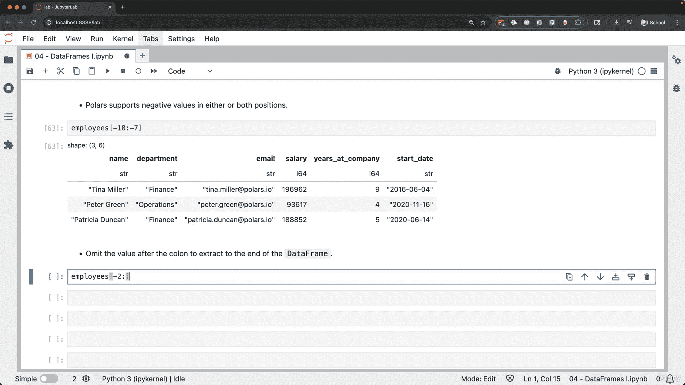

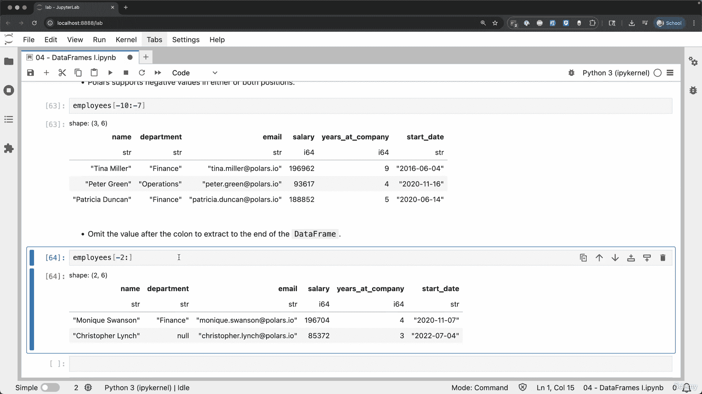

同时我们也学习了 Polars 团队为什么不推荐这种写法：库方法通常有性能保证，也能减少 pandas 中同类语法带来的歧义，尤其在行和列子集组合时更明显。Polars 支持列表切片语法主要是为了和 pandas、Python 保持一致，但真正写代码时应优先使用 `slice` 等方法。掌握这些内容以后，你既能读懂旧式切片代码，也能在 Polars 中选用更清晰、更可靠的取行方式。

