# Data Analysis with Polars and Python：第54讲：针对行值的表达式 🎯

在本节课中，我们将学习另一种基于行索引位置来定位一个或多个行值的方式。在之前的课程里，我们已经接触过许多通过方法生成新表达式的例子，而今天要介绍的这个方法同样属于这类“基于方法的表达式”的范畴。我们依然会使用 `employees` 数据帧作为演示对象，所以我会像往常一样先把代码重新执行一遍，把 `employees` 数据帧加载进来。

## 基于索引位置提取单个值 🎯

假设现在我想取出 `name` 列中索引位置为 499 的那个值。这里的索引位置 499 从技术上讲，是数据帧中的第 500 行，因为索引是从 0 开始计数的。要实现这个需求，可以从调用 `select` 方法开始，然后在 `select` 内部创建一个表达式。这个表达式的写法是：先调用 `pl.col` 函数来定位 `name` 列，然后在返回的表达式对象上调用 `get` 方法。

`get` 这个单词的字面意思就是“获取”，用在这里非常贴切，因为我们正是要基于行索引位置去获取 `name` 列中的值。我们需要传入的，正是那个代表索引位置的数字。所以这里我直接请求获取行索引 499 处的值。

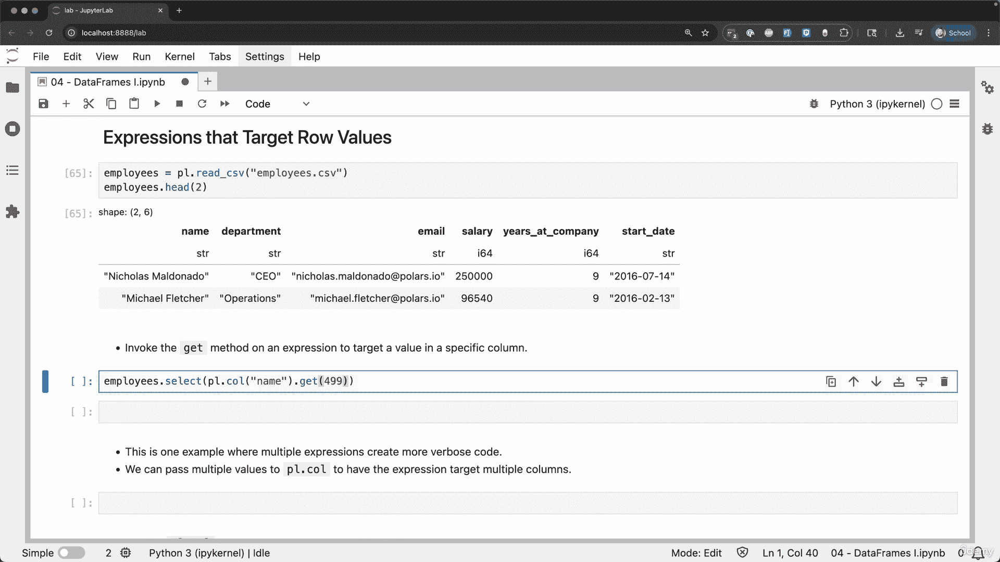

```python
employees.select(pl.col("name").get(499))
```

运行这段代码，你会看到我们确实把 `name` 列取了出来，但并没有返回整个列，而只是返回了索引位置 499 对应的那一行数据。这就是 `get` 方法的基本用法：传入一个行索引，拿到这一行在指定列上的值。对于这种单列取值场景，它比先筛选再多步操作要直接得多。

## 提取同一行的多个列值 🔗

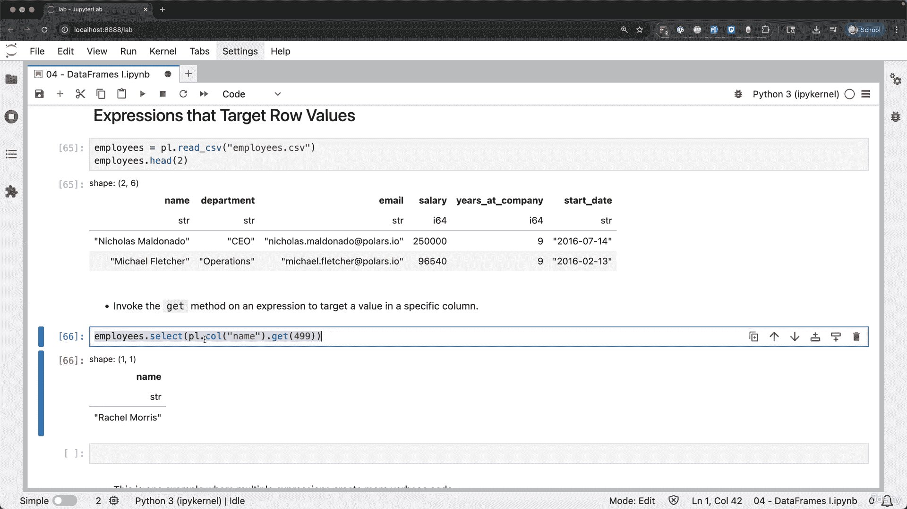

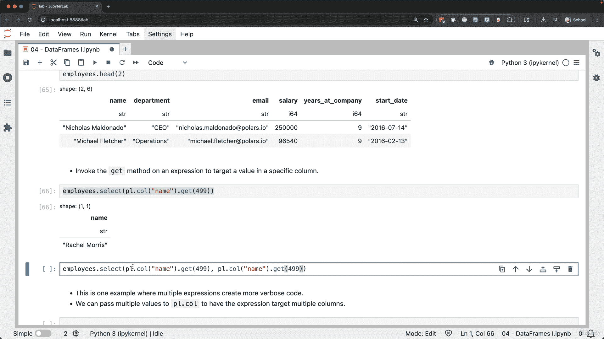

如果现在需要提取同一行上的多个列值，我们可以利用同一个索引位置，在 `select` 方法中同时传入多个表达式。第一种做法是最直接的：复制一份刚才的代码，再补充一个针对 `email` 列的表达式，两者都使用相同的索引位置 499。这样，`select` 里会有两个独立的表达式，分别负责 `name` 和 `email` 两个列。

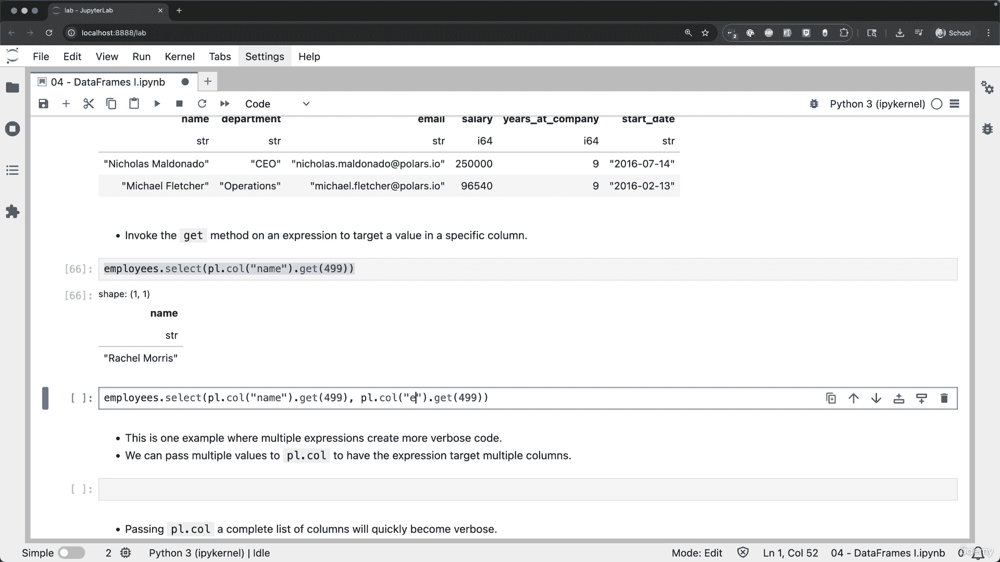

```python
employees.select(
    pl.col("name").get(499),
    pl.col("email").get(499)
)
```

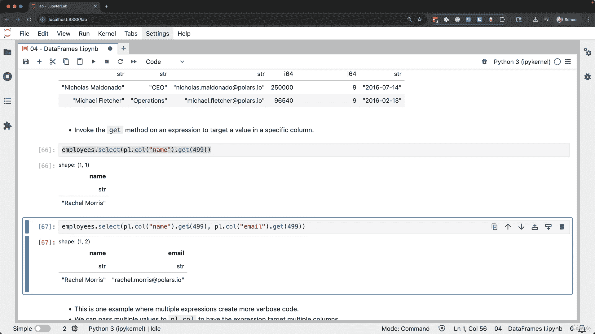

运行后，你会看到该行在 `name` 列和 `email` 列上的两个值被一起提取了出来。这种写法有什么问题呢？它让代码变得有些重复。假如我们只想提取两三个列，复制粘贴还能接受，但如果要提取的列很多，这种多个表达式并列的写法就会显得非常冗长，而且后续维护起来也比较麻烦。

幸运的是，我们可以把多个列名直接传给 `pl.col` 函数，从而创建一个同时覆盖多个列的表达式。在 `pl.col` 中传入一个按顺序排列的列名列表，就可以得到这样一个组合表达式。这样一来，一个表达式就能完成多个列的定位任务。

```python
employees.select(pl.col("name", "email").get(499))
```

这段代码创建了一个同时针对 `name` 和 `email` 两列的表达式，然后通过 `get` 方法取得第 499 行在这两列上的值。执行后，你会看到和刚才完全一样的行数据，但代码简洁了不少。从这里可以看出，当列数变多时，把一个表达式“组合”起来通常比堆砌多个表达式更好用。

## 使用 pl.all() 提取整行所有列 📋

假如你想要的不是两列，而是这一行的所有列值呢？如果继续用显式列出每个列名的方式，那会变得非常啰嗦。想象一下，如果数据帧有 100 列，难道要把 100 个列名全部写进 `pl.col` 里？这显然不现实。Polars 早就考虑到了这种场景，并提供了相应的函数和优化方法，让你不需要手动一一列举。

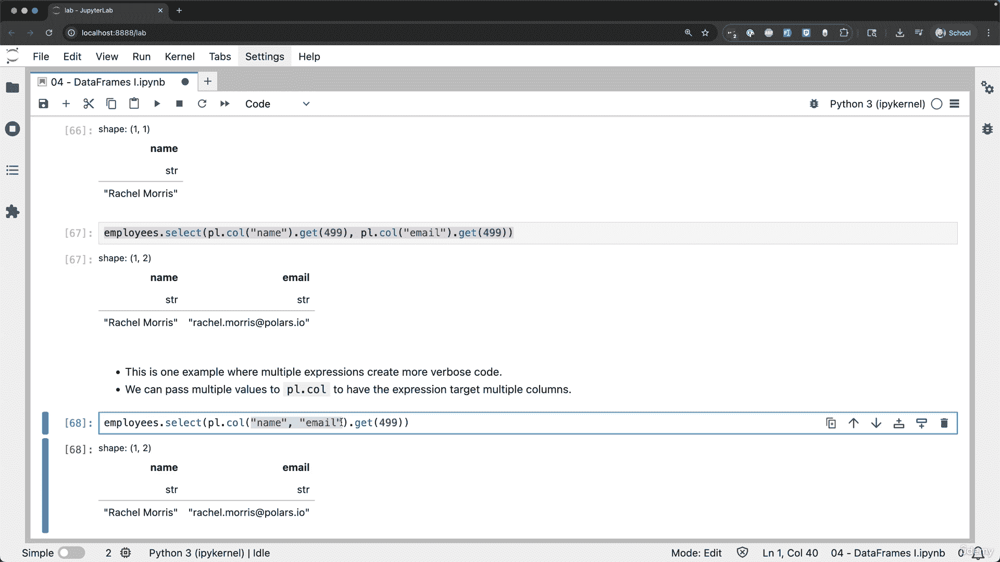

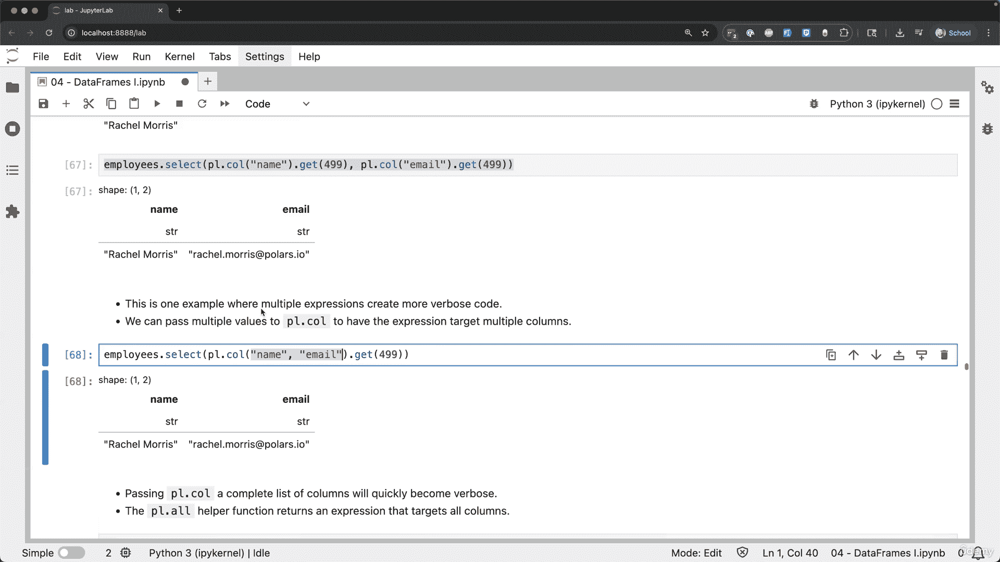

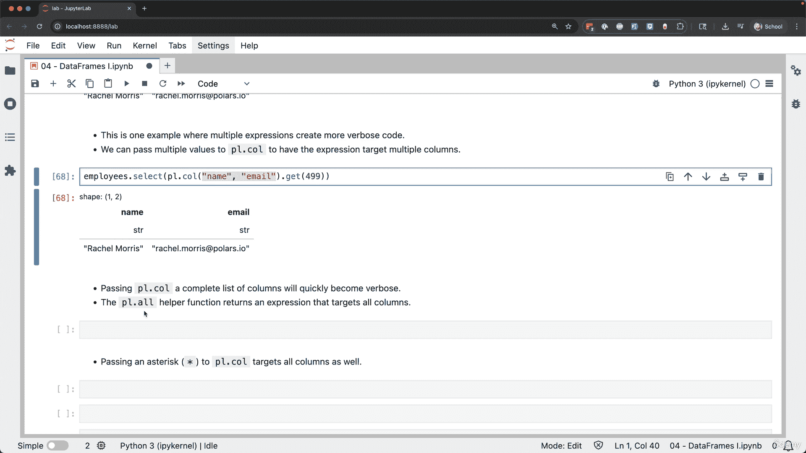

这一个新函数叫作 `all`，它位于 Polars 的顶层命名空间中。`all` 函数的作用就是创建一个针对数据帧中所有列的表达式，无论数据帧有多少列，它都能覆盖。我们直接把它传入 `select` 方法，看一下效果：

```python
employees.select(pl.all())
```

这行代码会返回 `employees` 数据帧中的所有列，得到的结果与原来的 `employees` 数据帧完全一样。也就是说，`pl.all()` 本质上就是一个覆盖所有列的便捷表达式。不过，表达式并不是一成不变的，你可以通过调用方法来修改它。既然 `pl.all()` 返回的是表达式，我们就可以在这个表达式上继续调用 `get` 方法。

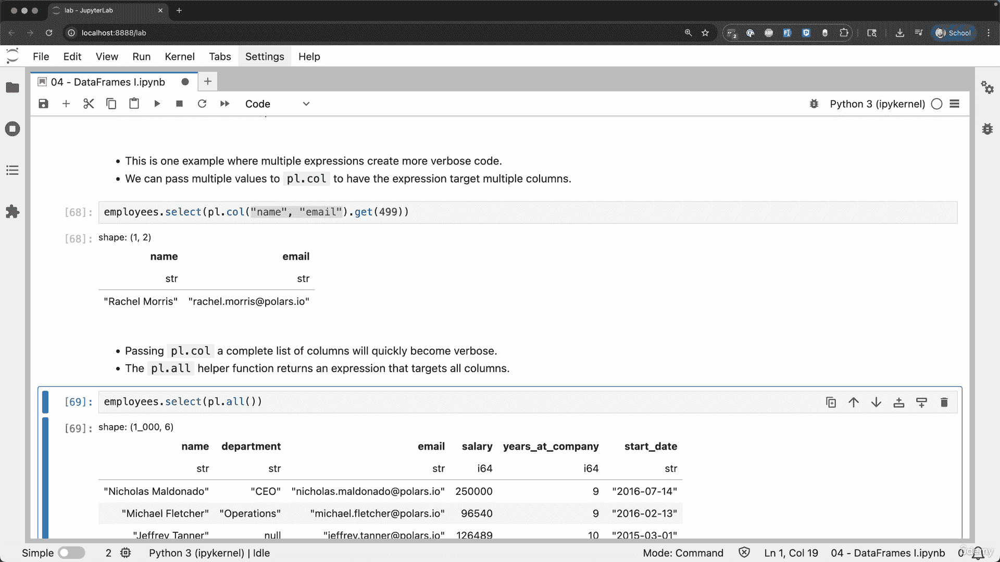

这样一来，我们就能一次性取出第 499 行在所有列上的值。这个操作和之前针对两个列时一样，只是现在作用范围扩大到所有列：

```python
employees.select(pl.all().get(499))
```

运行之后，你就能看到这一行的完整数据，例如 `Rachel Morris`、`Finance` 等等。这就是 `pl.all()` 配合 `get` 方法提取整行数据的用法。它最大的优势在于，即使数据帧有上千列，你也不需要改动表达式，代码始终是这么简短。

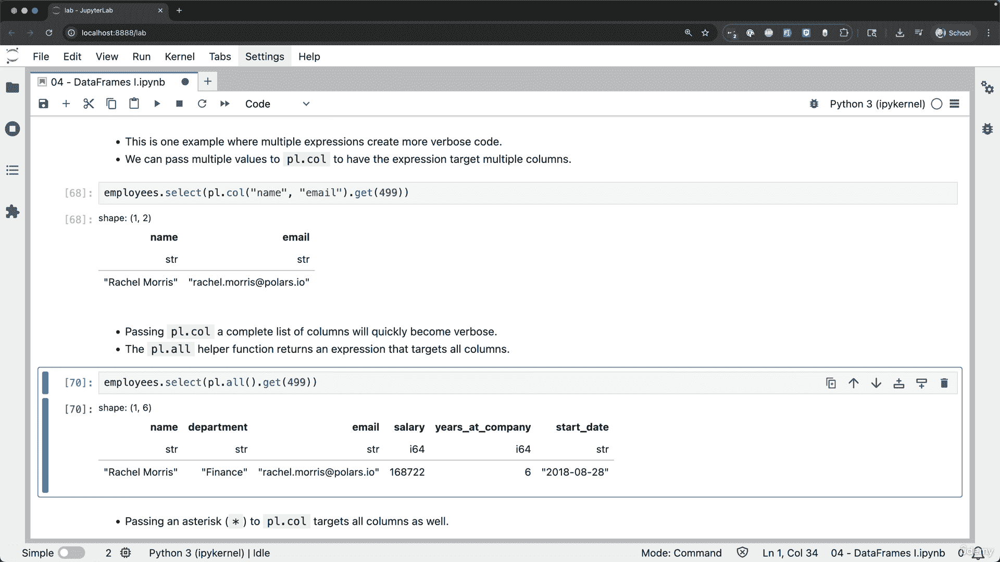

## 使用 pl.col("*") 的备选方案 ⭐

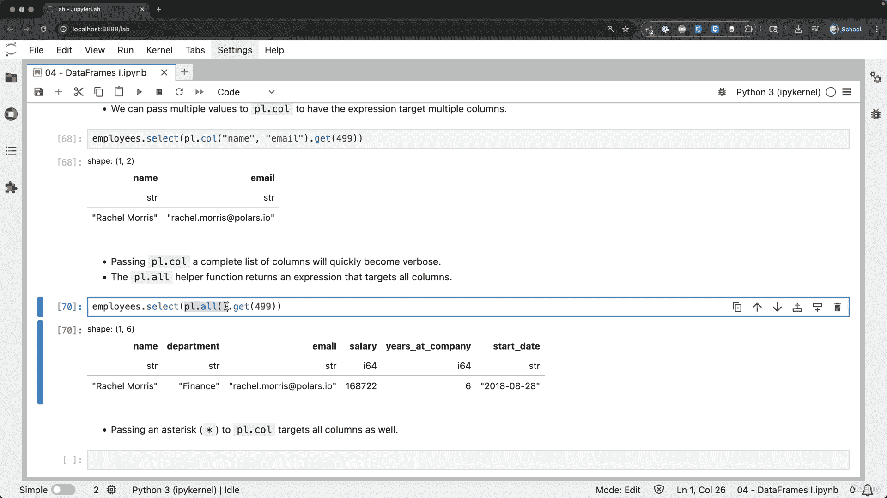

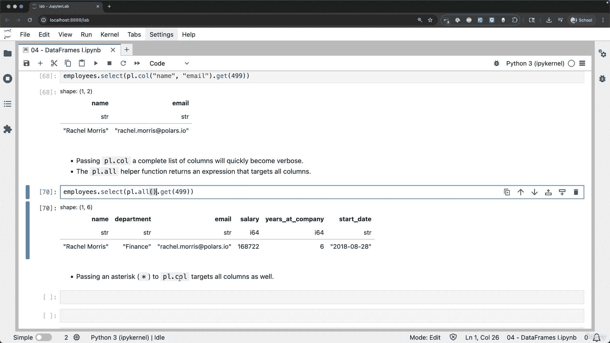

除了 `pl.all()`，还有一种方式也能实现同样的效果：直接调用我们熟悉的 `pl.col` 函数，但是传入一个星号字符串。星号是一个特殊字符，表示“所有列”。在键盘上，星号就是 `Shift + 8`。Polars 团队实际上不太推荐这种写法，因为 `pl.all()` 的可读性更好，但为了灵活性，它依然是一个可用的选项。

```python
employees.select(pl.col("*"))
```

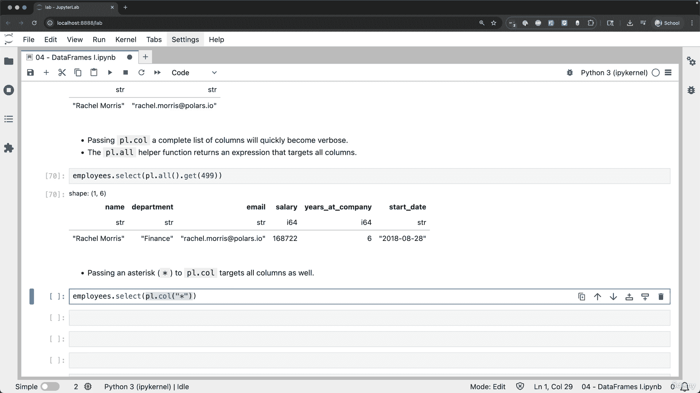

这样创建出来的表达式同样会覆盖数据帧中的所有列，所以默认情况下，它得到的结果和 `employees` 数据帧本身一样。既然表达式可以继续修改，我们自然也可以在它上面调用 `get` 方法。传入索引 499，也就是第 500 行，你会得到与上面使用 `pl.all()` 完全一致的结果。

```python
employees.select(pl.col("*").get(499))
```

这两种写法都表达了“目标行所有列”的意思，你可以根据团队习惯或个人偏好来选择。不过，在大多数情况下，`pl.all()` 会更加直观，也更容易让新人快速读懂。如果你追求代码的简洁和一致，优先考虑 `pl.all()` 通常是个不错的选择。

## 总结 📝

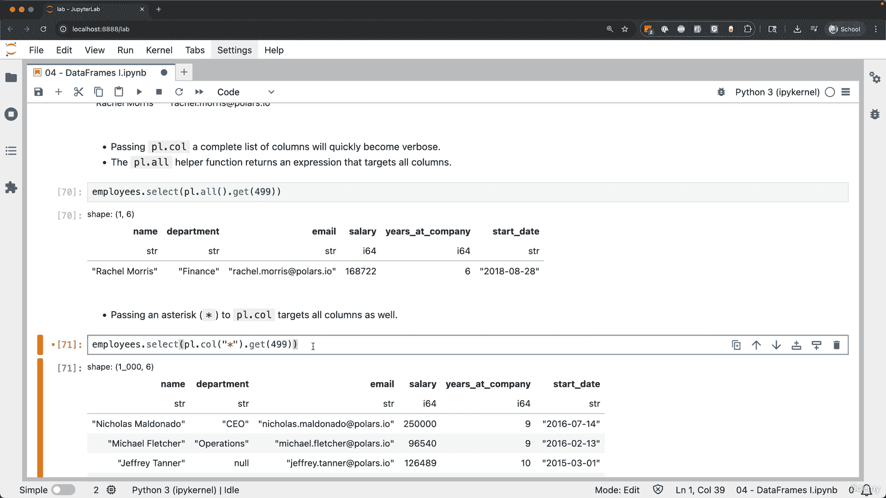

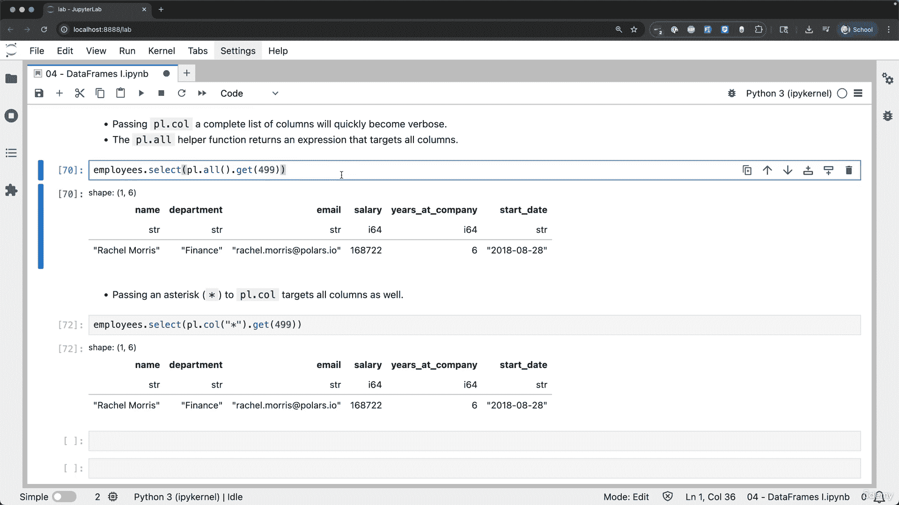

本节课中，我们一起学习了 Polars 中针对行值的表达式。我们看到了 `get` 方法如何基于行索引位置提取一个或多个列值，也了解了 `pl.all()` 和 `pl.col("*")` 这两个能够快速覆盖全部列的辅助函数。通过组合这些方法，我们可以创建更精细、更复杂的表达式，一次性地从数据帧中提取任意行、任意列的数据。在后续课程中，我们会继续探索更多 Polars 的辅助函数，让你的数据处理代码越来越简洁。
