# 📊 Polars 与 Python 数据分析：55：使用 item 方法从 DataFrame 中提取单个值

在本节课中我们将要学习如何从 Polars 的 DataFrame 中提取单个单元格的值。具体来说，我们会认识 `item` 方法：它可以根据行索引位置和列索引位置的交叉点，把对应的值取出来。这个操作在需要读取某个具体位置的数据时很实用，例如确认某一行某一列到底是什么内容。下面会从方法参数、索引规则、正常取值示例和缺失值处理几个方面展开，让初学者也能看懂。

有时你可能想根据一行和一列的交叉点，从 DataFrame 中取出一个值。`item` 方法允许你通过指定行的索引位置和列的索引位置来提取单元格值。这个思路很直接：先定位行，再定位列，两个位置确定后，交叉点上的值就是目标值。接下来先执行代码导入 `employees` 数据框，然后在下方对 `employees` 调用 `item` 方法。

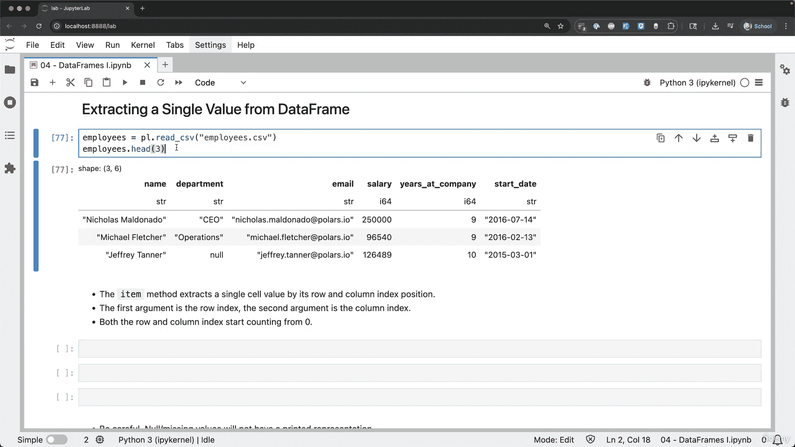

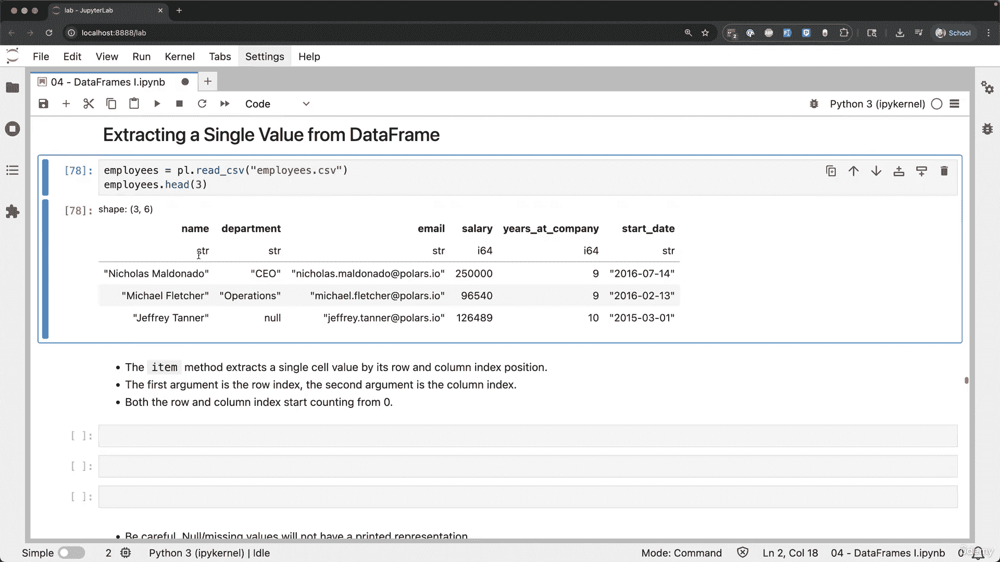

## 🧭 Polars 与 Python 数据分析：55.1：item 方法的基本用法

上一节已经说明了从行列交叉点取值的需求，本节来看看 `item` 方法本身怎么用。`item` 方法接收两个参数。第一个参数是行，第二个参数是列，并且这两个参数指定的都是索引位置，而不是行名或列名。核心公式可以写成下面这样：

\[
\text{cell} = \text{DataFrame.item(row\_index, column\_index)}
\]

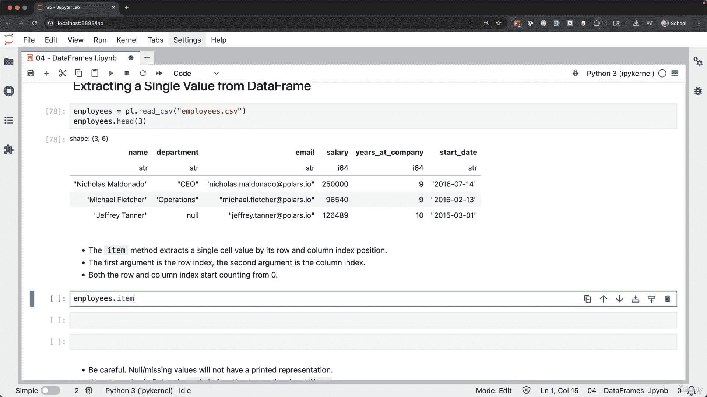

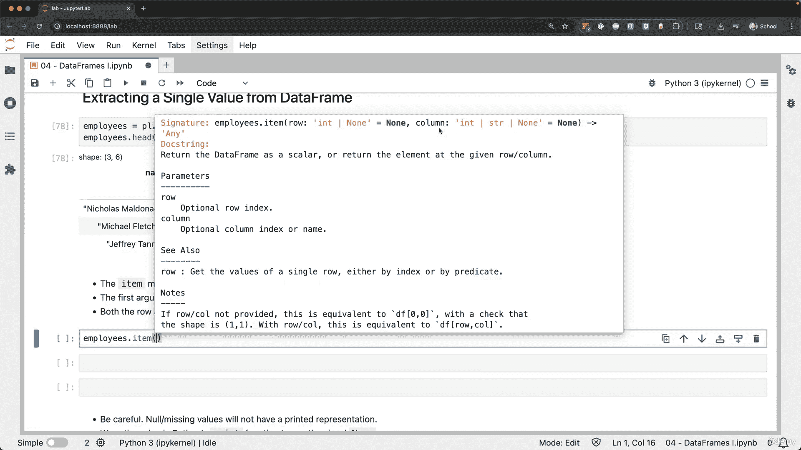

下面是调用 `item` 方法的基本代码形式，其中两个数字分别代表行索引位置和列索引位置：

```python
employees.item(0, 0)
```

## 🧮 Polars 与 Python 数据分析：55.2：行列索引从 0 开始

上一节介绍了 `item` 方法需要两个索引位置参数，本节来看看 Polars 中行列索引的编号规则。我们之前已经见过，Polars 会给每一行分配一个索引位置，虽然不是技术意义上的索引，但可以把它理解为一种象征性的编号，并且从 0 开始。也就是说，第一行是第 0 行，第二行是第 1 行，第三行是第 2 行。以下是行索引的直观编号方式：

- 第 0 行对应 row index `0`。
- 第 1 行对应 row index `1`。
- 第 2 行对应 row index `2`。

Polars 对列的处理原则完全相同。Polars 会按照列在数据中的顺序，给每一列分配一个从 0 开始的数字顺序。以下是列索引的编号示例：

- `name` 列是索引为 `0` 的列。
- `department` 列是第二个列，因此索引为 `1`。
- `email` 列在列中索引为 `2`。
- 其他列按照顺序继续递增。

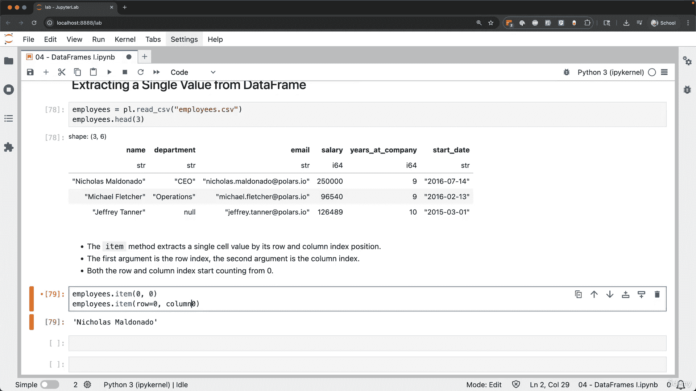

因此，如果指定行索引为 `0`、列索引为 `0`，就是在请求第一行与索引为 `0` 的列交叉处的值，而索引为 `0` 的列是 `name` 列。这样会取出这里 `name` 列中的值，例如 `Nicholas Malveado`。调用时也可以明确写出行参数和列参数，这样代码会更清楚一些。

## 🧪 Polars 与 Python 数据分析：55.3：提取具体单元格的示例

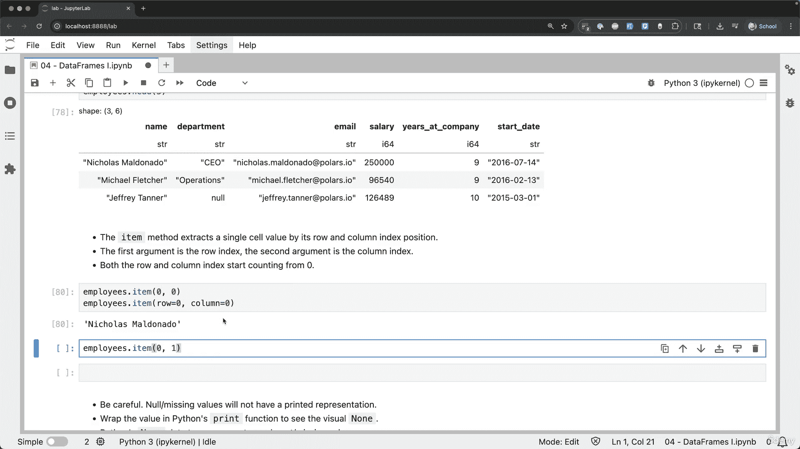

上一节已经理解了行列索引从 0 开始，本节通过几个例子看看 `item` 方法实际会取出什么。以下是几个 `item` 方法调用示例，方便理解行列交叉点：

- 调用 `employees.item(0, 0)` 时，请求的是索引为 `0` 的行，也就是第一行，并且请求索引为 `0` 的列，也就是 `name` 列，因此会提取 `Nicholas Malveado`。
- 调用 `employees.item(0, 1)` 时，请求的是索引为 `0` 的行，也就是这一行，然后请求索引为 `1` 的列，也就是第二列 `department`，因此会提取 `CEO`。
- 调用 `employees.item(343, 3)` 时，列索引为 `3`，行索引为 `343`，这是第 344 行，因此会提取该行与该列交叉处的值，在这个示例中看起来对应 `salary` 列。

这些示例说明，`item` 方法的核心就是两个数字：一个定位行，一个定位列。只要行列索引位置写对，交叉点上的值就会被返回。正常值看起来比较直观，但数据中如果存在缺失值，结果就需要特别留意。

## 🕳️ Polars 与 Python 数据分析：55.4：处理 null 与缺失值

上一节展示了正常单元格的提取结果，本节来看看数据中包含 null 或缺失值时会怎样。你需要注意，DataFrame 中可能包含 null 或缺失值。例如在 `department` 列中就能看到一个这样的值。当把这种缺失值提取出来时，Python 打印出来的表示会是一个空字符串，因此从视觉上没有任何输出可供查看。

> 注意：直接显示缺失值时，可能看起来像“什么都没有发生”，因为缺失值本身没有可见的字符输出。

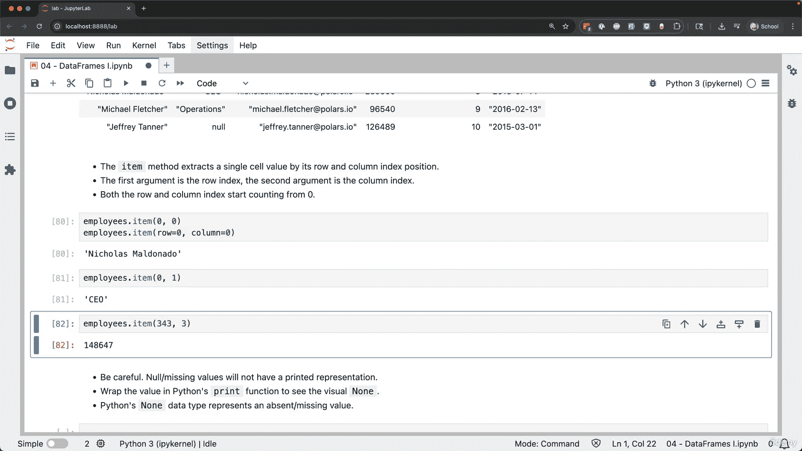

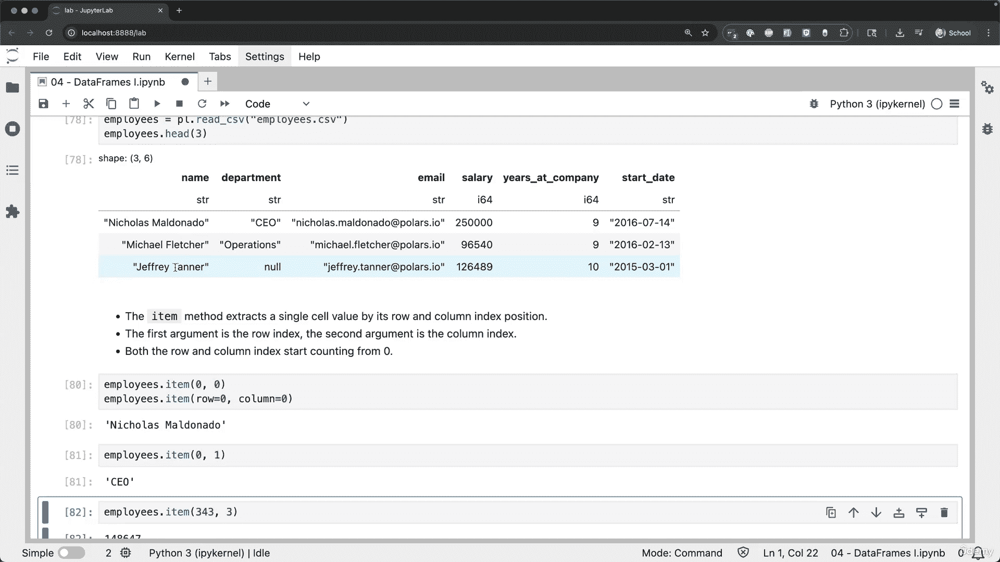

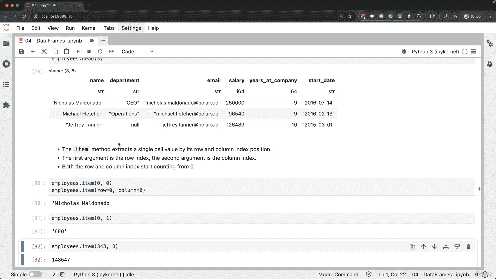

以下是确认缺失值返回结果的步骤：

- 使用 `item` 方法定位行索引为 `2`、列索引为 `1` 的单元格。
- 这个位置的值是 null 或缺失值，直接打印时看起来没有任何反应。
- 用 Python 的 `print` 函数包裹 `item` 调用，可以确认在这种场景下 `item` 方法实际返回的是 Python 的 `None` 对象。

对应的代码可以写成这样：

```python
print(employees.item(2, 1))
# None
```

在 Polars 中，我们使用 `null` 这个术语来表示缺失。Polars 会把它转换成等价的 Python 表示，也就是 Python 的 `None` 对象。二者目的相同，都是用来表示虚无、缺失，或者某个值不存在、已经不在。这个对应关系可以简单写成：

\[
\text{Polars null} \longleftrightarrow \text{Python None}
\]

以上就是对 `item` 方法的快速介绍。通过行列索引位置，可以准确地从 DataFrame 中取出单个单元格的值；遇到缺失值时，也可以通过 `print` 查看它是否返回了 `None`。

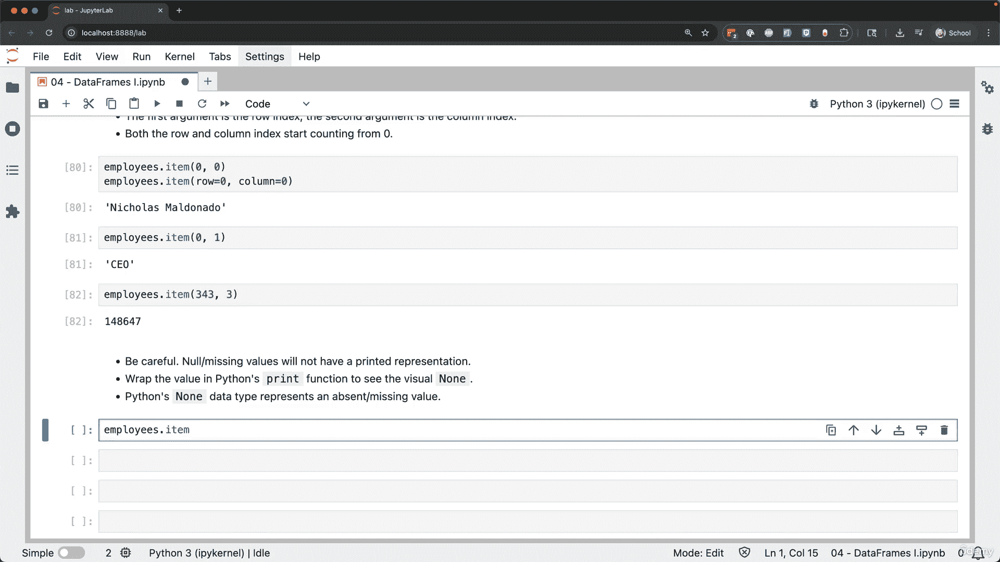

## ✅ Polars 与 Python 数据分析：55.5：本节总结

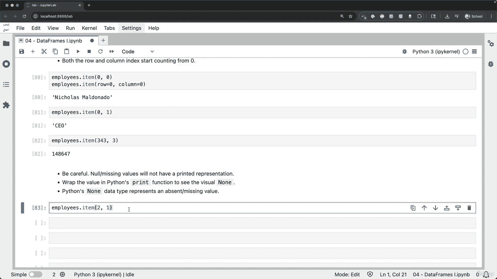

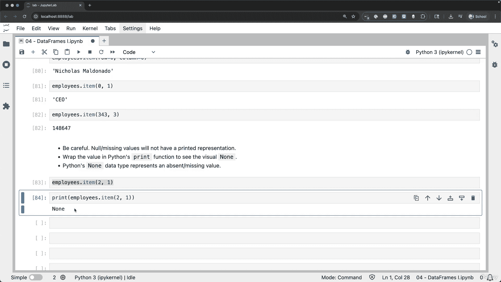

本节课中我们一起学习了 Polars 中 `item` 方法的用法。我们知道了 `item` 方法通过行索引位置和列索引位置定位单元格，行列索引都从 `0` 开始，第一行对应 `0`，第一列也对应 `0`。我们还通过 `employees.item(0, 0)`、`employees.item(0, 1)` 和 `employees.item(343, 3)` 等示例，理解了行列交叉点取值的实际效果。最后，我们看到了缺失值的情况：Polars 中的 `null` 在转换成 Python 表示时会变成 `None`，直接打印可能没有可见输出，因此可以用 `print(employees.item(2, 1))` 来确认返回值。

