# Polars 与 Python 数据分析：第56节：按索引位置提取行（gather 与 gather_every）📊

在本节课中，我们将要学习如何在 Polars 中按照行的索引位置提取多行数据。核心工具是 `gather` 和 `gather_every` 两个方法。前者接收一组具体的行索引，后者按照固定步长或间隔抽取行。掌握这两种方式后，面对“取第 0、100、200 行”或“每隔两行取一行”这类需求，就不需要手写循环。下面从准备工作开始，逐步说明表达式写法和 DataFrame 快捷方式。

上一段给出了整体目标，接下来先完成导入和基础表达式准备。首先重新执行导入代码，然后像往常一样从 `employees` 数据帧开始操作。我们调用 `select` 方法，并向它传入一个表达式。这一次仍然使用 Polars 顶层的 `all` 函数来创建表达式。

`all` 函数会创建一个表达式，目标是数据帧中的所有列。这个表达式对应的是：对于即将指定的行，要取出这些行的全部列值。创建好这个表达式后，在其上调用 `gather` 方法。

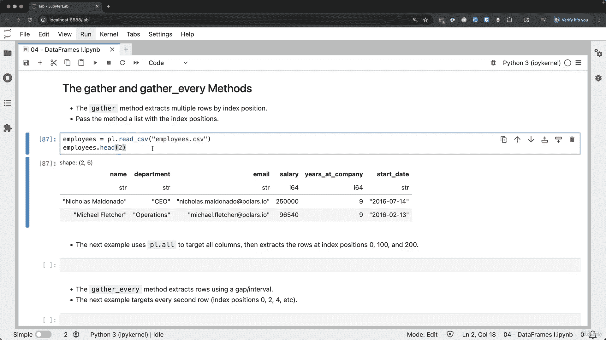

```python
import polars as pl

# 假设 employees 数据帧已经准备好
result = employees.select(
    pl.all().gather([0, 100, 200])
)
print(result)
```

`gather` 接受一个列表作为参数，列表里放入所有想提取的行的索引位置。例如要获取索引位置为 0、100、200 的行的所有列值，就把这三个索引放进列表。结果是三行的数据帧，这三行分别对应索引位置 0、100、200。因为使用了 `all` 函数，所以这三个指定索引位置的所有列值都被提取出来。用公式表示就是：

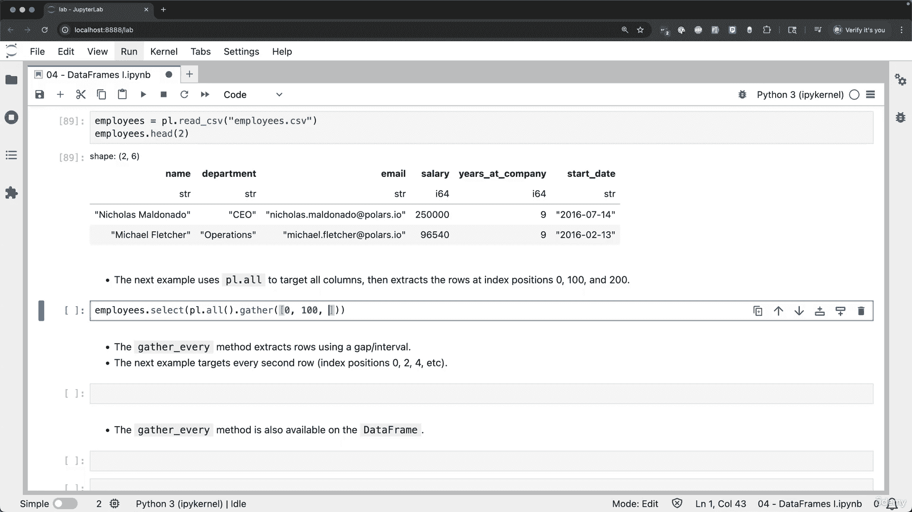

\[
\text{gather}([i_0,i_1,\ldots,i_k]) \rightarrow \text{结果行索引集合}\{i_0,i_1,\ldots,i_k\}
\]

上面的方法适合抽取离散的指定行。与此互补的另一个方法是 `gather_every`，它允许按照步长序列提取行。换句话说，它按固定间隔或间距抽取数据。例如想提取数据帧中的每隔一行，也就是索引位置 0、2、4、6，一直到数据帧末尾的行，语法与前面非常相似。

先介绍参数列表，下面是 `gather_every` 的关键概念，便于理解步长和偏移量：

- **步长 `n`**：每两行之间相隔多少个索引位置。
- **偏移量 `offset`**：从哪一个索引位置开始抽取，默认是 0。
- **结果行索引**：从偏移量开始，按步长依次递增。

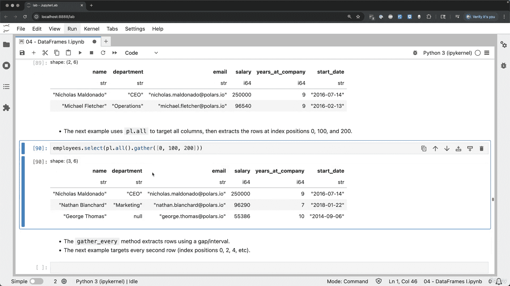

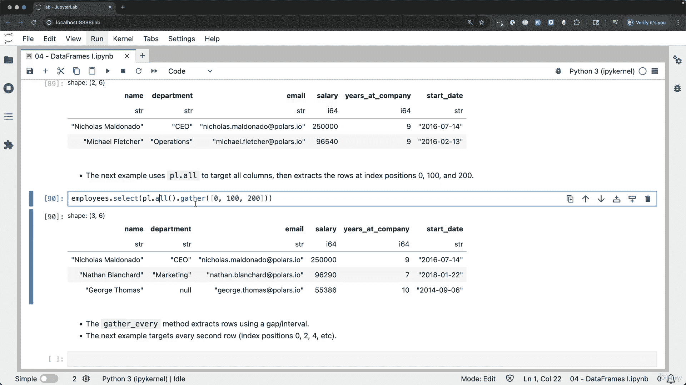

在代码中，仍然从 `employees` 数据帧调用 `select`，并传入一个或多个表达式。这里用 `all` 函数创建目标为所有列的表达式，然后在这个表达式上调用 `gather_every`。

```python
# 每隔 2 行取一行：索引 0, 2, 4, 6, ...
every_2 = employees.select(
    pl.all().gather_every(2)
)
print(every_2)

# 每隔 3 行取一行：索引 0, 3, 6, 9, ...
every_3 = employees.select(
    pl.all().gather_every(3)
)
print(every_3)
```

`gather_every` 被调用时接受一个参数，这个参数表示步长序列，也就是每两个索引位置之间的间隔。传入 2，表示抽取相隔为 2 的行，从索引 0 开始，然后取索引 2、4、6、8，依此类推。原来的 `employees` 数据帧有 1000 行，因此每隔 2 行抽取一次会得到其中一半，也就是 500 行。如果每隔 3 行抽取一次，就会抽取索引位置 0、3、6、9 等，结果数据帧的大小约为原来的三分之一。用公式可以写成：

\[
\text{gather\_every}(n,\ \text{offset}=o) \rightarrow
\{o,\ o+n,\ o+2n,\ o+3n,\ldots\}
\]

\[
\text{结果行数} \approx \frac{N}{n}
\]

其中 \(N\) 是原数据帧行数，\(n\) 是步长，\(o\) 默认是 0。

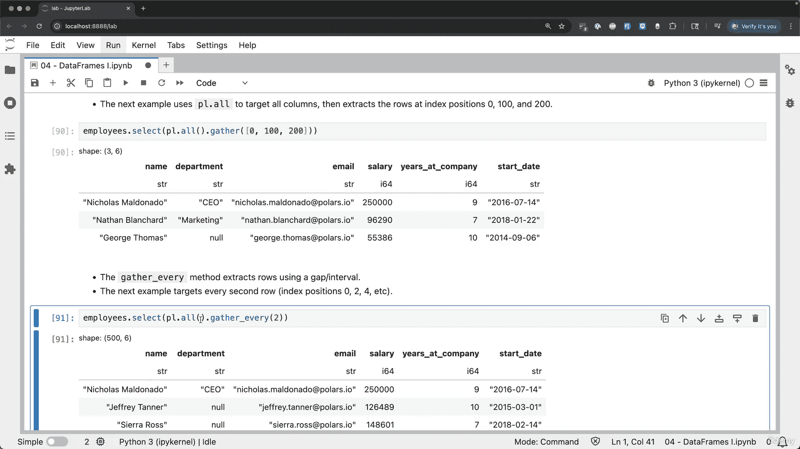

上一节展示了表达式方式，本节再来看 DataFrame 上的快捷方式。`gather_every` 方法也可以在数据帧对象本身直接调用。某些操作在特定业务领域很常见，因此 Polars 提供了快捷写法。例如不一定非要创建表达式再传给 `select`，虽然那样写完全有效；也可以直接在数据帧上调用 `gather_every`。

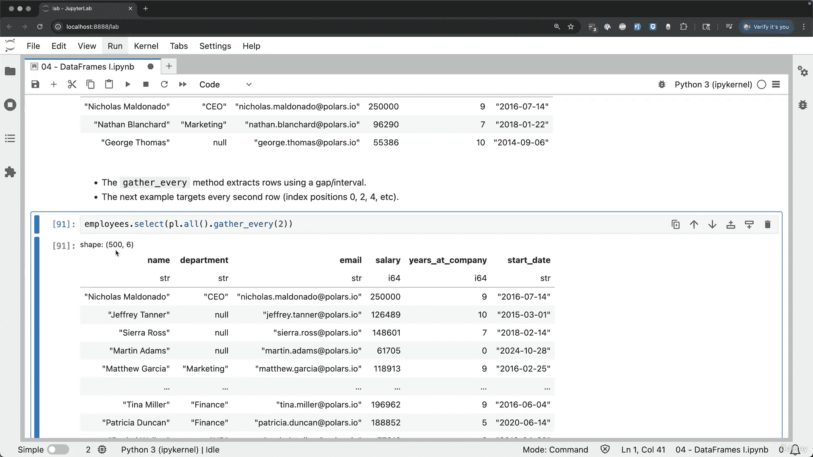

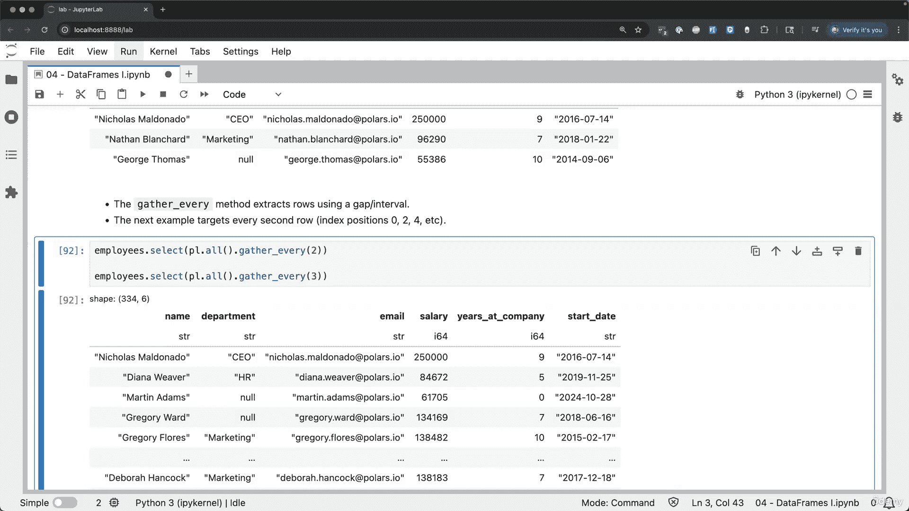

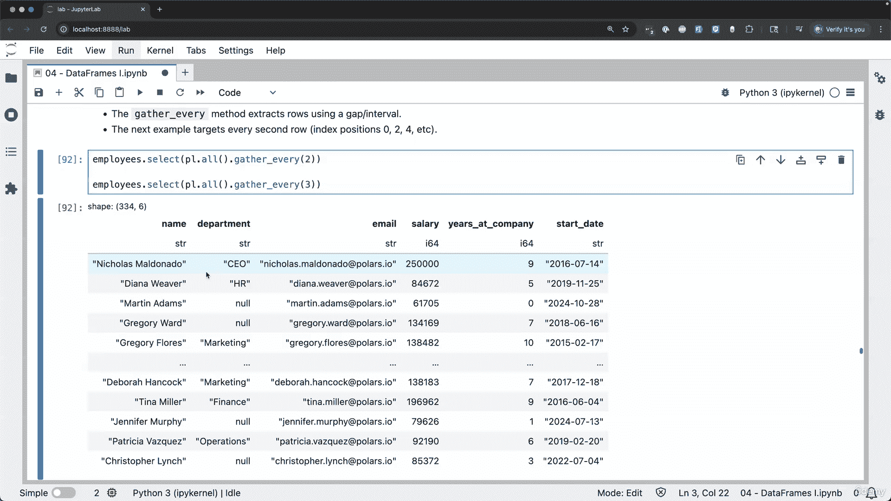

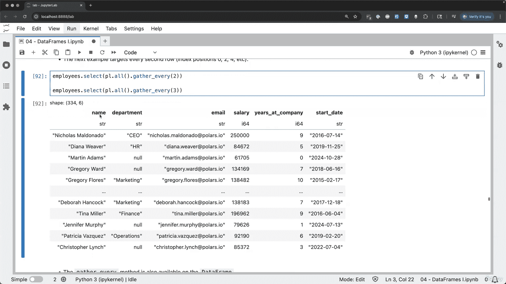

下面列出直接调用时常用的参数，方便对照表达式写法：

- `n`：步长，表示每隔多少行取一行。
- `offset`：起始索引，默认从索引 0 开始。
- 返回值：按指定间隔抽取后的新数据帧。

```python
# 直接在 DataFrame 上调用：每隔 2 行取一行
df_every_2 = employees.gather_every(n=2)

# 从索引 1 开始，每隔 2 行取一行：索引 1, 3, 5, 7, 9, ...
df_offset_1 = employees.gather_every(n=2, offset=1)
```

直接调用 `gather_every` 时，它接受与表达式写法相同的参数，这个参数表示步长序列。例如传入 `n=2`，表示每隔一行抽取，默认从开头开始抽取。如果想从不同的起始索引开始，就设置 `offset` 参数；该参数默认从索引 0 开始抽取。如果把 `offset` 改成 1，表示从索引位置为 1 的行开始，然后按间隔 2 抽取，也就是取索引位置 1、3、5、7、9 等行。这样就能灵活控制起点和间隔。

> 提示：`gather` 传入的是行索引位置列表，不是行号数量；索引位置从 0 开始计算，使用 `gather_every` 时重点检查 `n` 和 `offset` 是否符合预期。

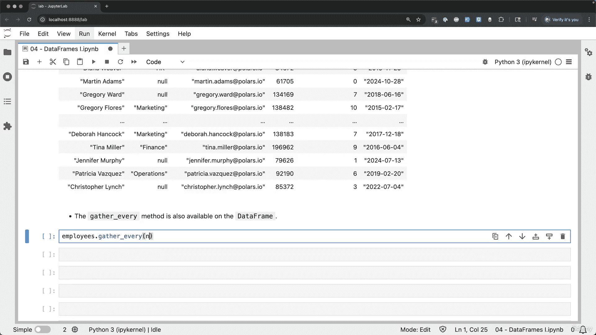

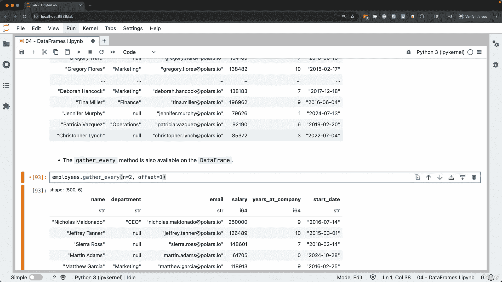

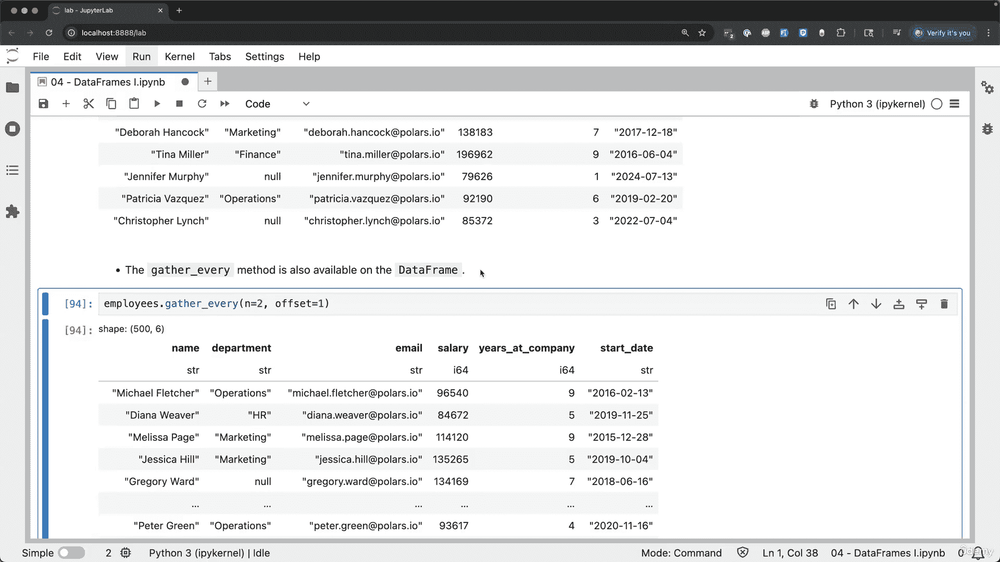

以上就是 `gather` 和 `gather_every` 两个方法的用法。本节中我们一起学习了按索引位置提取多行的基本思路：用 `gather` 抽取一组明确指定的行索引，用 `gather_every` 按固定步长抽取行，并且可以在表达式上调用，也可以直接在 DataFrame 上调用快捷方法。理解这两个方法后，面对抽样、切片和固定间隔检查数据等场景，就可以用更简洁的 Polars 代码完成操作。
