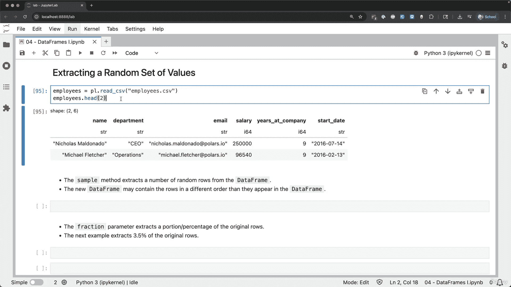
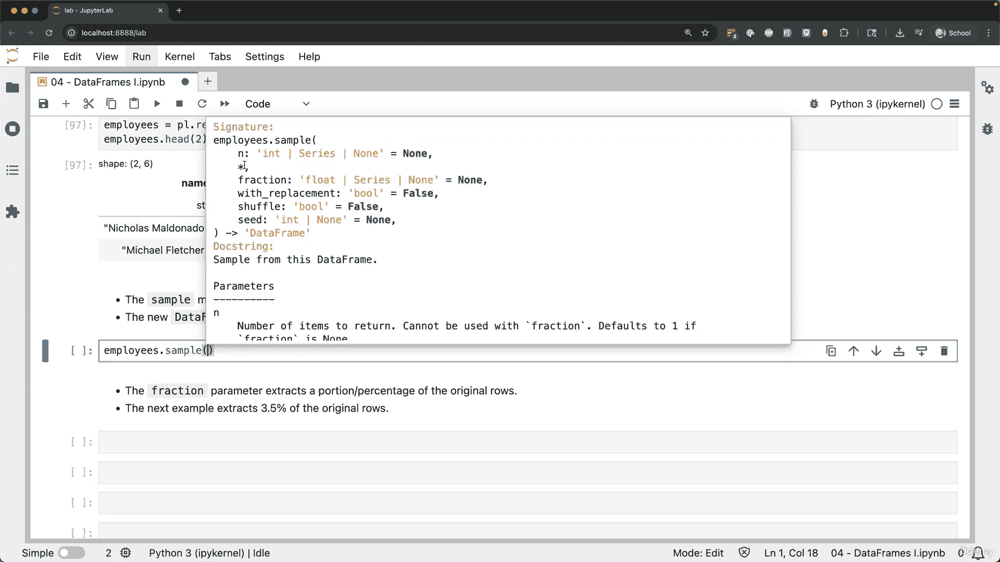
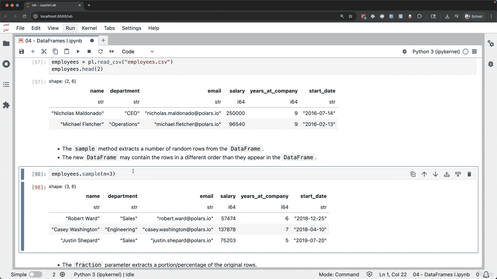
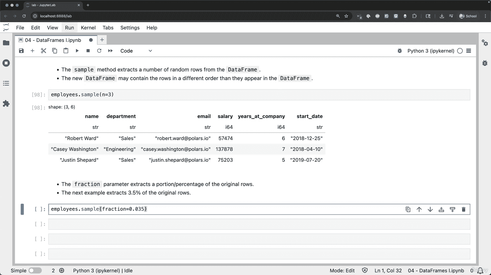
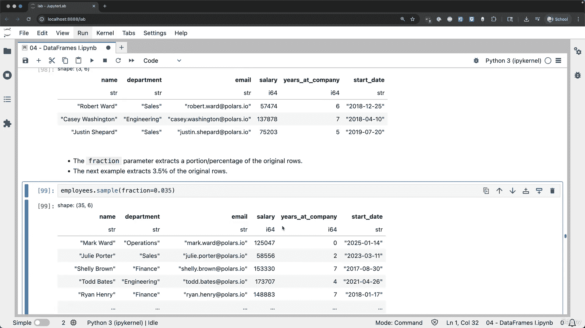
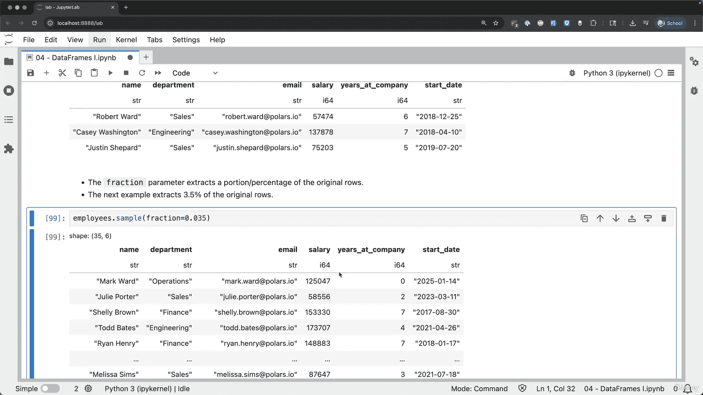

# Polars 与 Python 数据分析：57：随机抽取一组值 📊


在本节课中我们将要学习如何在 Polars 的 DataFrame 中随机抽取一行或多行数据，并理解 `sample` 方法中 `n` 参数和 `fraction` 参数各自的作用。学习目标很明确：一方面知道怎样抽取固定数量的随机行，另一方面知道怎样按照原始数据的一个百分比来抽取随机行。为了便于初学者建立整体印象，以下是本课的内容安排。


- 先说明随机抽样在数据分析中的常见用途。

- 再介绍 DataFrame 上的 `sample` 方法以及它的基本调用方式。

- 然后分别讲解 `n` 参数和 `fraction` 参数的用法。

- 最后用具体数字演示百分比抽取的换算过程，并做本课总结。


了解整体安排后，下一节先看为什么数据分析中会需要随机抽取行。


## Polars 与 Python 数据分析：57.1：为什么要随机抽样 🎲


上一节我们说明了本课的整体安排，本节中我们来看看随机抽样在数据分析中的使用场景。有时候做数据分析时，我们并不关心提取某一个特定行，而更关心从数据集中随机提取一行或者多行。这种需求和按条件筛选、按位置取行不一样，它关注的是“随机拿到一部分样本”。在数据处理和检查数据分布时，随机抽取往往能帮助我们快速观察数据的大致情况。为了支持这种操作，DataFrame 提供了 `sample` 方法。理解了使用场景之后，下一节进入具体调用方式。


## Polars 与 Python 数据分析：57.2：sample 方法的基本调用 🧱


上一节我们介绍了随机抽样的用途，本节中我们来看看怎样在 DataFrame 上直接调用 `sample` 方法。这里先执行代码把 `employees` 数据框准备好，然后在下方可以直接在数据框上调用 `sample` 方法。这个过程不需要使用 `select`，也就是说不需要先选中某些列再抽样，而是直接对整张表进行随机行抽取。基本调用形式如下：


```python
# 先准备好 employees 数据框
employees.sample(n=3)
```


上面的代码展示了最基本的调用思路。为了把过程讲清楚，以下是把调用过程拆开后的几个要点。




- `sample` 是 DataFrame 自带的方法，可以直接在数据框对象上调用。



- 调用时不需要先写 `select`，因为抽样针对的是行。

- 第一个常用参数是 `n`，它表示要抽取多少行。

- 抽取结果是随机行，不是按固定位置切片得到的行。


看完这些要点后，下一节我们重点看 `n` 参数如何指定固定行数。


## Polars 与 Python 数据分析：57.3：使用 n 参数抽取固定行数 🔢


上一节我们介绍了 `sample` 方法的基本调用，本节中我们来看看第一个参数 `n` 的具体作用。`n` 参数用来指定要随机抽取的行数，例如可以要求从 `employees` 中抽取三行随机数据。对应代码如下：


```python
employees.sample(n=3)
```


这段代码会从 `employees` 数据框中随机拿出三行。需要特别注意的是，因为原始数据有一千行，所以当你在自己的环境中运行这段代码时，很可能看到和示例完全不同的输出。随机抽样本来就不是固定结果，每次运行都可能得到不同的行。理解这一点后，下一节我们进一步看随机顺序和结果差异的问题。


## Polars 与 Python 数据分析：57.4：随机顺序与结果差异 🔀


上一节我们使用 `n=3` 抽取了三行随机数据，本节中我们来看看这些随机行的顺序问题。这里有一个重要点：这些行并不保证按照它们在原始 `employees` 数据框中出现的顺序被抽取出来。我们是在真正地随机抽取三行，因此完全有可能第一行在原始数据框中的位置比第二行更靠后。换句话说，`sample` 方法只是随机抽行，直到抽够指定的总数三行，并不会按照原始行号排序。下面把这个特点归纳成几个便于理解的要点。


- 抽取结果是随机的，不同运行环境或不同运行次数可能得到不同结果。

- 抽取出的行不保证与原始数据框中的出现顺序一致。

- 第一行随机结果在原始数据框中的位置可能比后面的随机结果更靠后。

- 随机抽取会一直进行，直到达到 `n` 指定的总行数。


理解随机顺序之后，下一节我们转向另一种抽取方式：按比例抽取。


## Polars 与 Python 数据分析：57.5：使用 fraction 参数按比例抽取 📐


上一节我们说明了随机行不保证原始顺序，本节中我们来看看如何使用 `sample` 方法的另一个参数 `fraction`。除了用 `n` 指定确切行数，还可以用 `fraction` 参数指定要抽取原始数据集的多大比例或多大的百分比。如果你不太关心必须抽取多少行，而是希望无论原始数据有多长，都抽取比如原始数据集的百分之十，那么就可以使用 `fraction` 参数。这个参数可以理解为“按比例抽样”。核心关系可以写成下面的公式：


\[
\text{抽取行数} = \text{原始行数} \times \text{fraction}
\]


调用方式仍然使用 `sample` 方法，只是这次传入 `fraction` 参数，例如：


```python
employees.sample(fraction=0.035)
```


这里需要把 `fraction` 设置成一个表示百分比的小数。下一节我们用具体数字解释这个小数怎样换算。


## Polars 与 Python 数据分析：57.6：百分比换算示例 🧮




上一节我们介绍了 `fraction` 参数的含义，本节中我们来看看百分比怎样换算成 `fraction` 需要的浮点数。如果目标是抽取原始数据的百分之三点五，也就是 `3.5%`，那么需要传入一个分母为 1 的浮点值。因为 `3.5%` 等于 `3.5 / 100`，所以应传入 `0.035`。可以写成下面的公式：


\[
0.035 = \frac{3.5}{100} = 3.5\%
\]


也可以把 1 看作分母，`0.035` 就是 1 的 `3.5%`。由于原始 `employees` 数据框有一千行，按这个比例抽取时，计算结果就是 `1000 × 0.035 = 35` 行。运行下面的代码，可以看到从 `employees` 数据框中随机抽出的三十五行的结果：


```python
employees.sample(fraction=0.035)
```


为了便于初学者照着做，以下是百分比换算的步骤。


- 先确定目标百分比，例如 `3.5%`。

- 把百分比除以 100，得到小数 `0.035`。

- 如果原始数据有一千行，就用 `1000 × 0.035` 计算抽取行数。

- 计算结果为 35，因此结果中会显示 35 行随机数据。


完成这个示例后，我们已经覆盖了 `sample` 方法的主要用法，下一节对本课内容做总结。


## Polars 与 Python 数据分析：57.7：本课总结 ✅


前面几节我们分别介绍了随机抽样场景、`sample` 方法的基本调用、`n` 参数、随机顺序问题以及 `fraction` 参数，本节中我们把这些内容收束起来。`sample` 方法可以直接作用在 DataFrame 上，不需要先使用 `select`；`n` 参数用于指定要抽取的确切行数，例如抽取三行；因为原始数据有一千行，所以每次运行可能得到不同结果，而且抽取出的行不保证保持原始数据框中的顺序；`fraction` 参数用于按比例抽取，传入的是百分比对应的小数，例如抽取 `3.5%` 时传入 `0.035`，在一千行原始数据上会抽取出 35 行。以下是本课要点清单。


- `sample` 方法用于从 DataFrame 中随机抽取行。

- `n` 参数指定固定行数，例如 `employees.sample(n=3)`。

- 随机抽取结果可能不同，并且不保证原始顺序。



- `fraction` 参数指定比例，例如 `employees.sample(fraction=0.035)`。



- 百分比换算为小数时除以 100，`3.5%` 对应 `0.035`。




本节课中我们一起学习了 Polars 中 `sample` 方法的随机抽样用法，理解了 `n` 参数抽取固定行数和 `fraction` 参数按百分比抽取的区别，并通过 `0.035` 和一千行数据的例子算出并观察了 35 行随机结果。
