# 📊 Polars 与 Python 数据分析：第58节：将列转换为不同数据类型

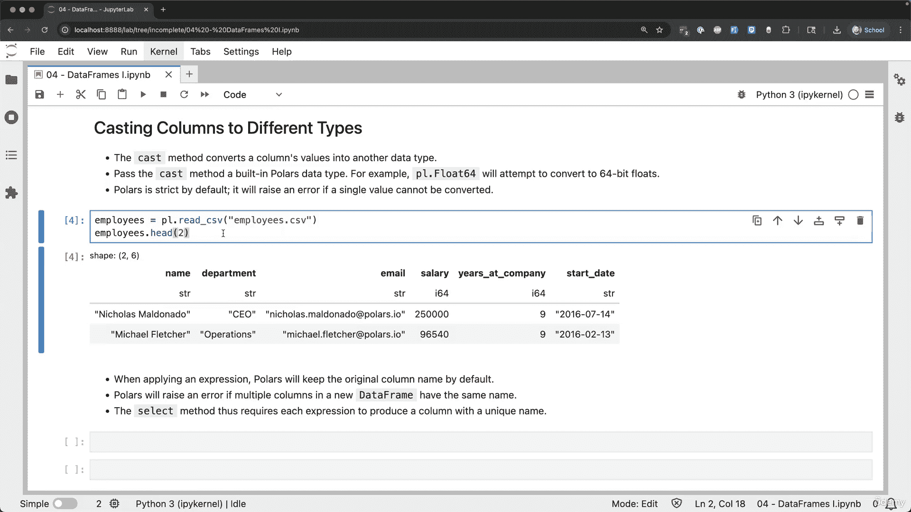

在本节课中我们将要学习如何使用 `cast` 方法把某一列中的值转换成另一种数据类型，并把转换后的结果整理成适合初学者理解的教程。`cast` 这个技术术语可以直白地理解为“换一个数据类型来存放同一列的值”，它的重点不是修改业务含义，而是改变这一列在程序里的类型表示；下面我们按照原文的思路，从导入 `employees` 数据框开始，一步步看单列转换、别名处理、严格模式、节省内存的整数类型选择、多列转换、字符串转日期以及按数据类型批量选择列。

## 🧭 Polars 与 Python 数据分析：第58节：本节概述

在正式动手之前，先把本节要走的路线说清楚。我们会先执行代码把 `employees` 数据框加载进来，然后用 `select` 方法只取出 `salary` 列，观察它默认是 `I64`，也就是 64 位整数；接着把这个 `salary` 列用 `cast` 转成浮点数 `Float64`，并通过 `alias` 给新列换一个名字，避免和原来的 `salary` 列重名。随后我们会看 Polars 默认的严格转换行为，再看把 `Years at Company` 从较大的整数类型转成更小的整数类型以节省内存，最后看如何一次转换多列、把字符串日期转成真正的日期类型，以及用数据类型本身作为选择条件批量转换所有 64 位整数列。

下面先用一个公式概括 `cast` 的核心概念，让初学者先有一个整体印象。

\[
\text{新列值} = \text{cast}(\text{原列值}, \text{目标数据类型})
\]

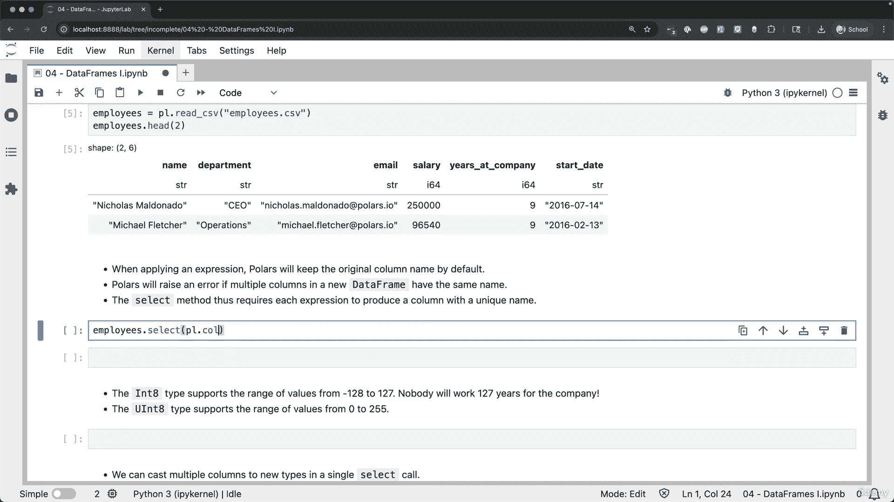

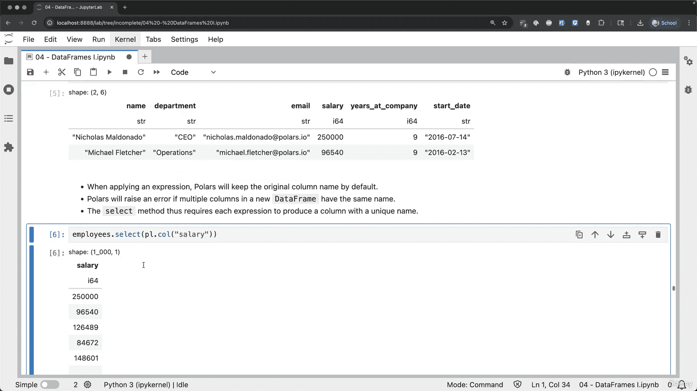

这个公式表达的事情很朴素：原来某一列里的值还是原来的值，只是换成了目标数据类型来承载，并返回一个全新的列。理解这一点之后，后面的代码就只是在反复使用同一个思路。

## 🔁 Polars 与 Python 数据分析：第58节：把 salary 列从整数转换为浮点数

在上一小节我们建立了 `cast` 的基本概念，本节中我们来看看它在单列上的具体用法。先执行代码把 `employees` 数据框导入进来，后面的操作都围绕这个数据框展开；导入之后，我们调用 `select` 方法，并用 `col` 函数把 `salary` 这一列取出来。此时可以看到，`salary` 列的类型是 `I64`，也就是 64 位整数。假设我们想把这个列改成保存浮点值，也就是带小数的十进制数字，那么就可以在原表达式的基础上调用 `cast`，把目标类型写成 `pl.Float64`，其中 `Float64` 的 `F` 是大写。

下面是把原始 `salary` 列和转换后的 `salary` 列并排展示时用到的关键代码，代码中保留了原列，也复制了原表达式作为第二个参数进行转换，并用 `alias` 给新列改名。

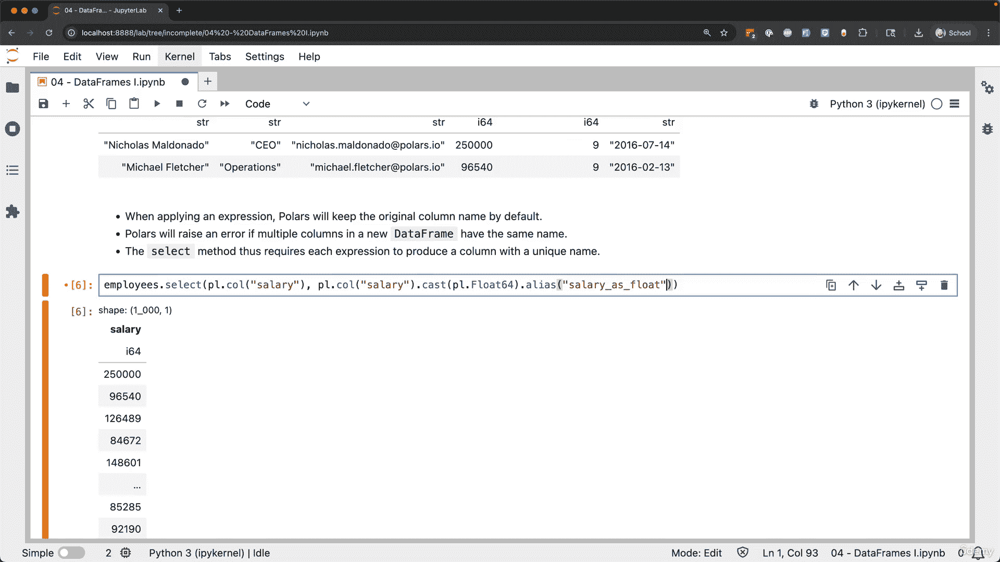

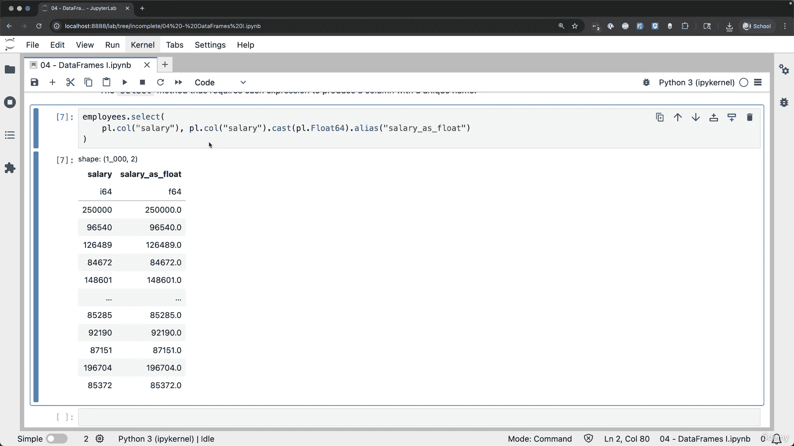

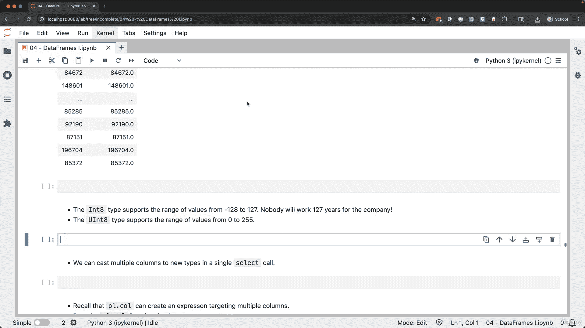

```python
import polars as pl

employees = pl.read_csv("employees.csv")

employees.select(
    pl.col("salary"),
    pl.col("salary").cast(pl.Float64).alias("salary_as_float"),
)
```

这段代码里，`pl.col("salary")` 负责选中原来的 `salary` 列，第二个表达式在同样选中 `salary` 后调用 `cast(pl.Float64)`，`cast` 会把列中的值转换成目标数据类型，并返回一个全新的列。这里还要注意一个细节：如果直接把转换后的表达式放进 `select` 而不改名，结果数据框会出现两个同名的 `salary` 列，所以代码马上调用 `alias` 方法给新列换了一个不同的名字，例如 `salary_as_float`。这个名字本身可以随自己定，只要不和原来的 `salary` 重名即可。运行之后可以看到两列并排：一列是原始的 `salary`，类型为 `I64`；另一列是转换后的列，保存浮点数。

在上面的单列转换中，我们已经看到了 `cast` 的基本写法，接下来需要特别留意 Polars 的默认行为。Polars 默认是严格的，只要原列中有一个值无法转换成目标类型，整个操作就会给出异常，也就是会抛出错误，而不是悄悄把那个值变成空值。这个特点对初学者很重要，因为看到报错时不要慌，通常说明某一列里确实存在不能直接转换的值。

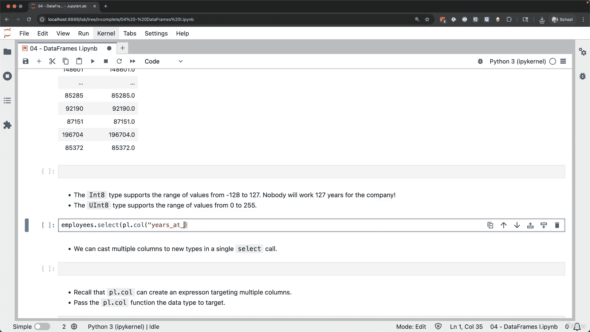

> 提示：Polars 的 `cast` 默认采用严格模式，转换时只要有一个值失败，整个操作就会抛出异常；这种设计可以避免数据在不知不觉中被转换成不符合预期的结果。
>

## 🧮 Polars 与 Python 数据分析：第58节：用更小的整数类型节省内存

上一小节我们处理的是 `salary` 列转换成浮点数，本节中我们来看看另一个常见场景：把整数列换成更小的整数类型。原文接下来给出了几个例子，其中一个例子再次针对 `employees` 数据框调用 `select` 方法，这次选中的列是 `Years at Company`。当 Polars 从 CSV 文件导入数据集时，默认会使用 `I64`，也就是 64 位整数类型，这个类型实际上相当大；而观察这一列的值可以看到，这些值通常都偏小，所以 `Int8` 类型，也就是 8 位整数，已经足够存放这些值。8 位有符号整数支持从 `-128` 到 `127` 的范围，没有人会在公司工作 127 年，因此这一列完全可以用更小的类型来保存。这个例子说明，转换到另一种数据类型，尤其是一个更小的数据类型时，可以节省内存。

为了帮助初学者快速理解常见整数类型的范围，下面列出几个在例子中会遇到的类型及其大白话含义。

- `Int8`：8 位有符号整数，范围是 `-128` 到 `127`，适合存放很小的整数。
- `UInt8`：8 位无符号整数，范围是 `0` 到 `255`，不保存负数，只保存 0 和正数。
- `I64`：64 位有符号整数，范围很大，但占用的内存也更多；Polars 从 CSV 导入时经常默认使用它。
- `Float64`：64 位浮点数，用来保存带小数的数值。

回到代码写法，语法和前面完全一样：先选中目标列，再调用 `cast` 方法，并传入一个真正的数据类型。这次我们在 Polars 中寻找整数类型，例如使用 8 位整数 `pl.Int8`，运行后就能看到原来的 `I64` 列变成了 `I8` 列。代码可以写成下面这样。

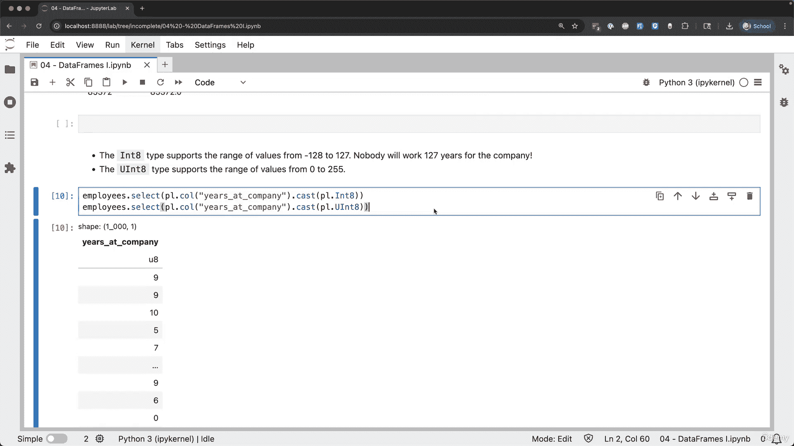

```python
employees.select(
    pl.col("Years at Company").cast(pl.Int8)
)
```

我们还可以继续往更小的方向选择，例如无符号 8 位整数 `UInt8`。这里需要提醒：无符号整数不支持负数，只支持 0 和正数；它的优势在于使用完全相同的内存量时，可以把正数方向的范围扩大一倍。无符号 8 位整数可以从 `0` 到 `255`，原文用“总共 255 个值”来概括这个范围跨度，更准确地说，0 到 255 一共是 256 个可能取值，课程想表达的重点是：有符号类型把范围分给负数和正数两边，无符号类型则把范围整体推到正数一侧。下面同样给出示例代码，把员工在公司工作的年数保存为无符号 8 位整数。

```python
employees.select(
    pl.col("Years at Company").cast(pl.UInt8)
)
```

到这里，单列的整数类型转换已经演示完了，接下来我们要把视野扩大一点。正如前面反复看到的，`select` 方法支持多个表达式，所以我们可以在同一次方法调用中转换多个列，而不必一列一列地重复写很多次 `select`。下面的代码会针对两个不同的列，并把它们转换成不同的数据类型：第一个表达式复制前面的思路，选中 `Years at Company` 列后调用 `cast`，把这些值转换成无符号 8 位整数；第二个表达式选中另一个独立的列，例如 `Start Date`，这一列当前保存为字符串，这也是我们第一次接触把字符串值转换成日期值。

```python
employees.select(
    pl.col("Years at Company").cast(pl.UInt8),
    pl.col("Start Date").cast(pl.Date),
)
```

这段代码中，`pl.Date` 是 Polars 顶层提供的一个日期类型。对 `Start Date` 调用 `cast` 之后，我们得到的列会保存日期值，而不是普通字符串。使用真正的日期值的好处是，之后可以使用大量与日期时间相关的功能，例如增加年份、减去天数、计算时长等；如果这里只是保存文本，那么它不过是由数字和连字符组成的普通字符串。现在有了日期类型，一系列与日期相关的方法就会变得可用，这也是把字符串转换成日期类型的实际价值。

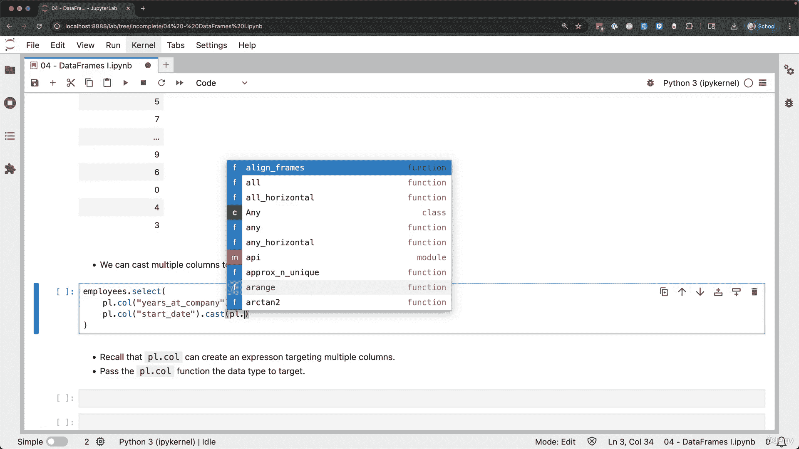

## 🧩 Polars 与 Python 数据分析：第58节：按数据类型批量选择和转换列

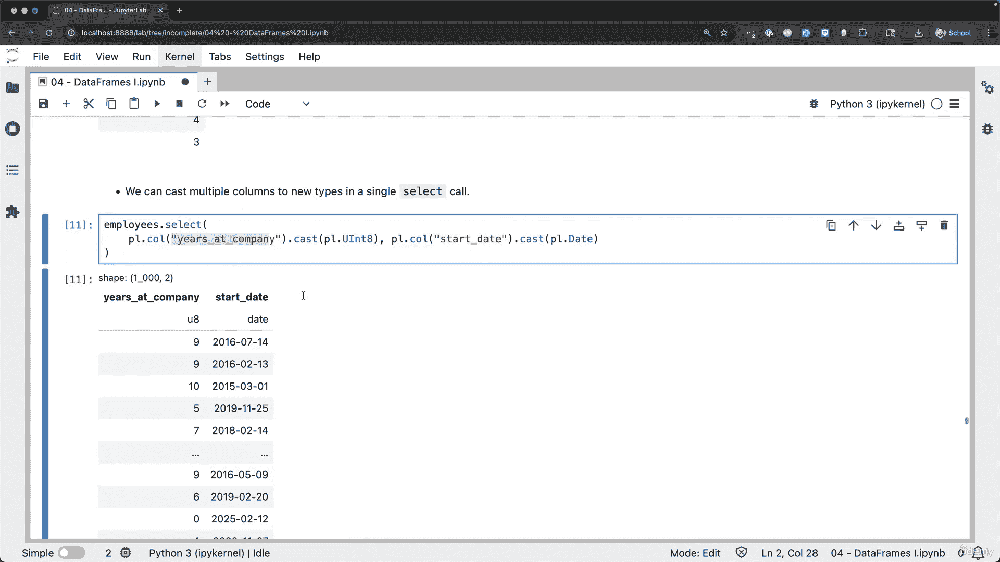

在上一小节中，我们通过列名明确指定了要转换的两列，本节中我们来看看另一种更灵活的方式：用数据类型本身作为选择条件。可以回忆一下，`col` 函数非常灵活，它支持多种不同的输入，不只是列名，还可以是数据类型。因此我们可以先构造一个表达式，让它选中所有指定数据类型的列，再在这个表达式上调用 `cast`，把这些列批量转换成另一种类型。下面的代码先选出所有 64 位整数列，也就是 `pl.Int64` 类型的列，然后把它们统一转换成 64 位浮点数 `pl.Float64`。

```python
employees.select(
    pl.col(pl.Int64).cast(pl.Float64)
)
```

这里的 `pl.col(pl.Int64)` 仍然是一个有效表达式，它表示“目标不是某一列的名字，而是所有数据类型为 64 位整数的列”。在这个表达式上继续调用 `cast(pl.Float64)`，就表示把这些被选中的 64 位整数列全部转换成 64 位浮点数。运行后可以看到，原数据框中的两个数值整数列都被转换成了保存浮点数的列，这正是 `cast` 配合按类型选择列时的批量处理效果。

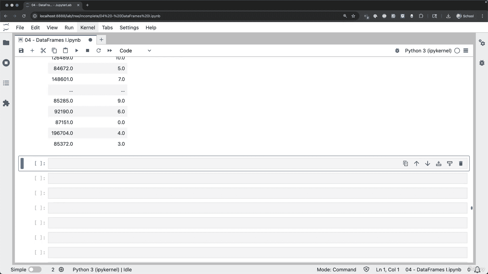

## ✅ Polars 与 Python 数据分析：第58节：本节总结

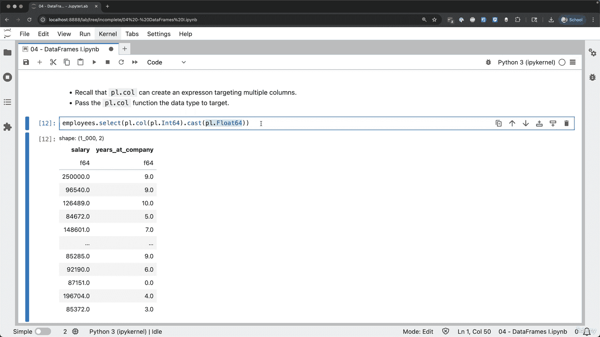

本节课中我们一起学习了 `cast` 方法的核心用法：先在一个表达式上调用 `cast`，再传入想转换成的数据类型，就可以把该列或多列的值转换成目标类型。我们先把 `salary` 从 `I64` 转成 `Float64`，并看到 `cast` 会返回一个全新的列；随后通过 `alias` 解决两列同名的问题。接着我们了解了 Polars 默认的严格转换行为，只要有一个值无法转换就会抛出异常。之后我们把 `Years at Company` 从较大的整数类型转成更小的 `Int8` 或 `UInt8` 以节省内存，又通过一次 `select` 调用同时转换多列，把字符串日期转成 `pl.Date` 并获得日期时间相关功能。最后，我们把数据类型本身传给 `col` 函数，批量选中所有 `Int64` 列并统一转换成 `Float64`。掌握这些写法后，面对列类型不合适的场景，就可以用 `cast` 做出清晰、直接且可控的转换。
