## 📘 Udemy - Data Analysis with Polars and Python part1：P59：自定义 DataFrame Schema

在本节课中，我们将要学习如何在 Polars 读取 CSV 时自定义 DataFrame 的 Schema。具体会回顾 `read_csv` 函数的两个参数：`schema_overrides` 和 `schema`，并介绍查看 `DataFrame.schema` 的方法，以及 `try_parse_dates` 快捷参数。核心目标是让一列或多列在导入时就得到期望的数据类型，避免导入后再调用 `cast` 方法。可以把 Schema 理解成数据表的说明书，它告诉 Polars 每一列应该存什么类型；在导入时把说明书给 Polars，后面的计算就不容易因为类型不对而多写转换代码。


### 🧩 Udemy - Data Analysis with Polars and Python part1：P59-1：回顾 schema_overrides 与 schema 参数

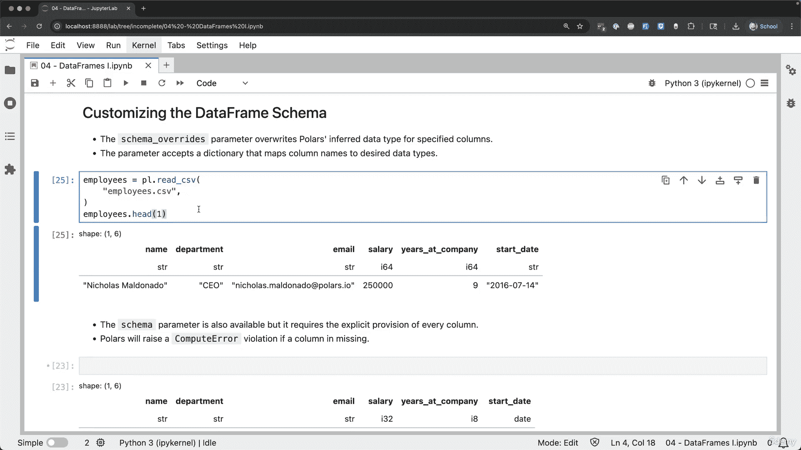

上一节的内容先从这里开始：在 Polars 把 CSV 读入 DataFrame 时，我们可以直接指定期望的列类型，这样就不必稍后再调用 `cast` 方法。这里沿用前面课程中的导入代码，先回顾 `schema_overrides` 参数。`schema_overrides` 看起来接受一个字典，我在课程前面的章节中简单提过它。这个字典提供列名到期望数据类型的映射。它叫 `overrides` 的原因是我们只指定要覆盖 Polars 默认推断的列。换句话说，我们仍然让 Polars 解析所有列，并对数据类型做合理猜测；如果某些列我们想指定类型，就明确告诉 Polars：这些列用我们指定的类型。`schema_overrides` 允许我们指定这些覆盖项。


例如，把 `years_at_company` 从 `Int64` 覆盖为 `Int8`，并把 `start_date` 列改为存储日期类型。这里提供两个键值对，每列一个。键是列名，值是数据类型；`years_at_company` 用 `pl.Int8`。然后用逗号提供第二个键值对，目标是 `start_date` 列；Polars 默认想把它作为字符串列，我们改为请求日期列，所以用 `pl.Date`。按此导入数据后，这两列就具有请求的数据类型。


```python
import polars as pl

df = pl.read_csv(
    "employees.csv",
    schema_overrides={
        "years_at_company": pl.Int8,
        "start_date": pl.Date,
    },
)
```


下面是使用 `schema_overrides` 时需要记住的几个点。

- `schema_overrides` 接受字典，字典把列名映射到期望数据类型。

- 它只覆盖你想改的列，其他列仍然交给 Polars 自动推断。

- 它适合只想调整少量列的场景，代码更少。


`schema_overrides` 的用法和优点已经清楚，接下来看看 `schema` 参数为什么更严格。


### 🧱 Udemy - Data Analysis with Polars and Python part1：P59-2：schema 参数要求显式提供所有列

上一节我们只覆盖了两列，本节来看看 `schema` 参数的全列要求。`schema_overrides` 和 `schema` 的区别是：`schema` 参数要求显式提供所有列。事实上，如果漏掉任意列，就会得到 `compute error`。为了展示这一点，可以复制下面的代码，并把参数名从 `schema_overrides` 改成 `schema`。`schema` 也接受字典映射，但这个字典只指定六列中的两列，因此会得到 `compute error`。为了让它工作，必须指定所有列。


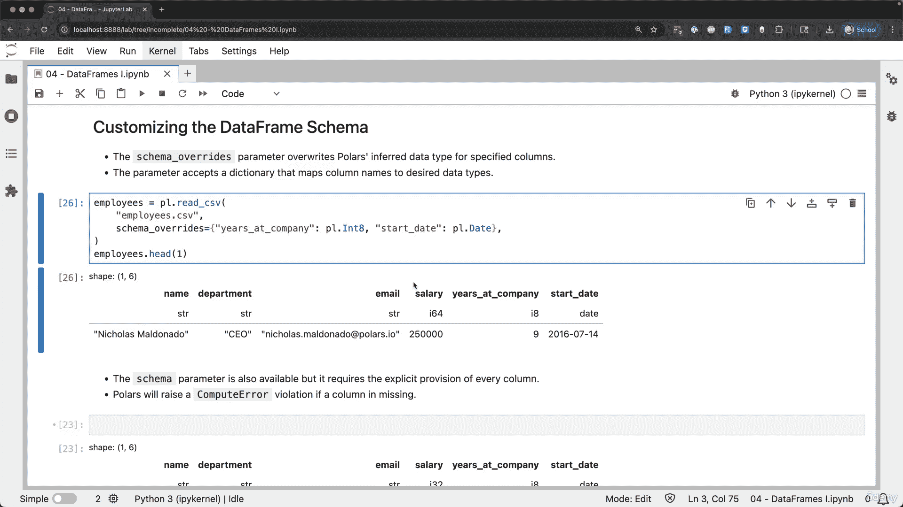

> `schema` 参数漏掉任意列时，Polars 会触发 `compute error`。


下面是 `schema` 参数的关键注意点。

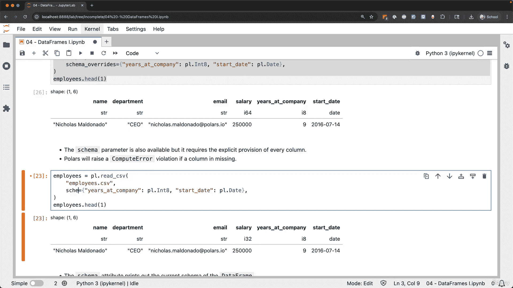

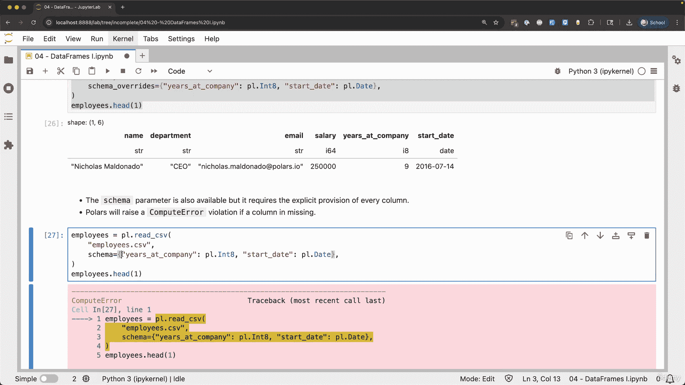

- `schema` 必须显式提供所有列。

- 漏掉任意列会触发 `compute error`。

- 如果只想覆盖少量列，`schema_overrides` 的代码更少。


从 `name` 开始提供所有列，`name` 用字符串类型；现在可以看到期望类型与 Polars 本来推断的一致，这也是通常更依赖 `schema_overrides` 的原因：代码更少，只指定要覆盖的列，而不必提供完整 Schema。回到这个问题，`department` 列用字符串，`email` 列用 `pl.String`；`salary` 列借机会改成 32 位整数，所以用 `pl.Int32`。这里六个键值对对应六列，按此方式导入后，可以看到与 Polars 默认推断不同的数据类型。


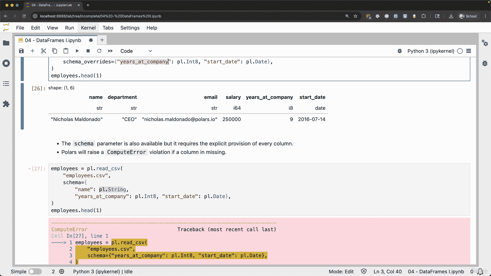

```python
schema = {
    "name": pl.String,
    "department": pl.String,
    "email": pl.String,
    "salary": pl.Int32,
    "years_at_company": pl.Int8,
    "start_date": pl.Date,
}

df = pl.read_csv("employees.csv", schema=schema)
```


可以用公式概括两种参数的关系：`schema_overrides = {部分列名: 期望类型}`，`schema = {全部列名: 期望类型}`。`schema` 参数和 `schema_overrides` 的区别已经理清，接下来看看 `DataFrame.schema` 和 `try_parse_dates`。


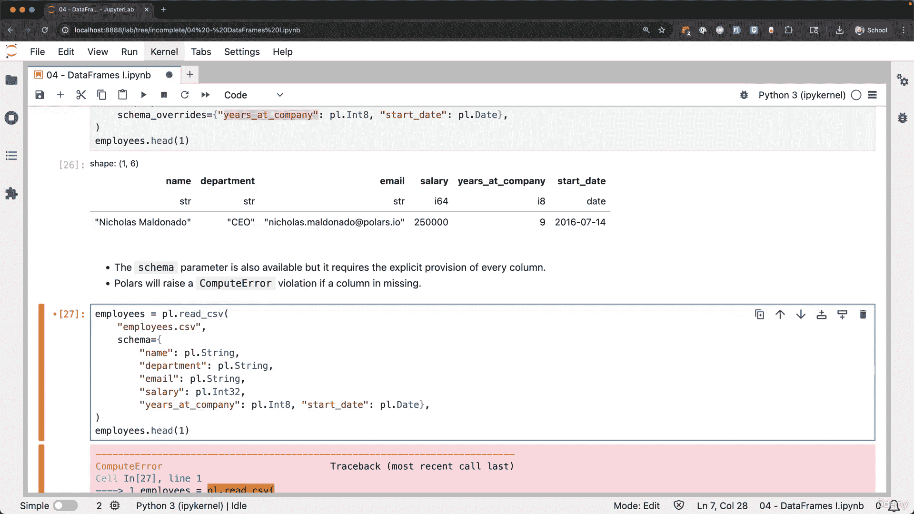

### 📅 Udemy - Data Analysis with Polars and Python part1：P59-3：查看 DataFrame.schema 与使用 try_parse_dates

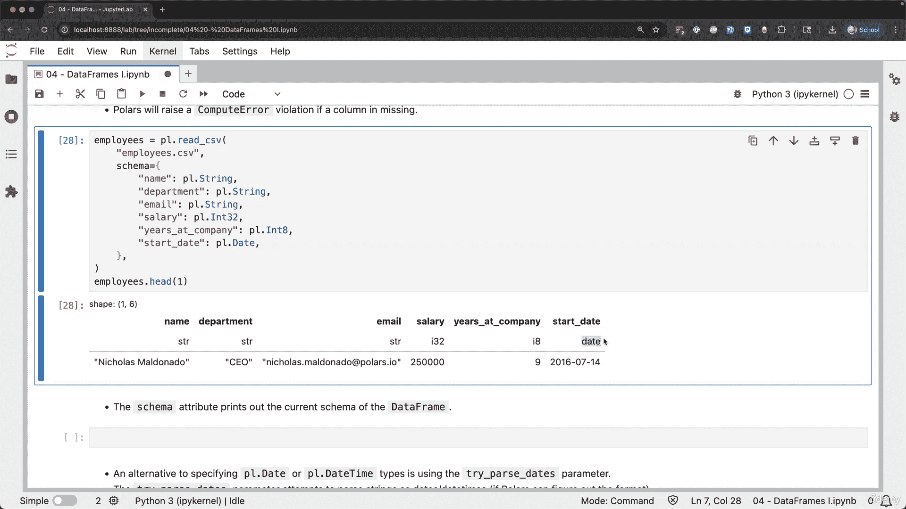

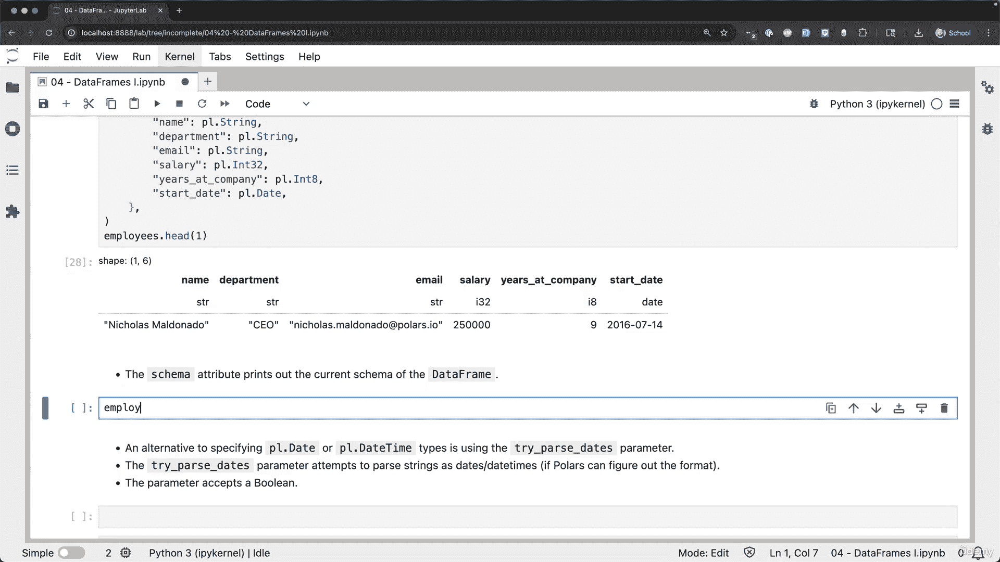

上一节我们处理了导入参数，本节来看看导入后的 Schema 属性，以及一个更省事的日期解析参数。一旦程序中有任意 DataFrame，DataFrame 就会有一个名为 `schema` 的属性，它给出 DataFrame 当前实际的 Schema。输出是一个 Schema 对象，内容看起来像元组，由列名和列关联的数据类型组成。例如 `name` 列存储字符串，`start_date` 列存储日期值，依此类推。可以用下面公式和代码概括这个属性。


```python
DataFrame.schema = {列名: 数据类型, ...}

df.schema
```


我们已经看到一种把日期列真正存为日期值的方法：使用 `schema` 或 `schema_overrides` 并指定 `pl.Date` 类型。但是还有一个好用的快捷方式。这里再次从 `read_csv` 函数开始，指定 `employees.csv`，并使用特殊参数 `try_parse_dates`。它叫 `try_parse_dates`，是因为 Polars 会尝试把任何能识别为可能存储日期或日期时间信息的字符串列，转换为正确的日期或日期时间列。它可能不成功，所以名字里有 `try`。我们传入布尔值 `True`，就是请求 Polars：如果找到这类列，就尝试把列值转换为日期时间。成功条件是日期时间值以常见格式存储，例如四位年份、连字符、月份、连字符、日期这种格式，Polars 能够识别。


```python
df = pl.read_csv("employees.csv", try_parse_dates=True)
```


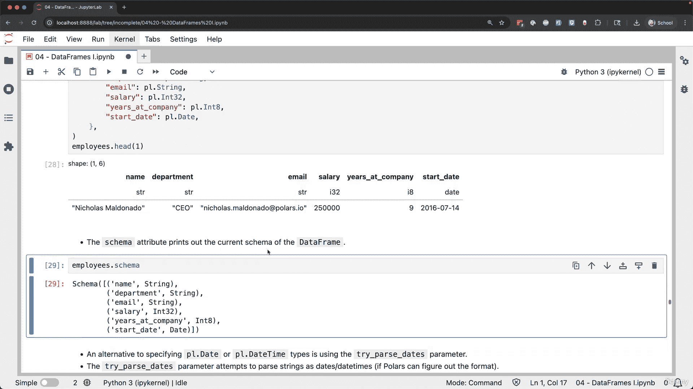

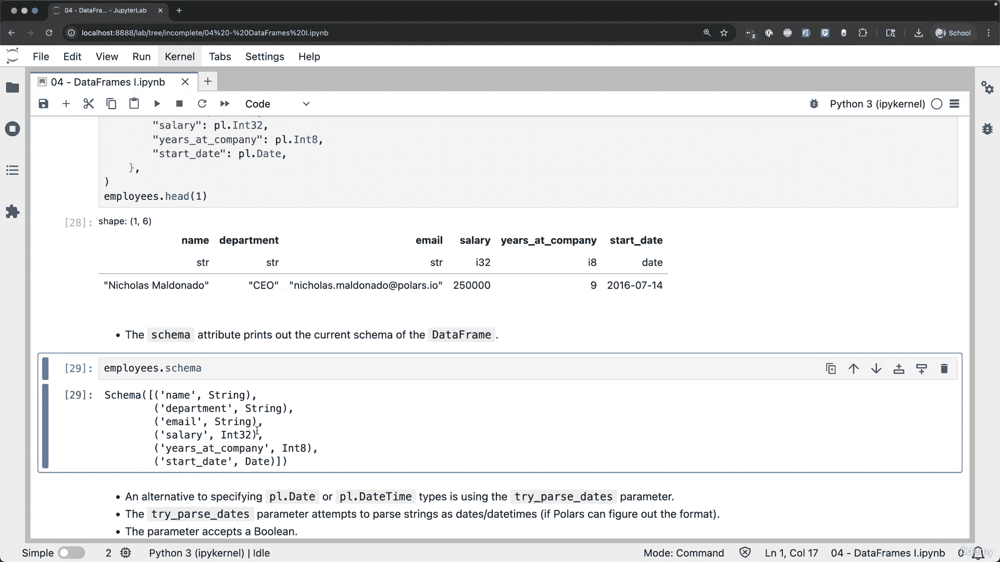

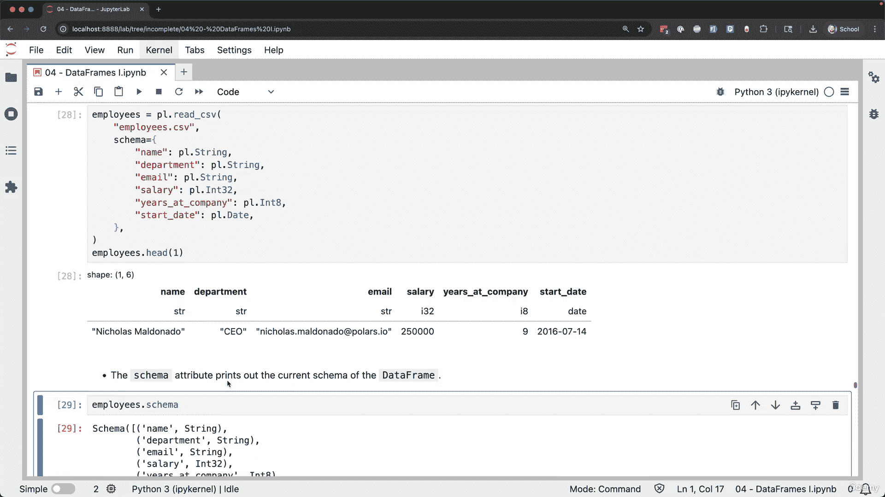

下面是 `try_parse_dates` 的要点。

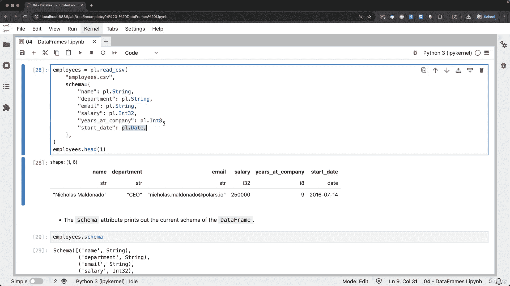

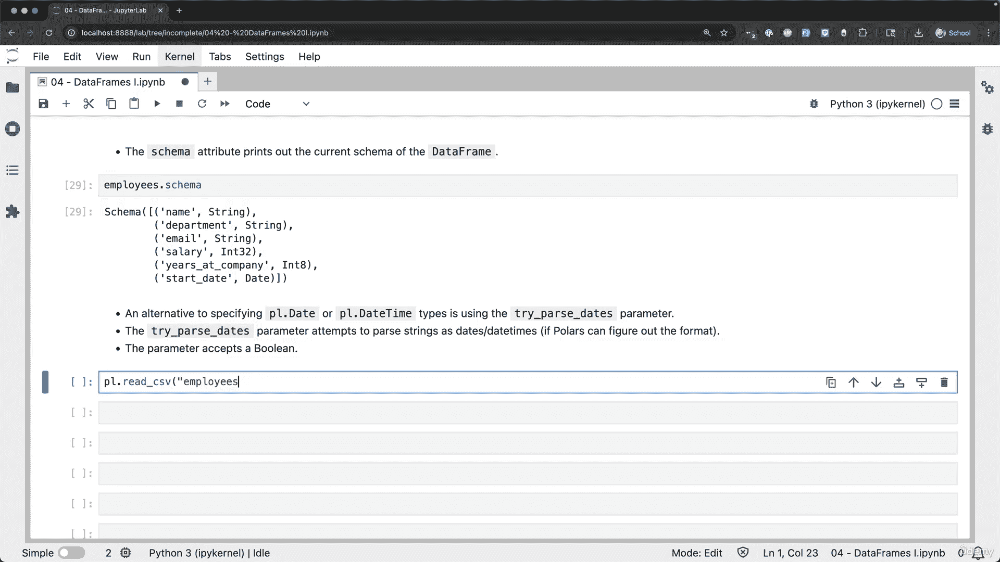

- 它是 `read_csv` 的特殊参数。

- 名字含 `try`，因为 Polars 会尝试，但不保证成功。

- 传入 `True` 后，Polars 会尝试把识别到的日期或日期时间字符串列转换为正确类型。

- 常见格式如 `YYYY-MM-DD` 更容易成功。

- 成功时不需要再写 `schema_overrides` 字典。

- 数据集里有多列涉及日期、时间或两者时，这个参数也有帮助。


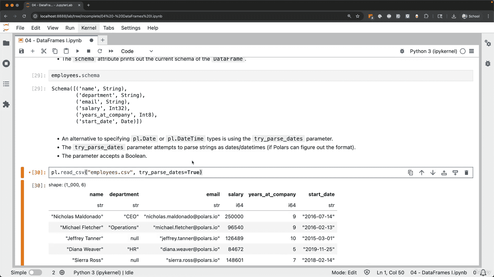

例如 `2024-01-15` 这种四位年份加连字符加月份加连字符加日期的格式很常见，Polars 能够识别。于是可以成功导入为日期列，而无需提供 `schema_overrides` 参数和字典。如果数据集中有多列涉及日期、时间或两者，这个参数同样有帮助。以上快速回顾了 `schema`、`schema_overrides` 以及非常有用的 `try_parse_dates` 参数。


### 🧾 Udemy - Data Analysis with Polars and Python part1：P59-4：总结

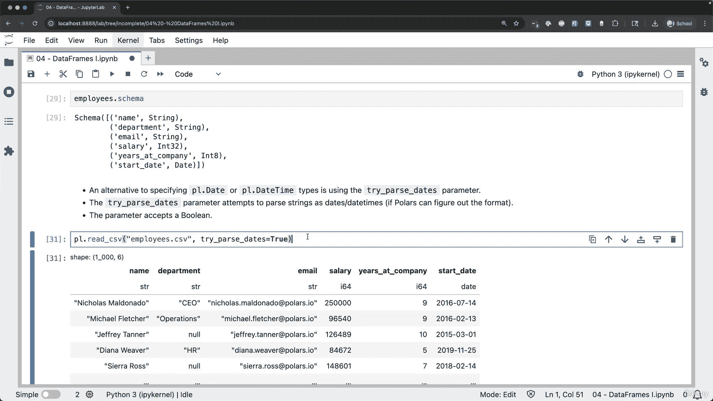

本节课中我们一起学习了如何自定义 Polars 读取 CSV 时的 DataFrame Schema。我们回顾了 `schema_overrides` 参数：它接受字典，只覆盖部分列的期望数据类型；也学习了 `schema` 参数：它要求显式提供所有列，漏列会触发 `compute error`。我们还查看了 `DataFrame.schema` 属性，用它了解当前各列的实际类型，并介绍了 `try_parse_dates=True` 这个快捷方式，让 Polars 尝试把常见格式的日期字符串列直接解析为日期或日期时间列。掌握这些方法后，可以在导入阶段就把数据类型安排好，减少后续转换代码。

