# 📊 使用Polars和Python进行数据分析：第60节：重命名列 🔄


在本节课中，我们将一起学习如何对 Polars 数据框（DataFrame）中的一个或多个列进行重命名。这项操作在日常数据分析中非常常见，几乎每隔一会儿就会用到一次。Polars 提供了不止一种实现方式，每一种方法都有自己的特点和适用场景，所以我们不能只会一种。我们从最基础的表达式方法开始讲起，然后介绍一个更便捷的 DataFrame 方法，最后再看看如何在读取 CSV 文件的时候就顺手把列名定好。等你学完这节课，你就能够根据实际情况，灵活地选择最顺手的那一种重命名方式了。


## 🛠️ 准备工作：重新执行导入代码


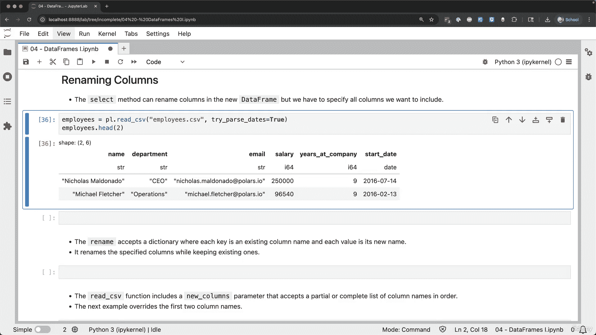

在动手之前，我们先把之前的导入代码重新执行一遍。如果你是从前面几节课一直学过来的，那么这段代码对你来说应该非常眼熟。它完成了三件事：导入 `polars` 库、读取员工数据文件、创建了一个名为 `employees` 的数据框。后面所有的示例都会基于这个 `employees` 数据框来展开。


```python
import polars as pl

employees = pl.read_csv("employees.csv")
employees
```


好了，数据已经准备好，接下来我们就正式步入正题，来看看第一种重命名列的方法。


## 🔍 方法一：使用 `select` + `alias` 重命名


首先，我们可以在表达式上使用 `select` 方法，再结合 `alias` 方法，这是最直接的一种思路。`alias` 方法的作用是给表达式指定一个新的名字，也就是我们想要的列名。比如，假设我想把 `name` 这一列重命名为 `first_name`，我就可以用 `select` 来写一个表达式。在这里，我会使用 `col()` 函数（也就是 `pl.col`）来选中 `name` 列，然后在表达式后面调用 `alias` 方法，把列名改成 `first_name`：


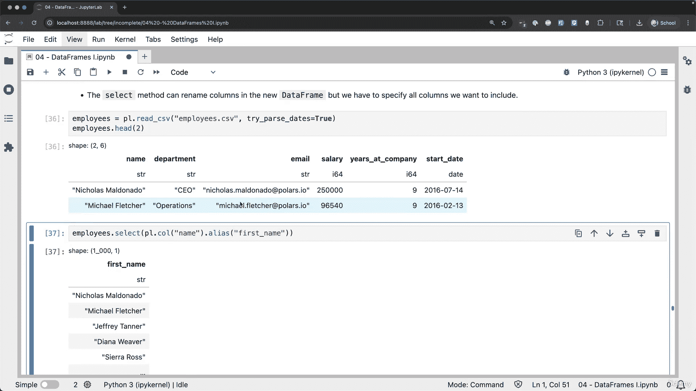

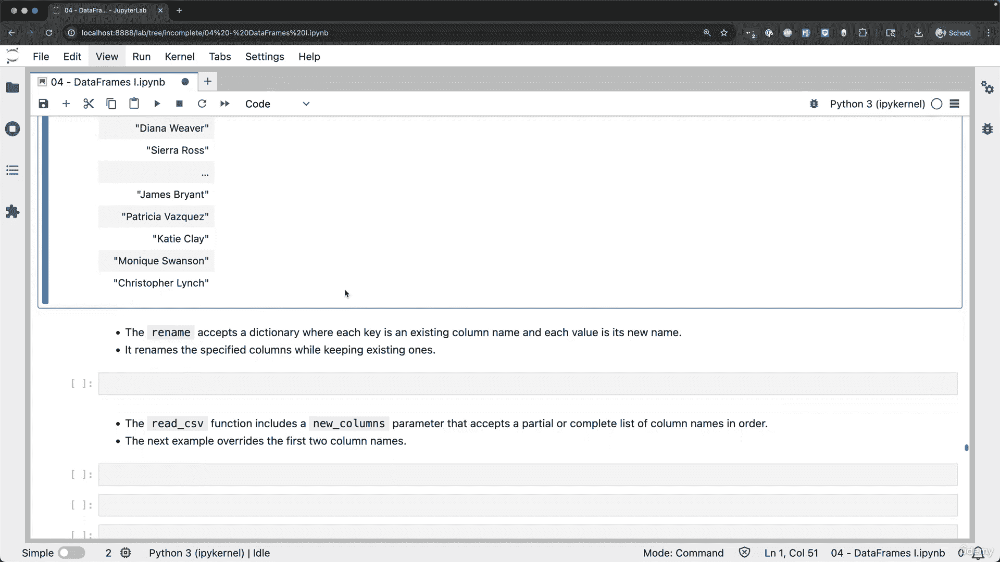

```python
employees.select(pl.col("name").alias("first_name"))
```


这段代码确实能完成任务，得到的结果是一个只包含 `first_name` 这一列的新数据框。但是，这里有一个不得不提的问题：`select` 只会保留我们在表达式中明确选中的那一列。如果我只在表达式里定位了 `name` 列，那么输出结果就只剩下这一列，其他列全部都会被丢掉。所以，如果我想把全部六列都重命名，就必须创建六个不同的表达式，每个表达式里都得单独调用一次 `alias` 方法。你可以想象一下，那会是一长串非常臃肿的代码，名字越多，写起来就越啰嗦，完全不利于维护。


正因为上面的方式太麻烦，Polars 才提供了一个方便又快捷的替代方法。


## 🚀 方法二：使用 `rename` 方法重命名多列


这个快捷方法叫做 `rename`，它是直接调用在数据框本身上的方法。什么意思呢？也就是说，我们完全不需要自己构造表达式，直接拿 `employees` 这个数据框来调用 `rename` 方法就可以了。调用的时候，我们需要传入一个字典，这个字典的键是当前的列名，而值则是我们想要的新列名。


举个例子，假如我想把 `years at company` 这一列改名为 `years`，我就可以把原来的列名作为键、新的列名作为值写进字典里：


```python
employees.rename({"years at company": "years"})
```


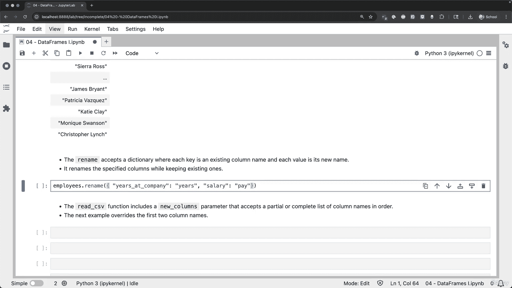

接下来再举一个例子。我想把 `salary` 这一列改名为 `pay`，写法是一样的：


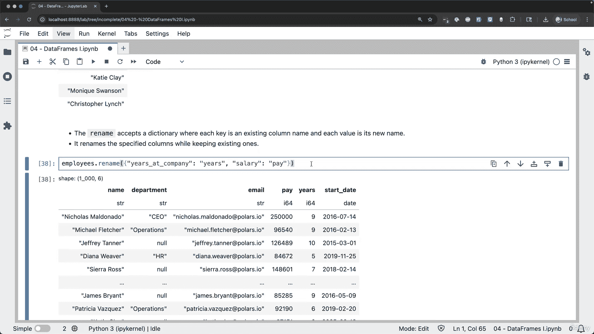

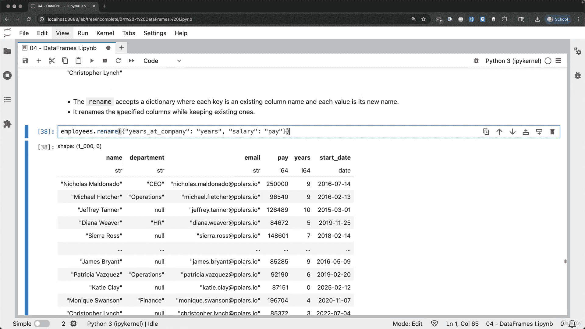

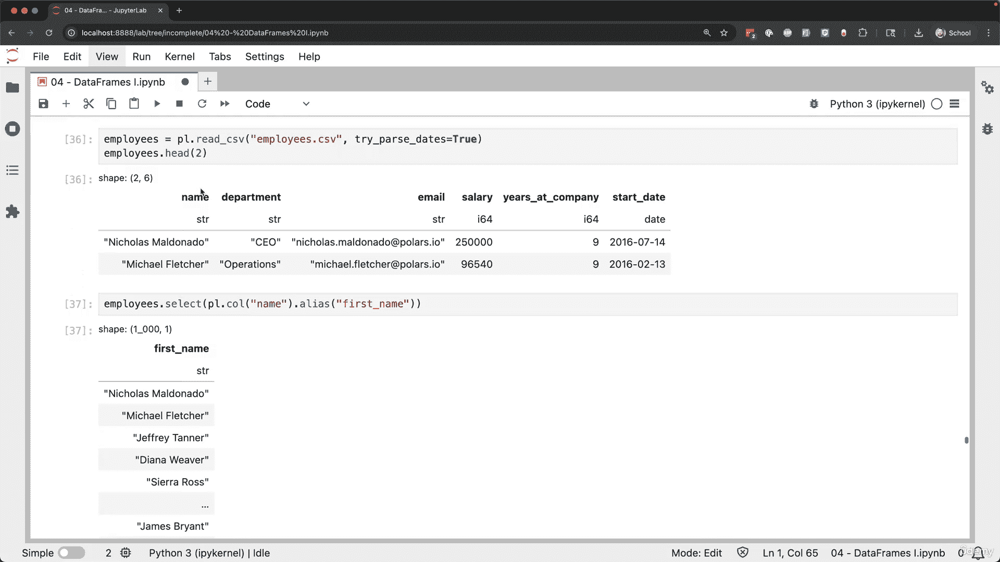

```python
employees.rename({"salary": "pay"})
```


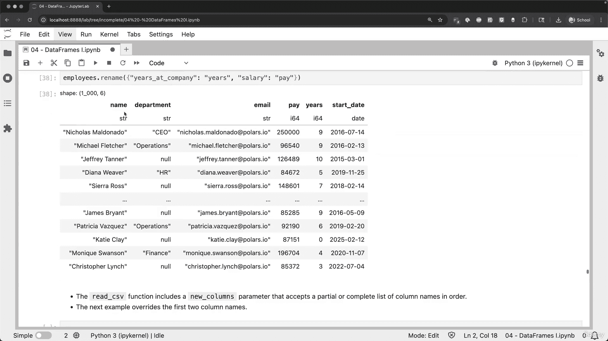

你当然可以把这两组键值对放在同一次调用里。这样就同时完成了两个列的重命名，非常清爽：


```python
employees.rename({
    "years at company": "years",
    "salary": "pay"
})
```


采用这种方案之后，我们会得到一个新的数据框，除了字典里指定的列之外，其他所有列都会被原样保留下来，只有我们指定的那些列被改名。比如说，原来的 `salary` 列变成了 `pay`，原来的 `years at company` 列变成了 `years`。整个过程只需要一次方法调用，配合一个方便的字典数据结构，就把多个列的重命名全部搞定了，它确实比刚才那种 `select` 写法要省心得多。


到这里，我们已经可以在数据框生成之后自由地修改列名了。不过，有时候我们可能希望在数据加载的那一刻就把列名定好，这就要用到 `read_csv` 函数中的一个额外参数了。


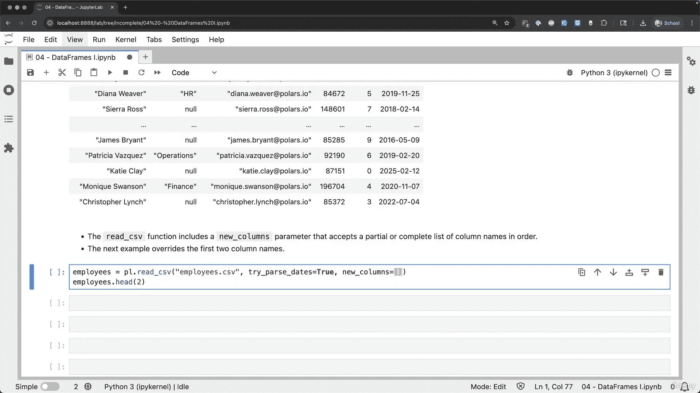

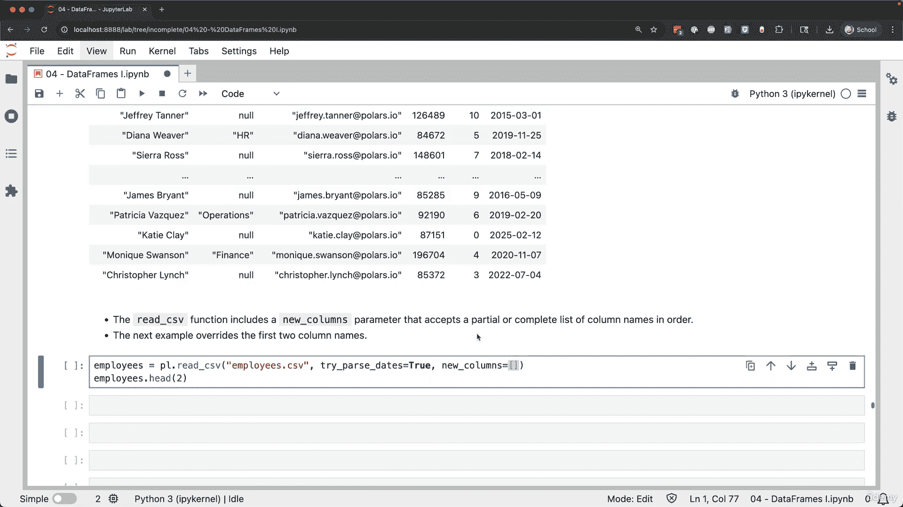

## 📥 方法三：在读取 CSV 时使用 `new_columns` 参数


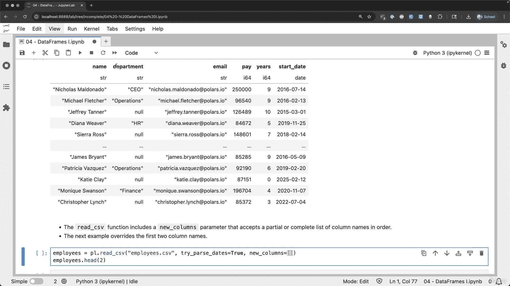

我们回到最开始的导入代码，其实 `pl.read_csv` 函数还有一个额外的参数，名字叫做 `new_columns`。这个参数可以让我们在导入数据的同时就指定列名，相当于把重命名的工作提前到数据进入内存之前完成。为了演示这一点，我们把刚才的导入代码复制下来，然后加上这个新参数。


`new_columns` 参数接受的是一个列表。你不需要把所有列名都写到这个列表里，这些名字会按照顺序依次分配给数据框的各个列。举例来说，如果我们想把第一列重命名为 `employee name`，把第二列重命名为 `dept`（也就是 department 的缩写），完全可以这样写：


```python
employees = pl.read_csv(
    "employees.csv",
    new_columns=["employee name", "dept"]
)
```


上面这段代码中，我们只提供了两个字符串，所以只有前两列会被重命名，剩下的四列仍然保持原来的列名。也就是说，列表中的第一个字符串对应数据框的第一列，第二个字符串对应第二列，依此类推。通过向列表里提供两个顺序的字符串，我们就按位置顺序完成了前两列的重命名。


不过，这里有一个细节要特别注意：`new_columns` 是按位置顺序映射到数据框的各个列的，而不是按列名来映射的。如果我们想修改的是数据框的最后一列，也就是第六列，那我们就必须把中间所有的列名都按顺序写出来，因为我们需要在列表中走到第六个位置，才能对应到数据框中的第六列。比如说，假如我想把最后一列改成 `start day`，那我就得把 `email`、`salary` 这些中间列也都写在列表里，哪怕这些列改不改名无所谓，也要把原来的名字原封不动地填在对应位置上，直到列表末尾，再把最后一列改成 `start day`。下面这段代码示意了这种写法，其中 `原来的第五列名` 需要根据你自己的数据换成真实的列名：


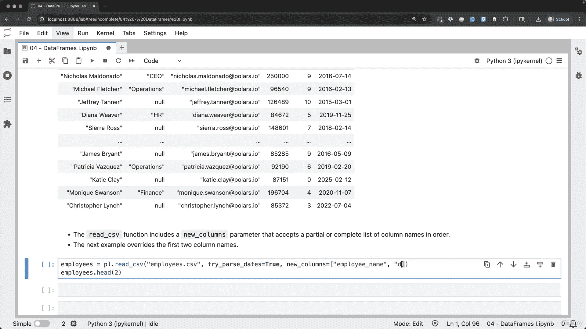

```python
employees = pl.read_csv(
    "employees.csv",
    new_columns=[
        "employee name",   # 第 1 列的新名字
        "dept",            # 第 2 列的新名字
        "email",           # 第 3 列保持不变
        "salary",          # 第 4 列保持不变
        "原来的第五列名",    # 第 5 列保持不变，请按实际列名替换
        "start day"        # 第 6 列的新名字
    ]
)
```


这样做是有效的，也能正常工作。但这算是 `new_columns` 参数的一个小缺点：它不支持传入类似字典这样的按列名映射的结构，你只能老老实实地提供一个按顺序排列的列名列表。如果你要修改的列恰好不在最前面，那你就不得不把前面和中间的列名都列出来，相比 `rename` 方法来说不够灵活。


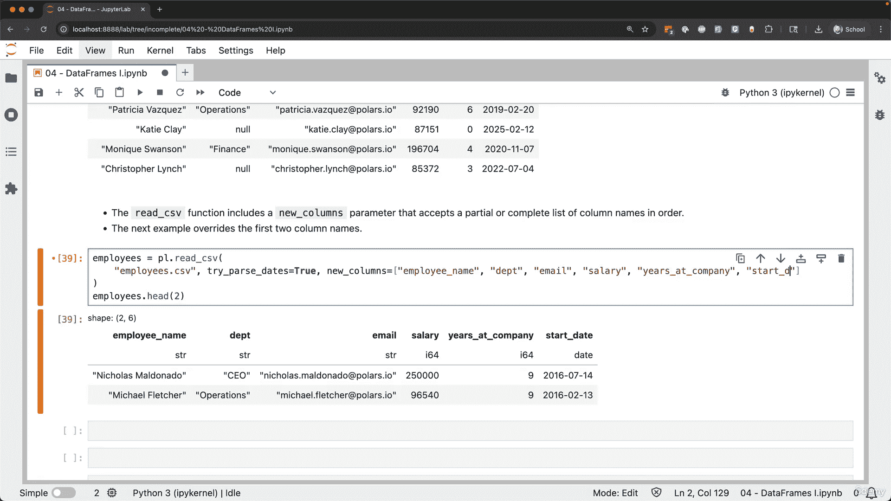

## 📝 小结


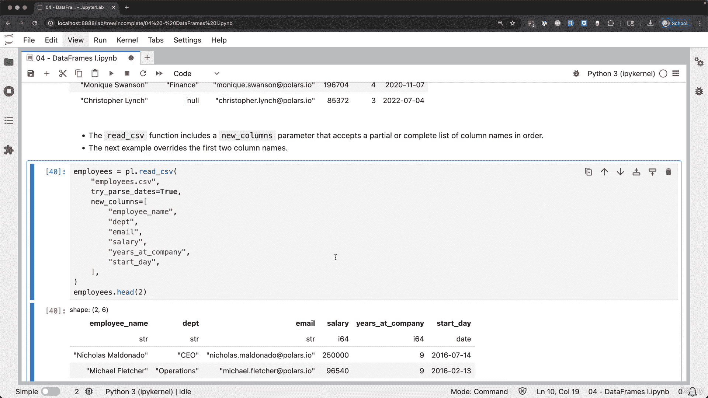

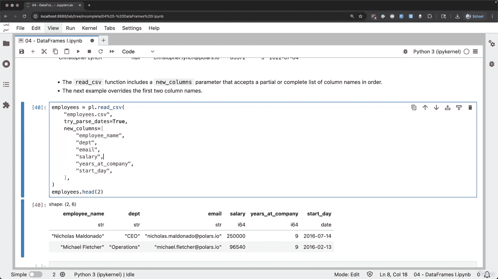

到这堂课为止，我们已经一起学习了三种在 Polars 中重命名列的方式：第一种是使用 `select` 配合 `alias`，适合单独处理某一列，但是会丢掉其他列，因此不适用于批量重命名；第二种是使用数据框的 `rename` 方法，通过字典一次性修改多个列的名字，并且保留其他所有列，是最常用也最推荐的方式；第三种是使用 `pl.read_csv` 的 `new_columns` 参数，在数据导入阶段就直接指定列名，适合刚刚开始读取数据的时候使用，但需要按位置列出所有中间列，灵活性稍差。每种方法都有自己适合的场景，希望你能在遇到具体问题时，判断该用哪一种。总而言之，以上就是本节课要覆盖的全部内容，我们下节课再见。

