# 📊 Polars 与 Python 数据分析：61：name 属性 🏷️

在本节课中我们将要学习 Polars 表达式中的 `name` 属性。此前我们已经探索了多种作用于表达式并返回新表达式的方法，也明确还有很多方法需要继续学习。Polars 团队简化复杂度的方式之一，是把相关方法嵌套或收纳在一个属性命名空间下面。为便于理解，先回顾：属性就是存放在对象上的一块数据。团队在这里用属性保存一个对象，该对象包含一组相关方法。这也是组织方法的一种方式：如果多个方法都围绕同一类操作，就把它们放在一起。下面给出示例，并重新执行代码。

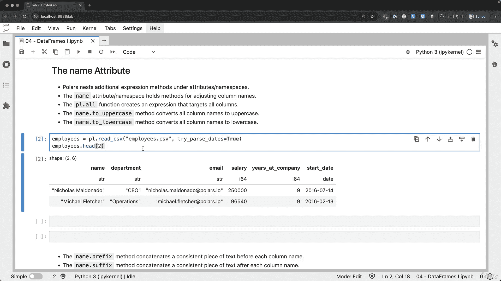

## 🧭 Polars 与 Python 数据分析：61.1：为什么需要 name 属性

上一节我们回顾了表达式会返回新表达式，本节中我们来看看 Polars 如何用属性命名空间组织与列名有关的方法。仍然从 `select` 方法开始。`select` 可以指定单个列，也可以指定多个列；本例使用 Polars 顶层的 `all` 函数。需要注意，`all` 函数本质上仍然创建一个表达式。每个表达式都会有一个 `name` 属性。Python 中访问属性的写法是点号加属性名，这里的属性名刚好叫 `name`。

这里需要区分属性与方法。`name` 不是方法，因此后面不加括号。可以把属性类比为电脑里的嵌套目录，也可以把它看成一个“功能文件夹”。在这个属性内部会得到一个对象，这个对象上面有各种方法。输入点号后再按 Tab 键，可以看到 `name` 下面收纳的方法。Polars 团队把这些方法放在这个对象里，是因为它们都具有影响名称的共同功能，更具体地说，是影响列名。例如，`name` 属性命名空间下有一个 `to_uppercase` 方法，它会把所有列名转换成大写。

下面的代码展示的还是同一套逻辑：仍然在创建一个表达式，并把它传给 `select`。区别在于，`to_uppercase` 这个功能不在顶层表达式上，必须进入 `name` 属性内部去访问和调用。代码结构可以写成下面这样：

```python
df.select(
    pl.all().name.to_uppercase()
)
```

运行后会得到一个新的 DataFrame，其中所有列名都被转换成大写。其他与名称相关的功能也会出现在这个命名空间里。

## 🔠 Polars 与 Python 数据分析：61.2：批量转换列名大小写

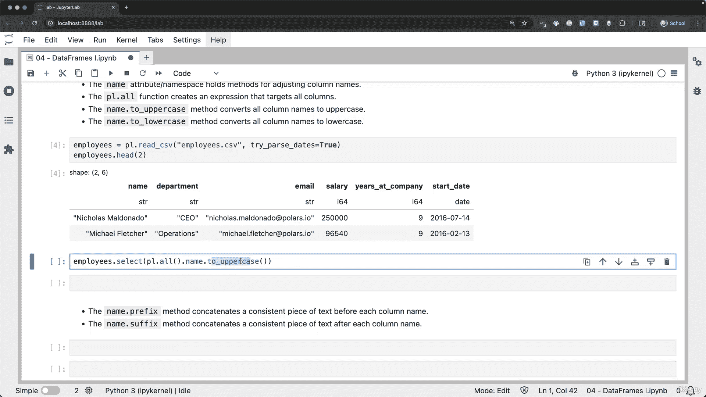

上一节我们看了 `name` 属性的基本访问方式，本节中我们来看看如何用 `name` 属性批量转换列名大小写。为了再练习一次，还有一个互补的 `to_lowercase` 方法。仍然从 DataFrame 开始，调用 `select` 方法，从 DataFrame 中选择数据或执行一个或多个惰性表达式。

那个表达式仍然由 `pl.all()` 创建。如果只想要所有列，单独执行 `pl.all()` 没有问题。接下来通过点号访问 `name` 属性，再用另一个点号定位要调用的方法。这一次调用互补的 `to_lowercase` 方法，它会返回一个新的 DataFrame，其中所有列名都是小写。列名原本可能就是小写，但整体思路完全一样：`name` 命名空间里会有各种与列名相关的功能。对应代码如下：

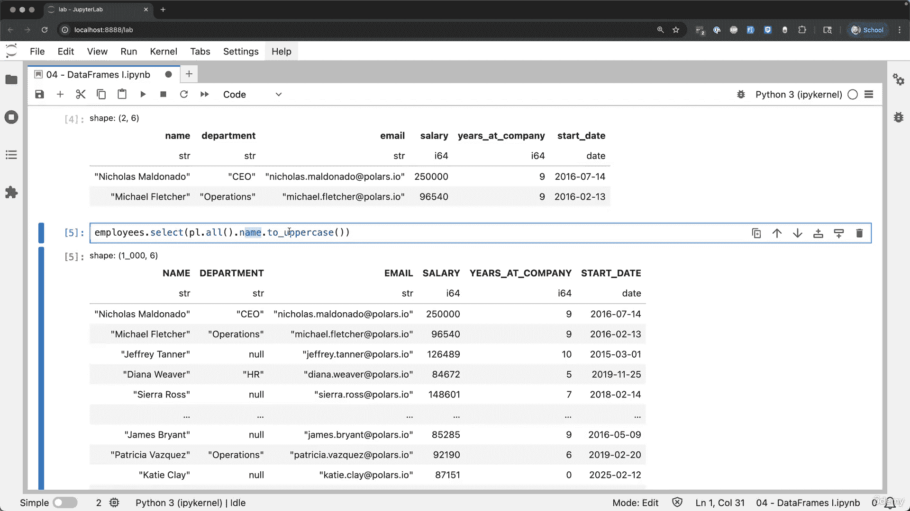

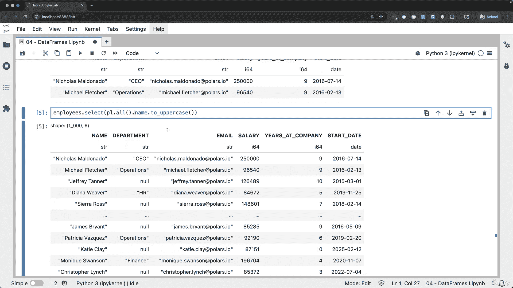

```python
df.select(
    pl.all().name.to_lowercase()
)
```

上一节我们看了大小写转换，本节中我们来看看如何批量给列名加前缀或后缀。

## ➕ Polars 与 Python 数据分析：61.3：批量添加前缀和后缀

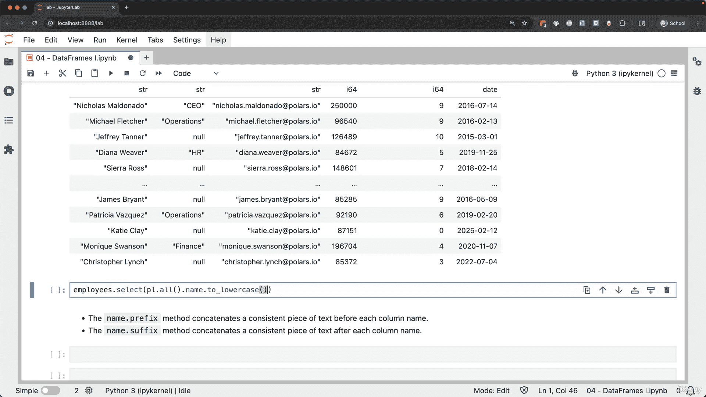

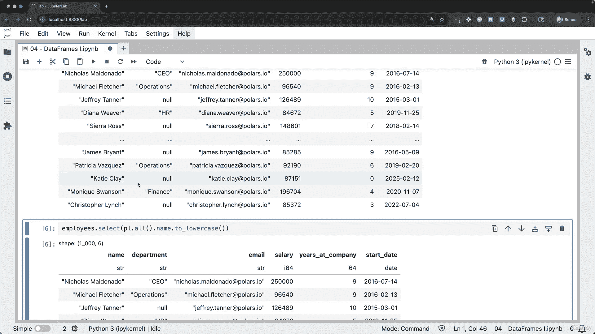

`name` 命名空间里还会提供 `prefix` 方法，它会在每个列名前面拼接一段一致的文本。例如，想在每个列名前加上 `EMP` 表示员工，希望得到 `EMP_name`、`EMP_department`、`EMP_email` 等列名。当然可以逐列重命名，但这样很啰嗦；如果有 100 列，逐列重命名不是好办法。好在 `name` 属性这个命名空间提供了方便的 `prefix` 方法来完成这件事。

下面是 `prefix` 方法的用法示意。仍然使用 `select`，用 `all` 函数选中所有列，然后在这个表达式上访问 `name` 属性，再调用 `prefix` 方法。这个方法接受一个字符串参数，表示要加到每个列名前面的内容。这里使用 `EMP_` 作为前缀。代码如下：

```python
df.select(
    pl.all().name.prefix("EMP_")
)
```

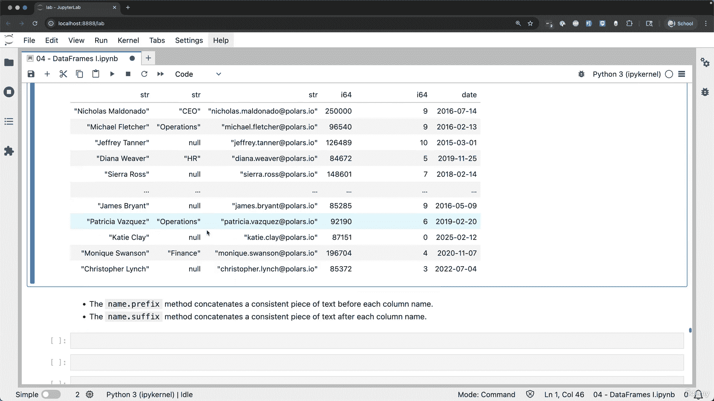

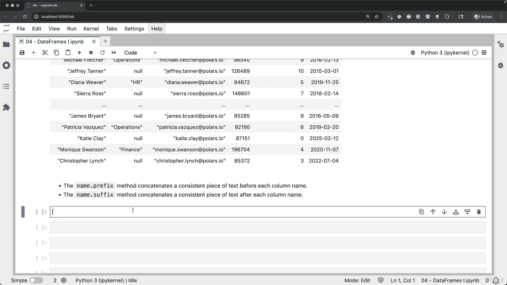

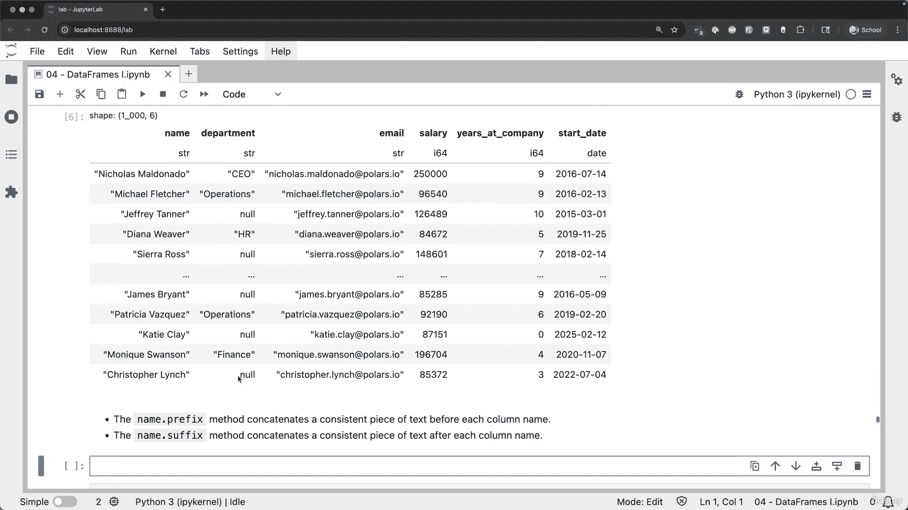

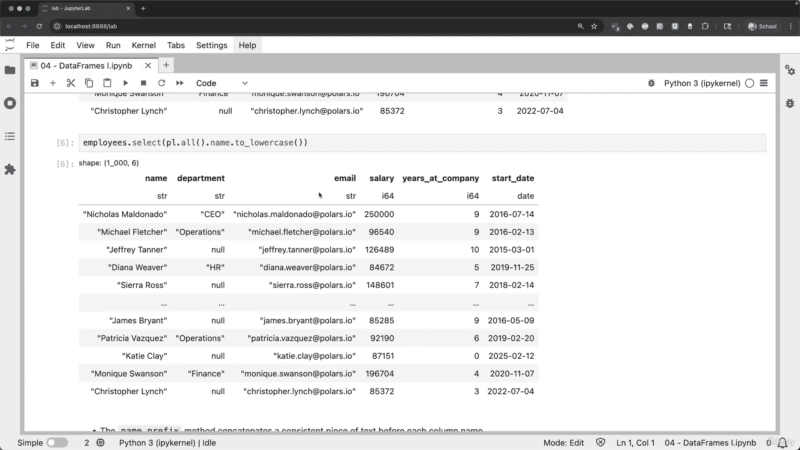

执行后可以看到一个新的 DataFrame，所有列名都加上了这段一致的前缀。可以猜到，还有一个互补的 `suffix` 方法，做的是同样的事情，只是把文本加到列名末尾。例如复制上面的代码，把方法改成 `suffix`。`suffix` 表示给定字符串的后缀，所以需要传入一个参数。这里随意提供 `_value` 作为后缀。代码如下：

```python
df.select(
    pl.all().name.suffix("_value")
)
```

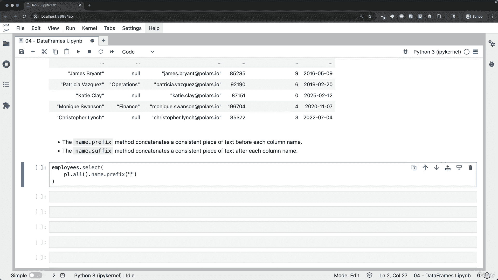

运行后会看到类似 `name_value` 这样的列名。只要想对 DataFrame 中的列名应用一致的操作，这些操作通常都能在 `name` 属性或命名空间中找到。除了 `name`，还会有其他互补的属性和命名空间，用于处理其他概念或数据类型，例如后面会讲到的日期时间数据命名空间。

最后需要强调，本节只是对 `name` 属性的快速介绍。归根到底，我们仍然是在生成一个表达式并传给 `select`，只是有些表达式修改方法会嵌套在自己的命名空间里，例如 `name`。理解这个组织方式后，再看到类似链式写法就不会陌生。

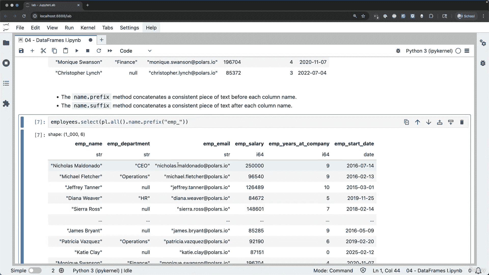

以下是本节涉及的核心方法汇总，便于快速回顾：

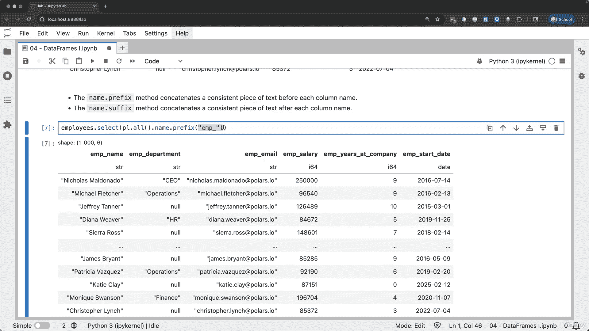

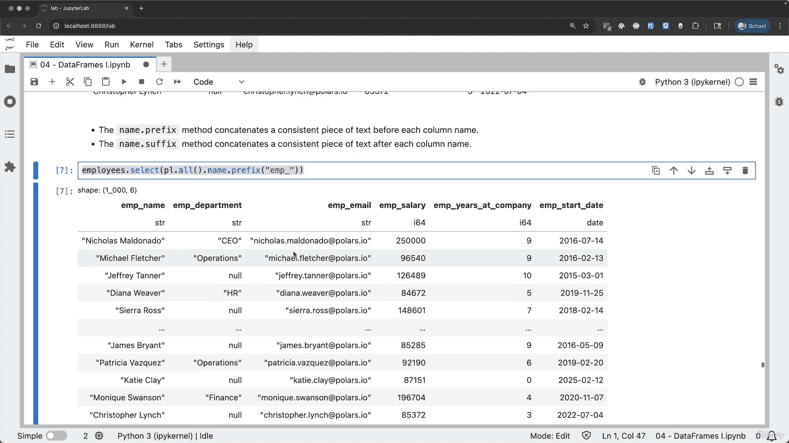

- `pl.all().name.to_uppercase()`：把所有列名转换成大写。
- `pl.all().name.to_lowercase()`：把所有列名转换成小写。
- `pl.all().name.prefix("EMP_")`：给所有列名加统一前缀。
- `pl.all().name.suffix("_value")`：给所有列名加统一后缀。

> 记忆要点：`name` 是属性，不是方法；访问它不用加括号。它像一个“列名功能文件夹”，里面收纳了与列名相关的方法。

## ✅ Polars 与 Python 数据分析：61.4：本节总结

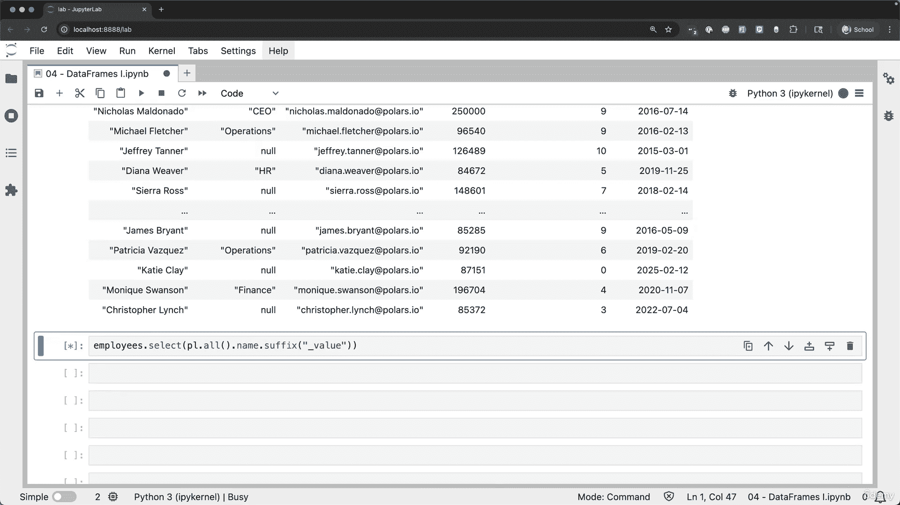

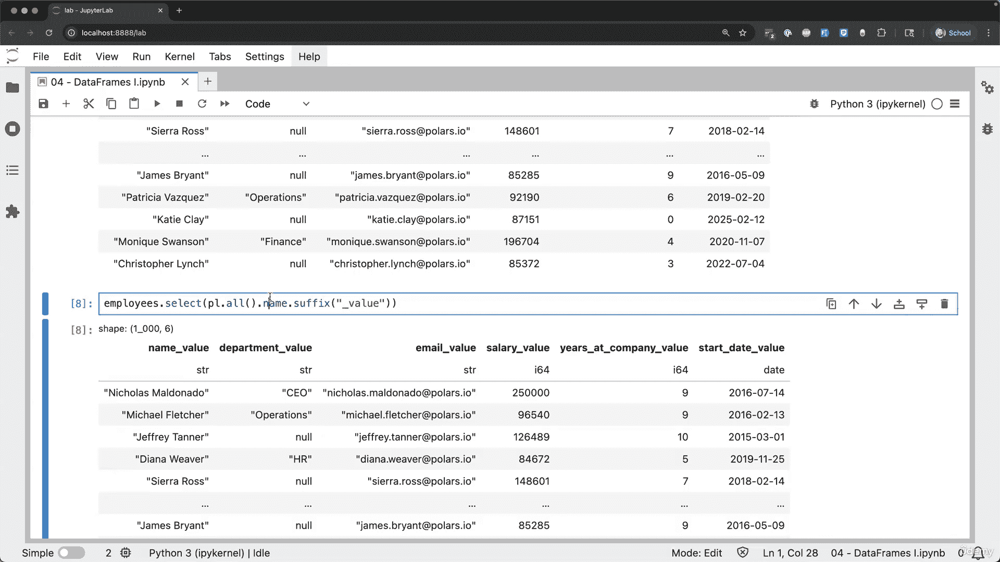

本节课中我们一起学习了 Polars 表达式中的 `name` 属性。我们了解了属性与方法的区别，知道了 `name` 是一个命名空间对象，里面收纳了与列名相关的方法，并通过大小写转换、前缀和后缀的示例看到了如何把这些方法串联到 `select` 表达式中。最终要记住：这些写法仍然是在构造表达式，只是把列名处理功能放进了 `name` 命名空间。

