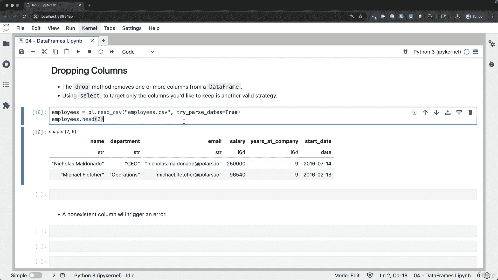
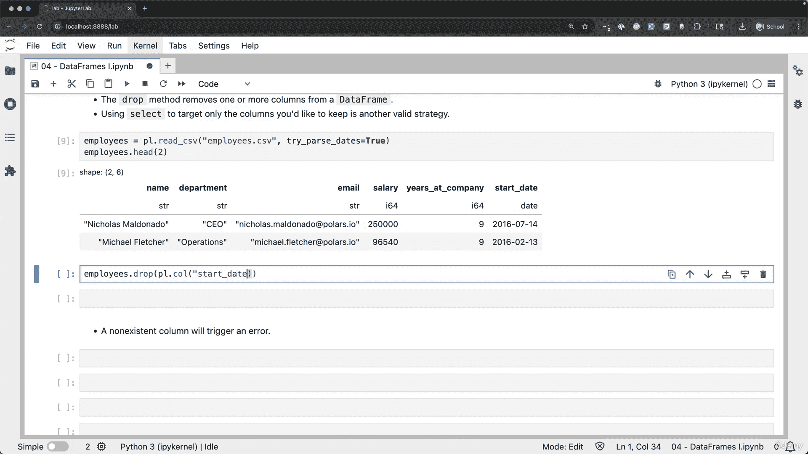
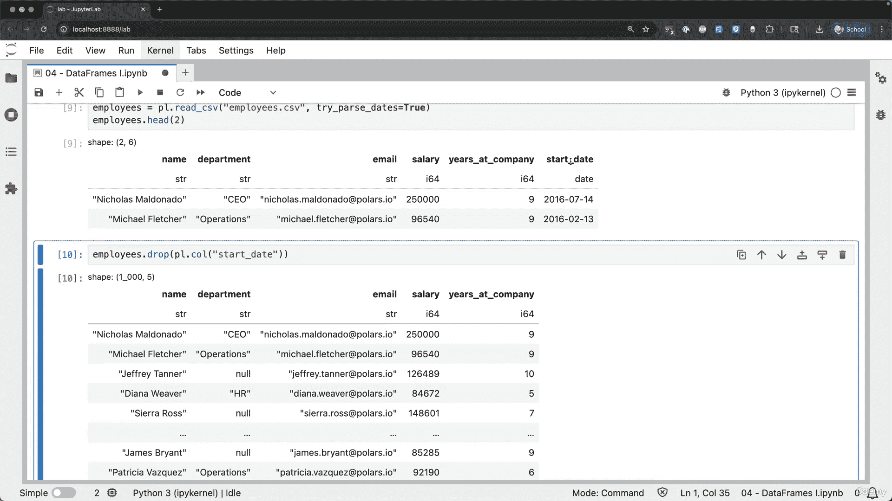
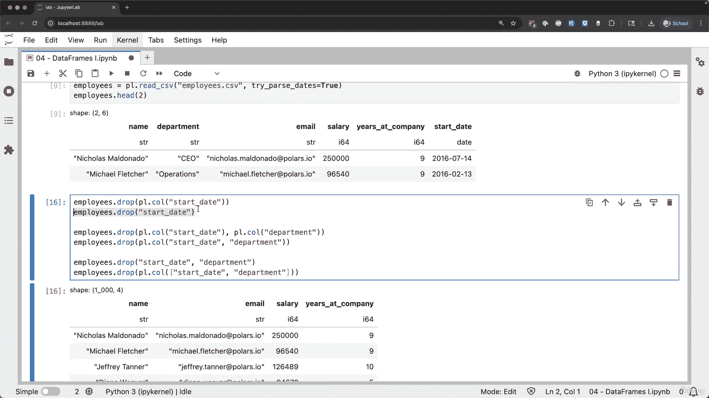
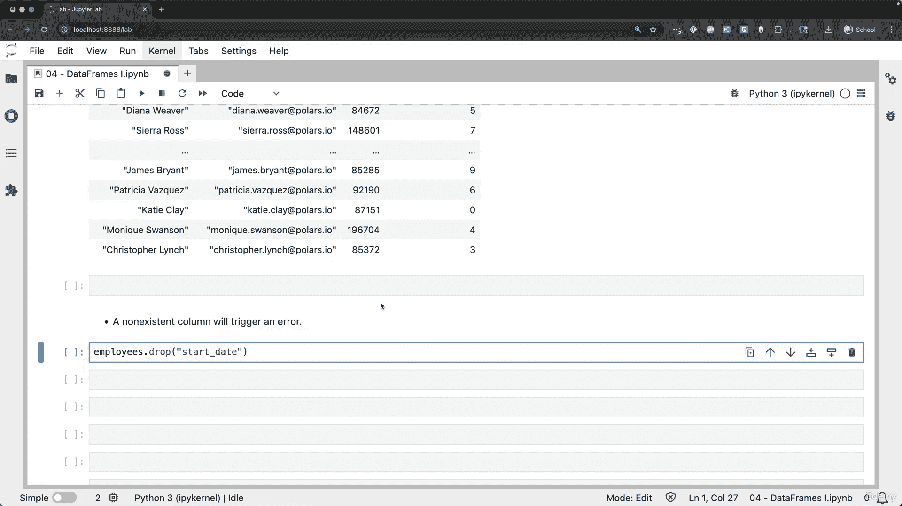
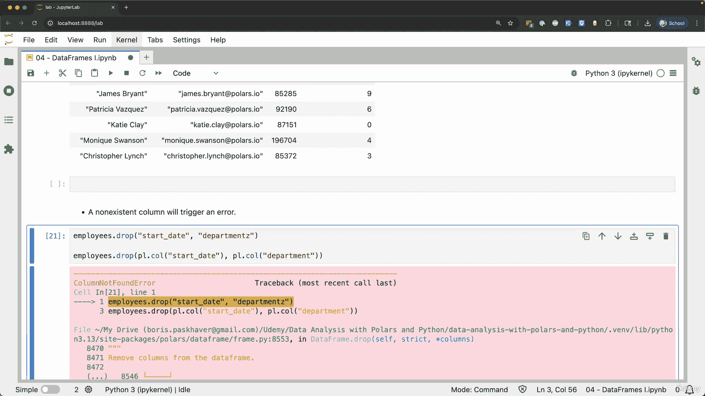
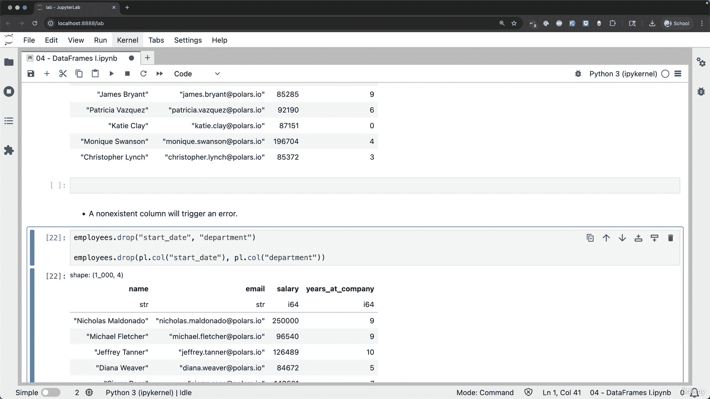

# Polars与Python数据分析：第62节：删除列 🗑️

在本节课中，我们将学习如何从DataFrame中删除一列或多列。课程会围绕Polars里的`drop`方法展开，说明它和`select`方法的区别，演示多种传参方式，并解释当列名不存在时为什么会报错以及如何处理。掌握这些内容后，就能更直接地清理数据表中的多余字段，而不必写出一长串保留列清单。

接下来先回顾本节的核心术语。Polars中删除列的技术术语是`drop`，意思是移除或删除。Polars在DataFrame本身直接提供了方便的`drop`方法。核心操作可以表示为：



```python
new_df = df.drop(要删除的列)
```

上一段介绍了`drop`的基本含义，本节中我们来看看它与`select`的区别。`select`方法始终可用，如果选择要保留的列，就相当于排除了要删除的列。这也是解决问题的一种方式。但如果DataFrame有100列，只想删除其中3列，用`select`写出97列会非常冗长。因此，接下来需要重点了解更直接的`drop`方法。



下面先看两种基本思路，它们分别对应“保留哪些列”和“删除哪些列”：



- 使用`select`：指定要保留的列，从而间接排除要删除的列。
- 使用`drop`：直接指定要删除的列，代码通常更短。

了解这两种思路后，我们进入`drop`的实际用法。我会重新导入数据，然后调用`drop`方法。`drop`方法接受多种输入，其中一种是表达式。例如，在调用函数中提供一个表达式，用来定位`start_date`列：

```python
df.drop(pl.col("start_date"))
```

Polars会一如既往地返回一个新的DataFrame。因此，运行这段代码后，可以看到结果中已经删除了`start_date`列。

上一段演示了表达式写法，本节中我们来看看更灵活的传参方式。许多Polars方法支持直接传入字符串。通常，在构建复杂表达式时不建议只传字符串，因为字符串只能指定某个列，无法表达更复杂的逻辑。但当前场景没有更复杂的表达式要构建，只是指定一列或多列，所以字符串语法也受支持。以下是`drop`常见的几种写法，可以按需选择：

```python
# 直接传字符串
df.drop("start_date")

# 同时传多个表达式
df.drop(pl.col("start_date"), pl.col("department"))

# 一个表达式指定多列
df.drop(pl.col("start_date", "department"))

# 连续传多个字符串参数
df.drop("start_date", "department")

# 向调用函数传入列表
df.drop(pl.col(["start_date", "department"]))
```



在第3种写法中，创建了一个针对多列的表达式，并传入两个连续的字符串，注意要正确关闭括号，这样会删除这些指定的列。第4种写法连续传入两个字符串参数，也完全有效。第5种写法把列表传给调用函数，同样可以完成删除。`drop`支持的方式很多，选择最适合自己的写法即可。

了解多种传参方式后，还需要注意一个非常重要的规则。如果指定了不存在的列，就会触发错误。下面用一个简单例子演示：这里指定一个不存在的列，比如在列名后多加一个`Z`：

```python
df.drop(pl.col("start_dateZ"))
```

此时会得到“列未找到”的错误，也就是`ColumnNotFoundError`。这个错误不仅会在所有列都无效时出现，即使同时指定了其他有效列，只要有一个指定列不存在，整个`drop`方法也会失败。例如，先定位`start_date`，再不小心把`department`拼错成`departmentz`，整个删除操作就不会成功。无论使用表达式还是字符串语法，错误本质上都一样；即使把表达式包在调用函数里，也不会有区别。以下是这个错误规则的关键点：



- 指定不存在的列会触发`ColumnNotFoundError`。
- 只要一个指定列不存在，整个`drop`操作就会失败。
- 无论使用表达式还是字符串语法，错误本质相同。
- 修正列名拼写错误后，代码就能恢复到可工作状态。





上一节我们介绍了错误处理规则，本节中我们对整体内容做一个小结。本节课中我们一起学习了如何用`drop`从DataFrame删除一列或多列，理解了`drop`表示移除或删除，也知道了`select`可以通过保留列来间接排除列。我们还掌握了`drop`支持表达式、字符串、多个参数和列表等多种传参方式，并明确了指定不存在列会导致整个操作失败。修正拼写错误后即可继续使用`drop`清理数据表。下节课再见。
