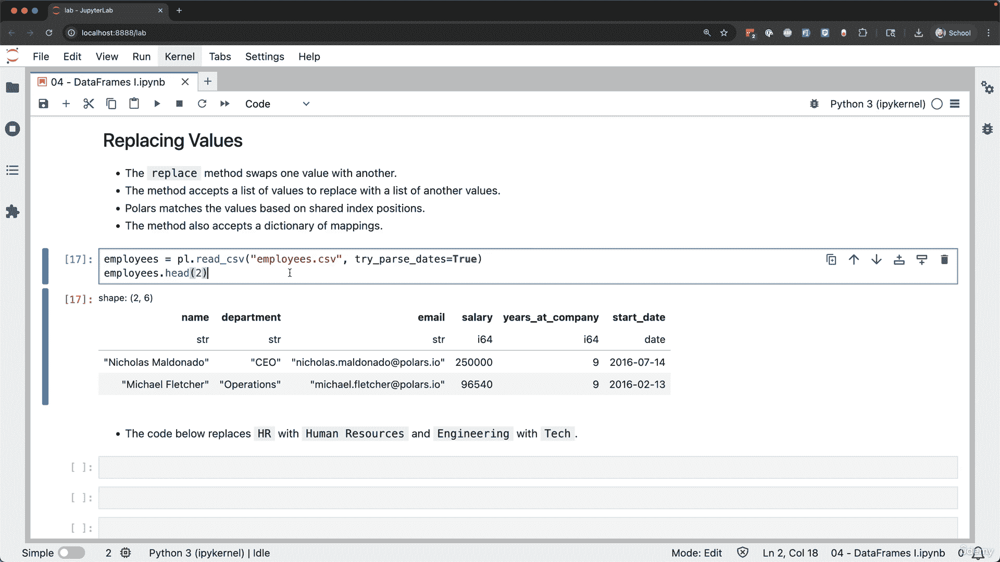
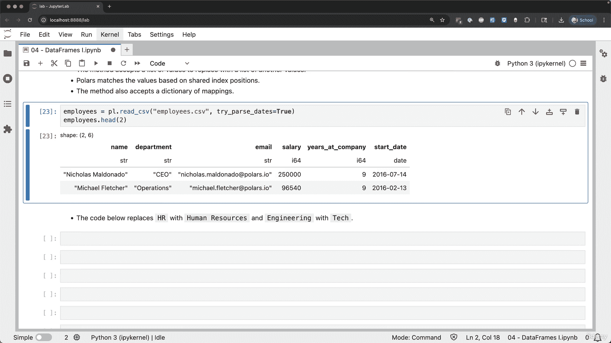
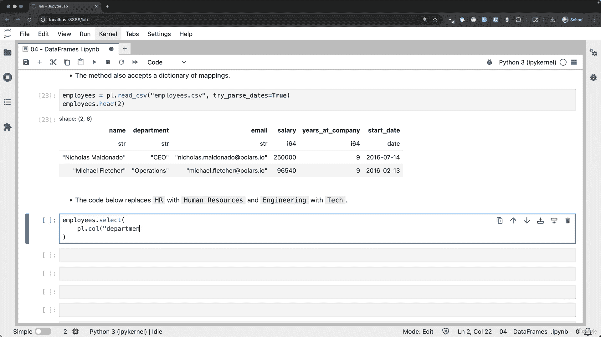
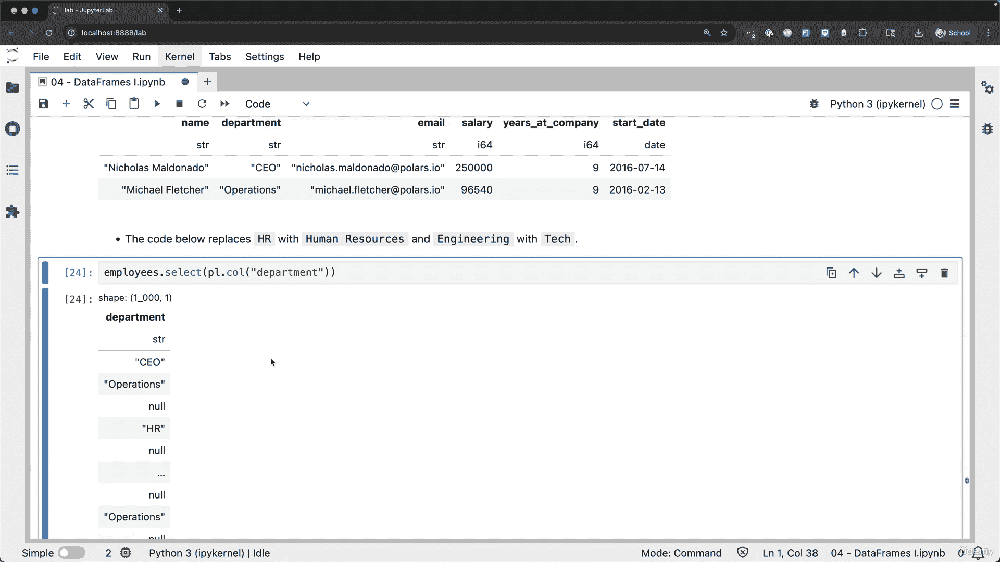
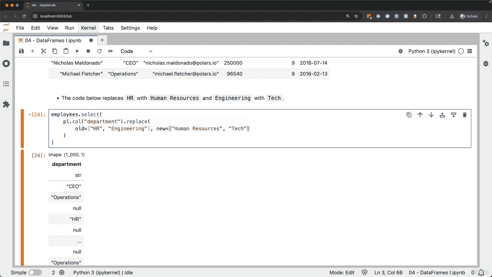
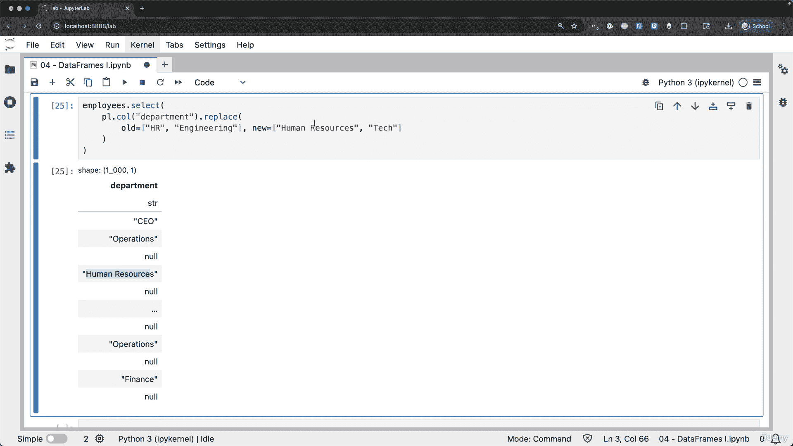
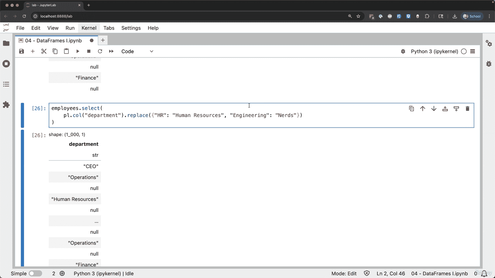

# Data Analysis with Polars and Python：第63节：替换值 🔄

在上一节中，我们已经学习了如何通过 select 方法从数据帧中选择出我们关心的列。本节课，我们在此基础上，进一步学习如何在列中替换值。具体来说，我们将一起学习 Polars 中的一个非常实用的方法：replace。这个方法的核心作用，是把某个列中的一些数值，替换成另外一组数值。你可以把它想象成 Excel 里的查找替换功能，只不过它在数据分析和数据处理场景下更加灵活。这节课的内容会围绕 replace 方法支持的两种不同输入方式展开，并通过实际例子一步一步演示如何使用它。

在正式动手之前，先介绍一下 replace 方法支持的两种输入方式：





- 第一种：使用 old 和 new 两个参数，并分别传入列表。
- 第二种：直接传入一个字典。

这两种方式各有特点，下面我们分别来看。

## 准备数据与初步观察

开始写代码之前，我们先把必要的导入工作准备好。我们需要引入 Polars 库，并且拥有一个可以操作的 employee 数据帧。只有先把基础环境搭建好，后面的替换演示才能顺利执行。我们先把 employee 数据帧取出来，并且单独选中 department 这一列。为什么要先单独看这一列呢？因为替换操作通常只作用于某一列，先观察一下列里的实际值，可以让我们更清楚要替换什么。执行下面的选择表达式后，我们就能看到 department 列中的所有值，或者至少能看到其中的一部分值。





```python
df.select(pl.col("department"))
```

假设我们现在有一个明确的需求：把 department 列中所有出现的 HR 字符串，全部替换成 human resources；同时，把所有出现的 engineering 字符串，替换成另一个词，比如 tech。这里要说明的是，替换并不是把整个数据帧里的所有列都扫描一遍，而是严格限制在 department 这一列里进行。

## 第一种方式：使用 old 和 new 列表参数

首先来看看第一种方式。在这种方式下，我们需要在 replace 方法中提供两个参数：一个是 old，另一个是 new。old 参数接收的是一个列表，这个列表中存放的是所有你希望被替换掉的旧值；new 参数同样接收一个列表，这个列表中存放的是与旧值一一对应的新值。也就是说，new 列表中的第 i 个元素，负责替换 old 列表中第 i 个元素，替换规则可以简单表示成：`new[i] -> old[i]`。这里有一个非常重要的约束：new 列表的长度必须与 old 列表的长度一致，否则无法完成一一对应的替换。

为了方便观察，我们把原来的表达式拆开写。在下面的代码中，old 列表就是我们定义的旧值列表，new 列表则是新值列表。因为 HR 在 old 列表中排第一个，所以 new 列表的第一个元素 human resources 就会用来替换 HR；同理，engineering 对应的是 new 列表中的第二个元素 tech。整个操作只针对 department 列，这一点从 select 方法传入的列名就能看出来。

```python
df.select(
    pl.col("department").replace(
        old=["HR", "engineering"],
        new=["human resources", "tech"]
    )
)
```

执行这段代码之后，我们会得到一个只包含 department 列的新数据帧。从输出结果中可以看到，原本的 HR 已经全部变成了 human resources。至于 engineering，在这个示例的输出中可能恰好没有显示出来，但请放心，只要原数据里存在 engineering，它也会被一一替换成 tech。这也说明替换操作是完全限定在 department 列内部的，不会影响到数据帧中的其他列。

到这里，我们已经了解了如何通过 old 和 new 两个列表来执行替换。不过，在实际使用中，这种同时维护两个列表的方式虽然有效，却显得有些繁琐。接下来，我们来看第二种方式：直接把一个字典传给 replace 方法。这也是我个人更加偏爱的写法，因为字典的键值对结构天生就适合表达“旧值替换成新值”这种映射关系。



## 第二种方式：使用字典参数



第二种方式在语法上仍然和 select 方法配合使用，而且我们依然只针对 department 这一列。区别在于，这次 replace 方法接收的参数不再是一个 old 和一个 new，而是一个字典。在这个字典中，每个键都代表一个旧值，每个键对应的值则代表要替换成的新值。换句话说，一个键值对就是一条替换规则：`旧值 -> 新值`。这种写法让替换关系变得一目了然。

如果我们要实现和刚才一样的替换效果，可以把字典写成下面这样。第一个键值对表示把 HR 替换成 human resources，第二个键值对表示把 engineering 替换成 nerds。注意，这次我没有继续使用 tech，而是换成了 nerds，主要是为了展示一下字典方式在写值的时候可以自由选择任何想要的字符串，没有额外的限制。

```python
df.select(
    pl.col("department").replace(
        {"HR": "human resources", "engineering": "nerds"}
    )
)
```

执行这段代码之后，我们应该会得到和第一种方式非常相似的输出。因为我们始终只针对 department 这一列，并且只交换这一列中的值。最终返回的结果同样是一个新的数据帧，里面只包含 department 这一列，HR 已经被替换成 human resources，engineering 则被替换成了 nerds。这个过程没有修改原始数据，而是生成了一份新的数据帧，这也是 Polars 操作的一个重要特点。

## 总结



本节课中，我们一起学习了 Polars 中 replace 方法的完整用法。我们首先了解了它能够把列中的值替换成另一组值，然后学习了两种不同的调用方式：第一种方式是使用 old 和 new 两个列表，按索引位置一一对应完成替换；第二种方式是使用字典，通过键值对来定义替换规则。列表方式适合替换规则比较多、且容易按顺序维护的场景；字典方式则更适合能够直接看到“旧值映射到新值”的场景。在实际工作中，你可以根据自己的习惯和具体需求，选择更适合的那一种方式。希望这节课的内容能帮助你在数据处理中更熟练地使用 replace 方法。
