# 🧮 Polars 与 Python 数据分析：64：数学运算（一）

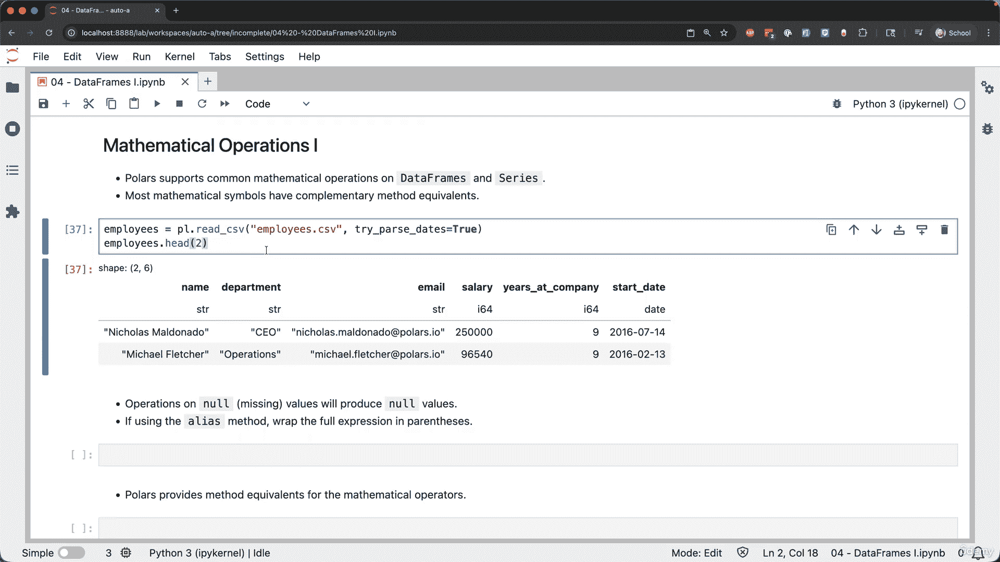

在本节课中，我们将学习如何对 Polars 数据框中的某一列应用许多常见数学运算。这些运算有两种执行方式：一种叫方法选项，另一种叫符号或运算符选项。本节课会把两种语法都展示出来，你可以选择自己更喜欢的一种。开始前还要注意一点：如果对 null 值应用数学运算，而 null 是 Polars 对缺失值或不存在值的叫法，那么这个运算会返回 null。例如，对 null 做加法或减法，结果仍然是 null。记住这一点后，我们先执行导入代码。

## 📥 Polars 与 Python 数据分析：64.1：准备数据与基本思路

上一节我们说明了两种写法和空值规则，本节中我们来看看如何开始写表达式。下面先在 employees 数据框上调用 select 方法，并连续展示一组数学运算。我们会先单独针对 salary 列，因为它目前存储的是整数，适合用来演示。以下是准备代码：

```python
import polars as pl

# 假设 employees 已经读取完成
# employees = pl.read_csv("employees.csv")
```

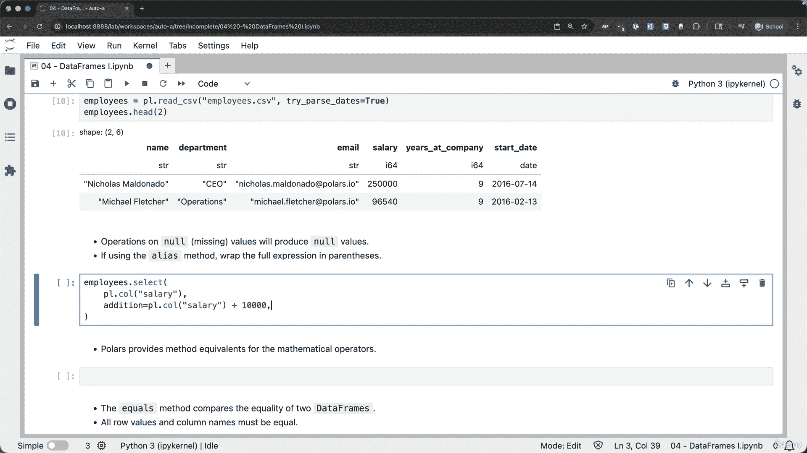

准备好环境后，就可以把多个数学表达式传给 select，让 Polars 按列计算并生成新列。这样写的好处是，所有计算都集中在一个表达式里，初学者也容易对照结果。

## ➕ Polars 与 Python 数据分析：64.2：加法、减法与乘法

上一节我们准备好了数据框，本节中我们来看看加法、减法和乘法。先看加法。加法符号是加号。例如 `+ 10000` 会给每一行值加 10000，并在新列中产生结果。提醒一下，必须给这个新列一个不同于 salary 的名字。命名有两种方式：第一种是用括号包住完整表达式，再调用 `alias` 方法提供名字，例如 addition；第二种是使用关键字参数，这里采用第二种方式。于是删除括号，并把表达式赋给 addition 列。下面可以沿用类似模式：先写列名，再写想求值的对应表达式。

以下是加法、减法和乘法示例：

```python
result = employees.select(
    addition=pl.col("salary") + 10000,
    subtraction=pl.col("salary") - 12345,
    multiplication=pl.col("salary") * 2,
)
```

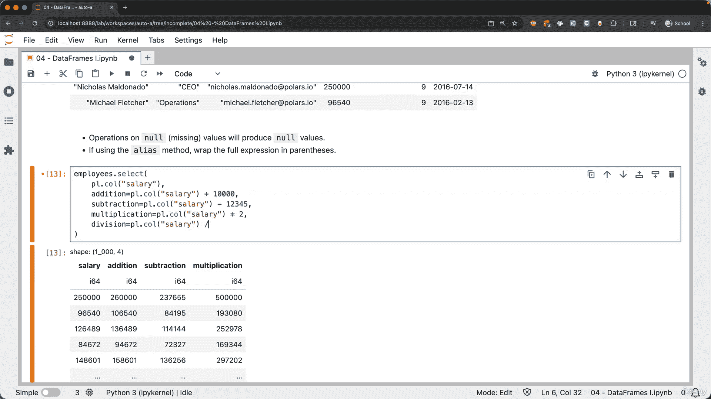

这里的加号运算符执行加法，为每行值加 10000。减法是加法的补充，列名为 subtraction，表达式仍然针对 salary 列，减号是减法符号，这里从每个 salary 起始值中减去 12345。可以看到起始值，也可以看到结果。接着是乘法。乘法使用熟悉的星号运算符，也就是键盘上的 shift+8，但原理完全相同：表达式针对 salary 列，然后对每一行值应用数学符号或运算符来执行运算。例如 `* 2` 表示把每一行值乘以 2，因此新的 multiplication 列中 salary 值会翻倍。

## ➗ Polars 与 Python 数据分析：64.3：浮点除法与向下取整除法

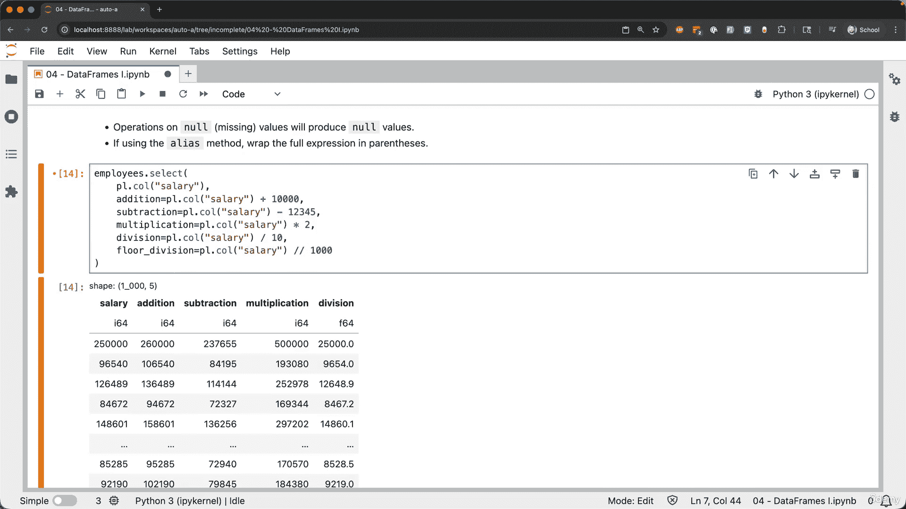

上面我们看了加减乘，本节中我们来看看除法。除法比较有意思，因为可以执行两种不同类型：浮点除法和向下取整除法。先看浮点除法，它的行为和直觉一致。这里取 salary 列，用单个正斜杠执行除法，把每个值除以 10，会得到一列浮点值。可以看到结果是 64 位浮点数。每个 salary 值都除以了 10，例如某个条目除以 10 后还带有 0.1 这样的浮点分量。浮点除法的补充叫向下取整除法，它会在计算完成后去掉小数或分数部分，因此结果是整数列。下面并排比较。再次创建针对 salary 的表达式，向下取整除法的符号是两个连续正斜杠。这里同样除以 10，对比可以看到，不再保留 0.1 这类分数或比例部分，而是直接截掉。注意这不是四舍五入，不会把数字向上或向下移动，只是截断完整的小数或十进制部分。两者主要区别就是产生浮点列还是整数列。以下是示例：

```python
result = employees.select(
    floating_division=pl.col("salary") / 10,
    floor_division=pl.col("salary") // 10,
)
```

从结果类型上看，`/` 保留小数部分，`//` 去掉小数部分。初学时可以用一个简单公式记住：`浮点除法 = 真除法结果`，`向下取整除法 = 截断小数部分`。

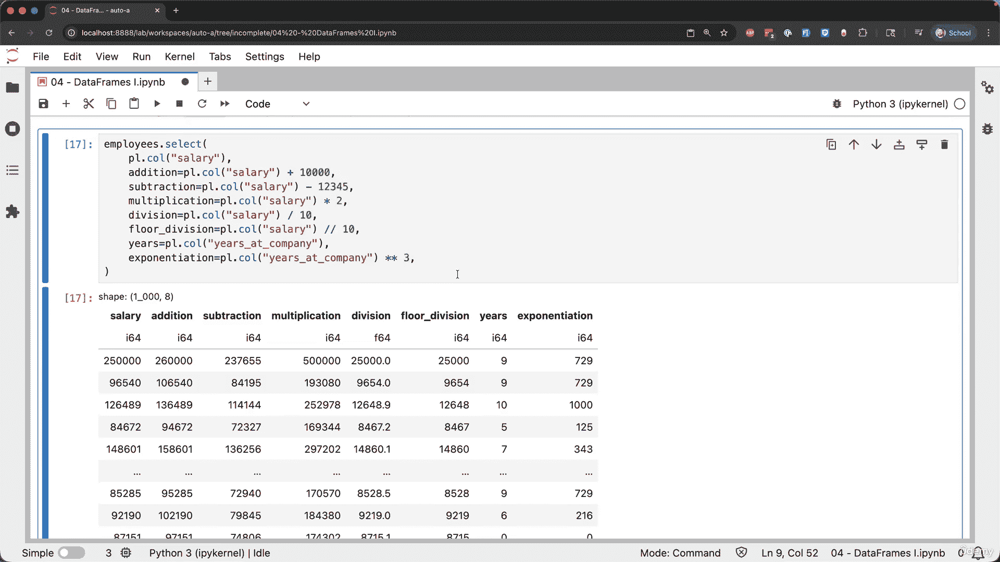

## 🔢 Polars 与 Python 数据分析：64.4：幂运算与取余运算

上一节我们介绍了除法，本节中我们来看看另外两类运算：幂运算和取余。接下来几个例子要针对 employees 中的另一个数值列 years，也就是 years at company。先单独提取 years at company 列，并把它赋给 years 列。然后看幂运算。幂运算是把一个数自身相乘若干次。例如创建针对 years at company 的表达式，幂运算符号是两个连续星号。若提供值 2，就是求每一行 years at company 值的平方。现有值 9 时，9 乘以自身一次，也就是 9×9，或 9 的平方、9 的 2 次方，得到 81。若提供值 3，就是立方，即自身乘三次，9×9×9 得到 729。这就是幂运算。最后看余数。它使用特殊符号取模运算符，也就是百分号。语法同样是创建针对 years at company 的表达式，然后使用取模运算符，这个符号在键盘上是 shift+5，再给一个除数。它会返回除法操作的余数：取 years at company 中某行值除以 3，余数是多少。例如 9 除以 3，3 整除 9，没有剩余，余数为 0；10 除以 3，3 进入 9，剩 1，余数为 1；5 除以 3，3 进入 3，剩 2，余数为 2。以下是幂与取余示例：

```python
result = employees.select(
    years=pl.col("years_at_company"),
    squared=pl.col("years_at_company") ** 2,
    cubed=pl.col("years_at_company") ** 3,
    remainder=pl.col("years_at_company") % 3,
)
```

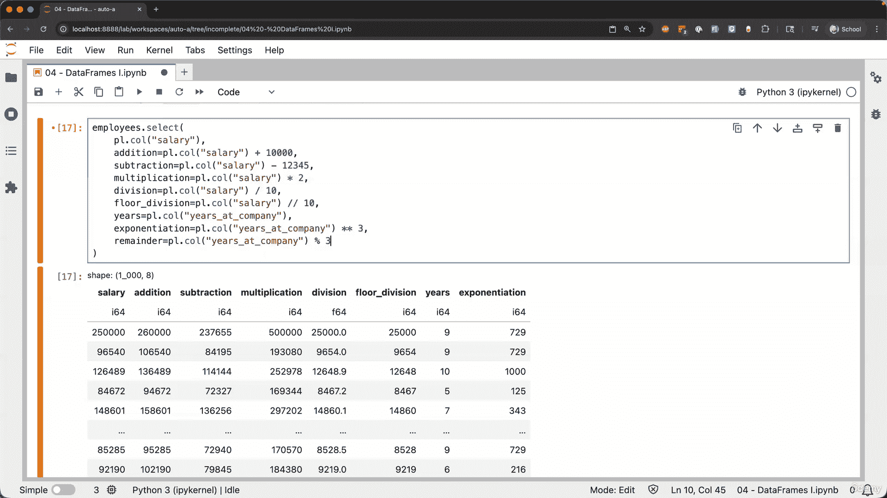

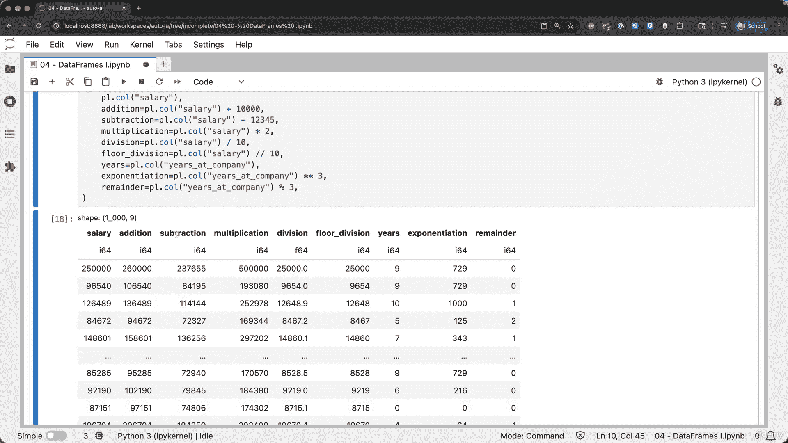

用公式表示就是：`9 ** 2 = 81`，`9 ** 3 = 729`，`10 % 3 = 1`，`5 % 3 = 2`。取余运算符也叫取模运算符，它关心的是除法后剩下多少。

## 🧰 Polars 与 Python 数据分析：64.5：用方法替代运算符

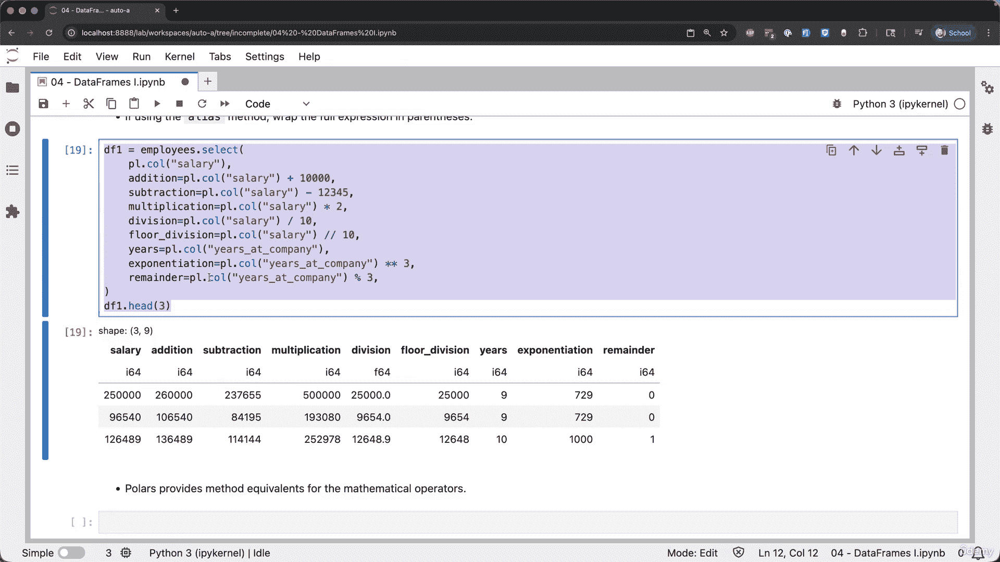

如课程开头所说，每一个符号都有对应的方法，可以完成完全相同的结果。稍后会展示并排示例。为了后续使用，先把创建出的完整数据框赋给特殊变量 df1，也就是 data frame 1，并用 head 方法预览前几行，参数为 3，用来提醒我们结果长什么样。接下来复制这一整段代码到下方，在下一个例子中只把所有符号替换成可调用的对应方法。先把数据框命名为 df2。无论选择符号或运算符，还是选择对应方法，结果都完全相同。选择更直观的一种即可，也欢迎在传给 select 的不同表达式中混合使用符号、运算符和方法。以下是常见运算符与方法名的对应关系：

- `+` 对应 `add`，表示加法。
- `-` 对应 `sub`，是 subtract 的缩写。
- `*` 对应 `mul`，是 multiply 的缩写。
- `/` 对应 `true_div`，表示浮点除法，也叫真除法。
- `//` 对应 `floor_div`，表示向下取整除法。
- `**` 对应 `pow`，是 power 的缩写。
- `%` 对应 `mod`，是 modular 的缩写。

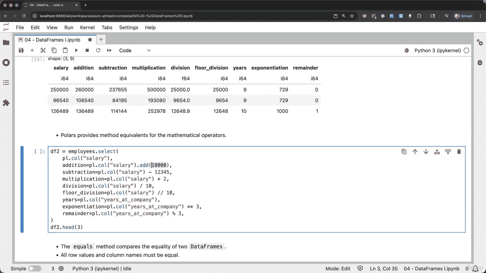

下面先看符号写法：

```python
df1 = employees.select(
    addition=pl.col("salary") + 10000,
    subtraction=pl.col("salary") - 12345,
    multiplication=pl.col("salary") * 2,
    floating_division=pl.col("salary") / 10,
    floor_division=pl.col("salary") // 10,
    years=pl.col("years_at_company"),
    squared=pl.col("years_at_company") ** 2,
    remainder=pl.col("years_at_company") % 3,
)

df1.head(3)
```

接着看方法写法。先看加法：不用加号，创建针对 salary 的表达式并调用 add 方法，会把参数中的固定值加到每一行值上，得到与上面完全相同的结果。减法的对应方法叫 sub，是 subtract 的缩写。乘法的对应方法叫 mul，是 multiply 的缩写。浮点除法的方法叫 true_div，也就是 true division；叫 true 是因为它更准确，不丢失数据，给出真正的除法结果。没有只叫 div，大概是为了提醒除法有两种：浮点除法和向下取整除法。true_div 就是浮点除法。向下取整除法用两个正斜杠完成，对应方法叫 floor_div。这里没有对表达式应用额外运算，只是按原样取出列。幂运算符双星号对应方法叫 pow，是 power 的缩写，这是数学术语；这里把行值提升到 3 次方。取余或取模运算符对应方法叫 mod，是 modular 的缩写；mod 表示除以传入参数值，然后返回余数，这些值会填入列。执行后会得到相同结果。以下是方法版示例：

```python
df2 = employees.select(
    addition=pl.col("salary").add(10000),
    subtraction=pl.col("salary").sub(12345),
    multiplication=pl.col("salary").mul(2),
    floating_division=pl.col("salary").true_div(10),
    floor_division=pl.col("salary").floor_div(10),
    years=pl.col("years_at_company"),
    squared=pl.col("years_at_company").pow(2),
    remainder=pl.col("years_at_company").mod(3),
)

df2.head(3)
```

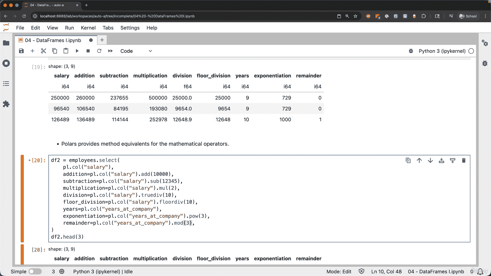

## ✅ Polars 与 Python 数据分析：64.6：验证两种写法完全一致

上一节我们用方法重写了表达式，本节中我们来看看如何验证两者一致。现在两个数据框已经赋给各自变量，Polars 有一个 equals 方法，可以在一个数据框如 df1 上调用，并把第二个数据框作为参数传入。它会返回布尔值：如果两个数据框完全相等，就为真。这里得到 true，说明两个数据框完全相同，每个列名、每个行值、每个数据类型都完全一致并共享。这证明第二个例子中的方法等价写法，和第一个例子中的符号或运算符写法完全一样。你可以选择更喜欢的方式，也可以混合搭配，或者每天尝试不同写法。以下是比较代码：

```python
df1.equals(df2)
# 预期输出: True
```

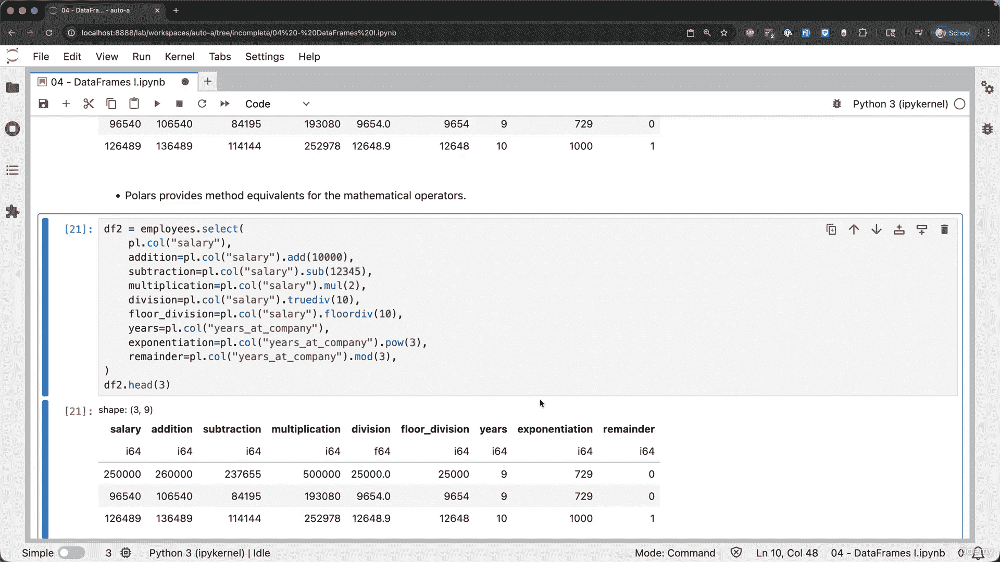

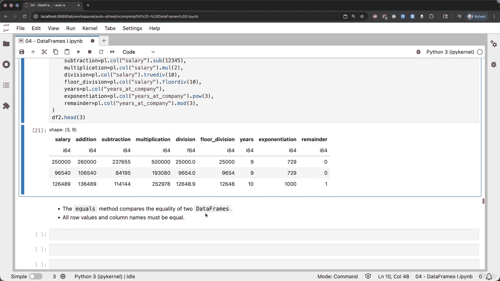

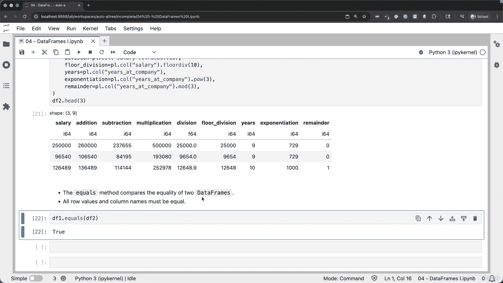

这就是对常见数学运算的快速介绍，这些运算可能会应用到数值列上。下一节课会有更多相关内容。本节课中我们一起学习了 Polars 中对列执行数学运算的两种写法、空值规则、加减乘除、浮点除法和向下取整除法、幂运算、取余运算，以及如何用 equals 验证符号写法和写法结果一致。到这里，你已经可以在实际数据清洗和特征计算中按需选择运算符或方法，并注意空值和除法类型带来的结果差异。

