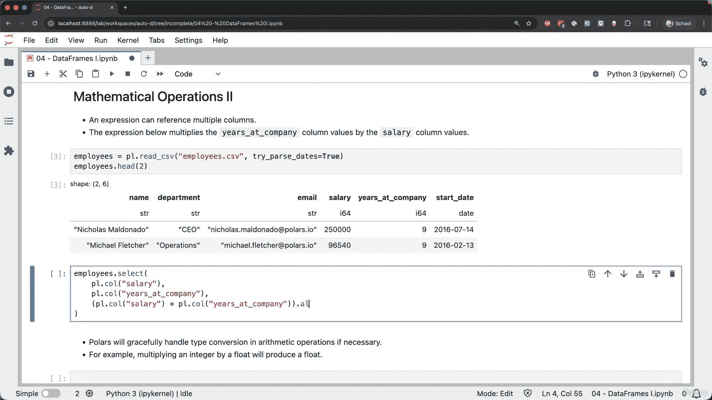
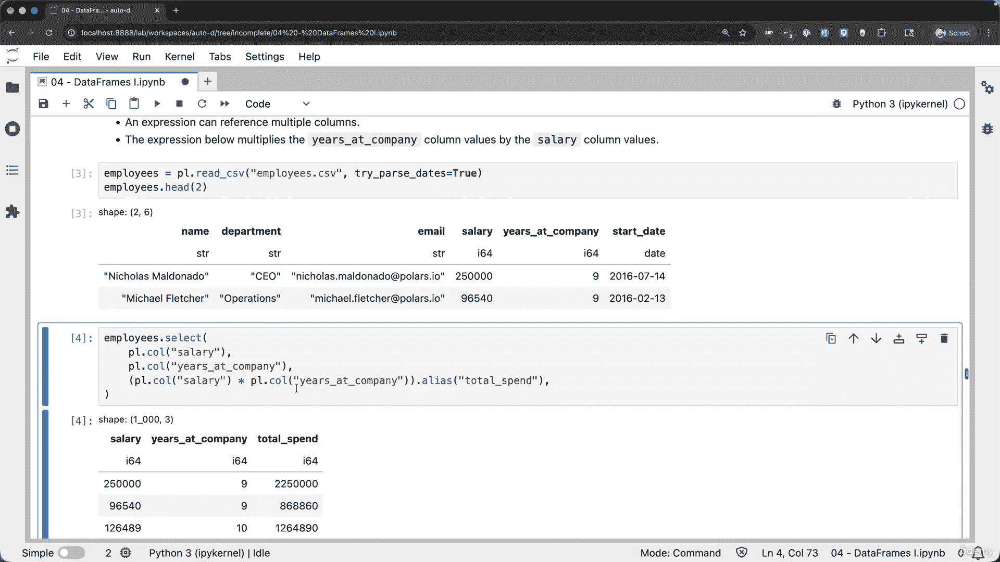
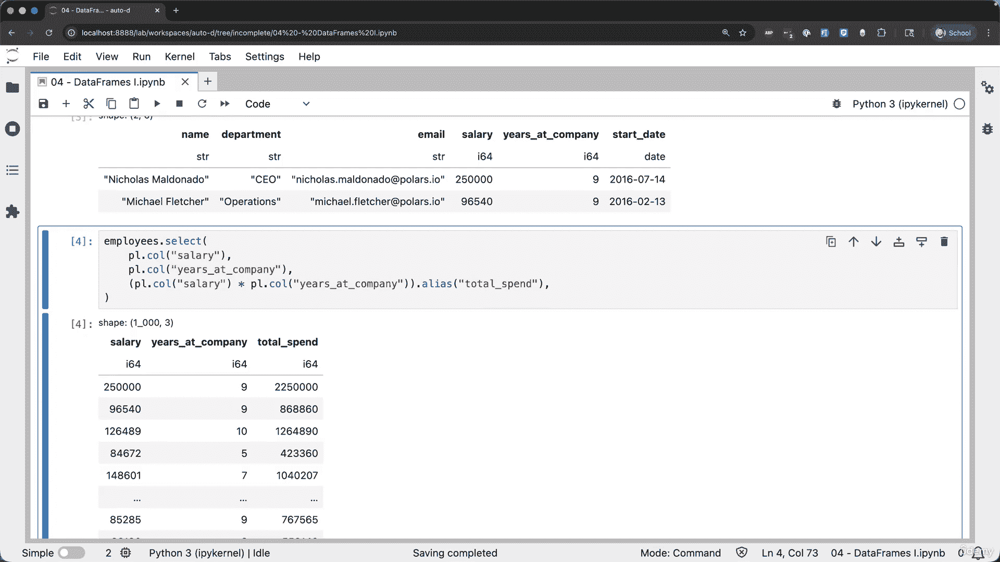
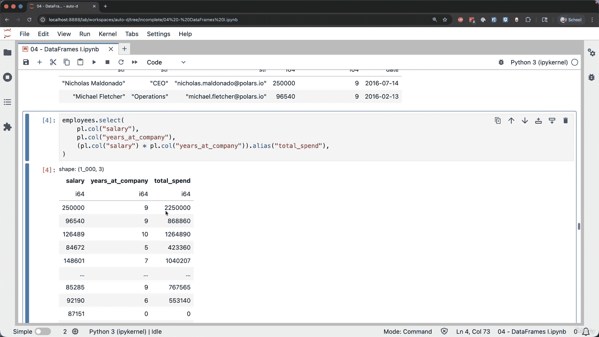
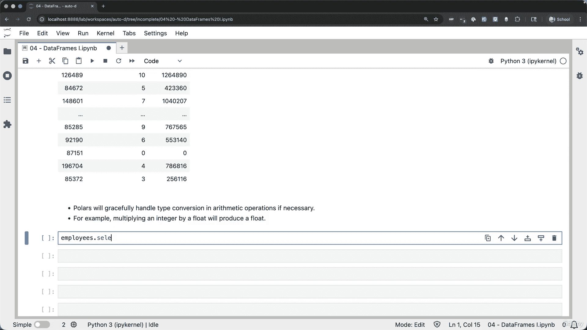
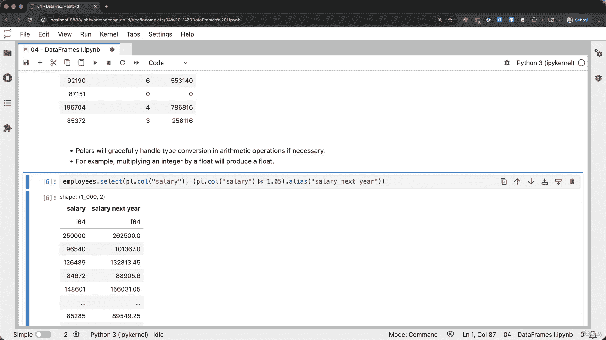
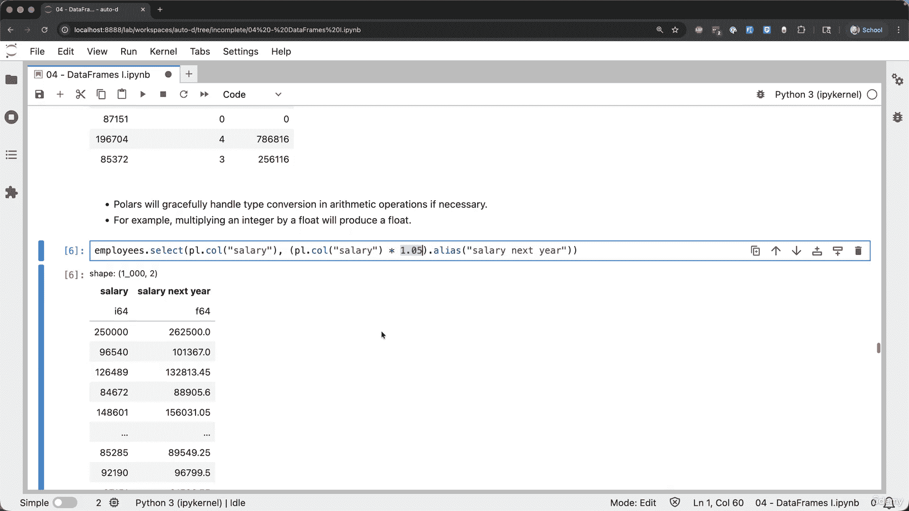
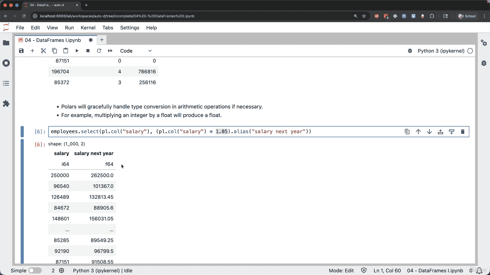

🧮 Udemy 数据分析与 Polars/Python：第 65 节：数学运算 II

在本节课中，我们继续接着上一节的内容往下讲。上一节我们学习了 Polars 中数学运算的基础写法，也就是拿某个列里的数值去乘以一个固定的常数。这一节我们要把范围再扩大一点，讨论两个特别值得注意的小细节。这两个细节分别是：能不能在同一个运算里使用多个列；以及当运算涉及不同类型时，Polars 会不会自动帮我们做类型转换。搞清楚这两点，后面写计算逻辑的时候就会顺手很多。

首先来看第一个知识点：在同一个数学运算中，我们可以同时使用多个列。这听起来很自然，但实际动手写代码的时候，很多人会下意识地只想到“列对常数”，而忘了列对列也是完全可以的。举个例子，假设我们手上有一份员工数据，我们想算出每个员工到目前为止一共在公司花了多少钱，也就是按行计算“工资乘以司龄”这种总额。这里的思路很简单：对于某一行，取出 salary 列里的数值，再取出 years at company 列里的数值，然后把这两个值乘起来。

上一节课我们是用每一行的数值去乘一个固定不变的常数，那种写法相当于给所有人加同样的系数。但如果你想表达“这个人的工资越高、在公司时间越长，总花费就越大”，那就得让两个列互相乘。其实这不只是乘法，任意一种数学运算，比如加法、减法、除法、取余，都可以施加在两个不同的列上。用公式表示就是：`total_spend = salary × years_at_company`。Polars 会默认按行对齐，所以不用担心行与行之间会错位。

下面是基本的实现思路。我们先把 employees 这个 DataFrame 拿出来，然后调用 select 方法。在 select 里面，我们先把 salary 列单独取出来，再把 years at company 列单独取出来。接着，为了把这两个列乘在一起，我们需要分别构造两个表达式，一个指向 salary，另一个指向 years at company，然后用星号操作符（Shift+8 打出来的那个 `*`）把左边和右边的表达式乘起来。

```python
import polars as pl

employees = pl.DataFrame({
    "salary": [50000, 60000, 70000],
    "years_at_company": [2, 5, 8],
})

result = employees.select([
    pl.col("salary"),
    pl.col("years_at_company"),
    (pl.col("salary") * pl.col("years_at_company")).alias("total_spend")
])

print(result)
```

这样写以后，对于这两列中的任意一行，Polars 都会把对应的两个值拿过来相乘。这里需要提醒一下：在一个 DataFrame 里面，所有列的长度必须相等。这意味着某一列不能比其他列更长，也不能更短。当然，如果某些位置缺少数据，你可以在中间放空值 null，这没问题；但列本身的高度和形状必须保持一致。所以，对于任何给定的一行，我们一定会拿到一个 salary 值和一个 years at company 值；万一其中一个是 null，或者两个都是 null，那计算结果直接就是 null。只要两个值都存在，运算结果就是这两个数的乘积。



还有一个小细节是，完整的表达式需要用一对括号包起来。也就是把 `pl.col("salary") * pl.col("years_at_company")` 整体放进 `select` 的参数里面，然后调用 `alias` 方法，给它换一个新名字，比如 `total_spend`。这样一来，输出结果里就会多出一列，每一行就是 salary 和 years at company 的乘积。你可以很直观地看到，Polars 把每行的两个数相乘，然后返回了对应的乘积列。







接下来我们看第二个知识点：如果某种数学运算要求类型转换，Polars 会自己处理得很优雅。这是什么意思？我们还是用员工数据里的 salary 列来举例。当前 salary 列存的是整数，具体来说是 64 位整数。假设公司想给每个员工都升职加薪，把工资统一提高 5%。那么我就可以把每一行的工资都乘以 1.05。注意，1.05 是一个浮点数，不是整数。因此这个运算本质上是在做“整数列乘以浮点数”的操作。类型转换规则可以写成：`Int64 × Float64 → Float64`。



代码写起来也很直接。我们可以接着用之前的表达式，把每一行的 salary 都乘上 1.05，然后把这个完整的操作包在括号里。这里说的“完整操作”其实就是一个新表达式，我们再用 alias 给新列起个名字，比如叫 salary_next。

```python
result = employees.select([
    pl.col("salary"),
    (pl.col("salary") * 1.05).alias("salary_next")
])

print(result)
```

运行之后你就会发现，虽然原始 salary 列是整数，但乘以 1.05 之后，新列 salary_next 变成了浮点数列。Polars 之所以会自动这么做，是因为想要精确表示整数乘以浮点数的最终结果，必须把结果转成浮点数。这是很有必要的，因为如果继续用整数来保存，小数部分就会被丢掉。Polars 会自动完成这个 cast 或者说 type conversion，不需要我们手动写 `pl.col("salary").cast(pl.Float64)` 之类的代码。







简单总结一下。本节课我们一起学习了两个有关 Polars 列运算的注意点。第一，我们可以在同一个数学运算中使用多个列，比如用 `salary` 列去乘 `years_at_company` 列，来得到每个员工的总花费；第二，Polars 会在数学运算需要的时候自动处理类型转换，比如整数列乘以浮点数 1.05 时，结果列会被自动转换成 64 位浮点数列。掌握这两个细节之后，你在用 Polars 做列与列之间的运算、或者做“列与常数”的混合运算时，就能少踩不少坑。下一节课我们继续往后看。
