# 📊 Polars与Python数据分析：66：累计数学运算

在本节课中我们将要学习 Polars 中一些额外的数学运算。这些方法的共同点是帮助执行累计逻辑。累计逻辑与上一节普通逐行逻辑的区别在于：累计方法需要之前的数据，才能计算任意给定行的值。这一点对初学者很重要，因为只要理解“当前结果依赖前面已经出现的数据”，后面的方法就只是换了一种计算规则。

上一节我们介绍了逐行独立计算，本节中我们来看看需要依赖历史数据的累计运算。首先重新运行导入数据框的代码，并查看 `employees` 数据框的所有行，然后从最简单的累计求和开始理解累计逻辑。

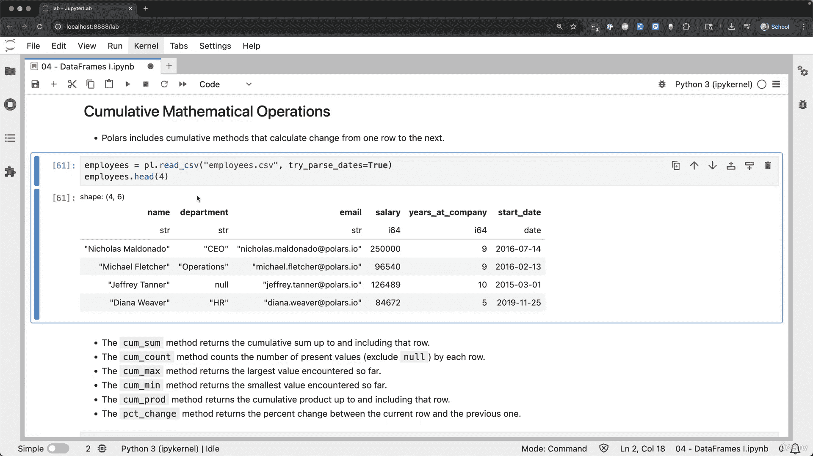

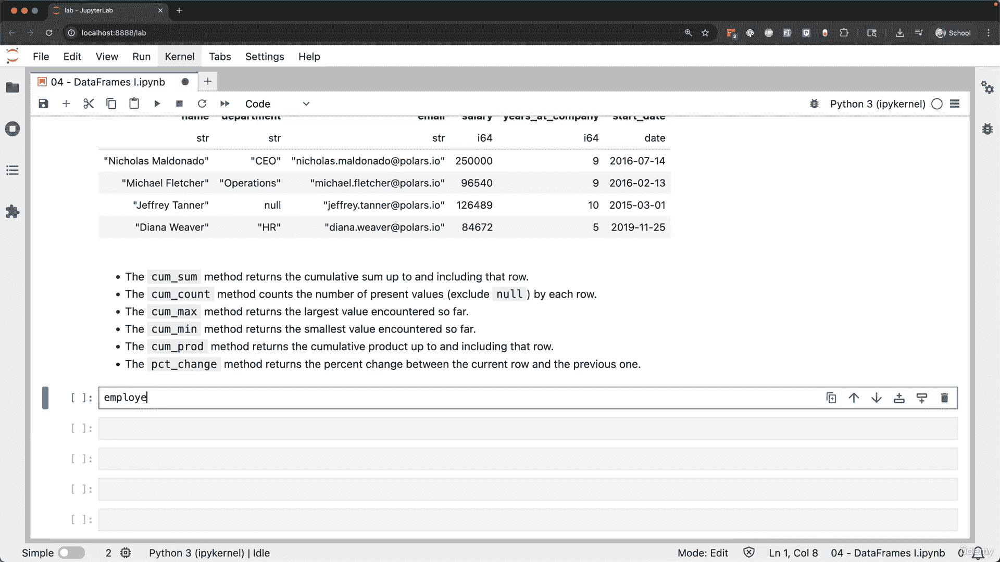

## 🧰 Polars与Python数据分析：66.1：准备数据与累计逻辑

上一节我们介绍了普通逐行计算，本节中我们来看看累计运算的基本含义。重新运行代码导入数据框后，先打印出 `employees` 数据框的所有行，便于观察列值如何随着行向下变化。以 `years_at_company` 列为例，如果随着数据框向下逐行累加这一列的值，就得到累计求和。

累计求和的含义可以用公式表示：

\[
\text{cum\_sum}_i = x_1 + x_2 + \cdots + x_i
\]

例如第一行是 9，第二行是 9 加 9 等于 18；第三行是前面已经遇到的 9、9、10 相加，得到 28，并一直累计到数据框底部。这就是累计逻辑的例子：对于任意给定行，Polars 需要知道这一行之前遇到的所有数据，并用这些数据计算当前结果。

在 Polars 中，这种累计逻辑的语法仍然很熟悉。我们仍然使用 `select` 方法选中目标列，并在表达式上调用累计方法，再把结果赋给同名的列。以下是累计求和的代码示例：

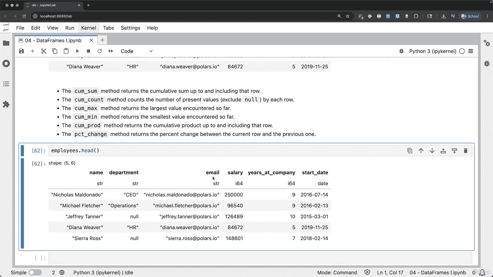

```python
import polars as pl

# 重新运行导入数据框的代码后，选中目标列并调用累计求和
df_cum_sum = df.select(
    pl.col("years_at_company")
      .cum_sum()
      .alias("years_at_company")
)
```

在正常输出中会得到累计求和结果，这些值会随着每行把当前值加入此前所有值的总和而增加。大多数累计方法都执行相同的基本逻辑，只是把“求和”替换成其他计算规则。完成累计求和后，本节中我们来看看累计计数如何工作。

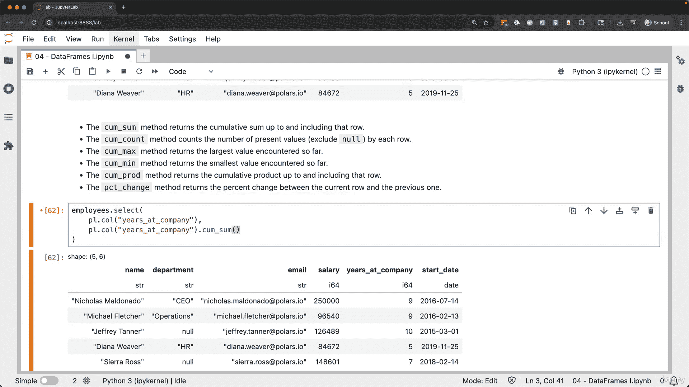

## 🔢 Polars与Python数据分析：66.2：累计计数

上一节我们介绍了累计求和，本节中我们来看看累计计数。再次复制上面的表达式，然后调用累计计数方法，原文中缩写为 `CUM_count`，在 Polars 中对应 `cum_count()`。

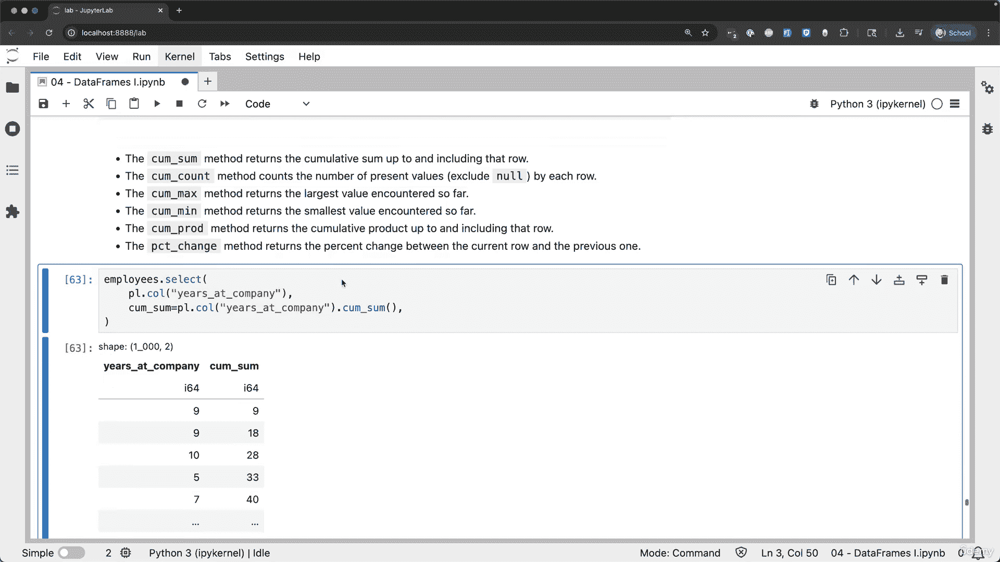

累计计数统计的是到目前为止已经遇到的非空值数量，不是简单地把每一行都数一遍。换句话说，如果某个行值是空值 `null`，它就不会被计入累计计数。以下是累计计数的代码示例：

```python
df_cum_count = df.select(
    pl.col("years_at_company")
      .cum_count()
      .alias("years_at_company")
)
```

输出中可以看到计数从 1 递增到 1000。这基本说明 `years_at_company` 列中没有遇到空值；如果存在空值，给定行的计数不会加一，而会继续向下推进，直到最终计数包含所有非空值。累计计数帮助我们跟踪“到目前为止有多少个有效值”。

累计计数理解了以后，本节中我们来看看累计最大值，它记录的是到目前为止遇到的最大值。

## ⬆️ Polars与Python数据分析：66.3：累计最大值

上一节我们介绍了累计计数，本节中我们来看看累计最大值。对应的累计最大值方法原文缩写为 `CUM_max`，在 Polars 中对应 `cum_max()`。这个方法会给出当前行位置为止已经遇到的最大值。

以下是累计最大值的代码示例：

```python
df_cum_max = df.select(
    pl.col("years_at_company")
      .cum_max()
      .alias("years_at_company")
)
```

例如一开始的值是 9，9 就是到目前为止遇到的最大值；继续到下一个 9，最大值仍然是 9；遇到第一个 10 时，10 成为到目前为止遇到的最大值。由于后面剩余的数据行中没有比 10 更大的值，所以结果最后会保持在 10。换句话说，累计最大值是在一行一行跟踪结果，但依据的是此前已经遇到的值，这一点和累计计数、累计求和相同。

既然可以找目前为止遇到的最大值，也可以找目前为止遇到的最小值。本节中我们来看看累计最小值。

## ⬇️ Polars与Python数据分析：66.4：累计最小值

上一节我们介绍了累计最大值，本节中我们来看看累计最小值。既然有方法找目前为止遇到的最大值，就有对应的方法找目前为止遇到的最小值，原文缩写为 `CUM_min`，在 Polars 中对应 `cum_min()`。

以下是累计最小值的代码示例：

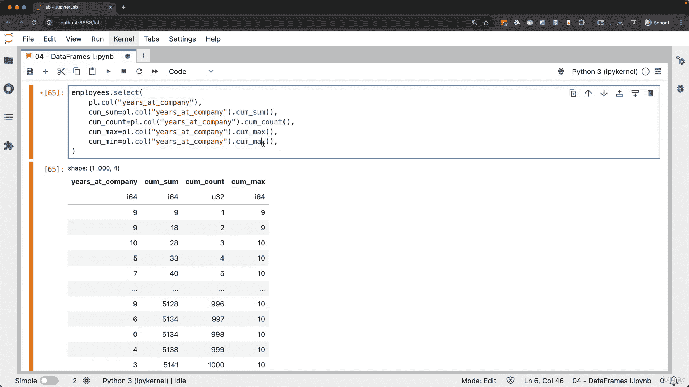

```python
df_cum_min = df.select(
    pl.col("years_at_company")
      .cum_min()
      .alias("years_at_company")
)
```

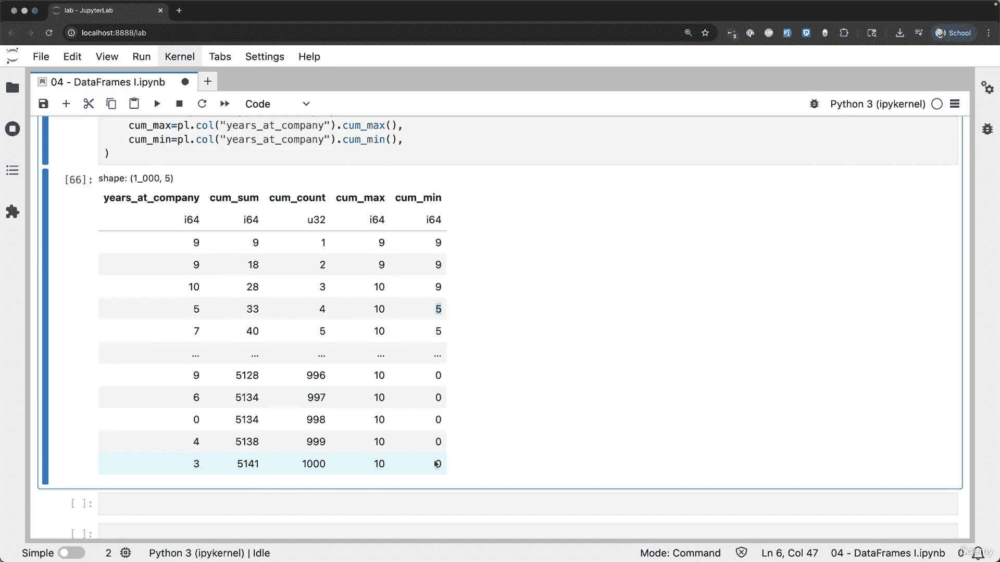

执行后可以看到：开始时是 9，接着还是 9；遇到 10 时，因为 10 大于 9，所以 9 仍然是到目前为止遇到的最小值；后来遇到 5，5 成为到目前为止遇到的最小值，并一直向下保持到 0；之后结果一直保持 0 直到数据框结尾，因为没有人为公司工作负的年份。累计最小值也是在跟踪一行中的结果，但依据的是此前已经遇到的数据。

累计最小值之后，本节中我们来看看累计乘积，它把已经遇到的值乘起来。

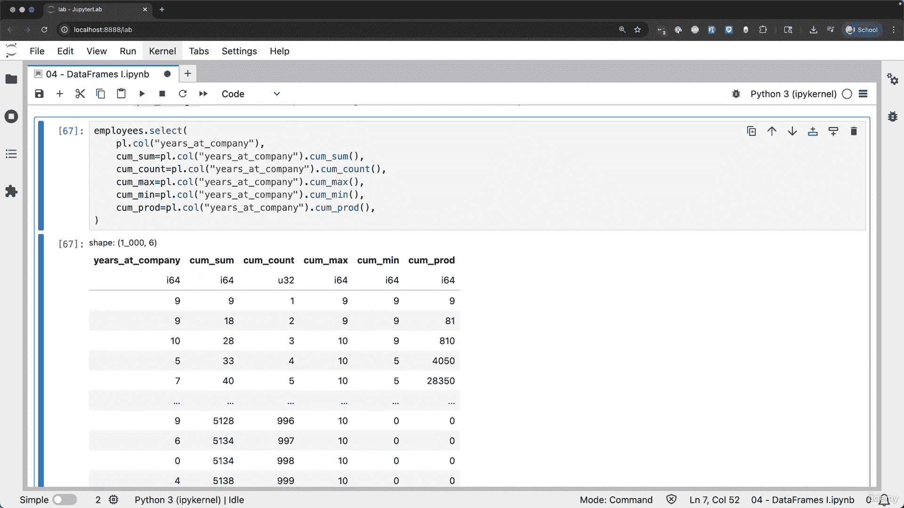

## ✖️ Polars与Python数据分析：66.5：累计乘积

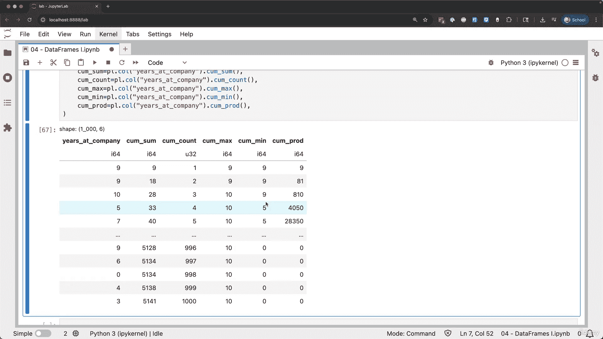

上一节我们介绍了累计最小值，本节中我们来看看累计乘积。我们已经有累计求和，也可以有累计乘积，原文中对应的是 `cum_prod()` 方法。这个方法会随着行向下，把已经遇到的所有值依次相乘。

以下是累计乘积的代码示例：

```python
df_cum_prod = df.select(
    pl.col("years_at_company")
      .cum_prod()
      .alias("years_at_company")
)
```

例如从 9 开始，然后乘以 9，再乘以 10，再乘以 5，并继续把后面遇到的值乘进去。累计乘积与累计求和类似，只是计算规则从加法变成了乘法。理解了这个思路后，本节中我们来看看实际分析中很有用的百分比变化方法。

## 📈 Polars与Python数据分析：66.6：百分比变化

上一节我们介绍了累计乘积，本节中我们来看看百分比变化，这是本节课最后展示的一个方法。百分比变化跟踪的是某一行相对于上一行的相对百分比变化。在 Polars 中对应 `pct_change()` 方法，调用后逐行观察几行结果，就能理解它在做什么。

百分比变化的基本公式可以写成：

\[
\text{pct\_change}_i = \frac{x_i - x_{i-1}}{x_{i-1}}
\]

如果结果乘以 100，就可以用百分数形式表示。以下是百分比变化的代码示例：

```python
df_pct_change = df.select(
    pl.col("years_at_company")
      .pct_change()
      .alias("years_at_company")
)
```

第一行的值是 9，但它没有上一行可以比较，因此没有可用于计算百分比差异的对象，所以结果从空值 `null` 开始，这是一个缺失的计算，因为 Polars 没有东西可以放在这里。到下一行时，Polars 会对比当前行与上一行，计算变化是正方向还是负方向。以下是几个百分比变化的具体示例：

- 第一行 9：没有上一行，结果为 `null`。
- 9 到 9：\((9-9)/9=0\)，即 `0.0`，表示没有变化。
- 9 到 10：\((10-9)/9≈0.111\)，约等于 11%，乘以 100 后约为 11.1%。
- 10 到 5：\((5-10)/10=-0.5\)，即 -50%，表示缩小或下降 50%。
- 5 到 7：\((7-5)/5=0.4\)，即 +40%，表示增长 40%。

如果想把结果表示成百分数，可以组合乘法运算符，把所有结果乘以 100，就能看到类似 11.1% 的数值。从 10 到 5 是减少，缩小量正好是一半，因此表示 50% 的下降；为了区分正增长和负增长，Polars 会用负百分比表示负增长。于是从 10 降到 5 是 50% 的下降，从 5 升到 7 是 40% 的增长。这样我们又在跟踪从上一批数据到下一批数据的变化。

所有这些方法的共同点是：它们不是只针对某一个行值做独立计算，而是会使用此前的一些计算结果。尽管如此，Polars 的语法仍然保持一致，这也是这个库的一个卖点。可以看到逻辑很相似：仍然使用 `select` 方法，选择一个给定列，用表达式构建逻辑，并通过调用不同的数学方法创建新表达式来应用计算。

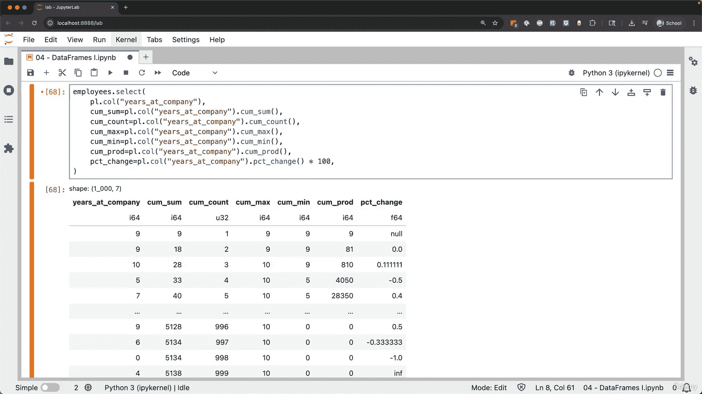

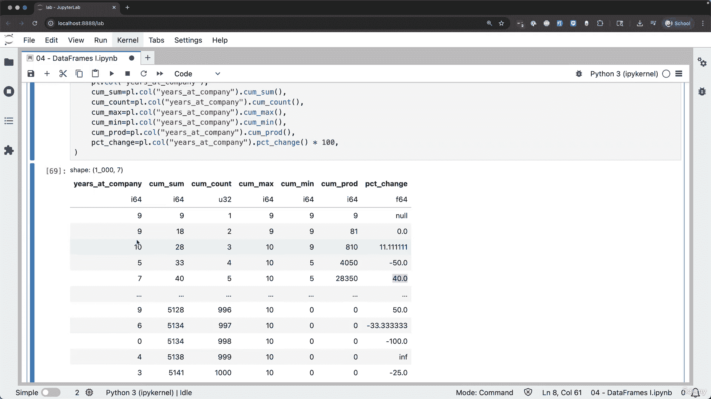

## 🧾 Polars与Python数据分析：66.7：总结

本节课中我们一起学习了 Polars 的累计数学运算，包括累计求和、累计计数、累计最大值、累计最小值、累计乘积和百分比变化。我们理解了累计方法需要依赖此前已经遇到的数据来计算当前行结果，也看到了这些方法在语法上都沿用 `select` 加列表达式的方式，只是调用的方法不同。

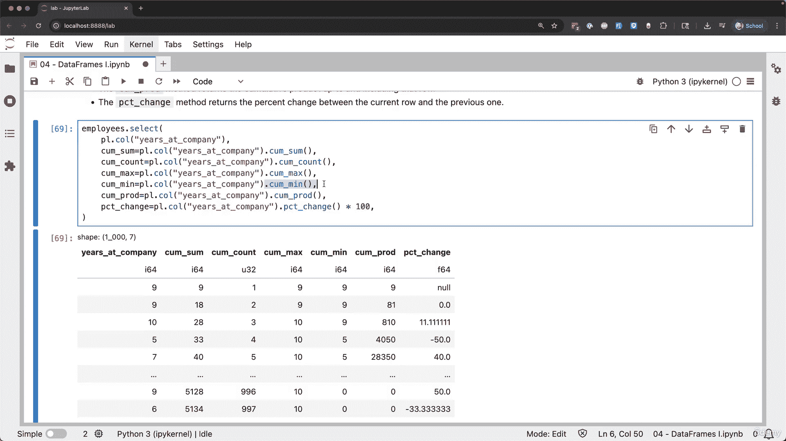

累计求和用 `cum_sum()`，累计计数用 `cum_count()` 统计非空值，累计最大值用 `cum_max()`，累计最小值用 `cum_min()`，累计乘积用 `cum_prod()`，百分比变化用 `pct_change()`。本节课内容到此结束，下一节课再见。

