# 📊 Polars 与 Python 数据分析：67：with_columns 方法

在本节课中，我们将要学习 Polars 的 `with_columns` 方法。它是对 `select` 方法的一个完美补充，两个方法在很多地方看起来很像，但返回结果和适用场景有重要区别。为了让初学者更容易理解，可以先把它们想成两种不同的“加工方式”：`select` 只把计算结果拿出来，组成一个新的数据框；`with_columns` 则保留原来的数据框内容，再把新计算出来的列追加到右边。接下来我们会先看共同点，再看区别，然后通过代码示例说明使用时的注意事项。

## 🧭 一、先理解两个方法的共同点和核心区别

上一节我们说到 `with_columns` 是 `select` 的补充，本节中我们来看看它们的共同点。两个方法相似的地方在于：它们都接受一个或多个表达式，并对这些表达式进行计算。也就是说，你传给它们的内容在语法层面非常接近，都是让 Polars 去计算某些列。

核心区别可以用下面的公式和代码来理解：

```text
select：原数据框 -> 只包含表达式计算结果的新数据框

with_columns：原数据框 -> 保留所有原始列 + 在右侧追加表达式计算出的新列
```

`with_columns` 之所以叫这个名字，是因为它返回的是原始数据框加上额外列后的结果。换句话说，它不是把旧列丢掉，而是在旧列的基础上继续添加新列。以下是两个方法的区别概括，方便先建立一个整体印象：

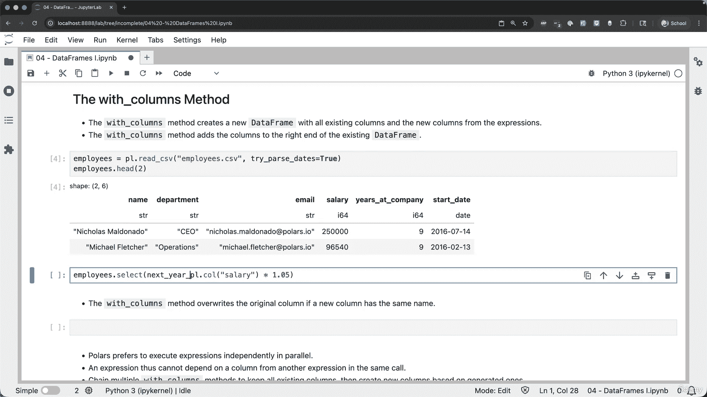

- `select` 返回一个新数据框，这个数据框只存储表达式计算出来的列。

- `with_columns` 保留原始数据框的所有列，然后把表达式计算出的新列添加到已有列的末尾，也就是数据框的右侧。

理解了这个总原则后，下面我们通过一个并排比较的例子，看看它在代码里到底长什么样。

## 🆚 二、用 select 计算员工加薪后的年薪

上一节我们明确了两个方法的核心区别，本节中我们来看看 `select` 的具体用法。课程示例先重新执行导入代码，并快速回顾 `select` 是如何工作的。假设公司要给所有员工在新的一年加薪 5%，那么可以先计算加薪后的金额。

以下是使用 `select` 计算加薪后列名的示例代码：

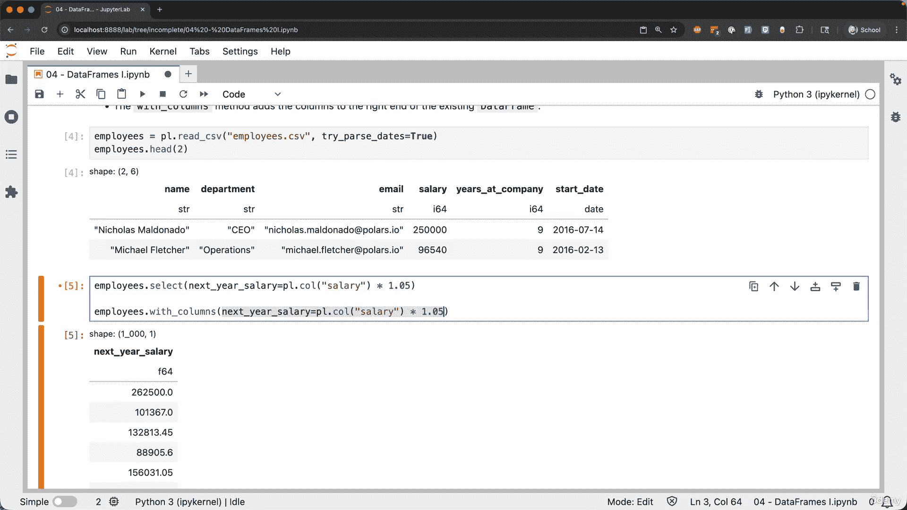

```python
import polars as pl

employees = pl.read_csv("employees.csv")

employees.select(
    (pl.col("salary") * 1.05).alias("next_year_salary")
)
```

这段代码的含义是：用 `pl.col` 函数定位 `salary` 列，把这一列的每个值乘以 `1.05`，然后给计算结果一个列名 `next_year_salary`。给新列命名时，可以使用关键字参数，也可以使用 `alias` 方法。这个例子的结果数据框只有一列，也就是 `next_year_salary`，因为 `select` 只保留表达式计算出来的内容。

看到这里，你已经知道 `select` 会把计算结果单独拿出来。接下来我们把同样的表达式换成 `with_columns`，看看结果会有什么不同。

## 🧩 三、把 select 换成 with_columns

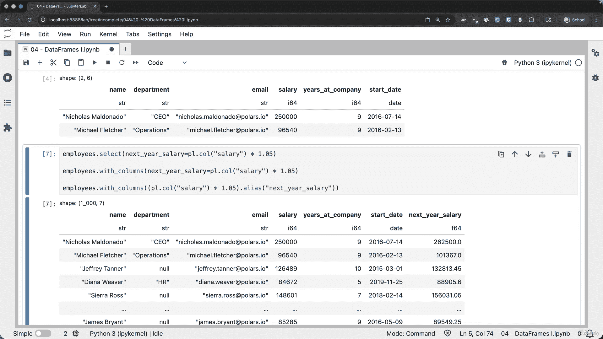

上一节我们使用 `select` 得到了只包含新列的数据框，本节中我们来看看把 `select` 换成 `with_columns` 会发生什么。可以把上面那行代码复制下来，然后把 `select` 方法替换成 `with_columns`。`with_columns` 的语法和 `select` 完全相同，它也接受一个或多个表达式，并且这些表达式同样可以指定新的结果列名。

以下是使用 `with_columns` 添加 `next_year_salary` 列的示例代码：

```python
employees.with_columns(
    (pl.col("salary") * 1.05).alias("next_year_salary")
)
```

这段代码和前面的 `select` 版本在表达式层面完全一样，但结果不同：`with_columns` 会保留原来的所有列，然后把新计算出来的 `next_year_salary` 列添加到数据框的末尾，也就是右侧。这样你既能看到员工原来的信息，也能看到新计算出的加薪后薪资。

课程还展示了 `alias` 的替代写法，用来说明关键字参数和 `alias` 方法在这里同样有效。以下是两种常见命名方式的示例：

```python
employees.with_columns(
    next_year_salary=pl.col("salary") * 1.05
)

employees.with_columns(
    (pl.col("salary") * 1.05).alias("next_year_salary")
)
```

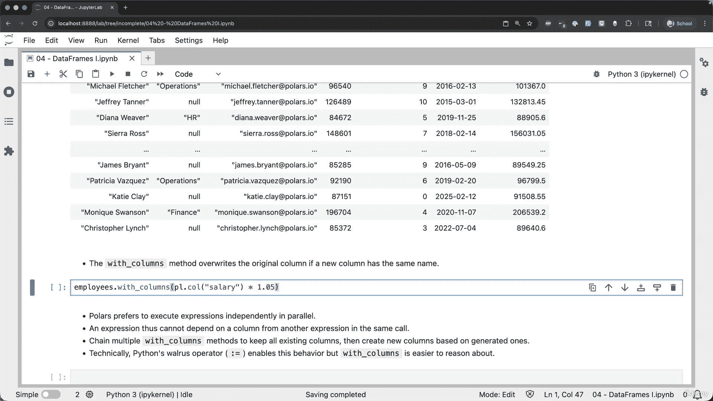

使用 `alias` 时，原始表达式外面需要包一层括号，因为这里使用了星号乘法运算符。这样写之后，得到的结果和前面完全相同。关键字参数和 `alias` 方法在这里都能给新列命名，效果一样。

到这里，我们已经看到 `with_columns` 会保留旧列并追加新列。接下来要特别留意一个容易踩坑的地方：如果不给新计算结果提供新的列名，它可能会覆盖原始列。

## ⚠️ 四、不提供新列名时会覆盖原始列

上一节我们给新列起了名字，所以结果很安全，本节中我们来看看不给新列名时会发生什么。`with_columns` 有一个细微差别：如果你不提供结果列的新名称，它就会覆盖起始数据框中的原始列。课程示例再次取 `employees` 数据框，调用 `with_columns`，并再次对 `salary` 列乘以 `1.05`，但不使用 `alias` 方法，也不使用关键字参数，也就是不提供新的列名。

以下是不提供新列名的示例代码：

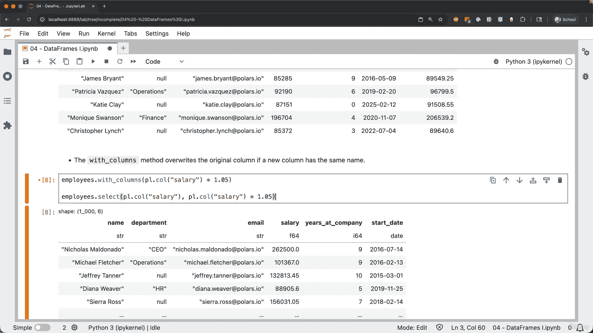

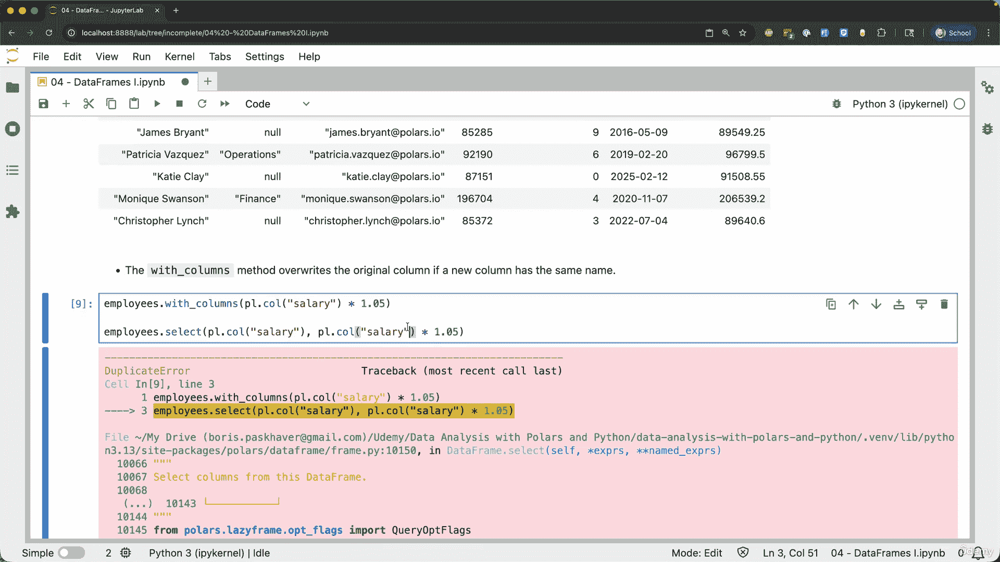

```python
employees.with_columns(
    pl.col("salary") * 1.05
)
```

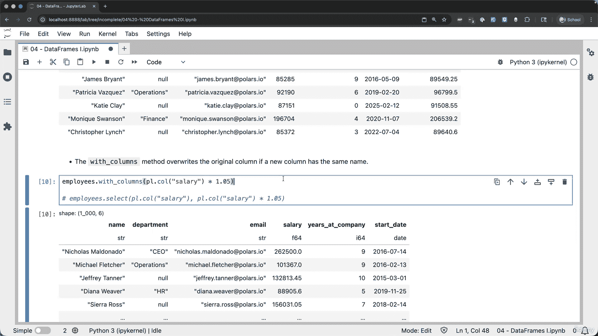

这时不会报错。原因是数据框里会出现两个都叫 `salary` 的列名：一个是原始值，一个是新计算值。Polars 的处理方式不是抛出异常，而是用新的 `salary` 列替换旧的 `salary` 列。因此结果集中看到的 `salary` 值，实际上是原始 `salary` 值乘以 `1.05` 之后的结果。

这里需要特别小心，因为如果不给新计算表达式一个不同于原始列的新列名，就可能意外替换旧数据。与 `select` 对比一下会更清楚：在 `select` 中，如果先选择现有的 `salary` 列，然后又创建第二个表达式去计算 `salary` 列并乘以 `1.05`，就会因为两个列同名而报错。以下是会报错的 `select` 示例：

```python
employees.select(
    pl.col("salary"),
    (pl.col("salary") * 1.05).alias("salary")
)
```

这个例子说明，`select` 遇到同名结果时会抛出异常，而 `with_columns` 不会抛出这个异常，所以使用 `with_columns` 时更要小心列名。列名一旦重复，旧列就可能被悄悄替换，数据结果虽然能返回，但不一定是你想要的结果。

除了列名覆盖问题，还有一个重要限制需要理解：在同一个 `with_columns` 调用中，一个表达式不能使用另一个表达式的结果。下面我们来看看这个限制以及它的原因。

## 🔗 五、同一调用中的表达式必须彼此独立

上一节我们提醒了列名覆盖风险，本节中我们来看看另一个关键限制。这个限制对 `select` 和 `with_columns` 都成立：你不能在同一个 `with_columns` 方法调用中，利用一个表达式的结果去写另一个表达式。原因在于 Polars 为了速度，需要并行执行这些表达式。

课程示例先计算一个新的员工薪资列，再想计算这个新薪资的周薪。按照直觉，可能会写出类似下面的代码：

```python
employees.with_columns(
    new_salary=pl.col("salary") * 1.05,
    new_salary_per_week=pl.col("new_salary") / 52
)
```

这段代码想表达的意思是：先给员工计算新薪资 `new_salary`，然后把每一行的新薪资除以 `52`，因为一年大约有 52 周，最后把结果命名为 `new_salary_per_week`。但这样写不会工作，因为第二个表达式依赖 `new_salary` 列，而 `new_salary` 是第一个表达式的结果。在同一个 `with_columns` 调用中，不能存在这种依赖关系。

Polars 会并行执行这些表达式，这也是 Polars 的一个优势：它可以把工作分配到多个线程上。例如你给 `with_columns` 提供 10 个表达式，Polars 可以同时并行执行这 10 个表达式，让它们彼此协作，最后再把结果合并到最终数据框中。这也意味着一个表达式不能等待另一个表达式完成，因为它们不是按顺序一个一个执行的。第二个表达式完全独立于第一个表达式运行，它不知道 `new_salary` 列的存在，而 `new_salary` 只有在第一个表达式完成后才会被生成。

因此，同一个方法调用中的所有表达式都必须彼此完全独立。否则就会触发错误，无论你使用关键字参数还是使用 `alias` 方法，结果都一样，都会得到 `column not found` 错误。原因是 Polars 找不到 `new_salary` 列，因为这个列在此时还不存在。

那么这个问题怎么解决？答案是使用两次顺序的 `with_columns` 调用。以下是正确的写法：

```python
employees.with_columns(
    new_salary=pl.col("salary") * 1.05
).with_columns(
    new_salary_per_week=pl.col("new_salary") / 52
)
```

在第一次调用 `with_columns` 之后，数据框保留了原始所有列，并添加了 `new_salary` 列。现在 `new_salary` 已经存在于这个数据框中，所以可以通过方法链再次调用 `with_columns`。在第二次调用中，表达式不必再和第一次调用中的表达式并行执行，它们可以按顺序处理，因此这时就可以使用 `new_salary` 列来计算 `new_salary_per_week`。最后这个新列会被拼接到数据框末尾。

这是使用 `with_columns` 时非常重要的一个细微差别和边界情况。下面用一组关键点再做一次提醒，方便记忆：

- 同一个 `with_columns` 调用中的表达式必须相互独立。

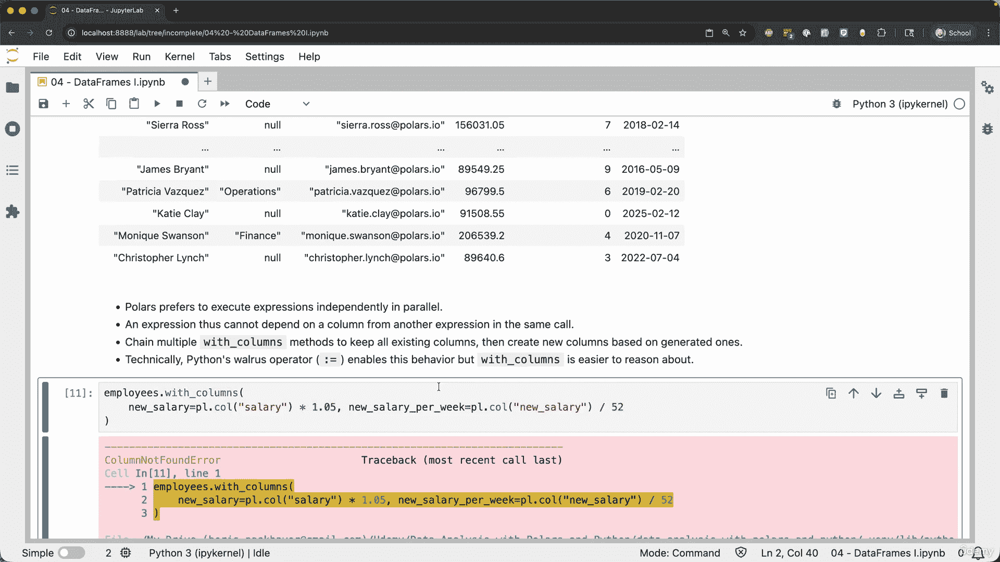

- 需要依赖前一步计算结果时，要拆成两次 `with_columns` 调用。

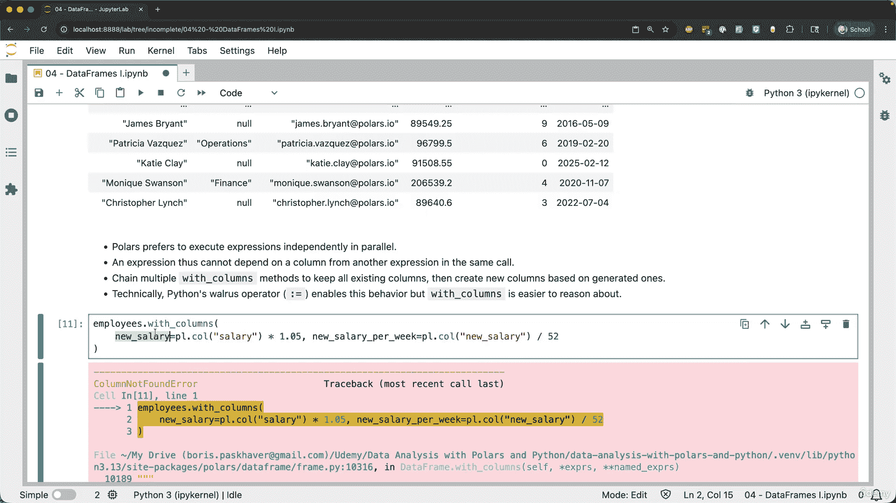

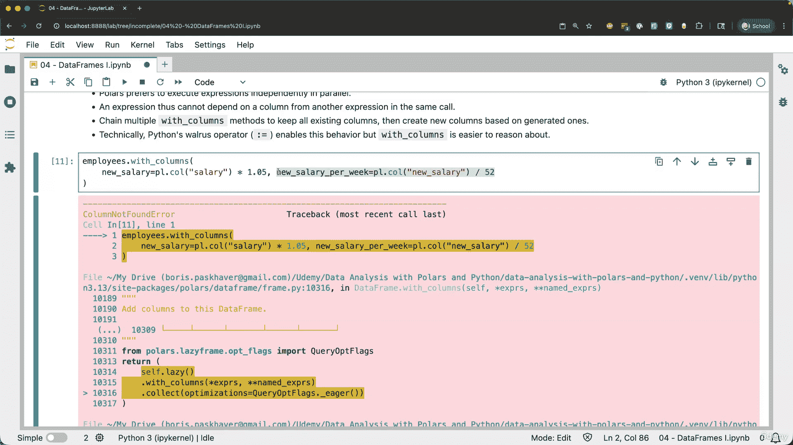

- 第二次调用可以通过方法链接在第一次调用后面。

- 新计算出的列会追加到数据框右侧。

理解了这些限制之后，`select` 和 `with_columns` 的区别就已经比较清楚了。接下来我们对整节课的内容做一个总结。

## ✅ 六、课程总结

前面我们分别看了 `select` 和 `with_columns` 的用法与注意事项，本节中我们一起回顾重点。本节课中我们一起学习了 Polars 的 `with_columns` 方法：它和 `select` 一样接受一个或多个表达式，但 `select` 会计算表达式并返回一个只包含这些计算结果的新数据框，而 `with_columns` 会保留原来的数据框，并把表达式计算出的新列添加到已有列的末尾和右侧。

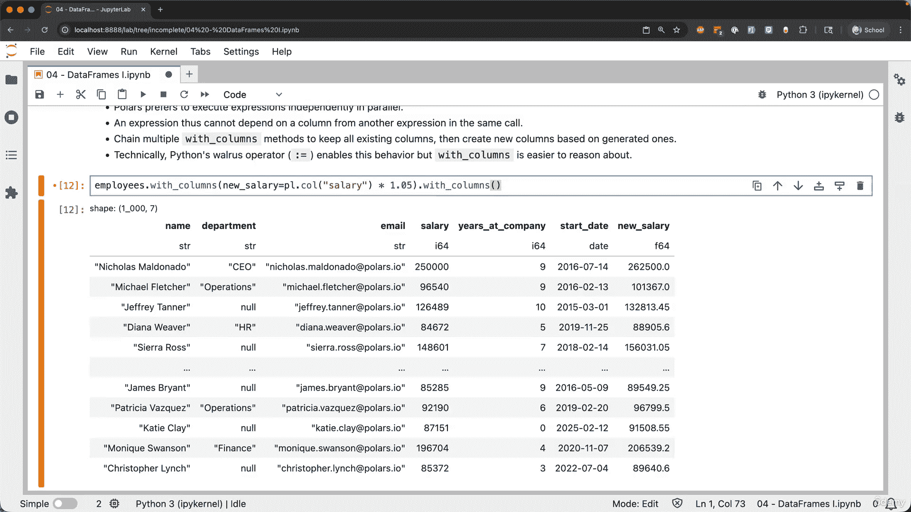

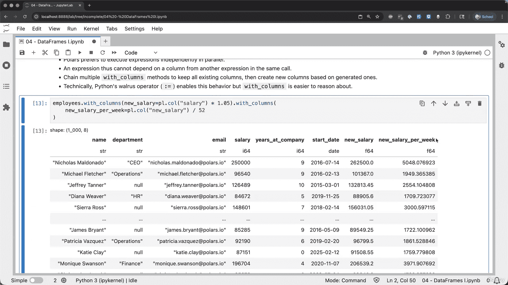

我们还学习了几个关键细节：不给新列名时，`with_columns` 可能覆盖原始列；`select` 遇到同名结果会报错，而 `with_columns` 不会报错但会替换旧列；同一个 `with_columns` 调用中的表达式必须彼此独立，因为 Polars 需要并行执行表达式来提升速度；如果后一个表达式要使用前一个表达式的结果，就需要写成两次顺序的 `with_columns` 调用。掌握这些内容后，就可以更安全地使用 `with_columns` 在保留原始数据的同时添加新列。

