# Polars与Python数据分析：68：all与exclude函数 🧩

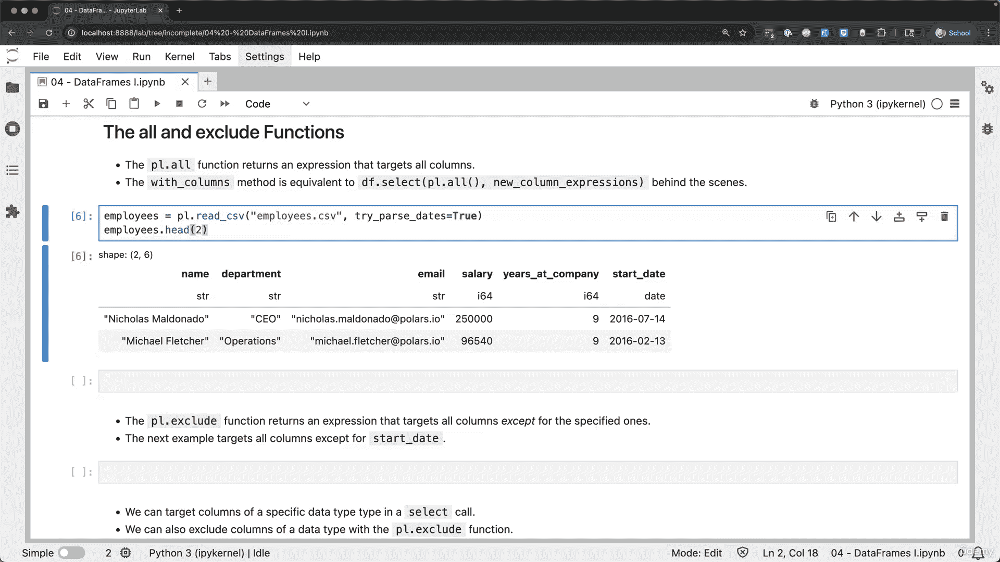

在本节课中，我们将要学习 Polars 顶层的两个函数：`all` 和 `exclude`。前面课程中我们已经接触过 `all`，但还没有见过 `exclude`。这两个函数有一个共同点：它们都会创建一个表达式，而这个表达式可以同时瞄准多个列。表达式的直观理解方式是：它先描述“要对哪些列做什么操作”，然后由 Polars 在数据帧上执行。下面先执行导入代码，再快速回顾 `all` 的用法，然后进入 `exclude`。

## 1. 回顾 all 函数：一次选中所有列 🎯

上一节我们接触过 `with_columns` 等方法，本节中我们来看看 `all` 如何创建面向所有列的表达式。先取员工数据帧 `employees`，调用 `select` 方法。核心概念可以用下面这个式子表示：

\[
\text{目标表达式}=\text{pl.all()}
\]

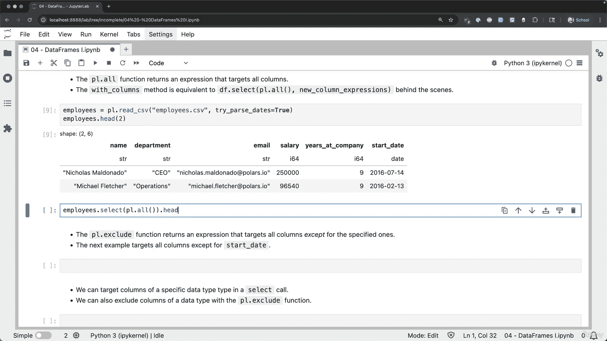

```
import polars as pl

employees.select(pl.all()).head()
```

以下是两种常见的定位列方式：

- 使用 `pl.col("列名")` 定位一列。
- 给 `col` 传入多个顺序参数，定位多列。

不过，这种写法要求我们提前知道所有列名。如果一个数据帧有 100 列，逐一写出来并不现实。因此可以直接使用 `all` 函数，并注意不要漏掉右括号。`pl.all()` 会创建一个表达式，瞄准指定数据帧中的所有列。代码最后调用 `head` 方法，确保只打印前五行。

运行后可以看到，这样就把 `employees` 中的所有列都选出来了。`all` 函数调用后面仍然可以添加多个表达式或额外表达式。例如，可以增加一个名为 `next_year_salary` 的列，使用关键字参数方法，通过 `col` 定位 `salary` 列，并乘以 `1.05`：

```
employees.select(
    pl.all(),
    next_year_salary=pl.col("salary") * 1.05
)
```

运行后得到的结果，与上一课 `with_columns` 方法的效果实际上完全一样：先选择数据帧中所有现有列，再根据提供的表达式添加新列。我认为在底层，`with_columns` 方法实际上就是使用 `all` 函数来完成这个结果：它先定位所有现有列，然后根据你提供的表达式创建新列。本节我们回顾了 `all`，下一节中我们来看看与它互补的 `exclude`。

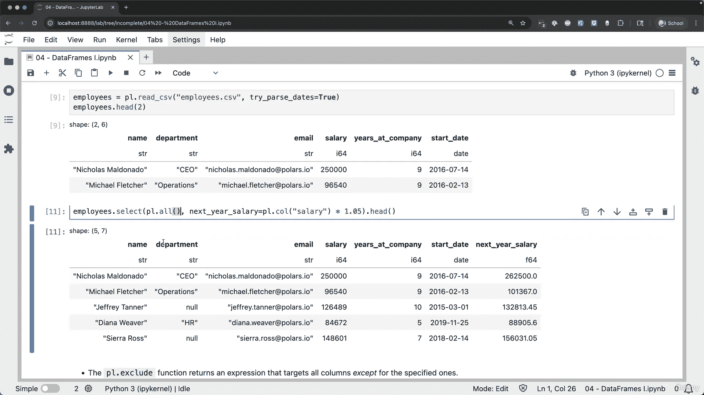

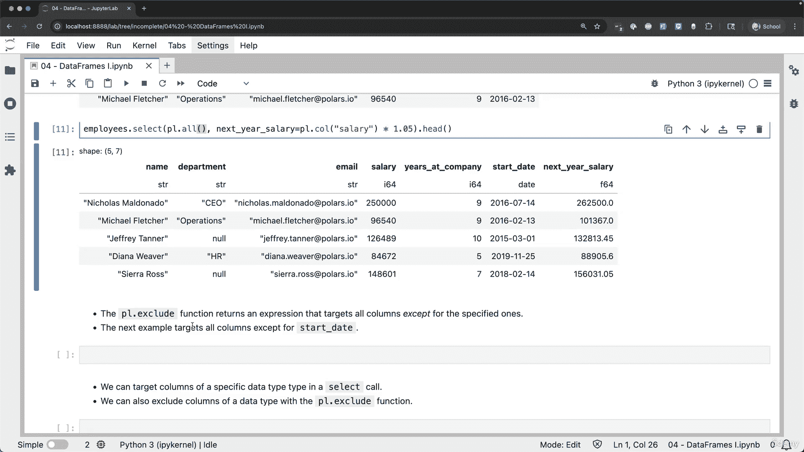

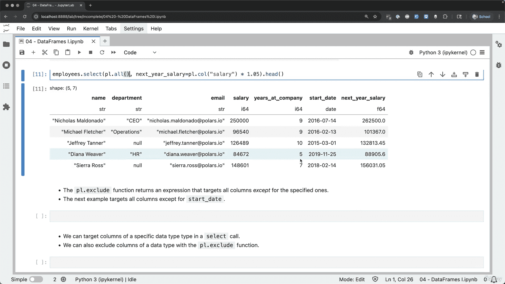

## 2. exclude 函数：排除指定列 🚫

上一节我们回顾了 `all` 函数，本节中我们来看看与它互补的 `exclude` 函数。`exclude` 会返回一个表达式，瞄准除指定列之外的所有列。换句话说，它是在排除、省略或留下指定列。核心概念可以用下面的公式和代码表示：

\[
\text{目标列}=\text{全部列}-\text{指定排除列}
\]

```
pl.exclude("start_date")
```

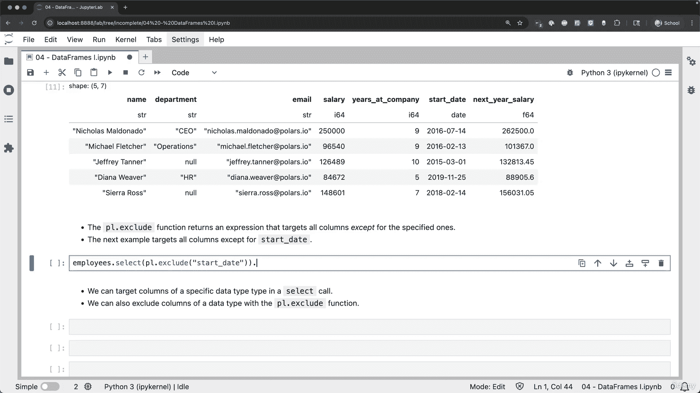

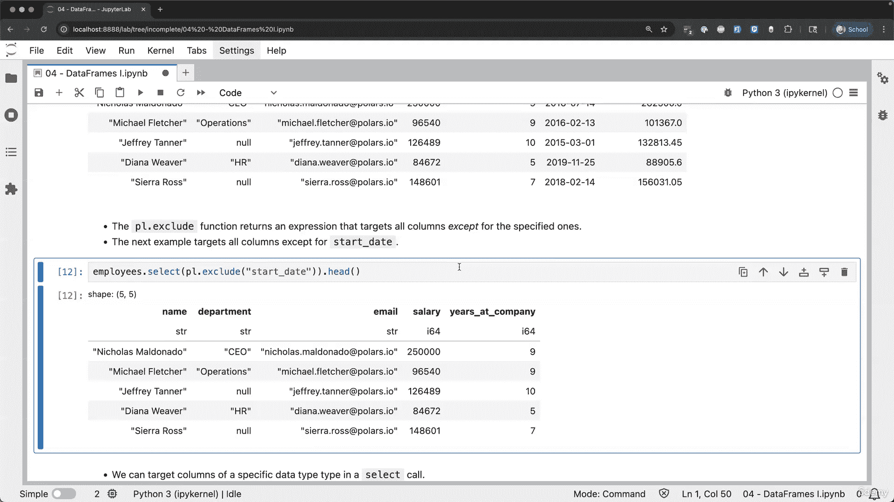

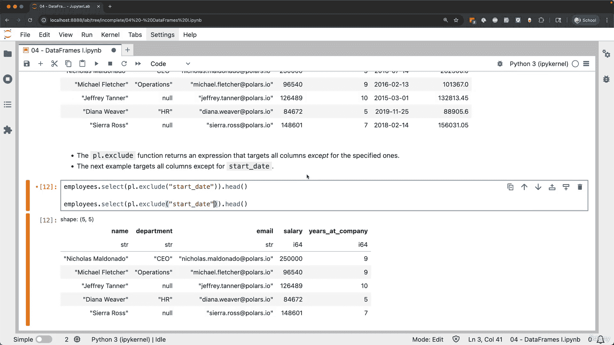

例如，假设要从员工数据帧中选择除 `start_date` 之外的所有列。这里再次取 `employees`，调用 `select`。在 Polars 中，缩写为 `pl`，顶层有 `exclude` 函数。`exclude` 接受任意数量的顺序字符串参数，这些字符串用来指定要排除的列，因此它会瞄准除指定内容之外的所有列。下面的代码表示排除 `start_date`，并拉取其他所有列：

```
employees.select(pl.exclude("start_date"))
```

运行后可以看到，得到的数据帧包含 `employees` 中所有原始列，但不包含 `start_date`。下面是指定多个参数的例子，语法完全相同：调用顶层 `exclude` 函数，再传入另一个参数，例如 `email`。这样会得到省略 `start_date` 和 `email` 两列的数据帧：

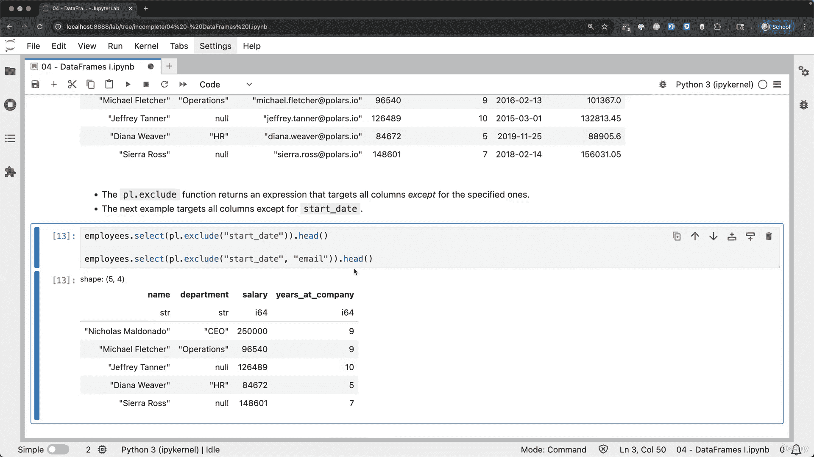

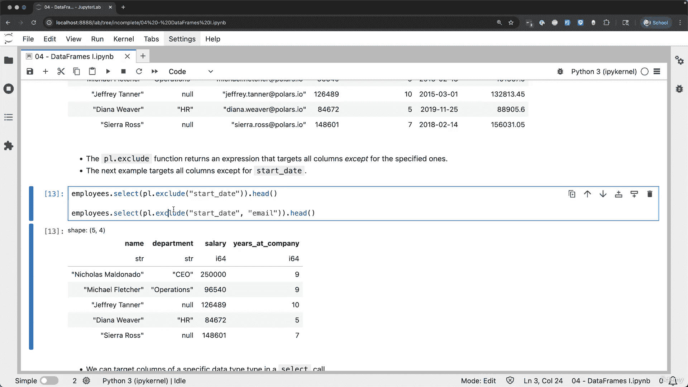

```
employees.select(pl.exclude("start_date", "email"))
```

与大多数 Polars 构造一样，我们始终可以把课程前面学到的各种思路混合搭配起来。例如，前面我们见过如何根据数据类型选择列；同样，也可以用 `exclude` 排除某种数据类型的列。本节我们排除了具体列名，下一节中我们来看看如何按数据类型排除列。

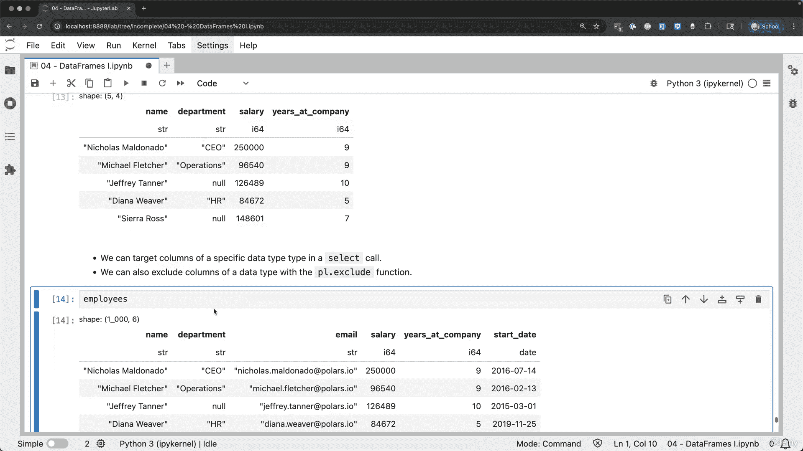

## 3. 用 exclude 按数据类型排除列 🧱

上一节我们使用 `exclude` 排除了具体列名，本节中我们来看看如何按数据类型排除列。再次拿出员工数据帧 `employees`。假设要返回一个新的数据帧，排除所有保存字符串值的列，也就是把这一类字符串列从这个结果里拿掉。这里调用 `select`，必须传入一个表达式，可以使用 `exclude` 函数创建表达式。上一例中我们在 `exclude` 里指定列名；这里还可以指定 Polars 的数据类型，再次通过缩写 `pl` 进入 Polars，在其顶层找到字符串数据类型 `pl.String`，并把它传给 `exclude`：

```
employees.select(pl.exclude(pl.String))
```

这行代码的含义是：从 `employees` 数据帧中选择所有列，但排除那些保存字符串值的列。这样就能动态地只取出非字符串列。实现方式不是去正面指定整数列和日期列，而是通过排除字符串列来完成。可以猜到，`exclude` 也接受多个参数，因此可以基于多个数据类型排除多种类型的列。例如下面只是示意写法，可以同时传入多个数据类型：

```
employees.select(pl.exclude(pl.String, pl.Date))
```

通过动手尝试 Polars，可以开始看到它非常灵活。很多语法选项会出现在你尝试的各种不同操作中，不过它们都遵循相似的方法：允许你把不同的构建块、表达式和函数组合起来，从而精确瞄准你想要的数据。以上我们分别看了 `all` 和 `exclude` 的基本用法与组合方式，下一节中我们做一个收尾总结。

## 4. 总结 📝

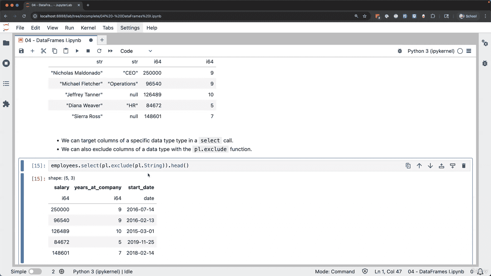

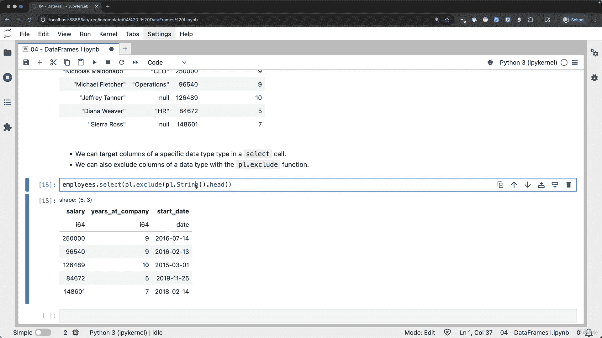

本节课中我们一起学习了 Polars 顶层的 `all` 与 `exclude` 函数。`all` 会创建表达式来瞄准指定数据帧中的所有列，适合在不知道列名或列很多的情况下使用；`exclude` 则创建表达式来瞄准除指定列之外的所有列，可以排除具体列名，也可以排除某种数据类型的列。我们还看到，`all` 和 `exclude` 都可以与其他表达式组合使用，并且与 `with_columns` 等方法的思路相通。本课要覆盖的内容就是这些，下一课再见。

