# 📘 Data Analysis with Polars and Python：第 69 节：fill_null 方法

本节课中，我们要继续探索 Polars 的数据框（DataFrame）。数据框是整个库最核心的数据结构，它本质上是一个二维表格，用来存放行和列。上一节我们已经在使用 employees 数据集了，这一节我们继续用它来演示。不过随着课程推进，我们还会引入更多不同的数据集，以及更多不同格式的文件导入方式，这一点你完全不用担心。

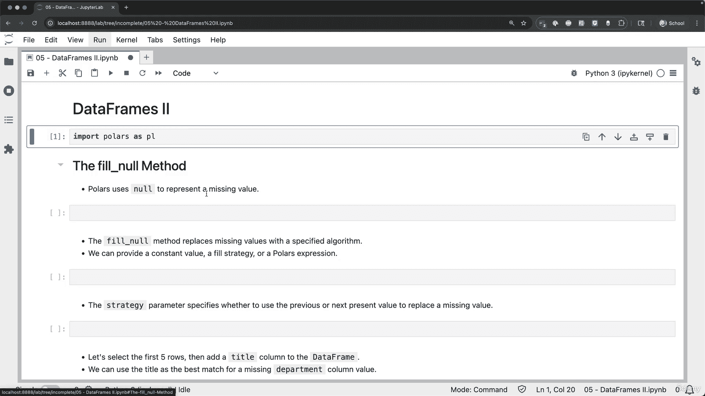

这一节我们会使用一个新的 Jupyter notebook，名字叫 `05_data_frames_too`。打开 notebook 之后，按照惯例，我们先把 Polars 导入进来。导入方式很简单，就像下面这样：

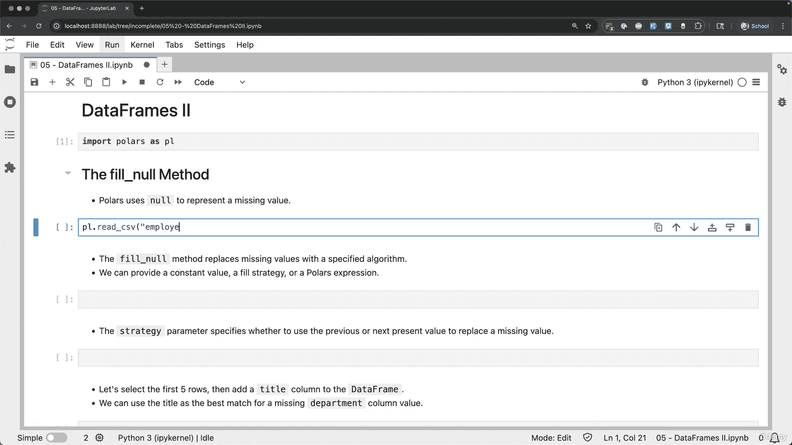

```python
import polars as pl
```

每次打开 notebook，只需要执行一次导入就可以了。接下来，我们把上一节用过的 employees 数据读进来。这里用到的是顶层函数 `read_csv`，只需要把文件名传进去就行：

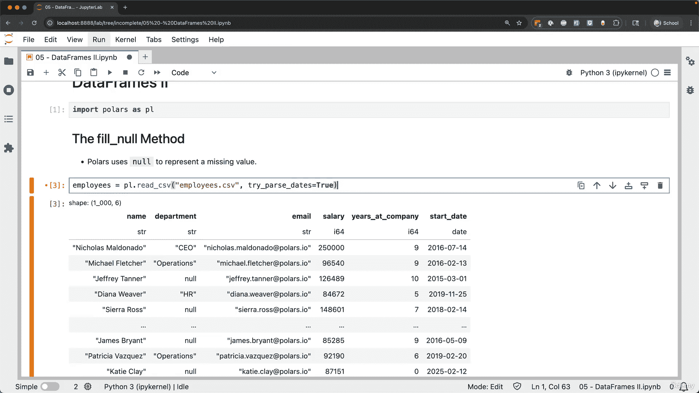

```python
employees = pl.read_csv("employees.csv", try_parse_dates=True)
employees.head(3)
```

关于 `try_parse_dates`，这里值得多说一句。这个数据集里有一个 `start_date` 列，默认情况下，它会被当作字符串读入，但从业务角度来说这些内容其实是日期。加上 `try_parse_dates=True` 之后，Polars 会自动尝试把所有可能的列从字符串转换成日期。由于文本本身采用的是一种常见的日期时间存储格式，所以 Polars 能顺利把它解析成日期列。我们把读取结果赋值给 `employees` 变量，然后用 `head(3)` 显示前三行。

你可能还记得，上一节我们反复看到过 Polars 表示缺失值的方式。它只要碰到缺失值，就会用 `null` 这个值来表示。比如 Jeffrey Tanner 这一行，`department` 字段就是 `null`。这表示在原始的 employees CSV 文件里，这个位置本来就没有任何内容，Polars 读取之后也用 `null` 打印出来。这种缺失值在真实数据里非常常见，所以我们要学会怎么处理它。

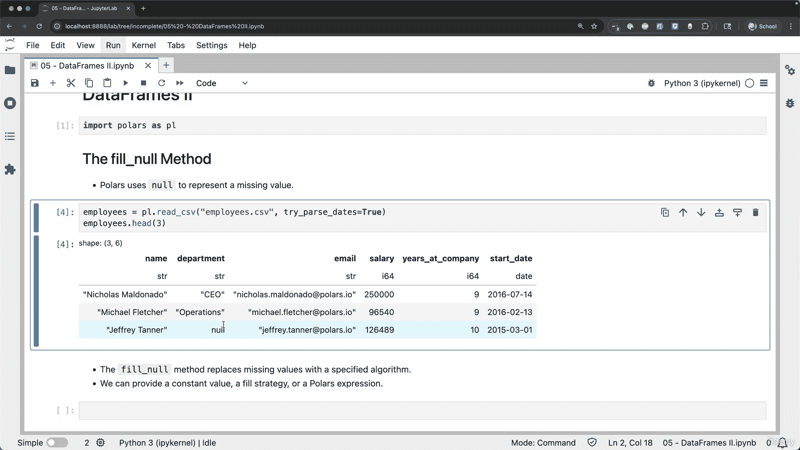

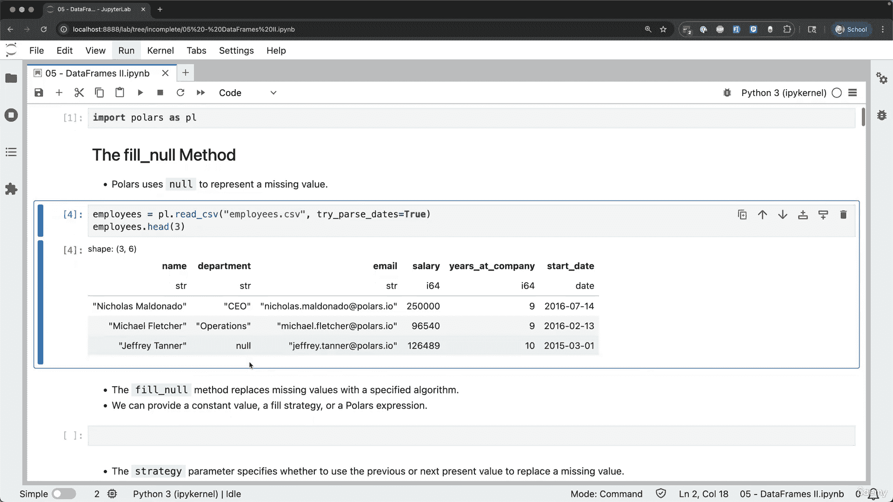

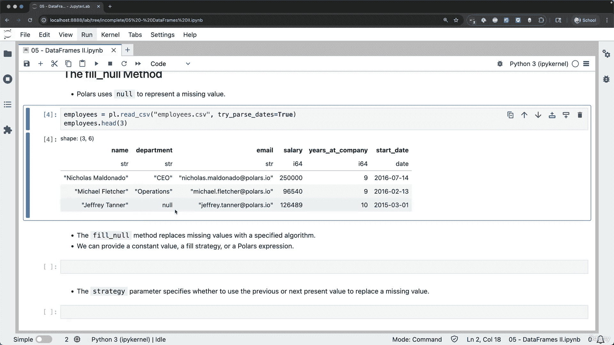

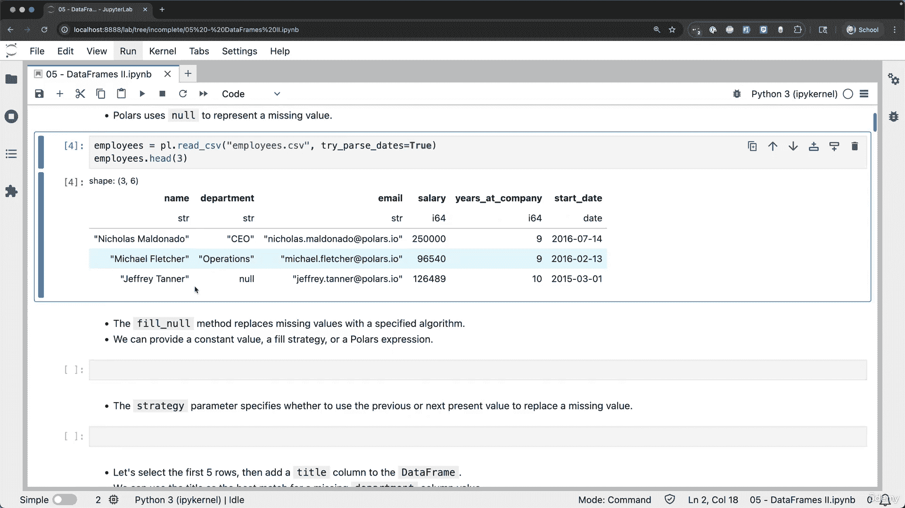

处理缺失值的方法有很多，这一节课我们主要围绕一个方法展开，那就是 `fill_null`。从字面上看，“fill” 是填充的意思，“null” 就是缺失值，所以 `fill_null` 的意思就是把缺失值补上。具体来说，我们可以用下面这几种做法来填充：

- 用一个固定的常量值来替换所有 `null`。
- 用前一个值或后一个值来复制填充。
- 用一个 Polars 表达式，比如引用另一列的值，来填充。

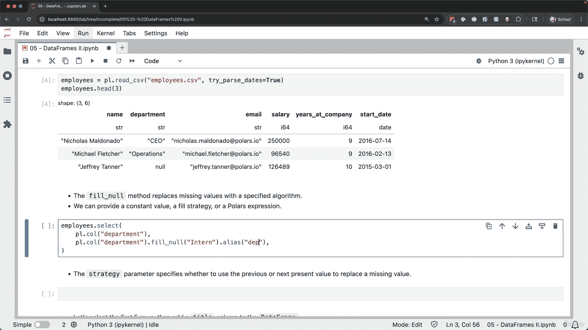

下面我们就从最简单的方案开始。

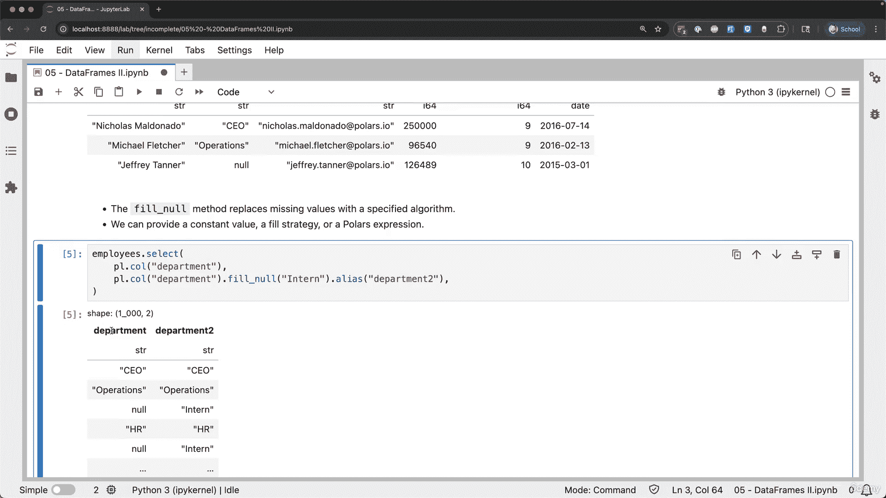

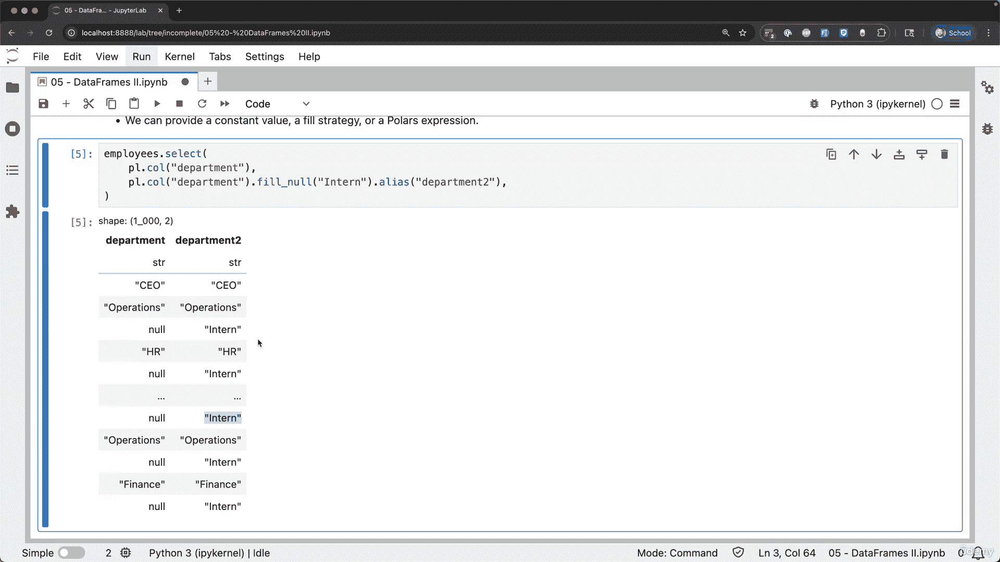

## 🔧 用固定值填充缺失值

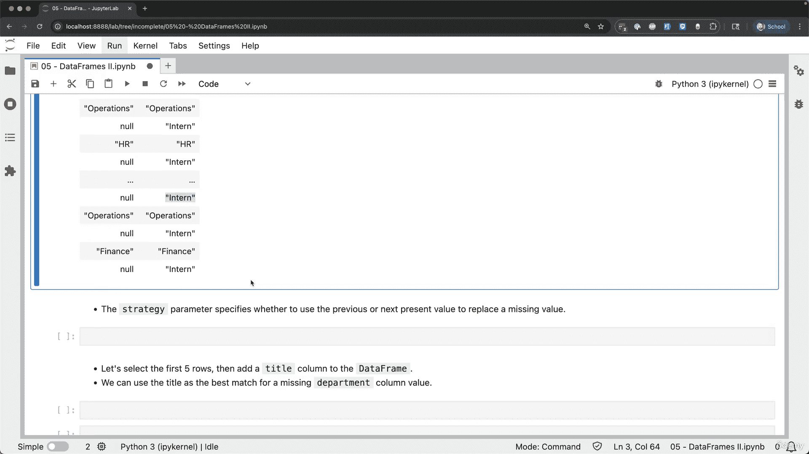

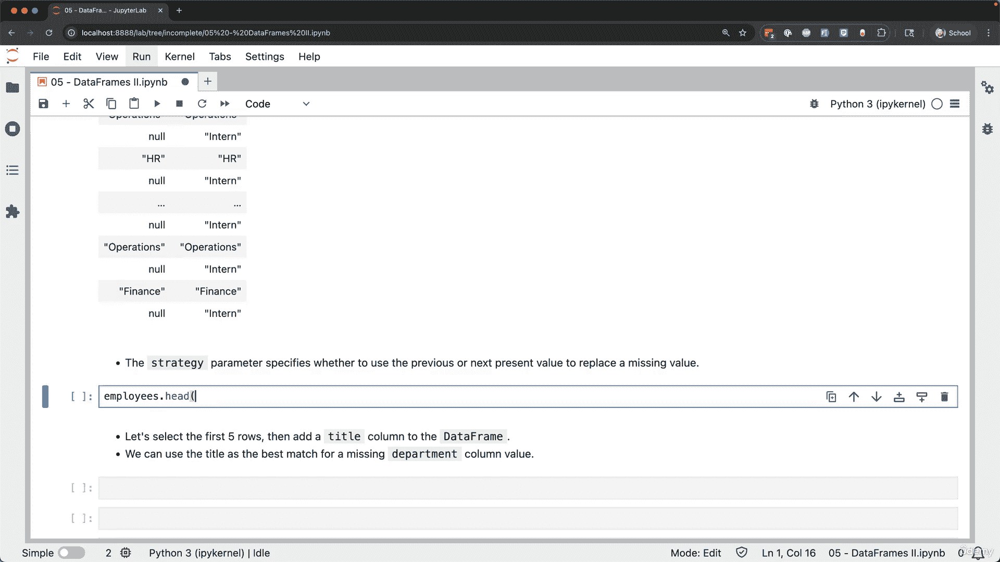

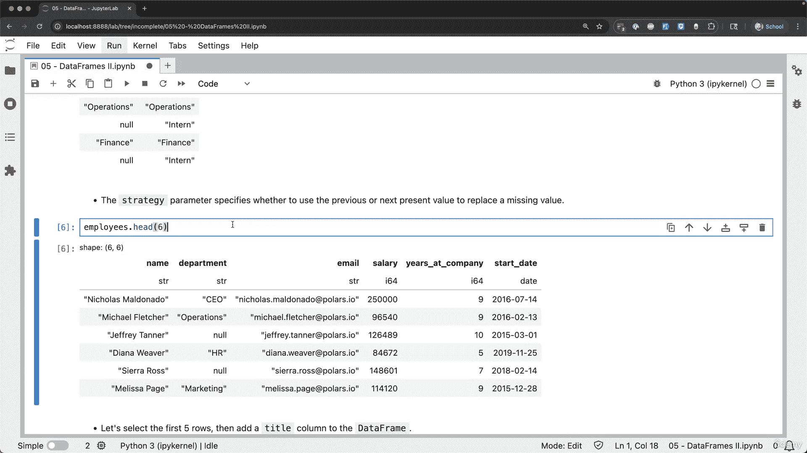

先看最简单的情况：我们想把 `department` 列里的所有 `null` 都替换成同一个值。思路是先选中 `department` 列，然后调用 `fill_null`，传入一个常量字符串。因为这一列是字符串类型，所以传入的值也得是字符串。这里我们假设把所有缺失部门的人都归为“实习生”，也就是 `"intern"`。

为了对比效果，我们把原始列和填充后的列同时显示出来。只不过两列如果都叫 `department` 是不允许的，所以需要给新列换个名字，使用 `alias` 方法即可。代码如下：

```python
employees.select(
    pl.col("department"),
    pl.col("department").fill_null("intern").alias("department_2")
)
```

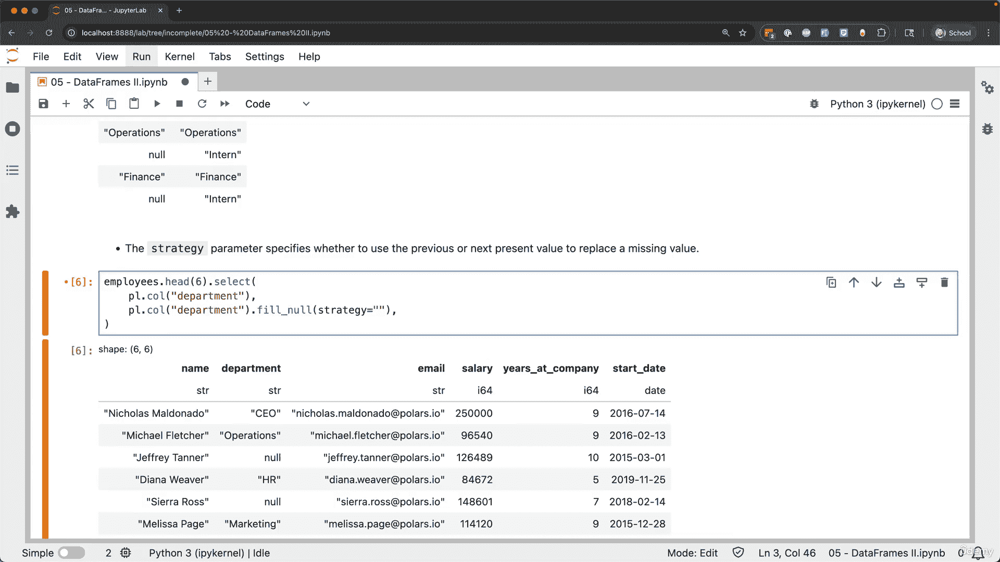

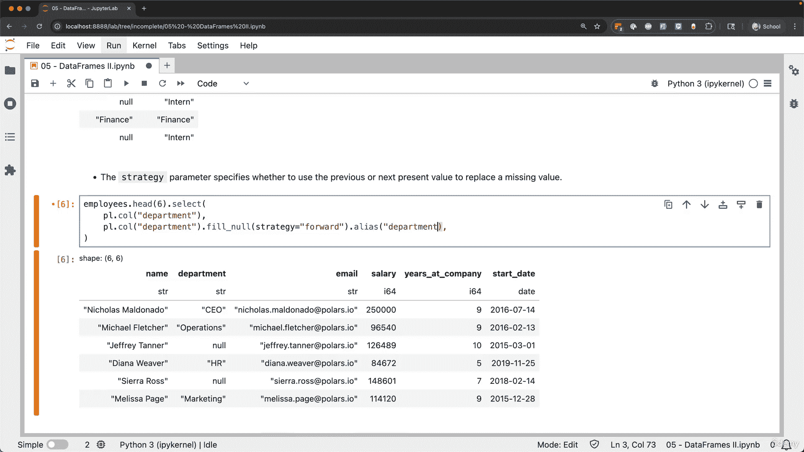

运行之后，你会看到左边是原始列，右边是新生成的列。凡是原来为 `null` 的位置，现在都被替换成了 `intern`，而且每一次出现 `null` 都会做同样处理。这就是固定值填充的逻辑：不管缺失值出现在哪一行，我们都用同一个值去补。这也是最直接、最不容易出错的一种方式。

## 🔄 用填充策略：forward 和 backward

接下来我们来看第二种做法，也就是使用填充策略。为了演示起来更清楚，我们先用 `head(6)` 取出 employees 数据的前六行，生成一个更小的数据框。然后依然选中 `department` 列，看看它现在的样子：

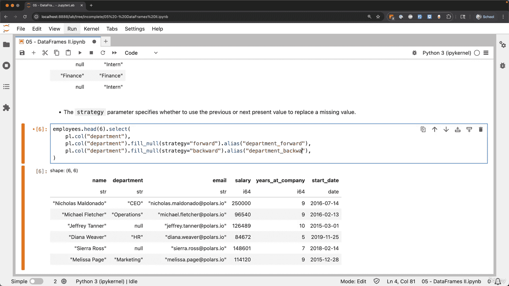

```python
small_employees = employees.head(6)

small_employees.select(
    pl.col("department"),
    pl.col("department").fill_null(strategy="forward").alias("department_forward"),
    pl.col("department").fill_null(strategy="backward").alias("department_backward")
)
```

这里的关键是 `strategy` 参数。你可以把它理解成“作战计划”，它决定了 Polars 在遇到 `null` 的时候，到底采用哪种填充方式。具体来说，每当碰到一个 `null`，Polars 可以选择使用它前面最近的那个非空值，也可以选择它后面最近的那个非空值。比如在 `department` 列里，前一个出现的值是 `operations`，后一个出现的值是 `HR`，到底复制哪一个过来，由 `strategy` 参数说了算。

`strategy="forward"` 的意思是向前填充。也就是说，Polars 会找到当前缺失值之前的那个有效值，把它复制过来，填补到空位上。这里需要稍微解释一下，因为“向前”这个词容易产生歧义。你可以从有效值的角度来看：有效值是自己“往前走”去填补后面的空位。所以在这个例子里，`operations` 会复制到它后面的 `null` 位置，而 `HR` 也会往前移动，填补它后面的 `null` 位置。这就是 `department_forward` 这一列做的事情。

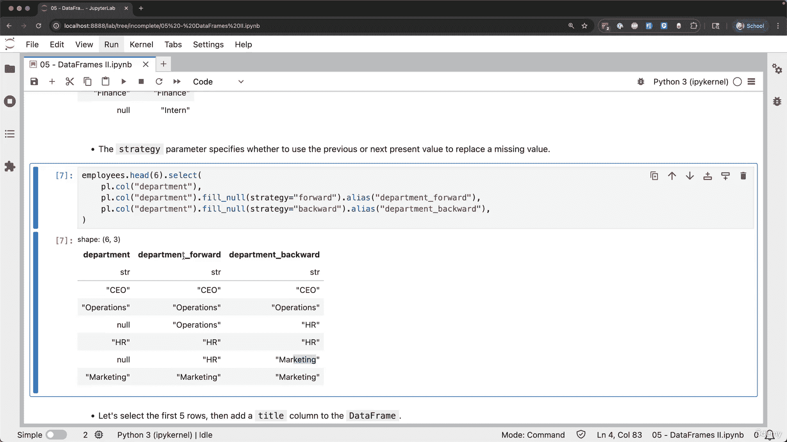

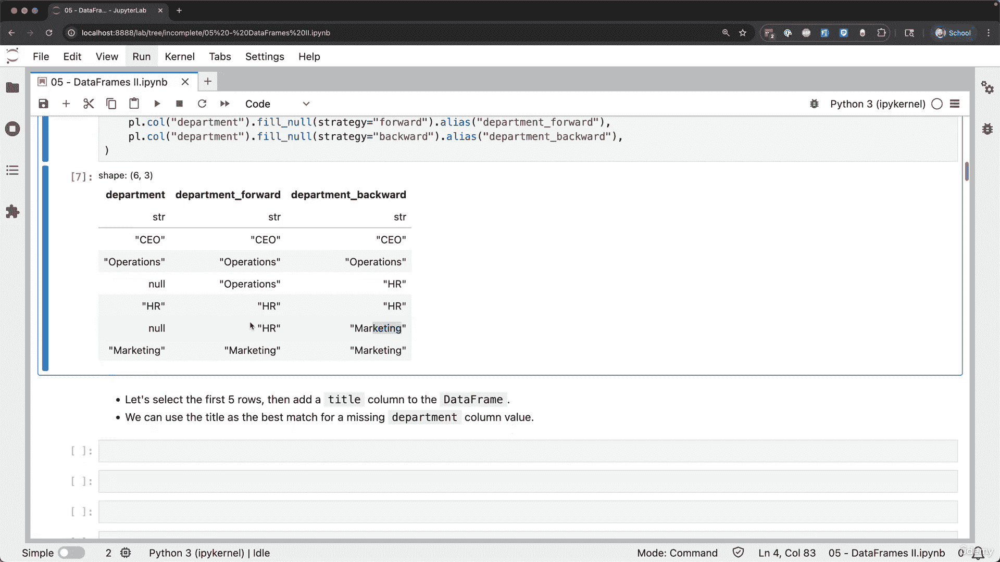

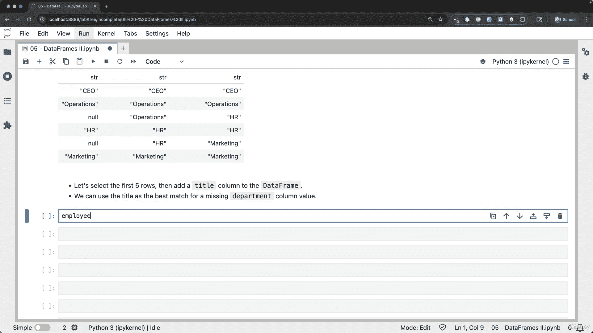

对应的，`strategy="backward"` 就是向后填充。它的逻辑正好反过来：Polars 会找到当前缺失值之后的那个有效值，把它复制到前面来。比如第一处 `null`，它后面最近的非空值是 `HR`，所以 `HR` 被复制到前面。接着又遇到一处 `null`，它后面的非空值是 `marketing`，于是 `marketing` 被复制到前面。你会发现，这两种策略本质上是一样的，只是搜索方向不同。你只需要想清楚，到底是用前面的值来补，还是用后面的值来补，`strategy` 参数就能帮你把方向定下来。

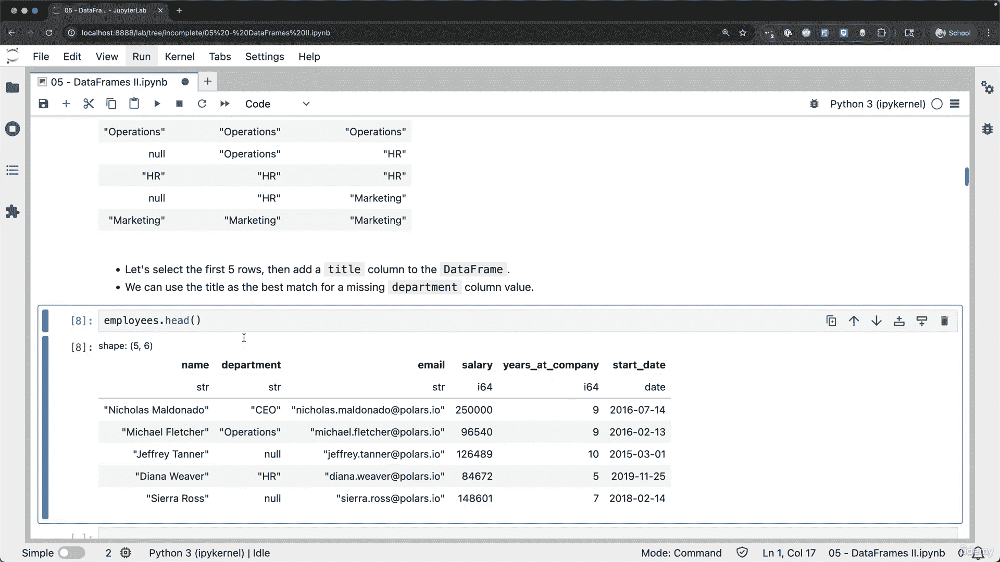

## 🧩 用另一列的值填充缺失值

最后这个例子会更灵活一些：我们不再用固定值，也不再用前一个或后一个值，而是引用数据框里的另一列，把那一列的值作为填充来源。这种做法的好处是，它能结合实际业务信息来处理缺失值，而不只是机械地复制相邻数据。

我们先对数据做一点小改动，让演示效果更明显。我们知道 employees 数据框一共有五行，现在用 `with_columns` 给它添加一列。你可能会说，之前我们用 `with_columns` 都是传入新表达式，其实传入一个普通的 Polars Series 也是合法的。只要这个 Series 的长度和数据框的行数一致，Polars 就会把它当作新列拼接到数据框末尾。比如，我们构造一个名为 `title` 的 Series，用来存放每个人的职位：

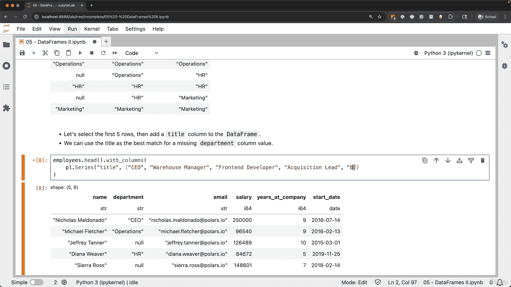

```python
small_df = employees.head(5).with_columns(
    pl.Series(
        "title",
        ["CEO", "warehouse manager", "front end developer", "acquisition lead", "backend developer"]
    )
)
```

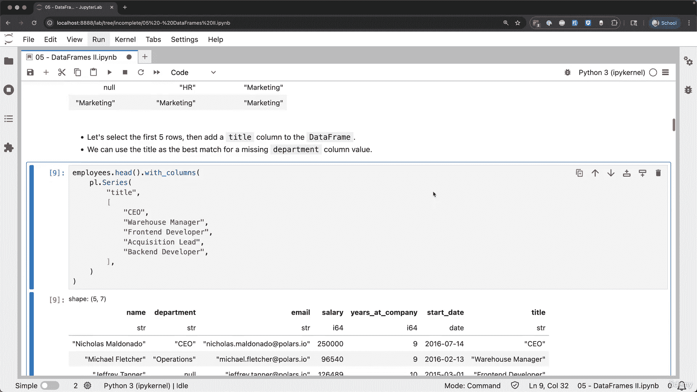

这里我们调用了 Polars 顶层的 `Series` 构造函数，它需要两个参数：第一个是列名 `"title"`，第二个是包含五个字符串的列表。执行完之后，你会看到新数据框里多出一列 `title`，而且每个值都是完整的，没有缺失。这就给后面的填充操作做好了准备。

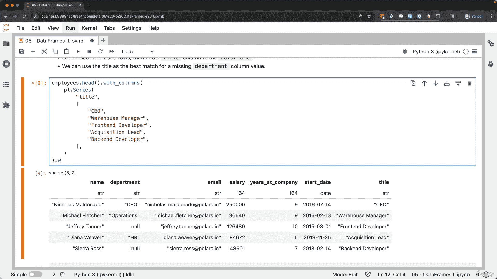

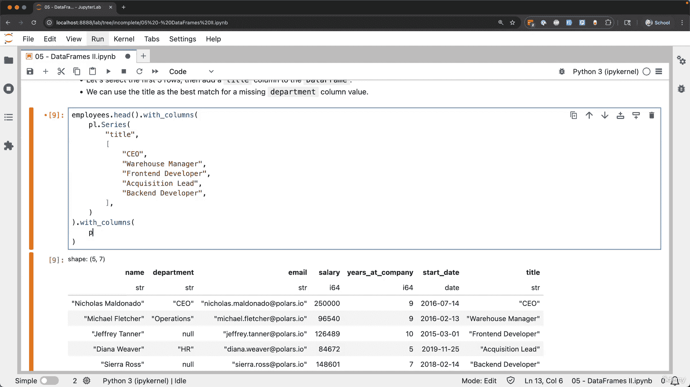

接下来，我们想让 `department` 列里的 `null` 值，参考 `title` 列的内容来填充。具体做法是：选中 `department` 列，调用 `fill_null`，但这次不再传常量，也不传 `strategy` 参数，而是传一个表达式，也就是 `pl.col("title")`。这个表达式的意思就是：遇到 `null` 的时候，请把 `title` 列对应位置的值复制过来。完整代码如下：

```python
small_df.with_columns(
    pl.col("department").fill_null(pl.col("title")).alias("department_updated")
)
```

因为新生成的列本质上还是 `department` 的变体，名字不能和原来的完全一样，所以我们最后用 `alias("department_updated")` 给它换了个名字。现在，你可以把 `department` 列和 `department_updated` 列放在一起对比。你会发现，原本就存在的值，比如 `CEO` 和 `operations`，一点都没有变；但凡是 `department` 列里为 `null` 的地方，比如第三行和第五行，现在都被 `title` 列的对应值替换掉了。

在这个例子里，我们可以这样理解：根据一个人的职位，我们能大致推断出他的部门。比如这两个人的职位是 “front end developer” 和 “backend developer”，那他们大概率属于软件工程类的部门。在这种情况下，用另一列的信息来填补缺失值，确实是一个相当合理的选择。而且这种表达式的方式非常灵活，因为引用的列可以随时更换，你也可以构建更复杂的条件逻辑。

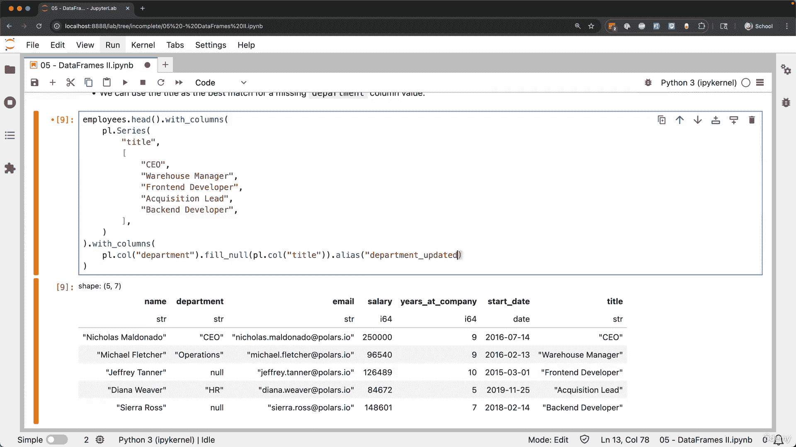

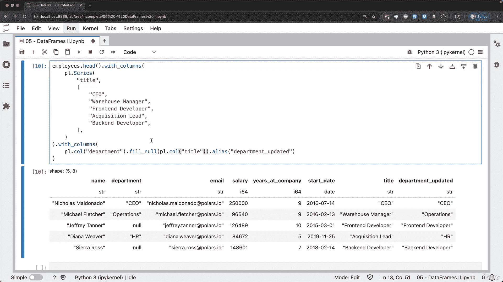

到这里，`fill_null` 方法的几种常见用法就都介绍完了。它能够用来替换数据框中的 `null`、缺失值或空值。我们回顾一下本节课的内容：我们用固定值填充了缺失值，用 `forward` 和 `backward` 策略做了前后方向填充，还通过引用另一列的表达式完成了更聪明的填充。在下一节课中，我们还会看到另一种处理缺失值的策略，叫做插值（interpolation），到时候我们再继续学习。
