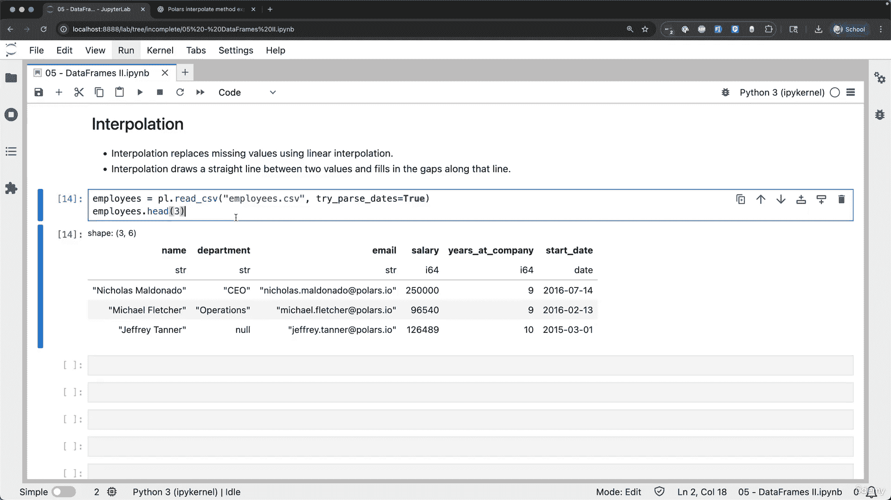
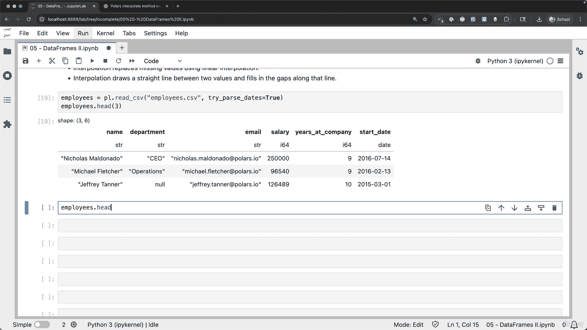
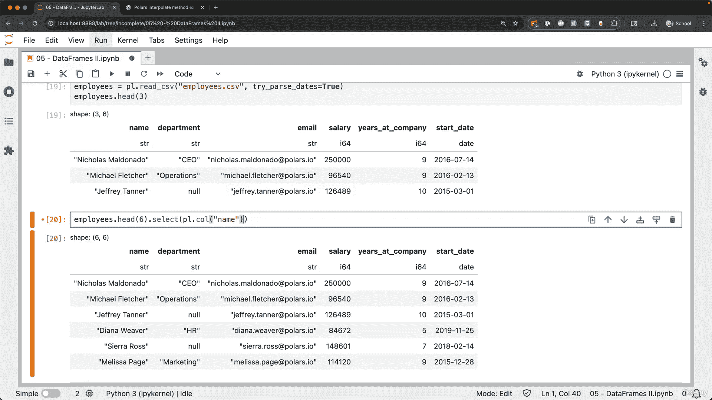
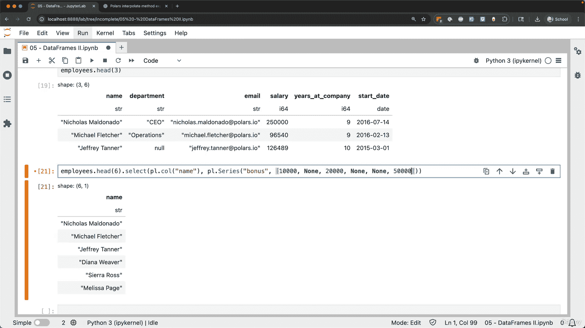
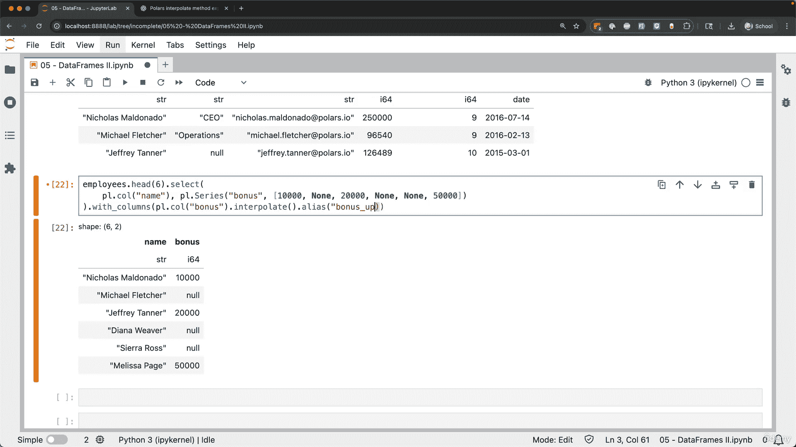
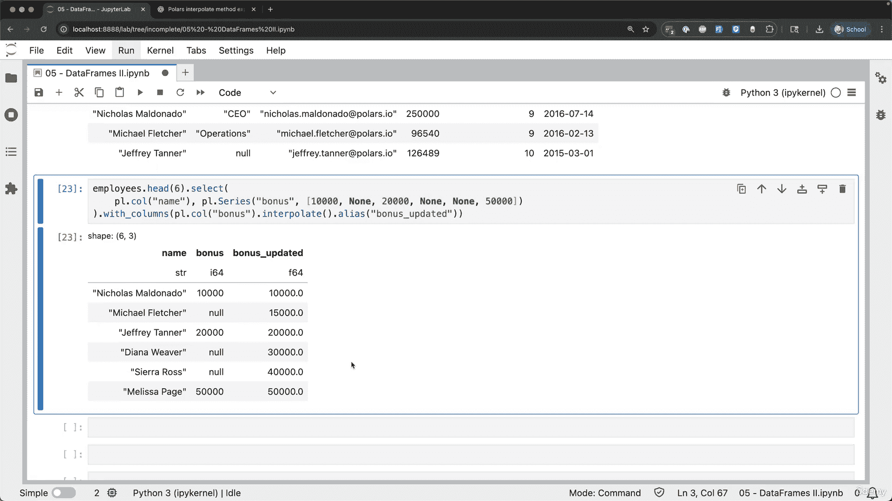

使用Polars和Python进行数据分析：第70节：插值法 🧮


本节课中，我们来学习另一种处理缺失值的方法，尤其适用于数值列，就是插值法。前面我们学习过如何用 `fill_null` 填充空值，这次我们要换一个更“聪明”的思路：利用已知数据点的位置关系，把缺失值按线性规律补上。说得更直白一点，当数据整体呈现一条直线趋势时，插值法可以在两个已知值之间拉一根直线，然后按照相等的间隔填补中间空档。在开始写代码之前，我们先把这个概念琢磨清楚。

## 什么是线性插值？ 📐




插值法，也叫线性插值，本质上是一种填充策略。它把“最后一个存在的值”和“下一个存在的值”之间的空缺看作一段距离，然后假设这两个值之间是一条直线。接下来，它就在这条直线上等分这段距离，把空出来的 `null` 值一一填满。就好比在坐标轴上画两个点，再把它们用直线连起来，缺失的坐标就从这条直线上取。这个概念光用嘴说有点抽象，但只要一看到实际例子，立刻就能明白。



我们可以用公式来表示这个思路。设上一个已知值为 \(y_0\)，下一个已知值为 \(y_1\)，中间有 \(n\) 个缺失值，那么第 \(i\) 个缺失值（\(i\) 从 1 开始）就等于：

\[
y = y_0 + \frac{i}{n+1}(y_1 - y_0)
\]

这个公式的意思是，把 \(y_0\) 到 \(y_1\) 的区间分成 \(n+1\) 等份，第 \(i\) 个点就落在第 \(i\) 个等分点上。当然，这个公式你不需要自己写，Polars 的插值函数会帮你算好，我们只要理解它背后的逻辑就行。



## 准备数据：创建一个小示例 🛠️


理解了原理，下面我们就动手实际操作一下。首先，执行导入代码，把 Polars 库加载进来。


```python
import polars as pl
```


示例继续使用 `employees` 数据集。为了把注意力集中在插值上，我们只取前六行数据。在 Polars 中，用 `head(6)` 就可以做到。接着，我们只需要保留其中的姓名列，于是用 `select` 把 `name` 列单独提取出来。现在我们要在这个数据框右侧追加一列新的数据，用来扮演“奖金”。具体做法是调用 Polars 顶层的 `Series` 构造函数，创建一个新的序列，并把它作为第二列加入数据框。代码如下：


```python
df = employees.head(6).select("name").with_columns(
    pl.Series([10000, None, 20000, None, None, 50000]).alias("bonus")
)
```


注意，这里传给 `pl.Series` 的是一个 Python 列表，里面有六个值。其中，`None` 是 Python 原生的空值对象，它和 Polars 里的 `null` 含义完全一致：表面上是一个合法的对象，但内容表示“缺失”或“什么都没有”。Polars 在把这个列表转换为数据框列的时候，会自动把其中的 `None` 识别为空值，这一点和上一节提到的空值处理方式一样。

下面，我们把列表中的每个元素拆开来看一下：



- 第一个值是 `10000`。
- 第二个值是 `None`。
- 第三个值是 `20000`。
- 第四个值是 `None`。
- 第五个值是 `None`。
- 第六个值是 `50000`。

我们可以把这些数字当作六名员工的奖金。假设出于某种原因，有些员工的奖金漏填了。但我们知道，这些奖金在原始规则下是按照线性顺序排列的。那么，Michael Fletcher 这个员工正好夹在拿 `10000` 和 `20000` 的两名员工之间（这里假设 Michael 是第 2 行，但我们不用管具体是谁）。既然是线性排列，他的奖金自然应该正好是两者中间的 `15000`。同样地，`20000` 到 `50000` 之间的差距是 `30000`，而中间存在两个空值，相当于要把这个差距平均分成三份，所以两个空值应该分别填充为 `30000` 和 `40000`。无论中间有多少个空值，这个规律都一样：一个空值就是一份间隔，两个空值就是两份间隔，依此类推。换句话说，插值就是在两个已知值之间按相等的步长一步步前进，直到把缺失的位置全部填满。

## 使用 interpolate 方法填充空值 ✨


数据准备好了，现在来看看怎么调用 Polars 的插值方法。我们需要再次使用 `with_columns` 方法，这样既能保留原来的列，又能新增一列处理后的结果。在 `with_columns` 里面，我们指定要操作的列是 `bonus`。注意，这里不再使用 `fill_null`，而是改用 `interpolate`。对于数值列来说，`interpolate` 正是它的用武之地。

具体代码如下：


```python
df.with_columns(
    pl.col("bonus").interpolate().alias("bonus_updated")
)
```




为什么要在最后加上 `alias("bonus_updated")`？原因很简单：如果不加别名，插值计算出来的新列会直接覆盖掉原来的 `bonus` 列。我们希望保留一个“修改前”和“修改后”的对照，所以特意给它起了一个新名字，这样就能直观看到插值前后的差异了。

运行代码后，你会看到结果和我们之前推理的完全一致。`10000` 和 `20000` 之间的空值被填成了 `15000`；`20000` 和 `50000` 之间的两个空值被填成了 `30000` 和 `40000`。从本质上讲，Polars 所做的就像是在这些已知数据点之间画了一条线，然后测量出每个间隔的长度，再用这些间隔去填充缺失值。

不过，这里有一个小坑需要提醒大家：使用 `interpolate` 之后，返回的列是浮点数类型（`float`），而不是整数。这是因为插值计算中会产生小数，Polars 为了不损失精度，自动把整型提升为浮点型。如果你希望最终得到整数列，可能需要在插值之后再做一次类型转换，例如用 `cast(pl.Int64)`。

## 总结 📝




看到这里，你应该已经明白线性插值是怎么一回事了。本节课中，我们一起学习了如何在 Polars 中使用插值法处理数值列中的缺失值。我们先从概念入手，理解了什么是线性插值，以及它如何利用两个已知值之间的“直线”来填补中间的空缺。接着，我们搭建了一个六行数据的示例，创建了一个带有多个 `None` 的奖金列，然后调用 `interpolate` 方法，成功地把 `10000` 和 `20000` 之间的空值填成了 `15000`，把 `20000` 和 `50000` 之间的两个空值分别填成了 `30000` 和 `40000`。与此同时，我们也注意到插值结果默认是浮点数这一细节。希望通过这个例子，大家在今后遇到数值列缺失值时，能够多一个选择：用 `interpolate` 让数据沿着趋势自动补齐。
