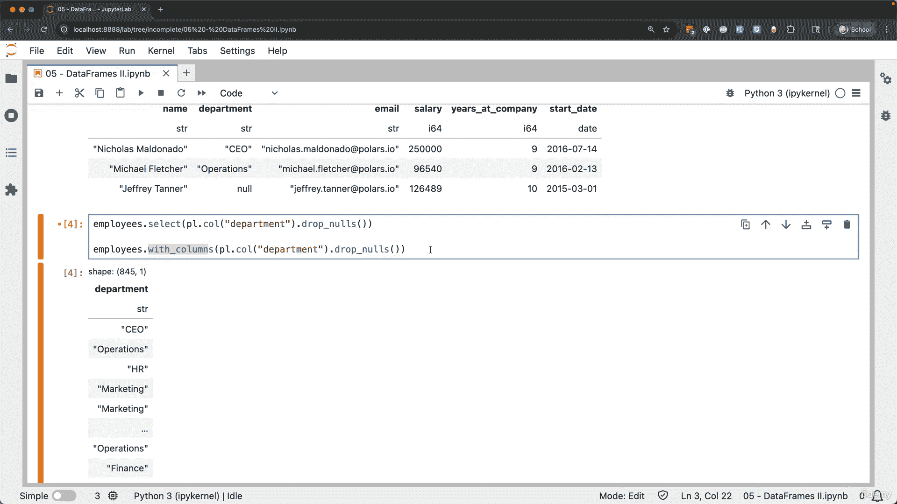
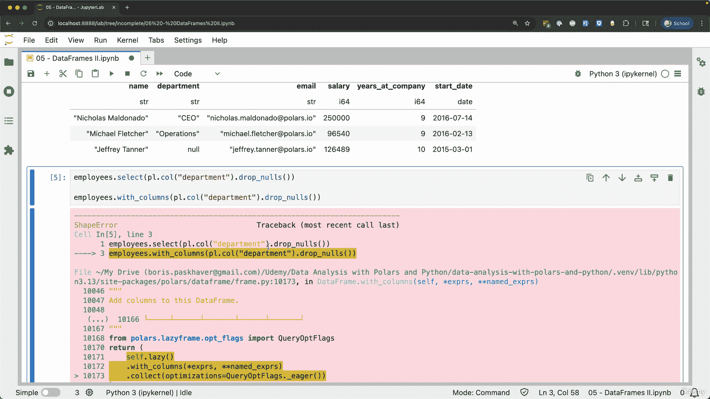
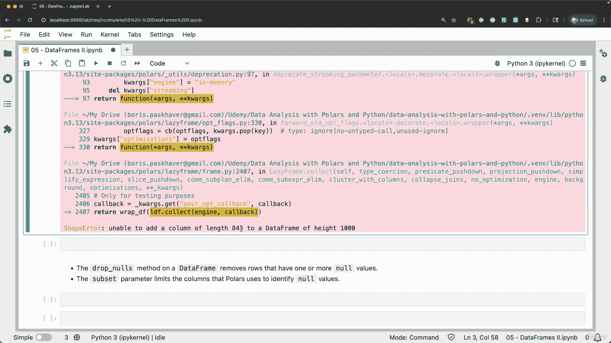
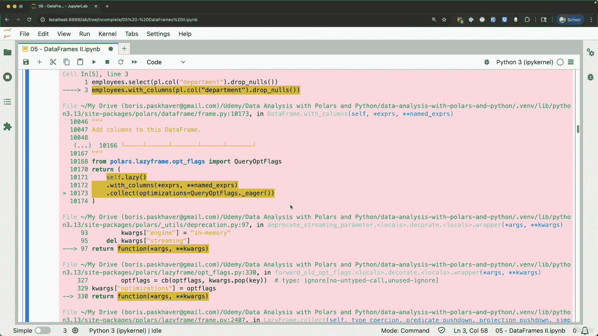
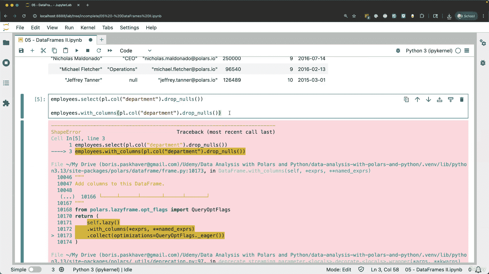
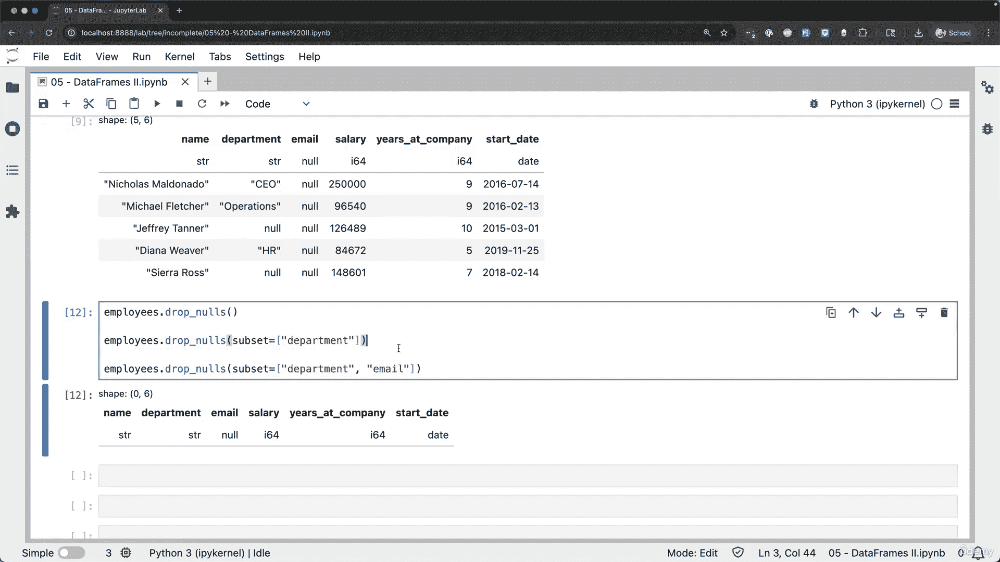

# 🐻‍❄️ 使用Polars和Python进行数据分析：第71节：删除缺失数据 🗑️


在本节课中，我们将学习如何使用Polars删除数据中的缺失值。在前面的课程中，我们已经了解了如何替换或填充缺失值，而这次我们要探讨另一种策略：直接把那些缺失值删掉。具体来说，你可以只针对某一个列，删除这个列里的所有空值；也可以在整个数据框的范围内，让Polars删除那些在一列或多列中带有空值的行。这两种方式我们都会在本节中一一实践。


## 1. 从select表达式开始：drop_nulls 🎯


首先，我们重新执行导入代码，加载数据。从之前的操作中可以看到，`department` 列里有一些空值，事实上，它是这个数据框中唯一包含空值的列。那我们就先从 `employees` 数据框开始，用 `select` 构建一个针对 `department` 列的表达式。这里要引入的新方法叫做 `drop_nulls`。就像字面意思一样：`drop` 就是删除，`null` 就是缺失值或空值，所以 `drop_nulls` 就是“删除空值”。把它用在列表达式上，就能返回一个没有空值的新列。

```python
employees.select(pl.col("department").drop_nulls())
```

执行之后，你会得到一个新列，这个列里不再有任何空值。有一点非常重要：这个新列的长度比原来的 `department` 列要短。原来的 `department` 列有1000行，我们去掉了155个空值，所以最终得到的是只有845个非空值的列。这对 `select` 方法来说完全没问题，因为 `select` 就是计算新的表达式，然后返回一个包含这些表达式结果的新数据框。但这样的表达式和 `with_columns` 方法放在一起，就会出问题。


## 2. 注意：with_columns中的长度限制 ⚠️






我们来看看下面这段代码，把同样的表达式传给 `with_columns`：

```python
employees.with_columns(pl.col("department").drop_nulls())
```





在运行之前，先解释一下会发生什么。`with_columns` 会保留所有现有的列，然后计算表达式，并把新列添加到数据框的末尾。也就是说，`with_columns` 期望每个表达式产生的列长度与原始数据框的行数完全相同，比如都是1000行，这样才能拼接到数据框后面。可问题在于，`drop_nulls` 表达式产生的列只有845行，比原始数据框的1000行要短。因此，这里会报错，因为列长度不匹配。错误信息大概是“shape error”（形状错误），往下滚动到底部，会看到详细的提示：“unable to add a column of length 845 to a data frame with a height of 1000”，意思是无法把一个长度为845的列添加到高度为1000的数据框中。

所以这里要特别小心：使用 `with_columns` 时，必须确保表达式产生的列长度和原始数据框完全一致。当然，`select` 也有一个限制，就是所有表达式产生的列长度必须相同，这样Polars才能把它们拼在一起；但它不要求这些列的长度必须等于原始数据框的行数。现在，我们先把刚才出错的代码注释掉，回到一个可运行的示例。


## 3. 构造一个多列缺失的小数据框 🧪




接下来，我们要介绍另一个方法，它会把带有空值的实际行从数据框中删除。为了让例子更直观，我们打算创建一个小数据框，并稍微修改一下数据。之前提到过，`employees` 数据框只有 `department` 这一列有缺失值。现在我们要构造一个在多个列中都有缺失值的数据框。具体做法是：先调用 `head` 方法取出前五行，然后把其中 `email` 列的所有值都替换成空值。这里需要用到一个新的语法——`with_columns` 配合 `pl.lit`。

还记得吗？在使用 `with_columns` 时，如果我们传入一个表达式，并且这个表达式算出来的列名和现有列名相同，它就会覆盖原来的列。所以，如果能创建一个包含五个空值的新 `email` 列，它就会覆盖并替换现有的 `email` 列。那么，如何创建一个固定值不变的全空列呢？可以用Polars顶层函数 `lit`。`lit` 是 `literal` 的缩写，意思是“字面量”，就是一个写死的、不会变化的常量值。它不是动态计算的，每一行都一样。调用 `pl.lit(None)` 就可以创建一个表达式，参数 `None` 就是那个常量值。在生成列的时候，Python的 `None` 会被转换成等价的空值表示。

这里有一个很奇妙的点：使用 `pl.lit` 时，我们不需要提前知道数据框有多少行。Polars会自己判断这个表达式要用多少行，然后生成一个新列，并把每一行都填上空值。再加上 `.alias("email")`，告诉Polars这个新列叫 `email`。Polars看到你给了它一个名为 `email`、且全是空值的新列，就会覆盖掉原来的 `email` 列，同时保持其他列不变。来看下面的代码：

```python
employees = employees.head(5).with_columns(pl.lit(None).alias("email"))
```

执行后，我们就得到了一个只有五行的数据框。`department` 列仍然有几个空值，而 `email` 列则完全为空。把 `employees` 变量覆盖成这个更小的数据框，接下来观察删除行的变化就方便多了。


## 4. DataFrame.drop_nulls的默认行为：删除所有含空值的行 🧹


现在我们再次使用 `drop_nulls` 方法，但这次不是用在表达式上，而是直接用在数据框上。调用方式是 `employees.drop_nulls()`，注意单词之间用下划线连接。默认情况下，这个方法非常“激进”。它会删除任何一行中包含一个或多个空值的行。也就是说，不管空值出现在这一行的哪个列，甚至多个位置，只要检测到空值，这一整行都会被排除。

在我们的例子中，五行的数据框里每一行至少有一个空值，所以执行后你会得到一个空数据框，真的是一行都不剩。听起来有点严格，但这在有些场景下特别有用。比如数据框里有一些“空行”：如果一份数据集中有很多缺失行，这些行会表现为一整行、一整段记录全部是空值。如果你想用一种简洁的方式让Polars把所有这些行都删掉，不管缺失出现在哪里，`drop_nulls` 的默认行为就能派上大用场。

```python
employees.drop_nulls()
```


## 5. 使用subset参数指定检查列 🎯


不过，有时候我们并不想这么粗暴。比如我们希望告诉Polars：不要删除任何带有缺失值的行，只删除那些在 `department` 列中有缺失值的行。至于 `email` 列怎么样，暂时忽略。也就是说，只有 `department` 里出现空值的那几行才需要被删除。这样就需要用到 `subset` 参数。`subset` 的意思就是“子集”，也就是从一个更大的数据集中取出的一个较小分组。在这里，我们指定Polars不要使用所有列来识别空值，只使用我们提供的指定列。

`subset` 接收一个Python列表，因为我们可以指定一个或多个列。先来看只指定 `department` 列的情况：

```python
employees.drop_nulls(subset=["department"])
```

运行之后，这个数据框会剩下三行。这三行的 `department` 列都没有空值，而 `email` 列里的空值则被完全忽略掉了。这正是 `subset` 的作用。


## 6. 多列之间的“或”逻辑 🔀


接下来，我们把 `subset` 扩展成同时包含 `department` 和 `email` 两个列，看看会发生什么。这个语法使用的并不是“与”逻辑，而是“或”逻辑。这里的含义是：只要 `department` 或 `email` 中出现一个空值，对应的行就会被删除。并不是要求两个列必须同时为空。如果继续增加更多列，也是同样的逻辑。所以，当我们把 `subset=["department", "email"]` 传给 `drop_nulls` 时，结果又会变成空数据框。因为只要一行一行看过去，`email` 列每一行都是空值，于是每一行都会被排除。

```python
employees.drop_nulls(subset=["department", "email"])
```

举个例子：如果某一行 `department` 有值，`email` 也有值，那么这一行会被保留；否则，只要 `department` 或 `email` 中任意一个为空，这一行就会被删除。在我们这个小数据框里，每一行都会因为 `email` 为空而被删掉，所以最后什么也不剩。

那如果我想删除的是“`department` 和 `email` 同时为空”的行，又该怎么办？这个例子我们会放到后面讲过滤的时候再深入展开。到那时，我们需要构建多个独立的条件表达式，比如先找出 `department` 为空的那些行，再找出 `email` 为空的那些行，然后只保留这两个条件同时成立的行，最后删除它们。不过现在，我们先掌握 `drop_nulls` 的基本用法就够了：它可以删除任意列存在空值的行，也可以删除指定列存在空值的行，或者删除多个指定列中任一列存在空值的行。


## 总结 📝




本节课我们一起学习了如何用Polars删除缺失数据。我们首先回顾了上一节的填充策略，然后引入删除策略：使用 `select` 和 `drop_nulls` 可以从单个列中删除空值，但要注意 `with_columns` 要求列长度一致，否则会报错。接着，我们用 `pl.lit(None)` 构造了一个带有多列缺失的小数据框，并介绍了 `DataFrame.drop_nulls()` 的默认行为是删除任何含空值的行。通过 `subset` 参数，我们可以只检查指定列；当指定多列时，用的是“或”逻辑：只要有一个列为空就删除该行。至于“同时为空”的“与”逻辑，我们将在后续过滤相关课程中继续学习。掌握了这些，你就能够灵活地清理数据中的缺失值了。

