# Udemy - Data Analysis with Polars and Python：第1部分：第73节：按多列排序 I 📊


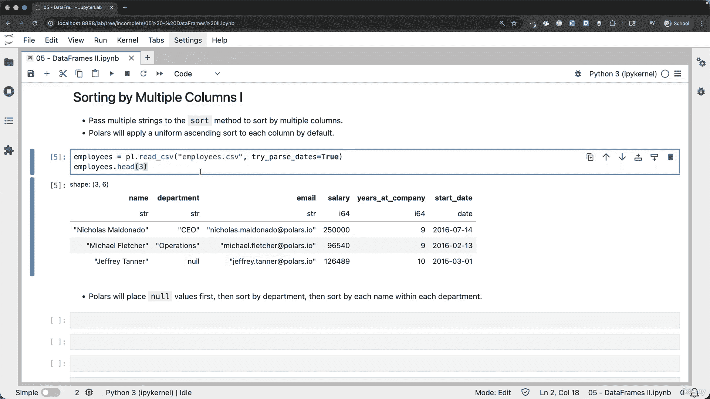

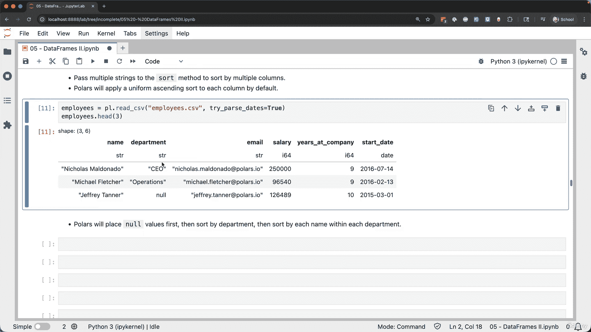

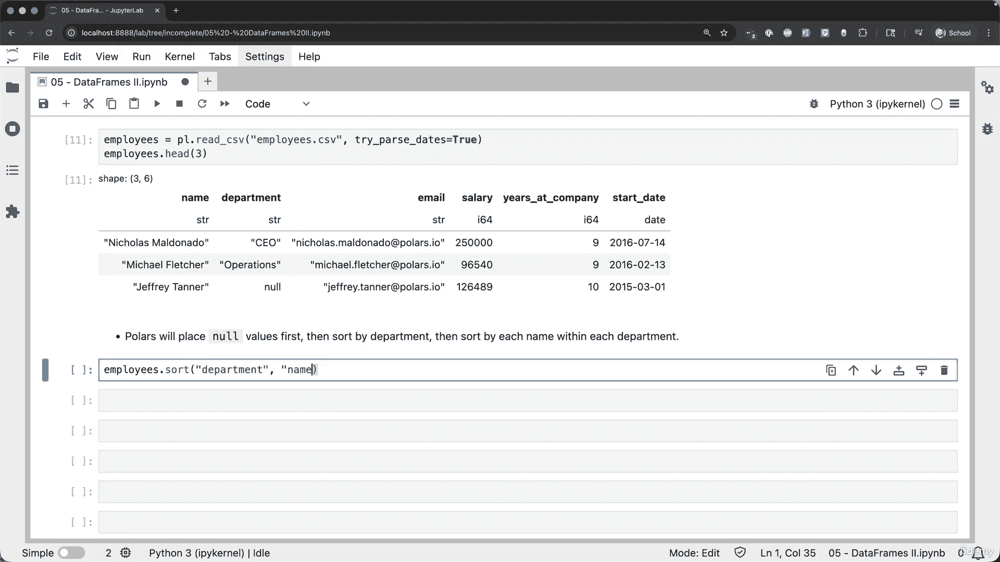

在本节课中，我们将要学习如何在 Polars 中按多列对数据进行排序。我们将详细讲解基本语法、几种等价的替代写法，以及排序列顺序对结果的关键影响。请跟随我的步骤，一步步掌握这一核心技能。


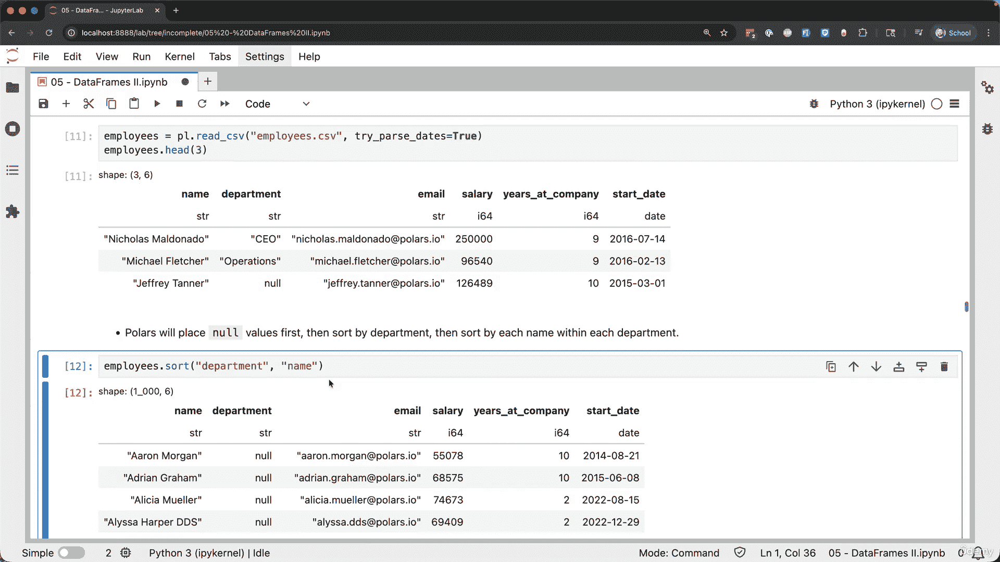

接下来，让我们来看看如何按多列进行排序。我将首先重新执行导入代码，然后在下方继续操作。我将再次对员工数据框使用 `sort` 方法。


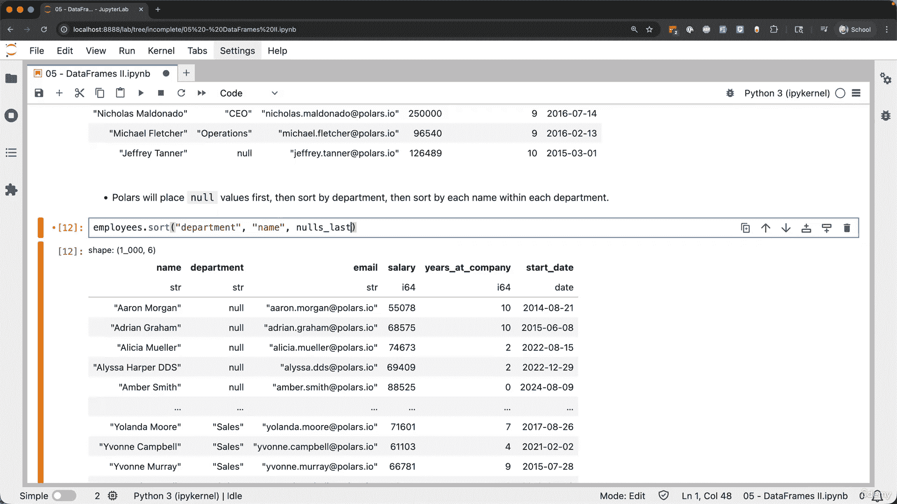

这一次，我不再传入代表单个列的单个字符串，而是将按顺序传入多个字符串，每个字符串对应数据框中的一列。我们首先指定 `department` 列，然后将 `name` 列作为第二个参数。


那么，当我们提供多个值时，Polars 是如何排序的呢？它会首先对 `department` 列中的所有内容进行排序。提醒一下，我们的 `department` 列包含空值或缺失值，默认情况下这些值会被放在最前面。如果将它们放在最后，这个例子可能更容易理解。因此，我将再次添加 `nulls_last` 参数，并将其设置为 `true`，这会将空值推到末尾，方便我们推理排序结果。


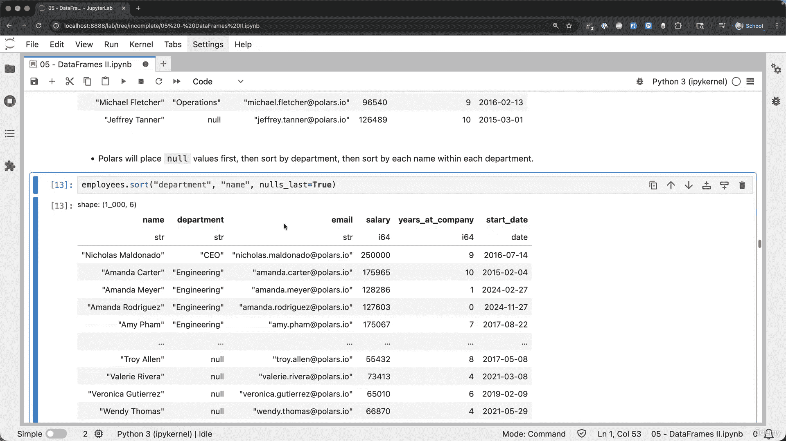

```python
df.sort("department", "name", nulls_last=True)
```


这是一个很好的例子：在 `department` 列中，我们确实是按字母顺序排序的。这里是 `CEO`，这里是 `Engineering`。这是一个升序排序，对于字符串来说意味着字母顺序。每当 `department` 列中出现重复或重复值时，Polars 就会转到 `name` 列，并对那里的值进行排序。这些是 `Engineering` 部门内排序后的员工姓名。请注意，整体员工并不一定按字母顺序排序。例如，`Nicholas Maldonado` 在字母表中排在 `Amanda Carter` 之后，但我们之所以看到这种顺序，是因为我们首先按 `department` 排序，`CEO` 排在最前，且只有一个 `CEO` 值。然后我们处理 `department` 列中的 `Engineering` 值，并按字母顺序排序所有对应的姓名。接着我们会处理像 `Sales` 这样的其他部门，同样按字母顺序排序对应的姓名。最后，我们会处理所有 `department` 列为空或缺失的值，你可以把缺失值想象成一个独立的重复类别，所有部门缺失的姓名也将按字母顺序排序。这是一个多列排序，同样，这两列的默认排序顺序都是升序，因为都是字符串，所以都是按字母顺序。我们可以自定义每列的排序顺序，下一节课我们将介绍如何操作。


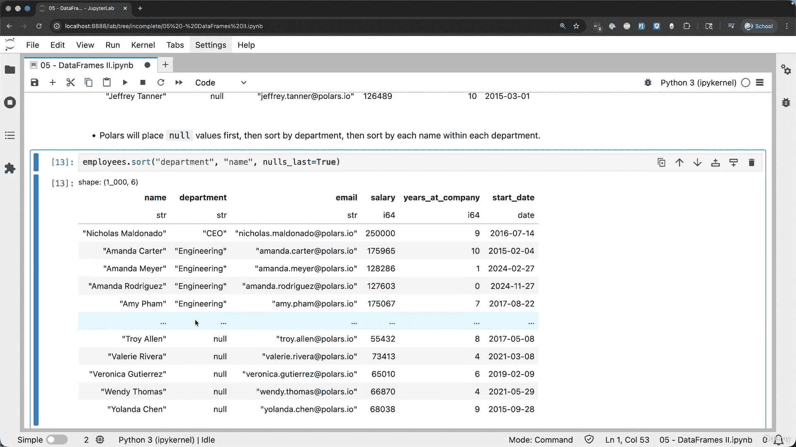

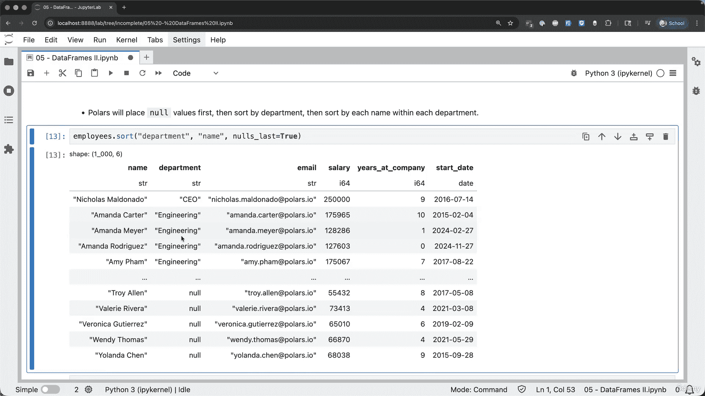

这里还有另一个例子，我可以直接复制上面的这行代码。我将调整第二列，将 `name` 列改为 `salary` 列。现在我们要排序的一个列包含字符串值，另一个包含整数，但逻辑完全相同。如你所见，`department` 列仍然按升序字母顺序排序。然后对于每一个重复的部门，我们按升序排序对应的薪资值。`Gina Williams` 是 `Engineering` 部门薪资最低的员工，下一位员工薪资稍高，依此类推。单独看 `salary` 列是无序的，它仅在 `department` 列的每个重复出现的组内才是有序的。这是这里需要理解的关键点。


以上是我通常使用的语法，但我还想向你介绍几种其他在实际代码中可能见到的有效语法选项。一如既往，Polars 提供了多种方式实现相同的结果。


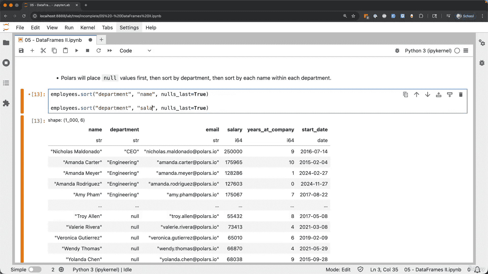

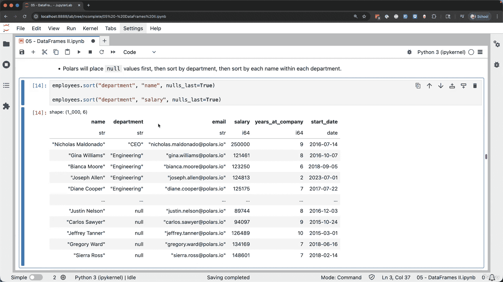

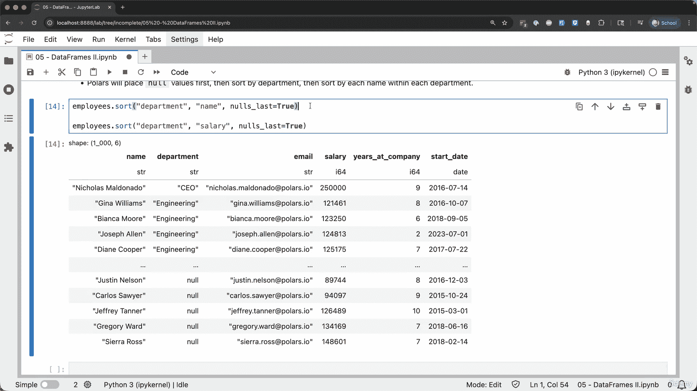

首先，我们可以不将字符串作为连续参数传入，而是将它们包裹在一个列表中。在这里我创建一个包含 `department` 和 `name` 的 Python 列表。再次提供 `nulls_last` 参数以保持简洁。这也是有效代码，将生成与上面完全相同的数据框。


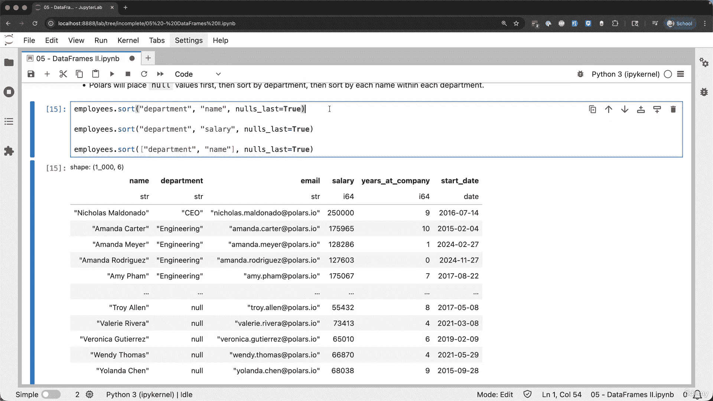

```python
df.sort(["department", "name"], nulls_last=True)
```


接下来我们可以做的是，用 Polars 表达式包裹这两列。我将在顶层调用 `pl.col` 函数，然后执行相同的操作。这样做没有特别的优势，但它是合法的语法。正如我们所见，我们再次先按 `department` 列值升序字母排序，然后对每个重复部门的 `name` 列值升序排序。正如之前所见，我们实际上可以创建一个自动针对多列的 Polars 表达式。


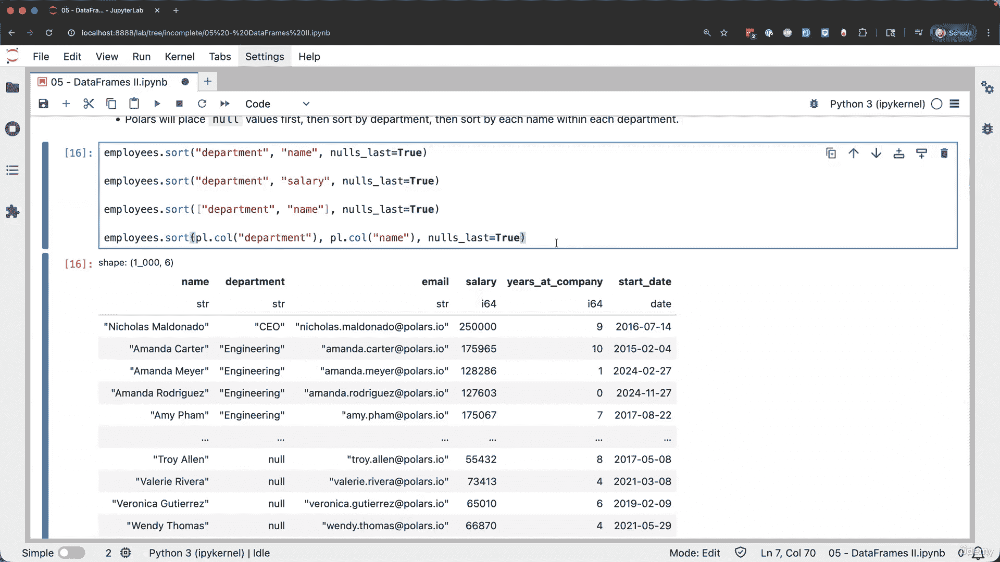

同样的逻辑适用于此，例如，我可以调用 `pl.col` 并依次指定 `department` 和 `name`。这创建了一个针对多列的表达式，但 Polars 也知道这是我们想要排序这些列的顺序序列。这里我再次提供 `nulls_last` 参数，将得到完全相同的结果。


```python
df.sort(pl.col("department", "name"), nulls_last=True)
```


非常重要的一点是，无论你使用哪种语法选项，提供这些值的顺序都很重要，因为我们指定的基本是先外层排序，后内层排序。如果我们反转这些值，让 `name` 排在前面，Polars 会先按 `name` 升序字母排序所有值，然后如果恰好有两个员工同名，Polars 再对这些员工对应的 `department` 进行升序排序。现在重复的部门比重复的姓名多得多，所以先按姓名排序再按部门排序可能没有特别大的好处，因为那里不会有太多部门排序的机会。这里的关键结论是：通常你会先按重复值或出现次数最多的列排序，然后在每个重复值（你可以将其视为一个类别，如 `Engineering` 部门、`Sales` 部门、`Marketing` 部门、空值类别）内部，再对另一列的值进行排序，这就是按多列排序的含义。


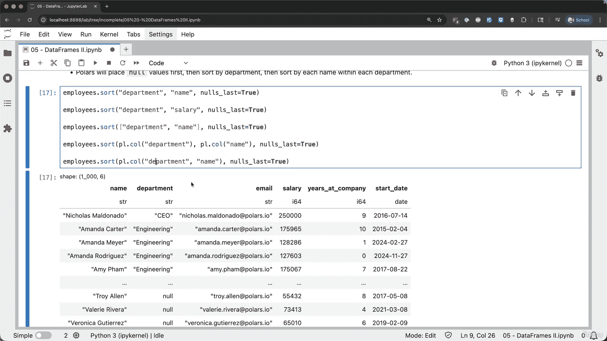

在本节课中，我们看到了 Polars 的默认行为，即每列都按升序排序。在下一节课中，我们将探讨如何按列自定义排序顺序。


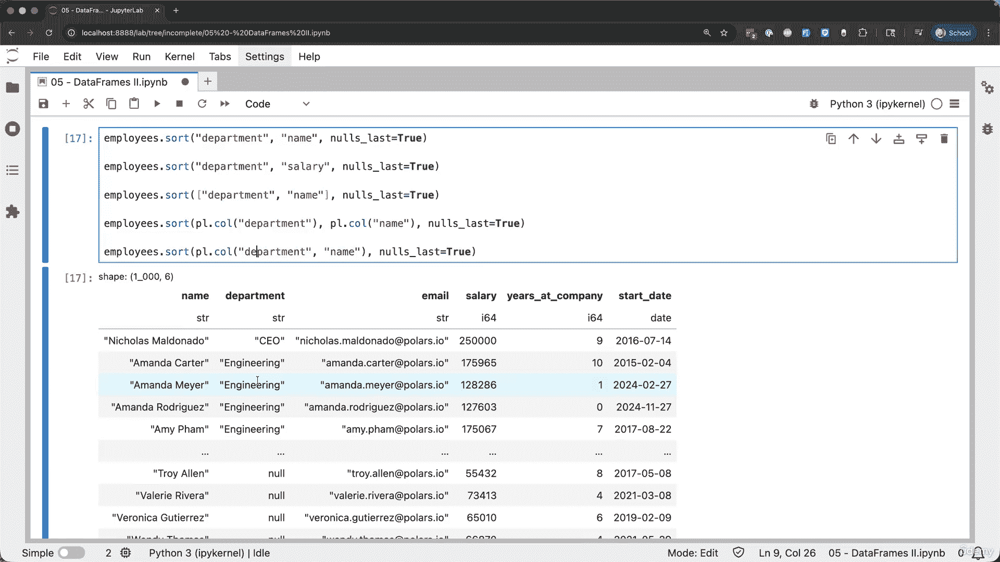

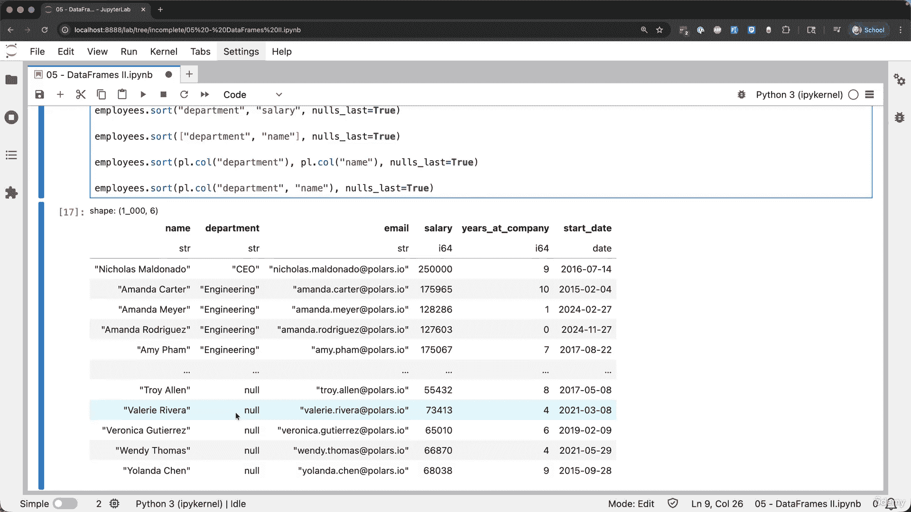

本节课中我们一起学习了如何在 Polars 中使用 `sort` 方法实现多列排序。我们掌握了三种主要语法：传入多个字符串参数、传入列表、以及使用 `pl.col` 表达式。我们深入理解了“先外层后内层”的排序逻辑，以及列顺序选择的策略（高基数列在前）。下一节我们将学习如何为每一列单独指定升序或降序，敬请期待。
